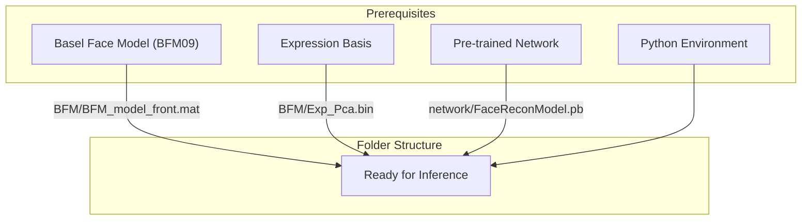
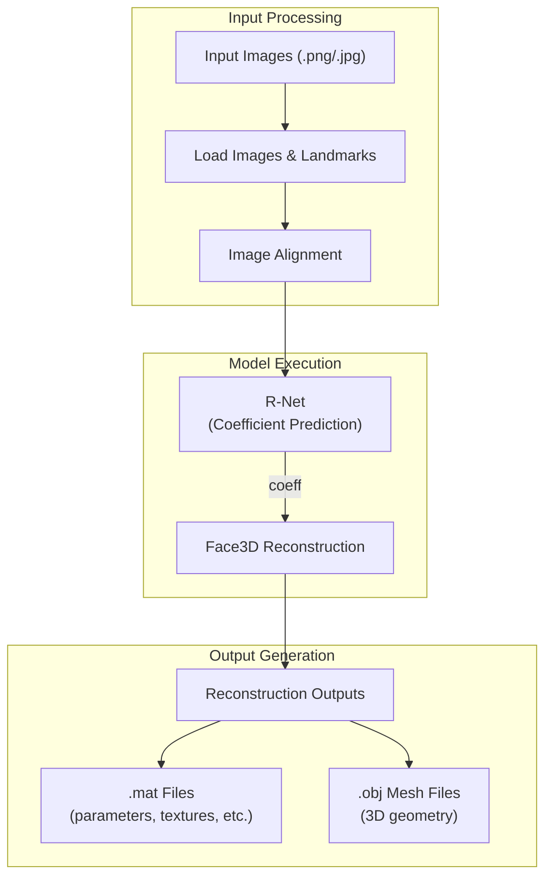
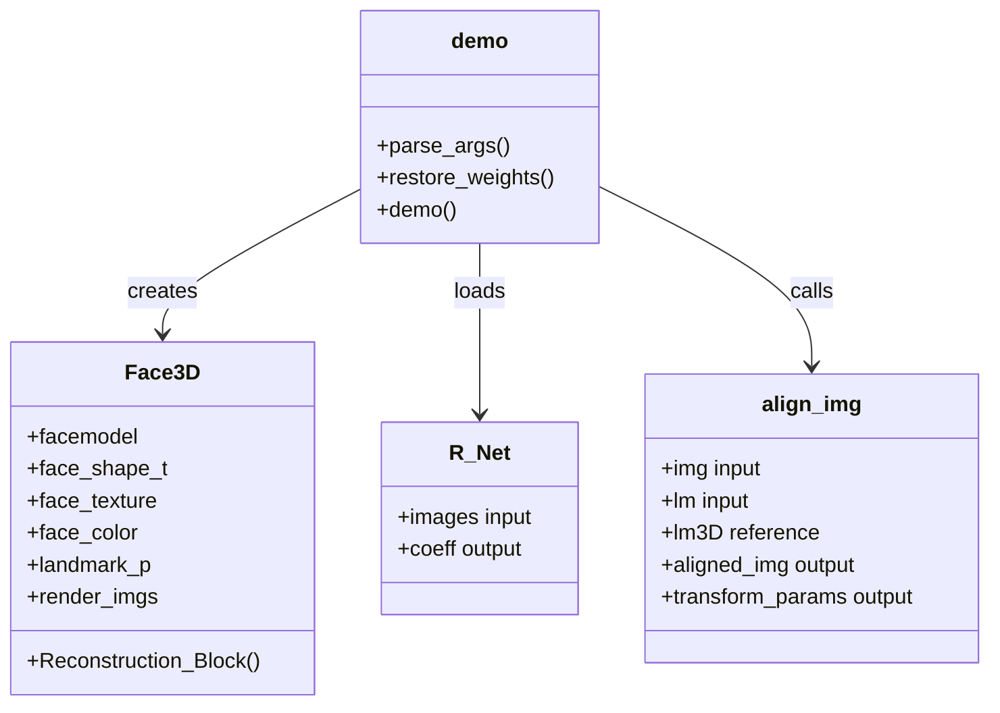
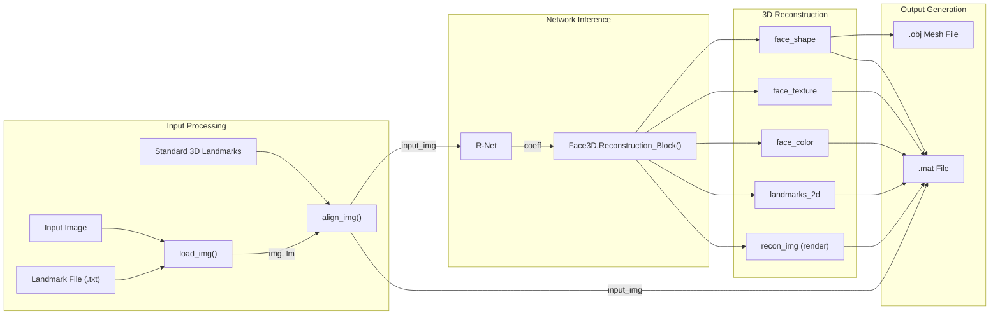

<!-- source: DeepWiki mcp.deepwiki.com · repo microsoft/Deep3DFaceReconstruction · page 3.1 Inference with demo.py · fetched 2026-10-26 -->

# Inference with demo.py

<details>
<summary>Relevant source files</summary>

The following files were used as context for generating this wiki page:

- [demo.py](demo.py)
- [images/albedo.png](images/albedo.png)
- [images/alignment.png](images/alignment.png)
- [images/example.png](images/example.png)
- [images/extreme.png](images/extreme.png)
- [readme.md](readme.md)

</details>


This page provides a detailed guide on using `demo.py` to perform 3D face reconstruction from single images using the pre-trained model. The document covers the prerequisites, execution workflow, command-line options, and output formats.

For information about training your own model, see [Training Pipeline](#3.2). For data preprocessing steps, see [Data Preprocessing](#3.3).

## Prerequisites

Before running inference with `demo.py`, ensure you have the following components in place:

1. **Basel Face Model (BFM09)**: The face model must be properly installed in the BFM subfolder
2. **Expression Basis**: The expression data transferred from Facewarehouse
3. **Pre-trained reconstruction network**: The FaceReconModel.pb file
4. **Python environment**: Setup with all required dependencies (tensorflow, numpy, etc.)



Sources: [readme.md:124-149]()

## Inference Workflow

When executed, `demo.py` follows a specific workflow to process input images and generate 3D face reconstructions:



Sources: [demo.py:40-123]()

### 1. Input Loading and Processing

The script first lists all PNG and JPG files in the `input` directory. For each image:

1. Loads the image and its corresponding landmark file (same name with .txt extension)
2. Aligns the face using the landmark information
3. Prepares the aligned image for network input

Sources: [demo.py:44-102]()

### 2. Model Execution

The system then performs the face reconstruction process:

1. Uses the pre-trained R-Net to predict 257-dimensional coefficients for the face
2. Feeds these coefficients to the Face3D module to reconstruct the 3D face shape, texture, and color
3. Computes facial landmarks from the 3D model

Sources: [demo.py:70-86](), [demo.py:104-113]()

### 3. Output Generation

Finally, the script generates and saves output files:

1. `.mat` files containing various reconstruction parameters and visualizations
2. `.obj` 3D mesh files representing the reconstructed face geometry

Sources: [demo.py:117-121]()

## Core Components

The inference process involves several key components that work together to perform face reconstruction:



Sources: [demo.py:10-14](), [demo.py:67-88]()

## Command-Line Options

`demo.py` supports the following command-line arguments:

| Argument | Type | Default | Description |
|----------|------|---------|-------------|
| `--pretrain_weights` | string | None | Path to pre-trained model weights (.ckpt file) |
| `--use_pb` | int | 1 | Whether to use pre-compiled .pb model file (1) or .ckpt checkpoint (0) |

Sources: [demo.py:17-25]()

## Execution Modes

The script supports two execution modes depending on the `use_pb` parameter:

### 1. Using Pre-Compiled Model (.pb)

This is the default mode, where the script loads the pre-compiled model from `network/FaceReconModel.pb`. This is the recommended approach for inference.

```
python demo.py
```

Sources: [demo.py:70-75]()

### 2. Using Checkpoint Model (.ckpt)

Alternatively, you can use a checkpoint file by specifying the path and setting `use_pb` to 0:

```
python demo.py --use_pb 0 --pretrain_weights path/to/checkpoint.ckpt
```

This mode is useful when testing custom-trained models.

Sources: [demo.py:76-79](), [demo.py:92-93]()

## Detailed Data Flow

The following diagram illustrates the detailed data flow during the inference process:



Sources: [demo.py:96-121]()

## Output Files

The script generates two types of output files for each processed image:

### 1. MAT Files (.mat)

Contains various reconstruction parameters and results:

| Field | Description |
|-------|-------------|
| `cropped_img` | RGB image after alignment (input to R-Net) |
| `recon_img` | RGBA reconstruction image aligned with the input (Linux only) |
| `coeff` | Output coefficients from R-Net (257 dimensions) |
| `face_shape` | Vertex positions of 3D face in world coordinate |
| `face_texture` | Vertex texture without lighting effect |
| `face_color` | Vertex color with lighting |
| `lm_68p` | 68 2D facial landmarks derived from 3D face |
| `lm_5p` | 5 detected landmarks aligned with cropped image |

Sources: [readme.md:140-149](), [demo.py:118-120]()

### 2. OBJ Files (.obj)

3D face mesh file in world coordinate, which can be viewed in 3D modeling software like MeshLab.

Sources: [readme.md:149-150](), [demo.py:121]()

## Practical Usage Examples

### Basic Usage

Run inference on all images in the `input` directory:

```
python demo.py
```

This will process all images and save outputs to the `output` directory.

### Using a Custom Model

To use your own trained model:

```
python demo.py --use_pb 0 --pretrain_weights ./result/my_model/model.ckpt
```

## Implementation Details

The core inference logic is implemented in the `demo()` function, which:

1. Creates the TensorFlow graph for inference
2. Sets up the Face3D reconstructor
3. Loads the pre-trained model
4. Processes each input image
5. Saves the reconstruction results

Sources: [demo.py:40-123]()

## Limitations and Notes

- The rendering process for visualization (recon_img) is only supported on Linux
- Image pre-alignment with 5 facial landmarks is necessary for accurate reconstruction
- The system assumes a pinhole camera model positioned at (0,0,10) in world coordinates
- The current model is trained with RGB scene illumination (not white light as in the paper)
- The model may give inferior results for images with severe perspective distortions or closed eyes

Sources: [readme.md:209-224]()

---

