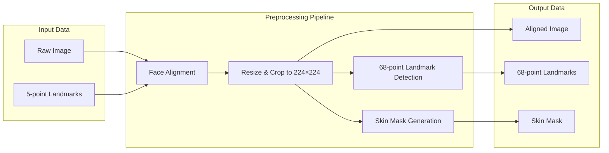
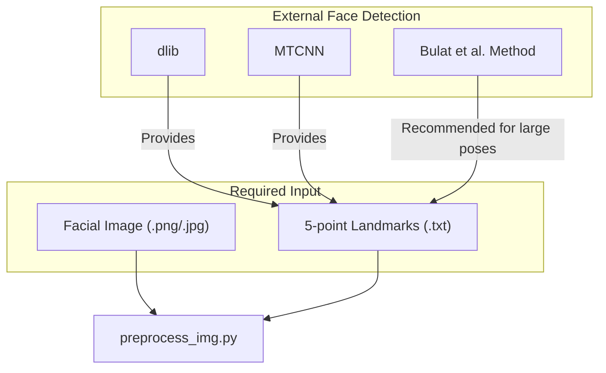
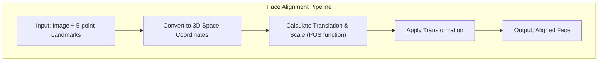
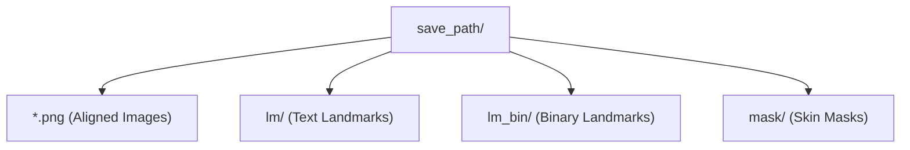
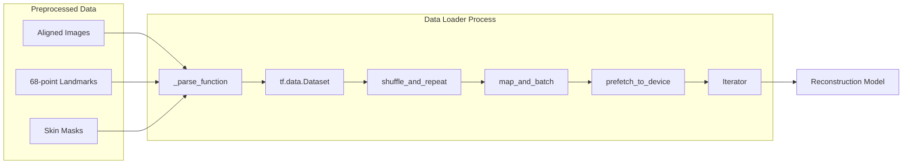
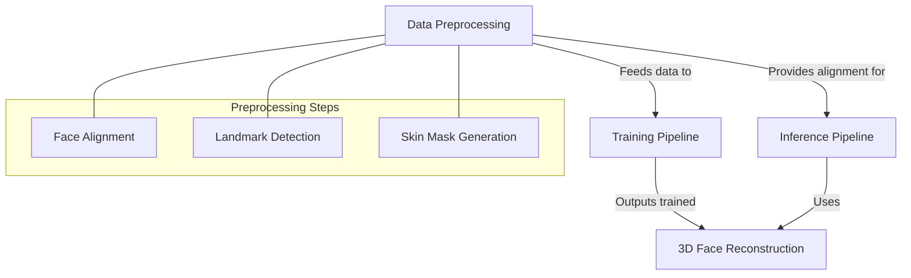

<!-- source: DeepWiki mcp.deepwiki.com · repo microsoft/Deep3DFaceReconstruction · page 3.3 Data Preprocessing · fetched 2026-10-26 -->

# Data Preprocessing

<details>
<summary>Relevant source files</summary>

The following files were used as context for generating this wiki page:

- [data_loader.py](data_loader.py)
- [images/example.png](images/example.png)
- [preprocess_img.py](preprocess_img.py)
- [readme.md](readme.md)

</details>


This page documents the data preprocessing pipeline used in the Deep3DFaceReconstruction system. The preprocessing stage is a critical component that prepares raw facial images for both training and inference. This document covers how images are aligned, how facial landmarks are detected, and how skin masks are generated - all essential steps before feeding data into the neural network for 3D face reconstruction.

For information about using the preprocessed data in training, see [Training Pipeline](#3.2).

## 1. Preprocessing Overview

The data preprocessing pipeline transforms raw facial images into a standardized format suitable for the reconstruction network. This process ensures that faces are properly aligned and normalized, which is crucial for achieving accurate reconstruction results.



Sources: [preprocess_img.py:108-149](), [readme.md:165-175]()

## 2. Input Requirements

Before preprocessing can begin, the system requires:

1. **Raw facial images** - Original images containing faces
2. **5-point facial landmarks** - Basic landmarks (typically eyes, nose, and mouth corners) for each image

The 5-point landmarks are crucial for the initial alignment process and must be detected beforehand using external face detection tools.



Sources: [readme.md:165-175](), [preprocess_img.py:136]()

### 2.1 Input Format Requirements

The preprocessing script expects:

- Images in PNG or JPG format
- 5-point landmark files with the same name as the corresponding image but with a .txt extension
- Landmark coordinates should be in the 2D image coordinate system

## 3. Preprocessing Steps

### 3.1 Face Alignment

The alignment process is the first and most critical step in preprocessing. It transforms faces into a canonical pose and scale, which is essential for consistent reconstruction results.

The alignment solves a least square problem between:
- 5 facial landmarks detected on the input image
- 5 standard facial landmarks of the BFM09 average 3D face



Sources: [preprocess_img.py:14-36](), [preprocess_img.py:61-76]()

#### 3.1.1 Technical Details of Alignment

The alignment uses the `POS` function to calculate:
- **Translation vector (t)** - Controls the position of the face
- **Scale factor (s)** - Controls the size of the face

The function solves a least squares problem to find the best transformation parameters that map the input landmarks to the standard landmarks.

```
t, s = POS(lm.transpose(), lm3D.transpose())
```

After determining these parameters, the image is resized and cropped to 224×224 pixels using the `resize_n_crop_img` function.

Sources: [preprocess_img.py:14-36](), [preprocess_img.py:39-57]()

### 3.2 68-point Landmark Detection

After alignment, a pre-trained landmark detector is used to detect 68 facial landmarks on the aligned image. These landmarks are more detailed than the initial 5-point landmarks and are used during training for landmark loss computation.

The landmark detector is loaded from a pre-trained model:
```
lm_detector = load_graph(os.path.join('network','landmark68_detector.pb'))
```

The detection is performed using TensorFlow:
```
landmark = sess.run(lm, feed_dict={input_img:img})
```

Sources: [preprocess_img.py:79-88](), [readme.md:157]()

### 3.3 Skin Mask Generation

The final preprocessing step involves generating a skin mask for each aligned image. The skin mask identifies pixels corresponding to facial skin and is used during training to focus on skin regions during optimization.

The skin detection is performed using the `skinmask` function from the `skin.py` module:
```
skin_img = skinmask(img)
```

Sources: [preprocess_img.py:91-95]()

## 4. Output Structure

The preprocessing pipeline generates the following outputs:

| Output | Description | Format | Location |
|--------|-------------|--------|----------|
| Aligned Images | Face images aligned and cropped to 224×224 pixels | PNG | `save_path/*.png` |
| 68-point Landmarks (Text) | 68 facial landmarks in text format | TXT | `save_path/lm/*.txt` |
| 68-point Landmarks (Binary) | 68 facial landmarks in binary format | BIN | `save_path/lm_bin/*.bin` |
| Skin Masks | Binary masks identifying skin regions | PNG | `save_path/mask/*.png` |

These outputs are organized in a directory structure that is expected by the data loader during training.



Sources: [preprocess_img.py:113-120](), [preprocess_img.py:143-148]()

## 5. Data Loader Integration

The preprocessed data is loaded during training using the `data_loader.py` script. The data loader:
1. Creates TensorFlow datasets from the preprocessed files
2. Applies batching, shuffling, and prefetching operations for efficient training
3. Provides an iterator to access batches of preprocessed data



Sources: [data_loader.py:10-29](), [data_loader.py:39-75]()

## 6. Using the Preprocessing Script

### 6.1 Command Line Arguments

The preprocessing script (`preprocess_img.py`) accepts the following command-line arguments:

| Argument | Description | Default |
|----------|-------------|---------|
| `--img_path` | Path to the folder containing input images and landmarks | `./input` |
| `--save_path` | Path where preprocessed data will be saved | `./processed_data` |

Sources: [preprocess_img.py:97-105]()

### 6.2 Example Usage

Basic usage with default parameters:
```bash
python preprocess_img.py
```

Custom input and output paths:
```bash
python preprocess_img.py --img_path /path/to/raw/images --save_path /path/to/save/processed/data
```

Sources: [preprocess_img.py:150-151](), [readme.md:170-174]()

## 7. Important Implementation Notes

1. **Image Coordinate System**: The implementation converts between different coordinate systems. In particular, when loading landmarks, it flips the y-coordinate to convert from image plane coordinates to 3D space coordinates.

2. **Landmark File Formats**: The system supports both text (TXT) and binary (BIN) formats for landmarks. Binary files are generated for faster loading during training.

3. **BGR Color Order**: The system uses BGR color order (instead of RGB) as is common in computer vision libraries like OpenCV.

4. **GPU Requirement**: The preprocessing script uses GPU (device '/gpu:0') for landmark detection to accelerate the process.

Sources: [preprocess_img.py:65-66](), [preprocess_img.py:127-130](), [preprocess_img.py:52-53]()

## 8. Relationship to Overall System

The preprocessing pipeline is a critical preliminary step in both training and inference workflows. It ensures that input faces are consistently aligned and normalized, which is essential for accurate 3D reconstruction.



Sources: [readme.md:165-175](), [readme.md:125-139]()

## 9. Potential Issues and Recommendations

1. **Large Pose Images**: Traditional 2D detectors may return incorrect 5-point landmarks for faces with large poses. The readme recommends using the method of Bulat et al. to get facial landmarks with semantic consistency for large pose images.

2. **Alignment Quality**: Poor alignment can significantly impact reconstruction accuracy. Careful verification of the alignment results is recommended.

3. **Preprocessing Dependencies**: The preprocessing requires specific dependencies including TensorFlow and a pre-trained landmark detector model.

Sources: [readme.md:210-211]()

---

