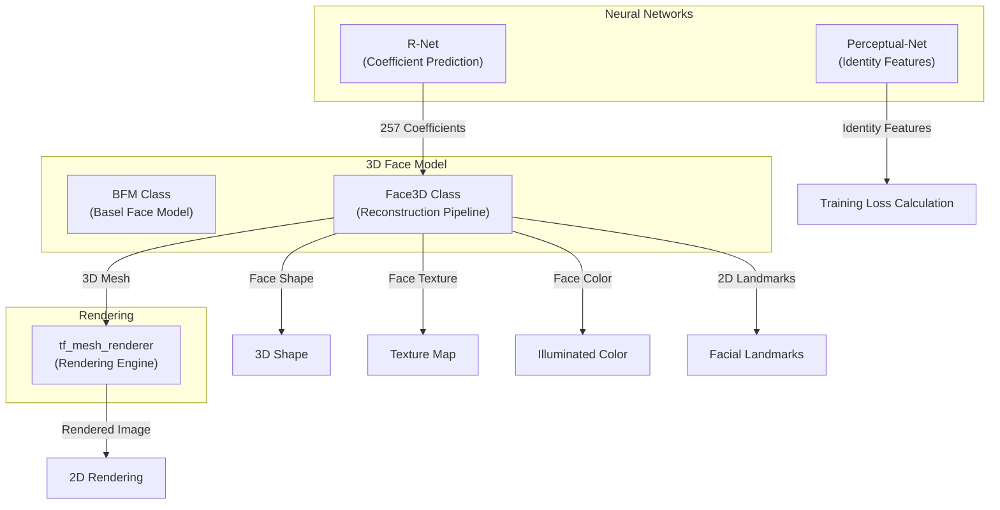
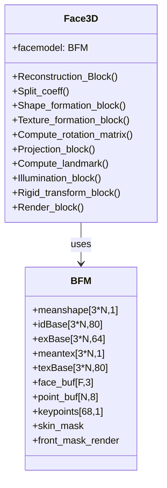
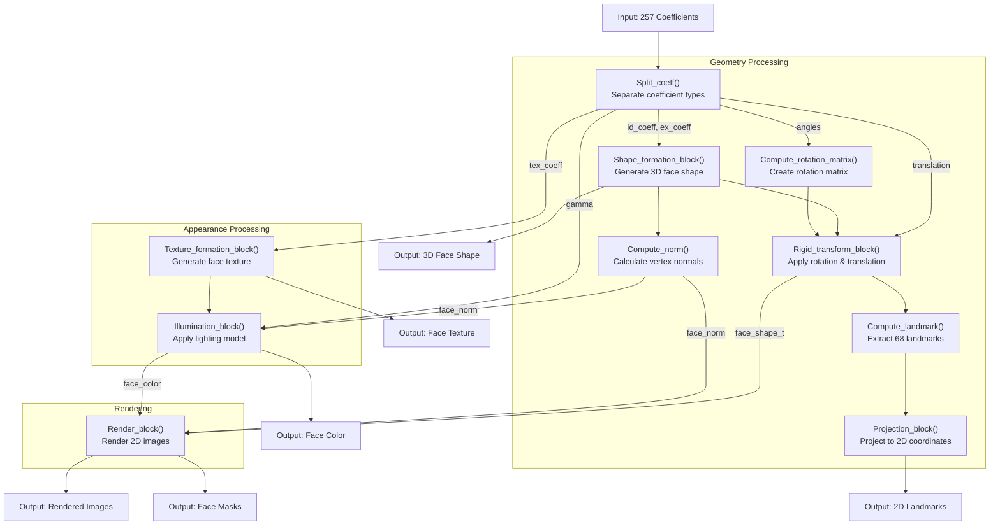
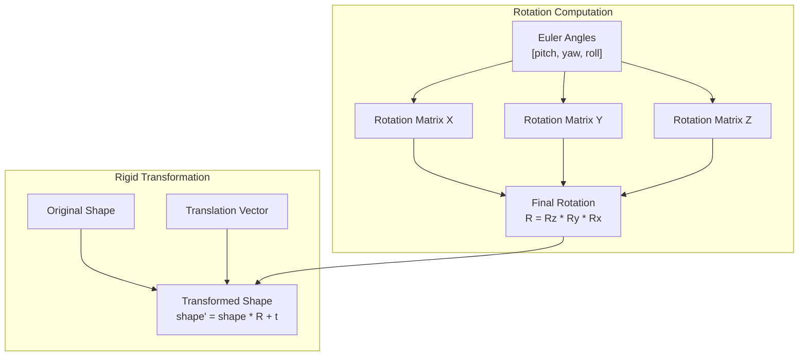
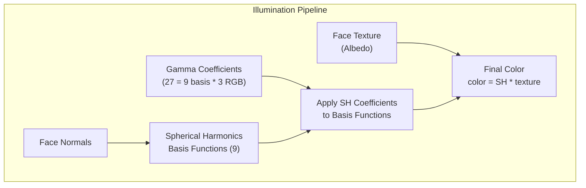
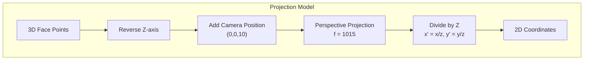
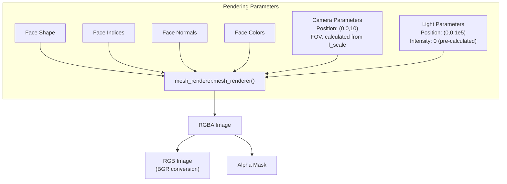
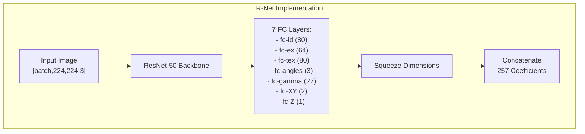
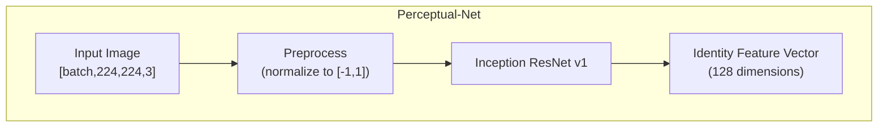

<!-- source: DeepWiki mcp.deepwiki.com · repo microsoft/Deep3DFaceReconstruction · page 4 Technical Details · fetched 2026-10-26 -->

# Technical Details

<details>
<summary>Relevant source files</summary>

The following files were used as context for generating this wiki page:

- [face_decoder.py](face_decoder.py)
- [losses.py](losses.py)
- [networks.py](networks.py)

</details>


This document provides a detailed technical examination of the Deep3DFaceReconstruction system implementation. Here we focus on the core algorithms, mathematical formulations, and implementation details that power the 3D face reconstruction pipeline. For information about specific loss functions used in training, see [Loss Functions](#4.1). For details on data loading mechanisms, see [Data Loader and Batching](#4.2). For configuration parameters, see [Configuration Options](#4.3).

## Core Technical Components

Deep3DFaceReconstruction implements a pipeline that reconstructs 3D face models from single images using a combination of deep learning and 3D morphable models. The system consists of several key technical components.



Sources: [networks.py:9-63](), [face_decoder.py:16-29](), [face_decoder.py:32-345]()

## Face Model Representation

The system uses the Basel Face Model (BFM), implemented as the `BFM` class, which provides a parametric representation of 3D face shape and texture.



Sources: [face_decoder.py:16-29](), [face_decoder.py:32-37]()

### Coefficient System

The neural network (R-Net) predicts 257 coefficients that control different aspects of the 3D face model:

| Coefficient Group | Size | Description | Code Location |
|-------------------|------|-------------|--------------|
| Identity (id_coeff) | 80 | Controls face shape identity | [networks.py:17-21]() |
| Expression (ex_coeff) | 64 | Controls facial expression | [networks.py:22-26]() |
| Texture (tex_coeff) | 80 | Controls face albedo/texture | [networks.py:27-31]() |
| Angles | 3 | Controls 3D rotation (Euler angles) | [networks.py:32-36]() |
| Gamma | 27 | Controls illumination (spherical harmonics) | [networks.py:37-41]() |
| Translation | 3 | Controls 3D position (x,y,z) | [networks.py:42-51]() |

These coefficients are extracted from the R-Net output and processed in the `Split_coeff` method:

Sources: [face_decoder.py:80-91](), [networks.py:9-63]()

## Reconstruction Pipeline

The core reconstruction process is implemented in the `Face3D.Reconstruction_Block` method, which transforms the predicted coefficients into a complete 3D face representation.



Sources: [face_decoder.py:38-77]()

## Mathematical Formulations

### Shape and Texture Formation

The 3D face shape and texture are generated using linear combinations of base components:

```
face_shape = meanshape + id_coeff * idBase + ex_coeff * exBase
face_texture = meantex + tex_coeff * texBase
```

Where:
- `meanshape` and `meantex` are the average face shape and texture
- `idBase` and `texBase` are identity basis vectors (80 dimensions)
- `exBase` is the expression basis (64 dimensions)
- `id_coeff`, `ex_coeff`, and `tex_coeff` are the predicted coefficients

Sources: [face_decoder.py:93-102](), [face_decoder.py:130-136]()

### Rotation and Transformation

The system computes a 3D rotation matrix using Euler angles (X, Y, Z) and applies rigid transformation:



Sources: [face_decoder.py:138-183](), [face_decoder.py:256-261]()

### Illumination Model

The system uses Spherical Harmonics (SH) illumination modeling with 9 basis functions for each RGB channel:



The implementation computes the 9 SH basis functions based on vertex normals and applies the gamma coefficients to control the illumination for each RGB channel.

Sources: [face_decoder.py:221-254]()

### Projection Model

The system implements a pinhole camera model with perspective projection:



Sources: [face_decoder.py:185-209]()

## Rendering System

The system uses TensorFlow Mesh Renderer to generate 2D images from the 3D face model:



The rendering process generates both a colored image of the face and a mask indicating the face region. During training, it also creates a crop mask for the central face region.

Sources: [face_decoder.py:263-345]()

## R-Net Architecture

The R-Net neural network predicts the 257 coefficients used for face reconstruction:



The network uses a standard ResNet-50 architecture as the backbone, followed by specialized fully connected layers for different coefficient types. All FC layers are initialized with zeros to start with a neutral face.

Sources: [networks.py:9-63]()

## Perceptual Network

The Perceptual-Net extracts identity features used for calculating perceptual loss during training:



The Perceptual-Net uses a pre-trained Inception ResNet v1 architecture to extract 128-dimensional identity features for each face.

Sources: [networks.py:66-87]()

## Technical Implementation Notes

### Platform-Specific Considerations

The rendering system has platform-specific implementations:
- On Windows, rendering functionality is limited (rendering is skipped during training)
- On other platforms, the full rendering pipeline is available

Sources: [face_decoder.py:7-14](), [face_decoder.py:263-268]()

### Computational Optimizations

The system includes several computational optimizations:
1. Normal computation uses a one-ring neighborhood approach for efficiency
2. Face region masks are pre-computed to focus computation on relevant areas
3. CPU-specific operations are explicitly placed on the CPU device

Sources: [face_decoder.py:104-128](), [face_decoder.py:297-337]()

## Summary

The Deep3DFaceReconstruction system implements a technically sophisticated pipeline combining deep learning with 3D morphable models. The R-Net predicts coefficients that control face shape, expression, texture, pose, and illumination. These coefficients drive the Face3D reconstruction pipeline, which generates a complete 3D face model and renders it for comparison with the input image during training and visualization during inference.

For additional technical details, refer to the specialized pages on [Loss Functions](#4.1), [Data Loader and Batching](#4.2), and [Configuration Options](#4.3).

---

