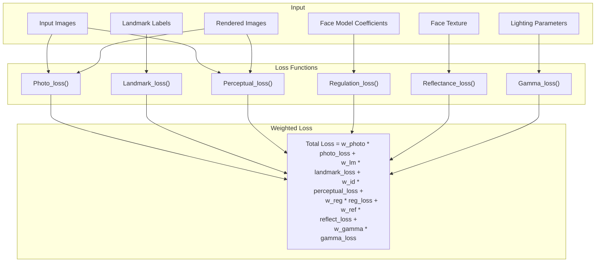
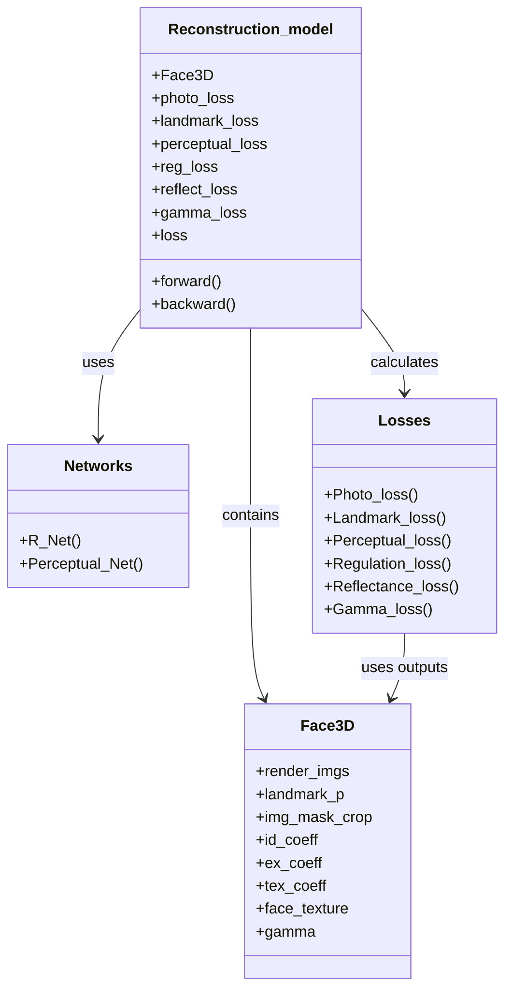
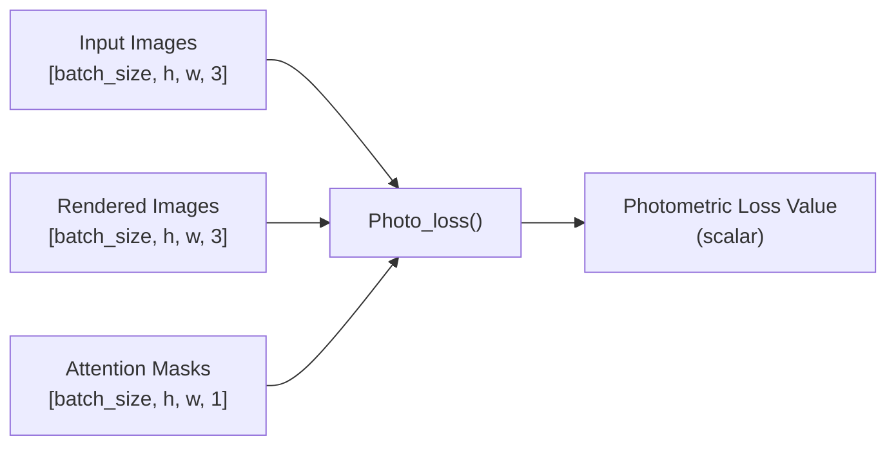
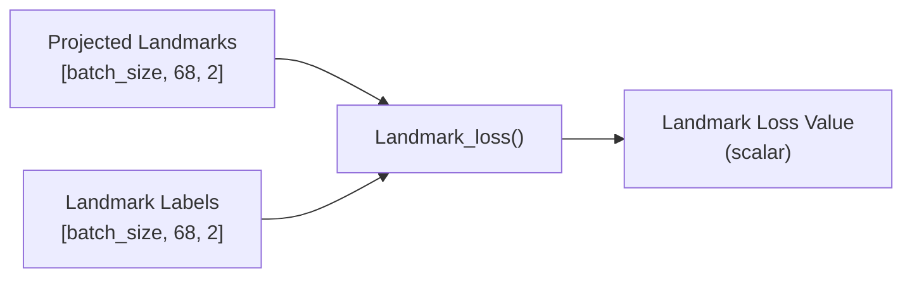
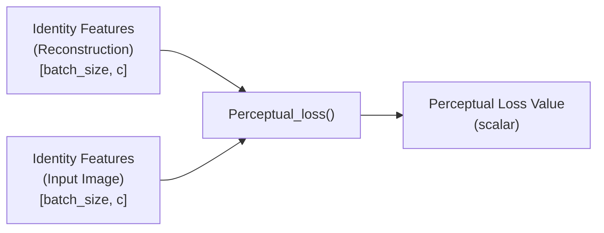
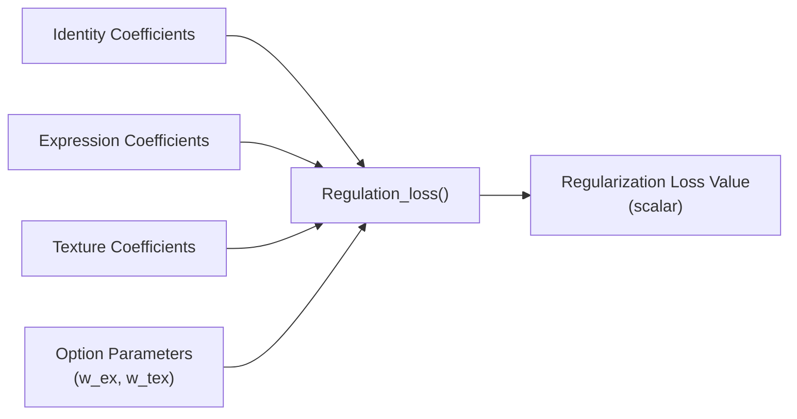
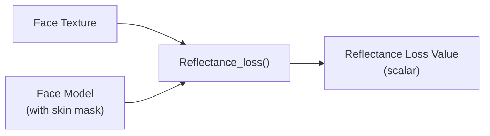
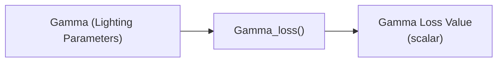
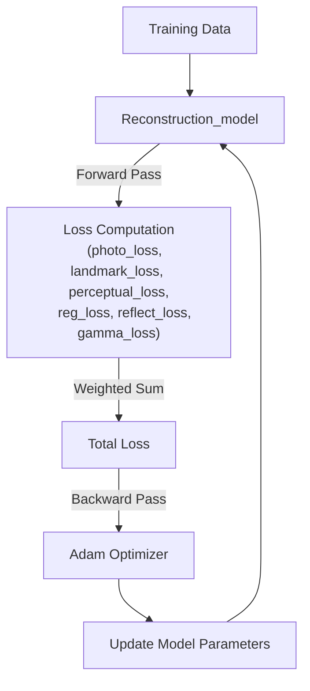

<!-- source: DeepWiki mcp.deepwiki.com · repo microsoft/Deep3DFaceReconstruction · page 4.1 Loss Functions · fetched 2026-10-26 -->

# Loss Functions

<details>
<summary>Relevant source files</summary>

The following files were used as context for generating this wiki page:

- [losses.py](losses.py)
- [options.py](options.py)
- [reconstruction_model.py](reconstruction_model.py)
- [train.py](train.py)

</details>


This document provides a detailed explanation of the loss functions used during training in the Deep3DFaceReconstruction system. Loss functions are crucial components that guide the optimization process, ensuring that the reconstructed 3D face models accurately reflect the input images in terms of appearance, geometry, and identity.

For information on the training pipeline itself, see [Training Pipeline](#3.2).

## Overview of Loss Components

The training process uses a composite loss function that combines six different components, each addressing a specific aspect of face reconstruction. These components work together to ensure high-quality, realistic 3D face reconstructions.



Sources: [losses.py:1-76](), [reconstruction_model.py:30-41]()

## Loss Function Architecture

The loss functions work in conjunction with the reconstruction model and 3D face decoder to drive the optimization process. The following diagram illustrates how the loss components interact with other parts of the system:



Sources: [reconstruction_model.py:1-86](), [losses.py:1-76]()

## Loss Components in Detail

### 1. Photometric Loss

The photometric loss measures the pixel-wise difference between the input image and the rendered image. It ensures that the reconstructed 3D face, when rendered, visually matches the input image.



**Implementation Details:**
- Calculates the squared difference between input and rendered images
- Takes the square root of the sum of squared differences
- Applies an attention mask to focus on facial regions
- Normalizes by the sum of the mask values
- Weight in total loss: `w_photo = 1.92`

**Code Implementation:**
```python
def Photo_loss(input_imgs, render_imgs, img_mask):
    input_imgs = tf.cast(input_imgs, tf.float32)
    img_mask = tf.stop_gradient(img_mask[:,:,:,0])
    
    # photo loss with skin attention
    photo_loss = tf.sqrt(tf.reduce_sum(tf.square(input_imgs - render_imgs), axis=3)) * img_mask / 255
    photo_loss = tf.reduce_sum(photo_loss) / tf.maximum(tf.reduce_sum(img_mask), 1.0)
    
    return photo_loss
```

Sources: [losses.py:7-21](), [options.py:36]()

### 2. Landmark Loss

The landmark loss ensures that the 2D projections of the 3D facial landmarks align with the detected landmarks in the input image. This helps achieve correct geometric alignment.



**Implementation Details:**
- Calculates the squared difference between predicted and ground truth landmarks
- Applies different weights to different landmark regions (higher weights for mouth and nose)
- Normalizes by the number of landmarks (68) and batch size
- Weight in total loss: `w_lm = 1.6e-3`

**Code Implementation:**
```python
def Landmark_loss(landmark_p, landmark_label):
    # Higher weights for landmarks around the mouth and nose regions
    landmark_weight = tf.concat([tf.ones([1,28]), 20*tf.ones([1,3]), 
                                tf.ones([1,29]), 20*tf.ones([1,8])], axis=1)
    landmark_weight = tf.tile(landmark_weight, [tf.shape(landmark_p)[0], 1])
    
    landmark_loss = tf.reduce_sum(tf.reduce_sum(tf.square(landmark_p-landmark_label), 2) * landmark_weight) / 
                    (68.0 * tf.cast(tf.shape(landmark_p)[0], tf.float32))
    
    return landmark_loss
```

Sources: [losses.py:34-44](), [options.py:37]()

### 3. Perceptual (Identity) Loss

The perceptual loss ensures that the identity features of the reconstructed face match those of the input face. It uses a pre-trained FaceNet to extract identity features.



**Implementation Details:**
- Normalizes feature vectors to unit length
- Calculates cosine similarity between feature vectors
- Converts similarity to a loss by subtracting from 1 and truncating at 0
- Normalizes by batch size
- Weight in total loss: `w_id = 0.2`

**Code Implementation:**
```python
def Perceptual_loss(id_feature, id_label):
    id_feature = tf.nn.l2_normalize(id_feature, dim=1)
    id_label = tf.nn.l2_normalize(id_label, dim=1)
    # cosine similarity
    sim = tf.reduce_sum(id_feature * id_label, 1)
    loss = tf.reduce_sum(tf.maximum(0.0, 1.0 - sim)) / tf.cast(tf.shape(id_feature)[0], tf.float32)
    
    return loss
```

Sources: [losses.py:23-32](), [options.py:38]()

### 4. Regularization Loss

The regularization loss prevents the model coefficients from taking extreme values, ensuring plausible 3D face reconstructions.



**Implementation Details:**
- Applies L2 regularization to identity, expression, and texture coefficients
- Uses different weights for expression (`w_ex = 0.8`) and texture (`w_tex = 1.7e-2`) coefficients
- Normalizes by batch size
- Weight in total loss: `w_reg = 3.0e-4`

**Code Implementation:**
```python
def Regulation_loss(id_coeff, ex_coeff, tex_coeff, opt):
    w_ex = opt.w_ex
    w_tex = opt.w_tex
    
    regulation_loss = tf.nn.l2_loss(id_coeff) + w_ex * tf.nn.l2_loss(ex_coeff) + w_tex * tf.nn.l2_loss(tex_coeff)
    regulation_loss = 2 * regulation_loss / tf.cast(tf.shape(id_coeff)[0], tf.float32)
    
    return regulation_loss
```

Sources: [losses.py:46-54](), [options.py:40](), [options.py:45-46]()

### 5. Reflectance Loss

The reflectance loss ensures uniform skin albedo, which helps achieve more realistic face textures.



**Implementation Details:**
- Uses a pre-defined skin mask to identify skin regions
- Calculates the mean texture for skin regions
- Minimizes variance of texture in skin regions
- Normalizes by batch size and skin mask size
- Weight in total loss: `w_ref = 5.0`

**Code Implementation:**
```python
def Reflectance_loss(face_texture, facemodel):
    skin_mask = facemodel.skin_mask
    skin_mask = tf.reshape(skin_mask, [1, tf.shape(skin_mask)[0], 1])
    
    texture_mean = tf.reduce_sum(face_texture * skin_mask, 1) / tf.reduce_sum(skin_mask)
    texture_mean = tf.expand_dims(texture_mean, 1)
    
    # Minimize texture variance for pre-defined skin region
    reflectance_loss = tf.reduce_sum(tf.square((face_texture - texture_mean) * skin_mask / 255.0)) / 
                       (tf.cast(tf.shape(face_texture)[0], tf.float32) * tf.reduce_sum(skin_mask))
    
    return reflectance_loss
```

Sources: [losses.py:56-67](), [options.py:41]()

### 6. Gamma Loss

The gamma loss ensures nearly-monochromatic lighting, which helps achieve more natural illumination in the reconstructed face.



**Implementation Details:**
- Reshapes gamma parameter to [batch_size, 3, 9]
- Calculates mean across the second dimension
- Minimizes variance from the mean
- Weight in total loss: `w_gamma = 10.0`

**Code Implementation:**
```python
def Gamma_loss(gamma):
    gamma = tf.reshape(gamma, [-1, 3, 9])
    gamma_mean = tf.reduce_mean(gamma, 1, keep_dims=True)
    
    gamma_loss = tf.reduce_mean(tf.square(gamma - gamma_mean))
    
    return gamma_loss
```

Sources: [losses.py:69-75](), [options.py:43]()

## Loss Function Integration

The total loss is a weighted sum of all six loss components, with weights defined in the `options.py` file. These weights balance the different aspects of face reconstruction:

| Loss Component | Weight Parameter | Default Value |
|----------------|------------------|--------------|
| Photometric Loss | `w_photo` | 1.92 |
| Landmark Loss | `w_lm` | 1.6e-3 |
| Perceptual Loss | `w_id` | 0.2 |
| Regularization Loss | `w_reg` | 3.0e-4 |
| Reflectance Loss | `w_ref` | 5.0 |
| Gamma Loss | `w_gamma` | 10.0 |

The total loss is computed in the `forward` method of the `Reconstruction_model` class:

```python
self.loss = self.opt.w_photo * self.photo_loss + self.opt.w_lm * self.landmark_loss + 
            self.opt.w_id * self.perceptual_loss + self.opt.w_reg * self.reg_loss + 
            self.opt.w_ref * self.reflect_loss + self.opt.w_gamma * self.gamma_loss
```

This total loss guides the optimization of the face model coefficients during training.

Sources: [reconstruction_model.py:40-41](), [options.py:36-43]()

## Loss Computation in Training Pipeline

During training, loss values are computed and used to update the model parameters. The following diagram illustrates how loss computation fits into the training pipeline:



In each training iteration, all loss components are computed and logged. Their values are printed and also saved to TensorBoard for monitoring:

```python
_,ph_loss,lm_loss,id_loss = sess.run([train_op, photo_error, lm_error, id_error])
print('Iter: %d; lm_loss: %f; photo_loss: %f; id_loss: %f\n' % (i, np.sqrt(lm_loss), ph_loss, id_loss))
```

Summary statistics are also created to visualize the loss values during training:

```python
stat = [
    tf.summary.scalar('reflect_error', self.reflect_loss),
    tf.summary.scalar('gamma_error', self.gamma_loss),
    tf.summary.scalar('id_sim_error', self.perceptual_loss),
    tf.summary.scalar('lm_error', tf.sqrt(self.landmark_loss)),
    tf.summary.scalar('photo_error', self.photo_loss),
    tf.summary.scalar('train_error', self.loss),
    # ...
]
```

Sources: [train.py:117-118](), [reconstruction_model.py:68-77]()

## Conclusion

The loss functions in Deep3DFaceReconstruction work together to ensure high-quality, realistic 3D face reconstructions. Each loss component addresses a specific aspect of the reconstruction process:

1. Photometric Loss - Ensures visual similarity between input and rendered images
2. Landmark Loss - Ensures geometric alignment of facial features
3. Perceptual Loss - Ensures identity preservation
4. Regularization Loss - Ensures plausible face model coefficients
5. Reflectance Loss - Ensures uniform skin albedo
6. Gamma Loss - Ensures natural illumination

The weights of these loss components are carefully tuned to balance different reconstruction aspects, resulting in realistic and accurate 3D face reconstructions from single images.

---

