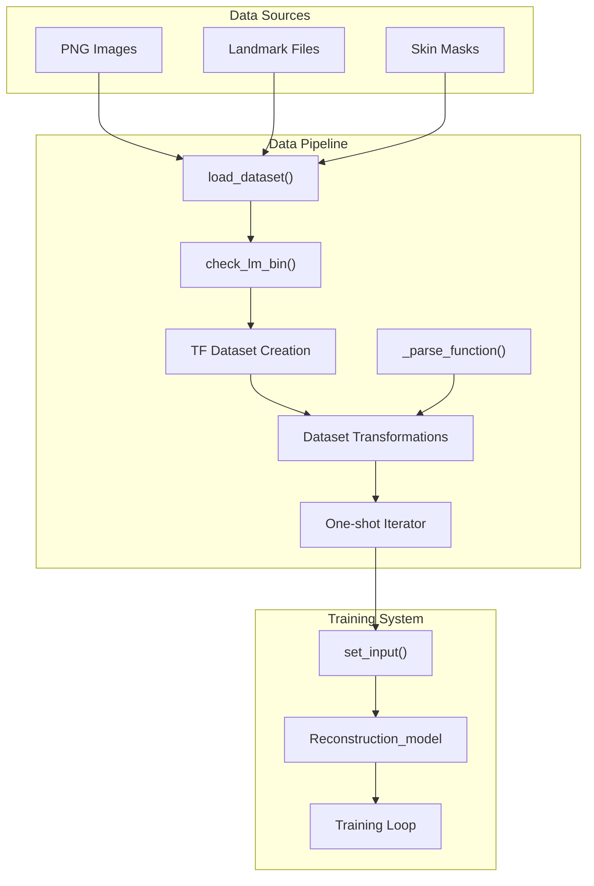
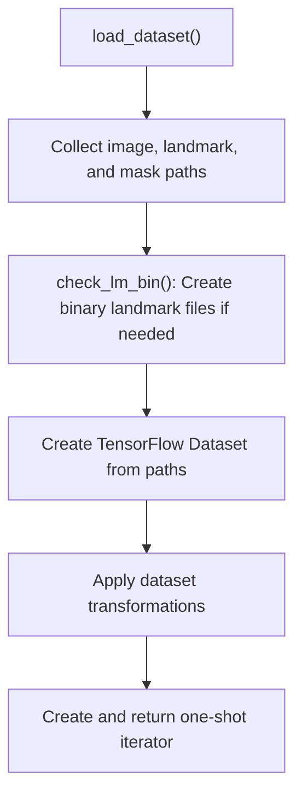

<!-- source: DeepWiki mcp.deepwiki.com · repo microsoft/Deep3DFaceReconstruction · page 4.2 Data Loader and Batching · fetched 2026-10-26 -->

# Data Loader and Batching

<details>
<summary>Relevant source files</summary>

The following files were used as context for generating this wiki page:

- [data_loader.py](data_loader.py)
- [options.py](options.py)
- [train.py](train.py)

</details>


This document describes the data loading and batching system used in the Deep3DFaceReconstruction framework. It covers how the training and validation data is loaded, processed, and fed into the model during the training process. For information about the training pipeline as a whole, see [Training Pipeline](#3.2). For details about data preprocessing before training, see [Data Preprocessing](#3.3).

## Overview

The data loader is responsible for efficiently feeding batches of processed face images, facial landmarks, and skin masks to the reconstruction model during training. The system utilizes TensorFlow's Dataset API for efficient pipeline creation, data shuffling, batching, and prefetching.



Sources: [data_loader.py:1-76](), [train.py:79-84]()

## Data Structure and Sources

The data loader expects a specific directory structure for the training and validation data. The data paths are configured in the Options class.

### Directory Structure

```
processed_data/
├── *.png                 # Aligned face images
├── lm/
│   └── *.txt             # Original landmark files (68 points, 2D coordinates)
├── lm_bin/
│   └── *.bin             # Binary landmark files (created automatically)
└── mask/
    └── *.png             # Skin masks
```

The dataset paths are specified in the Options class, with the default being `./processed_data` for both training and validation data. Multiple dataset paths can be provided as a list.

Sources: [data_loader.py:39-64](), [options.py:16-17]()

## Data Loading Pipeline

### Loading Data Paths

The `load_dataset` function is the main entry point for the data loading process. It takes an options object and a boolean flag indicating whether to load training or validation data.



The function collects image paths, landmark paths, and mask paths from the specified directories, checks if binary landmark files exist (creating them if necessary), and then creates a TensorFlow Dataset from these paths.

Sources: [data_loader.py:39-75]()

### Converting Text Landmarks to Binary Format

Before creating the dataset, the system checks if binary versions of the landmark files exist. If not, it creates them using the `check_lm_bin` function. This conversion improves loading efficiency during training.

```python
def check_lm_bin(dataset, lm_path):
    if not os.path.isdir(os.path.join(dataset, 'lm_bin')):
        os.makedirs(os.path.join(dataset, 'lm_bin'))
        for i in range(len(lm_path)):
            lm = np.loadtxt(lm_path[i])
            lm = np.reshape(lm, [-1])
            lm.tofile(os.path.join(dataset, 'lm_bin', lm_path[i].split('/')[-1].replace('txt', 'bin')))
```

Sources: [data_loader.py:31-37]()

### Parsing Input Data

The `_parse_function` is applied to each data sample to load and preprocess the images, landmarks, and masks:

1. **Image Processing**:
   - Loads PNG image files
   - Converts to float32 format
   - Reverses the color channels (BGR to RGB)

2. **Landmark Processing**:
   - Loads binary landmark data
   - Converts to float32 format
   - Reshapes to 68x2 (68 landmarks with x, y coordinates)

3. **Mask Processing**:
   - Loads PNG mask files
   - Converts to float32 format

Sources: [data_loader.py:10-29]()

## Dataset Transformations

After creating the dataset from file paths, several transformations are applied to prepare the data for efficient training:


The transformations include:

1. **Shuffle and Repeat**: The dataset is shuffled and repeated indefinitely to ensure random batch composition across training epochs.

2. **Map and Batch**: The `_parse_function` is applied to each sample, and the samples are grouped into batches of size defined in the options (default: 16). Parallel batching is used for efficiency.

3. **Prefetch to Device**: Data is prefetched to the GPU to overlap data preparation with model execution, optimizing training throughput.

The code snippet for these transformations is:

```python
dataset = dataset. \
apply(shuffle_and_repeat(dataset_num)). \
apply(map_and_batch(_parse_function, opt.batch_size, num_parallel_batches=4, drop_remainder=True)). \
apply(prefetch_to_device('/gpu:0', None))
```

Sources: [data_loader.py:69-72](), [options.py:48]()

## Integration with Training Pipeline

The data loader is integrated with the training pipeline in `train.py`. The primary integration points are:

### Creating Data Iterators

```python
# load training data into queue
train_iterator = load_dataset(opt)
# create reconstruction model
model = Reconstruction_model(opt)
# send training data to the model
model.set_input(train_iterator)
```

Similar steps are followed for validation data. The iterators are created using `make_one_shot_iterator()`, which provides an infinite stream of data without requiring explicit initialization.

### Feeding Data to the Model

The `set_input` method of the `Reconstruction_model` class consumes data from the iterator and prepares it for use in the forward and backward passes of the model.

### Training Loop

In the training loop, the model consumes data from the iterator automatically during each iteration:

```python
for i in range(opt.train_maxiter):
    _, ph_loss, lm_loss, id_loss = sess.run([train_op, photo_error, lm_error, id_error])
```

No explicit calls to retrieve data are needed, as the TensorFlow session automatically pulls the next batch of data from the iterator when executing the training operations.

Sources: [train.py:79-84](), [train.py:98-105](), [train.py:114-137]()

## Configuration Parameters

Key configuration parameters for the data loader and batching system are defined in the `Option` class in `options.py`:

| Parameter | Default Value | Description |
|-----------|---------------|-------------|
| `batch_size` | 16 | Number of samples in each training batch |
| `data_path` | ['./processed_data'] | Paths to training data directories |
| `val_data_path` | ['./processed_data'] | Paths to validation data directories |
| `augment` | True | Flag to enable data augmentation |

Sources: [options.py:16-17](), [options.py:48](), [options.py:53]()

## Data Loading Flow in the Overall System

```mermaid
classDiagram
    class Options {
        +data_path
        +val_data_path
        +batch_size
        +augment
    }
    
    class load_dataset {
        +find_data_paths()
        +check_lm_bin()
        +create_dataset()
        +apply_transformations()
        +return_iterator()
    }
    
    class _parse_function {
        +load_image()
        +load_landmark()
        +load_mask()
        +return_processed_data()
    }
    
    class Reconstruction_model {
        +set_input()
        +step()
        +train_op
    }
    
    Options --> load_dataset: configures
    load_dataset --> _parse_function: uses
    load_dataset --> Reconstruction_model: provides iterator
    Reconstruction_model --> "Training Loop": feeds data to
```

Sources: [data_loader.py:1-76](), [train.py:79-84](), [options.py:7-64]()

## Summary

The data loader in Deep3DFaceReconstruction uses TensorFlow's Dataset API to efficiently load, process, and batch training data. It handles images, landmarks, and masks in a coordinated way, applying necessary preprocessing steps before feeding the data to the reconstruction model. The system is configured through the Options class and is tightly integrated with the training pipeline.

Key features of the data loading system include:
- Efficient binary conversion of landmark data
- Parallel processing of data samples
- GPU prefetching for improved performance
- Automatic handling of batching and shuffling
- Seamless integration with the training loop

---

