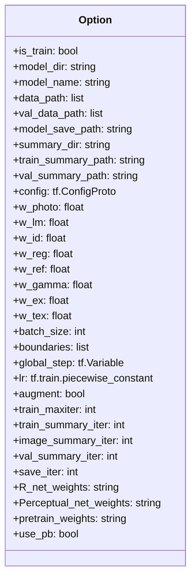
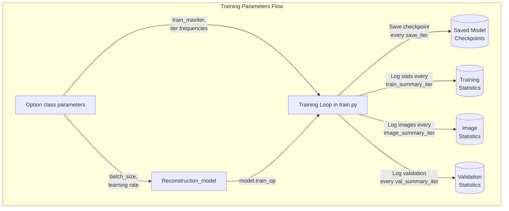
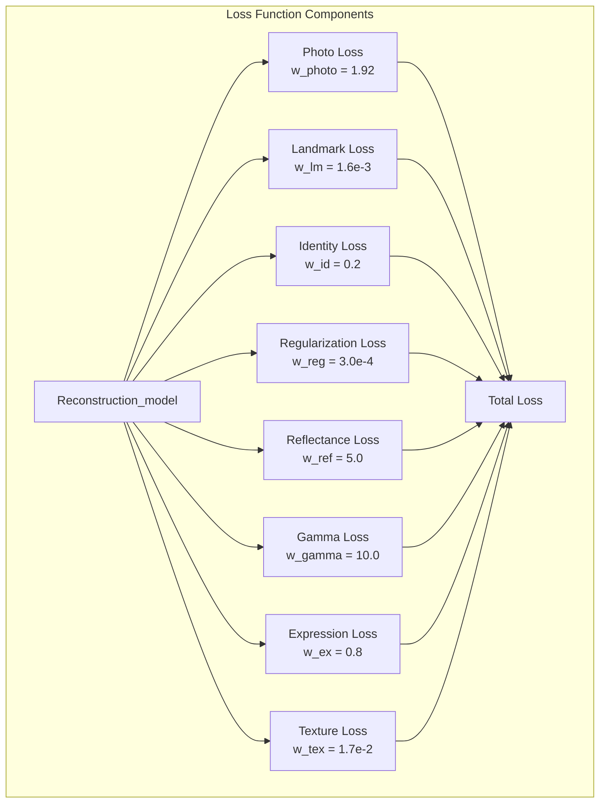
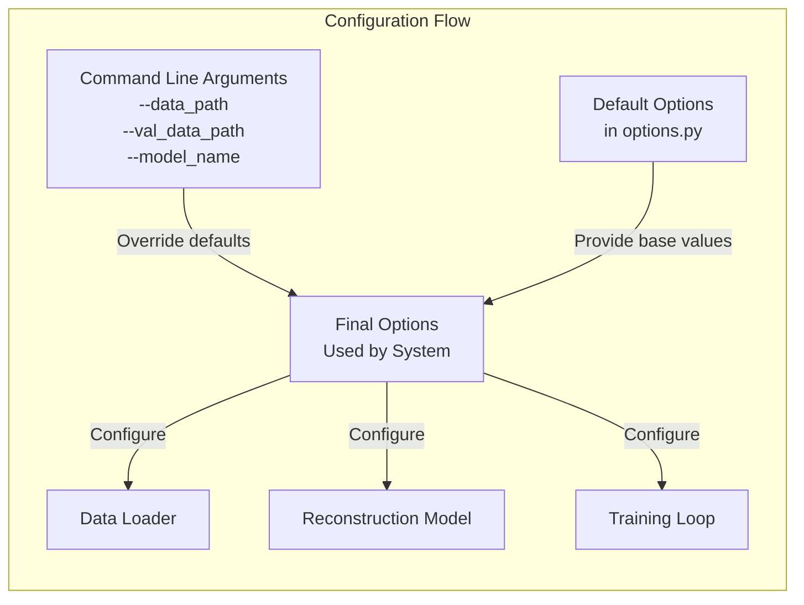

<!-- source: DeepWiki mcp.deepwiki.com · repo microsoft/Deep3DFaceReconstruction · page 4.3 Configuration Options · fetched 2026-10-26 -->

# Configuration Options

<details>
<summary>Relevant source files</summary>

The following files were used as context for generating this wiki page:

- [images/example.png](images/example.png)
- [options.py](options.py)
- [readme.md](readme.md)
- [train.py](train.py)

</details>


## Purpose and Scope

This document provides a comprehensive reference for all configuration options available in the Deep3DFaceReconstruction system. It covers training parameters, model settings, loss function weights, and system configurations that can be customized to control the behavior of the 3D face reconstruction pipeline. For information about running inference with the pre-trained model, see [Inference with demo.py](#3.1). For details about the training pipeline, see [Training Pipeline](#3.2).

## Core Configuration Structure

The configuration system in Deep3DFaceReconstruction is implemented through the `Option` class defined in [options.py](). This class encapsulates all parameters that control the behavior of the system during both training and inference.



Sources: [options.py:7-64]()

## Training Configuration Parameters

The following parameters control the training process in Deep3DFaceReconstruction:

| Parameter | Default Value | Description |
|-----------|---------------|-------------|
| `batch_size` | 16 | Number of samples processed in each training iteration |
| `train_maxiter` | 200000 | Maximum number of training iterations |
| `boundaries` | [100000] | Learning rate schedule boundaries |
| `lr` | [1e-4, 2e-5] | Learning rates for each schedule segment |
| `augment` | True | Whether to use data augmentation during training |
| `train_summary_iter` | 50 | Frequency of training statistics summarization |
| `image_summary_iter` | 200 | Frequency of image statistics summarization |
| `val_summary_iter` | 1000 | Frequency of validation statistics summarization |
| `save_iter` | 10000 | Frequency of model checkpointing |



Sources: [options.py:47-58](), [train.py:113-138]()

## Loss Function Weights

Deep3DFaceReconstruction uses a composite loss function with multiple components, each weighted to balance their contributions:

| Weight Parameter | Default Value | Description |
|------------------|---------------|-------------|
| `w_photo` | 1.92 | Weight for photometric loss (pixel-wise RGB difference) |
| `w_lm` | 1.6e-3 | Weight for landmark loss (2D landmarks alignment) |
| `w_id` | 0.2 | Weight for identity/perceptual loss (face recognition features) |
| `w_reg` | 3.0e-4 | Weight for regularization loss (coefficient regularization) |
| `w_ref` | 5.0 | Weight for reflectance loss (albedo smoothness) |
| `w_gamma` | 10.0 | Weight for gamma loss (lighting parameter regularization) |
| `w_ex` | 0.8 | Weight for expression coefficient regularization |
| `w_tex` | 1.7e-2 | Weight for texture coefficient regularization |



Sources: [options.py:36-46]()

## Path and Directory Configuration

The system uses several paths to organize model weights, training data, and results:

| Parameter | Default Value | Description |
|-----------|---------------|-------------|
| `model_dir` | 'result' | Directory to store model results |
| `model_name` | 'model_test' | Name of the model (creates subdirectory) |
| `data_path` | ['./processed_data'] | List of paths to training data |
| `val_data_path` | ['./processed_data'] | List of paths to validation data |
| `model_save_path` | '{model_dir}/{model_name}' | Path where model checkpoints are saved |
| `summary_dir` | '{model_save_path}/summary' | Directory for TensorBoard summaries |
| `train_summary_path` | '{summary_dir}/train' | Path for training summaries |
| `val_summary_path` | '{summary_dir}/val' | Path for validation summaries |

Sources: [options.py:11-27]()

## Pre-trained Model Weights

The system can load pre-trained weights from various sources:

| Parameter | Default Value | Description |
|-----------|---------------|-------------|
| `R_net_weights` | './weights/resnet/resnet_v1_50.ckpt' | Path to pre-trained ResNet-50 weights |
| `Perceptual_net_weights` | './weights/id_net/model-20170512-110547.ckpt-250000' | Path to pre-trained FaceNet weights for perceptual loss |
| `pretrain_weights` | 'train/model_test/iter_100000.ckpt' | Path to pre-trained reconstruction model weights |

These weights are essential for initializing the model properly, particularly when fine-tuning or performing inference.

Sources: [options.py:60-64](), [train.py:57-58]()

## Command-line Configuration

The training script allows overriding default configuration options through command-line arguments:

| Argument | Description |
|----------|-------------|
| `--data_path` | Path to training data folder |
| `--val_data_path` | Path to validation data folder |
| `--model_name` | Name for the model |



Sources: [train.py:16-26]()

## System Configuration

Additional parameters control system-level behavior:

| Parameter | Default Value | Description |
|-----------|---------------|-------------|
| `config` | tf.ConfigProto() | TensorFlow session configuration |
| `config.gpu_options.visible_device_list` | '0' | GPU devices to use |
| `use_pb` | True | Whether to use protocol buffer format for model |

These settings affect how the system utilizes hardware resources and how models are loaded/saved.

Sources: [options.py:29-33]()

## Configuration Usage Example

Below is an example of how configuration options are used in the training pipeline:

```mermaid
sequenceDiagram
    participant Main as train.py
    participant Args as ArgumentParser
    participant Opt as Option class
    participant DataLoader
    participant Model as Reconstruction_model
    participant Writer as TensorBoard Writer
    
    Main->>Args: parse_args()
    Args-->>Main: args (data_path, val_data_path, model_name)
    Main->>Opt: create Option(model_name=args.model_name)
    Main->>Opt: set data_path and val_data_path from args
    Main->>DataLoader: load_dataset(opt)
    DataLoader-->>Main: train_iterator
    Main->>Model: create Reconstruction_model(opt)
    Main->>Model: set_input(train_iterator)
    Main->>DataLoader: load_dataset(opt, train=False)
    DataLoader-->>Main: val_iterator
    Main->>Main: restore_weights_and_initialize(opt)
    Main->>Writer: create train_writer and val_writer
    loop For i in range(opt.train_maxiter)
        Main->>Model: run train_op
        Note over Main,Model: Log train stats every opt.train_summary_iter
        Note over Main,Model: Log image stats every opt.image_summary_iter
        Note over Main,Model: Log val stats every opt.val_summary_iter
        Note over Main,Model: Save model every opt.save_iter
    end
```

Sources: [train.py:64-141]()

## How to Modify Configuration Options

Configuration options can be modified in several ways:

1. **Command-line arguments**: For quick changes to data paths and model name
   ```
   python train.py --data_path /custom/data/path --val_data_path /custom/val/path --model_name my_model
   ```

2. **Direct modification**: Edit the default values in [options.py]() for more permanent changes

3. **Runtime modification**: Create and modify an `Option` instance in your custom scripts:
   ```python
   from options import Option
   
   opt = Option(model_name="custom_model")
   opt.batch_size = 32
   opt.w_photo = 2.5
   # Use the customized options
   ```

Sources: [train.py:16-26](), [options.py:7-64]()

## Important Configuration Guidelines

1. **Loss Weights**: The default weights are carefully tuned for face reconstruction. Adjusting them may significantly impact results.

2. **Learning Rate**: The system uses a piecewise constant learning rate schedule. Modify `boundaries` and `lr` together.

3. **Data Paths**: Ensure that data in the specified paths follows the expected format (aligned images, landmarks, etc.).

4. **Pre-trained Weights**: The correct paths to pre-trained weights are crucial for proper initialization and effective training.

5. **GPU Configuration**: Adjust `config.gpu_options.visible_device_list` to specify which GPUs to use.

Sources: [options.py:36-46](), [options.py:47-58](), [options.py:60-64](), [options.py:29-33]()

---

