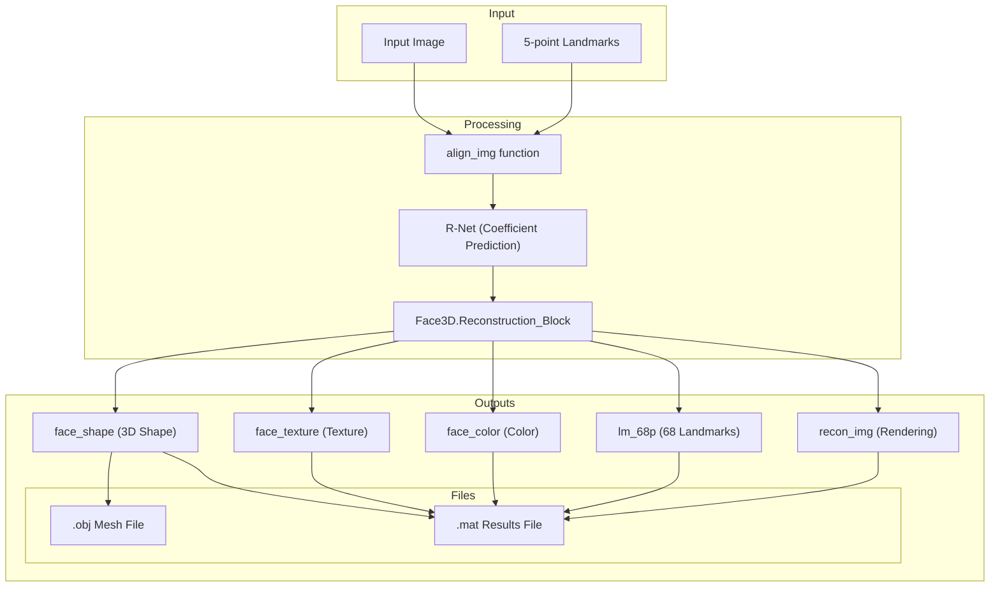
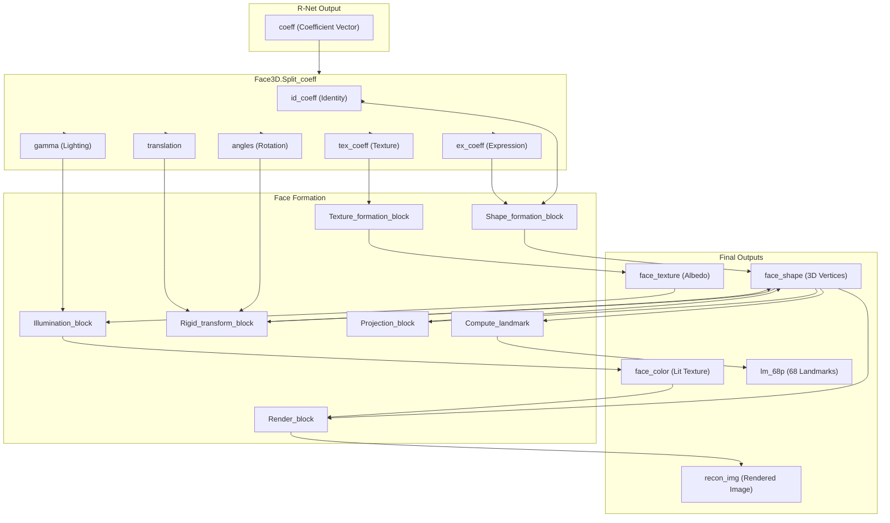
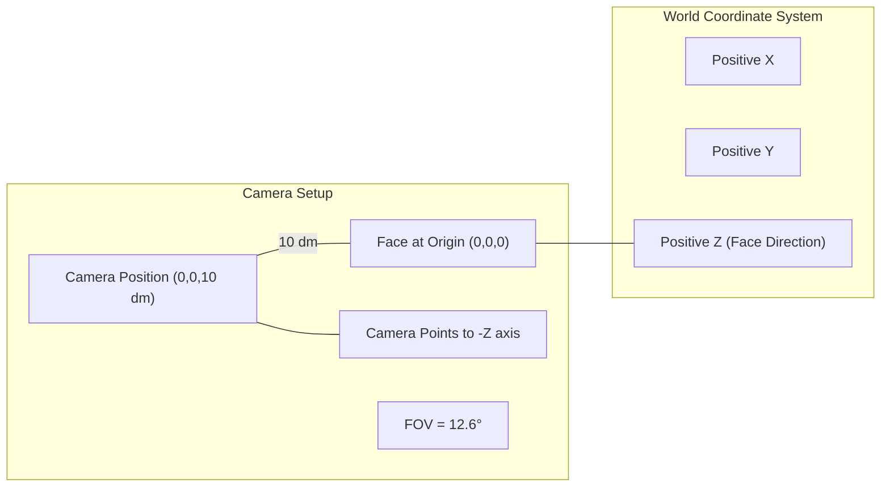

<!-- source: DeepWiki mcp.deepwiki.com · repo microsoft/Deep3DFaceReconstruction · page 5 Examples and Results · fetched 2026-10-26 -->

# Examples and Results

Relevant source files

The following files were used as context for generating this wiki page:

- [images/albedo.png](images/albedo.png)
- [images/alignment.png](images/alignment.png)
- [images/camera.png](images/camera.png)
- [images/example.gif](images/example.gif)
- [images/example.png](images/example.png)
- [images/extreme.png](images/extreme.png)
- [images/lm3d.png](images/lm3d.png)
- [images/lm5p.png](images/lm5p.png)
- [readme.md](readme.md)

This page showcases example results and visualizations from the Deep3DFaceReconstruction system. It demonstrates the quality and capabilities of the 3D face reconstruction approach through visual examples, benchmark evaluations, and practical usage scenarios. For information about the technical architecture and implementation details, see [System Architecture](#2).

## Output Formats and Examples

When you run the reconstruction model with the demo script on input images, two main output files are generated for each input:

| Output File | Description |
|-------------|-------------|
| `xxx.mat` | MATLAB data file containing reconstruction data such as face shape, texture, landmarks |
| `xxx_mesh.obj` | 3D face mesh in world coordinates (viewable in MeshLab) |

The `.mat` file contains the following components:

| Component | Description |
|-----------|-------------|
| `cropped_img` | RGB image after alignment (input to R-Net) |
| `recon_img` | RGBA reconstruction aligned with the input (only on Linux) |
| `coeff` | Output coefficients from R-Net |
| `face_shape` | 3D face vertex positions in world coordinates |
| `face_texture` | Face texture excluding lighting effect |
| `face_color` | Face color with lighting consideration |
| `lm_68p` | 68 facial landmarks derived from the reconstructed face |
| `lm_5p` | 5 detected landmarks aligned with the cropped image |

Sources: [readme.md:140-149]()

### Reconstruction Process Flow

The following diagram illustrates the process flow from input image to the generated outputs:

Sources: [readme.md:134-149](), [readme.md:212-216]()

## Quality Showcase

### Accurate Shape Reconstruction

The system achieves state-of-the-art accuracy in 3D face shape reconstruction, as demonstrated by quantitative evaluations on standard benchmarks:

| Method | FaceWareHouse | Florence | BU3DFE |
|:------:|:-------------:|:--------:|:------:|
| Tewari et al. 17 | 2.19±0.54 | - | - |
| Tewari et al. 18 | 1.84±0.38 | - | - |
| Genova et al. 18 | - | 1.77±0.53 | - |
| Sela et al. 17 | - | - | 2.91±0.60 |
| PRN 18 | - | - | 1.86±0.47 |
| Deep3DFaceReconstruction | **1.81±0.50** | **1.67±0.50** | **1.40±0.31** |

*Shape errors measured in millimeters (lower is better)*

Sources: [readme.md:25-32]()

### High Fidelity Textures

The system produces high-quality face textures while preserving identity information. It also disentangles scene illumination to generate a pure albedo texture map, as shown in this example:

![High-fidelity texture examples showing original images and corresponding albedo maps]

The albedo maps (rightmost column) show the pure texture without lighting effects, which can be useful for further applications like face recognition or editing.

Sources: [readme.md:36-40](), [images/albedo.png]()

### Robustness to Extreme Conditions

The method provides reasonable reconstruction results under challenging conditions such as large pose variations and partial occlusions:

![Examples of reconstruction under extreme conditions like large pose and occlusions]

This robustness makes the system practical for real-world applications where perfect frontal faces may not be available.

Sources: [readme.md:42-46](), [images/extreme.png]()

### Alignment with Input Images

The system aligns reconstruction with input images, providing accurate face pose estimation and 68 facial landmarks. Performance evaluation on the AFLW_2000 dataset (Normalized Mean Error - lower is better):

| Method | [0°,30°] | [30°,60°] | [60°,90°] | Overall |
|:------:|:--------:|:---------:|:---------:|:-------:|
| 3DDFA 16 | 3.78 | 4.54 | 7.93 | 5.42 |
| 3DDFA+SDM 16 | 3.43 | 4.24 | 7.17 | 4.94 |
| Bulat et al. 17 | **2.47** | **3.01** | **4.31** | **3.26** |
| PRN 18 | 2.75 | 3.51 | 4.61 | 3.62 |
| Deep3DFaceReconstruction | 2.56 | 3.11 | 4.45 | 3.37 |

![Example of face alignment showing the reconstructed mesh aligned with input image]

Sources: [readme.md:48-60](), [images/alignment.png]()

## Understanding the Output Components

The following diagram illustrates the relationship between output components and how they relate to the coefficients predicted by the R-Net:

Sources: [readme.md:140-149]()

## Visualization and Applications

### Visualizing 3D Mesh Results

The output `.obj` files can be visualized using standard 3D modeling software:

1. **MeshLab**: Free and open-source 3D mesh viewing software
   - Load the `.obj` file directly
   - Supports texture mapping if texture files are provided

2. **Blender**: For more advanced visualization and manipulation
   - Allows rendering with custom lighting and environment
   - Supports animation if multiple mesh files are provided

Example of a reconstructed face mesh:

![Example of 3D face reconstruction showing input image and reconstructed mesh]

Sources: [readme.md:149-150](), [images/example.png]()

### Camera Setup for Visualization

The system uses a pinhole camera model for face projection with the following settings:

Key points:
- Camera is positioned at (0,0,10) in world coordinates (distance in decimeters)
- Camera points toward the negative Z axis
- Faces in canonical view face the positive Z axis
- Camera field of view is fixed at 12.6 degrees

Sources: [readme.md:212-216](), [images/camera.png]()

## Example Use Cases

### Academic Research

The 3D face reconstruction results can be used for:
- Face recognition under extreme poses
- Facial expression analysis
- 3D facial attribute editing
- Dataset augmentation for deep learning

### Practical Applications

- **Face Verification**: Compare 3D face models instead of 2D images for more accurate identity verification
- **Facial Animation**: Transfer expressions between individuals using the expression coefficients
- **Virtual Try-On**: Apply virtual makeup, glasses, or other accessories to the 3D model
- **Augmented Reality**: Create realistic face filters and effects
- **Medical Applications**: Non-invasive facial analysis for medical or cosmetic procedures

## Usage Tips for Best Results

1. **Input Image Quality**:
   - Use frontal or near-frontal face images for best results
   - Ensure good lighting conditions without harsh shadows
   - Higher resolution images generally yield better reconstructions

2. **Handling Special Cases**:
   - The system may struggle with closed eyes due to limited training data
   - Severe occlusions may affect reconstruction quality but the system is designed to be robust
   - Extreme poses (beyond 90°) may reduce accuracy

3. **Computation Efficiency**:
   - The system achieves over 50 fps on a GTX 1080 GPU
   - ResNet-50 is used as the backbone network for efficient processing

4. **Model Limitations**:
   - The ear and neck regions of the original BFM09 model are excluded to focus on the face region
   - The system uses 3-channel RGB scene illumination rather than white light
   - Perspective distortions (e.g., in selfies) may affect reconstruction quality

Sources: [readme.md:63-65](), [readme.md:210-224]()