# Page: Overview

# Overview

<details>
<summary>Relevant source files</summary>

The following files were used as context for generating this wiki page:

- [images/example.png](images/example.png)
- [readme.md](readme.md)

</details>


This document provides an introduction to the Deep3DFaceReconstruction repository, a TensorFlow implementation for accurate 3D face reconstruction from single images. This overview summarizes the system's purpose, architecture, capabilities, and key components, helping developers understand what the system does and how it works at a high level. For detailed installation instructions, see [Installation](#1.1), and for quick usage instructions, see [Quick Start](#1.2).

## Purpose and Scope

Deep3DFaceReconstruction implements a CNN-based approach for accurate 3D face reconstruction from a single image, as described in the paper "Accurate 3D Face Reconstruction with Weakly-Supervised Learning: From Single Image to Image Set" by Deng et al. The system uses a weakly-supervised learning approach to generate detailed 3D face models, including geometry and texture, from a single face image. The reconstructed models are accurate, robust to occlusions and extreme poses, and aligned with input images.

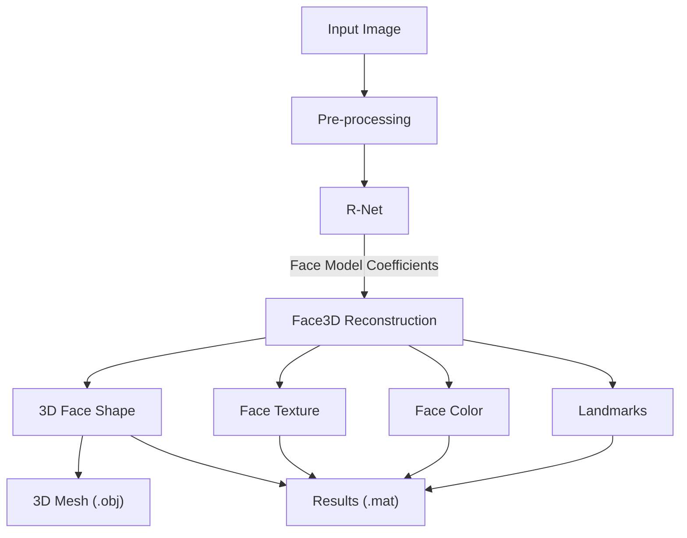

Sources: [readme.md:10-14](), [readme.md:64-65]()

## Key Capabilities

The system offers several key capabilities that make it valuable for 3D face reconstruction tasks:

1. **Accurate Shape Reconstruction**: Achieves state-of-the-art shape accuracy on benchmarks like FaceWareHouse, Florence, and BU3DFE.
2. **High Fidelity Textures**: Produces detailed face textures while preserving identity information.
3. **Disentangled Illumination**: Separates scene illumination to generate pure albedo textures.
4. **Robustness**: Provides reasonable results under extreme conditions like large pose variations and occlusions.
5. **Alignment with Input**: Reconstructions are aligned with input images, providing face pose estimation and 68 facial landmarks.
6. **Fast Processing**: Uses ResNet-50 as backbone to achieve over 50 fps on a GTX 1080 GPU.
7. **Easy Representation**: Uses Basel Face Model 2009 for face representation, making further manipulation easy.

Sources: [readme.md:19-64]()

## System Architecture

The Deep3DFaceReconstruction system consists of several interconnected components that work together to process input images and generate 3D face reconstructions.

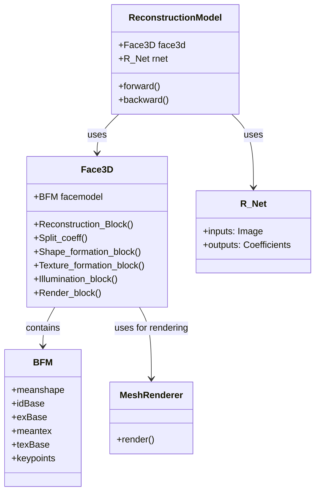

Sources: [readme.md:73-75](), [readme.md:210-216]()

### Core Components

1. **R-Net** - A CNN model built on ResNet-50 architecture that takes an aligned face image as input and outputs face model coefficients.
2. **Face3D** - A class that handles 3D face model reconstruction using the Basel Face Model (BFM) and the coefficients predicted by R-Net.
3. **Basel Face Model (BFM)** - A 3D morphable model for face representation, including shape, expression, and texture bases.
4. **Mesh Renderer** - A component using tf_mesh_renderer to visualize the 3D reconstructions.

Sources: [readme.md:73-75](), [readme.md:145-149]()

## Reconstruction Pipeline

The reconstruction pipeline consists of the following key steps:

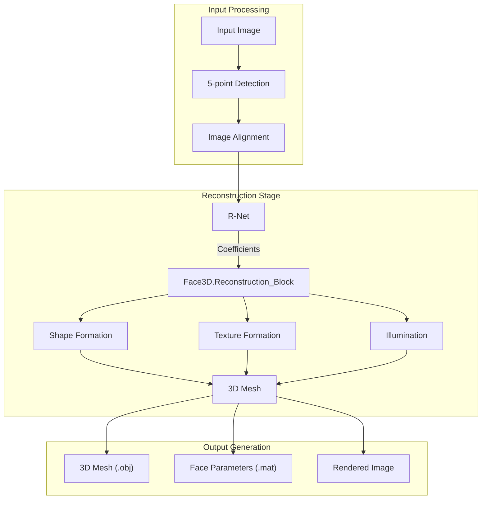

Sources: [readme.md:139-149](), [readme.md:210-216]()

1. **Pre-processing**: 
   - Detect 5 facial landmarks for each input image
   - Align the face image by solving a least square problem between detected landmarks and BFM average face landmarks

2. **Coefficient Prediction**:
   - Feed the aligned image to R-Net
   - Predict coefficients for identity, expression, texture, illumination, and pose

3. **3D Reconstruction**:
   - Generate 3D face shape using identity and expression coefficients
   - Generate face texture using texture coefficients
   - Apply illumination model to get face color
   - Compute face pose and projection

4. **Output Generation**:
   - Generate 3D face mesh in OBJ format
   - Save reconstruction parameters and results in MAT format
   - Render the reconstructed face aligned with the input image

Sources: [readme.md:139-149]()

## Technical Foundations

The system is built on several important technical foundations:

1. **Weakly-Supervised Learning**: The network is trained with a hybrid-level weakly-supervised approach that doesn't require 3D face scans as ground truth.

2. **Camera Model**: A pinhole camera model is used for face projection. The camera is positioned at (0,0,10) in world coordinates with a field of view of 12.6 degrees.

3. **Basel Face Model**: The 3D face representation uses the Basel Face Model 2009 (BFM09) with additional expression bases transferred from Facewarehouse.

4. **Loss Functions**: The training involves multiple losses including photometric, landmark, perceptual, and regularization losses. For more details about loss functions, see [Loss Functions](#4.1).

5. **Network Architecture**: The system uses ResNet-50 as the backbone for the R-Net and FaceNet for perceptual feature extraction. For more details about network architecture, see [Neural Network Architecture](#2.2).

Sources: [readme.md:12-14](), [readme.md:210-216](), [readme.md:73-75]()

## System Usage Overview

The system supports two main usage modes:

1. **Inference/Testing**: Using pre-trained models to reconstruct 3D faces from input images. This is demonstrated in the demo.py script.

2. **Training**: Training new models using your own data. The system provides scripts for data preprocessing and model training.

For a detailed guide on inference, see [Inference with demo.py](#3.1). For training information, see [Training Pipeline](#3.2).

## Limitations

The current system has a few known limitations:

1. It may give inferior results for images with severe perspective distortions (e.g., selfies).
2. It cannot well handle faces with closed eyes due to limited training data.
3. Pre-alignment with 5 facial landmarks is necessary, and poor alignment may affect reconstruction results.

Sources: [readme.md:223-224](), [readme.md:210-216]()

## Summary

Deep3DFaceReconstruction provides a state-of-the-art approach for 3D face reconstruction from single images. Its key strengths include accurate shape reconstruction, high-fidelity textures, robustness to challenging conditions, and fast processing speed. The system is designed with a modular architecture that supports both inference and training, making it suitable for various applications in computer vision, graphics, and AR/VR.

---

# Page: Installation

# Installation

<details>
<summary>Relevant source files</summary>

The following files were used as context for generating this wiki page:

- [.gitignore](.gitignore)
- [.gitmodules](.gitmodules)
- [LICENSE](LICENSE)
- [images/example.png](images/example.png)
- [readme.md](readme.md)

</details>


This guide provides detailed instructions for installing and setting up the Deep3DFaceReconstruction system on your machine. It covers environment setup, dependency installation, and preparation of required model files for both inference (testing) and training. For instructions on how to use the system after installation, see [Quick Start](#1.2).

## System Requirements

Before proceeding with the installation, ensure your system meets the following requirements:

| Component | Requirement |
|-----------|-------------|
| **Operating System** | Windows or Linux (Linux recommended as rendering is only supported on Linux) |
| **Python** | Python 3.6 |
| **GPU** | NVIDIA GPU with CUDA support (for optimal performance) |
| **CUDA** | CUDA 9.0 (compatible with TensorFlow 1.12) |

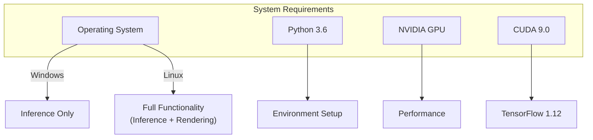

Sources: [readme.md:67-76]()

## Basic Installation

### 1. Clone the Repository

The first step is to clone the repository with all its submodules:

```bash
git clone https://github.com/Microsoft/Deep3DFaceReconstruction --recursive
cd Deep3DFaceReconstruction
```

Note that the `--recursive` flag is important to clone the tf_mesh_renderer submodule.

Sources: [readme.md:78-82]()

### 2. Set up the Python Environment

You can use either Anaconda or pip to set up the Python environment.

#### Option A: Using Anaconda (Recommended)

```bash
conda create -n deep3d python=3.6
source activate deep3d
conda install tensorflow-gpu==1.12.0 scipy
pip install pillow argparse
```

#### Option B: Using pip

```bash
pip install tensorflow-gpu==1.12.0
pip install scipy pillow argparse
```

Note: If you use pip for installation, you'll need to link `/usr/local/cuda` to `cuda-9.0`.

Sources: [readme.md:84-96]()

### 3. Set up the Renderer (Required for Linux)

The rendering process is only supported on Linux and requires tf_mesh_renderer. You have two options:

#### Option A: Use Pre-compiled Binary

If you installed tensorflow using pip, you can download a pre-compiled binary file:
1. Download [rasterize_triangles_kernel.so](https://drive.google.com/file/d/1VUtJPdg0UiJkKWxkACs8ZTf5L7Y4P9Wj/view?usp=sharing)
2. Place it in the `./renderer` subfolder

#### Option B: Compile from Source

If you use conda for tensorflow installation or prefer to compile from source:

```bash
cd tf_mesh_renderer
git checkout ba27ea1798
git checkout master WORKSPACE
# Set -D_GLIBCXX_USE_CXX11_ABI=1 in ./mesh_renderer/kernels/BUILD before compilation
bazel test ...
cd ..
```

After compilation, copy the necessary files:

```bash
cd renderer
cp ./tf_mesh_renderer/mesh_renderer/{camera_utils.py,mesh_renderer.py,rasterize_triangles.py} ./renderer/
cp ./tf_mesh_renderer/bazel-bin/mesh_renderer/kernels/rasterize_triangles_kernel.so ./renderer/
```

You need to make two minor adjustments to the renderer files:
1. Replace the library path in `./renderer/rasterize_triangles.py` (Line 26) with `"./renderer/rasterize_triangles_kernel.so"`
2. Replace `xrange` with `range` in `./renderer/rasterize_triangles.py` (Line 109) for Python 3 compatibility

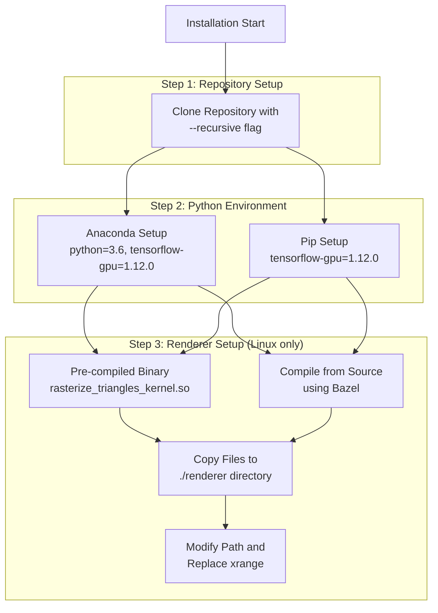

Sources: [readme.md:98-123](), [.gitmodules:1-4]()

## Preparing Model Files

To use the system, you need to download and prepare several model files:

### 1. Basel Face Model (BFM09)

Due to licensing restrictions, you need to separately download the Basel Face Model:
1. Submit an application on the [BFM website](https://faces.dmi.unibas.ch/bfm/main.php?nav=1-2&id=downloads)
2. After approval, download "01_MorphableModel.mat"
3. Place the file in the `./BFM` subfolder

### 2. Expression Basis

1. Download the expression basis from the [Coarse_Dataset](https://github.com/Juyong/3DFace) (look for "CoarseData" link)
2. Extract "Exp_Pca.bin" from the downloaded Coarse_Dataset.zip
3. Place the file in the `./BFM` subfolder

### 3. Pre-trained Reconstruction Network

1. Download the [pre-trained model](https://drive.google.com/file/d/176LCdUDxAj7T2awQ5knPMPawq5Q2RUWM/view?usp=sharing)
2. Unzip the downloaded file
3. Place "FaceReconModel.pb" in the `./network` subfolder

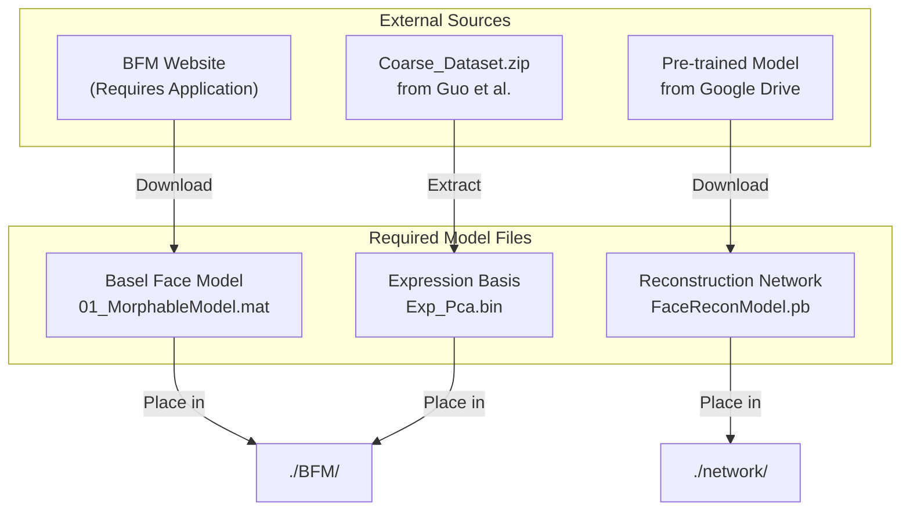

Sources: [readme.md:126-132]()

## Additional Setup for Training

If you plan to train new models (not just run inference), you need additional components:

### 1. Facenet

1. Download [pre-trained weights](https://drive.google.com/file/d/0B5MzpY9kBtDVZ2RpVDYwWmxoSUk/edit) by Sandberg et al.
2. Unzip and place all files in `./weights/id_net`

### 2. ResNet50-v1

1. Download [pre-trained weights](http://download.tensorflow.org/models/resnet_v1_50_2016_08_28.tar.gz) from TensorFlow Slim
2. Unzip and place "resnet_v1_50.ckpt" in `./weights/resnet`

### 3. 68-Landmark Detector

1. Download the [68-landmark detector](https://drive.google.com/file/d/1KYFeTb963jg0F47sTiwqDdhBIvRlUkPa/view?usp=sharing)
2. Place the file in the `./network` directory

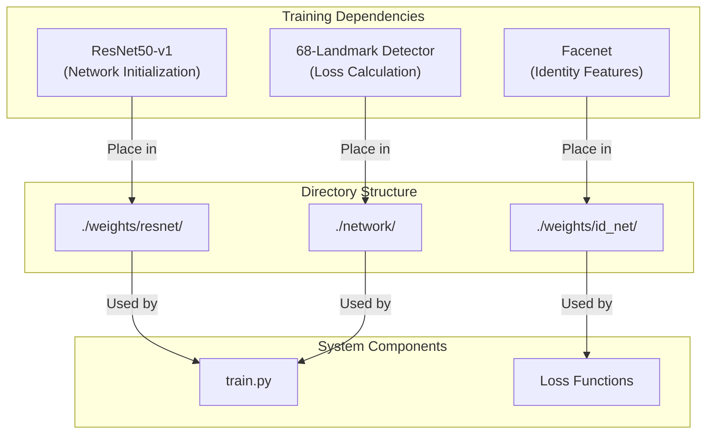

Sources: [readme.md:151-163]()

## Verify Installation

After completing the installation steps, you can verify that everything is set up correctly by running the demo:

```bash
python demo.py
```

If the installation is successful:
1. The demo will process sample images in the `./input` folder
2. Results will be saved in the `./output` folder
3. For each input image, you'll get:
   - A .mat file with reconstruction data
   - A .obj file with the 3D face mesh

Sources: [readme.md:133-150]()

## File Structure After Installation

After completing all installation steps, your directory structure should look like this:

```
Deep3DFaceReconstruction/
├── BFM/
│   ├── 01_MorphableModel.mat
│   └── Exp_Pca.bin
├── input/                   # Sample input images
├── network/
│   ├── FaceReconModel.pb    # For inference
│   └── ... (landmark detector for training)
├── output/                  # Generated outputs
├── renderer/                # Rendering components
│   ├── camera_utils.py
│   ├── mesh_renderer.py
│   ├── rasterize_triangles.py
│   └── rasterize_triangles_kernel.so
├── tf_mesh_renderer/        # Submodule
├── weights/                 # For training
│   ├── id_net/              # Facenet weights
│   └── resnet/              # ResNet weights
├── demo.py                  # For inference
├── train.py                 # For training
└── preprocess_img.py        # For data preparation
```

## Common Issues and Troubleshooting

### TensorFlow Version Compatibility
The system is designed to work with TensorFlow 1.12.0. Using different versions may cause compatibility issues, especially with the pre-compiled renderer binary.

### CUDA Version
Ensure you have CUDA 9.0 installed for TensorFlow 1.12.0 compatibility. If using pip for TensorFlow installation, you may need to create a symbolic link:
```bash
sudo ln -s /usr/local/cuda-9.0 /usr/local/cuda
```

### Renderer Issues
If you encounter errors related to rendering:
1. Ensure you're running on Linux (rendering is not supported on Windows)
2. Check that the renderer files are correctly placed and modified as instructed
3. Verify that the rasterize_triangles_kernel.so file is compatible with your system

### Missing Files Errors
If you encounter "file not found" errors:
1. Check that all required model files are downloaded and placed in their correct directories
2. Verify that the file paths in the code match your actual directory structure

Sources: [readme.md:98-125](), [readme.md:210-224]()

## Next Steps

After completing the installation, refer to [Quick Start](#1.2) to learn how to use the system for 3D face reconstruction.

---

# Page: Quick Start

# Quick Start

<details>
<summary>Relevant source files</summary>

The following files were used as context for generating this wiki page:

- [demo.py](demo.py)
- [images/example.gif](images/example.gif)
- [images/example.png](images/example.png)
- [readme.md](readme.md)

</details>


This page provides a step-by-step guide for quickly getting started with Deep3DFaceReconstruction to perform 3D face reconstruction from single images using pre-trained models. For detailed information about system architecture, see [System Architecture](#2), or for training your own model, see [Training Pipeline](#3.2).

## Overview of the Quick Start Process

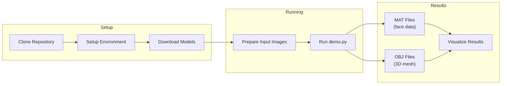

Sources: [readme.md:67-68](), [readme.md:126-138]()

## Prerequisites

Before you begin, ensure your system meets the following requirements:

| Requirement | Details |
|-------------|---------|
| Operating System | Linux (recommended) or Windows (limited rendering support) |
| Python | Version 3.6 with numpy, scipy, pillow, argparse |
| TensorFlow | Version 1.12 |
| Models | Basel Face Model 2009, Expression Basis |
| Rendering | tf_mesh_renderer (Linux only) |

**Note**: While reconstructions can be done on both Windows and Linux, we recommend using Linux because the rendering process is only fully supported on Linux platforms.

Sources: [readme.md:69-76]()

## Installation and Setup

### 1. Clone the Repository

```bash
git clone https://github.com/Microsoft/Deep3DFaceReconstruction --recursive
cd Deep3DFaceReconstruction
```

Sources: [readme.md:78-82]()

### 2. Set up Python Environment

Using Anaconda (recommended):

```bash
conda create -n deep3d python=3.6
source activate deep3d
conda install tensorflow-gpu==1.12.0 scipy
pip install pillow argparse
```

Sources: [readme.md:85-91]()

### 3. Download Required Models

#### Basel Face Model (BFM09)

1. Download "01_MorphableModel.mat" from the [Basel Face Model website](https://faces.dmi.unibas.ch/bfm/main.php?nav=1-2&id=downloads) (requires registration)
2. Place it in the `./BFM` subfolder

#### Expression Basis

1. Download "Exp_Pca.bin" from the [Coarse Data](https://github.com/Juyong/3DFace) repository
2. Place it in the `./BFM` subfolder

#### Pre-trained Network

1. Download the [reconstruction network](https://drive.google.com/file/d/176LCdUDxAj7T2awQ5knPMPawq5Q2RUWM/view?usp=sharing)
2. Unzip it and place "FaceReconModel.pb" in the `./network` subfolder

Sources: [readme.md:127-132]()

### 4. Renderer Setup (Linux Only)

If you're using Linux and want to visualize the reconstructed faces:

1. For pip-installed TensorFlow: Download the [pre-compiled binary](https://drive.google.com/file/d/1VUtJPdg0UiJkKWxkACs8ZTf5L7Y4P9Wj/view?usp=sharing)
2. For conda-installed TensorFlow: Compile from source following instructions in [readme.md:98-123]()
3. Place the renderer files in the `./renderer` subfolder

Sources: [readme.md:98-123]()

## Running Face Reconstruction

### Inference Pipeline

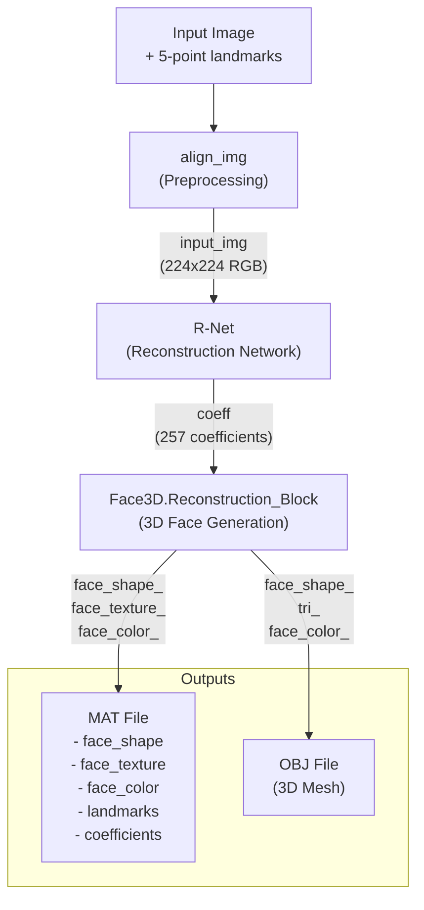

Sources: [demo.py:40-124](), [readme.md:139-149]()

### Input Requirements

Place your test images in the `./input` folder. For each image, you need:

1. An image file (PNG or JPG format)
2. A text file with the same name containing 5 facial landmarks
   - The landmarks should be in the format: `x1 y1\nx2 y2\nx3 y3\nx4 y4\nx5 y5`
   - These represent the coordinates of: left eye, right eye, nose, left mouth corner, right mouth corner

**Note**: The repository includes some example images in the `./input` folder that you can use for reference.

Sources: [demo.py:44-50](), [demo.py:99-102]()

### Running the Demo

To run face reconstruction with default settings:

```bash
python demo.py
```

This will:
1. Process all PNG and JPG images in the `./input` directory
2. Use the pre-trained model in `./network/FaceReconModel.pb`
3. Save results in the `./output` directory

#### Advanced Usage

You can specify a different pre-trained model using command-line arguments:

```bash
# Use a specific checkpoint file instead of the default .pb file
python demo.py --use_pb 0 --pretrain_weights path/to/model.ckpt
```

Sources: [demo.py:17-25](), [demo.py:65-79](), [readme.py:133-137]()

## Understanding the Outputs

The demo script generates two types of output files for each input image:

### 1. MAT File (`.mat`)

Contains the following data:

| Field | Description |
|-------|-------------|
| `cropped_img` | RGB image after alignment (input to the network) |
| `recon_img` | RGBA reconstruction image aligned with input (Linux only) |
| `coeff` | Output coefficients from the reconstruction network |
| `face_shape` | 3D face vertex positions in world coordinates |
| `face_texture` | Face texture values without lighting effects |
| `face_color` | Face color values with lighting applied |
| `lm_68p` | 68 2D facial landmarks derived from the reconstructed face |
| `lm_5p` | 5 detected landmarks from input alignment |

### 2. OBJ File (`_mesh.obj`)

Contains the 3D face mesh in world coordinates, which can be viewed in 3D modeling software like MeshLab.

Sources: [readme.md:140-149](), [demo.py:117-121]()

## Key Components Used in Quick Start

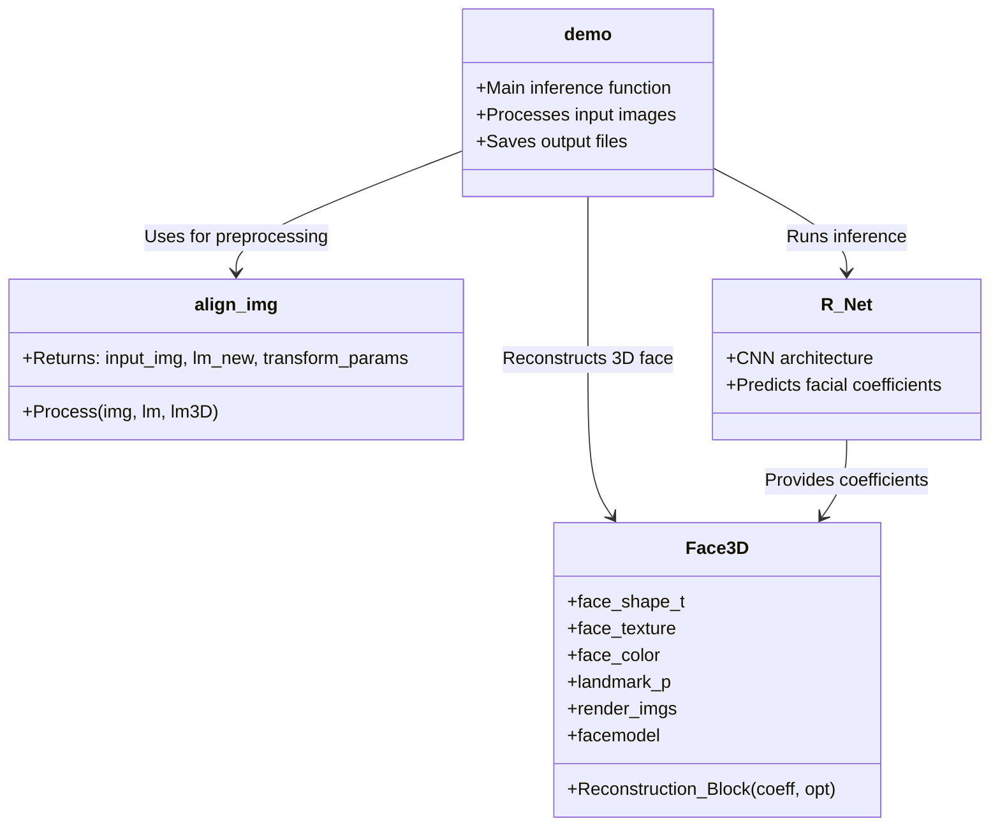

Sources: [demo.py:10-13](), [demo.py:67-88]()

## Troubleshooting

### Common Issues

1. **Missing Basel Face Model**:
   - Error: `FileNotFoundError: BFM/BFM_model_front.mat`
   - Solution: Ensure you've downloaded the Basel Face Model and placed it in the BFM folder

2. **Landmark Detection Issues**:
   - Error: Missing or incorrect landmark files
   - Solution: Ensure each image has a corresponding text file with 5 facial landmarks

3. **Renderer Issues (Linux)**:
   - Error: `ImportError: cannot open shared object file: rasterize_triangles_kernel.so`
   - Solution: Make sure the renderer is properly set up following the instructions in [Installation](#1.1)

4. **Poor Reconstruction Quality**:
   - Issue: Inaccurate face reconstructions
   - Solution: Ensure input images are frontal or near-frontal faces with good lighting and minimal occlusions

Sources: [readme.md:208-224]()

## Next Steps

Once you've successfully run the demo:

1. For visualization, use MeshLab to open the `.obj` files
2. For more detailed analysis, examine the `.mat` files using MATLAB or Python with scipy.io
3. To train your own model, see [Training Pipeline](#3.2)
4. For technical details about the system architecture, see [System Architecture](#2)

Sources: [readme.md:151-196]()

---

# Page: System Architecture

# System Architecture

<details>
<summary>Relevant source files</summary>

The following files were used as context for generating this wiki page:

- [face_decoder.py](face_decoder.py)
- [images/example.png](images/example.png)
- [networks.py](networks.py)
- [readme.md](readme.md)
- [reconstruction_model.py](reconstruction_model.py)

</details>


This document provides a comprehensive overview of the system architecture for the Deep3DFaceReconstruction repository. It details the core components, their interactions, and the overall data flow within the system that enables 3D face reconstruction from single images using a weakly-supervised deep learning approach.

For practical usage of the system, see [Using the System](#3). For details about specific neural network architectures, see [Neural Network Architecture](#2.2).

## System Overview

The Deep3DFaceReconstruction system implements a CNN-based approach for reconstructing detailed 3D face models from single images. The system follows a modular design with clear separation between the coefficient prediction network (R-Net), 3D face model reconstruction (Face3D), and rendering components.

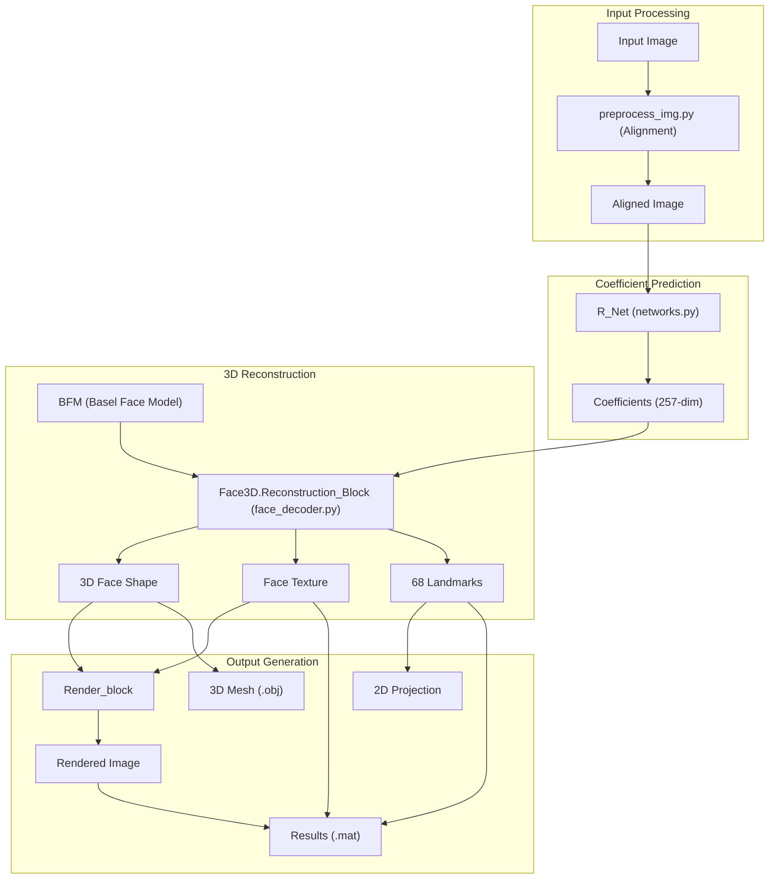

Sources: [networks.py](networks.py), [face_decoder.py](face_decoder.py), [reconstruction_model.py](reconstruction_model.py), [readme.md](readme.md)

## Core Components

The system consists of several core components that work together to perform 3D face reconstruction:

### R-Net: Coefficient Prediction Network

The R-Net is a deep neural network responsible for predicting the coefficients needed for 3D face reconstruction from a single input image.

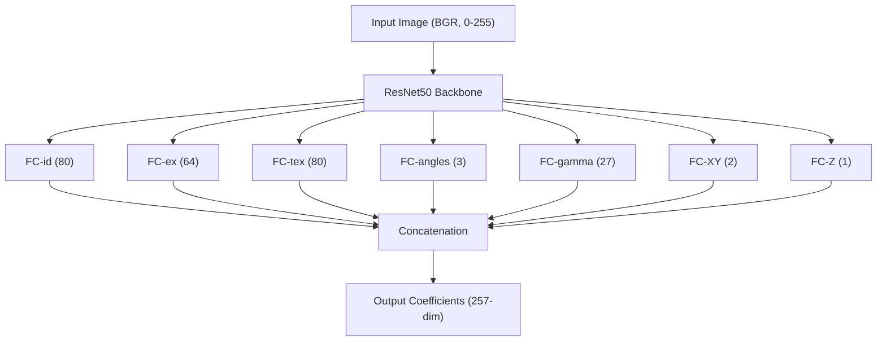

The R-Net takes a 224×224 BGR image as input and processes it through:
1. A ResNet50 backbone (without the classification layer)
2. Multiple fully connected layers that predict different coefficient types
3. Concatenation of these coefficients to produce a 257-dimensional output vector

Sources: [networks.py:9-63](networks.py)

### Face3D: 3D Face Reconstruction

The Face3D class is responsible for reconstructing 3D face shapes from the coefficients predicted by the R-Net.

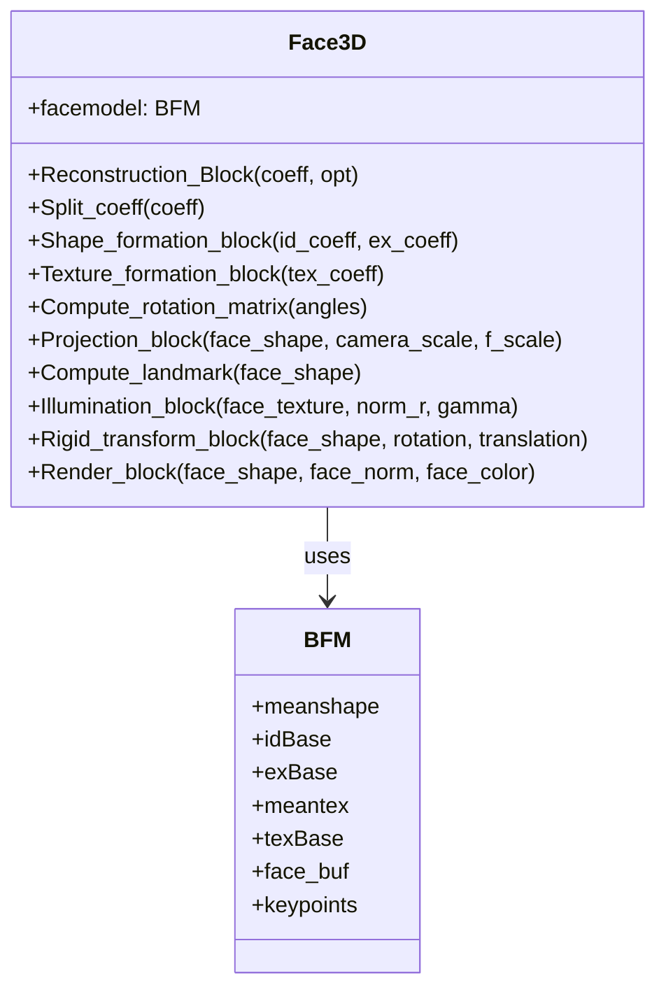

The Face3D reconstruction process:
1. Splits the 257-dimensional coefficient vector
2. Constructs 3D face shape using identity and expression coefficients
3. Generates face texture using texture coefficients
4. Computes rotation matrix from angle coefficients
5. Applies rigid transformation using rotation and translation
6. Computes face color using texture, normals, and lighting (gamma)
7. Projects 3D landmarks to 2D
8. Renders the face if requested

Sources: [face_decoder.py:32-345](face_decoder.py)

### Basel Face Model (BFM)

The Basel Face Model (BFM) is a statistical 3D face model that serves as the foundation for face reconstruction.

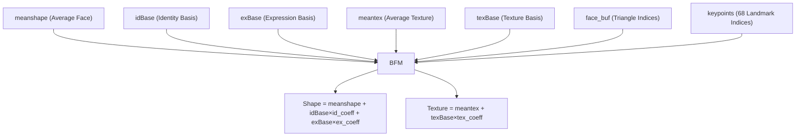

The BFM consists of:
- A mean face shape and texture
- PCA basis vectors for identity and expression variations
- PCA basis vectors for texture variations
- Face topology (triangle indices)
- Landmark indices for 68 facial landmarks

Sources: [face_decoder.py:16-29](face_decoder.py), [readme.md:73-77](readme.md)

### Perceptual Network

The Perceptual Network extracts identity features from face images for computing perceptual loss during training.

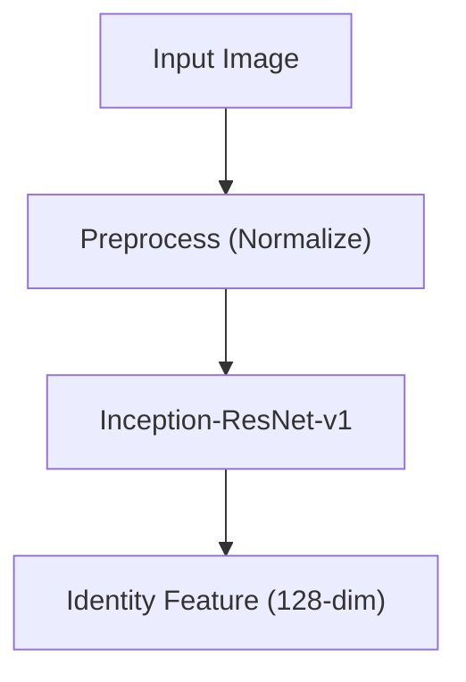

The Perceptual Network:
1. Takes a face image as input
2. Preprocesses it (normalization)
3. Processes it through an Inception-ResNet-v1 network
4. Outputs a 128-dimensional identity feature vector

Sources: [networks.py:66-87](networks.py)

## Pipeline Architecture

The system has three main pipelines: preprocessing, training, and inference.

### Preprocessing Pipeline

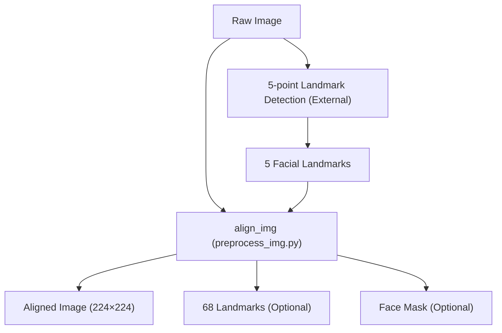

The preprocessing pipeline:
1. Detects 5 facial landmarks using an external detector (e.g., dlib or MTCNN)
2. Aligns the face image using these landmarks
3. Optionally generates 68 landmarks and face masks for training

Sources: [readme.md:166-176](readme.md)

### Training Pipeline

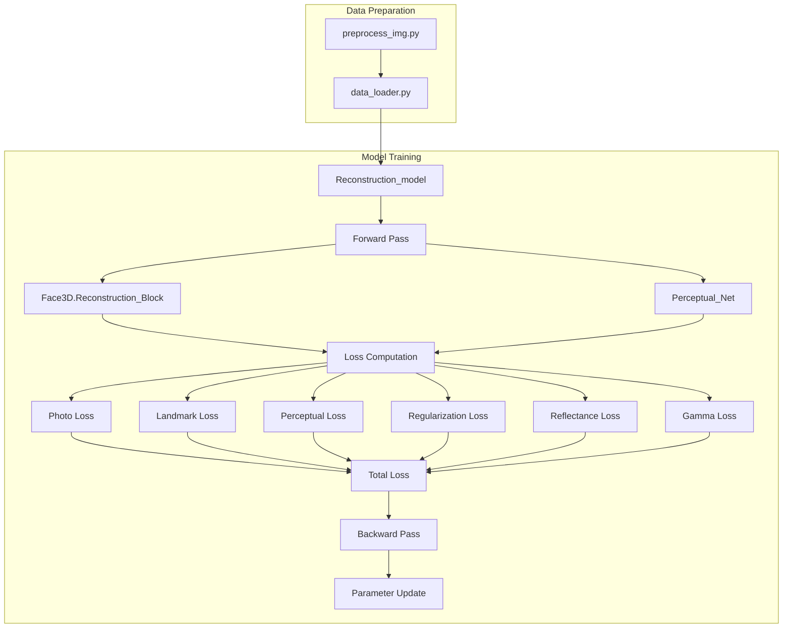

The training pipeline:
1. Loads preprocessed data (aligned images, landmarks, masks)
2. Feeds images to the R-Net to predict coefficients
3. Reconstructs 3D faces using Face3D
4. Computes various losses:
   - Photometric loss (rendered vs. input image)
   - Landmark loss (projected vs. ground truth landmarks)
   - Perceptual loss (identity feature similarity)
   - Regularization loss (coefficient magnitudes)
   - Reflectance loss (texture naturalness)
   - Gamma loss (lighting parameters)
5. Updates network parameters using backpropagation

Sources: [reconstruction_model.py:9-86](reconstruction_model.py), [readme.md:178-196](readme.md)

### Inference Pipeline

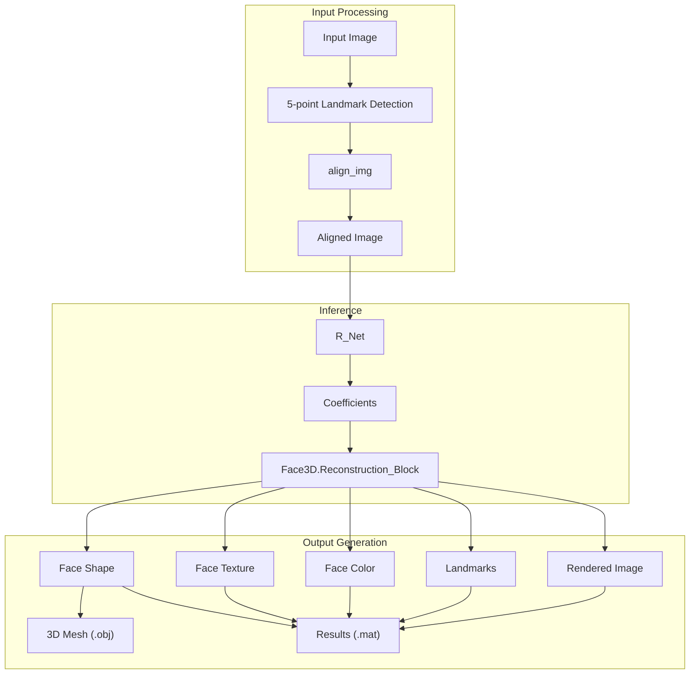

The inference pipeline:
1. Aligns the input image using 5-point landmarks
2. Predicts coefficients using the R-Net
3. Reconstructs 3D face using Face3D
4. Outputs:
   - 3D face mesh (.obj)
   - Face texture and color
   - 68 facial landmarks
   - Rendered face image
   - Results file (.mat)

Sources: [readme.md:134-149](readme.md), [demo.py](demo.py)

## Data Flow and Transformations

This section illustrates how data flows through the system and the key transformations that occur.

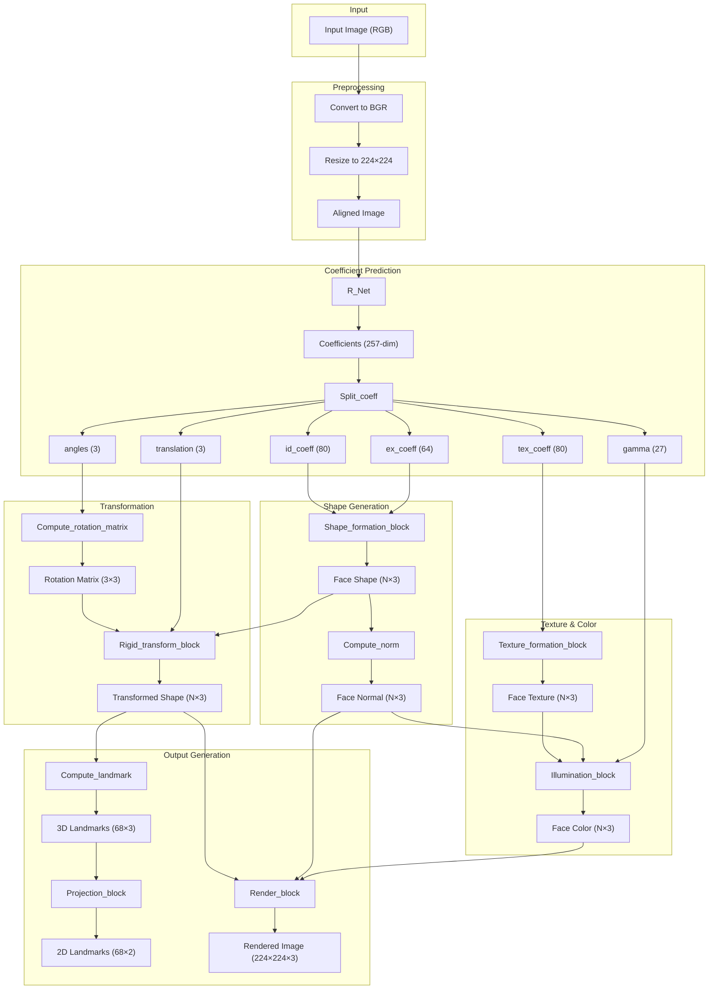

Key data transformations:
1. **Coefficient splitting**: The 257-dimensional coefficient vector is split into components for identity, expression, texture, angles, lighting, and translation.
2. **Shape formation**: 3D face shape is generated by combining the mean shape with weighted identity and expression basis vectors.
3. **Texture formation**: Face texture is generated by combining the mean texture with weighted texture basis vectors.
4. **Illumination**: Face color is calculated by applying lighting (gamma) to the face texture.
5. **Transformation**: Face shape is transformed using rotation and translation.
6. **Projection**: 3D landmarks are projected to 2D for comparison with detected landmarks.
7. **Rendering**: The 3D face is rendered to a 2D image for visualization and loss computation.

Sources: [face_decoder.py:38-346](face_decoder.py)

## Camera Model and Coordinate System

The system uses a specific camera model and coordinate system for 3D face reconstruction and rendering.

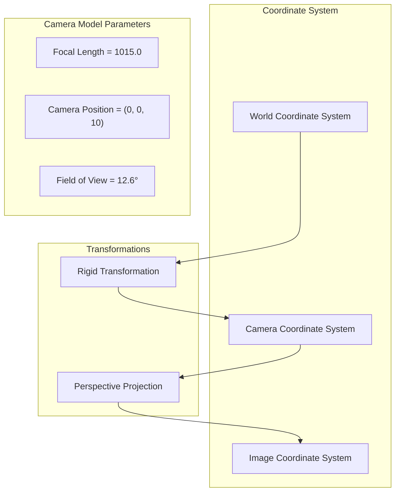

Camera model details:
- Pinhole camera model with perspective projection
- Camera positioned at (0, 0, 10) in world coordinates
- Camera points to the negative z axis
- Fixed focal length of 1015 and field of view of 12.6°
- Canonical face positioned at the origin, facing positive z axis

Sources: [face_decoder.py:185-208](face_decoder.py), [readme.md:212-216](readme.md)

## Component Integration

This diagram illustrates how the various components are integrated in the system:

```mermaid
classDiagram
    class Reconstruction_model {
        +Face3D: Face3D
        +opt: Options
        +set_input(input_iterator)
        +forward(is_train)
        +backward(is_train)
        +step(is_train)
        +summarize()
    }
    
    class Face3D {
        +facemodel: BFM
        +Reconstruction_Block(coeff, opt)
        +Split_coeff(coeff)
        +Shape_formation_block(id_coeff, ex_coeff)
        +Texture_formation_block(tex_coeff)
        +Compute_norm(face_shape)
        +Compute_rotation_matrix(angles)
        +Projection_block(face_shape, camera_scale, f_scale)
        +Compute_landmark(face_shape)
        +Illumination_block(face_texture, norm_r, gamma)
        +Rigid_transform_block(face_shape, rotation, translation)
        +Render_block(face_shape, face_norm, face_color)
    }
    
    class R_Net {
        +inputs: Image
        +is_training: Boolean
        +outputs: Coefficients
    }
    
    class Perceptual_Net {
        +inputs: Image
        +outputs: Identity_Features
    }
    
    class BFM {
        +meanshape
        +idBase
        +exBase
        +meantex
        +texBase
        +face_buf
        +keypoints
    }
    
    Reconstruction_model --> Face3D : uses
    Reconstruction_model --> R_Net : uses
    Reconstruction_model --> Perceptual_Net : uses
    Face3D --> BFM : uses
```

Sources: [reconstruction_model.py:9-86](reconstruction_model.py), [face_decoder.py:32-346](face_decoder.py), [networks.py:9-87](networks.py)

## Summary

The Deep3DFaceReconstruction system employs a modular architecture to reconstruct 3D face models from single images. The system uses:

1. An R-Net for predicting 257 coefficients from input images
2. A Face3D module that leverages the Basel Face Model to reconstruct 3D face geometry and texture
3. A Perceptual Network for extracting identity features during training
4. A rendering module for visualizing the reconstructed face

This architecture enables:
- Accurate 3D face reconstruction from single images
- Disentanglement of identity, expression, texture, and lighting
- Robustness to pose variations and occlusions
- Generation of high-quality 3D face models with detailed geometry and texture

The system achieves state-of-the-art performance through a weakly-supervised training approach that combines photometric, landmark, perceptual, and regularization losses.

---

# Page: Face Reconstruction Pipeline

# Face Reconstruction Pipeline

<details>
<summary>Relevant source files</summary>

The following files were used as context for generating this wiki page:

- [demo.py](demo.py)
- [face_decoder.py](face_decoder.py)
- [networks.py](networks.py)

</details>


This document describes the complete pipeline for reconstructing 3D face models from single images in the Deep3DFaceReconstruction system. It covers the process from input image preprocessing through neural network inference to the final 3D face model generation and rendering. For information about the specific neural network architecture used for coefficient prediction, see [Neural Network Architecture](#2.2).

## 1. Pipeline Overview

The Face Reconstruction Pipeline transforms a 2D facial image into a detailed 3D face model through a series of well-defined steps:

```mermaid
flowchart TD
    subgraph "Input"
        input["Input Image"] --> preprocess["Preprocessing"]
        landmarks["5-point Landmarks"] --> preprocess
    end
    
    subgraph "Coefficient Prediction"
        preprocess --> |"Aligned 224×224 Image"| rnet["R-Net"]
        rnet --> |"257 Coefficients"| split["Split_coeff"]
    end
    
    subgraph "3D Face Model Reconstruction"
        split --> id["Identity Coefficients (80)"]
        split --> ex["Expression Coefficients (64)"]
        split --> tex["Texture Coefficients (80)"]
        split --> angles["Rotation Angles (3)"]
        split --> trans["Translation (3)"]
        split --> gamma["Illumination Params (27)"]
        
        id --> shape["Shape_formation_block"]
        ex --> shape
        tex --> texture["Texture_formation_block"]
        angles --> rotation["Compute_rotation_matrix"]
        
        shape --> |"Face Shape"| norm["Compute_norm"]
        shape --> |"Face Shape"| transform["Rigid_transform_block"]
        rotation --> |"Rotation Matrix"| transform
        trans --> transform
        
        texture --> |"Face Texture"| illum["Illumination_block"]
        norm --> |"Face Normals"| rotated["Rotated Normals"]
        rotation --> rotated
        rotated --> illum
        gamma --> illum
        
        transform --> |"Transformed Shape"| landmark["Compute_landmark"]
        transform --> |"Transformed Shape"| render["Render_block"]
        rotated --> render
        illum --> |"Face Color"| render
    end
    
    subgraph "Output"
        render --> rendered["Rendered Image"]
        transform --> mesh["3D Mesh"]
        landmark --> lm2d["2D Landmarks"]
        texture --> out_tex["Face Texture"]
        illum --> out_color["Face Color"]
    end
```

Sources: [demo.py:40-124](), [face_decoder.py:32-346]()

## 2. Pipeline Components

### 2.1 Input Processing

The pipeline begins with an input image and corresponding 5-point facial landmarks:

1. **Input**: RGB image (any resolution) and 5-point facial landmarks (typically eye corners, nose tip, and mouth corners)
2. **Alignment**: The `align_img` function aligns the face to a canonical position using the 5-point landmarks
3. **Normalization**: The aligned image is resized to 224×224 pixels, which is the expected input size for the neural network

Sources: [demo.py:99-102]()

### 2.2 Coefficient Prediction via R-Net

The aligned image is fed into R-Net, which predicts a 257-dimensional coefficient vector:

```mermaid
classDiagram
    class R_Net {
        +inputs: Image[B,224,224,3]
        +is_training: Boolean
        +resnet_v1_50(): Feature extraction
        +fc-id: Identity coefficients[80]
        +fc-ex: Expression coefficients[64]
        +fc-tex: Texture coefficients[80]
        +fc-angles: Rotation angles[3]
        +fc-gamma: Illumination parameters[27]
        +fc-XY: Translation XY[2]
        +fc-Z: Translation Z[1]
        +outputs: Coefficients[257]
    }
```

The R-Net processes the input using:
1. A ResNet-50 backbone that extracts features from the input image
2. Several fully connected layers that predict different sets of coefficients
3. The output coefficients are concatenated into a single 257-dimensional vector

Sources: [networks.py:9-63](), [demo.py:76-79]()

### 2.3 Coefficient Splitting

The 257-dimensional coefficient vector is split into its components:

```
- Identity coefficients (80): Control the identity-specific facial shape
- Expression coefficients (64): Control the facial expression
- Texture coefficients (80): Control the facial texture/appearance
- Rotation angles (3): Control the 3D rotation of the face
- Translation parameters (3): Control the 3D position of the face
- Illumination parameters (27): Control the lighting conditions
```

This is handled by the `Split_coeff` function in the `Face3D` class.

Sources: [face_decoder.py:80-91]()

### 2.4 Face Shape Formation

The identity and expression coefficients are used to form the 3D face shape using the Basel Face Model (BFM):

```mermaid
flowchart TD
    subgraph "Shape Formation"
        id["Identity Coefficients"] --> shape["Shape_formation_block"]
        ex["Expression Coefficients"] --> shape
        bfm["BFM meanshape/idBase/exBase"] --> shape
        shape --> face_shape["3D Face Shape [B,N,3]"]
    end
```

The face shape is computed as a linear combination of:
- The mean face shape from BFM
- Identity-specific shape components weighted by identity coefficients
- Expression-specific shape components weighted by expression coefficients

Sources: [face_decoder.py:93-101]()

### 2.5 Face Texture Formation

Similarly, the texture coefficients are used to form the face texture:

```mermaid
flowchart TD
    subgraph "Texture Formation"
        tex["Texture Coefficients"] --> texture["Texture_formation_block"]
        bfm["BFM meantex/texBase"] --> texture
        texture --> face_texture["Face Texture [B,N,3]"]
    end
```

The face texture is computed as a linear combination of:
- The mean face texture from BFM
- Texture components weighted by texture coefficients

Sources: [face_decoder.py:130-136]()

### 2.6 Face Geometry Processing

The face shape undergoes several geometric processing steps:

1. **Normal Computation**: Face normals are computed for each vertex using `Compute_norm`
2. **Rotation Matrix Computation**: A 3×3 rotation matrix is computed from the rotation angles using `Compute_rotation_matrix`
3. **Rigid Transformation**: The face shape is transformed using rotation and translation via `Rigid_transform_block`
4. **Landmark Projection**: 68 facial landmarks are extracted and projected to 2D using `Compute_landmark` and `Projection_block`

Sources: [face_decoder.py:104-219]()

### 2.7 Illumination and Color

The face texture is processed to include illumination effects:

```mermaid
flowchart TD
    subgraph "Illumination Processing"
        texture["Face Texture"] --> illum["Illumination_block"]
        normals["Rotated Face Normals"] --> illum
        gamma["Illumination Parameters"] --> illum
        illum --> face_color["Face Color [B,N,3]"]
    end
```

The `Illumination_block` applies Spherical Harmonic lighting to the face texture, producing the final face color that incorporates illumination effects.

Sources: [face_decoder.py:221-254]()

### 2.8 Rendering

Finally, the 3D face model is rendered to a 2D image using the tf_mesh_renderer:

```mermaid
flowchart TD
    subgraph "Rendering Process"
        shape["Transformed Face Shape"] --> render["Render_block/mesh_renderer"]
        normals["Face Normals"] --> render
        color["Face Color"] --> render
        camera["Camera Parameters"] --> render
        render --> rendered["Rendered Image [B,224,224,3]"]
        render --> mask["Face Mask [B,224,224,1]"]
    end
```

The renderer produces:
- A rendered RGB image of the face
- A face mask indicating which pixels contain the face

Sources: [face_decoder.py:263-345]()

## 3. Pipeline Data Flow

The complete data flow through the reconstruction pipeline is shown below:

```mermaid
flowchart TD
    img["Input Image"] --> align["align_img()"]
    lm5p["5-point Landmarks"] --> align
    align --> |"Aligned Image"| rnet["R_Net()"]
    rnet --> |"257 Coefficients"| recon["Reconstruction_Block()"]
    
    subgraph "Face3D.Reconstruction_Block"
        split["Split_coeff()"] --> shape_form["Shape_formation_block()"]
        split --> tex_form["Texture_formation_block()"]
        split --> rot["Compute_rotation_matrix()"]
        split --> |"Translation"| rigid["Rigid_transform_block()"]
        split --> |"Gamma"| illum["Illumination_block()"]
        
        shape_form --> |"Face Shape"| norm["Compute_norm()"]
        shape_form --> |"Face Shape"| rigid
        rot --> |"Rotation Matrix"| rigid
        rot --> |"Rotation Matrix"| rot_norm["Rotated Normals"]
        norm --> rot_norm
        
        rigid --> |"Transformed Shape"| lm["Compute_landmark()"]
        lm --> proj["Projection_block()"]
        
        tex_form --> |"Face Texture"| illum
        rot_norm --> illum
        
        rigid --> |"Transformed Shape"| render["Render_block()"]
        rot_norm --> render
        illum --> |"Face Color"| render
    end
    
    recon --> face_shape["Face Shape [B,N,3]"]
    recon --> face_texture["Face Texture [B,N,3]"]
    recon --> face_color["Face Color [B,N,3]"]
    recon --> landmarks["2D Landmarks [B,68,2]"]
    recon --> render_imgs["Rendered Image [B,224,224,3]"]
```

Sources: [demo.py:82-87](), [demo.py:104-105](), [face_decoder.py:38-77]()

## 4. Implementation Details

### 4.1 Coefficient Processing

The coefficients predicted by R-Net are processed as follows:

| Coefficient Type | Dimension | Function | Output |
|------------------|-----------|----------|--------|
| Identity | 80 | Shape_formation_block | Identity-specific shape |
| Expression | 64 | Shape_formation_block | Expression-specific shape |
| Texture | 80 | Texture_formation_block | Face texture/appearance |
| Angles | 3 | Compute_rotation_matrix | 3×3 rotation matrix |
| Translation | 3 | Rigid_transform_block | 3D position offset |
| Gamma | 27 | Illumination_block | Illumination parameters |

Sources: [face_decoder.py:38-42]()

### 4.2 Basel Face Model Integration

The Basel Face Model provides the statistical prior for face reconstruction:

```mermaid
classDiagram
    class BFM {
        +meanshape: Mean face shape [3N,1]
        +idBase: Identity basis [3N,80]
        +exBase: Expression basis [3N,64]
        +meantex: Mean face texture [3N,1]
        +texBase: Texture basis [3N,80]
        +face_buf: Face triangles [F,3]
        +point_buf: Point adjacency [N,8]
        +keypoints: 68 landmark indices [68,1]
        +front_mask_render: Front face mask
        +skin_mask: Skin region mask
    }
```

The BFM is used to:
1. Provide the mean face shape and texture
2. Provide basis vectors for identity and expression variations
3. Provide basis vectors for texture variations
4. Define the face topology (triangles)
5. Define landmark positions

Sources: [face_decoder.py:16-29]()

### 4.3 Integration with Demo Pipeline

The pipeline is integrated with the demo script to provide a complete workflow from input image to 3D model:

1. Load input image and landmarks
2. Preprocess and align the face
3. Run R-Net to predict coefficients
4. Reconstruct the 3D face model
5. Save the outputs:
   - 3D mesh (.obj file)
   - Reconstruction parameters (.mat file)
   - Rendered image

Sources: [demo.py:96-121]()

## 5. Pipeline Outputs

The Face Reconstruction Pipeline generates several outputs:

1. **3D Face Shape**: The 3D vertices of the face mesh (in world coordinates)
2. **Face Texture**: The RGB texture values for each vertex (without illumination)
3. **Face Color**: The RGB color values for each vertex (with illumination)
4. **2D Landmarks**: The 2D coordinates of 68 facial landmarks
5. **Rendered Image**: A 2D rendering of the reconstructed 3D face
6. **3D Mesh File**: An .obj file containing the 3D face geometry and texture
7. **MAT File**: A MATLAB file containing all reconstruction parameters and results

Sources: [demo.py:108-121]()

---

# Page: Neural Network Architecture

# Neural Network Architecture

<details>
<summary>Relevant source files</summary>

The following files were used as context for generating this wiki page:

- [images/example.png](images/example.png)
- [inception_resnet_v1.py](inception_resnet_v1.py)
- [networks.py](networks.py)
- [readme.md](readme.md)

</details>


This document describes the neural network architectures used in the Deep3DFaceReconstruction system. It focuses on the structure and functionality of the key neural networks: the Reconstruction Network (R-Net) that predicts 3D face model coefficients and the Perceptual Network used for identity feature extraction. For information about the overall reconstruction pipeline, see [Face Reconstruction Pipeline](#2.1). For details about the 3D face model, see [3D Face Model and Rendering](#2.3).

## Neural Network Overview

The Deep3DFaceReconstruction system employs two primary neural networks with distinct purposes:

```mermaid
graph TD
    subgraph "Main Pipeline"
        Input["Input Face Image (224x224x3)"] --> Preprocess["Image Preprocessing<br>(Alignment, Normalization)"]
        Preprocess --> RNet["R-Net<br>(ResNet-50 Backbone)"]
        RNet --> Coefficients["Face Model Coefficients<br>(257 dimensions)"]
        Coefficients --> Face3D["Face3D Module<br>(3D Face Reconstruction)"]
    end
    
    subgraph "Training Only"
        Input2["Input Face Image"] --> PerceptualNet["Perceptual Network<br>(Inception-ResNet-v1)"]
        PerceptualNet --> IdentityFeatures["Identity Features<br>(128 dimensions)"]
        IdentityFeatures --> Loss["Perceptual Loss"]
    end
```

Sources: [networks.py](), [readme.md:10-15]()

## R-Net Architecture

The R-Net is the core neural network responsible for predicting the coefficients of the 3D face model from a single input image. It converts a 2D face image into a comprehensive set of parameters that control identity, expression, texture, pose, and lighting.

### Network Structure

```mermaid
graph TD
    Input["Input Image<br>(224x224x3 BGR)"] --> ResNet["ResNet-50 Backbone<br>(without final FC layer)"]
    ResNet --> FC["Modified FC Layer (1x1 Conv)"]
    
    FC -->|"Zero-initialized weights"| ID["Identity Coefficients<br>(80 dimensions)"]
    FC -->|"Zero-initialized weights"| EX["Expression Coefficients<br>(64 dimensions)"]
    FC -->|"Zero-initialized weights"| TEX["Texture Coefficients<br>(80 dimensions)"]
    FC -->|"Zero-initialized weights"| ANGLES["Rotation Angles<br>(3 dimensions)"]
    FC -->|"Zero-initialized weights"| GAMMA["Lighting Parameters<br>(27 dimensions)"]
    FC -->|"Zero-initialized weights"| TXY["Translation X,Y<br>(2 dimensions)"]
    FC -->|"Zero-initialized weights"| TZ["Translation Z<br>(1 dimension)"]
    
    ID & EX & TEX & ANGLES & GAMMA & TXY & TZ --> Concat["Concatenated Output<br>(257 dimensions)"]
```

Sources: [networks.py:9-63]()

### Implementation Details

The R-Net is implemented as follows:

1. **Input**: BGR images with pixel values in range 0-255, sized 224×224×3
2. **Backbone**: Standard ResNet-50 pre-trained on ImageNet (without the final classification layer)
   ```python
   with slim.arg_scope(resnet_v1.resnet_arg_scope()):
       net,end_points = resnet_v1.resnet_v1_50(inputs, is_training=is_training, reuse=tf.AUTO_REUSE)
   ```

3. **Coefficient Prediction Layers**: Multiple 1×1 convolution layers (functioning as fully connected layers) with zero initialization to predict different coefficient types:

   | Layer | Output Dimension | Purpose |
   |-------|-----------------|---------|
   | fc-id | 80 | Identity shape coefficients |
   | fc-ex | 64 | Expression coefficients |
   | fc-tex | 80 | Texture coefficients |
   | fc-angles | 3 | Rotation angles (pitch, yaw, roll) |
   | fc-gamma | 27 | Scene illumination (RGB × 9 spherical harmonics) |
   | fc-XY | 2 | Translation in X,Y direction |
   | fc-Z | 1 | Translation in Z direction (depth) |

4. **Output**: 257-dimensional vector representing all coefficients, created by concatenating the outputs of all prediction layers

The use of zero-initialized weights for the prediction layers is significant - it ensures that the network starts with predictions that correspond to the mean face, allowing gradual refinement during training.

Sources: [networks.py:12-63](), [readme.md:216-223]()

## Perceptual Network Architecture

The Perceptual Network extracts identity features from face images and is used during training to compute a perceptual loss that preserves identity across different poses and expressions.

### Network Structure

```mermaid
graph TD
    Input["Input Image<br>(224x224x3 BGR)"] --> Preprocess["Preprocessing<br>(Normalize to [-1,1])"]
    Preprocess --> IncepResNet["Inception-ResNet-v1"]
    
    subgraph "Inception-ResNet-v1 Architecture"
        IncepResNet --> Conv1["Initial Conv Layers"]
        Conv1 --> Block1["5× Inception-ResNet-A<br>(block35 function)"]
        Block1 --> RedA["Reduction-A<br>(reduction_a function)"]
        RedA --> Block2["10× Inception-ResNet-B<br>(block17 function)"]
        Block2 --> RedB["Reduction-B<br>(reduction_b function)"]
        Block3 --> InceptionC["5× Inception-ResNet-C<br>(block8 function)"]
        RedB --> Block3["5× Inception-ResNet-C<br>(block8 function)"]
        InceptionC --> Pool["Global Average Pooling"]
        Pool --> FC["Fully Connected Layer<br>(128 dimensions)"]
    end
    
    FC --> Features["Identity Feature Vector<br>(128 dimensions)"]
```

Sources: [networks.py:66-87](), [inception_resnet_v1.py:153-247]()

### Implementation Details

The Perceptual Network is implemented with the following specifications:

1. **Input Processing**:
   - Takes BGR images (0-255 pixel range)
   - Resizes to 224×224×3
   - Normalizes pixel values to range [-1, 1]

2. **Network Architecture**:
   - Uses Inception-ResNet-v1 architecture
   - The network includes multiple specialized blocks:
     - **Inception-ResNet-A**: 5 blocks with 35×35 resolution (implemented as `block35`)
     - **Reduction-A**: Reduces spatial dimensions from 35×35 to 17×17 (implemented as `reduction_a`)
     - **Inception-ResNet-B**: 10 blocks with 17×17 resolution (implemented as `block17`)
     - **Reduction-B**: Reduces spatial dimensions from 17×17 to 8×8 (implemented as `reduction_b`)
     - **Inception-ResNet-C**: 5 blocks with 8×8 resolution (implemented as `block8`)

3. **Output**: 128-dimensional identity feature vector produced by the final fully connected layer

During training, this network is used as a fixed feature extractor (with pre-trained weights) to compute perceptual loss between the input image and the rendered reconstruction.

Sources: [networks.py:66-87](), [inception_resnet_v1.py:30-247](), [readme.md:154-157]()

## Block Architecture Details

Each Inception-ResNet block has a specific structure that combines traditional convolution with residual connections for improved performance.

### Inception-ResNet Block Details

```mermaid
graph TD
    subgraph "Inception-ResNet-A (block35)"
        InputA["Input (35×35×256)"] --> Branch0A["1×1 Conv<br>(32 filters)"]
        InputA --> Branch1A["1×1 Conv → 3×3 Conv<br>(32 → 32 filters)"]
        InputA --> Branch2A["1×1 Conv → 3×3 Conv → 3×3 Conv<br>(32 → 32 → 32 filters)"]
        Branch0A & Branch1A & Branch2A --> ConcatA["Concatenate"]
        ConcatA --> Conv1x1A["1×1 Conv"]
        InputA & Conv1x1A --> AddA["Add + ReLU"]
    end
    
    subgraph "Inception-ResNet-B (block17)"
        InputB["Input (17×17×896)"] --> Branch0B["1×1 Conv<br>(128 filters)"]
        InputB --> Branch1B["1×1 Conv → 1×7 Conv → 7×1 Conv<br>(128 → 128 → 128 filters)"]
        Branch0B & Branch1B --> ConcatB["Concatenate"]
        ConcatB --> Conv1x1B["1×1 Conv"]
        InputB & Conv1x1B --> AddB["Add + ReLU"]
    end
    
    subgraph "Inception-ResNet-C (block8)"
        InputC["Input (8×8×1792)"] --> Branch0C["1×1 Conv<br>(192 filters)"]
        InputC --> Branch1C["1×1 Conv → 1×3 Conv → 3×1 Conv<br>(192 → 192 → 192 filters)"]
        Branch0C & Branch1C --> ConcatC["Concatenate"]
        ConcatC --> Conv1x1C["1×1 Conv"]
        InputC & Conv1x1C --> AddC["Add + ReLU"]
    end
```

Sources: [inception_resnet_v1.py:31-90]()

## Integration in Training and Inference

### Training Pipeline

During training, both networks work together:

```mermaid
graph TD
    Input["Input Face Image"] --> Align["Face Alignment"]
    Align --> RNet["R-Net"]
    RNet --> Coefficients["Face Model Coefficients<br>(257 dimensions)"]
    Coefficients --> Face3D["Face3D Module"]
    Face3D --> Rendered["Rendered Image"]
    
    Input --> PerceptualNet["Perceptual Network"]
    PerceptualNet --> IdFeatureReal["Real Image<br>Identity Features"]
    
    Rendered --> PerceptualNet2["Perceptual Network<br>(shared weights)"]
    PerceptualNet2 --> IdFeatureRender["Rendered Image<br>Identity Features"]
    
    IdFeatureReal & IdFeatureRender --> PerceptualLoss["Perceptual Loss<br>(L2 Distance)"]
    
    Input & Rendered --> PhotometricLoss["Photometric Loss<br>(Pixel-wise)"]
    
    PerceptualLoss & PhotometricLoss & OtherLosses --> TotalLoss["Total Loss"]
    TotalLoss --> Backprop["Backpropagation<br>(Update R-Net)"]
```

Sources: [readme.md:149-204](), [networks.py:9-87]()

### Inference Pipeline

During inference, only the R-Net is used:

```mermaid
graph TD
    Input["Input Face Image"] --> Align["Face Alignment<br>(Using 5-point landmarks)"]
    Align --> RNet["R-Net<br>(Coefficient Prediction)"]
    RNet --> Coefficients["Face Model Coefficients<br>(257 dimensions)"]
    
    Coefficients --> Split["Split Coefficients"]
    Split --> ID["Identity<br>(80 dim)"]
    Split --> EX["Expression<br>(64 dim)"]
    Split --> TEX["Texture<br>(80 dim)"]
    Split --> Angles["Angles<br>(3 dim)"]
    Split --> Gamma["Gamma<br>(27 dim)"]
    Split --> Trans["Translation<br>(3 dim)"]
    
    ID & EX & TEX & Angles & Gamma & Trans --> Face3D["Face3D.Reconstruction_Block"]
    Face3D --> Outputs["Output Formats:<br>- 3D Mesh (.obj)<br>- Rendered Image<br>- Face Parameters (.mat)"]
```

Sources: [readme.md:134-148](), [networks.py:9-63]()

## Key Technical Specifications

| Network | Architecture | Input | Output | Pre-training |
|---------|-------------|-------|--------|-------------|
| R-Net | ResNet-50 + FC layers | 224×224×3 BGR image | 257-dimensional coefficient vector | ImageNet pre-training for ResNet-50 backbone |
| Perceptual-Net | Inception-ResNet-v1 | 224×224×3 BGR image | 128-dimensional identity feature | Pre-trained on face recognition dataset |

The system achieves high accuracy in 3D face reconstruction with these neural network architectures, demonstrating superior performance across multiple benchmarks as noted in the paper.

Sources: [networks.py:9-87](), [readme.md:19-33]()

---

# Page: 3D Face Model and Rendering

# 3D Face Model and Rendering

<details>
<summary>Relevant source files</summary>

The following files were used as context for generating this wiki page:

- [.gitmodules](.gitmodules)
- [face_decoder.py](face_decoder.py)
- [images/camera.png](images/camera.png)
- [images/lm3d.png](images/lm3d.png)
- [images/lm5p.png](images/lm5p.png)
- [renderer/__init__.py](renderer/__init__.py)

</details>


This documentation covers the 3D face model representation and rendering system used in Deep3DFaceReconstruction. It explains the Basel Face Model (BFM) implementation, the Face3D class that provides 3D reconstruction functionality, and the rendering system used to visualize reconstructed face meshes. For information about the neural network architecture that predicts the model coefficients, see [Neural Network Architecture](#2.2).

## 1. 3D Face Model Overview

The Deep3DFaceReconstruction system uses the Basel Face Model (BFM) as its 3D morphable face model framework. The BFM provides a parametric representation of 3D face geometry and texture, allowing the system to generate detailed face reconstructions from a relatively small set of parameters.

### 1.1 Basel Face Model (BFM)

The Basel Face Model represents 3D faces using a PCA-based parametric model with separate components for identity shape, expression shape, and texture.

```mermaid
graph TD
    subgraph "Basel Face Model (BFM)"
        MS["meanshape
        Base face shape"]
        ID["idBase
        Identity basis (80 components)"]
        EX["exBase
        Expression basis (64 components)"]
        MT["meantex
        Base texture"]
        TB["texBase
        Texture basis (80 components)"]
        FB["face_buf
        Face indices"]
        KP["keypoints
        68 facial landmarks"]
    end

    ID_C["Identity Coefficients"] --> |Modulate| ID
    EX_C["Expression Coefficients"] --> |Modulate| EX
    TEX_C["Texture Coefficients"] --> |Modulate| TB
    
    ID --> |Add to| MS
    EX --> |Add to| MS
    TB --> |Add to| MT
    
    MS --> FaceShape["Final Face Shape"]
    MT --> FaceTexture["Final Face Texture"]
    FB --> Mesh["3D Face Mesh"]
    KP --> Landmarks["Facial Landmarks"]
```

The BFM model is implemented in the `BFM` class, which loads the pre-computed model parameters from a `.mat` file and stores them as TensorFlow constants.

Sources: [face_decoder.py:15-29]()

### 1.2 BFM Implementation

The `BFM` class initializes the following key components:

| Component | Description | Shape | Data Type |
|-----------|-------------|-------|-----------|
| `meanshape` | Mean face shape | [3*N, 1] | Float |
| `idBase` | Identity basis vectors | [3*N, 80] | Float |
| `exBase` | Expression basis vectors | [3*N, 64] | Float |
| `meantex` | Mean face texture | [3*N, 1] | Float (0-255) |
| `texBase` | Texture basis vectors | [3*N, 80] | Float |
| `face_buf` | Face indices for rendering | [F, 3] | Int |
| `keypoints` | 68 facial landmark indices | [68, 1] | Int |

Where N is the number of vertices in the face model and F is the number of triangular faces.

Sources: [face_decoder.py:16-29]()

## 2. Face3D Class

The `Face3D` class provides the core functionality for 3D face reconstruction and manipulation. It integrates with the BFM model and provides methods for shape formation, texture mapping, illumination, and rendering.

### 2.1 Architecture and Components

```mermaid
classDiagram
    class Face3D {
        +facemodel: BFM
        +Reconstruction_Block(coeff, opt)
        +Split_coeff(coeff)
        +Shape_formation_block(id_coeff, ex_coeff)
        +Texture_formation_block(tex_coeff)
        +Compute_rotation_matrix(angles)
        +Compute_norm(face_shape)
        +Projection_block(face_shape, camera_scale, f_scale)
        +Compute_landmark(face_shape)
        +Illumination_block(face_texture, norm_r, gamma)
        +Rigid_transform_block(face_shape, rotation, translation)
        +Render_block(face_shape, face_norm, face_color)
    }
    
    class BFM {
        +meanshape
        +idBase
        +exBase
        +meantex
        +texBase
        +face_buf
        +keypoints
    }
    
    Face3D --> BFM : contains
```

Sources: [face_decoder.py:31-36](), [face_decoder.py:37-77]()

### 2.2 Reconstruction Process

The reconstruction process is orchestrated by the `Reconstruction_Block` method, which takes a vector of 257 coefficients produced by the neural network (R-Net) and generates a complete 3D face reconstruction.

```mermaid
flowchart TD
    Coeff["Input Coefficients
    [Batch, 257]"] --> Split["Split_coeff()"]
    
    subgraph "Coefficient Separation"
        Split --> ID_C["Identity Coefficients
        [Batch, 80]"]
        Split --> EX_C["Expression Coefficients
        [Batch, 64]"]
        Split --> TEX_C["Texture Coefficients
        [Batch, 80]"]
        Split --> ANG["Rotation Angles
        [Batch, 3]"]
        Split --> TRANS["Translation
        [Batch, 3]"]
        Split --> GAMMA["Illumination Parameters
        [Batch, 27]"]
        Split --> C_SCALE["Camera Scale
        [Batch, 1]"]
        Split --> F_SCALE["Focal Scale
        [Batch, 1]"]
    end
    
    subgraph "Geometry Processing"
        ID_C --> |"Shape_formation_block()"| SHAPE["Face Shape
        [Batch, N, 3]"]
        EX_C --> |"Shape_formation_block()"| SHAPE
        ANG --> |"Compute_rotation_matrix()"| ROT["Rotation Matrix
        [Batch, 3, 3]"]
        SHAPE --> |"Compute_norm()"| NORM["Face Normal
        [Batch, N, 3]"]
        SHAPE --> |"Rigid_transform_block()"| SHAPE_T["Transformed Shape
        [Batch, N, 3]"]
        ROT --> |"Rigid_transform_block()"| SHAPE_T
        TRANS --> |"Rigid_transform_block()"| SHAPE_T
        NORM --> |"matmul()"| NORM_R["Rotated Normal
        [Batch, N, 3]"]
        ROT --> |"matmul()"| NORM_R
    end
    
    subgraph "Appearance & Projection"
        TEX_C --> |"Texture_formation_block()"| TEX["Face Texture
        [Batch, N, 3]"]
        TEX --> |"Illumination_block()"| COLOR["Face Color
        [Batch, N, 3]"]
        NORM_R --> |"Illumination_block()"| COLOR
        GAMMA --> |"Illumination_block()"| COLOR
        SHAPE_T --> |"Compute_landmark()"| LM_3D["3D Landmarks
        [Batch, 68, 3]"]
        LM_3D --> |"Projection_block()"| LM_2D["2D Landmarks
        [Batch, 68, 2]"]
        C_SCALE --> |"Projection_block()"| LM_2D
        F_SCALE --> |"Projection_block()"| LM_2D
    end
    
    subgraph "Rendering"
        SHAPE_T --> |"Render_block()"| IMG["Rendered Image"]
        NORM_R --> |"Render_block()"| IMG
        COLOR --> |"Render_block()"| IMG
        C_SCALE --> |"Render_block()"| IMG
        F_SCALE --> |"Render_block()"| IMG
    end
```

Sources: [face_decoder.py:37-77](), [face_decoder.py:80-91]()

### 2.3 Shape Formation

The shape formation process combines identity and expression coefficients with the corresponding basis vectors to generate the 3D face shape. The implementation follows these steps:

1. Multiply identity coefficients with identity basis
2. Multiply expression coefficients with expression basis
3. Add the results to the mean shape
4. Reshape to 3D vertex coordinates
5. Re-center the face shape

The mathematical model is:
```
face_shape = meanshape + idBase * id_coeff + exBase * ex_coeff
```

Sources: [face_decoder.py:93-102]()

### 2.4 Texture Formation

Similarly, the texture formation process uses texture coefficients to generate the face texture:

```
face_texture = meantex + texBase * tex_coeff
```

Sources: [face_decoder.py:130-136]()

### 2.5 Illumination Model

The system uses Spherical Harmonics (SH) to model scene illumination. The `Illumination_block` method computes vertex colors based on:

1. The base face texture (albedo)
2. Surface normals
3. 27 illumination parameters (gamma)

This approach allows realistic face rendering under various lighting conditions without explicit light source definitions.

Sources: [face_decoder.py:221-254]()

## 3. Rendering System

The rendering system converts the 3D face model into 2D images for visualization and error computation during training.

### 3.1 Rendering Pipeline

```mermaid
flowchart TD
    subgraph "Input Data"
        SHAPE["Face Shape
        [Batch, N, 3]"] 
        NORM["Face Normal
        [Batch, N, 3]"]
        COLOR["Face Color
        [Batch, N, 3]"]
        FACES["Face Indices
        [F, 3]"]
    end
    
    subgraph "Camera Settings"
        CAM_POS["Camera Position"]
        CAM_LOOK["Camera Lookat"]
        CAM_UP["Camera Up"]
        FOV["Field of View"]
    end
    
    subgraph "Light Settings"
        LIGHT_POS["Light Position"]
        LIGHT_INT["Light Intensity"]
        AMB_COLOR["Ambient Color"]
    end
    
    subgraph "tf_mesh_renderer"
        SHAPE --> RENDERER["mesh_renderer()"]
        NORM --> RENDERER
        COLOR --> RENDERER
        FACES --> RENDERER
        CAM_POS --> RENDERER
        CAM_LOOK --> RENDERER
        CAM_UP --> RENDERER
        LIGHT_POS --> RENDERER
        LIGHT_INT --> RENDERER
        FOV --> RENDERER
        AMB_COLOR --> RENDERER
    end
    
    RENDERER --> IMG_RGBA["RGBA Image
    [Batch, 224, 224, 4]"]
    
    IMG_RGBA --> IMG["RGB Image
    [Batch, 224, 224, 3]"]
    IMG_RGBA --> MASK["Alpha Mask
    [Batch, 224, 224, 1]"]
```

Sources: [face_decoder.py:263-345]()

### 3.2 Mesh Renderer Integration

The system uses Google's `tf_mesh_renderer` for rasterization, a TensorFlow-compatible renderer that converts 3D triangular meshes into 2D images. The renderer is imported as a submodule in the repository.

The mesh renderer handles:
- Projection of 3D vertices to 2D screen space
- Rasterization of triangular faces
- Shading based on normals, colors, and lighting
- Visibility determination (Z-buffering)

The `Render_block` method configures and calls the mesh renderer with:
- Face geometry (vertices, faces, normals)
- Face appearance (vertex colors)
- Camera parameters (position, look-at point, field of view)
- Light settings

The renderer outputs images with RGBA channels, where the alpha channel serves as a mask for the face region.

Sources: [face_decoder.py:263-345](), [.gitmodules:1-3]()

### 3.3 CPU Execution

Note that rendering operations are explicitly performed on the CPU:

```python
with tf.device('/cpu:0'):
    img_rgba = mesh_renderer.mesh_renderer(...)
```

This is necessary because the mesh renderer is not compatible with GPU execution.

Sources: [face_decoder.py:297-312]()

## 4. Coordinate Systems and Transformations

The system involves several coordinate transformations to go from model space to screen space.

### 4.1 Rigid Transformation

The `Rigid_transform_block` applies rotation and translation to the face shape:

```
face_shape_r = face_shape * rotation
face_shape_t = face_shape_r + translation
```

Sources: [face_decoder.py:256-261]()

### 4.2 Perspective Projection

The `Projection_block` implements perspective projection to convert 3D coordinates to 2D screen coordinates:

1. Apply camera transformation
2. Project using camera intrinsics (focal length)
3. Normalize by Z-coordinate

Sources: [face_decoder.py:185-209]()

### 4.3 Landmark Projection

For facial landmarks, the system:
1. Extracts landmark vertices from the face shape using predefined indices
2. Transforms them to camera space
3. Projects them to 2D screen coordinates

This produces 68 2D landmark points that can be compared with detected landmarks for alignment.

Sources: [face_decoder.py:212-219]()

## 5. Summary

The 3D Face Model and Rendering system provides the foundation for the Deep3DFaceReconstruction pipeline. It enables:

1. Parametric representation of 3D faces through the Basel Face Model
2. Generation of 3D face geometry and appearance from coefficients
3. Realistic illumination through Spherical Harmonics
4. 2D rendering for visualization and training

This component integrates with the Neural Network (see [Neural Network Architecture](#2.2)) which predicts the coefficients, and the Face Reconstruction Pipeline (see [Face Reconstruction Pipeline](#2.1)) which coordinates the overall process.

Sources: [face_decoder.py](), [.gitmodules:1-3](), [renderer/__init__.py:1-2]()

---

# Page: Using the System

# Using the System

<details>
<summary>Relevant source files</summary>

The following files were used as context for generating this wiki page:

- [demo.py](demo.py)
- [images/example.png](images/example.png)
- [options.py](options.py)
- [readme.md](readme.md)
- [train.py](train.py)

</details>


This document provides a detailed guide on how to use the Deep3DFaceReconstruction system for both inference (applying a pre-trained model to reconstruct 3D faces from images) and training (creating your own reconstruction model). For information about the system architecture, see [System Architecture](#2), and for installation instructions, see [Installation](#1.1).

## 1. System Usage Overview

The Deep3DFaceReconstruction system provides two main usage patterns:

```mermaid
flowchart TD
    subgraph "Main Usage Patterns"
        direction TB
        Inference["Inference (demo.py)"]
        Training["Training (train.py)"]
        Preprocessing["Data Preprocessing (preprocess_img.py)"]
    end
    
    Inference -->|"Reconstructs 3D faces from images"| Results["3D Face Results (.obj/.mat)"]
    Preprocessing -->|"Prepares training data"| Training
    Training -->|"Creates"| ModelFile["Trained Model (.ckpt/.pb)"]
    ModelFile -->|"Used by"| Inference
```

Sources: [readme.md:67-196](), [demo.py:1-124](), [train.py:1-141]()

## 2. Using the System for Inference

The inference pipeline allows you to reconstruct 3D face models from images using a pre-trained model.

### 2.1 Inference Data Flow

```mermaid
flowchart LR
    subgraph "Input"
        img["Input Image (.jpg/.png)"]
        lm["5-point Landmarks (.txt)"]
    end
    
    subgraph "align_img()"
        alignment["Image Alignment"]
    end
    
    subgraph "Face3D.Reconstruction_Block()"
        recon["3D Reconstruction"]
    end
    
    subgraph "demo.py"
        direction TB
        resnet["R-Net Inference"]
        process["Process Results"]
        save["Save Outputs"]
    end
    
    subgraph "Output Files"
        matfile[".mat file (face parameters)"]
        objfile[".obj file (3D mesh)"]
    end
    
    img --> alignment
    lm --> alignment
    alignment -->|"Aligned Image"| resnet
    resnet -->|"Coefficients"| recon
    recon --> process
    process --> save
    save --> matfile
    save --> objfile
```

Sources: [demo.py:40-122](), [readme.md:133-149]()

### 2.2 Running Inference

To run inference with the pre-trained model:

1. Place your test images in the `./input` folder
2. For each image, ensure you have a corresponding text file with the same name containing 5-point facial landmarks
3. Run the demo script:

```bash
python demo.py
```

4. To use a custom model checkpoint instead of the pre-trained model:

```bash
python demo.py --use_pb 0 --pretrain_weights path/to/model.ckpt
```

Sources: [demo.py:16-26](), [demo.py:40-124](), [readme.md:133-149]()

### 2.3 Inference Output Files

For each input image, the system generates the following outputs in the `./output` folder:

| Output File | Format | Contents |
|-------------|--------|----------|
| `xxx.mat` | MATLAB | - `cropped_img`: Aligned input image<br>- `recon_img`: Rendered reconstruction image<br>- `coeff`: Reconstruction coefficients<br>- `face_shape`: 3D vertex positions<br>- `face_texture`: Vertex texture (without lighting)<br>- `face_color`: Vertex color (with lighting)<br>- `lm_68p`: 68 reconstructed landmarks<br>- `lm_5p`: 5 detected landmarks |
| `xxx_mesh.obj` | Wavefront OBJ | 3D face mesh viewable in 3D software like MeshLab |

Sources: [demo.py:117-121](), [readme.md:139-149]()

## 3. Using the System for Training

The training pipeline allows you to train your own face reconstruction model using custom datasets.

### 3.1 Training Pipeline Architecture

```mermaid
flowchart TD
    subgraph "Data Preparation"
        preprocess["preprocess_img.py"]
    end
    
    subgraph "data_loader.py"
        loader["load_dataset()"]
    end
    
    subgraph "Reconstruction_model"
        set_input["set_input()"]
        step["step()"]
        summarize["summarize()"]
        train_op["train_op"]
    end
    
    subgraph "External Models"
        ResNet["ResNet50"]
        FaceNet["FaceNet"]
    end
    
    subgraph "Training Outputs"
        checkpoints["Model Checkpoints (.ckpt)"]
        tensorboard["TensorBoard Summaries"]
    end
    
    preprocess -->|"Aligned Images,\nLandmarks,\nSkin Masks"| loader
    loader -->|"Training Batches"| set_input
    set_input --> step
    step --> summarize
    summarize --> train_op
    ResNet -->|"Initialize"| Reconstruction_model
    FaceNet -->|"Identity Features"| Reconstruction_model
    train_op -->|"Save"| checkpoints
    summarize -->|"Write"| tensorboard
```

Sources: [train.py:64-138](), [readme.md:151-196]()

### 3.2 Running the Training Pipeline

To train the model with your own data:

1. Preprocess your training images with the preprocessing script (see Section 4)
2. Run the training script:

```bash
python train.py
```

3. To customize the training process with your own data paths and model name:

```bash
python train.py --data_path <custom_data_path> --val_data_path <custom_val_data_path> --model_name <custom_model_name>
```

4. Monitor training progress using TensorBoard:

```bash
tensorboard --logdir=result/<custom_model_name> --port=10001
```

Sources: [train.py:17-27](), [train.py:64-138](), [readme.md:178-196]()

### 3.3 Training Configuration Options

Key configuration options for training (defined in `options.py`):

| Parameter | Description | Default Value |
|-----------|-------------|---------------|
| `batch_size` | Batch size for training | 16 |
| `lr` | Learning rate schedule | [1e-4, 2e-5] |
| `boundaries` | Learning rate boundaries | [100000] |
| `train_maxiter` | Maximum training iterations | 200000 |
| `w_photo` | Weight for photometric loss | 1.92 |
| `w_lm` | Weight for landmark loss | 1.6e-3 |
| `w_id` | Weight for identity loss | 0.2 |
| `w_reg` | Weight for regularization | 3.0e-4 |
| `save_iter` | Checkpoint saving frequency | 10000 |

Sources: [options.py:5-63](), [readme.md:178-196]()

## 4. Data Preprocessing

Before training, images must be preprocessed to align faces and generate landmarks and skin masks.

### 4.1 Preprocessing Workflow

```mermaid
flowchart TD
    subgraph "Input Data"
        images["Raw Images"]
        landmarks["5-point Landmarks"]
    end
    
    subgraph "preprocess_img.py"
        align["align_img()"]
        detect68["68-landmark Detection"]
        skinmask["Skin Mask Generation"]
    end
    
    subgraph "Processed Data"
        alignedimg["Aligned Images"]
        lm68["68 Landmarks"]
        masks["Skin Masks"]
    end
    
    images --> align
    landmarks --> align
    align --> alignedimg
    alignedimg --> detect68
    alignedimg --> skinmask
    detect68 --> lm68
    skinmask --> masks
    
    alignedimg --> |"Used for"| training["Training"]
    lm68 --> |"Used for"| training
    masks --> |"Used for"| training
```

Sources: [readme.md:165-175]()

### 4.2 Running Data Preprocessing

To preprocess your data:

1. For each image, generate 5-point facial landmarks using face detectors like dlib or MTCNN
2. Run the preprocessing script:

```bash
# Using default paths (input -> processed_data)
python preprocess_img.py

# Using custom paths
python preprocess_img.py --img_path <raw_img_path> --save_path <save_path_for_processed_data>
```

3. The script will generate aligned images, 68 landmarks, and skin masks for training

Sources: [readme.md:165-175]()

## 5. System Integration Points

This diagram shows how the main executables integrate with core components and where user interactions occur:

```mermaid
classDiagram
    class demo.py {
        +load_img()
        +restore_weights()
        +save_obj()
    }
    
    class train.py {
        +restore_weights_and_initialize()
        +load_dataset()
    }
    
    class preprocess_img.py {
        +align_img()
        +detect_landmark()
        +get_skinmask()
    }
    
    class Face3D {
        +facemodel: BFM
        +Reconstruction_Block()
        +Split_coeff()
        +Render_block()
    }
    
    class Reconstruction_model {
        +Face3D
        +set_input()
        +forward()
        +backward()
        +step()
    }
    
    class Option {
        +batch_size
        +lr
        +w_photo
        +w_lm
        +w_id
    }
    
    demo.py --> Face3D: uses
    demo.py --> Option: configures
    train.py --> Reconstruction_model: trains
    train.py --> Option: configures
    preprocess_img.py ..> train.py: prepares data for
    Reconstruction_model --> Face3D: contains
    demo.py --> Option: uses
    Reconstruction_model --> Option: uses
```

Sources: [demo.py:1-124](), [train.py:1-141](), [options.py:5-63]()

## 6. Common Issues and Recommendations

1. **Image Alignment**: The system requires good facial landmark detection for proper alignment. Poor landmarks will lead to inaccurate reconstructions.

2. **Large Pose Images**: For images with large head poses, traditional 2D landmark detectors may provide inaccurate results. Consider using 3D landmark detectors for better alignment.

3. **Perspective Distortion**: The system may give inferior results for images with severe perspective distortions (e.g., selfies taken too close to the face).

4. **Closed Eyes**: The system may not handle faces with closed eyes well due to limited training examples with this condition.

5. **Hardware Requirements**: Training requires a GPU with sufficient memory. Inference can be run on CPU but is much faster on GPU.

Sources: [readme.md:208-223]()

---

# Page: Inference with demo.py

# Inference with demo.py

<details>
<summary>Relevant source files</summary>

The following files were used as context for generating this wiki page:

- [demo.py](demo.py)
- [images/albedo.png](images/albedo.png)
- [images/alignment.png](images/alignment.png)
- [images/example.png](images/example.png)
- [images/extreme.png](images/extreme.png)
- [readme.md](readme.md)

</details>


This page provides a detailed guide on using `demo.py` to perform 3D face reconstruction from single images using the pre-trained model. The document covers the prerequisites, execution workflow, command-line options, and output formats.

For information about training your own model, see [Training Pipeline](#3.2). For data preprocessing steps, see [Data Preprocessing](#3.3).

## Prerequisites

Before running inference with `demo.py`, ensure you have the following components in place:

1. **Basel Face Model (BFM09)**: The face model must be properly installed in the BFM subfolder
2. **Expression Basis**: The expression data transferred from Facewarehouse
3. **Pre-trained reconstruction network**: The FaceReconModel.pb file
4. **Python environment**: Setup with all required dependencies (tensorflow, numpy, etc.)

```mermaid
graph TD
    subgraph "Prerequisites"
        BFM["Basel Face Model (BFM09)"]
        ExpBasis["Expression Basis"]
        Network["Pre-trained Network"]
        Python["Python Environment"]
    end
    
    subgraph "Folder Structure"
        BFM --> |"BFM/BFM_model_front.mat"| Ready["Ready for Inference"]
        ExpBasis --> |"BFM/Exp_Pca.bin"| Ready
        Network --> |"network/FaceReconModel.pb"| Ready
        Python --> Ready
    end
```

Sources: [readme.md:124-149]()

## Inference Workflow

When executed, `demo.py` follows a specific workflow to process input images and generate 3D face reconstructions:

```mermaid
flowchart TD
    subgraph "Input Processing"
        input["Input Images (.png/.jpg)"] --> loadImg["Load Images & Landmarks"]
        loadImg --> alignment["Image Alignment"]
    end
    
    subgraph "Model Execution"
        alignment --> rnet["R-Net\n(Coefficient Prediction)"]
        rnet --> |"coeff"| face3d["Face3D Reconstruction"]
    end
    
    subgraph "Output Generation"
        face3d --> outputs["Reconstruction Outputs"]
        outputs --> matFile[".mat Files\n(parameters, textures, etc.)"]
        outputs --> objFile[".obj Mesh Files\n(3D geometry)"]
    end
```

Sources: [demo.py:40-123]()

### 1. Input Loading and Processing

The script first lists all PNG and JPG files in the `input` directory. For each image:

1. Loads the image and its corresponding landmark file (same name with .txt extension)
2. Aligns the face using the landmark information
3. Prepares the aligned image for network input

Sources: [demo.py:44-102]()

### 2. Model Execution

The system then performs the face reconstruction process:

1. Uses the pre-trained R-Net to predict 257-dimensional coefficients for the face
2. Feeds these coefficients to the Face3D module to reconstruct the 3D face shape, texture, and color
3. Computes facial landmarks from the 3D model

Sources: [demo.py:70-86](), [demo.py:104-113]()

### 3. Output Generation

Finally, the script generates and saves output files:

1. `.mat` files containing various reconstruction parameters and visualizations
2. `.obj` 3D mesh files representing the reconstructed face geometry

Sources: [demo.py:117-121]()

## Core Components

The inference process involves several key components that work together to perform face reconstruction:

```mermaid
classDiagram
    class demo {
        +parse_args()
        +restore_weights()
        +demo()
    }
    
    class Face3D {
        +facemodel
        +Reconstruction_Block()
        +face_shape_t
        +face_texture
        +face_color
        +landmark_p
        +render_imgs
    }
    
    class R_Net {
        +images input
        +coeff output
    }
    
    class align_img {
        +img input
        +lm input
        +lm3D reference
        +aligned_img output
        +transform_params output
    }
    
    demo --> Face3D: creates
    demo --> R_Net: loads
    demo --> align_img: calls
```

Sources: [demo.py:10-14](), [demo.py:67-88]()

## Command-Line Options

`demo.py` supports the following command-line arguments:

| Argument | Type | Default | Description |
|----------|------|---------|-------------|
| `--pretrain_weights` | string | None | Path to pre-trained model weights (.ckpt file) |
| `--use_pb` | int | 1 | Whether to use pre-compiled .pb model file (1) or .ckpt checkpoint (0) |

Sources: [demo.py:17-25]()

## Execution Modes

The script supports two execution modes depending on the `use_pb` parameter:

### 1. Using Pre-Compiled Model (.pb)

This is the default mode, where the script loads the pre-compiled model from `network/FaceReconModel.pb`. This is the recommended approach for inference.

```
python demo.py
```

Sources: [demo.py:70-75]()

### 2. Using Checkpoint Model (.ckpt)

Alternatively, you can use a checkpoint file by specifying the path and setting `use_pb` to 0:

```
python demo.py --use_pb 0 --pretrain_weights path/to/checkpoint.ckpt
```

This mode is useful when testing custom-trained models.

Sources: [demo.py:76-79](), [demo.py:92-93]()

## Detailed Data Flow

The following diagram illustrates the detailed data flow during the inference process:

```mermaid
flowchart LR
    subgraph "Input Processing"
        img["Input Image"] --> loadImg["load_img()"]
        lm["Landmark File (.txt)"] --> loadImg
        lm3D["Standard 3D Landmarks"] --> alignImg["align_img()"]
        loadImg --> |"img, lm"| alignImg
    end
    
    subgraph "Network Inference"
        alignImg --> |"input_img"| network["R-Net"]
        network --> |"coeff"| recBlock["Face3D.Reconstruction_Block()"]
    end
    
    subgraph "3D Reconstruction"
        recBlock --> faceShape["face_shape"]
        recBlock --> faceTexture["face_texture"]
        recBlock --> faceColor["face_color"]
        recBlock --> landmarks["landmarks_2d"]
        recBlock --> reconImg["recon_img (render)"]
    end
    
    subgraph "Output Generation"
        faceShape --> objFile[".obj Mesh File"]
        faceShape --> matFile[".mat File"]
        faceTexture --> matFile
        faceColor --> matFile
        landmarks --> matFile
        reconImg --> matFile
        alignImg --> |"input_img"| matFile
    end
```

Sources: [demo.py:96-121]()

## Output Files

The script generates two types of output files for each processed image:

### 1. MAT Files (.mat)

Contains various reconstruction parameters and results:

| Field | Description |
|-------|-------------|
| `cropped_img` | RGB image after alignment (input to R-Net) |
| `recon_img` | RGBA reconstruction image aligned with the input (Linux only) |
| `coeff` | Output coefficients from R-Net (257 dimensions) |
| `face_shape` | Vertex positions of 3D face in world coordinate |
| `face_texture` | Vertex texture without lighting effect |
| `face_color` | Vertex color with lighting |
| `lm_68p` | 68 2D facial landmarks derived from 3D face |
| `lm_5p` | 5 detected landmarks aligned with cropped image |

Sources: [readme.md:140-149](), [demo.py:118-120]()

### 2. OBJ Files (.obj)

3D face mesh file in world coordinate, which can be viewed in 3D modeling software like MeshLab.

Sources: [readme.md:149-150](), [demo.py:121]()

## Practical Usage Examples

### Basic Usage

Run inference on all images in the `input` directory:

```
python demo.py
```

This will process all images and save outputs to the `output` directory.

### Using a Custom Model

To use your own trained model:

```
python demo.py --use_pb 0 --pretrain_weights ./result/my_model/model.ckpt
```

## Implementation Details

The core inference logic is implemented in the `demo()` function, which:

1. Creates the TensorFlow graph for inference
2. Sets up the Face3D reconstructor
3. Loads the pre-trained model
4. Processes each input image
5. Saves the reconstruction results

Sources: [demo.py:40-123]()

## Limitations and Notes

- The rendering process for visualization (recon_img) is only supported on Linux
- Image pre-alignment with 5 facial landmarks is necessary for accurate reconstruction
- The system assumes a pinhole camera model positioned at (0,0,10) in world coordinates
- The current model is trained with RGB scene illumination (not white light as in the paper)
- The model may give inferior results for images with severe perspective distortions or closed eyes

Sources: [readme.md:209-224]()

---

# Page: Training Pipeline

# Training Pipeline

<details>
<summary>Relevant source files</summary>

The following files were used as context for generating this wiki page:

- [images/example.png](images/example.png)
- [losses.py](losses.py)
- [options.py](options.py)
- [readme.md](readme.md)
- [reconstruction_model.py](reconstruction_model.py)
- [train.py](train.py)

</details>


This document provides a comprehensive guide to training your own models using the Deep3DFaceReconstruction system. It covers data preparation, model architecture, loss functions, training procedure, and monitoring of training progress. For running inference with pre-trained models, see [Inference with demo.py](#3.1). For detailed information on data preprocessing, see [Data Preprocessing](#3.3).

## Overview

The training pipeline optimizes a convolutional neural network (R-Net) to predict 3D face model coefficients from single input images. These coefficients parameterize the 3D morphable face model (BFM) to generate accurate 3D reconstructions. The system employs a weakly-supervised approach with multiple loss functions that don't require ground-truth 3D scans.

```mermaid
graph TD
    subgraph "Data Preparation"
        RawImages["Raw Images"] --> PreprocessImg["preprocess_img.py"]
        PreprocessImg --> |"Aligned Images, Landmarks, Masks"| ProcessedData["Processed Data"]
    end

    subgraph "Model Training"
        ProcessedData --> DataLoader["data_loader.py"]
        DataLoader --> |"Training Batches"| ReconModel["Reconstruction_model"]
        Options["options.py"] --> |"Configuration"| ReconModel
        ReconModel --> |"Forward Pass"| Losses["Loss Functions"]
        Losses --> |"Backward Pass"| ReconModel
    end

    subgraph "Training Outputs"
        ReconModel --> |"Checkpoints"| SavedModel["Model Checkpoints"]
        ReconModel --> |"Summaries"| TensorBoard["TensorBoard Visualization"]
    end

    subgraph "External Dependencies"
        ResNet["ResNet50"] --> |"Initialization"| ReconModel
        FaceNet["FaceNet"] --> |"Identity Features"| Losses
        BFM["Basel Face Model"] --> ReconModel
    end
```

Sources: [train.py](), [readme.md:152-196]()

## Training Requirements

Before you begin training, ensure you have the following prerequisites:

1. **Environment**:
   - Linux operating system (training is only supported on Linux)
   - TensorFlow 1.12
   - Python 3.6 with necessary packages (numpy, scipy, pillow, argparse)
   - [tf_mesh_renderer](https://github.com/google/tf_mesh_renderer/) for rendering capabilities

2. **Pre-trained Models**:
   - [Facenet](https://github.com/davidsandberg/facenet) (version 20170512-110547) for identity feature extraction
   - [ResNet50-v1](https://github.com/tensorflow/models/blob/master/research/slim/README.md) pre-trained on ImageNet for initializing the reconstruction network
   - 68-facial-landmark detector for computing landmark loss during training

3. **3D Face Model**:
   - Basel Face Model 2009 (BFM09)
   - Expression Basis transferred from Facewarehouse

Sources: [readme.md:152-157](), [readme.md:159-164]()

## Training Preparation

Follow these steps to prepare for training:

1. **Download Pre-trained Models**:
   ```
   # Facenet weights
   # Place in ./weights/id_net

   # ResNet-50 weights
   # Place resnet_v1_50.ckpt in ./weights/resnet

   # 68 landmark detector
   # Place in ./network
   ```

2. **Data Pre-processing**:
   - Obtain 5-point facial landmarks for your training images using dlib or MTCNN
   - Run the preprocessing script to align images and generate 68 landmarks and skin masks:
   ```
   python preprocess_img.py --img_path <raw_img_path> --save_path <save_path_for_processed_data>
   ```

Sources: [readme.md:159-175]()

## Training Model Architecture

The training pipeline is built around the `Reconstruction_model` class, which integrates several components:

```mermaid
classDiagram
    class Reconstruction_model {
        +Face3D: Face decoder
        +opt: Training options
        +Optimizer: AdamOptimizer
        +set_input(input_iterator)
        +forward(is_train)
        +backward(is_train)
        +step(is_train)
        +summarize()
    }
    
    class Face3D {
        +facemodel: BFM
        +Reconstruction_Block(coeff)
        +Split_coeff(coeff)
        +Shape_formation_block()
        +Texture_formation_block()
        +Render_block()
    }
    
    class Networks {
        +R_Net(imgs, is_training)
        +Perceptual_Net(imgs)
    }
    
    class Losses {
        +Photo_loss()
        +Landmark_loss()
        +Perceptual_loss()
        +Regulation_loss()
        +Reflectance_loss()
        +Gamma_loss()
    }
    
    Reconstruction_model --> Face3D: uses
    Reconstruction_model --> Networks: uses
    Reconstruction_model --> Losses: uses
```

Sources: [reconstruction_model.py:1-13](), [reconstruction_model.py:21-42]()

Key components:

1. **R-Net**: A modified ResNet-50 architecture that predicts coefficients from aligned face images
2. **Face3D**: A decoder that transforms coefficients into 3D face shape, texture, and rendering
3. **Perceptual Network**: FaceNet-based architecture that extracts identity features
4. **Loss Functions**: Multiple loss components to guide the training process

## Forward Pass

During the forward pass, the following sequence occurs:

```mermaid
graph TD
    InputImage["Input Image"] --> RNet["R_Net"]
    RNet --> |"Coefficients"| Face3D["Face3D.Reconstruction_Block"]
    
    Face3D --> Shape["3D Face Shape"]
    Face3D --> Texture["Face Texture"]
    Face3D --> Pose["Face Pose"]
    Face3D --> Render["Rendered Image"]
    Face3D --> Landmarks["Projected Landmarks"]
    
    InputImage --> PerceptNet1["Perceptual_Net"]
    Render --> PerceptNet2["Perceptual_Net"]
    
    PerceptNet1 --> |"ID Label"| PerceptLoss["Perceptual Loss"]
    PerceptNet2 --> |"ID Feature"| PerceptLoss
    
    InputImage --> PhotoLoss["Photo Loss"]
    Render --> PhotoLoss
    
    InputLandmarks["Input Landmarks"] --> LandmarkLoss["Landmark Loss"]
    Landmarks --> LandmarkLoss
    
    Shape --> RegLoss["Regularization Loss"]
    Texture --> RegLoss
    
    Texture --> ReflectLoss["Reflectance Loss"]
    
    IllumParams["Illumination Params"] --> GammaLoss["Gamma Loss"]
    
    PhotoLoss --> TotalLoss["Total Loss"]
    LandmarkLoss --> TotalLoss
    PerceptLoss --> TotalLoss
    RegLoss --> TotalLoss
    ReflectLoss --> TotalLoss
    GammaLoss --> TotalLoss
```

Sources: [reconstruction_model.py:21-41]()

## Loss Functions

The training employs multiple specialized loss functions to achieve accurate face reconstruction:

| Loss Function | Description | Weight Parameter |
|---------------|-------------|------------------|
| Photo Loss | Measures pixel-wise difference between input and rendered images in skin regions | `w_photo` (1.92) |
| Landmark Loss | Ensures projected 3D landmarks align with 2D landmarks, with higher weights for mouth and nose | `w_lm` (1.6e-3) |
| Perceptual Loss | Preserves identity using cosine similarity of features from a face recognition network | `w_id` (0.2) |
| Regularization Loss | Constrains face model coefficients to ensure plausible faces | `w_reg` (3.0e-4) |
| Reflectance Loss | Encourages uniform skin albedo | `w_ref` (5.0) |
| Gamma Loss | Ensures nearly-monochromatic lighting | `w_gamma` (10.0) |

Sources: [losses.py:7-76](), [options.py:36-46]()

### Detailed Loss Implementation

The total loss is a weighted combination of all individual losses:

```
total_loss = w_photo * photo_loss + w_lm * landmark_loss + w_id * perceptual_loss 
             + w_reg * reg_loss + w_ref * reflect_loss + w_gamma * gamma_loss
```

Each loss component is specifically designed for the face reconstruction task:

1. **Photometric Loss** - Computes the root mean square error between the input image and the rendered image, using skin masks to focus on face regions [losses.py:8-21]()

2. **Landmark Loss** - Uses different weights for different facial regions, with higher weights for landmarks around mouth and nose regions [losses.py:34-44]()

3. **Perceptual Loss** - Based on cosine similarity between identity features extracted by the face recognition network [losses.py:23-32]()

4. **Regularization Loss** - L2 regularization on identity, expression, and texture coefficients [losses.py:46-54]()

5. **Reflectance Loss** - Minimizes texture variance in skin regions to ensure uniform albedo [losses.py:56-67]()

6. **Gamma Loss** - Enforces consistent illumination across color channels [losses.py:69-75]()

Sources: [reconstruction_model.py:31-41](), [losses.py:7-76]()

## Training Process

The training process is orchestrated by the `train.py` script:

```mermaid
sequenceDiagram
    participant User
    participant train.py
    participant data_loader
    participant Reconstruction_model
    participant Face3D
    
    User->>train.py: Execute with parameters
    train.py->>train.py: Parse args & prepare BFM model
    train.py->>data_loader: load_dataset(opt)
    data_loader-->>train.py: Return training iterator
    train.py->>Reconstruction_model: Create model with options
    train.py->>Reconstruction_model: set_input(train_iterator)
    
    train.py->>data_loader: load_dataset(opt, train=False)
    data_loader-->>train.py: Return validation iterator
    train.py->>Reconstruction_model: set_input(val_iterator)
    
    train.py->>train.py: restore_weights_and_initialize(opt)
    
    loop For i in range(opt.train_maxiter)
        train.py->>Reconstruction_model: Execute training step
        Reconstruction_model-->>train.py: Return losses
        
        alt Every train_summary_iter
            train.py->>train.py: Save training summaries
        end
        
        alt Every image_summary_iter
            train.py->>train.py: Save image summaries
        end
        
        alt Every val_summary_iter
            train.py->>train.py: Run validation & save summaries
        end
        
        alt Every save_iter
            train.py->>train.py: Save model checkpoint
        end
    end
```

Sources: [train.py:63-138]()

## Training Configuration Options

Training behavior is controlled by the `Option` class in `options.py`:

| Parameter | Description | Default |
|-----------|-------------|---------|
| `model_dir` | Directory for model output | 'result' |
| `model_name` | Name of the model | 'model_test' |
| `data_path` | Path to training data | ['./processed_data'] |
| `val_data_path` | Path to validation data | ['./processed_data'] |
| `batch_size` | Batch size for training | 16 |
| `lr` | Learning rate with piecewise schedule | [1e-4, 2e-5] |
| `boundaries` | LR schedule boundaries | [100000] |
| `augment` | Whether to use data augmentation | True |
| `train_maxiter` | Maximum training iterations | 200000 |
| `train_summary_iter` | Frequency for training summaries | 50 |
| `image_summary_iter` | Frequency for image summaries | 200 |
| `val_summary_iter` | Frequency for validation summaries | 1000 |
| `save_iter` | Frequency for saving checkpoints | 10000 |

Sources: [options.py:7-63]()

## Running Training

To train a model, use the following command:

```bash
python train.py --data_path <custom_data_path> --val_data_path <custom_val_data_path> --model_name <custom_model_name>
```

Training artifacts will be saved in `result/<custom_model_name>/`:
- Model checkpoints: Saved every `save_iter` iterations
- Summary logs: For TensorBoard visualization

Note: Training with default parameters (batch size 16, 200K iterations) takes approximately 20 hours on a single Tesla M40 GPU.

Sources: [train.py:17-26](), [readme.md:179-196]()

## Monitoring Training Progress

You can monitor training progress using TensorBoard:

```bash
tensorboard --logdir=result/<custom_model_name> --port=10001
```

TensorBoard will display:
1. **Scalar metrics**:
   - Photometric error
   - Landmark error
   - Identity similarity error
   - Regularization errors
   
2. **Image visualizations**:
   - Input images
   - Reconstructed faces
   - Combined visualizations

Sources: [reconstruction_model.py:64-86](), [readme.md:187-189]()

## Evaluating Trained Models

To evaluate a trained model:

```bash
python demo.py --use_pb 0 --pretrain_weights <custom_weights>.ckpt
```

This runs inference on test images in the `./input` directory and saves results in `./output`:
- 3D face meshes (`.obj` files)
- Reconstruction parameters (`.mat` files)
- Rendered images

Sources: [readme.md:190-196]()

## Implementation Details

The core training implementation resides in:

1. **train.py**: The main training script that handles data loading, model creation, training loop, and checkpoint management [train.py:63-138]()

2. **reconstruction_model.py**: Defines the `Reconstruction_model` class that performs forward and backward passes during training [reconstruction_model.py:9-86]()

3. **losses.py**: Implements all loss functions used for training [losses.py:7-76]()

4. **options.py**: Contains the configuration options for training [options.py:7-63]()

5. **data_loader.py**: Handles loading and batching of training data

The backward pass to update model weights is implemented in [reconstruction_model.py:44-56](), which:
1. Gets all trainable variables (focusing on ResNet and fully-connected layers)
2. Computes gradients with respect to the total loss
3. Applies gradients using the Adam optimizer with learning rate scheduling

Sources: [train.py](), [reconstruction_model.py]()

---

# Page: Data Preprocessing

# Data Preprocessing

<details>
<summary>Relevant source files</summary>

The following files were used as context for generating this wiki page:

- [data_loader.py](data_loader.py)
- [images/example.png](images/example.png)
- [preprocess_img.py](preprocess_img.py)
- [readme.md](readme.md)

</details>


This page documents the data preprocessing pipeline used in the Deep3DFaceReconstruction system. The preprocessing stage is a critical component that prepares raw facial images for both training and inference. This document covers how images are aligned, how facial landmarks are detected, and how skin masks are generated - all essential steps before feeding data into the neural network for 3D face reconstruction.

For information about using the preprocessed data in training, see [Training Pipeline](#3.2).

## 1. Preprocessing Overview

The data preprocessing pipeline transforms raw facial images into a standardized format suitable for the reconstruction network. This process ensures that faces are properly aligned and normalized, which is crucial for achieving accurate reconstruction results.

```mermaid
flowchart LR
    subgraph "Input Data"
        raw["Raw Image"]
        lm5p["5-point Landmarks"]
    end

    subgraph "Preprocessing Pipeline"
        align["Face Alignment"]
        resize["Resize & Crop to 224×224"]
        lm68["68-point Landmark Detection"]
        skin["Skin Mask Generation"]
    end

    subgraph "Output Data"
        aligned["Aligned Image"]
        landmarks["68-point Landmarks"]
        mask["Skin Mask"]
    end

    raw --> align
    lm5p --> align
    align --> resize
    resize --> lm68
    resize --> skin
    lm68 --> landmarks
    skin --> mask
    resize --> aligned
```

Sources: [preprocess_img.py:108-149](), [readme.md:165-175]()

## 2. Input Requirements

Before preprocessing can begin, the system requires:

1. **Raw facial images** - Original images containing faces
2. **5-point facial landmarks** - Basic landmarks (typically eyes, nose, and mouth corners) for each image

The 5-point landmarks are crucial for the initial alignment process and must be detected beforehand using external face detection tools.

```mermaid
flowchart TD
    subgraph "External Face Detection"
        detector1["dlib"]
        detector2["MTCNN"]
        detector3["Bulat et al. Method"]
    end

    subgraph "Required Input"
        img["Facial Image (.png/.jpg)"]
        lm["5-point Landmarks (.txt)"]
    end

    detector1 -->|"Provides"| lm
    detector2 -->|"Provides"| lm
    detector3 -->|"Recommended for large poses"| lm
    
    img --> preprocess["preprocess_img.py"]
    lm --> preprocess
```

Sources: [readme.md:165-175](), [preprocess_img.py:136]()

### 2.1 Input Format Requirements

The preprocessing script expects:

- Images in PNG or JPG format
- 5-point landmark files with the same name as the corresponding image but with a .txt extension
- Landmark coordinates should be in the 2D image coordinate system

## 3. Preprocessing Steps

### 3.1 Face Alignment

The alignment process is the first and most critical step in preprocessing. It transforms faces into a canonical pose and scale, which is essential for consistent reconstruction results.

The alignment solves a least square problem between:
- 5 facial landmarks detected on the input image
- 5 standard facial landmarks of the BFM09 average 3D face

```mermaid
flowchart TD
    subgraph "Face Alignment Pipeline"
        input["Input: Image + 5-point Landmarks"]
        coord["Convert to 3D Space Coordinates"]
        pos["Calculate Translation & Scale (POS function)"]
        transform["Apply Transformation"]
        output["Output: Aligned Face"]
    end
    
    input --> coord
    coord --> pos
    pos --> transform
    transform --> output
```

Sources: [preprocess_img.py:14-36](), [preprocess_img.py:61-76]()

#### 3.1.1 Technical Details of Alignment

The alignment uses the `POS` function to calculate:
- **Translation vector (t)** - Controls the position of the face
- **Scale factor (s)** - Controls the size of the face

The function solves a least squares problem to find the best transformation parameters that map the input landmarks to the standard landmarks.

```
t, s = POS(lm.transpose(), lm3D.transpose())
```

After determining these parameters, the image is resized and cropped to 224×224 pixels using the `resize_n_crop_img` function.

Sources: [preprocess_img.py:14-36](), [preprocess_img.py:39-57]()

### 3.2 68-point Landmark Detection

After alignment, a pre-trained landmark detector is used to detect 68 facial landmarks on the aligned image. These landmarks are more detailed than the initial 5-point landmarks and are used during training for landmark loss computation.

The landmark detector is loaded from a pre-trained model:
```
lm_detector = load_graph(os.path.join('network','landmark68_detector.pb'))
```

The detection is performed using TensorFlow:
```
landmark = sess.run(lm, feed_dict={input_img:img})
```

Sources: [preprocess_img.py:79-88](), [readme.md:157]()

### 3.3 Skin Mask Generation

The final preprocessing step involves generating a skin mask for each aligned image. The skin mask identifies pixels corresponding to facial skin and is used during training to focus on skin regions during optimization.

The skin detection is performed using the `skinmask` function from the `skin.py` module:
```
skin_img = skinmask(img)
```

Sources: [preprocess_img.py:91-95]()

## 4. Output Structure

The preprocessing pipeline generates the following outputs:

| Output | Description | Format | Location |
|--------|-------------|--------|----------|
| Aligned Images | Face images aligned and cropped to 224×224 pixels | PNG | `save_path/*.png` |
| 68-point Landmarks (Text) | 68 facial landmarks in text format | TXT | `save_path/lm/*.txt` |
| 68-point Landmarks (Binary) | 68 facial landmarks in binary format | BIN | `save_path/lm_bin/*.bin` |
| Skin Masks | Binary masks identifying skin regions | PNG | `save_path/mask/*.png` |

These outputs are organized in a directory structure that is expected by the data loader during training.

```mermaid
flowchart TD
    root["save_path/"]
    images["*.png (Aligned Images)"]
    lm["lm/ (Text Landmarks)"]
    lm_bin["lm_bin/ (Binary Landmarks)"]
    mask["mask/ (Skin Masks)"]
    
    root --> images
    root --> lm
    root --> lm_bin
    root --> mask
```

Sources: [preprocess_img.py:113-120](), [preprocess_img.py:143-148]()

## 5. Data Loader Integration

The preprocessed data is loaded during training using the `data_loader.py` script. The data loader:
1. Creates TensorFlow datasets from the preprocessed files
2. Applies batching, shuffling, and prefetching operations for efficient training
3. Provides an iterator to access batches of preprocessed data

```mermaid
flowchart LR
    subgraph "Preprocessed Data"
        img["Aligned Images"]
        lm["68-point Landmarks"]
        mask["Skin Masks"]
    end
    
    subgraph "Data Loader Process"
        parse["_parse_function"]
        dataset["tf.data.Dataset"]
        shuffle["shuffle_and_repeat"]
        batch["map_and_batch"]
        prefetch["prefetch_to_device"]
        iter["Iterator"]
    end
    
    img --> parse
    lm --> parse
    mask --> parse
    parse --> dataset
    dataset --> shuffle
    shuffle --> batch
    batch --> prefetch
    prefetch --> iter
    iter --> model["Reconstruction Model"]
```

Sources: [data_loader.py:10-29](), [data_loader.py:39-75]()

## 6. Using the Preprocessing Script

### 6.1 Command Line Arguments

The preprocessing script (`preprocess_img.py`) accepts the following command-line arguments:

| Argument | Description | Default |
|----------|-------------|---------|
| `--img_path` | Path to the folder containing input images and landmarks | `./input` |
| `--save_path` | Path where preprocessed data will be saved | `./processed_data` |

Sources: [preprocess_img.py:97-105]()

### 6.2 Example Usage

Basic usage with default parameters:
```bash
python preprocess_img.py
```

Custom input and output paths:
```bash
python preprocess_img.py --img_path /path/to/raw/images --save_path /path/to/save/processed/data
```

Sources: [preprocess_img.py:150-151](), [readme.md:170-174]()

## 7. Important Implementation Notes

1. **Image Coordinate System**: The implementation converts between different coordinate systems. In particular, when loading landmarks, it flips the y-coordinate to convert from image plane coordinates to 3D space coordinates.

2. **Landmark File Formats**: The system supports both text (TXT) and binary (BIN) formats for landmarks. Binary files are generated for faster loading during training.

3. **BGR Color Order**: The system uses BGR color order (instead of RGB) as is common in computer vision libraries like OpenCV.

4. **GPU Requirement**: The preprocessing script uses GPU (device '/gpu:0') for landmark detection to accelerate the process.

Sources: [preprocess_img.py:65-66](), [preprocess_img.py:127-130](), [preprocess_img.py:52-53]()

## 8. Relationship to Overall System

The preprocessing pipeline is a critical preliminary step in both training and inference workflows. It ensures that input faces are consistently aligned and normalized, which is essential for accurate 3D reconstruction.

```mermaid
flowchart TD
    preprocess["Data Preprocessing"]
    train["Training Pipeline"]
    inference["Inference Pipeline"]
    reconstruction["3D Face Reconstruction"]
    
    subgraph "Preprocessing Steps"
        align["Face Alignment"]
        landmarks["Landmark Detection"]
        masks["Skin Mask Generation"]
    end
    
    preprocess --> |"Feeds data to"| train
    preprocess --> |"Provides alignment for"| inference
    train --> |"Outputs trained"| reconstruction
    inference --> |"Uses"| reconstruction
    
    preprocess --- align
    preprocess --- landmarks
    preprocess --- masks
```

Sources: [readme.md:165-175](), [readme.md:125-139]()

## 9. Potential Issues and Recommendations

1. **Large Pose Images**: Traditional 2D detectors may return incorrect 5-point landmarks for faces with large poses. The readme recommends using the method of Bulat et al. to get facial landmarks with semantic consistency for large pose images.

2. **Alignment Quality**: Poor alignment can significantly impact reconstruction accuracy. Careful verification of the alignment results is recommended.

3. **Preprocessing Dependencies**: The preprocessing requires specific dependencies including TensorFlow and a pre-trained landmark detector model.

Sources: [readme.md:210-211]()

---

# Page: Technical Details

# Technical Details

<details>
<summary>Relevant source files</summary>

The following files were used as context for generating this wiki page:

- [face_decoder.py](face_decoder.py)
- [losses.py](losses.py)
- [networks.py](networks.py)

</details>


This document provides a detailed technical examination of the Deep3DFaceReconstruction system implementation. Here we focus on the core algorithms, mathematical formulations, and implementation details that power the 3D face reconstruction pipeline. For information about specific loss functions used in training, see [Loss Functions](#4.1). For details on data loading mechanisms, see [Data Loader and Batching](#4.2). For configuration parameters, see [Configuration Options](#4.3).

## Core Technical Components

Deep3DFaceReconstruction implements a pipeline that reconstructs 3D face models from single images using a combination of deep learning and 3D morphable models. The system consists of several key technical components.

```mermaid
graph TD
    subgraph "Neural Networks"
        RNet["R-Net\n(Coefficient Prediction)"]
        PNet["Perceptual-Net\n(Identity Features)"]
    end
    
    subgraph "3D Face Model"
        BFM["BFM Class\n(Basel Face Model)"]
        Face3D["Face3D Class\n(Reconstruction Pipeline)"]
    end
    
    subgraph "Rendering"
        MeshRenderer["tf_mesh_renderer\n(Rendering Engine)"]
    end
    
    RNet --> |"257 Coefficients"| Face3D
    Face3D --> |"3D Mesh"| MeshRenderer
    Face3D --> |"Face Shape"| Output1["3D Shape"]
    Face3D --> |"Face Texture"| Output2["Texture Map"]
    Face3D --> |"Face Color"| Output3["Illuminated Color"]
    Face3D --> |"2D Landmarks"| Output4["Facial Landmarks"]
    MeshRenderer --> |"Rendered Image"| Output5["2D Rendering"]
    PNet --> |"Identity Features"| LossComputation["Training Loss Calculation"]
```

Sources: [networks.py:9-63](), [face_decoder.py:16-29](), [face_decoder.py:32-345]()

## Face Model Representation

The system uses the Basel Face Model (BFM), implemented as the `BFM` class, which provides a parametric representation of 3D face shape and texture.

```mermaid
classDiagram
    class BFM {
        +meanshape[3*N,1]
        +idBase[3*N,80]
        +exBase[3*N,64]
        +meantex[3*N,1]
        +texBase[3*N,80]
        +face_buf[F,3]
        +point_buf[N,8]
        +keypoints[68,1]
        +skin_mask
        +front_mask_render
    }
    
    class Face3D {
        +facemodel: BFM
        +Reconstruction_Block()
        +Split_coeff()
        +Shape_formation_block()
        +Texture_formation_block()
        +Compute_rotation_matrix()
        +Projection_block()
        +Compute_landmark()
        +Illumination_block()
        +Rigid_transform_block()
        +Render_block()
    }
    
    Face3D --> BFM : uses
```

Sources: [face_decoder.py:16-29](), [face_decoder.py:32-37]()

### Coefficient System

The neural network (R-Net) predicts 257 coefficients that control different aspects of the 3D face model:

| Coefficient Group | Size | Description | Code Location |
|-------------------|------|-------------|--------------|
| Identity (id_coeff) | 80 | Controls face shape identity | [networks.py:17-21]() |
| Expression (ex_coeff) | 64 | Controls facial expression | [networks.py:22-26]() |
| Texture (tex_coeff) | 80 | Controls face albedo/texture | [networks.py:27-31]() |
| Angles | 3 | Controls 3D rotation (Euler angles) | [networks.py:32-36]() |
| Gamma | 27 | Controls illumination (spherical harmonics) | [networks.py:37-41]() |
| Translation | 3 | Controls 3D position (x,y,z) | [networks.py:42-51]() |

These coefficients are extracted from the R-Net output and processed in the `Split_coeff` method:

Sources: [face_decoder.py:80-91](), [networks.py:9-63]()

## Reconstruction Pipeline

The core reconstruction process is implemented in the `Face3D.Reconstruction_Block` method, which transforms the predicted coefficients into a complete 3D face representation.

```mermaid
flowchart TD
    Coeffs["Input: 257 Coefficients"] --> Split["Split_coeff()\nSeparate coefficient types"]
    
    subgraph "Geometry Processing"
        Split --> |"id_coeff, ex_coeff"| Shape["Shape_formation_block()\nGenerate 3D face shape"]
        Shape --> Norm["Compute_norm()\nCalculate vertex normals"]
        Split --> |"angles"| Rotation["Compute_rotation_matrix()\nCreate rotation matrix"]
        Split --> |"translation"| Transform["Rigid_transform_block()\nApply rotation & translation"]
        Shape --> Transform
        Rotation --> Transform
        Transform --> Landmark["Compute_landmark()\nExtract 68 landmarks"]
        Landmark --> Project["Projection_block()\nProject to 2D coordinates"]
    end
    
    subgraph "Appearance Processing"
        Split --> |"tex_coeff"| Texture["Texture_formation_block()\nGenerate face texture"]
        Norm --> |"face_norm"| Illumination["Illumination_block()\nApply lighting model"]
        Split --> |"gamma"| Illumination
        Texture --> Illumination
    end
    
    subgraph "Rendering"
        Transform --> |"face_shape_t"| Render["Render_block()\nRender 2D images"]
        Norm --> |"face_norm"| Render
        Illumination --> |"face_color"| Render
    end
    
    Project --> Output1["Output: 2D Landmarks"]
    Render --> Output2["Output: Rendered Images"]
    Render --> Output3["Output: Face Masks"]
    Shape --> Output4["Output: 3D Face Shape"]
    Texture --> Output5["Output: Face Texture"]
    Illumination --> Output6["Output: Face Color"]
```

Sources: [face_decoder.py:38-77]()

## Mathematical Formulations

### Shape and Texture Formation

The 3D face shape and texture are generated using linear combinations of base components:

```
face_shape = meanshape + id_coeff * idBase + ex_coeff * exBase
face_texture = meantex + tex_coeff * texBase
```

Where:
- `meanshape` and `meantex` are the average face shape and texture
- `idBase` and `texBase` are identity basis vectors (80 dimensions)
- `exBase` is the expression basis (64 dimensions)
- `id_coeff`, `ex_coeff`, and `tex_coeff` are the predicted coefficients

Sources: [face_decoder.py:93-102](), [face_decoder.py:130-136]()

### Rotation and Transformation

The system computes a 3D rotation matrix using Euler angles (X, Y, Z) and applies rigid transformation:

```mermaid
graph TD
    subgraph "Rotation Computation"
        angles["Euler Angles\n[pitch, yaw, roll]"] --> rotX["Rotation Matrix X"]
        angles --> rotY["Rotation Matrix Y"]
        angles --> rotZ["Rotation Matrix Z"]
        rotX --> rotFinal["Final Rotation\nR = Rz * Ry * Rx"]
        rotY --> rotFinal
        rotZ --> rotFinal
    end
    
    subgraph "Rigid Transformation"
        shape["Original Shape"] --> transform["Transformed Shape\nshape' = shape * R + t"]
        rotFinal --> transform
        translation["Translation Vector"] --> transform
    end
```

Sources: [face_decoder.py:138-183](), [face_decoder.py:256-261]()

### Illumination Model

The system uses Spherical Harmonics (SH) illumination modeling with 9 basis functions for each RGB channel:

```mermaid
graph TD
    subgraph "Illumination Pipeline"
        normals["Face Normals"] --> SHBasis["Spherical Harmonics\nBasis Functions (9)"]
        gamma["Gamma Coefficients\n(27 = 9 basis * 3 RGB)"] --> SHApply["Apply SH Coefficients\nto Basis Functions"]
        SHBasis --> SHApply
        texture["Face Texture\n(Albedo)"] --> finalColor["Final Color\ncolor = SH * texture"]
        SHApply --> finalColor
    end
```

The implementation computes the 9 SH basis functions based on vertex normals and applies the gamma coefficients to control the illumination for each RGB channel.

Sources: [face_decoder.py:221-254]()

### Projection Model

The system implements a pinhole camera model with perspective projection:

```mermaid
graph TD
    subgraph "Projection Model"
        shape3D["3D Face Points"] --> reverse["Reverse Z-axis"]
        reverse --> addCamera["Add Camera Position\n(0,0,10)"]
        addCamera --> projection["Perspective Projection\nf = 1015"]
        projection --> divideZ["Divide by Z\nx' = x/z, y' = y/z"]
        divideZ --> shape2D["2D Coordinates"]
    end
```

Sources: [face_decoder.py:185-209]()

## Rendering System

The system uses TensorFlow Mesh Renderer to generate 2D images from the 3D face model:

```mermaid
graph TD
    subgraph "Rendering Parameters"
        shape["Face Shape"] --> renderer["mesh_renderer.mesh_renderer()"]
        faces["Face Indices"] --> renderer
        normals["Face Normals"] --> renderer
        colors["Face Colors"] --> renderer
        camera["Camera Parameters\nPosition: (0,0,10)\nFOV: calculated from f_scale"] --> renderer
        light["Light Parameters\nPosition: (0,0,1e5)\nIntensity: 0 (pre-calculated)"] --> renderer
    end
    
    renderer --> rgba["RGBA Image"]
    rgba --> rgb["RGB Image\n(BGR conversion)"]
    rgba --> mask["Alpha Mask"]
```

The rendering process generates both a colored image of the face and a mask indicating the face region. During training, it also creates a crop mask for the central face region.

Sources: [face_decoder.py:263-345]()

## R-Net Architecture

The R-Net neural network predicts the 257 coefficients used for face reconstruction:

```mermaid
graph TD
    subgraph "R-Net Implementation"
        input["Input Image\n[batch,224,224,3]"] --> resnet["ResNet-50 Backbone"]
        resnet --> fcLayers["7 FC Layers:\n- fc-id (80)\n- fc-ex (64)\n- fc-tex (80)\n- fc-angles (3)\n- fc-gamma (27)\n- fc-XY (2)\n- fc-Z (1)"]
        fcLayers --> squeeze["Squeeze Dimensions"]
        squeeze --> concat["Concatenate\n257 Coefficients"]
    end
```

The network uses a standard ResNet-50 architecture as the backbone, followed by specialized fully connected layers for different coefficient types. All FC layers are initialized with zeros to start with a neutral face.

Sources: [networks.py:9-63]()

## Perceptual Network

The Perceptual-Net extracts identity features used for calculating perceptual loss during training:

```mermaid
graph TD
    subgraph "Perceptual-Net"
        input["Input Image\n[batch,224,224,3]"] --> preprocess["Preprocess\n(normalize to [-1,1])"]
        preprocess --> inception["Inception ResNet v1"]
        inception --> features["Identity Feature Vector\n(128 dimensions)"]
    end
```

The Perceptual-Net uses a pre-trained Inception ResNet v1 architecture to extract 128-dimensional identity features for each face.

Sources: [networks.py:66-87]()

## Technical Implementation Notes

### Platform-Specific Considerations

The rendering system has platform-specific implementations:
- On Windows, rendering functionality is limited (rendering is skipped during training)
- On other platforms, the full rendering pipeline is available

Sources: [face_decoder.py:7-14](), [face_decoder.py:263-268]()

### Computational Optimizations

The system includes several computational optimizations:
1. Normal computation uses a one-ring neighborhood approach for efficiency
2. Face region masks are pre-computed to focus computation on relevant areas
3. CPU-specific operations are explicitly placed on the CPU device

Sources: [face_decoder.py:104-128](), [face_decoder.py:297-337]()

## Summary

The Deep3DFaceReconstruction system implements a technically sophisticated pipeline combining deep learning with 3D morphable models. The R-Net predicts coefficients that control face shape, expression, texture, pose, and illumination. These coefficients drive the Face3D reconstruction pipeline, which generates a complete 3D face model and renders it for comparison with the input image during training and visualization during inference.

For additional technical details, refer to the specialized pages on [Loss Functions](#4.1), [Data Loader and Batching](#4.2), and [Configuration Options](#4.3).

---

# Page: Loss Functions

# Loss Functions

<details>
<summary>Relevant source files</summary>

The following files were used as context for generating this wiki page:

- [losses.py](losses.py)
- [options.py](options.py)
- [reconstruction_model.py](reconstruction_model.py)
- [train.py](train.py)

</details>


This document provides a detailed explanation of the loss functions used during training in the Deep3DFaceReconstruction system. Loss functions are crucial components that guide the optimization process, ensuring that the reconstructed 3D face models accurately reflect the input images in terms of appearance, geometry, and identity.

For information on the training pipeline itself, see [Training Pipeline](#3.2).

## Overview of Loss Components

The training process uses a composite loss function that combines six different components, each addressing a specific aspect of face reconstruction. These components work together to ensure high-quality, realistic 3D face reconstructions.

```mermaid
flowchart TD
    subgraph "Input"
        input_imgs["Input Images"]
        lm_labels["Landmark Labels"]
        render_imgs["Rendered Images"]
        face_texture["Face Texture"]
        coeff["Face Model Coefficients"]
        gamma["Lighting Parameters"]
    end

    subgraph "Loss Functions"
        photo["Photo_loss()"]
        landmark["Landmark_loss()"]
        perceptual["Perceptual_loss()"]
        regulation["Regulation_loss()"]
        reflectance["Reflectance_loss()"]
        gamma_loss["Gamma_loss()"]
    end

    subgraph "Weighted Loss"
        total["Total Loss = w_photo * photo_loss + 
               w_lm * landmark_loss + 
               w_id * perceptual_loss +
               w_reg * reg_loss +
               w_ref * reflect_loss +
               w_gamma * gamma_loss"]
    end

    input_imgs --> photo
    render_imgs --> photo
    lm_labels --> landmark
    input_imgs --> perceptual
    render_imgs --> perceptual
    coeff --> regulation
    face_texture --> reflectance
    gamma --> gamma_loss

    photo --> total
    landmark --> total
    perceptual --> total
    regulation --> total
    reflectance --> total
    gamma_loss --> total
```

Sources: [losses.py:1-76](), [reconstruction_model.py:30-41]()

## Loss Function Architecture

The loss functions work in conjunction with the reconstruction model and 3D face decoder to drive the optimization process. The following diagram illustrates how the loss components interact with other parts of the system:

```mermaid
classDiagram
    class Reconstruction_model {
        +Face3D
        +photo_loss
        +landmark_loss
        +perceptual_loss
        +reg_loss
        +reflect_loss
        +gamma_loss
        +loss
        +forward()
        +backward()
    }
    
    class Face3D {
        +render_imgs
        +landmark_p
        +img_mask_crop
        +id_coeff
        +ex_coeff
        +tex_coeff
        +face_texture
        +gamma
    }
    
    class Networks {
        +R_Net()
        +Perceptual_Net()
    }
    
    class Losses {
        +Photo_loss()
        +Landmark_loss()
        +Perceptual_loss()
        +Regulation_loss()
        +Reflectance_loss()
        +Gamma_loss()
    }
    
    Reconstruction_model --> Face3D: contains
    Reconstruction_model --> Networks: uses
    Reconstruction_model --> Losses: calculates
    Losses --> Face3D: uses outputs
```

Sources: [reconstruction_model.py:1-86](), [losses.py:1-76]()

## Loss Components in Detail

### 1. Photometric Loss

The photometric loss measures the pixel-wise difference between the input image and the rendered image. It ensures that the reconstructed 3D face, when rendered, visually matches the input image.

```mermaid
flowchart LR
    input["Input Images
    [batch_size, h, w, 3]"] --> photo["Photo_loss()"]
    render["Rendered Images
    [batch_size, h, w, 3]"] --> photo
    mask["Attention Masks
    [batch_size, h, w, 1]"] --> photo
    photo --> loss["Photometric Loss Value
    (scalar)"]
```

**Implementation Details:**
- Calculates the squared difference between input and rendered images
- Takes the square root of the sum of squared differences
- Applies an attention mask to focus on facial regions
- Normalizes by the sum of the mask values
- Weight in total loss: `w_photo = 1.92`

**Code Implementation:**
```python
def Photo_loss(input_imgs, render_imgs, img_mask):
    input_imgs = tf.cast(input_imgs, tf.float32)
    img_mask = tf.stop_gradient(img_mask[:,:,:,0])
    
    # photo loss with skin attention
    photo_loss = tf.sqrt(tf.reduce_sum(tf.square(input_imgs - render_imgs), axis=3)) * img_mask / 255
    photo_loss = tf.reduce_sum(photo_loss) / tf.maximum(tf.reduce_sum(img_mask), 1.0)
    
    return photo_loss
```

Sources: [losses.py:7-21](), [options.py:36]()

### 2. Landmark Loss

The landmark loss ensures that the 2D projections of the 3D facial landmarks align with the detected landmarks in the input image. This helps achieve correct geometric alignment.

```mermaid
flowchart LR
    lm_p["Projected Landmarks
    [batch_size, 68, 2]"] --> lm_loss["Landmark_loss()"]
    lm_label["Landmark Labels
    [batch_size, 68, 2]"] --> lm_loss
    lm_loss --> loss["Landmark Loss Value
    (scalar)"]
```

**Implementation Details:**
- Calculates the squared difference between predicted and ground truth landmarks
- Applies different weights to different landmark regions (higher weights for mouth and nose)
- Normalizes by the number of landmarks (68) and batch size
- Weight in total loss: `w_lm = 1.6e-3`

**Code Implementation:**
```python
def Landmark_loss(landmark_p, landmark_label):
    # Higher weights for landmarks around the mouth and nose regions
    landmark_weight = tf.concat([tf.ones([1,28]), 20*tf.ones([1,3]), 
                                tf.ones([1,29]), 20*tf.ones([1,8])], axis=1)
    landmark_weight = tf.tile(landmark_weight, [tf.shape(landmark_p)[0], 1])
    
    landmark_loss = tf.reduce_sum(tf.reduce_sum(tf.square(landmark_p-landmark_label), 2) * landmark_weight) / 
                    (68.0 * tf.cast(tf.shape(landmark_p)[0], tf.float32))
    
    return landmark_loss
```

Sources: [losses.py:34-44](), [options.py:37]()

### 3. Perceptual (Identity) Loss

The perceptual loss ensures that the identity features of the reconstructed face match those of the input face. It uses a pre-trained FaceNet to extract identity features.

```mermaid
flowchart LR
    id_feat["Identity Features
    (Reconstruction)
    [batch_size, c]"] --> perc["Perceptual_loss()"]
    id_label["Identity Features
    (Input Image)
    [batch_size, c]"] --> perc
    perc --> loss["Perceptual Loss Value
    (scalar)"]
```

**Implementation Details:**
- Normalizes feature vectors to unit length
- Calculates cosine similarity between feature vectors
- Converts similarity to a loss by subtracting from 1 and truncating at 0
- Normalizes by batch size
- Weight in total loss: `w_id = 0.2`

**Code Implementation:**
```python
def Perceptual_loss(id_feature, id_label):
    id_feature = tf.nn.l2_normalize(id_feature, dim=1)
    id_label = tf.nn.l2_normalize(id_label, dim=1)
    # cosine similarity
    sim = tf.reduce_sum(id_feature * id_label, 1)
    loss = tf.reduce_sum(tf.maximum(0.0, 1.0 - sim)) / tf.cast(tf.shape(id_feature)[0], tf.float32)
    
    return loss
```

Sources: [losses.py:23-32](), [options.py:38]()

### 4. Regularization Loss

The regularization loss prevents the model coefficients from taking extreme values, ensuring plausible 3D face reconstructions.

```mermaid
flowchart LR
    id_coeff["Identity Coefficients"] --> reg["Regulation_loss()"]
    ex_coeff["Expression Coefficients"] --> reg
    tex_coeff["Texture Coefficients"] --> reg
    opt["Option Parameters
    (w_ex, w_tex)"] --> reg
    reg --> loss["Regularization Loss Value
    (scalar)"]
```

**Implementation Details:**
- Applies L2 regularization to identity, expression, and texture coefficients
- Uses different weights for expression (`w_ex = 0.8`) and texture (`w_tex = 1.7e-2`) coefficients
- Normalizes by batch size
- Weight in total loss: `w_reg = 3.0e-4`

**Code Implementation:**
```python
def Regulation_loss(id_coeff, ex_coeff, tex_coeff, opt):
    w_ex = opt.w_ex
    w_tex = opt.w_tex
    
    regulation_loss = tf.nn.l2_loss(id_coeff) + w_ex * tf.nn.l2_loss(ex_coeff) + w_tex * tf.nn.l2_loss(tex_coeff)
    regulation_loss = 2 * regulation_loss / tf.cast(tf.shape(id_coeff)[0], tf.float32)
    
    return regulation_loss
```

Sources: [losses.py:46-54](), [options.py:40](), [options.py:45-46]()

### 5. Reflectance Loss

The reflectance loss ensures uniform skin albedo, which helps achieve more realistic face textures.

```mermaid
flowchart LR
    face_tex["Face Texture"] --> ref["Reflectance_loss()"]
    facemodel["Face Model
    (with skin mask)"] --> ref
    ref --> loss["Reflectance Loss Value
    (scalar)"]
```

**Implementation Details:**
- Uses a pre-defined skin mask to identify skin regions
- Calculates the mean texture for skin regions
- Minimizes variance of texture in skin regions
- Normalizes by batch size and skin mask size
- Weight in total loss: `w_ref = 5.0`

**Code Implementation:**
```python
def Reflectance_loss(face_texture, facemodel):
    skin_mask = facemodel.skin_mask
    skin_mask = tf.reshape(skin_mask, [1, tf.shape(skin_mask)[0], 1])
    
    texture_mean = tf.reduce_sum(face_texture * skin_mask, 1) / tf.reduce_sum(skin_mask)
    texture_mean = tf.expand_dims(texture_mean, 1)
    
    # Minimize texture variance for pre-defined skin region
    reflectance_loss = tf.reduce_sum(tf.square((face_texture - texture_mean) * skin_mask / 255.0)) / 
                       (tf.cast(tf.shape(face_texture)[0], tf.float32) * tf.reduce_sum(skin_mask))
    
    return reflectance_loss
```

Sources: [losses.py:56-67](), [options.py:41]()

### 6. Gamma Loss

The gamma loss ensures nearly-monochromatic lighting, which helps achieve more natural illumination in the reconstructed face.

```mermaid
flowchart LR
    gamma["Gamma (Lighting Parameters)"] --> gl["Gamma_loss()"]
    gl --> loss["Gamma Loss Value
    (scalar)"]
```

**Implementation Details:**
- Reshapes gamma parameter to [batch_size, 3, 9]
- Calculates mean across the second dimension
- Minimizes variance from the mean
- Weight in total loss: `w_gamma = 10.0`

**Code Implementation:**
```python
def Gamma_loss(gamma):
    gamma = tf.reshape(gamma, [-1, 3, 9])
    gamma_mean = tf.reduce_mean(gamma, 1, keep_dims=True)
    
    gamma_loss = tf.reduce_mean(tf.square(gamma - gamma_mean))
    
    return gamma_loss
```

Sources: [losses.py:69-75](), [options.py:43]()

## Loss Function Integration

The total loss is a weighted sum of all six loss components, with weights defined in the `options.py` file. These weights balance the different aspects of face reconstruction:

| Loss Component | Weight Parameter | Default Value |
|----------------|------------------|--------------|
| Photometric Loss | `w_photo` | 1.92 |
| Landmark Loss | `w_lm` | 1.6e-3 |
| Perceptual Loss | `w_id` | 0.2 |
| Regularization Loss | `w_reg` | 3.0e-4 |
| Reflectance Loss | `w_ref` | 5.0 |
| Gamma Loss | `w_gamma` | 10.0 |

The total loss is computed in the `forward` method of the `Reconstruction_model` class:

```python
self.loss = self.opt.w_photo * self.photo_loss + self.opt.w_lm * self.landmark_loss + 
            self.opt.w_id * self.perceptual_loss + self.opt.w_reg * self.reg_loss + 
            self.opt.w_ref * self.reflect_loss + self.opt.w_gamma * self.gamma_loss
```

This total loss guides the optimization of the face model coefficients during training.

Sources: [reconstruction_model.py:40-41](), [options.py:36-43]()

## Loss Computation in Training Pipeline

During training, loss values are computed and used to update the model parameters. The following diagram illustrates how loss computation fits into the training pipeline:

```mermaid
flowchart TD
    train_data["Training Data"] --> model["Reconstruction_model"]
    model -- "Forward Pass" --> loss["Loss Computation
    (photo_loss, landmark_loss, perceptual_loss,
    reg_loss, reflect_loss, gamma_loss)"]
    loss -- "Weighted Sum" --> total_loss["Total Loss"]
    total_loss -- "Backward Pass" --> optimizer["Adam Optimizer"]
    optimizer --> update["Update Model Parameters"]
    update --> model
```

In each training iteration, all loss components are computed and logged. Their values are printed and also saved to TensorBoard for monitoring:

```python
_,ph_loss,lm_loss,id_loss = sess.run([train_op, photo_error, lm_error, id_error])
print('Iter: %d; lm_loss: %f; photo_loss: %f; id_loss: %f\n' % (i, np.sqrt(lm_loss), ph_loss, id_loss))
```

Summary statistics are also created to visualize the loss values during training:

```python
stat = [
    tf.summary.scalar('reflect_error', self.reflect_loss),
    tf.summary.scalar('gamma_error', self.gamma_loss),
    tf.summary.scalar('id_sim_error', self.perceptual_loss),
    tf.summary.scalar('lm_error', tf.sqrt(self.landmark_loss)),
    tf.summary.scalar('photo_error', self.photo_loss),
    tf.summary.scalar('train_error', self.loss),
    # ...
]
```

Sources: [train.py:117-118](), [reconstruction_model.py:68-77]()

## Conclusion

The loss functions in Deep3DFaceReconstruction work together to ensure high-quality, realistic 3D face reconstructions. Each loss component addresses a specific aspect of the reconstruction process:

1. Photometric Loss - Ensures visual similarity between input and rendered images
2. Landmark Loss - Ensures geometric alignment of facial features
3. Perceptual Loss - Ensures identity preservation
4. Regularization Loss - Ensures plausible face model coefficients
5. Reflectance Loss - Ensures uniform skin albedo
6. Gamma Loss - Ensures natural illumination

The weights of these loss components are carefully tuned to balance different reconstruction aspects, resulting in realistic and accurate 3D face reconstructions from single images.

---

# Page: Data Loader and Batching

# Data Loader and Batching

<details>
<summary>Relevant source files</summary>

The following files were used as context for generating this wiki page:

- [data_loader.py](data_loader.py)
- [options.py](options.py)
- [train.py](train.py)

</details>


This document describes the data loading and batching system used in the Deep3DFaceReconstruction framework. It covers how the training and validation data is loaded, processed, and fed into the model during the training process. For information about the training pipeline as a whole, see [Training Pipeline](#3.2). For details about data preprocessing before training, see [Data Preprocessing](#3.3).

## Overview

The data loader is responsible for efficiently feeding batches of processed face images, facial landmarks, and skin masks to the reconstruction model during training. The system utilizes TensorFlow's Dataset API for efficient pipeline creation, data shuffling, batching, and prefetching.

```mermaid
flowchart TD
    subgraph "Data Sources"
        Images["PNG Images"]
        Landmarks["Landmark Files"]
        Masks["Skin Masks"]
    end
    
    subgraph "Data Pipeline" 
        LoadPaths["load_dataset()"]
        CreateBinaries["check_lm_bin()"]
        TFDataset["TF Dataset Creation"]
        Parse["_parse_function()"]
        Transform["Dataset Transformations"]
        Iterator["One-shot Iterator"]
    end
    
    subgraph "Training System"
        Model["Reconstruction_model"]
        SetInput["set_input()"]
        Training["Training Loop"]
    end
    
    Images --> LoadPaths
    Landmarks --> LoadPaths
    Masks --> LoadPaths
    
    LoadPaths --> CreateBinaries
    CreateBinaries --> TFDataset
    TFDataset --> Transform
    Parse --> Transform
    Transform --> Iterator
    Iterator --> SetInput
    SetInput --> Model
    Model --> Training
```

Sources: [data_loader.py:1-76](), [train.py:79-84]()

## Data Structure and Sources

The data loader expects a specific directory structure for the training and validation data. The data paths are configured in the Options class.

### Directory Structure

```
processed_data/
├── *.png                 # Aligned face images
├── lm/
│   └── *.txt             # Original landmark files (68 points, 2D coordinates)
├── lm_bin/
│   └── *.bin             # Binary landmark files (created automatically)
└── mask/
    └── *.png             # Skin masks
```

The dataset paths are specified in the Options class, with the default being `./processed_data` for both training and validation data. Multiple dataset paths can be provided as a list.

Sources: [data_loader.py:39-64](), [options.py:16-17]()

## Data Loading Pipeline

### Loading Data Paths

The `load_dataset` function is the main entry point for the data loading process. It takes an options object and a boolean flag indicating whether to load training or validation data.

```mermaid
flowchart TD
    Start["load_dataset()"] --> GetPaths["Collect image, landmark, and mask paths"]
    GetPaths --> CheckBin["check_lm_bin(): Create binary landmark files if needed"]
    CheckBin --> CreateDataset["Create TensorFlow Dataset from paths"]
    CreateDataset --> ApplyTransforms["Apply dataset transformations"]
    ApplyTransforms --> CreateIterator["Create and return one-shot iterator"]
```

The function collects image paths, landmark paths, and mask paths from the specified directories, checks if binary landmark files exist (creating them if necessary), and then creates a TensorFlow Dataset from these paths.

Sources: [data_loader.py:39-75]()

### Converting Text Landmarks to Binary Format

Before creating the dataset, the system checks if binary versions of the landmark files exist. If not, it creates them using the `check_lm_bin` function. This conversion improves loading efficiency during training.

```python
def check_lm_bin(dataset, lm_path):
    if not os.path.isdir(os.path.join(dataset, 'lm_bin')):
        os.makedirs(os.path.join(dataset, 'lm_bin'))
        for i in range(len(lm_path)):
            lm = np.loadtxt(lm_path[i])
            lm = np.reshape(lm, [-1])
            lm.tofile(os.path.join(dataset, 'lm_bin', lm_path[i].split('/')[-1].replace('txt', 'bin')))
```

Sources: [data_loader.py:31-37]()

### Parsing Input Data

The `_parse_function` is applied to each data sample to load and preprocess the images, landmarks, and masks:

1. **Image Processing**:
   - Loads PNG image files
   - Converts to float32 format
   - Reverses the color channels (BGR to RGB)

2. **Landmark Processing**:
   - Loads binary landmark data
   - Converts to float32 format
   - Reshapes to 68x2 (68 landmarks with x, y coordinates)

3. **Mask Processing**:
   - Loads PNG mask files
   - Converts to float32 format

Sources: [data_loader.py:10-29]()

## Dataset Transformations

After creating the dataset from file paths, several transformations are applied to prepare the data for efficient training:

```mermaid
flowchart LR
    Raw["Raw Dataset"] --> Shuffle["shuffle_and_repeat"]
    Shuffle --> Map["map_and_batch"]
    Map --> Prefetch["prefetch_to_device"]
    Prefetch --> Iterator["One-shot Iterator"]
```

The transformations include:

1. **Shuffle and Repeat**: The dataset is shuffled and repeated indefinitely to ensure random batch composition across training epochs.

2. **Map and Batch**: The `_parse_function` is applied to each sample, and the samples are grouped into batches of size defined in the options (default: 16). Parallel batching is used for efficiency.

3. **Prefetch to Device**: Data is prefetched to the GPU to overlap data preparation with model execution, optimizing training throughput.

The code snippet for these transformations is:

```python
dataset = dataset. \
apply(shuffle_and_repeat(dataset_num)). \
apply(map_and_batch(_parse_function, opt.batch_size, num_parallel_batches=4, drop_remainder=True)). \
apply(prefetch_to_device('/gpu:0', None))
```

Sources: [data_loader.py:69-72](), [options.py:48]()

## Integration with Training Pipeline

The data loader is integrated with the training pipeline in `train.py`. The primary integration points are:

### Creating Data Iterators

```python
# load training data into queue
train_iterator = load_dataset(opt)
# create reconstruction model
model = Reconstruction_model(opt)
# send training data to the model
model.set_input(train_iterator)
```

Similar steps are followed for validation data. The iterators are created using `make_one_shot_iterator()`, which provides an infinite stream of data without requiring explicit initialization.

### Feeding Data to the Model

The `set_input` method of the `Reconstruction_model` class consumes data from the iterator and prepares it for use in the forward and backward passes of the model.

### Training Loop

In the training loop, the model consumes data from the iterator automatically during each iteration:

```python
for i in range(opt.train_maxiter):
    _, ph_loss, lm_loss, id_loss = sess.run([train_op, photo_error, lm_error, id_error])
```

No explicit calls to retrieve data are needed, as the TensorFlow session automatically pulls the next batch of data from the iterator when executing the training operations.

Sources: [train.py:79-84](), [train.py:98-105](), [train.py:114-137]()

## Configuration Parameters

Key configuration parameters for the data loader and batching system are defined in the `Option` class in `options.py`:

| Parameter | Default Value | Description |
|-----------|---------------|-------------|
| `batch_size` | 16 | Number of samples in each training batch |
| `data_path` | ['./processed_data'] | Paths to training data directories |
| `val_data_path` | ['./processed_data'] | Paths to validation data directories |
| `augment` | True | Flag to enable data augmentation |

Sources: [options.py:16-17](), [options.py:48](), [options.py:53]()

## Data Loading Flow in the Overall System

```mermaid
classDiagram
    class Options {
        +data_path
        +val_data_path
        +batch_size
        +augment
    }
    
    class load_dataset {
        +find_data_paths()
        +check_lm_bin()
        +create_dataset()
        +apply_transformations()
        +return_iterator()
    }
    
    class _parse_function {
        +load_image()
        +load_landmark()
        +load_mask()
        +return_processed_data()
    }
    
    class Reconstruction_model {
        +set_input()
        +step()
        +train_op
    }
    
    Options --> load_dataset: configures
    load_dataset --> _parse_function: uses
    load_dataset --> Reconstruction_model: provides iterator
    Reconstruction_model --> "Training Loop": feeds data to
```

Sources: [data_loader.py:1-76](), [train.py:79-84](), [options.py:7-64]()

## Summary

The data loader in Deep3DFaceReconstruction uses TensorFlow's Dataset API to efficiently load, process, and batch training data. It handles images, landmarks, and masks in a coordinated way, applying necessary preprocessing steps before feeding the data to the reconstruction model. The system is configured through the Options class and is tightly integrated with the training pipeline.

Key features of the data loading system include:
- Efficient binary conversion of landmark data
- Parallel processing of data samples
- GPU prefetching for improved performance
- Automatic handling of batching and shuffling
- Seamless integration with the training loop

---

# Page: Configuration Options

# Configuration Options

<details>
<summary>Relevant source files</summary>

The following files were used as context for generating this wiki page:

- [images/example.png](images/example.png)
- [options.py](options.py)
- [readme.md](readme.md)
- [train.py](train.py)

</details>


## Purpose and Scope

This document provides a comprehensive reference for all configuration options available in the Deep3DFaceReconstruction system. It covers training parameters, model settings, loss function weights, and system configurations that can be customized to control the behavior of the 3D face reconstruction pipeline. For information about running inference with the pre-trained model, see [Inference with demo.py](#3.1). For details about the training pipeline, see [Training Pipeline](#3.2).

## Core Configuration Structure

The configuration system in Deep3DFaceReconstruction is implemented through the `Option` class defined in [options.py](). This class encapsulates all parameters that control the behavior of the system during both training and inference.

```mermaid
classDiagram
    class Option {
        +is_train: bool
        +model_dir: string
        +model_name: string
        +data_path: list
        +val_data_path: list
        +model_save_path: string
        +summary_dir: string
        +train_summary_path: string
        +val_summary_path: string
        +config: tf.ConfigProto
        +w_photo: float
        +w_lm: float
        +w_id: float
        +w_reg: float
        +w_ref: float
        +w_gamma: float
        +w_ex: float
        +w_tex: float
        +batch_size: int
        +boundaries: list
        +global_step: tf.Variable
        +lr: tf.train.piecewise_constant
        +augment: bool
        +train_maxiter: int
        +train_summary_iter: int
        +image_summary_iter: int
        +val_summary_iter: int
        +save_iter: int
        +R_net_weights: string
        +Perceptual_net_weights: string
        +pretrain_weights: string
        +use_pb: bool
    }
```

Sources: [options.py:7-64]()

## Training Configuration Parameters

The following parameters control the training process in Deep3DFaceReconstruction:

| Parameter | Default Value | Description |
|-----------|---------------|-------------|
| `batch_size` | 16 | Number of samples processed in each training iteration |
| `train_maxiter` | 200000 | Maximum number of training iterations |
| `boundaries` | [100000] | Learning rate schedule boundaries |
| `lr` | [1e-4, 2e-5] | Learning rates for each schedule segment |
| `augment` | True | Whether to use data augmentation during training |
| `train_summary_iter` | 50 | Frequency of training statistics summarization |
| `image_summary_iter` | 200 | Frequency of image statistics summarization |
| `val_summary_iter` | 1000 | Frequency of validation statistics summarization |
| `save_iter` | 10000 | Frequency of model checkpointing |

```mermaid
graph TD
    subgraph "Training Parameters Flow"
        options["Option class parameters"]
        model["Reconstruction_model"]
        trainLoop["Training Loop in train.py"]
        
        options -->|"batch_size,\nlearning rate"| model
        options -->|"train_maxiter,\niter frequencies"| trainLoop
        model -->|"model.train_op"| trainLoop
        trainLoop -->|"Save checkpoint\nevery save_iter"| modelSave[("Saved Model\nCheckpoints")]
        trainLoop -->|"Log stats every\ntrain_summary_iter"| trainStats[("Training\nStatistics")]
        trainLoop -->|"Log images every\nimage_summary_iter"| imageStats[("Image\nStatistics")] 
        trainLoop -->|"Log validation\nevery val_summary_iter"| valStats[("Validation\nStatistics")]
    end
```

Sources: [options.py:47-58](), [train.py:113-138]()

## Loss Function Weights

Deep3DFaceReconstruction uses a composite loss function with multiple components, each weighted to balance their contributions:

| Weight Parameter | Default Value | Description |
|------------------|---------------|-------------|
| `w_photo` | 1.92 | Weight for photometric loss (pixel-wise RGB difference) |
| `w_lm` | 1.6e-3 | Weight for landmark loss (2D landmarks alignment) |
| `w_id` | 0.2 | Weight for identity/perceptual loss (face recognition features) |
| `w_reg` | 3.0e-4 | Weight for regularization loss (coefficient regularization) |
| `w_ref` | 5.0 | Weight for reflectance loss (albedo smoothness) |
| `w_gamma` | 10.0 | Weight for gamma loss (lighting parameter regularization) |
| `w_ex` | 0.8 | Weight for expression coefficient regularization |
| `w_tex` | 1.7e-2 | Weight for texture coefficient regularization |

```mermaid
graph TD
    subgraph "Loss Function Components"
        reconstructionModel["Reconstruction_model"]
        
        photoLoss["Photo Loss\nw_photo = 1.92"]
        lmLoss["Landmark Loss\nw_lm = 1.6e-3"]
        idLoss["Identity Loss\nw_id = 0.2"]
        regLoss["Regularization Loss\nw_reg = 3.0e-4"]
        refLoss["Reflectance Loss\nw_ref = 5.0"]
        gammaLoss["Gamma Loss\nw_gamma = 10.0"]
        exLoss["Expression Loss\nw_ex = 0.8"]
        texLoss["Texture Loss\nw_tex = 1.7e-2"]
        
        reconstructionModel --> photoLoss
        reconstructionModel --> lmLoss
        reconstructionModel --> idLoss
        reconstructionModel --> regLoss
        reconstructionModel --> refLoss
        reconstructionModel --> gammaLoss
        reconstructionModel --> exLoss
        reconstructionModel --> texLoss
        
        photoLoss --> totalLoss["Total Loss"]
        lmLoss --> totalLoss
        idLoss --> totalLoss
        regLoss --> totalLoss
        refLoss --> totalLoss
        gammaLoss --> totalLoss
        exLoss --> totalLoss
        texLoss --> totalLoss
    end
```

Sources: [options.py:36-46]()

## Path and Directory Configuration

The system uses several paths to organize model weights, training data, and results:

| Parameter | Default Value | Description |
|-----------|---------------|-------------|
| `model_dir` | 'result' | Directory to store model results |
| `model_name` | 'model_test' | Name of the model (creates subdirectory) |
| `data_path` | ['./processed_data'] | List of paths to training data |
| `val_data_path` | ['./processed_data'] | List of paths to validation data |
| `model_save_path` | '{model_dir}/{model_name}' | Path where model checkpoints are saved |
| `summary_dir` | '{model_save_path}/summary' | Directory for TensorBoard summaries |
| `train_summary_path` | '{summary_dir}/train' | Path for training summaries |
| `val_summary_path` | '{summary_dir}/val' | Path for validation summaries |

Sources: [options.py:11-27]()

## Pre-trained Model Weights

The system can load pre-trained weights from various sources:

| Parameter | Default Value | Description |
|-----------|---------------|-------------|
| `R_net_weights` | './weights/resnet/resnet_v1_50.ckpt' | Path to pre-trained ResNet-50 weights |
| `Perceptual_net_weights` | './weights/id_net/model-20170512-110547.ckpt-250000' | Path to pre-trained FaceNet weights for perceptual loss |
| `pretrain_weights` | 'train/model_test/iter_100000.ckpt' | Path to pre-trained reconstruction model weights |

These weights are essential for initializing the model properly, particularly when fine-tuning or performing inference.

Sources: [options.py:60-64](), [train.py:57-58]()

## Command-line Configuration

The training script allows overriding default configuration options through command-line arguments:

| Argument | Description |
|----------|-------------|
| `--data_path` | Path to training data folder |
| `--val_data_path` | Path to validation data folder |
| `--model_name` | Name for the model |

```mermaid
flowchart LR
    subgraph "Configuration Flow"
        cmdArgs["Command Line Arguments\n--data_path\n--val_data_path\n--model_name"]
        defaultOpts["Default Options\nin options.py"]
        finalOpts["Final Options\nUsed by System"]
        
        cmdArgs -->|"Override defaults"| finalOpts
        defaultOpts -->|"Provide base values"| finalOpts
        finalOpts -->|"Configure"| dataLoader["Data Loader"]
        finalOpts -->|"Configure"| recoModel["Reconstruction Model"]
        finalOpts -->|"Configure"| trainLoop["Training Loop"]
    end
```

Sources: [train.py:16-26]()

## System Configuration

Additional parameters control system-level behavior:

| Parameter | Default Value | Description |
|-----------|---------------|-------------|
| `config` | tf.ConfigProto() | TensorFlow session configuration |
| `config.gpu_options.visible_device_list` | '0' | GPU devices to use |
| `use_pb` | True | Whether to use protocol buffer format for model |

These settings affect how the system utilizes hardware resources and how models are loaded/saved.

Sources: [options.py:29-33]()

## Configuration Usage Example

Below is an example of how configuration options are used in the training pipeline:

```mermaid
sequenceDiagram
    participant Main as train.py
    participant Args as ArgumentParser
    participant Opt as Option class
    participant DataLoader
    participant Model as Reconstruction_model
    participant Writer as TensorBoard Writer
    
    Main->>Args: parse_args()
    Args-->>Main: args (data_path, val_data_path, model_name)
    Main->>Opt: create Option(model_name=args.model_name)
    Main->>Opt: set data_path and val_data_path from args
    Main->>DataLoader: load_dataset(opt)
    DataLoader-->>Main: train_iterator
    Main->>Model: create Reconstruction_model(opt)
    Main->>Model: set_input(train_iterator)
    Main->>DataLoader: load_dataset(opt, train=False)
    DataLoader-->>Main: val_iterator
    Main->>Main: restore_weights_and_initialize(opt)
    Main->>Writer: create train_writer and val_writer
    loop For i in range(opt.train_maxiter)
        Main->>Model: run train_op
        Note over Main,Model: Log train stats every opt.train_summary_iter
        Note over Main,Model: Log image stats every opt.image_summary_iter
        Note over Main,Model: Log val stats every opt.val_summary_iter
        Note over Main,Model: Save model every opt.save_iter
    end
```

Sources: [train.py:64-141]()

## How to Modify Configuration Options

Configuration options can be modified in several ways:

1. **Command-line arguments**: For quick changes to data paths and model name
   ```
   python train.py --data_path /custom/data/path --val_data_path /custom/val/path --model_name my_model
   ```

2. **Direct modification**: Edit the default values in [options.py]() for more permanent changes

3. **Runtime modification**: Create and modify an `Option` instance in your custom scripts:
   ```python
   from options import Option
   
   opt = Option(model_name="custom_model")
   opt.batch_size = 32
   opt.w_photo = 2.5
   # Use the customized options
   ```

Sources: [train.py:16-26](), [options.py:7-64]()

## Important Configuration Guidelines

1. **Loss Weights**: The default weights are carefully tuned for face reconstruction. Adjusting them may significantly impact results.

2. **Learning Rate**: The system uses a piecewise constant learning rate schedule. Modify `boundaries` and `lr` together.

3. **Data Paths**: Ensure that data in the specified paths follows the expected format (aligned images, landmarks, etc.).

4. **Pre-trained Weights**: The correct paths to pre-trained weights are crucial for proper initialization and effective training.

5. **GPU Configuration**: Adjust `config.gpu_options.visible_device_list` to specify which GPUs to use.

Sources: [options.py:36-46](), [options.py:47-58](), [options.py:60-64](), [options.py:29-33]()

---

# Page: Examples and Results

# Examples and Results

<details>
<summary>Relevant source files</summary>

The following files were used as context for generating this wiki page:

- [images/albedo.png](images/albedo.png)
- [images/alignment.png](images/alignment.png)
- [images/camera.png](images/camera.png)
- [images/example.gif](images/example.gif)
- [images/example.png](images/example.png)
- [images/extreme.png](images/extreme.png)
- [images/lm3d.png](images/lm3d.png)
- [images/lm5p.png](images/lm5p.png)
- [readme.md](readme.md)

</details>


This page showcases example results and visualizations from the Deep3DFaceReconstruction system. It demonstrates the quality and capabilities of the 3D face reconstruction approach through visual examples, benchmark evaluations, and practical usage scenarios. For information about the technical architecture and implementation details, see [System Architecture](#2).

## Output Formats and Examples

When you run the reconstruction model with the demo script on input images, two main output files are generated for each input:

| Output File | Description |
|-------------|-------------|
| `xxx.mat` | MATLAB data file containing reconstruction data such as face shape, texture, landmarks |
| `xxx_mesh.obj` | 3D face mesh in world coordinates (viewable in MeshLab) |

The `.mat` file contains the following components:

| Component | Description |
|-----------|-------------|
| `cropped_img` | RGB image after alignment (input to R-Net) |
| `recon_img` | RGBA reconstruction aligned with the input (only on Linux) |
| `coeff` | Output coefficients from R-Net |
| `face_shape` | 3D face vertex positions in world coordinates |
| `face_texture` | Face texture excluding lighting effect |
| `face_color` | Face color with lighting consideration |
| `lm_68p` | 68 facial landmarks derived from the reconstructed face |
| `lm_5p` | 5 detected landmarks aligned with the cropped image |

Sources: [readme.md:140-149]()

### Reconstruction Process Flow

The following diagram illustrates the process flow from input image to the generated outputs:

```mermaid
flowchart TD
    subgraph "Input"
        input["Input Image"]
        lm5p["5-point Landmarks"]
    end
    
    subgraph "Processing"
        align["align_img function"]
        rnet["R-Net (Coefficient Prediction)"]
        reconstruct["Face3D.Reconstruction_Block"]
    end
    
    subgraph "Outputs"
        shape["face_shape (3D Shape)"]
        texture["face_texture (Texture)"]
        color["face_color (Color)"]
        lm68["lm_68p (68 Landmarks)"]
        render["recon_img (Rendering)"]
        
        subgraph "Files"
            obj[".obj Mesh File"]
            mat[".mat Results File"]
        end
    end
    
    input --> align
    lm5p --> align
    align --> rnet
    rnet --> reconstruct
    reconstruct --> shape
    reconstruct --> texture
    reconstruct --> color
    reconstruct --> lm68
    reconstruct --> render
    
    shape --> obj
    shape --> mat
    texture --> mat
    color --> mat
    lm68 --> mat
    render --> mat
```

Sources: [readme.md:134-149](), [readme.md:212-216]()

## Quality Showcase

### Accurate Shape Reconstruction

The system achieves state-of-the-art accuracy in 3D face shape reconstruction, as demonstrated by quantitative evaluations on standard benchmarks:

| Method | FaceWareHouse | Florence | BU3DFE |
|:------:|:-------------:|:--------:|:------:|
| Tewari et al. 17 | 2.19±0.54 | - | - |
| Tewari et al. 18 | 1.84±0.38 | - | - |
| Genova et al. 18 | - | 1.77±0.53 | - |
| Sela et al. 17 | - | - | 2.91±0.60 |
| PRN 18 | - | - | 1.86±0.47 |
| Deep3DFaceReconstruction | **1.81±0.50** | **1.67±0.50** | **1.40±0.31** |

*Shape errors measured in millimeters (lower is better)*

Sources: [readme.md:25-32]()

### High Fidelity Textures

The system produces high-quality face textures while preserving identity information. It also disentangles scene illumination to generate a pure albedo texture map, as shown in this example:

![High-fidelity texture examples showing original images and corresponding albedo maps]

The albedo maps (rightmost column) show the pure texture without lighting effects, which can be useful for further applications like face recognition or editing.

Sources: [readme.md:36-40](), [images/albedo.png]()

### Robustness to Extreme Conditions

The method provides reasonable reconstruction results under challenging conditions such as large pose variations and partial occlusions:

![Examples of reconstruction under extreme conditions like large pose and occlusions]

This robustness makes the system practical for real-world applications where perfect frontal faces may not be available.

Sources: [readme.md:42-46](), [images/extreme.png]()

### Alignment with Input Images

The system aligns reconstruction with input images, providing accurate face pose estimation and 68 facial landmarks. Performance evaluation on the AFLW_2000 dataset (Normalized Mean Error - lower is better):

| Method | [0°,30°] | [30°,60°] | [60°,90°] | Overall |
|:------:|:--------:|:---------:|:---------:|:-------:|
| 3DDFA 16 | 3.78 | 4.54 | 7.93 | 5.42 |
| 3DDFA+SDM 16 | 3.43 | 4.24 | 7.17 | 4.94 |
| Bulat et al. 17 | **2.47** | **3.01** | **4.31** | **3.26** |
| PRN 18 | 2.75 | 3.51 | 4.61 | 3.62 |
| Deep3DFaceReconstruction | 2.56 | 3.11 | 4.45 | 3.37 |

![Example of face alignment showing the reconstructed mesh aligned with input image]

Sources: [readme.md:48-60](), [images/alignment.png]()

## Understanding the Output Components

The following diagram illustrates the relationship between output components and how they relate to the coefficients predicted by the R-Net:

```mermaid
flowchart TD
    subgraph "R-Net Output"
        coeff["coeff (Coefficient Vector)"]
    end
    
    subgraph "Face3D.Split_coeff"
        id["id_coeff (Identity)"]
        ex["ex_coeff (Expression)"]
        tex["tex_coeff (Texture)"]
        angles["angles (Rotation)"]
        gamma["gamma (Lighting)"]
        translation["translation"]
    end
    
    subgraph "Face Formation"
        shape_formation["Shape_formation_block"]
        texture_formation["Texture_formation_block"]
        illumination["Illumination_block"]
        rigid_transform["Rigid_transform_block"]
        projection["Projection_block"]
        compute_landmark["Compute_landmark"]
        render["Render_block"]
    end
    
    subgraph "Final Outputs"
        face_shape["face_shape (3D Vertices)"]
        face_texture["face_texture (Albedo)"]
        face_color["face_color (Lit Texture)"]
        landmarks["lm_68p (68 Landmarks)"]
        recon_img["recon_img (Rendered Image)"]
    end
    
    coeff --> Face3D.Split_coeff
    Face3D.Split_coeff --> id
    Face3D.Split_coeff --> ex
    Face3D.Split_coeff --> tex
    Face3D.Split_coeff --> angles
    Face3D.Split_coeff --> gamma
    Face3D.Split_coeff --> translation
    
    id --> shape_formation
    ex --> shape_formation
    shape_formation --> face_shape
    
    tex --> texture_formation
    texture_formation --> face_texture
    
    face_texture --> illumination
    gamma --> illumination
    illumination --> face_color
    
    face_shape --> rigid_transform
    angles --> rigid_transform
    translation --> rigid_transform
    rigid_transform --> face_shape
    
    face_shape --> projection
    projection --> face_shape
    
    face_shape --> compute_landmark
    compute_landmark --> landmarks
    
    face_shape --> render
    face_color --> render
    render --> recon_img
```

Sources: [readme.md:140-149]()

## Visualization and Applications

### Visualizing 3D Mesh Results

The output `.obj` files can be visualized using standard 3D modeling software:

1. **MeshLab**: Free and open-source 3D mesh viewing software
   - Load the `.obj` file directly
   - Supports texture mapping if texture files are provided

2. **Blender**: For more advanced visualization and manipulation
   - Allows rendering with custom lighting and environment
   - Supports animation if multiple mesh files are provided

Example of a reconstructed face mesh:

![Example of 3D face reconstruction showing input image and reconstructed mesh]

Sources: [readme.md:149-150](), [images/example.png]()

### Camera Setup for Visualization

The system uses a pinhole camera model for face projection with the following settings:

```mermaid
flowchart LR
    subgraph "Camera Setup"
        camera["Camera Position (0,0,10 dm)"]
        origin["Face at Origin (0,0,0)"]
        direction["Camera Points to -Z axis"]
        fov["FOV = 12.6°"]
    end
    
    subgraph "World Coordinate System"
        posX["Positive X"]
        posY["Positive Y"]
        posZ["Positive Z (Face Direction)"]
    end
    
    camera --- |"10 dm"| origin
    origin --- posZ
    camera --- direction
```

Key points:
- Camera is positioned at (0,0,10) in world coordinates (distance in decimeters)
- Camera points toward the negative Z axis
- Faces in canonical view face the positive Z axis
- Camera field of view is fixed at 12.6 degrees

Sources: [readme.md:212-216](), [images/camera.png]()

## Example Use Cases

### Academic Research

The 3D face reconstruction results can be used for:
- Face recognition under extreme poses
- Facial expression analysis
- 3D facial attribute editing
- Dataset augmentation for deep learning

### Practical Applications

- **Face Verification**: Compare 3D face models instead of 2D images for more accurate identity verification
- **Facial Animation**: Transfer expressions between individuals using the expression coefficients
- **Virtual Try-On**: Apply virtual makeup, glasses, or other accessories to the 3D model
- **Augmented Reality**: Create realistic face filters and effects
- **Medical Applications**: Non-invasive facial analysis for medical or cosmetic procedures

## Usage Tips for Best Results

1. **Input Image Quality**:
   - Use frontal or near-frontal face images for best results
   - Ensure good lighting conditions without harsh shadows
   - Higher resolution images generally yield better reconstructions

2. **Handling Special Cases**:
   - The system may struggle with closed eyes due to limited training data
   - Severe occlusions may affect reconstruction quality but the system is designed to be robust
   - Extreme poses (beyond 90°) may reduce accuracy

3. **Computation Efficiency**:
   - The system achieves over 50 fps on a GTX 1080 GPU
   - ResNet-50 is used as the backbone network for efficient processing

4. **Model Limitations**:
   - The ear and neck regions of the original BFM09 model are excluded to focus on the face region
   - The system uses 3-channel RGB scene illumination rather than white light
   - Perspective distortions (e.g., in selfies) may affect reconstruction quality

Sources: [readme.md:63-65](), [readme.md:210-224]()