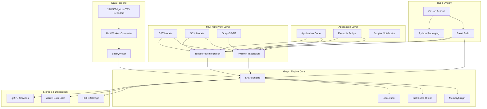
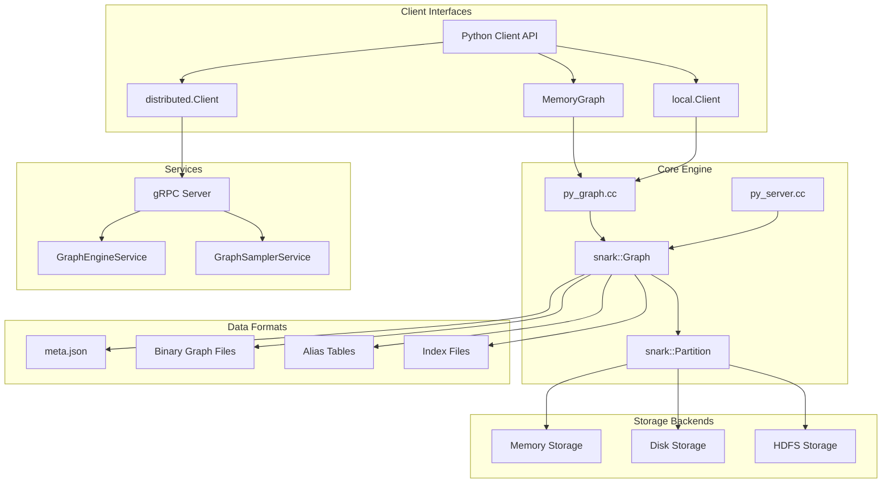
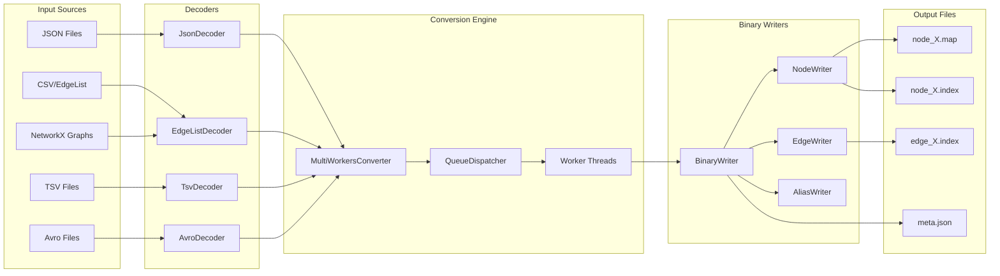

<!-- source: DeepWiki mcp.deepwiki.com · repo microsoft/DeepGNN · page 1 Overview · fetched 2026-10-26 -->

# Overview

Relevant source files

The following files were used as context for generating this wiki page:

- [.readthedocs.yaml](.readthedocs.yaml)
- [docs/BUILD](docs/BUILD)
- [docs/graph_engine/custom_decoder.rst](docs/graph_engine/custom_decoder.rst)
- [docs/requirements.txt](docs/requirements.txt)
- [docs/tf/index.rst](docs/tf/index.rst)
- [requirements.txt](requirements.txt)

## Purpose and Scope

DeepGNN is a distributed graph neural network framework designed for large-scale graph processing and machine learning tasks. This framework provides a complete pipeline from graph data ingestion and storage through distributed training of graph neural network models.

The framework consists of a high-performance graph engine (Snark), data conversion utilities, and integrations with popular machine learning frameworks including PyTorch and TensorFlow. For detailed information about specific components, see [Graph Engine (Snark)](#2), [Datasets and Data Processing](#3), [Machine Learning Integration](#4), and [Development and Deployment](#5).

## High-Level Architecture

**DeepGNN System Architecture**

Sources: [requirements.txt:1-274](), [docs/BUILD:8-287](), [docs/graph_engine/custom_decoder.rst:1-151]()

## Core Components

### Graph Engine (Snark)

The Snark graph engine provides the foundational graph storage and processing capabilities. It supports both in-memory and distributed graph operations through multiple client interfaces.

**Graph Engine Component Architecture**

The engine supports multiple storage backends and provides both synchronous and asynchronous graph operations. Client applications interact with the graph through Python APIs that abstract the underlying C++ implementation.

Sources: [docs/BUILD:8-37](), [docs/graph_engine/custom_decoder.rst:135-151]()

### Data Processing Pipeline

The data conversion system transforms various input formats into the graph engine's optimized binary representation. This pipeline supports multiple input formats and provides extensible decoder interfaces.

**Data Conversion Flow**

The pipeline supports custom decoders through the `Decoder` base class, allowing users to implement domain-specific data transformation logic while maintaining compatibility with the graph engine's storage format.

Sources: [docs/graph_engine/custom_decoder.rst:80-107](), [docs/BUILD:40-51]()

## Machine Learning Framework Integration

### PyTorch Integration

DeepGNN provides native PyTorch integration through specialized dataset classes, samplers, and model implementations. The integration supports distributed training scenarios and popular GNN architectures.

Key components include:
- `GraphSAGE` encoders and sampling utilities
- Custom PyTorch datasets for graph data
- Integration with PyTorch Geometric (`torch_geometric`)
- Ray-based distributed training support

### TensorFlow Integration

The TensorFlow integration offers similar capabilities with TensorFlow-specific implementations:
- Graph Attention Network (`GAT`) models
- Graph Convolutional Network (`GCN`) implementations  
- TensorFlow-compatible data loaders
- Ray distributed training integration

Sources: [requirements.txt:250-258](), [docs/BUILD:99-159](), [docs/BUILD:161-237](), [docs/tf/index.rst:1-11]()

## External System Integration

DeepGNN integrates with several external systems for data storage and distributed processing:

| System | Purpose | Configuration |
|--------|---------|---------------|
| Azure Data Lake | Cloud storage backend | Via `azure-datalake-store` package |
| HDFS | Distributed file storage | Native HDFS integration |
| Apache Spark | Data preprocessing | Through `pyspark` integration |
| Ray | Distributed training | For both PyTorch and TensorFlow |
| gRPC | Service communication | For distributed graph operations |

The framework automatically handles data partitioning and distribution across these systems, enabling scalable graph processing workflows.

Sources: [requirements.txt:20-35](), [requirements.txt:88-90](), [requirements.txt:185](), [requirements.txt:196]()

## Build and Deployment System

DeepGNN uses Bazel as its primary build system, providing reproducible builds across different platforms. The build configuration supports:

- Cross-platform C++ compilation with manylinux compatibility
- Python package generation and distribution
- Automated testing through GitHub Actions
- Documentation generation using Sphinx

The build system handles complex dependencies including C++ libraries, Python packages, and external frameworks, ensuring consistent deployment across development and production environments.

Sources: [docs/BUILD:1-287](), [docs/requirements.txt:1-31](), [.readthedocs.yaml:1-13]()

---

