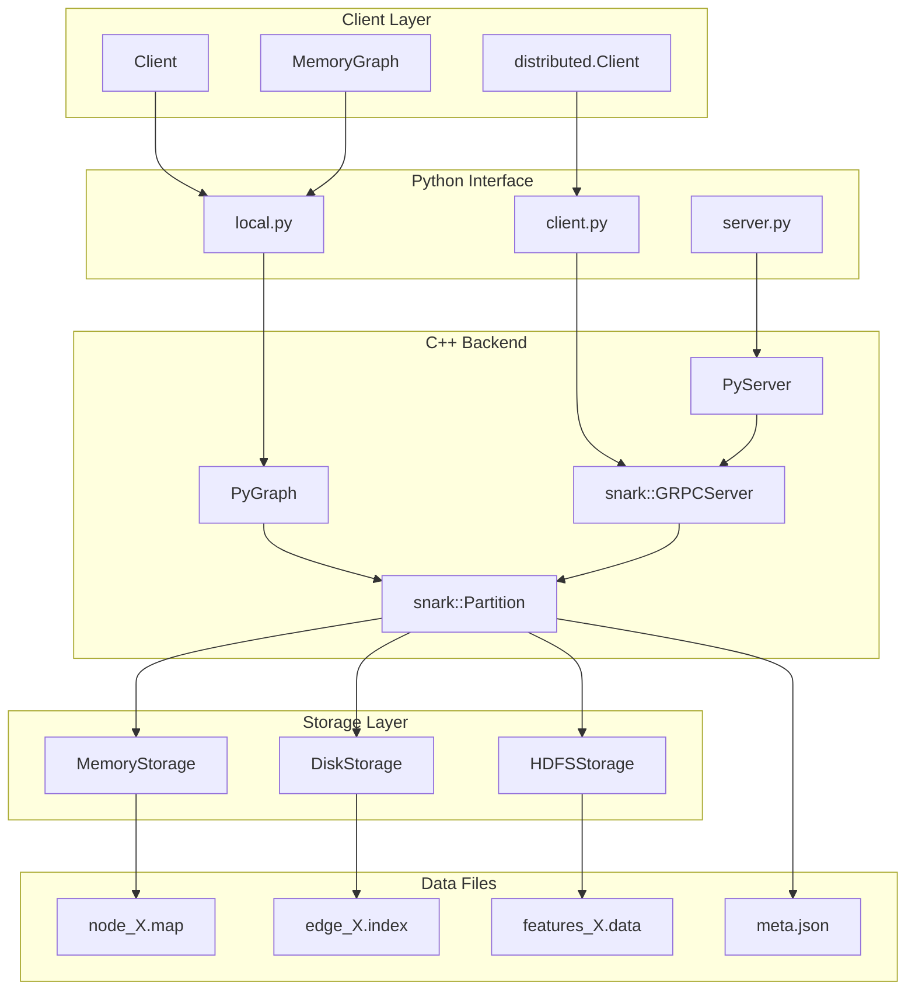
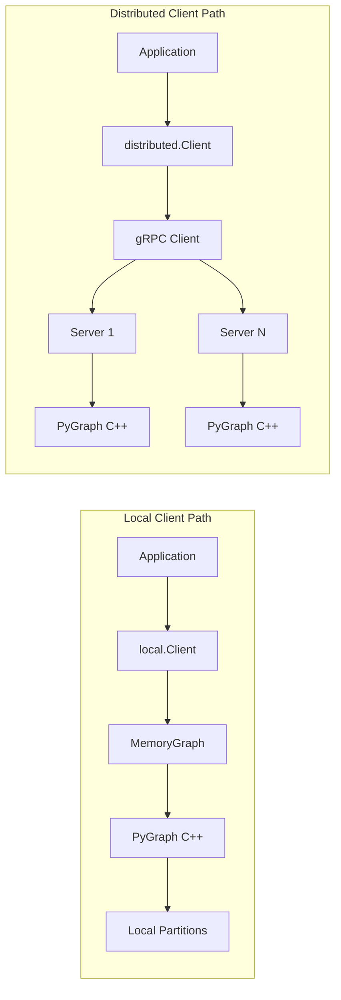
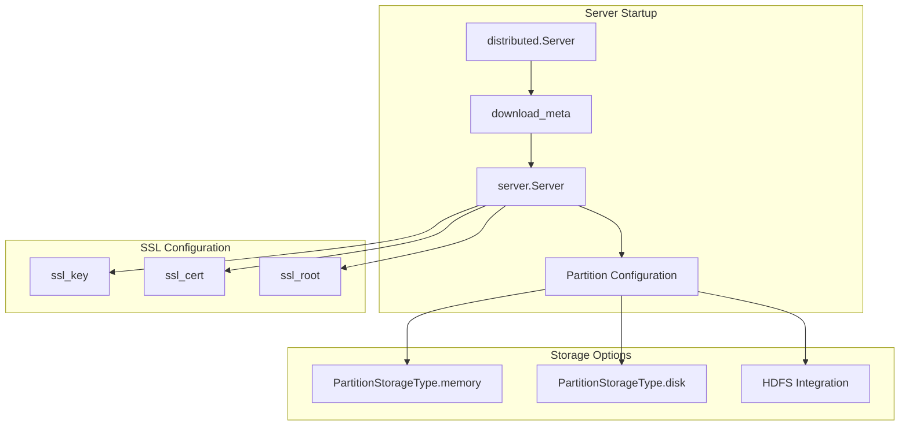
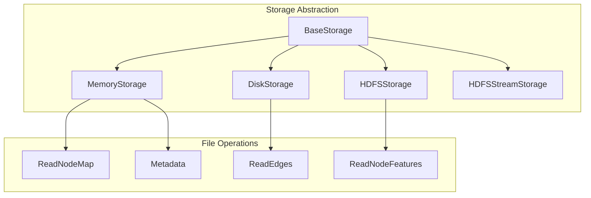
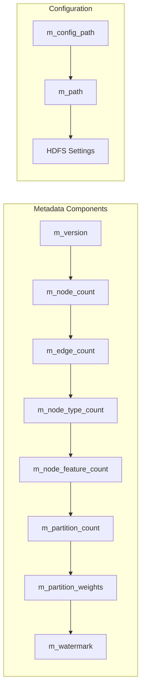
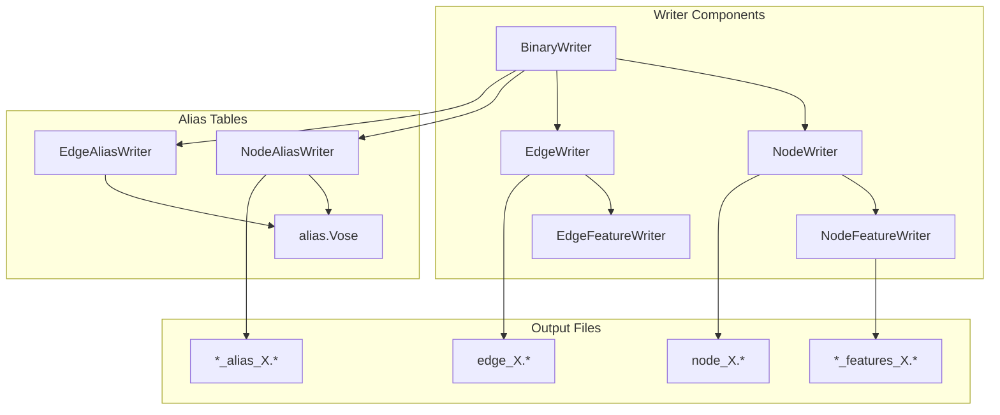
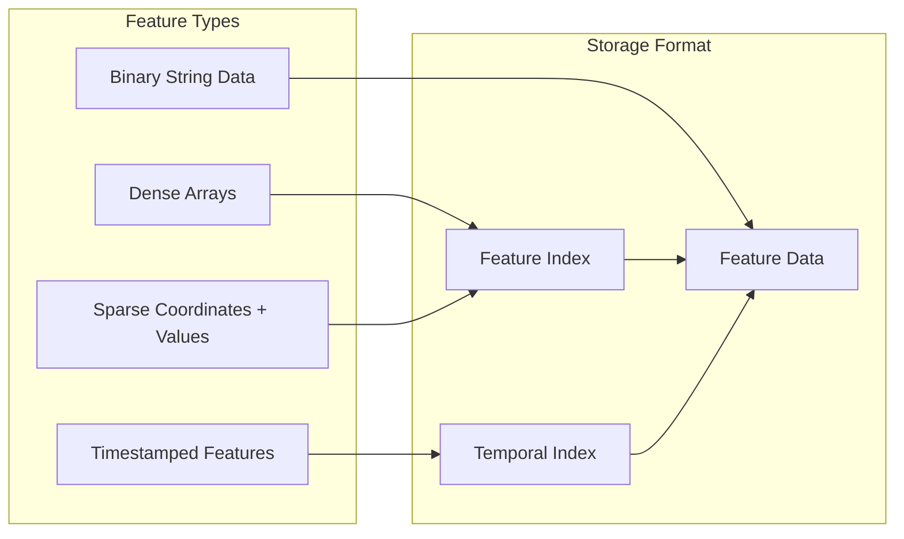

<!-- source: DeepWiki mcp.deepwiki.com · repo microsoft/DeepGNN · page 2 Graph Engine (Snark) · fetched 2026-10-26 -->

# Graph Engine (Snark)

Relevant source files

The following files were used as context for generating this wiki page:

- [src/cc/lib/graph/metadata.cc](src/cc/lib/graph/metadata.cc)
- [src/cc/lib/graph/metadata.h](src/cc/lib/graph/metadata.h)
- [src/cc/lib/graph/partition.cc](src/cc/lib/graph/partition.cc)
- [src/cc/lib/py_graph.h](src/cc/lib/py_graph.h)
- [src/python/deepgnn/graph_engine/snark/converter/writers.py](src/python/deepgnn/graph_engine/snark/converter/writers.py)
- [src/python/deepgnn/graph_engine/snark/distributed.py](src/python/deepgnn/graph_engine/snark/distributed.py)
- [src/python/deepgnn/graph_engine/snark/tests/e2e_test.py](src/python/deepgnn/graph_engine/snark/tests/e2e_test.py)
- [src/python/deepgnn/graph_engine/snark/tests/sparse_features_test.py](src/python/deepgnn/graph_engine/snark/tests/sparse_features_test.py)

The Graph Engine, internally known as Snark, is the core distributed graph storage and query engine for DeepGNN. It provides efficient storage, retrieval, and sampling operations for large-scale graphs across multiple partitions and servers. Snark handles both static and temporal graphs, supporting node and edge features, weighted sampling, and distributed operations through a client-server architecture.

For information about data processing and conversion pipelines that feed into Snark, see [Data Conversion Pipeline](#3.2). For ML framework integration that uses Snark, see [Machine Learning Integration](#4).

## Architecture Overview

Snark employs a multi-layered architecture with Python client interfaces, C++ backend processing, and flexible storage options. The system supports both local in-memory graphs and distributed multi-server deployments.

### Core System Architecture

**Sources:** [src/python/deepgnn/graph_engine/snark/distributed.py:18-42](), [src/cc/lib/py_graph.h:30-44](), [src/cc/lib/graph/partition.cc:138-150]()

## Client APIs

Snark provides two primary client interfaces: local clients for single-machine deployments and distributed clients for multi-server setups.

### Local vs Distributed Clients

**Sources:** [src/python/deepgnn/graph_engine/snark/distributed.py:18-56](), [src/python/deepgnn/graph_engine/snark/tests/e2e_test.py:164-167]()

### Client Interface Operations

The client APIs support comprehensive graph operations including:

| Operation Category | Methods | Description |
|---|---|---|
| Node Operations | `node_features()`, `node_types()`, `node_string_features()` | Retrieve node attributes and features |
| Edge Operations | `edge_features()`, `neighbors()`, `neighbor_count()` | Access edge data and connectivity |
| Sampling | `NodeSampler`, `EdgeSampler` | Weighted and uniform sampling |
| Graph Queries | `get_node_type_count()`, `get_edge_type_count()` | Graph statistics |

**Sources:** [src/python/deepgnn/graph_engine/snark/tests/e2e_test.py:168-176](), [src/cc/lib/py_graph.h:96-125]()

## Server Components

The distributed server architecture enables horizontal scaling across multiple machines while maintaining data locality and efficient query processing.

### Server Initialization and Configuration

**Sources:** [src/python/deepgnn/graph_engine/snark/distributed.py:62-111](), [src/cc/lib/py_graph.h:84-89]()

## Data Storage and Partitioning

Snark uses a sophisticated partitioning scheme to distribute graph data across multiple storage backends while maintaining query efficiency.

### Partition Structure

The `snark::Partition` class manages individual graph partitions with the following key components:

- **Node Storage**: Node mappings, types, and feature indices
- **Edge Storage**: Edge indices, neighbor relationships, and timestamps
- **Feature Storage**: Dense and sparse feature data
- **Metadata**: Partition-specific statistics and configuration

**Sources:** [src/cc/lib/graph/partition.cc:138-201]()

### Storage Type Hierarchy

**Sources:** [src/cc/lib/graph/partition.cc:152-201](), [src/cc/lib/graph/partition.cc:396-455]()

### Binary File Format

Snark stores graph data in an optimized binary format with separate files for different data types:

| File Type | Purpose | Format |
|---|---|---|
| `node_X.map` | Node ID to internal ID mapping | `[node_id: 8b, internal_id: 8b, type: 4b]` |
| `edge_X.index` | Edge connectivity data | `[dst: 8b, feature_offset: 8b, type: 4b, weight: 4b]` |
| `neighbors_X.index` | Neighbor list indices | `[offset: 8b]` |
| `node_features_X.data` | Node feature storage | Variable length binary data |
| `meta.json` | Graph metadata | JSON metadata |

**Sources:** [src/cc/lib/graph/partition.cc:269-337](), [src/python/deepgnn/graph_engine/snark/converter/writers.py:214-221]()

## Metadata Management

The metadata system provides essential graph statistics and configuration information required for distributed operations.

### Metadata Structure

**Sources:** [src/cc/lib/graph/metadata.h:18-44](), [src/cc/lib/graph/metadata.cc:19-111]()

## Data Conversion Pipeline

The conversion pipeline transforms raw graph data into Snark's optimized binary format through a multi-stage process.

### Binary Writer Architecture

**Sources:** [src/python/deepgnn/graph_engine/snark/converter/writers.py:19-172](), [src/python/deepgnn/graph_engine/snark/converter/writers.py:487-576]()

## Key Operations and Interfaces

### C++ Interface Layer

The C interface in `py_graph.h` defines the core operations available to Python clients:

| Function Category | Key Functions | Purpose |
|---|---|---|
| Graph Creation | `CreateLocalGraph`, `CreateRemoteClient` | Initialize graph instances |
| Server Management | `StartServer`, `ResetServer` | Manage distributed servers |
| Node Operations | `GetNodeType`, `GetNodeFeature`, `GetNodeSparseFeature` | Node data access |
| Edge Operations | `GetEdgeFeature`, `GetNeighbors`, `NeighborCount` | Edge data access |
| Sampling | `CreateWeightedNodeSampler`, `SampleNodes`, `SampleEdges` | Random sampling |

**Sources:** [src/cc/lib/py_graph.h:80-183]()

### Feature Handling

Snark supports multiple feature types including dense arrays, sparse features, and string features with temporal versioning:

**Sources:** [src/cc/lib/graph/partition.cc:33-71](), [src/python/deepgnn/graph_engine/snark/converter/writers.py:680-736](), [src/python/deepgnn/graph_engine/snark/tests/sparse_features_test.py:24-53]()

---

