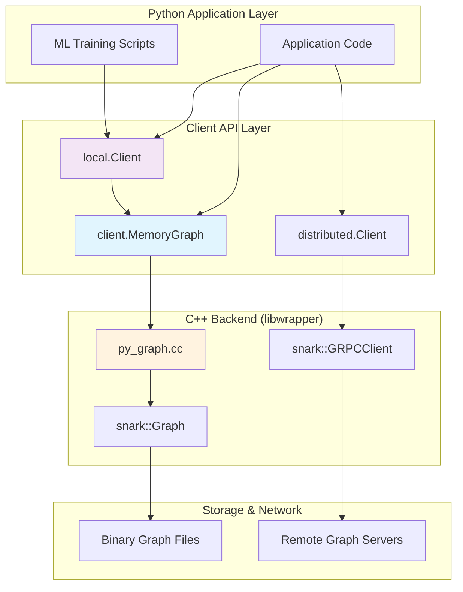
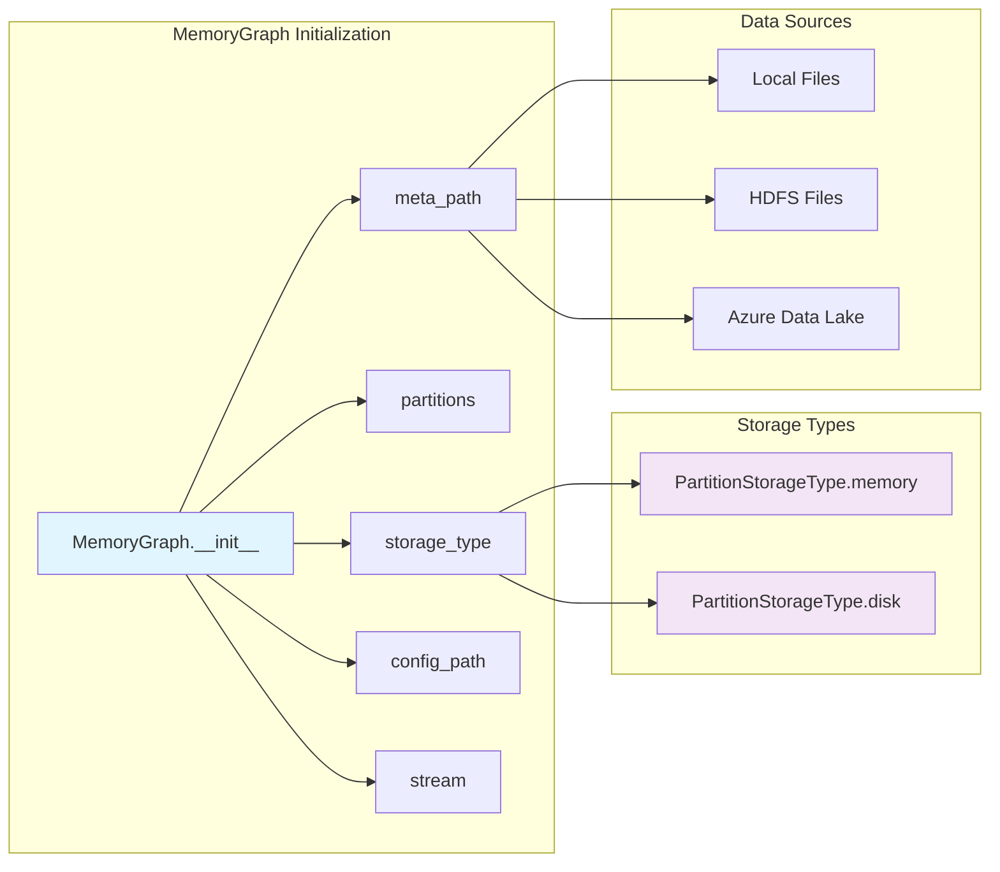
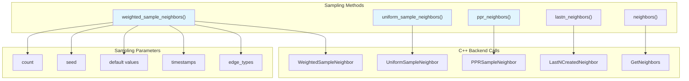
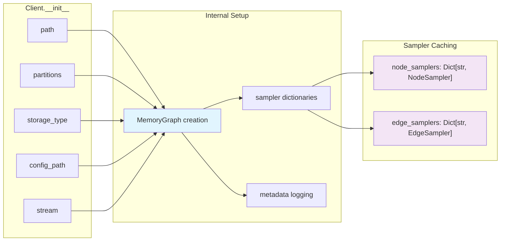
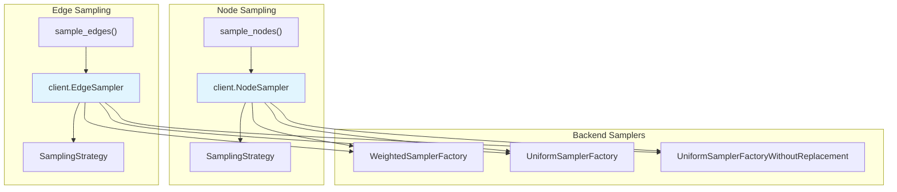
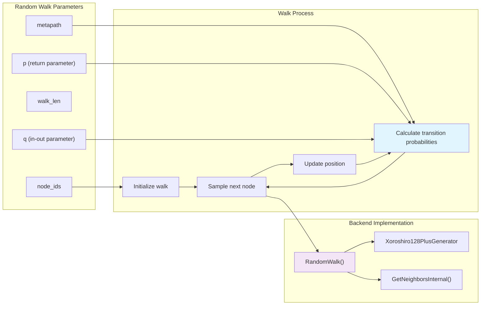
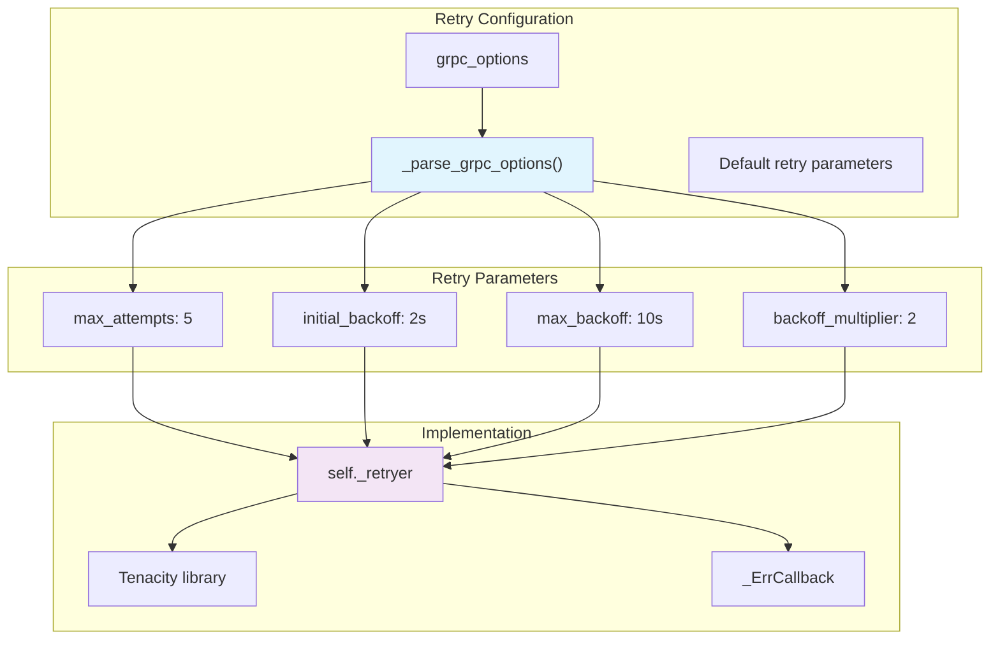

<!-- source: DeepWiki mcp.deepwiki.com · repo microsoft/DeepGNN · page 2.1 Client APIs · fetched 2026-10-26 -->

# Client APIs

Relevant source files

The following files were used as context for generating this wiki page:

- [src/cc/lib/py_graph.cc](src/cc/lib/py_graph.cc)
- [src/cc/lib/version-script.darwin.lds](src/cc/lib/version-script.darwin.lds)
- [src/cc/lib/version-script.linux.lds](src/cc/lib/version-script.linux.lds)
- [src/python/deepgnn/graph_engine/snark/client.py](src/python/deepgnn/graph_engine/snark/client.py)
- [src/python/deepgnn/graph_engine/snark/local.py](src/python/deepgnn/graph_engine/snark/local.py)

## Purpose and Scope

This document covers the Python client interfaces for interacting with the DeepGNN graph engine (Snark). The client APIs provide the primary mechanism for loading graph data, querying graph structure, retrieving features, and performing sampling operations for machine learning workflows.

For information about server setup and distributed deployment, see [Server Components](#2.2). For distributed operations across multiple servers, see [Distributed Operations](#2.3).

## Client Architecture Overview

The client API consists of two main layers: a low-level `MemoryGraph` class that directly interfaces with the C++ backend, and a higher-level `Client` wrapper that provides convenient abstractions for common operations.

**Sources:** [src/python/deepgnn/graph_engine/snark/client.py:1-42](), [src/python/deepgnn/graph_engine/snark/local.py:1-25](), [src/cc/lib/py_graph.cc:64-71]()

## MemoryGraph - Core Local Client

The `MemoryGraph` class provides direct access to graph data loaded into memory or streamed from storage. It serves as the foundation for all local graph operations.

### Initialization and Storage Options

**Sources:** [src/python/deepgnn/graph_engine/snark/client.py:203-288](), [src/python/deepgnn/graph_engine/snark/client.py:99-104]()

### Feature Retrieval Operations

The `MemoryGraph` class supports multiple types of feature retrieval for both nodes and edges:

| Feature Type | Node Method | Edge Method | Data Format |
|--------------|-------------|-------------|-------------|
| Dense | `node_features()` | `edge_features()` | Fixed-size arrays |
| Sparse | `node_sparse_features()` | `edge_sparse_features()` | COO format indices + values |
| String | `node_string_features()` | `edge_string_features()` | Variable-length byte arrays |

**Sources:** [src/python/deepgnn/graph_engine/snark/client.py:540-584](), [src/python/deepgnn/graph_engine/snark/client.py:675-730](), [src/python/deepgnn/graph_engine/snark/client.py:586-629]()

### Neighbor Sampling Strategies

**Sources:** [src/python/deepgnn/graph_engine/snark/client.py:947-1025](), [src/python/deepgnn/graph_engine/snark/client.py:1027-1098](), [src/cc/lib/py_graph.cc:730-778](), [src/cc/lib/py_graph.cc:780-830]()

## Local Client Wrapper

The `local.Client` class provides a convenient high-level interface that wraps `MemoryGraph` and includes additional functionality for node/edge sampling and strategy-based neighbor sampling.

### Client Initialization Flow

**Sources:** [src/python/deepgnn/graph_engine/snark/local.py:24-54](), [src/python/deepgnn/graph_engine/snark/local.py:49-50]()

### Sampling Strategy Mapping

The `local.Client` maps high-level sampling strategies to implementation-specific methods:

| Strategy | Implementation | Method Called |
|----------|----------------|---------------|
| `SamplingStrategy.Weighted` | "weighted" | `weighted_sample_neighbors()` |
| `SamplingStrategy.Random` | "uniform" | `uniform_sample_neighbors()` |
| `SamplingStrategy.RandomWithoutReplacement` | "withoutreplacement" | `uniform_sample_neighbors(without_replacement=True)` |
| `SamplingStrategy.PPRGo` | "ppr-go" | `ppr_neighbors()` |
| `SamplingStrategy.LastN` | "lastn" | `lastn_neighbors()` |

**Sources:** [src/python/deepgnn/graph_engine/snark/local.py:14-21](), [src/python/deepgnn/graph_engine/snark/local.py:116-188]()

## Core Client Operations

### Node and Edge Sampling

The client APIs support sampling of nodes and edges from the graph using various strategies:

**Sources:** [src/python/deepgnn/graph_engine/snark/local.py:62-96](), [src/cc/lib/py_graph.cc:251-265]()

### Graph Traversal Operations

#### Random Walk Implementation

The client supports biased random walks following the node2vec algorithm:

**Sources:** [src/python/deepgnn/graph_engine/snark/local.py:210-239](), [src/cc/lib/py_graph.cc:882-1022]()

### Feature Access Patterns

The client APIs provide comprehensive feature access with temporal support:

| Operation | Temporal Support | Return Format | Example Use Case |
|-----------|------------------|---------------|------------------|
| `node_features()` | ✓ (timestamps) | Dense arrays | Node embeddings |
| `edge_features()` | ✓ (timestamps) | Dense arrays | Edge weights |
| `node_sparse_features()` | ✓ (timestamps) | COO indices + values | Bag-of-words features |
| `neighbors()` | ✓ (timestamps) | Node IDs + metadata | Full neighborhood |
| `neighbor_count()` | ✓ (timestamps) | Counts | Degree information |

**Sources:** [src/python/deepgnn/graph_engine/snark/local.py:190-299](), [src/python/deepgnn/graph_engine/snark/client.py:844-883]()

## Error Handling and Retry Logic

The client implementation includes robust error handling for distributed scenarios:

**Sources:** [src/python/deepgnn/graph_engine/snark/client.py:44-82](), [src/python/deepgnn/graph_engine/snark/client.py:88-97](), [src/python/deepgnn/graph_engine/snark/client.py:290]()

---

