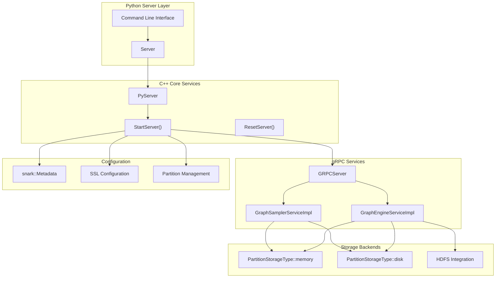
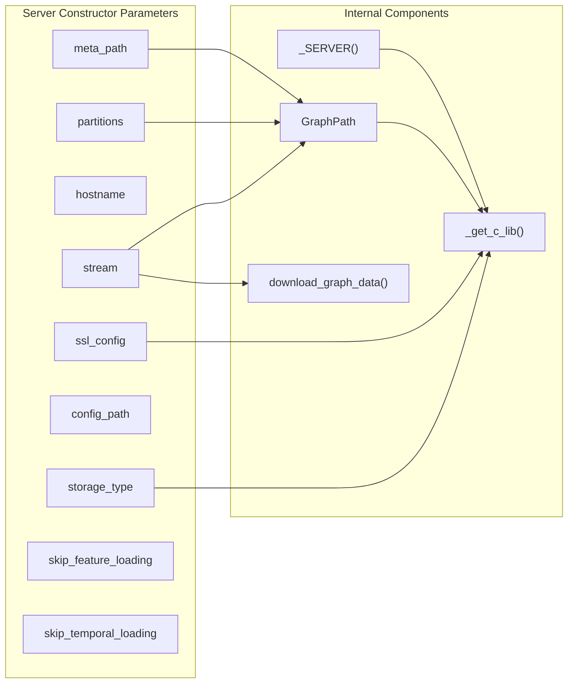
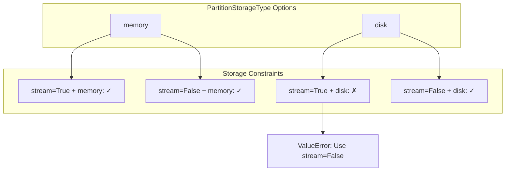
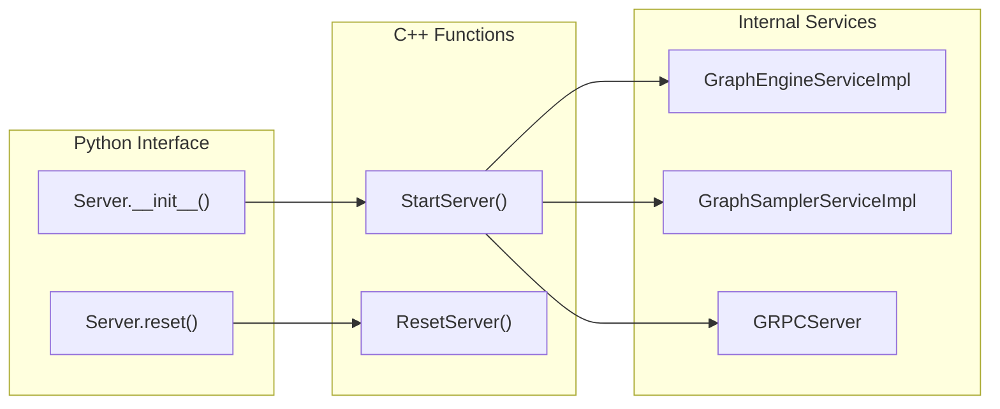
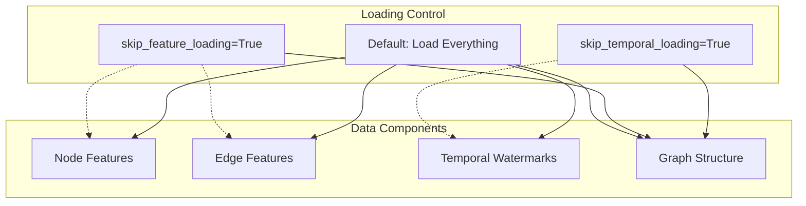

<!-- source: DeepWiki mcp.deepwiki.com · repo microsoft/DeepGNN · page 2.2 Server Components · fetched 2026-10-26 -->

# Server Components

<details>
<summary>Relevant source files</summary>

The following files were used as context for generating this wiki page:

- [src/cc/lib/py_server.cc](src/cc/lib/py_server.cc)
- [src/cc/tests/graph_test.cc](src/cc/tests/graph_test.cc)
- [src/python/deepgnn/graph_engine/snark/server.py](src/python/deepgnn/graph_engine/snark/server.py)
- [src/python/deepgnn/graph_engine/snark/tests/hdfs_test.py](src/python/deepgnn/graph_engine/snark/tests/hdfs_test.py)

</details>


This document covers the server-side components of the Graph Engine (Snark), including server setup, configuration options, storage backends, and service implementations. For information about client interfaces that connect to these servers, see [Client APIs](#2.1). For details about multi-server distributed deployments, see [Distributed Operations](#2.3).

## Architecture Overview

The DeepGNN graph engine server provides gRPC-based services for graph operations, supporting various storage backends and deployment configurations.

### Server Component Architecture



Sources: [src/python/deepgnn/graph_engine/snark/server.py:39-167](), [src/cc/lib/py_server.cc:32-54]()

## Main Server Class

The `Server` class in `server.py` serves as the primary interface for creating and managing graph engine servers.

### Server Initialization



| Parameter | Type | Description |
|-----------|------|-------------|
| `meta_path` | `str` | Location of meta.json file with global graph information |
| `partitions` | `Sequence[Union[int, Tuple[str, int]]]` | Partition IDs or (path, ID) tuples to load |
| `hostname` | `str` | Address to use for serving (e.g., "0.0.0.0:9999") |
| `ssl_config` | `Dict[str, str]` | SSL configuration with keys: ssl_key, ssl_cert, ssl_root |
| `storage_type` | `PartitionStorageType` | Memory or disk storage (default: memory) |
| `config_path` | `str` | Path to configuration files for HDFS access |
| `stream` | `bool` | Stream data directly vs. download first (default: False) |
| `skip_feature_loading` | `bool` | Skip loading node/edge features (default: False) |
| `skip_temporal_loading` | `bool` | Skip loading temporal watermarks (default: False) |

Sources: [src/python/deepgnn/graph_engine/snark/server.py:42-70]()

### Server Lifecycle Methods

The server provides methods for managing its lifecycle:

- **`reset()`**: Stops the server and cleans up resources
- **C++ Integration**: Uses ctypes to interface with the underlying C++ server implementation

Sources: [src/python/deepgnn/graph_engine/snark/server.py:159-165]()

## Storage Configuration

### Storage Types

The server supports different storage backends through the `PartitionStorageType` enumeration:



**Storage Type Validation**: The server enforces that `stream=True` cannot be used with `storage_type=disk`, raising a `ValueError` with the message "Use stream=False to download files first and use them from disk."

Sources: [src/python/deepgnn/graph_engine/snark/server.py:71-74]()

### HDFS and Remote Storage

The server supports various remote storage protocols:

| Protocol | Example Path | Configuration Required |
|----------|--------------|------------------------|
| HDFS | `hdfs://namenode:port/path` | Hadoop configuration files |
| Azure Data Lake | `adl://account.azuredatalakestore.net/path` | ADL configuration |
| Local Files | `file:///absolute/path` | Hadoop classpath setup |

**HDFS Integration**: When remote paths are detected, the server calls `_set_hadoop_classpath(config_path)` to configure the Hadoop environment.

Sources: [src/python/deepgnn/graph_engine/snark/server.py:91-96](), [src/python/deepgnn/graph_engine/snark/tests/hdfs_test.py:25-51]()

## C++ Service Implementation

### Core Server Functions

The C++ backend provides two primary functions for server management:



**StartServer Function**: Creates and initializes the server with the following signature:
```cpp
int32_t StartServer(PyServer *graph, const char *meta_location, size_t count, 
                   uint32_t *partition_indices, const char **partition_locations, 
                   const char *host_name, const char *ssl_key, const char *ssl_cert, 
                   const char *ssl_root, const PyPartitionStorageType storage_type_, 
                   const char *config_path, bool skip_feature_loading, 
                   bool skip_temporal_loading)
```

Sources: [src/cc/lib/py_server.cc:32-54]()

### Service Architecture

The C++ implementation creates two main gRPC services:

1. **GraphEngineServiceImpl**: Handles core graph operations (node/edge queries, features)
2. **GraphSamplerServiceImpl**: Provides graph sampling functionality

Both services are wrapped in a `GRPCServer` instance that manages the gRPC lifecycle.

Sources: [src/cc/lib/py_server.cc:46-52]()

## Command Line Interface

The server can be run as a standalone application using the built-in command line interface:

### Basic Usage

```bash
python -m deepgnn.graph_engine.snark.server \
    --port 9999 \
    --data_dir /path/to/graph/data \
    --partitions 0,1,2
```

### Command Line Arguments

| Argument | Type | Description |
|----------|------|-------------|
| `--port` | `str` | Server listening port (required) |
| `--data_dir` | `str` | Graph data directory (required) |
| `--partitions` | `List[int]` | Partition IDs to load |
| `--server_group` | `List[int]` | [server_index, total_servers, total_partitions] |
| `--storage_type` | `PartitionStorageType` | Storage backend (default: memory) |
| `--config_path` | `str` | Configuration directory for HDFS |
| `--stream` | `bool` | Stream remote data directly |
| `--skip_feature_loading` | `bool` | Skip feature loading |
| `--skip_temporal_loading` | `bool` | Skip temporal data loading |

### Server Group Configuration

For distributed deployments, use `--server_group` instead of `--partitions`:

```bash
# Server 0 in a 3-server setup with 9 total partitions
python -m deepgnn.graph_engine.snark.server \
    --port 9999 \
    --data_dir /path/to/data \
    --server_group 0,3,9
```

This automatically assigns partitions `[0, 3, 6]` to server 0.

Sources: [src/python/deepgnn/graph_engine/snark/server.py:175-268]()

## SSL Configuration

### SSL Setup

The server supports encrypted gRPC connections through SSL configuration:

```python
ssl_config = {
    "ssl_key": "/path/to/private.key",
    "ssl_cert": "/path/to/certificate.crt", 
    "ssl_root": "/path/to/ca.crt"
}

server = Server(
    meta_path="hdfs://namenode/graph/meta.json",
    partitions=[0, 1],
    hostname="0.0.0.0:9999",
    ssl_config=ssl_config
)
```

**SSL File Requirements**:
- `ssl_key`: Private key file for the server
- `ssl_cert`: Server certificate file
- `ssl_root`: Certificate authority root certificate

The SSL configuration is passed directly to the underlying gRPC server implementation.

Sources: [src/python/deepgnn/graph_engine/snark/server.py:135-141](), [src/cc/lib/py_server.cc:34-35]()

## Feature and Temporal Loading Control

### Loading Options

The server provides fine-grained control over data loading:



**Performance Optimization**: Skipping feature or temporal loading can significantly reduce server startup time and memory usage when these features are not needed.

Sources: [src/python/deepgnn/graph_engine/snark/server.py:68-69](), [src/python/deepgnn/graph_engine/snark/tests/hdfs_test.py:115-118]()

---

