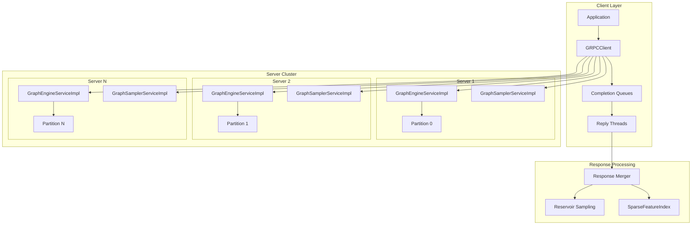
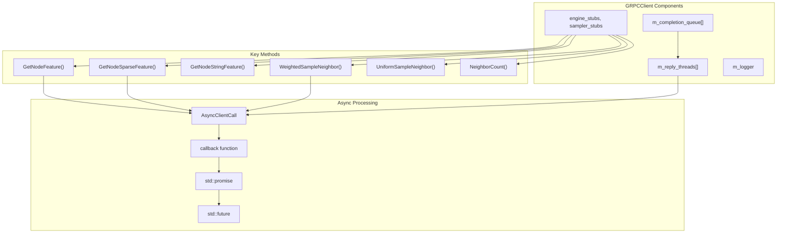
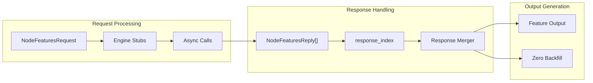
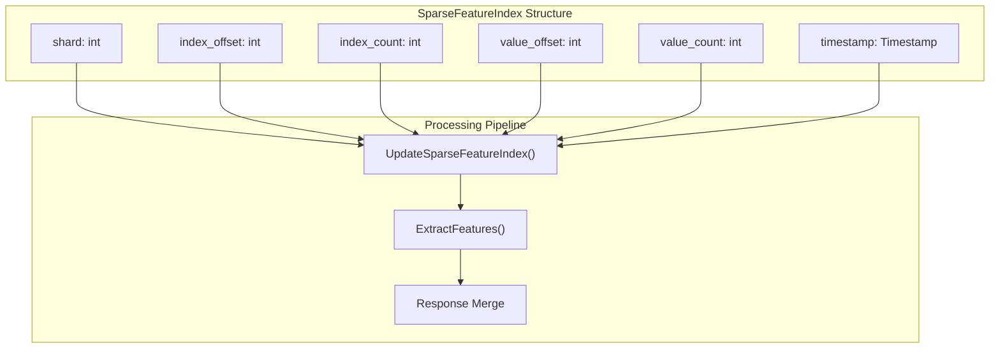
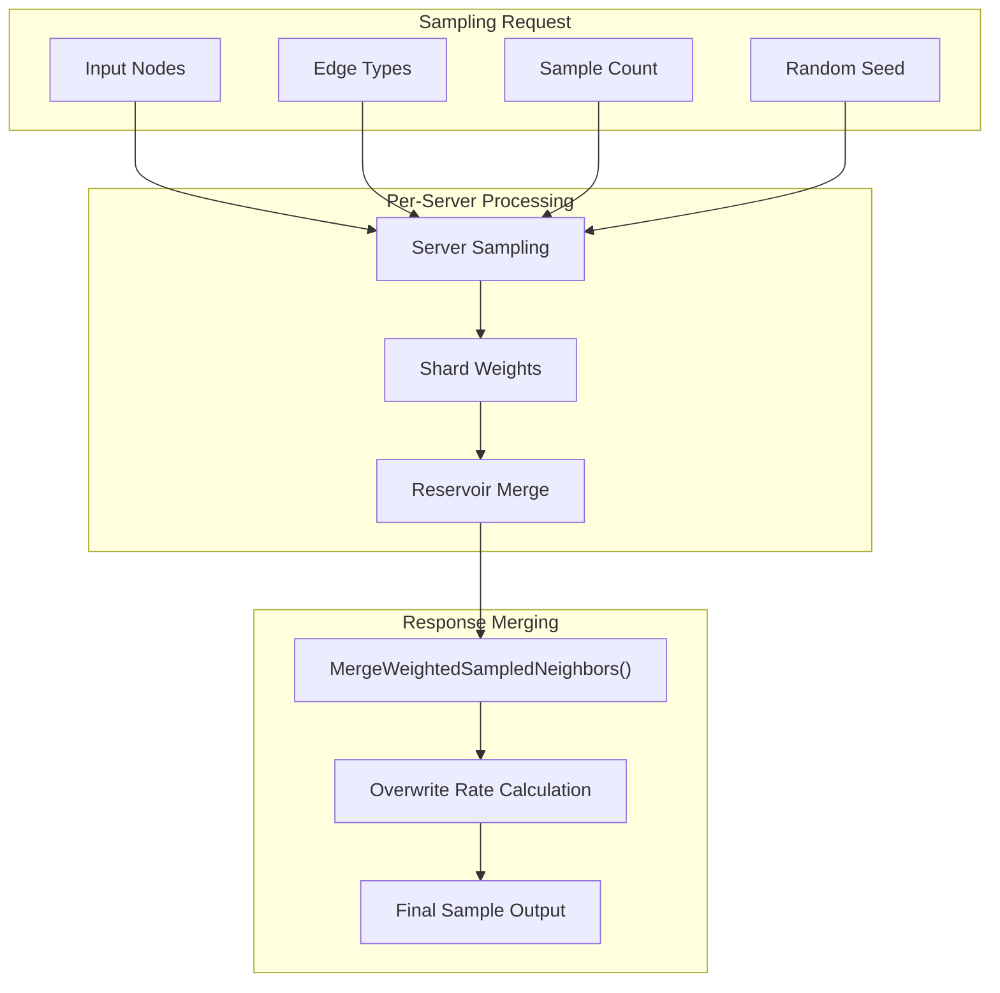
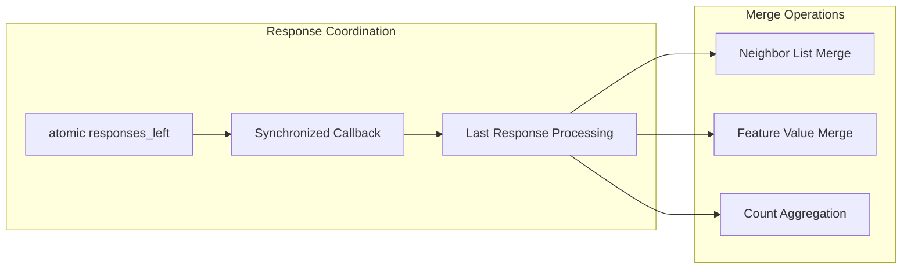
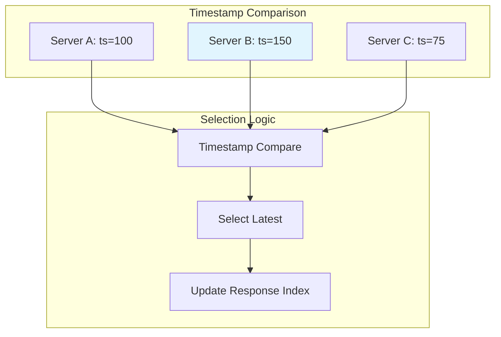

<!-- source: DeepWiki mcp.deepwiki.com · repo microsoft/DeepGNN · page 2.3 Distributed Operations · fetched 2026-10-26 -->

# Distributed Operations

<details>
<summary>Relevant source files</summary>

The following files were used as context for generating this wiki page:

- [src/cc/lib/distributed/client.cc](src/cc/lib/distributed/client.cc)
- [src/cc/lib/graph/merger.h](src/cc/lib/graph/merger.h)
- [src/cc/lib/graph/reservoir.cc](src/cc/lib/graph/reservoir.cc)
- [src/cc/lib/graph/reservoir.h](src/cc/lib/graph/reservoir.h)
- [src/cc/tests/distributed_test.cc](src/cc/tests/distributed_test.cc)
- [src/cc/tests/temporal_test.cc](src/cc/tests/temporal_test.cc)

</details>


This document covers the distributed graph operations system in DeepGNN's Snark graph engine, including client-server communication, multi-partition data retrieval, and distributed sampling algorithms. The distributed operations enable graph neural network workloads to scale across multiple servers by partitioning graph data and coordinating operations through gRPC services.

For information about setting up graph engine servers, see [Server Components](#2.2). For details about client APIs for local graph access, see [Client APIs](#2.1).

## System Overview

The distributed operations system enables graph queries and sampling across multiple server partitions through a coordinated client-server architecture. The system uses gRPC for communication and implements sophisticated response merging to provide a unified view of partitioned graph data.

### Distributed Architecture



Sources: [src/cc/lib/distributed/client.cc:164-186](), [src/cc/tests/distributed_test.cc:92-96]()

## Core Components

### GRPCClient

The `GRPCClient` class serves as the primary interface for distributed graph operations, managing connections to multiple server partitions and coordinating asynchronous requests.



Sources: [src/cc/lib/distributed/client.cc:164-186](), [src/cc/lib/distributed/client.cc:188-230]()

### Asynchronous Operation Framework

The distributed system uses an asynchronous callback model with completion queues to handle concurrent requests to multiple servers efficiently.

| Component | Purpose | Key Fields |
|-----------|---------|------------|
| `AsyncClientCall` | Request context | `ClientContext`, `Status`, `callback`, `promise` |
| Completion Queue | Async event handling | Per-thread queues for load balancing |
| Reply Threads | Response processing | Configurable thread pool |

Sources: [src/cc/lib/distributed/client.cc:34-47](), [src/cc/lib/distributed/client.cc:182-185]()

## Feature Retrieval Operations

### Node Feature Retrieval

Node feature retrieval distributes requests across servers and merges responses based on timestamps to provide the most recent feature values.



The system maintains a response index that tracks the latest timestamp for each node-feature combination across all servers:

```cpp
// Response index structure: (shard_index, node_index, timestamp)
std::vector<std::tuple<int32_t, int32_t, snark::Timestamp>> response_index
```

Sources: [src/cc/lib/distributed/client.cc:284-388](), [src/cc/tests/distributed_test.cc:76-104]()

### Sparse Feature Handling

Sparse features use a specialized index structure to efficiently merge variable-length feature data from multiple partitions.



Sources: [src/cc/lib/graph/merger.h:19-29](), [src/cc/lib/graph/merger.h:78-133](), [src/cc/lib/distributed/client.cc:469-486]()

## Distributed Sampling Operations

### Weighted Neighbor Sampling

Weighted neighbor sampling distributes sampling requests across partitions and uses reservoir sampling to merge results while maintaining proper probability distributions.



The merging process uses probabilistic replacement based on shard weights:

```cpp
float overwrite_rate = *curr_reply_shard_weight / *curr_shard_weight;
```

Sources: [src/cc/lib/distributed/client.cc:720-781](), [src/cc/lib/graph/merger.h:249-360]()

### Uniform Sampling

Uniform sampling provides unbiased neighbor selection across partitions using reservoir sampling algorithms.

| Sampling Mode | Algorithm | Replacement Policy |
|---------------|-----------|-------------------|
| Without Replacement | `AlgorithmL` | Optimal reservoir sampling |
| With Replacement | `WithReplacement` | Bernoulli trials |
| Merge Operations | `WithoutReplacementMerge` | Weighted merging |

Sources: [src/cc/lib/graph/reservoir.h:17-41](), [src/cc/lib/graph/reservoir.cc:13-55]()

## Response Merging and Aggregation

### Multi-Server Response Coordination

The system uses atomic counters and synchronized callbacks to coordinate responses from multiple servers before processing results.



Sources: [src/cc/lib/distributed/client.cc:552-589](), [src/cc/lib/distributed/client.cc:648-705]()

### Temporal Consistency

The distributed system maintains temporal consistency by selecting the most recent values across partitions based on timestamps.



Sources: [src/cc/lib/distributed/client.cc:336-342](), [src/cc/tests/temporal_test.cc:37-204]()

## Error Handling and Resilience

The distributed operations system implements comprehensive error handling for network failures, partial responses, and missing data scenarios.

### Missing Data Handling

| Scenario | Strategy | Default Value |
|----------|----------|---------------|
| Missing Node Features | Zero backfill | `0` bytes |
| Missing Neighbors | Default values | Configurable defaults |
| Empty Server Responses | Skip processing | Continue aggregation |
| Dimension Mismatches | Fatal error | Validation failure |

### Partial Response Processing

The system gracefully handles scenarios where some servers return empty responses or fail to respond, continuing with available data.

Sources: [src/cc/lib/distributed/client.cc:212-229](), [src/cc/lib/graph/merger.h:99-107](), [src/cc/tests/distributed_test.cc:354-391]()

---

