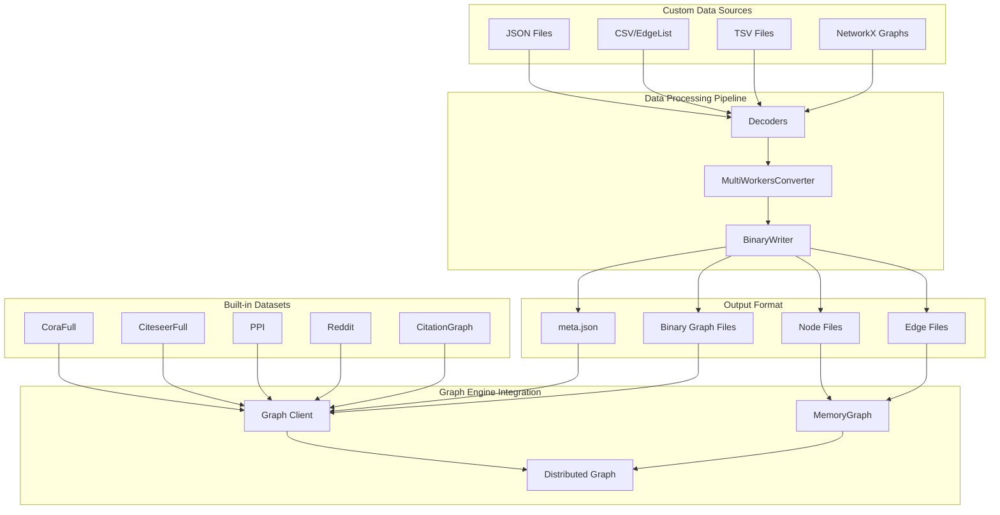
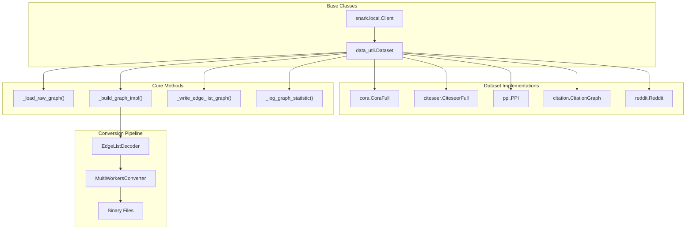
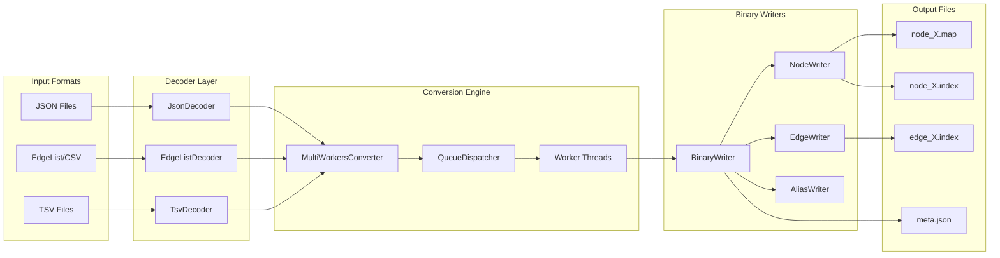
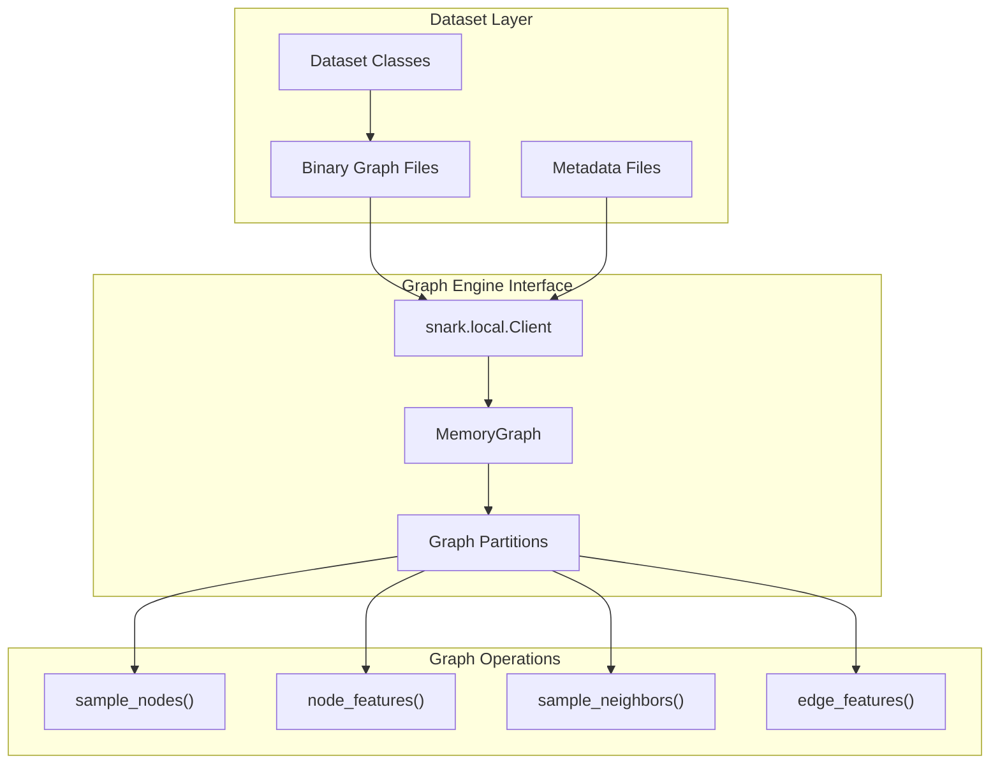

<!-- source: DeepWiki mcp.deepwiki.com · repo microsoft/DeepGNN · page 3 Datasets and Data Processing · fetched 2026-10-26 -->

# Datasets and Data Processing

<details>
<summary>Relevant source files</summary>

The following files were used as context for generating this wiki page:

- [CHANGELOG.md](CHANGELOG.md)
- [src/python/deepgnn/graph_engine/data/BUILD](src/python/deepgnn/graph_engine/data/BUILD)
- [src/python/deepgnn/graph_engine/data/citeseer.py](src/python/deepgnn/graph_engine/data/citeseer.py)
- [src/python/deepgnn/graph_engine/data/citeseer.zip](src/python/deepgnn/graph_engine/data/citeseer.zip)
- [src/python/deepgnn/graph_engine/data/cora.py](src/python/deepgnn/graph_engine/data/cora.py)
- [src/python/deepgnn/graph_engine/data/data_util.py](src/python/deepgnn/graph_engine/data/data_util.py)
- [src/python/deepgnn/graph_engine/data/test_graph_dataset.py](src/python/deepgnn/graph_engine/data/test_graph_dataset.py)

</details>


This document covers the dataset management and data processing capabilities within DeepGNN. It explains the built-in graph datasets, the data conversion pipeline for custom datasets, and how raw graph data is transformed into the binary format used by the Snark graph engine.

For information about the core graph engine that consumes these processed datasets, see [Graph Engine (Snark)](#2). For machine learning framework integration with datasets, see [Machine Learning Integration](#4).

## Overview

DeepGNN provides a comprehensive data processing system that handles both built-in benchmark datasets and custom graph data conversion. The system transforms various input formats into an optimized binary representation suitable for distributed graph operations.



Sources: [src/python/deepgnn/graph_engine/data/data_util.py:83-215](), [src/python/deepgnn/graph_engine/data/BUILD:7-24]()

## Dataset Architecture

The dataset system is built around a common `Dataset` base class that provides standardized interfaces for graph data access and preprocessing.



Sources: [src/python/deepgnn/graph_engine/data/data_util.py:83-112](), [src/python/deepgnn/graph_engine/data/cora.py:13-54](), [src/python/deepgnn/graph_engine/data/citeseer.py:13-51]()

## Built-in Datasets

### Academic Citation Networks

DeepGNN includes several well-known academic citation datasets commonly used for graph neural network research.

| Dataset | Nodes | Edges | Classes | Features | Description |
|---------|-------|-------|---------|----------|-------------|
| `CoraFull` | 2,708 | 10,556 | 7 | 1,433 | Citation network with papers classified by research area |
| `CiteseerFull` | 3,312 | 9,228 | 6 | 3,703 | Computer science papers with citation relationships |

#### Cora Dataset

The `CoraFull` class provides access to the complete Cora citation network:

```python
# Basic usage
g = CoraFull()

# Custom configuration
g = CoraFull(
    output_dir="/path/to/data",
    train_node_ratio=0.8,
    random_selection=True,
    num_partitions=4
)
```

**Key Features:**
- Node features: Binary word vectors indicating paper content
- Labels: Research area classification (7 categories)
- Edges: Citation relationships between papers
- Configurable train/test splits

Sources: [src/python/deepgnn/graph_engine/data/cora.py:13-54](), [src/python/deepgnn/graph_engine/data/test_graph_dataset.py:96-112]()

#### Citeseer Dataset

The `CiteseerFull` class implements the Citeseer citation network:

```python
g = CiteseerFull(
    output_dir="/custom/path",
    train_node_ratio=0.7,
    random_selection=False
)
```

**Characteristics:**
- Focus: Computer science publications
- Features: Bag-of-words representations
- Higher dimensional features than Cora (3,703 vs 1,433)

Sources: [src/python/deepgnn/graph_engine/data/citeseer.py:13-51](), [src/python/deepgnn/graph_engine/data/test_graph_dataset.py:114-129]()

### Protein-Protein Interaction Dataset

The `PPI` dataset represents biological protein interaction networks:

```python
g = PPI()
```

**Statistics:**
- Training nodes: 44,906
- Validation nodes: 6,514  
- Test nodes: 5,524
- Features: 50-dimensional
- Classes: 121 (multi-label classification)
- Edges: 1,246,382 (training), 365,966 (validation)

Sources: [src/python/deepgnn/graph_engine/data/test_graph_dataset.py:175-206]()

### Legacy Datasets

#### MOOC Dataset (Deprecated)
The MOOC temporal dataset has been removed as indicated in the changelog. It previously provided user-course interaction data for temporal graph analysis.

Sources: [CHANGELOG.md:9](), [src/python/deepgnn/graph_engine/data/test_graph_dataset.py:208-229]()

## Data Conversion Pipeline

The conversion pipeline transforms raw graph data into DeepGNN's optimized binary format through a multi-stage process.



Sources: [src/python/deepgnn/graph_engine/data/data_util.py:143-156]()

### Conversion Process

The `Dataset._build_graph_impl()` method orchestrates the conversion:

1. **Raw Data Loading**: Extract from zip archives or download from URLs
2. **Edge List Generation**: Convert to intermediate edge list format using `get_edge_list_node()`
3. **Binary Conversion**: Use `MultiWorkersConverter` with `EdgeListDecoder`
4. **Output Generation**: Create node/edge files and metadata

Key conversion steps:
```python
# Convert graph: edge_list -> Binary
convert.MultiWorkersConverter(
    graph_path=graph_file,
    partition_count=self._num_partitions,
    output_dir=output_dir,
    decoder=decoders.EdgeListDecoder(),
).convert()
```

Sources: [src/python/deepgnn/graph_engine/data/data_util.py:149-155]()

### EdgeList Format

The intermediate EdgeList format uses a structured text representation:

```
# Node format: node_id,-1,node_type,weight,feature_type,feature_count,features...,label_type,label_count,labels...
# Edge format: src_id,edge_type,dst_id,weight

1,-1,0,1.0,float32,1433,0.1,0.2,...,float32,1,3
1,0,5,1.0
1,0,15,1.0
```

The `get_edge_list_node()` function generates this format:

Sources: [src/python/deepgnn/graph_engine/data/data_util.py:30-53]()

## File Formats and Storage

### Binary Graph Format

The conversion pipeline produces several binary file types optimized for efficient graph operations:

| File Type | Purpose | Example |
|-----------|---------|---------|
| `node_X.map` | Node ID mappings | Original ID → Internal ID |
| `node_X.index` | Node data indices | Offset pointers for features |
| `edge_X.index` | Edge data indices | Neighbor list pointers |
| `neighbors_X.index` | Neighbor indices | Adjacency list storage |
| `meta.json` | Graph metadata | Statistics and configuration |

### Metadata Structure

The `meta.json` file contains essential graph statistics and configuration:

```json
{
  "node_count": 2708,
  "edge_count": 10556,
  "node_type_num": 2,
  "edge_type_num": 2,
  "feature_count": 1,
  "watermark": 0
}
```

### Train/Test Split Files

Datasets generate auxiliary files for machine learning workflows:
- `train.nodes`: Training node IDs (one per line)
- `test.nodes`: Test node IDs (one per line)

Sources: [src/python/deepgnn/graph_engine/data/data_util.py:156-161]()

## Integration with Graph Engine

Datasets seamlessly integrate with the Snark graph engine through the `Client` interface:



### Client Initialization

The `Dataset` base class inherits from `Client` and automatically initializes the graph engine:

```python
super().__init__(self.output_dir, partitions=[0])
```

This provides immediate access to graph operations:
- Node sampling with different strategies
- Feature extraction for nodes and edges  
- Neighbor sampling for GNN training
- Graph statistics and metadata access

Sources: [src/python/deepgnn/graph_engine/data/data_util.py:111](), [src/python/deepgnn/graph_engine/data/test_graph_dataset.py:18-32]()

### Usage in Machine Learning

Datasets integrate directly with training workflows:

```python
# Initialize dataset
g = CoraFull(train_node_ratio=0.8)

# Sample training nodes
train_nodes = g.sample_nodes(
    batch_size=64, 
    node_types=0, 
    strategy=SamplingStrategy.Random
)

# Get node features
features = g.node_features(
    train_nodes, 
    np.array([[0, g.FEATURE_DIM]], dtype=np.int32), 
    np.float32
)
```

Sources: [src/python/deepgnn/graph_engine/data/test_graph_dataset.py:47-51]()

---

