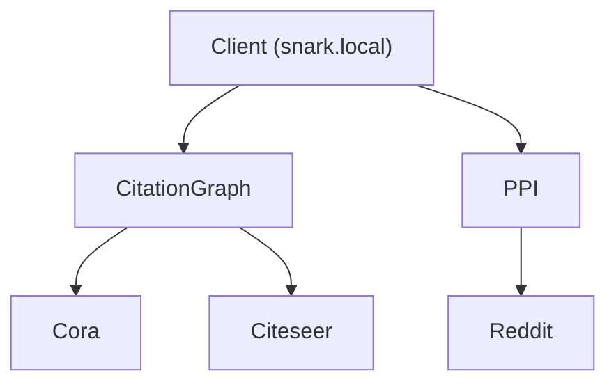
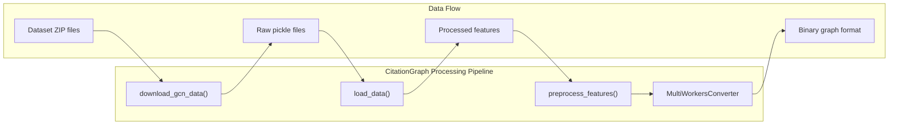
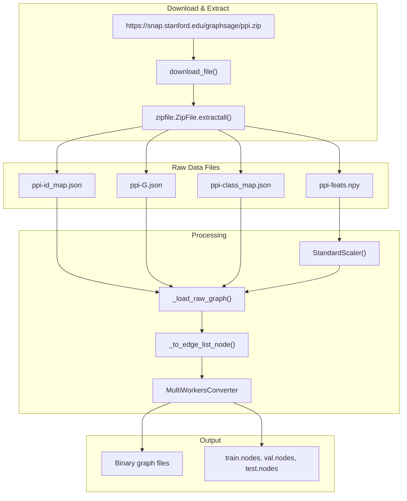
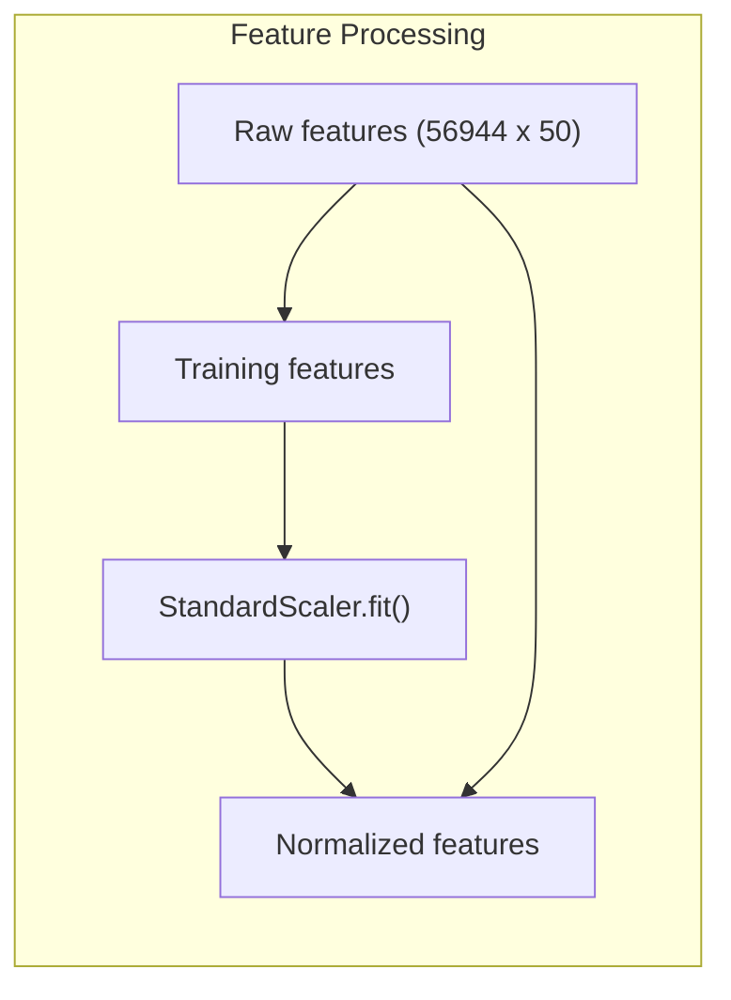
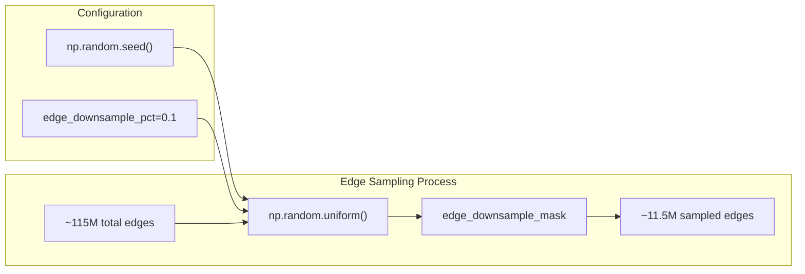

<!-- source: DeepWiki mcp.deepwiki.com · repo microsoft/DeepGNN · page 3.1 Built-in Datasets · fetched 2026-10-26 -->

# Built-in Datasets

<details>
<summary>Relevant source files</summary>

The following files were used as context for generating this wiki page:

- [src/python/deepgnn/graph_engine/data/citation.py](src/python/deepgnn/graph_engine/data/citation.py)
- [src/python/deepgnn/graph_engine/data/ppi.py](src/python/deepgnn/graph_engine/data/ppi.py)
- [src/python/deepgnn/graph_engine/data/reddit.py](src/python/deepgnn/graph_engine/data/reddit.py)
- [src/python/deepgnn/tf/common/args.py](src/python/deepgnn/tf/common/args.py)
- [src/python/deepgnn/tf/common/unittest/testserver.py](src/python/deepgnn/tf/common/unittest/testserver.py)

</details>


This document covers the built-in graph datasets provided by DeepGNN, including citation networks (Cora, Citeseer), protein interaction networks (PPI), and social networks (Reddit). These datasets are pre-implemented with automatic download, preprocessing, and conversion to the graph engine's binary format.

For information about converting custom datasets, see [Data Conversion Pipeline](#3.2). For legacy dataset components, see [Legacy and Deprecated Components](#3.3).

## Dataset Overview

DeepGNN provides four main built-in datasets that are commonly used for graph neural network research. All datasets inherit from the graph engine's `Client` class and provide standardized interfaces for data access.

### Dataset Class Hierarchy



Sources: [src/python/deepgnn/graph_engine/data/citation.py:183-207](), [src/python/deepgnn/graph_engine/data/ppi.py:21-55](), [src/python/deepgnn/graph_engine/data/reddit.py:24-70]()

### Dataset Statistics Summary

| Dataset | Nodes | Edges | Classes | Feature Dim | Split Type |
|---------|-------|-------|---------|-------------|------------|
| Cora | 2,708 | 10,556 | 7 | 1,433 | Node Classification |
| Citeseer | 3,312 | 9,228 | 6 | 3,703 | Node Classification |
| PPI | 56,944 | 1,637,432 | 121 | 50 | Multi-label Node Classification |
| Reddit | 232,965 | ~11.5M* | 50 | 300 | Node Classification |

*Reddit edges are downsampled by default (10% of ~115M total edges)

Sources: [src/python/deepgnn/graph_engine/data/citation.py:192-199](), [src/python/deepgnn/graph_engine/data/ppi.py:32-38](), [src/python/deepgnn/graph_engine/data/reddit.py:35-41]()

## Citation Networks

The citation network datasets include Cora and Citeseer, which are academic paper citation graphs commonly used for node classification tasks.

### CitationGraph Base Class

The `CitationGraph` class provides the foundation for both Cora and Citeseer datasets:



Sources: [src/python/deepgnn/graph_engine/data/citation.py:141-154](), [src/python/deepgnn/graph_engine/data/citation.py:36-128](), [src/python/deepgnn/graph_engine/data/citation.py:131-138]()

### Cora Dataset

The `Cora` class implements the Cora citation network:

```python
# Usage example
from deepgnn.graph_engine.data.citation import Cora

# Initialize with default temp directory
cora = Cora()

# Initialize with custom output directory and random split
cora = Cora(output_dir="/path/to/data", split="random")
```

**Key characteristics:**
- **Nodes:** 2,708 academic papers
- **Edges:** 10,556 citation links  
- **Classes:** 7 research areas
- **Features:** 1,433-dimensional bag-of-words vectors
- **Splits:** Public (140 train, 500 val, 1000 test) or random (20 per class)

Sources: [src/python/deepgnn/graph_engine/data/citation.py:330-353](), [src/python/deepgnn/graph_engine/data/citation.py:192-195]()

### Citeseer Dataset

The `Citeseer` class implements the Citeseer citation network:

```python
# Usage example
from deepgnn.graph_engine.data.citation import Citeseer

citeseer = Citeseer(output_dir="/path/to/data", split="public")
```

**Key characteristics:**
- **Nodes:** 3,312 academic papers
- **Edges:** 9,228 citation links
- **Classes:** 6 research areas  
- **Features:** 3,703-dimensional bag-of-words vectors
- **Special handling:** Isolated nodes are handled with zero-vectors

Sources: [src/python/deepgnn/graph_engine/data/citation.py:356-379](), [src/python/deepgnn/graph_engine/data/citation.py:85-94]()

### Citation Data Processing

Citation datasets use a specialized processing pipeline:

```mermaid
graph TB
    subgraph "Input Files"
        x["ind.dataset.x (train features)"]
        y["ind.dataset.y (train labels)"]
        tx["ind.dataset.tx (test features)"]
        ty["ind.dataset.ty (test labels)"]
        allx["ind.dataset.allx (all features)"]
        ally["ind.dataset.ally (all labels)"]
        graph["ind.dataset.graph (adjacency)"]
        test_idx["ind.dataset.test.index"]
    end
    
    subgraph "Processing Steps"
        parse["parse_index_file()"]
        stack["sp.vstack() features"]
        adj_matrix["nx.adjacency_matrix()"]
        masks["sample_mask() creation"]
        normalize["preprocess_features()"]
    end
    
    subgraph "Output"
        features["Normalized features"]
        adjacency["Adjacency matrix"]
        train_mask["Train/val/test masks"]
        labels["One-hot labels"]
    end
    
    test_idx --> parse
    x --> stack
    tx --> stack
    allx --> stack
    stack --> normalize
    normalize --> features
    
    graph --> adj_matrix
    adj_matrix --> adjacency
    
    y --> masks
    ally --> masks
    ty --> masks
    masks --> train_mask
    masks --> labels
```

Sources: [src/python/deepgnn/graph_engine/data/citation.py:21-26](), [src/python/deepgnn/graph_engine/data/citation.py:70-128](), [src/python/deepgnn/graph_engine/data/citation.py:29-33]()

## PPI Dataset

The Protein-Protein Interactions (PPI) dataset is a multi-label node classification benchmark from Stanford SNAP.

### PPI Implementation

```python
# Usage example
from deepgnn.graph_engine.data.ppi import PPI

# Single partition
ppi = PPI(output_dir="/path/to/data")

# Multiple partitions for distributed processing
ppi = PPI(output_dir="/path/to/data", num_partitions=4)
```

**Key characteristics:**
- **Nodes:** 56,944 proteins
- **Edges:** 1,637,432 interactions
- **Labels:** 121 gene ontology terms (multi-label)
- **Features:** 50-dimensional positional gene sets
- **Splits:** Pre-defined train (44,906), val (6,514), test (5,524)

Sources: [src/python/deepgnn/graph_engine/data/ppi.py:21-55](), [src/python/deepgnn/graph_engine/data/ppi.py:32-38]()

### PPI Data Processing Pipeline



Sources: [src/python/deepgnn/graph_engine/data/ppi.py:114-156](), [src/python/deepgnn/graph_engine/data/ppi.py:61-112](), [src/python/deepgnn/graph_engine/data/ppi.py:173-188]()

### PPI Feature Normalization

PPI applies StandardScaler normalization fitted only on training data:



Sources: [src/python/deepgnn/graph_engine/data/ppi.py:105-110]()

## Reddit Dataset

The Reddit dataset represents subreddit-to-subreddit interactions and inherits from the `PPI` class with specialized processing.

### Reddit Implementation

```python
# Usage example  
from deepgnn.graph_engine.data.reddit import Reddit

# Default configuration with edge downsampling
reddit = Reddit(
    output_dir="/path/to/data",
    edge_downsample_pct=0.1,  # Use 10% of edges
    num_partitions=2,
    seed=42
)
```

**Key characteristics:**
- **Nodes:** 232,965 Reddit posts
- **Edges:** ~11.5M interactions (downsampled from ~115M)
- **Classes:** 50 subreddit communities  
- **Features:** 300-dimensional GloVe word vectors
- **Edge downsampling:** Configurable to manage large graph size

Sources: [src/python/deepgnn/graph_engine/data/reddit.py:24-70](), [src/python/deepgnn/graph_engine/data/reddit.py:35-41]()

### Reddit Edge Downsampling

Reddit implements edge downsampling to handle the large graph size:



Sources: [src/python/deepgnn/graph_engine/data/reddit.py:96-102]()

### Reddit Label Processing

Reddit converts class labels to one-hot vectors:

```python
# One-hot conversion from reddit.py
def _onehot(value, size):
    output = [0] * size
    output[value] = 1
    return output

# Applied to class map
class_map = {id_map[k]: _onehot(v, 50) for k, v in class_map.items()}
```

Sources: [src/python/deepgnn/graph_engine/data/reddit.py:17-21](), [src/python/deepgnn/graph_engine/data/reddit.py:117]()

## Common Dataset Interface

All built-in datasets inherit from `Client` and provide consistent interfaces:

### Initialization Parameters

| Parameter | Citation | PPI | Reddit | Description |
|-----------|----------|-----|--------|-------------|
| `output_dir` | ✓ | ✓ | ✓ | Custom data directory |
| `split` | ✓ | - | - | Train/val/test split method |
| `num_partitions` | - | ✓ | ✓ | Graph partitioning count |
| `edge_downsample_pct` | - | - | ✓ | Edge sampling percentage |
| `seed` | - | - | ✓ | Random seed for reproducibility |

### Common Methods

All datasets inherit these methods from `Client`:
- `node_features()` - Retrieve node feature vectors
- `node_neighbors()` - Get neighbor sampling 
- `edge_features()` - Access edge attributes
- `data_dir()` - Get dataset storage location

Sources: [src/python/deepgnn/graph_engine/data/citation.py:207](), [src/python/deepgnn/graph_engine/data/ppi.py:55](), [src/python/deepgnn/graph_engine/data/reddit.py:68-70]()

### Node Type Encoding

Built-in datasets use consistent node type encoding:

| Node Type | ID | Usage |
|-----------|----|----- |
| train | 0 | Training nodes |
| val/validation | 1 | Validation nodes |
| test | 2 | Test nodes |
| other | 3 | Unlabeled nodes (Citation only) |

Sources: [src/python/deepgnn/graph_engine/data/citation.py:298](), [src/python/deepgnn/graph_engine/data/ppi.py:69](), [src/python/deepgnn/graph_engine/data/reddit.py:80]()

---

