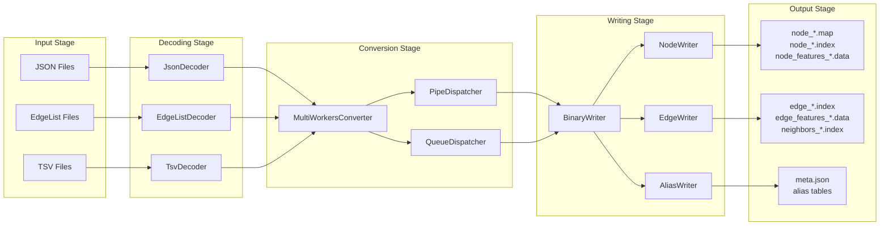
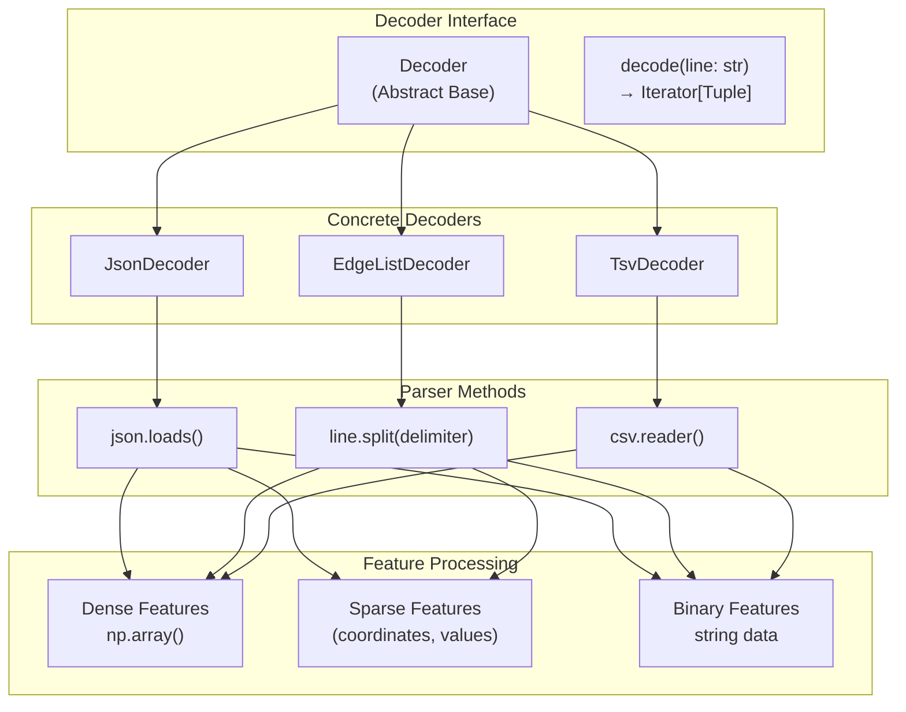
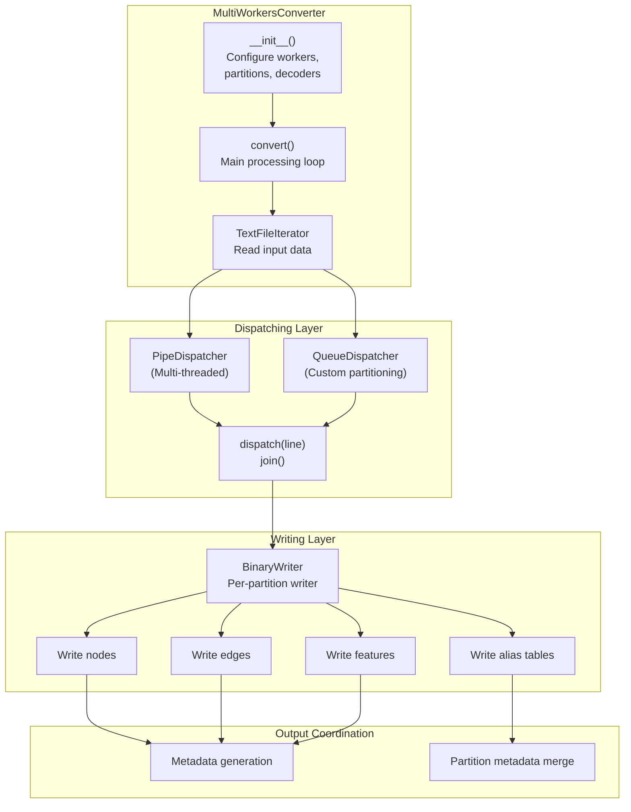
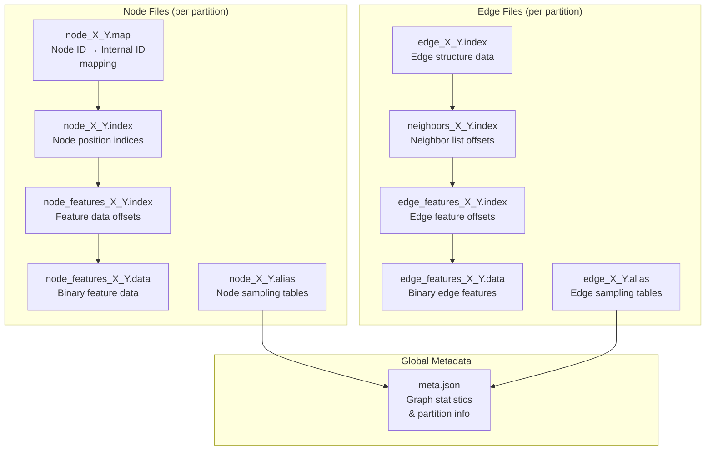
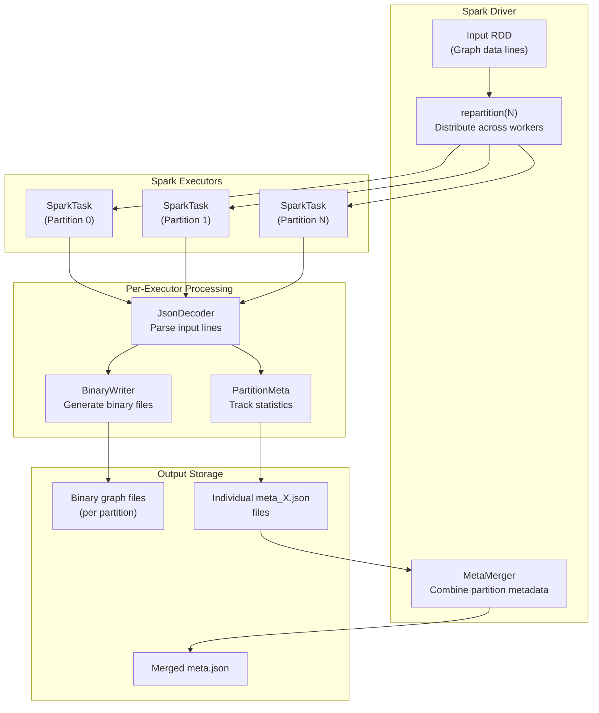

<!-- source: DeepWiki mcp.deepwiki.com · repo microsoft/DeepGNN · page 3.2 Data Conversion Pipeline · fetched 2026-10-26 -->

# Data Conversion Pipeline

<details>
<summary>Relevant source files</summary>

The following files were used as context for generating this wiki page:

- [docs/advanced/sql_shard.rst](docs/advanced/sql_shard.rst)
- [docs/graph_engine/data_spec.rst](docs/graph_engine/data_spec.rst)
- [docs/graph_engine/spark_converter.rst](docs/graph_engine/spark_converter.rst)
- [src/cc/lib/benchmark/grpc_benchmark.cc](src/cc/lib/benchmark/grpc_benchmark.cc)
- [src/cc/lib/benchmark/neighbor_sampler_benchmark.cc](src/cc/lib/benchmark/neighbor_sampler_benchmark.cc)
- [src/cc/lib/distributed/service.proto](src/cc/lib/distributed/service.proto)
- [src/cc/tests/mocks.cc](src/cc/tests/mocks.cc)
- [src/python/deepgnn/graph_engine/snark/convert.py](src/python/deepgnn/graph_engine/snark/convert.py)
- [src/python/deepgnn/graph_engine/snark/decoders.py](src/python/deepgnn/graph_engine/snark/decoders.py)
- [src/python/deepgnn/graph_engine/snark/tests/convert_test.py](src/python/deepgnn/graph_engine/snark/tests/convert_test.py)

</details>


The data conversion pipeline transforms raw graph data from various human-readable formats into the optimized binary format used by the DeepGNN graph engine. This system supports multiple input formats and provides both single-machine and distributed conversion capabilities.

For information about the binary format specifications and working with converted graphs, see [Graph Engine (Snark)](#2). For details about available pre-converted datasets, see [Built-in Datasets](#3.1).

## Overview

The conversion pipeline follows a multi-stage process that decodes input data, partitions it across workers, and writes optimized binary files along with metadata for efficient graph operations.



Sources: [src/python/deepgnn/graph_engine/snark/convert.py:1-272](), [src/python/deepgnn/graph_engine/snark/decoders.py:1-551]()

## Input Data Formats and Decoders

The pipeline supports three primary input formats, each handled by a specialized decoder class that implements the `Decoder` interface.

### Decoder Architecture



Sources: [src/python/deepgnn/graph_engine/snark/decoders.py:13-46](), [src/python/deepgnn/graph_engine/snark/decoders.py:299-438]()

### Format Support Matrix

| Format | Decoder Class | Heterogeneous Graphs | Sparse Features | Temporal Features |
|--------|---------------|---------------------|-----------------|-------------------|
| JSON | `JsonDecoder` | ✓ | ✓ | ✓ |
| EdgeList | `EdgeListDecoder` | ✓ | ✓ | ✓ |
| TSV | `TsvDecoder` | ✗ | ✗ | ✗ |

### JsonDecoder

The `JsonDecoder` handles JSON-formatted input where each line represents a complete node with its features and outgoing edges. It processes both dense and sparse features and supports temporal feature vectors.

Key capabilities:
- Feature type mapping via `convert_map` dictionary [src/python/deepgnn/graph_engine/snark/decoders.py:17-31]()
- Sparse feature coordinate handling [src/python/deepgnn/graph_engine/snark/decoders.py:374-383]()
- Temporal feature serialization [src/python/deepgnn/graph_engine/snark/decoders.py:331-354]()

### EdgeListDecoder 

The `EdgeListDecoder` processes CSV-like formats with flexible schema definitions. It supports default values for common attributes and configurable delimiters.

Key features:
- Configurable default values for node/edge types and weights [src/python/deepgnn/graph_engine/snark/decoders.py:138-154]()
- Sparse feature parsing with coordinate dimensions [src/python/deepgnn/graph_engine/snark/decoders.py:199-210]()
- Binary feature escape sequence handling [src/python/deepgnn/graph_engine/snark/decoders.py:213-226]()

### TsvDecoder

The `TsvDecoder` handles tab-separated values optimized for homogeneous graphs with simpler feature representations.

Sources: [src/python/deepgnn/graph_engine/snark/decoders.py:440-551](), [docs/graph_engine/data_spec.rst:15-25]()

## Conversion Process

The conversion process is orchestrated by the `MultiWorkersConverter` class, which coordinates data reading, processing, and writing across multiple workers and partitions.

### MultiWorkersConverter Architecture



Sources: [src/python/deepgnn/graph_engine/snark/convert.py:23-111](), [src/python/deepgnn/graph_engine/snark/convert.py:112-163]()

### Key Parameters

The `MultiWorkersConverter` constructor accepts several important configuration parameters:

- `partition_count`: Number of graph partitions to create
- `worker_count`: Number of parallel conversion workers  
- `thread_count`: Threads per worker for processing
- `decoder`: Decoder instance for input format
- `dispatcher`: Optional custom dispatcher for partitioning logic
- `debug`: Disables multiprocessing for error debugging

Sources: [src/python/deepgnn/graph_engine/snark/convert.py:26-67]()

### Dispatcher System

The dispatcher system determines how graph data is distributed across partitions. Two main implementations are provided:

#### PipeDispatcher
- Uses multiprocessing for parallel conversion
- Automatically partitions data across workers
- Optimized for throughput on large datasets

#### QueueDispatcher  
- Allows custom partitioning functions
- Single-threaded processing with custom logic
- Used for specific partitioning requirements

Sources: [src/python/deepgnn/graph_engine/snark/dispatcher.py](), [src/python/deepgnn/graph_engine/snark/convert.py:94-110]()

## Output Binary Format

The conversion process generates a structured set of binary files and metadata that enable efficient graph operations.

### Output File Structure



Sources: [src/python/deepgnn/graph_engine/snark/tests/convert_test.py:134-206](), [src/python/deepgnn/graph_engine/snark/tests/convert_test.py:344-365]()

### Binary File Formats

#### Node Map Files (`node_X_Y.map`)
Contains mappings from original node IDs to internal partition indices. Each entry is 20 bytes:
- 8 bytes: Original node ID
- 8 bytes: Internal partition index  
- 4 bytes: Node type

#### Feature Data Files (`*_features_X_Y.data`)
Stores packed binary feature vectors in various formats:
- Dense features: Consecutive arrays of typed data
- Sparse features: Coordinate arrays followed by value arrays
- Binary features: Length-prefixed string data

#### Index Files (`*.index`)
Provide byte offsets into corresponding data files for random access:
- Node indices: Offsets into node feature data
- Edge indices: Neighbor list boundaries
- Feature indices: Individual feature vector boundaries

Sources: [src/python/deepgnn/graph_engine/snark/tests/convert_test.py:173-186](), [src/python/deepgnn/graph_engine/snark/tests/convert_test.py:218-231]()

### Metadata Format (`meta.json`)

The metadata file contains global graph statistics and partition information required for graph engine initialization:

```json
{
  "binary_data_version": "v2",
  "node_count": 1000000,
  "edge_count": 5000000, 
  "node_type_count": 3,
  "edge_type_count": 2,
  "node_feature_count": 5,
  "edge_feature_count": 3,
  "partitions": {
    "0": {
      "node_weight": [333333, 333333, 333334],
      "edge_weight": [2500000, 2500000]
    }
  },
  "node_count_per_type": [333333, 333333, 333334],
  "edge_count_per_type": [2500000, 2500000],
  "watermark": -1
}
```

Sources: [src/python/deepgnn/graph_engine/snark/convert.py:166-196](), [src/python/deepgnn/graph_engine/snark/meta.py]()

## Distributed Conversion

For large-scale graphs, the conversion pipeline supports distributed processing using Apache Spark or multiple converter instances.

### Spark-based Conversion

The distributed conversion approach uses Spark to parallelize conversion across a cluster:



Sources: [docs/graph_engine/spark_converter.rst:111-145]()

### Multi-Worker Conversion

For single-machine distributed conversion, multiple `MultiWorkersConverter` instances can process different portions of the data:

```python
# Worker 0: processes partitions 0-1
converter_0 = MultiWorkersConverter(
    graph_path=input_file,
    partition_count=4,
    worker_index=0, 
    worker_count=2,
    output_dir=output_dir
)

# Worker 1: processes partitions 2-3  
converter_1 = MultiWorkersConverter(
    graph_path=input_file,
    partition_count=4,
    worker_index=1,
    worker_count=2, 
    output_dir=output_dir
)
```

This approach automatically divides partitions across workers and generates separate metadata files that must be merged using the `meta_merger` utility.

Sources: [src/python/deepgnn/graph_engine/snark/convert.py:86-93](), [docs/graph_engine/spark_converter.rst:139-145]()

---

