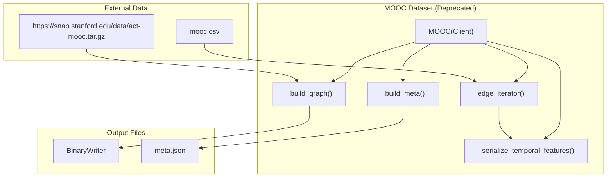
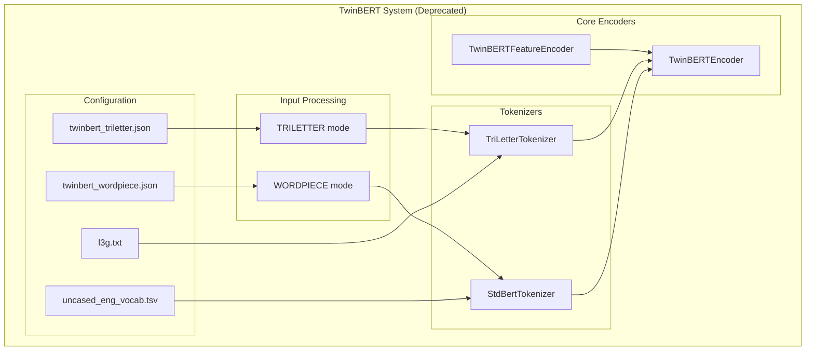
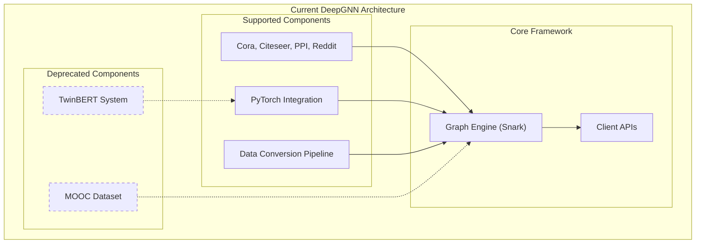

<!-- source: DeepWiki mcp.deepwiki.com · repo microsoft/DeepGNN · page 3.3 Legacy and Deprecated Components · fetched 2026-10-26 -->

# Legacy and Deprecated Components

Relevant source files

The following files were used as context for generating this wiki page:

- [src/python/deepgnn/graph_engine/data/mooc.py](src/python/deepgnn/graph_engine/data/mooc.py)
- [src/python/deepgnn/pytorch/encoding/test_feature_encoder.py](src/python/deepgnn/pytorch/encoding/test_feature_encoder.py)
- [src/python/deepgnn/pytorch/encoding/twinbert/test_encoder.py](src/python/deepgnn/pytorch/encoding/twinbert/test_encoder.py)
- [src/python/deepgnn/pytorch/encoding/twinbert/test_tokenization.py](src/python/deepgnn/pytorch/encoding/twinbert/test_tokenization.py)

This document covers deprecated and legacy components within the DeepGNN framework that are no longer actively maintained or supported. These components remain in the codebase for historical reference but should not be used in new projects.

For information about currently supported datasets, see [Built-in Datasets](#3.1). For active data processing capabilities, see [Data Conversion Pipeline](#3.2).

## Overview

The DeepGNN repository contains several deprecated components that were part of earlier versions of the framework:

- **MOOC Dataset**: A temporal graph dataset loader that is out of support
- **TwinBERT Text Encoding**: BERT-based text feature encoders for graph nodes

These components may have compatibility issues with current DeepGNN versions and should be replaced with supported alternatives.

## MOOC Temporal Dataset

The `MOOC` class provides access to a temporal student interaction network from Stanford SNAP, but is explicitly marked as out of support.

### Dataset Characteristics

| Property | Value |
|----------|-------|
| Nodes | 7,144 |
| Edges | 41,179 |
| Classes | 2 |
| Edge Feature Dimensions | 4 |
| Type | Temporal bipartite graph |

### Implementation Details

The `MOOC` class inherits from `Client` and implements temporal edge features through complex serialization:

The dataset implements temporal features where multiple feature updates for the same edge are aggregated into the first occurrence, while subsequent edge instances contain empty features [src/python/deepgnn/graph_engine/data/mooc.py:123-171]().

### Deprecation Status

The MOOC dataset is explicitly marked as "OUT OF SUPPORT" with the comment that "Dataset loading needs to be modified for deepgnn loading" [src/python/deepgnn/graph_engine/data/mooc.py:24]().

**Sources:** [src/python/deepgnn/graph_engine/data/mooc.py:1-226]()

## TwinBERT Text Encoding Components

The TwinBERT system provided BERT-based text feature encoding for graph nodes but has been deprecated across all test suites.

### Component Architecture

### Feature Processing Pipeline

The TwinBERT system supported two tokenization approaches:

1. **TriLetter Tokenization**: Character-level tri-gram tokenization for subword representation
2. **WordPiece Tokenization**: Standard BERT wordpiece tokenization

The system processed string features through the following pipeline:

| Step | TriLetter Mode | WordPiece Mode |
|------|----------------|----------------|
| Input | Raw text strings | Raw text strings |
| Tokenization | 3-character sequences | WordPiece tokens |
| Sequence Length | 15 tokens (3×5) | 3 tokens |
| Output | Dense embeddings | Dense embeddings |

### Deprecation Markers

All TwinBERT test cases are marked with `@pytest.mark.skip(reason="Deprecated")`:

- Feature encoder tests [src/python/deepgnn/pytorch/encoding/test_feature_encoder.py:211]()
- Tokenization tests [src/python/deepgnn/pytorch/encoding/twinbert/test_tokenization.py:27]()
- Core encoder tests [src/python/deepgnn/pytorch/encoding/twinbert/test_encoder.py:156]()

**Sources:** [src/python/deepgnn/pytorch/encoding/test_feature_encoder.py:1-261](), [src/python/deepgnn/pytorch/encoding/twinbert/test_tokenization.py:1-49](), [src/python/deepgnn/pytorch/encoding/twinbert/test_encoder.py:1-176]()

## Migration Recommendations

### MOOC Dataset Alternatives

For temporal graph analysis, consider:
- Converting MOOC data using the current [Data Conversion Pipeline](#3.2)
- Using supported temporal datasets from [Built-in Datasets](#3.1)
- Implementing custom temporal features using the current graph engine APIs

### TwinBERT Replacement

For text feature encoding in graphs:
- Use standard PyTorch text encoders with the [PyTorch Integration](#4.1)
- Implement custom BERT encoders using HuggingFace transformers
- Leverage the current feature encoding APIs in the graph engine

## Legacy Component Context

These deprecated components represent earlier approaches to specific use cases that have been superseded by more flexible and maintainable solutions in the current DeepGNN architecture.

**Sources:** [src/python/deepgnn/graph_engine/data/mooc.py:1-226](), [src/python/deepgnn/pytorch/encoding/test_feature_encoder.py:1-261](), [src/python/deepgnn/pytorch/encoding/twinbert/test_tokenization.py:1-49](), [src/python/deepgnn/pytorch/encoding/twinbert/test_encoder.py:1-176]()

---

