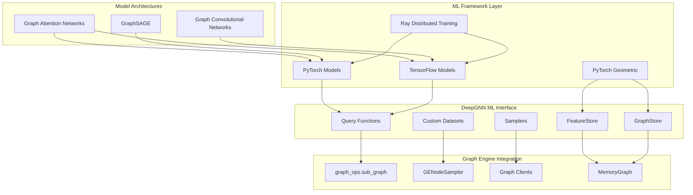
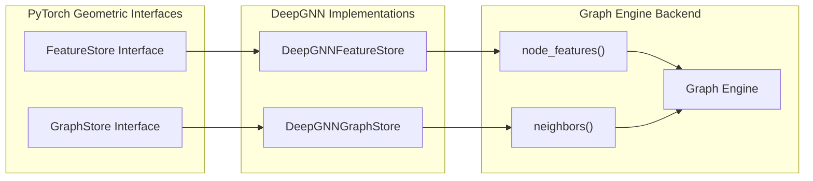
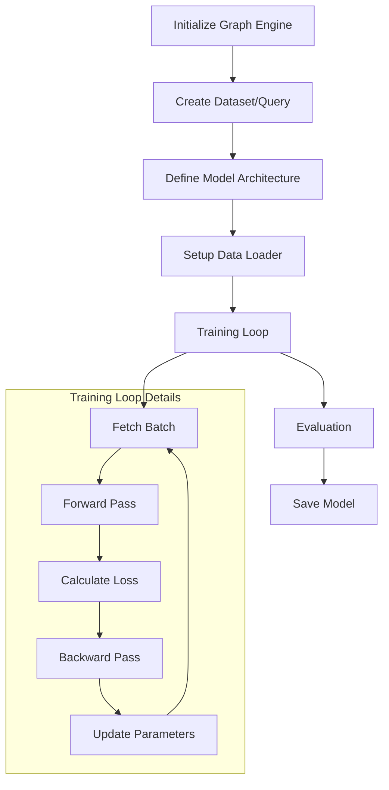
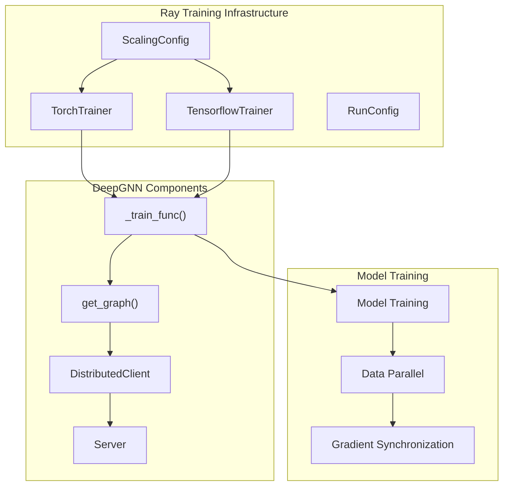

<!-- source: DeepWiki mcp.deepwiki.com · repo microsoft/DeepGNN · page 4 Machine Learning Integration · fetched 2026-10-26 -->

# Machine Learning Integration

Relevant source files

The following files were used as context for generating this wiki page:

- [docs/tf/ray_usage.rst](docs/tf/ray_usage.rst)
- [docs/torch/node_class.rst](docs/torch/node_class.rst)
- [examples/pytorch/gat.py](examples/pytorch/gat.py)
- [examples/pytorch/pyg_interface.py](examples/pytorch/pyg_interface.py)
- [examples/tensorflow/gat/test_gat.py](examples/tensorflow/gat/test_gat.py)
- [examples/tensorflow/gcn/test_gcn.py](examples/tensorflow/gcn/test_gcn.py)

This document covers DeepGNN's integration with machine learning frameworks for training Graph Neural Networks (GNNs). It explains the interfaces, components, and patterns used to connect the graph engine with PyTorch and TensorFlow for model training and inference.

For information about the underlying graph engine components, see [Graph Engine (Snark)](#2). For details about data processing and dataset management, see [Datasets and Data Processing](#3).

## Overview

DeepGNN provides integrated support for both PyTorch and TensorFlow frameworks, enabling users to train various GNN architectures on large-scale graphs. The integration follows a modular design where the graph engine handles data storage and sampling while ML frameworks handle model definition and training.

### Architecture Components

The ML integration consists of several key components that bridge the graph engine with ML frameworks:

**Sources:** [examples/pytorch/gat.py:1-241](), [docs/tf/ray_usage.rst:1-261](), [examples/pytorch/pyg_interface.py:1-191]()

## Core Integration Patterns

### Query-Based Data Sampling

Both PyTorch and TensorFlow integrations use query functions to fetch graph contexts for training. These queries use `graph_ops.sub_graph` to sample neighborhoods and extract features:

| Component | Purpose | Key Methods |
|-----------|---------|-------------|
| `GATDataset` | PyTorch iterable dataset | `query()`, `__iter__()` |
| `GATQuery` | TensorFlow query interface | `query_training()` |
| `graph_ops.sub_graph` | Core sampling function | Neighbor sampling, subgraph extraction |

The query pattern enables parallel data loading while the model trains, improving overall performance.

**Sources:** [examples/pytorch/gat.py:80-103](), [docs/tf/ray_usage.rst:59-97](), [docs/torch/node_class.rst:57-77]()

### Feature and Graph Store Interfaces

For PyTorch Geometric integration, DeepGNN implements standard interfaces:

**Sources:** [examples/pytorch/pyg_interface.py:18-89]()

## Model Architecture Support

### Supported GNN Models

DeepGNN provides examples and utilities for several popular GNN architectures:

| Model | Framework | Implementation | Key Features |
|-------|-----------|----------------|--------------|
| GAT | PyTorch | `torch_geometric.nn.GATConv` | Multi-head attention, dropout |
| GAT | TensorFlow | `deepgnn.tf.nn.gat_conv.GATConv` | Custom attention mechanism |
| GCN | TensorFlow | Custom implementation | Graph convolution layers |
| GraphSAGE | PyTorch | `torch_geometric.nn.GraphSAGE` | Sampling and aggregation |

### Model Training Workflow

The typical training workflow follows this pattern:

**Sources:** [examples/pytorch/gat.py:194-207](), [docs/tf/ray_usage.rst:238-240]()

## Distributed Training Integration

### Ray Framework Support

DeepGNN integrates with Ray for distributed training across both frameworks:

**Sources:** [examples/pytorch/gat.py:158-241](), [docs/tf/ray_usage.rst:245-258]()

### Configuration Parameters

Key configuration parameters for distributed training:

| Parameter | Purpose | Example Values |
|-----------|---------|----------------|
| `num_workers` | Number of training workers | 1, 2, 4 |
| `batch_size` | Training batch size | 140, 2708 |
| `learning_rate` | Optimizer learning rate | 0.005, 0.01 |
| `num_epochs` | Training epochs | 120, 200, 300 |

**Sources:** [examples/pytorch/gat.py:236-237](), [docs/tf/ray_usage.rst:248-256]()

## Framework-Specific Integration Details

For detailed information about PyTorch-specific integration patterns, components, and examples, see [PyTorch Integration](#4.1).

For comprehensive TensorFlow integration documentation including GAT and GCN implementations with Ray distributed training, see [TensorFlow Integration](#4.2).

**Sources:** [examples/pytorch/gat.py:1-241](), [examples/tensorflow/gat/test_gat.py:1-133](), [examples/tensorflow/gcn/test_gcn.py:1-135](), [docs/tf/ray_usage.rst:1-261](), [docs/torch/node_class.rst:1-218](), [examples/pytorch/pyg_interface.py:1-191]()

---

