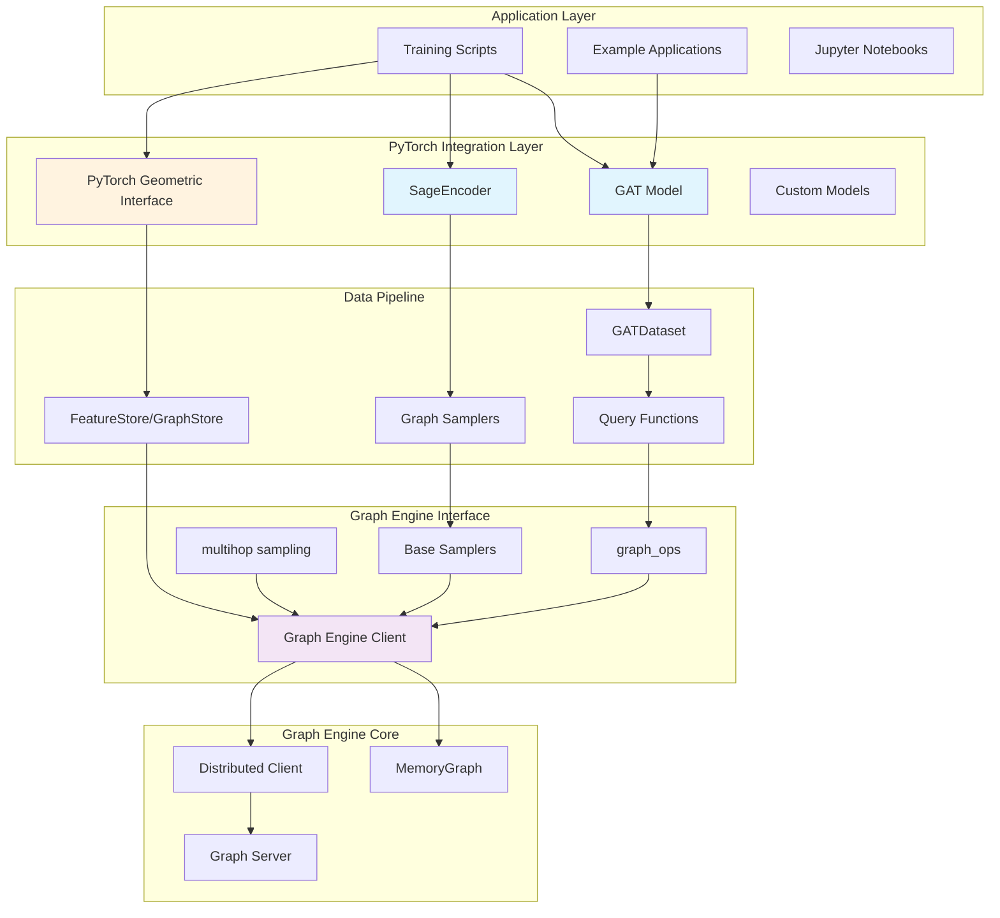
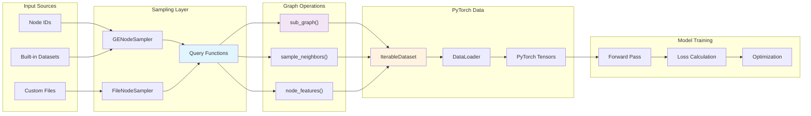
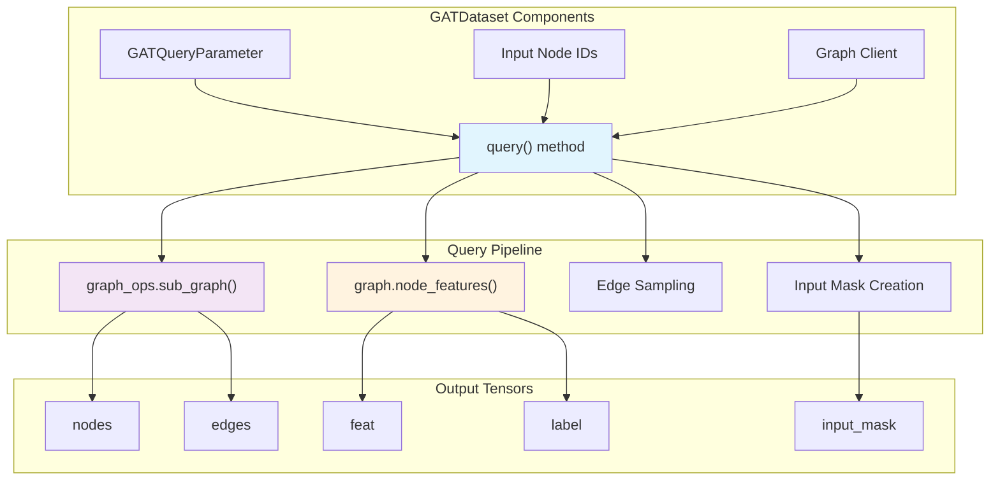
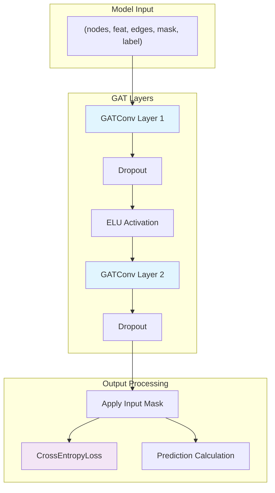
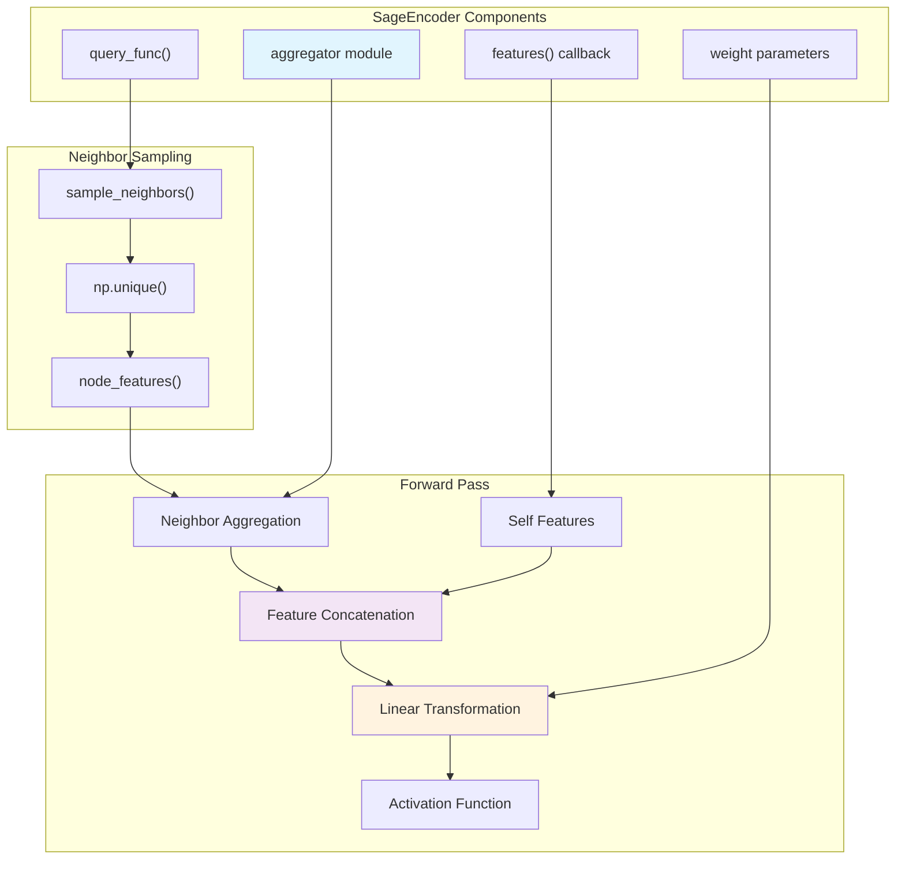
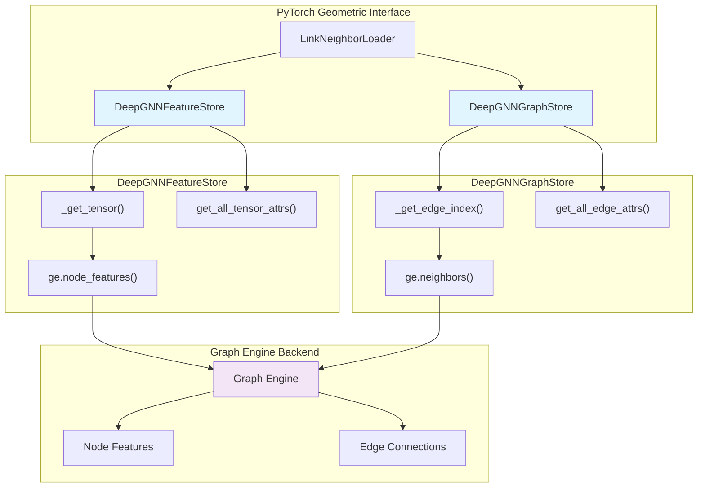
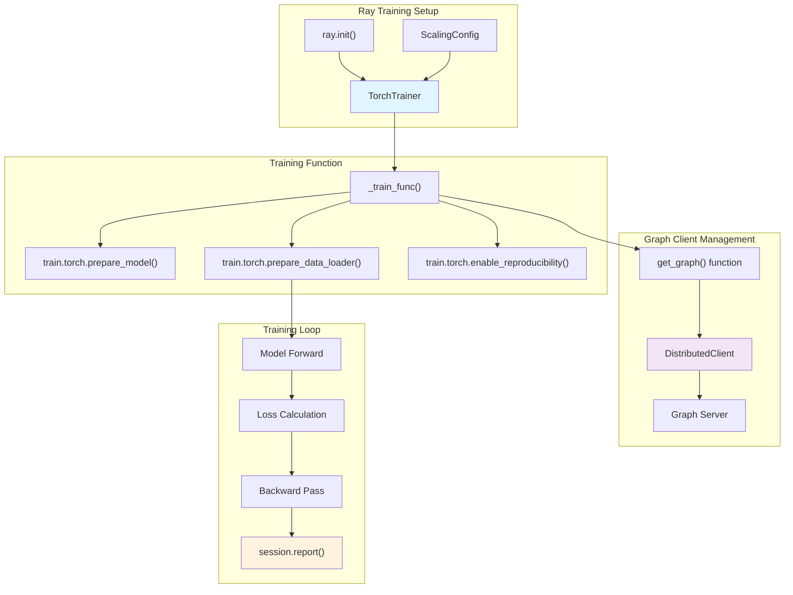
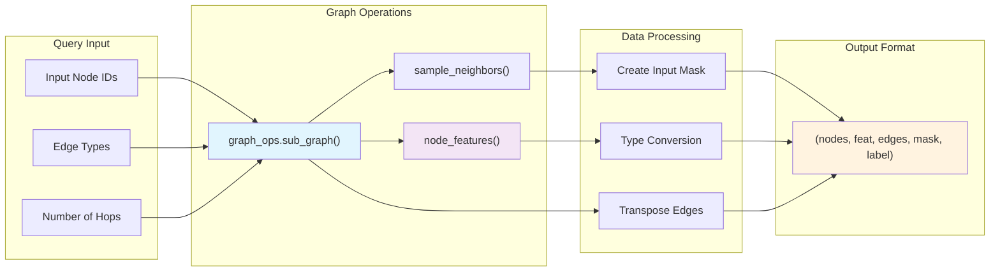

<!-- source: DeepWiki mcp.deepwiki.com · repo microsoft/DeepGNN · page 4.1 PyTorch Integration · fetched 2026-10-26 -->

# PyTorch Integration

Relevant source files

The following files were used as context for generating this wiki page:

- [docs/tf/ray_usage.rst](docs/tf/ray_usage.rst)
- [docs/torch/node_class.rst](docs/torch/node_class.rst)
- [examples/pytorch/gat.py](examples/pytorch/gat.py)
- [examples/pytorch/pyg_interface.py](examples/pytorch/pyg_interface.py)
- [examples/tensorflow/gat/test_gat.py](examples/tensorflow/gat/test_gat.py)
- [examples/tensorflow/gcn/test_gcn.py](examples/tensorflow/gcn/test_gcn.py)
- [examples/tensorflow/sage/sage.py](examples/tensorflow/sage/sage.py)
- [src/python/deepgnn/graph_engine/graph_ops.py](src/python/deepgnn/graph_engine/graph_ops.py)
- [src/python/deepgnn/graph_engine/multihop.py](src/python/deepgnn/graph_engine/multihop.py)
- [src/python/deepgnn/graph_engine/samplers.py](src/python/deepgnn/graph_engine/samplers.py)
- [src/python/deepgnn/pytorch/encoding/gnn_encoder_sage.py](src/python/deepgnn/pytorch/encoding/gnn_encoder_sage.py)
- [tools/manylinux/install-gcc11.sh](tools/manylinux/install-gcc11.sh)

This document covers the PyTorch integration components within the DeepGNN framework, including model implementations, data loading pipelines, and distributed training capabilities. The PyTorch integration provides Graph Neural Network (GNN) model implementations like GAT and GraphSAGE, along with seamless integration with the graph engine for efficient sampling and feature extraction.

For TensorFlow integration details, see [TensorFlow Integration](#4.2). For core graph engine functionality, see [Graph Engine (Snark)](#2).

## Architecture Overview

The PyTorch integration in DeepGNN follows a modular architecture that connects the graph engine's sampling capabilities with PyTorch's neural network framework. The integration supports both custom model implementations and PyTorch Geometric compatibility.

**Sources:** [examples/pytorch/gat.py:1-241](), [examples/pytorch/pyg_interface.py:1-191](), [src/python/deepgnn/pytorch/encoding/gnn_encoder_sage.py:1-144](), [docs/torch/node_class.rst:1-218]()

## Core Components

### Model Implementations

The PyTorch integration provides several GNN model implementations that work seamlessly with the graph engine:

| Component | Purpose | Key Classes |
|-----------|---------|-------------|
| **GAT Model** | Graph Attention Network implementation | `GAT`, `GATDataset`, `GATQueryParameter` |
| **GraphSAGE Encoder** | GraphSAGE encoding with sampling | `SageEncoder` |
| **PyTorch Geometric** | Integration with PyG ecosystem | `DeepGNNFeatureStore`, `DeepGNNGraphStore` |
| **Base Components** | Common functionality | `BaseSampler`, `GENodeSampler` |

### Data Flow Pipeline

**Sources:** [src/python/deepgnn/graph_engine/samplers.py:127-182](), [src/python/deepgnn/graph_engine/graph_ops.py:95-179](), [examples/pytorch/gat.py:43-104]()

## GAT Model Implementation

The Graph Attention Network (GAT) implementation demonstrates the integration pattern between PyTorch models and the graph engine.

### GAT Dataset and Query

The `GATDataset` class extends `torch.utils.data.IterableDataset` to provide seamless integration with PyTorch's data loading infrastructure:

**Sources:** [examples/pytorch/gat.py:43-104](), [docs/torch/node_class.rst:41-78](), [src/python/deepgnn/graph_engine/graph_ops.py:95-179]()

### GAT Model Architecture

The GAT model uses PyTorch Geometric's `GATConv` layers with the graph engine's data pipeline:

**Sources:** [examples/pytorch/gat.py:106-155](), [docs/torch/node_class.rst:84-139]()

## GraphSAGE Encoder

The `SageEncoder` provides a flexible GraphSAGE implementation with configurable aggregation strategies.

### SageEncoder Architecture

**Sources:** [src/python/deepgnn/pytorch/encoding/gnn_encoder_sage.py:14-144]()

## PyTorch Geometric Integration

The PyTorch Geometric integration provides compatibility with the PyG ecosystem through custom store implementations.

### Store Architecture

**Sources:** [examples/pytorch/pyg_interface.py:18-88]()

## Distributed Training with Ray

The PyTorch integration supports distributed training using Ray for scalable GNN training across multiple workers.

### Ray Training Pipeline

**Sources:** [examples/pytorch/gat.py:210-241]()

## Data Sampling and Loading

The PyTorch integration leverages the graph engine's sampling infrastructure for efficient data loading.

### Sampling Components

| Component | Purpose | Key Features |
|-----------|---------|--------------|
| `GENodeSampler` | Sample nodes from graph engine | Weighted/random sampling, distributed support |
| `GEEdgeSampler` | Sample edges from graph engine | Edge type filtering, batch processing |
| `FileNodeSampler` | Load nodes from files | File-based sampling for large datasets |
| `FileEdgeSampler` | Load edges from files | Custom edge formats, feature support |

### Query Function Pattern

Graph queries follow a consistent pattern for fetching training data:

**Sources:** [examples/pytorch/gat.py:80-103](), [docs/torch/node_class.rst:57-77](), [src/python/deepgnn/graph_engine/graph_ops.py:95-179]()

## Usage Examples

### Basic GAT Training

The GAT training example demonstrates the complete integration workflow:

1. **Dataset Setup**: Load Cora dataset using built-in downloader
2. **Model Creation**: Initialize GAT model with attention parameters
3. **Data Loading**: Create `GATDataset` with graph client
4. **Training Loop**: Standard PyTorch training with graph-based batches

### PyTorch Geometric Integration

The PyG interface example shows how to use DeepGNN with existing PyTorch Geometric workflows:

1. **Store Implementation**: Custom `FeatureStore` and `GraphStore` implementations
2. **Loader Integration**: Use with `LinkNeighborLoader` for neighbor sampling
3. **Model Compatibility**: Works with standard PyG models like `GraphSAGE`

### Distributed Training

Ray-based distributed training enables scaling across multiple workers:

1. **Server Setup**: Initialize distributed graph server
2. **Client Creation**: Create graph clients for each worker
3. **Model Distribution**: Use Ray's `prepare_model()` for distribution
4. **Synchronized Training**: Coordinate training across workers

**Sources:** [examples/pytorch/gat.py:210-241](), [examples/pytorch/pyg_interface.py:134-191](), [docs/torch/node_class.rst:160-218]()

---

