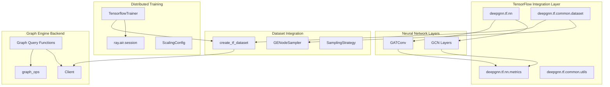
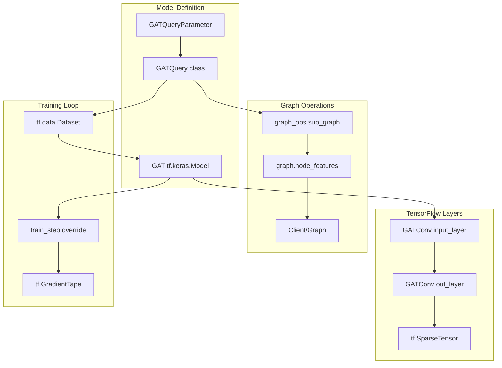
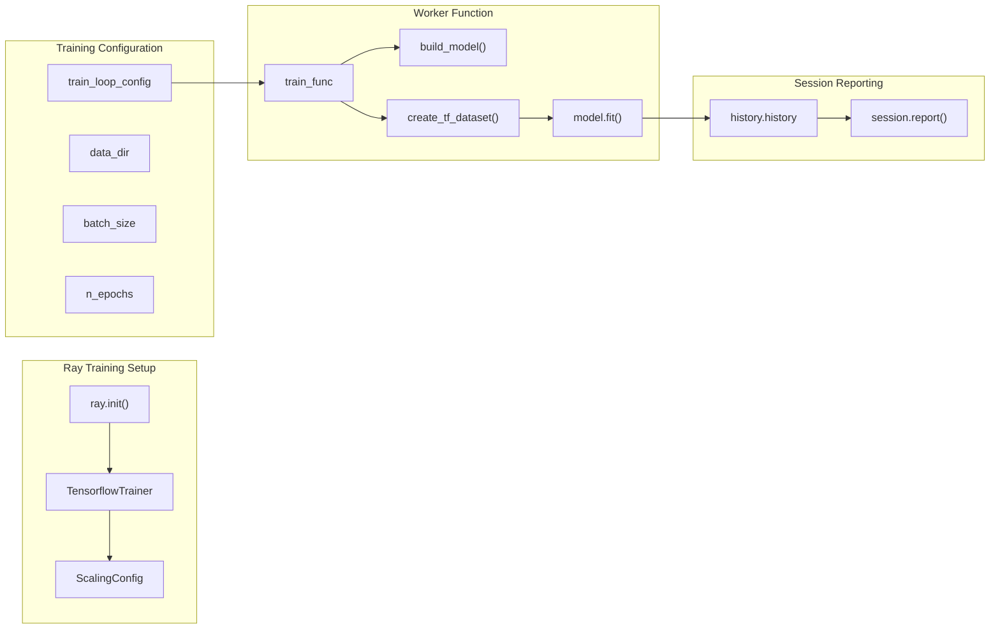
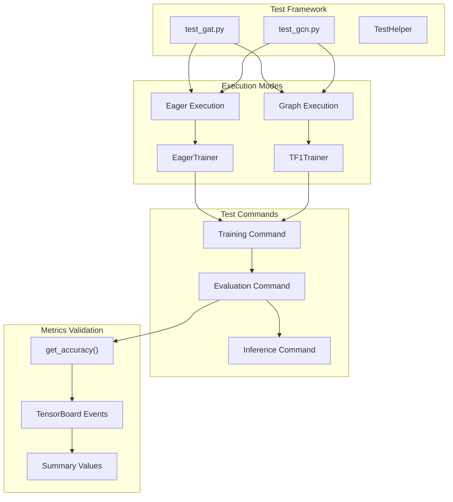

<!-- source: DeepWiki mcp.deepwiki.com · repo microsoft/DeepGNN · page 4.2 TensorFlow Integration · fetched 2026-10-26 -->

# TensorFlow Integration

<details>
<summary>Relevant source files</summary>

The following files were used as context for generating this wiki page:

- [.github/actions/lint/action.yml](.github/actions/lint/action.yml)
- [CONTRIBUTING.md](CONTRIBUTING.md)
- [docs/tf/ray_usage.rst](docs/tf/ray_usage.rst)
- [docs/torch/distrib.rst](docs/torch/distrib.rst)
- [docs/torch/node_class.rst](docs/torch/node_class.rst)
- [examples/pytorch/gat.py](examples/pytorch/gat.py)
- [examples/pytorch/pyg_interface.py](examples/pytorch/pyg_interface.py)
- [examples/tensorflow/gat/test_gat.py](examples/tensorflow/gat/test_gat.py)
- [examples/tensorflow/gcn/test_gcn.py](examples/tensorflow/gcn/test_gcn.py)
- [examples/tensorflow/requirements.txt](examples/tensorflow/requirements.txt)

</details>


This document covers the TensorFlow integration components in DeepGNN, including neural network layers, distributed training with Ray, dataset creation utilities, and example model implementations. The integration enables training Graph Neural Networks using TensorFlow with the DeepGNN graph engine as the data backend.

For PyTorch integration, see [PyTorch Integration](#4.1). For information about the underlying graph engine, see [Graph Engine (Snark)](#2).

## Core TensorFlow Components

The TensorFlow integration provides several key components that work together to enable graph neural network training:



**TensorFlow Neural Network Components**
Sources: [docs/tf/ray_usage.rst:31-32]()

The `deepgnn.tf.nn` module provides TensorFlow implementations of graph neural network layers:

- `GATConv`: Graph Attention Network convolution layer
- Custom metrics including `masked_accuracy` and `masked_softmax_cross_entropy`

## Model Architecture Pattern

TensorFlow models in DeepGNN follow a consistent architectural pattern that integrates with the graph engine:



**Model Implementation Details**
Sources: [docs/tf/ray_usage.rst:51-98](), [docs/tf/ray_usage.rst:102-187]()

Models implement a query function that:
1. Samples subgraphs using `graph_ops.sub_graph`
2. Extracts node features and labels using `graph.node_features`
3. Creates sparse adjacency tensors for TensorFlow processing
4. Returns structured data for model consumption

## Ray Distributed Training Integration

The TensorFlow integration includes built-in support for distributed training using Ray:



**Ray Training Implementation**
Sources: [docs/tf/ray_usage.rst:215-261]()

The Ray integration enables:
- Multi-worker distributed training using `TensorflowTrainer`
- Automatic data distribution with `create_tf_dataset`
- Progress reporting through `session.report`
- Configurable scaling with `ScalingConfig`

## Dataset Creation and Sampling

The TensorFlow integration provides utilities for creating TensorFlow datasets from graph data:

| Component | Purpose | Key Parameters |
|-----------|---------|----------------|
| `create_tf_dataset` | Creates `tf.data.Dataset` from graph | `sampler_class`, `query_fn`, `backend` |
| `GENodeSampler` | Samples nodes from graph engine | `node_types`, `strategy` |
| `SamplingStrategy` | Defines sampling behavior | `RandomWithoutReplacement`, etc. |

**Dataset Creation Pattern**
Sources: [docs/tf/ray_usage.rst:220-229]()

```python
tf_dataset, steps_per_epoch = create_tf_dataset(
    sampler_class=GENodeSampler,
    query_fn=query.query_training,
    backend=type("Backend", (object,), {"graph": Client(config["data_dir"], [0])})(),
    node_types=np.array([0], dtype=np.int32),
    batch_size=config["batch_size"],
    num_workers=2,
    worker_index=0,
    strategy=SamplingStrategy.RandomWithoutReplacement,
)
```

## Testing Infrastructure

The TensorFlow integration includes comprehensive testing infrastructure for both eager and graph execution modes:



**Test Execution Modes**
Sources: [examples/tensorflow/gat/test_gat.py:107-125](), [examples/tensorflow/gcn/test_gcn.py:109-127]()

Tests validate both execution modes:
- **Graph Mode**: Traditional TensorFlow 1.x style execution
- **Eager Mode**: TensorFlow 2.x eager execution
- Accuracy thresholds ensure model quality (e.g., Cora GAT > 0.823 accuracy)

## Model Examples

### GAT (Graph Attention Network)

The GAT implementation demonstrates the complete TensorFlow integration:

**Key Components:**
- `GATConv` layers with attention mechanisms
- Masked loss computation for semi-supervised learning  
- Custom `train_step` override for specialized training logic
- Support for multiple attention heads and dropout

Sources: [docs/tf/ray_usage.rst:102-187]()

### GCN (Graph Convolutional Network)

The GCN example shows simpler convolution-based models:

**Key Features:**
- Standard graph convolution operations
- L2 regularization support
- Configurable hidden dimensions
- Both eager and graph execution support

Sources: [examples/tensorflow/gcn/test_gcn.py:109-118]()

## Configuration and Command Line Interface

Both GAT and GCN examples support comprehensive command-line configuration:

| Parameter | Purpose | Example Values |
|-----------|---------|----------------|
| `--mode` | Execution mode | `train`, `evaluate`, `inference` |
| `--eager` | Enable eager execution | Flag |
| `--backend` | Graph backend type | `snark` |
| `--batch_size` | Training batch size | `140`, `1000` |
| `--learning_rate` | Optimizer learning rate | `0.005`, `0.01` |
| `--epochs` | Training epochs | `200`, `300` |
| `--neighbor_edge_types` | Edge types for sampling | `0` |

Sources: [examples/tensorflow/gat/test_gat.py:54-62](), [examples/tensorflow/gcn/test_gcn.py:54-62]()

---

