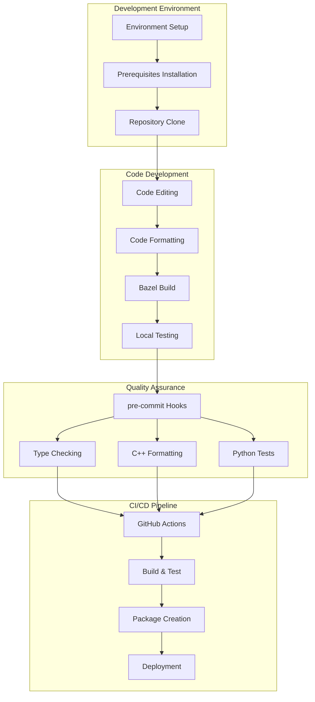
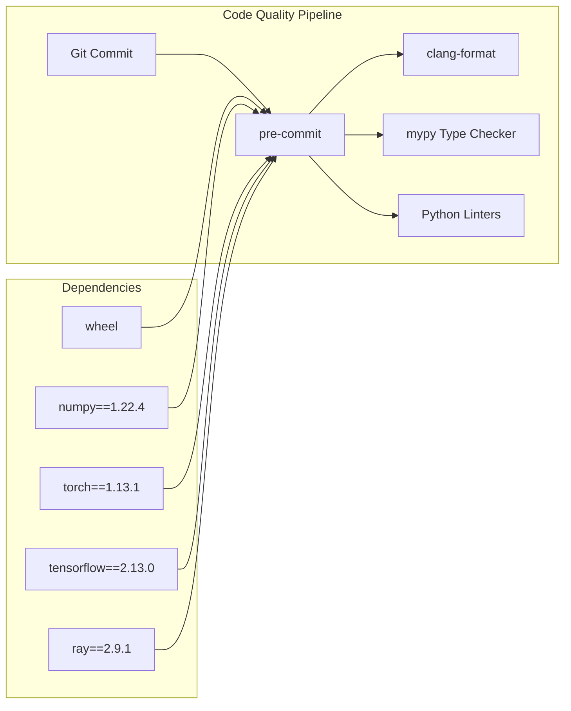
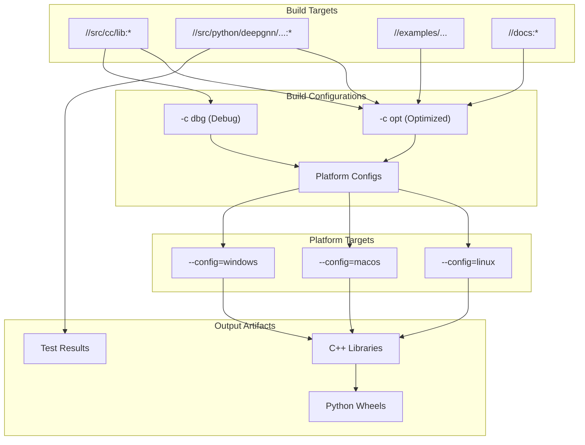
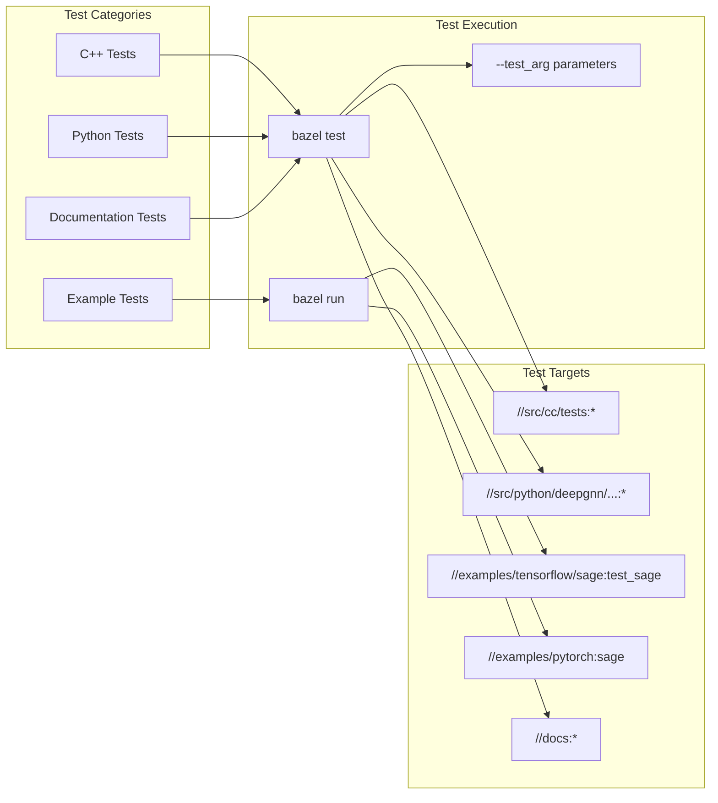
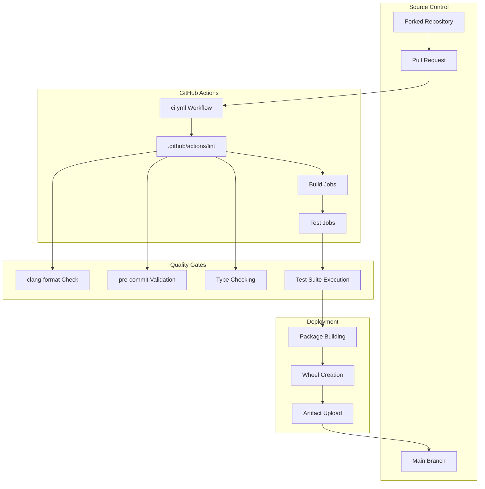
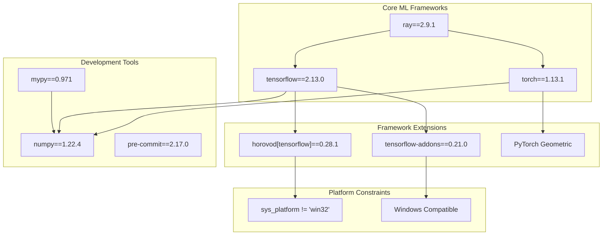

<!-- source: DeepWiki mcp.deepwiki.com · repo microsoft/DeepGNN · page 5 Development and Deployment · fetched 2026-10-26 -->

# Development and Deployment

Relevant source files

The following files were used as context for generating this wiki page:

- [.github/actions/lint/action.yml](.github/actions/lint/action.yml)
- [CONTRIBUTING.md](CONTRIBUTING.md)
- [docs/torch/distrib.rst](docs/torch/distrib.rst)
- [examples/tensorflow/requirements.txt](examples/tensorflow/requirements.txt)

This document provides comprehensive guidance for developers working on the DeepGNN codebase, covering the complete development lifecycle from environment setup to deployment. It includes build system configuration, testing infrastructure, continuous integration workflows, and package distribution processes.

For specific build system details, see [Build System](#5.1). For packaging and distribution specifics, see [Package Distribution](#5.2). For detailed testing procedures, see [Testing and CI/CD](#5.3).

## Development Environment Setup

### Prerequisites by Platform

DeepGNN supports development across Linux, macOS, and Windows platforms with specific toolchain requirements for each:

| Platform | Required Tools | Build Config |
|----------|---------------|--------------|
| Linux | Bazel 6.4.0, g++-12, clang-format | `--config=linux` |
| macOS | XCode CLI tools, Bazel (via Homebrew) | `--config=macos` |
| Windows | Golang, Bazelisk, MSVC compilers | `--config=windows` |

The build system requires Python 3 as the default interpreter and uses Bazel as the primary build tool across all platforms.

**Development Workflow Overview**

Sources: [CONTRIBUTING.md:14-41](), [.github/actions/lint/action.yml:1-29]()

### Code Quality Tools

The development environment integrates several code quality tools managed through `pre-commit`:

Sources: [CONTRIBUTING.md:84-91](), [.github/actions/lint/action.yml:15-28]()

## Build System Architecture

The build system centers around Bazel with platform-specific configurations and targets for both C++ and Python components:

**Build System Components**

Key build commands include:
- Optimized build: `bazel build -c opt //src/cc/lib:* --config=linux`
- Debug build: `bazel build -c dbg //src/cc/lib:* --config=linux`
- Python package: `python setup.py deepgnn-ge bdist_wheel --plat-name manylinux1_x86_64`

Sources: [CONTRIBUTING.md:42-69]()

## Testing Infrastructure

### Test Execution Framework

The testing system operates through Bazel with multiple test categories and timeout configurations:

| Test Category | Command | Timeout | Output |
|---------------|---------|---------|--------|
| C++ Graph Engine | `bazel test //src/cc/tests:*` | 4 seconds | `--test_output=all` |
| Python DeepGNN | `bazel test //src/python/deepgnn/...:*` | 6000 seconds | `--test_output=all` |
| TensorFlow Examples | `bazel run //examples/tensorflow/sage:test_sage` | 6000 seconds | `--test_output=all` |
| PyTorch Examples | `bazel run //examples/pytorch:sage` | 6000 seconds | `--test_output=all` |
| Documentation | `bazel test //docs:*` | 6000 seconds | `--test_output=all` |

**Test Execution Pipeline**

Individual test filtering is supported through pytest arguments: `--test_arg=-k --test_arg='test_sanity_neighbors_index'`

Sources: [CONTRIBUTING.md:94-118]()

## Continuous Integration Workflow

### GitHub Actions Pipeline

The CI/CD system uses GitHub Actions with automated linting, testing, and deployment:

**CI/CD Pipeline Architecture**

The lint action installs platform-specific dependencies and runs comprehensive code quality checks across all supported platforms.

Sources: [CONTRIBUTING.md:119-131](), [.github/actions/lint/action.yml:1-29]()

## Package Distribution

### Python Package Building

The package distribution system creates platform-specific wheels with manylinux compatibility:

Key distribution commands:
- Set build version: `export BUILD_VERSION=0.1.60`
- Create wheel: `python setup.py deepgnn-ge bdist_wheel --plat-name manylinux1_x86_64 clean --all`
- Install package: `python -m pip install --upgrade --force-reinstall dist/deepgnn_ge-$BUILD_VERSION-py3-none-manylinux1_x86_64.whl`

The packaging system integrates with the C++ library build process and creates distributable wheels for PyPI deployment.

Sources: [CONTRIBUTING.md:61-69]()

## Framework Dependencies

### Machine Learning Framework Integration

The development environment supports multiple ML framework versions with specific compatibility requirements:

| Framework | Version | Additional Components |
|-----------|---------|----------------------|
| PyTorch | 1.13.1 | PyTorch Geometric |
| TensorFlow | 2.13.0 | TensorFlow Addons 0.21.0 |
| Ray | 2.9.1 | Distributed Training |
| Horovod | 0.28.1 | TensorFlow Backend (Linux/macOS only) |

**Framework Dependency Graph**

Platform-specific dependency management ensures compatibility across Linux, macOS, and Windows development environments.

Sources: [examples/tensorflow/requirements.txt:1-6](), [.github/actions/lint/action.yml:15-22](), [docs/torch/distrib.rst:248-254]()

---

