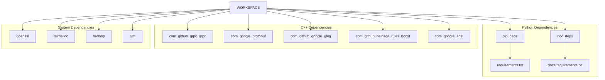
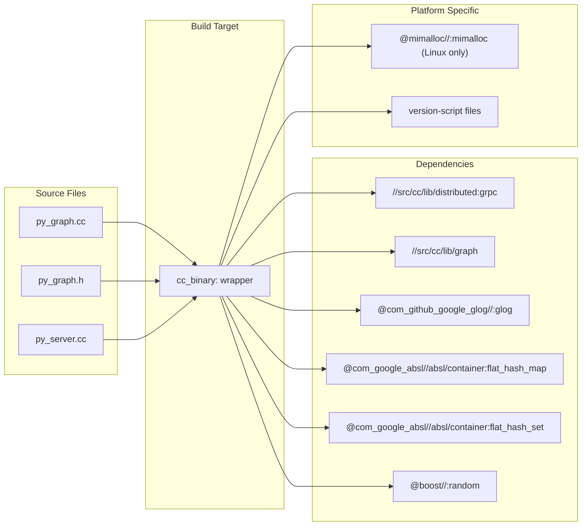
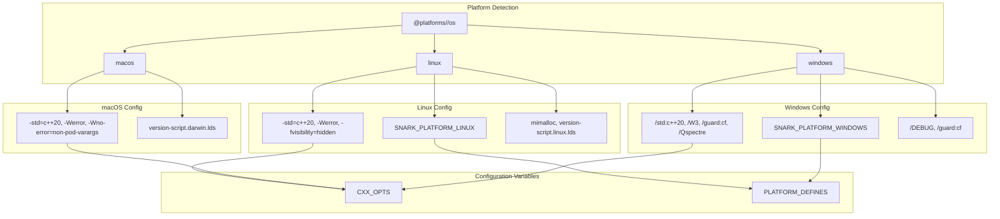

<!-- source: DeepWiki mcp.deepwiki.com · repo microsoft/DeepGNN · page 5.1 Build System · fetched 2026-10-26 -->

# Build System

Relevant source files

The following files were used as context for generating this wiki page:

- [WORKSPACE](WORKSPACE)
- [config/variables.bzl](config/variables.bzl)
- [src/cc/lib/BUILD](src/cc/lib/BUILD)

The DeepGNN build system is based on Bazel and manages compilation of C++ components, Python package integration, and cross-platform builds. This document covers the Bazel workspace configuration, C++ library compilation, platform-specific build settings, and dependency management. For information about Python package distribution, see [Package Distribution](#5.2). For testing infrastructure, see [Testing and CI/CD](#5.3).

## Bazel Workspace Configuration

The build system is configured through the main `WORKSPACE` file, which defines external dependencies and build rules. The workspace uses multiple rule sets for different components:

| Rule Set | Purpose | Key Dependencies |
|----------|---------|------------------|
| `rules_python` | Python integration and pip dependencies | PyTorch, TensorFlow, numpy |
| `rules_proto` | Protocol buffer compilation | gRPC services, graph serialization |
| `rules_foreign_cc` | External C++ libraries | OpenSSL, mimalloc |
| `rules_cc` | C++ compilation | Core graph engine, distributed services |

The workspace defines two main Python dependency sets through `pip_parse`:

**Sources:** [WORKSPACE:31-40](), [WORKSPACE:42-50]()

## C++ Wrapper Library Build

The core C++ wrapper library is built as a shared library through the `wrapper` target in `src/cc/lib/BUILD`. This library provides the Python-C++ interface for the graph engine:

**Sources:** [src/cc/lib/BUILD:6-59]()

## Platform-Specific Build Configuration

The build system handles three platforms with different compilation and linking options defined in `config/variables.bzl`:

| Platform | C++ Standard | Key Flags | Special Features |
|----------|--------------|-----------|------------------|
| Linux | C++20 | `-fvisibility=hidden`, `-Werror` | mimalloc integration, version scripts |
| macOS | C++20 | `-fvisibility=hidden`, `-Wno-error=non-pod-varargs` | Exported symbols list |
| Windows | C++20 | `/W3`, `/guard:cf`, `/Qspectre` | Control Flow Guard, Spectre mitigation |

The platform-specific configurations are applied through Bazel's `select()` mechanism:

**Sources:** [config/variables.bzl:6-16](), [config/variables.bzl:18-22](), [src/cc/lib/BUILD:16-26](), [src/cc/lib/BUILD:30-58]()

## External Dependency Management

The build system manages numerous external dependencies through different mechanisms:

### C++ Dependencies
- **gRPC** (`com_github_grpc_grpc`): Distributed communication services
- **Protocol Buffers** (`com_google_protobuf`): Data serialization 
- **Google Test** (`googletest`): Unit testing framework
- **Abseil** (`com_google_absl`): Google's C++ library collection
- **Boost** (`com_github_nelhage_rules_boost`): C++ libraries for random number generation

### System Dependencies  
- **OpenSSL** (`openssl`): Cryptographic library with custom build configuration
- **mimalloc** (`mimalloc`): Microsoft's memory allocator (Linux only)
- **Hadoop** (`hadoop`): HDFS integration for distributed storage
- **JSON** (`json`): nlohmann/json library for JSON parsing

### Python Dependencies
- **PyTorch**: Deep learning framework with CPU-specific wheel sources
- **TensorFlow**: Alternative deep learning framework
- **Documentation**: Separate dependency set for documentation generation

```mermaid
graph TB
    subgraph "Dependency Sources"
        HTTP_ARCHIVE["http_archive"]
        GIT_REPOSITORY["git_repository"]
        PIP_PARSE["pip_parse"]
    end
    
    subgraph "C++ Libraries"
        GRPC_DEP["gRPC v1.51.1"]
        PROTOBUF_DEP["Protobuf v3.19.4"]
        GTEST_DEP["GoogleTest v1.11.0"]
        BOOST_DEP["Boost (custom rules)"]
        ABSL_DEP["Abseil 20220623.0"]
    end
    
    subgraph "System Libraries"
        OPENSSL_DEP["OpenSSL 3.3.0"]
        MIMALLOC_DEP["mimalloc v2.1.2"]
        HADOOP_DEP["Hadoop 3.3.6"]
        JSON_DEP["nlohmann/json v3.11.2"]
    end
    
    subgraph "Python Packages"
        PYTORCH_DEP["PyTorch (CPU wheels)"]
        MAIN_DEPS["requirements.txt"]
        DOC_DEPS_PKG["docs/requirements.txt"]
    end
    
    HTTP_ARCHIVE --> GRPC_DEP
    HTTP_ARCHIVE --> PROTOBUF_DEP
    HTTP_ARCHIVE --> BOOST_DEP
    HTTP_ARCHIVE --> ABSL_DEP
    HTTP_ARCHIVE --> OPENSSL_DEP
    HTTP_ARCHIVE --> MIMALLOC_DEP
    HTTP_ARCHIVE --> HADOOP_DEP
    HTTP_ARCHIVE --> JSON_DEP
    
    GIT_REPOSITORY --> GTEST_DEP
    
    PIP_PARSE --> PYTORCH_DEP
    PIP_PARSE --> MAIN_DEPS
    PIP_PARSE --> DOC_DEPS_PKG
```

**Sources:** [WORKSPACE:52-56](), [WORKSPACE:94-106](), [WORKSPACE:116-121](), [WORKSPACE:31-36](), [WORKSPACE:134-139](), [WORKSPACE:147-153]()

## Build Process and Outputs

The build process produces platform-specific shared libraries that serve as the interface between Python and C++ components:

| Platform | Output Format | Key Features |
|----------|---------------|--------------|
| Linux | `.so` (shared object) | Symbol visibility control, mimalloc integration |
| macOS | `.dylib` (dynamic library) | Exported symbols list, Darwin-specific linking |
| Windows | `.dll` (dynamic library) | Control Flow Guard, debug symbols |

The `wrapper` target uses `linkshared = True` and `linkstatic = True` to create a self-contained shared library that can be loaded by Python. Platform-specific version scripts control symbol visibility to ensure a clean API surface.

**Sources:** [src/cc/lib/BUILD:27-28](), [src/cc/lib/BUILD:16-26]()

---

