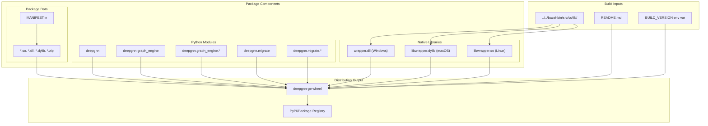
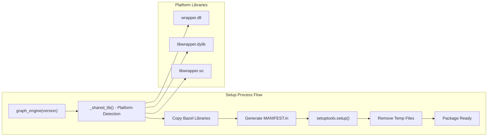
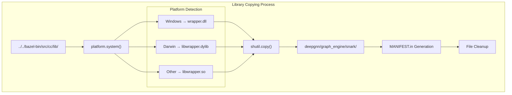
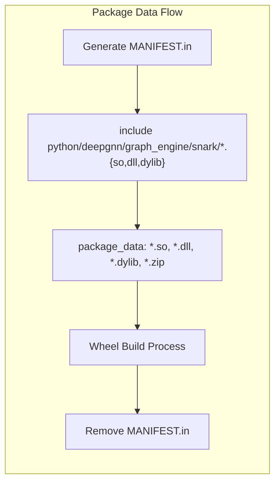
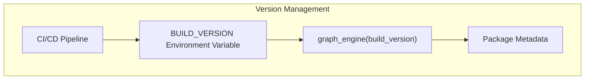

<!-- source: DeepWiki mcp.deepwiki.com · repo microsoft/DeepGNN · page 5.2 Package Distribution · fetched 2026-10-26 -->

# Package Distribution

Relevant source files

The following files were used as context for generating this wiki page:

- [examples/pytorch/aml.py](examples/pytorch/aml.py)
- [src/python/setup.py](src/python/setup.py)

This document covers the Python package distribution system for DeepGNN, including the setuptools configuration, binary library packaging, and wheel creation process. It focuses on how the framework packages its Python components along with the compiled C++ graph engine libraries for distribution via PyPI or other package repositories.

For information about the build system that creates the binaries packaged here, see [Build System](#5.1). For testing and CI/CD processes that validate these packages, see [Testing and CI/CD](#5.3).

## Package Structure Overview

The DeepGNN distribution system creates Python wheels that combine pure Python code with compiled C++ libraries from the Snark graph engine. The primary package distributed is `deepgnn-ge` (graph engine), which contains both the Python API and the underlying native libraries.

**Sources:** [src/python/setup.py:54-104]()

## Setup Configuration

The main package distribution logic is implemented in the `graph_engine()` function within `setup.py`. This function handles platform-specific library packaging and creates the wheel configuration.

### Package Metadata

| Property | Value |
|----------|-------|
| Package Name | `deepgnn-ge` |
| Description | Graph engine - distributed graph engine to host graphs |
| License | MIT |
| Python Requirements | `>=3.7` |
| Supported Versions | 3.7, 3.8, 3.9, 3.10 |

**Sources:** [src/python/setup.py:21-44](), [src/python/setup.py:54-89]()

## Binary Library Integration

The packaging process integrates compiled C++ libraries from the Bazel build system into the Python package. The `_shared_lib()` function determines the appropriate library name based on the target platform.

### Platform-Specific Library Handling

The setup process copies the appropriate shared library from the Bazel build output directory to the package directory:

The process also handles Windows-specific permissions by setting write permissions on the DLL files before copying.

**Sources:** [src/python/setup.py:24-45](), [src/python/setup.py:106-112]()

## Dependencies and Requirements

The package declares several categories of dependencies for different functionality areas:

### Core Dependencies

| Package | Version Requirement | Purpose |
|---------|-------------------|---------|
| `numpy` | `>=1.17.0` | Numerical computing |
| `networkx` | `==2.5.1` | Graph data structures |
| `scipy` | `>=1.10.0` | Scientific computing |
| `scikit-learn` | (latest) | Machine learning utilities |

### Cloud and Storage Dependencies

| Package | Purpose |
|---------|---------|
| `azure-datalake-store` | Azure Data Lake integration |
| `fsspec` | Filesystem abstraction |
| `tenacity` | Retry mechanisms |

### Monitoring Dependencies

| Package | Purpose |
|---------|---------|
| `opencensus-ext-azure` | Azure monitoring integration |

**Sources:** [src/python/setup.py:73-82]()

## Package Data and Manifest

The packaging system uses a dynamically generated `MANIFEST.in` file to include binary libraries in the distribution. This manifest ensures that platform-specific shared libraries are properly included in the wheel.

The `package_data` specification in setuptools configuration ensures that all binary files are included in the final package distribution.

**Sources:** [src/python/setup.py:32-45](), [src/python/setup.py:72](), [src/python/setup.py:107]()

## Build Version Management

Package versioning is controlled through the `BUILD_VERSION` environment variable, which is typically set by CI/CD pipelines during automated builds.

**Sources:** [src/python/setup.py:116-118]()

## Module Discovery and Packaging

The setup configuration uses `setuptools.find_packages()` with specific include patterns to package only the relevant modules:

- `deepgnn` - Base package
- `deepgnn.graph_engine` - Graph engine components  
- `deepgnn.graph_engine.*` - All graph engine submodules
- `deepgnn.migrate` - Migration utilities
- `deepgnn.migrate.*` - All migration submodules

This selective packaging ensures that only the core graph engine functionality and related utilities are included in the `deepgnn-ge` distribution package.

**Sources:** [src/python/setup.py:63-71]()

---

