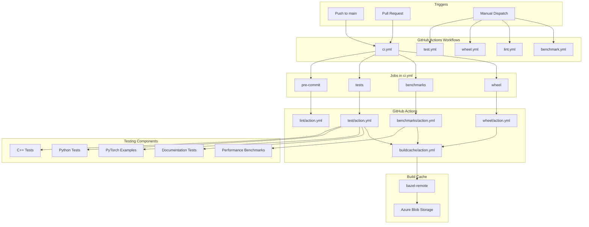
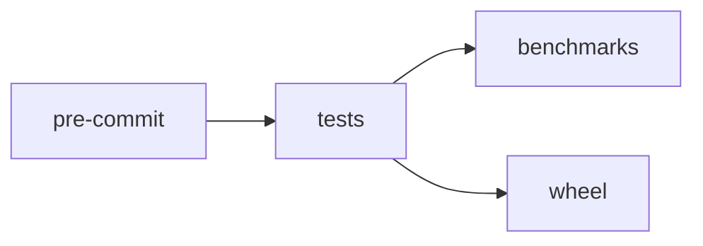
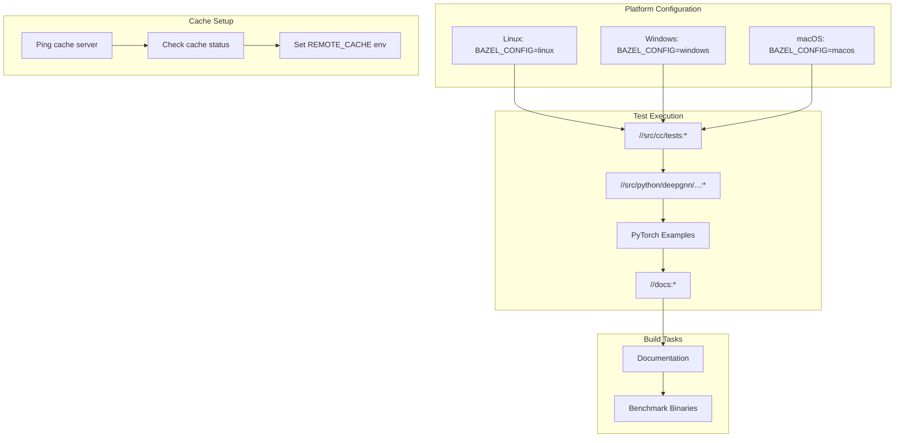
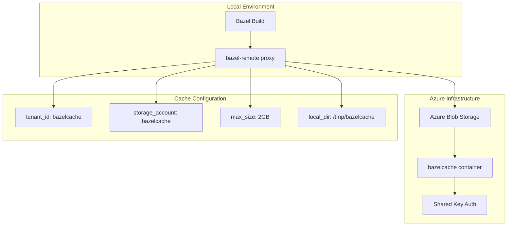
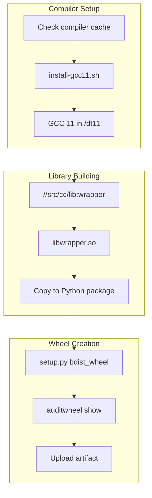
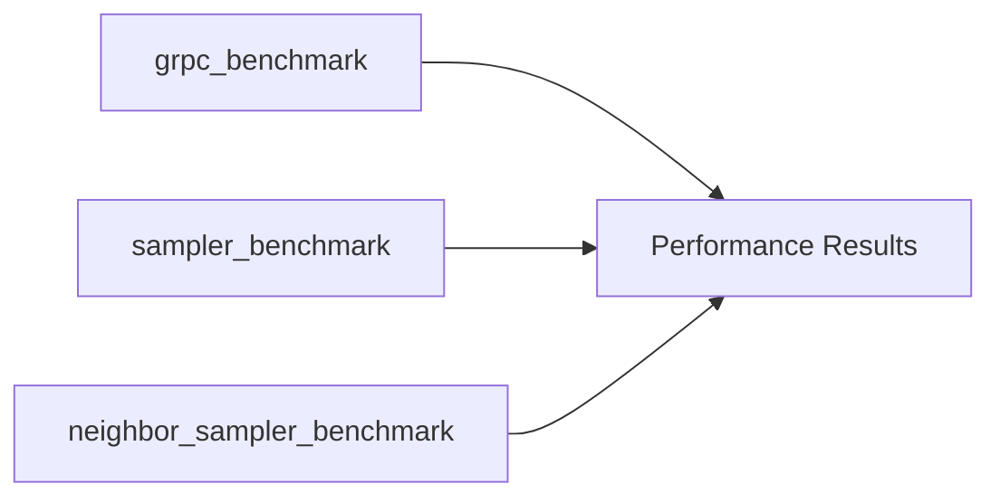

<!-- source: DeepWiki mcp.deepwiki.com · repo microsoft/DeepGNN · page 5.3 Testing and CI/CD · fetched 2026-10-26 -->

# Testing and CI/CD

<details>
<summary>Relevant source files</summary>

The following files were used as context for generating this wiki page:

- [.github/actions/benchmarks/action.yml](.github/actions/benchmarks/action.yml)
- [.github/actions/buildcache/action.yml](.github/actions/buildcache/action.yml)
- [.github/actions/test/action.yml](.github/actions/test/action.yml)
- [.github/actions/wheel/action.yml](.github/actions/wheel/action.yml)
- [.github/workflows/benchmark.yml](.github/workflows/benchmark.yml)
- [.github/workflows/ci.yml](.github/workflows/ci.yml)
- [.github/workflows/lint.yml](.github/workflows/lint.yml)
- [.github/workflows/test.yml](.github/workflows/test.yml)
- [.github/workflows/wheel.yml](.github/workflows/wheel.yml)

</details>


This page documents the testing infrastructure and continuous integration/continuous deployment (CI/CD) pipelines for the DeepGNN repository. It covers the GitHub Actions workflows, testing strategies, build caching mechanisms, and deployment processes used to ensure code quality and reliable distribution.

For information about the build system itself, see [Build System](#5.1). For package distribution details, see [Package Distribution](#5.2). For detailed testing infrastructure components, see [Testing Infrastructure Details](#5.4).

## Overview

The DeepGNN repository uses GitHub Actions for CI/CD with a comprehensive testing strategy that includes:

- Multi-platform testing (Linux, Windows)
- Multi-version Python support (3.8, 3.9, 3.10)
- C++ and Python unit tests
- Integration tests with ML frameworks
- Performance benchmarking
- Automated wheel building and distribution
- Remote build caching for efficiency

## CI/CD Pipeline Architecture



Sources: [.github/workflows/ci.yml:1-86](), [.github/workflows/test.yml:1-26](), [.github/workflows/wheel.yml:1-36](), [.github/workflows/lint.yml:1-20](), [.github/workflows/benchmark.yml:1-17]()

## Main CI Workflow

The primary CI workflow is defined in `ci.yml` and runs on push to main, pull requests, and manual triggers. It consists of four sequential jobs:

### Job Matrix Strategy

| Job | Python Versions | Operating Systems |
|-----|-----------------|-------------------|
| pre-commit | 3.8, 3.9, 3.10 | ubuntu-22.04, windows-2019 |
| tests | 3.10 | ubuntu-22.04, windows-2019 |
| benchmarks | N/A | ubuntu-22.04 |
| wheel | 3.10 | ubuntu-22.04 |

### Job Dependencies



Sources: [.github/workflows/ci.yml:14-86]()

## Testing Infrastructure

### Test Execution Action

The `test/action.yml` action orchestrates all testing activities:



### Test Commands

| Test Type | Bazel Command | Timeout |
|-----------|---------------|---------|
| C++ Tests | `bazel test -c dbg //src/cc/tests:* --test_output=all --test_timeout 30` | 30s |
| Python Tests | `bazel test -c dbg //src/python/deepgnn/...:* --jobs 1 --test_output=all --test_timeout 600` | 600s |
| Documentation | `bazel test -c dbg //docs:* --test_output=all --jobs 1` | Default |

### PyTorch Examples Testing

The following PyTorch examples are executed as integration tests:

- `//examples/pytorch:aml`
- `//examples/pytorch:gcn`  
- `//examples/pytorch:gat`
- `//examples/pytorch:sage`
- `//examples/pytorch:pyg_interface`

Sources: [.github/actions/test/action.yml:27-51]()

## Build Caching System

### Cache Architecture



The build cache uses `bazel-remote` v2.4.1 to proxy between local Bazel builds and Azure Blob Storage. Cache availability is checked before use:

```bash
if [ ping -c 1 localhost:8080 &> /dev/null ] && [ $(curl localhost:8080/status | python -c "import sys, json; print(json.load(sys.stdin)['NumFiles'])") -ne 0 ]
```

Sources: [.github/actions/buildcache/action.yml:14-22]()

## Wheel Building Pipeline

### Platform-Specific Configuration

| Platform | Bazel Config | Platform Name | Special Requirements |
|----------|-------------|---------------|---------------------|
| Linux | `manylinux` | `manylinux1_x86_64` | GCC 11 installation |
| Windows | `windows` | `win-amd64` | None |
| macOS | `macos` | `macosx-10.9-x86_64` | None |

### Linux Wheel Building Process



The wheel building process includes:

1. Installing GCC 11 for manylinux compatibility
2. Building the C++ wrapper library: `bazel build -c opt //src/cc/lib:wrapper`
3. Copying `libwrapper.so` to the Python package directory
4. Creating wheels with platform-specific names
5. Auditing Linux wheels with `auditwheel`

Sources: [.github/actions/wheel/action.yml:18-81]()

## Performance Benchmarking

### Benchmark Execution

The benchmarking system runs three performance tests:



Each benchmark is executed with:
- Configuration: `--config=linux`
- Build mode: `-c opt` (optimized)
- Remote cache: Connected to Azure Blob Storage

Benchmark commands:
- `bazel run -c opt src/cc/lib/benchmark:grpc_benchmark`
- `bazel run -c opt src/cc/lib/benchmark:sampler_benchmark`  
- `bazel run -c opt src/cc/lib/benchmark:neighbor_sampler_benchmark`

Sources: [.github/actions/benchmarks/action.yml:16-18]()

## Workflow Triggers and Dependencies

### Trigger Configuration

| Workflow | Triggers | Secrets Required |
|----------|----------|------------------|
| `ci.yml` | Push to main, PR, Manual | `BAZEL_REMOTE_AZBLOB_SHARED_KEY` |
| `test.yml` | Manual dispatch | `BAZEL_REMOTE_AZBLOB_SHARED_KEY` |
| `wheel.yml` | Manual dispatch | `BAZEL_REMOTE_AZBLOB_SHARED_KEY` |
| `lint.yml` | Manual dispatch | None |
| `benchmark.yml` | Manual dispatch | `BAZEL_REMOTE_AZBLOB_SHARED_KEY` |

### Artifact Management

The CI pipeline produces and manages several artifacts:

- **Examples**: Uploaded from `examples/*` directory
- **Wheels**: Platform-specific wheel files from `src/python/dist/*.whl`
- **Documentation**: Generated during test runs
- **Benchmark Results**: Performance metrics from C++ benchmarks

Sources: [.github/workflows/ci.yml:68-85](), [.github/workflows/wheel.yml:31-35]()

---

