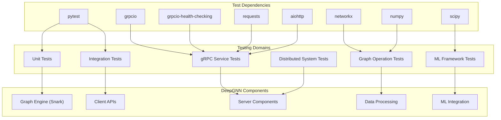
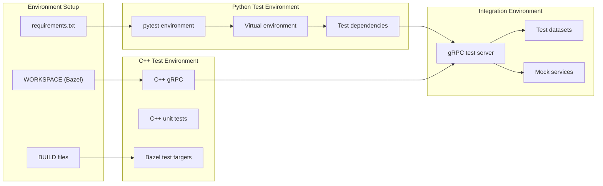
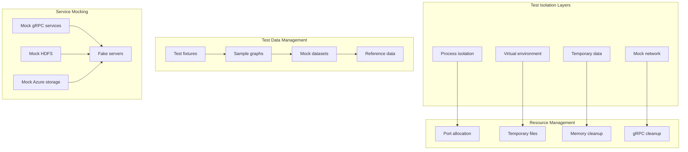

<!-- source: DeepWiki mcp.deepwiki.com · repo microsoft/DeepGNN · page 5.4 Testing Infrastructure Details · fetched 2026-10-26 -->

# Testing Infrastructure Details

Relevant source files

The following files were used as context for generating this wiki page:

- [src/python/deepgnn/graph_engine/snark/tests/requirements.txt](src/python/deepgnn/graph_engine/snark/tests/requirements.txt)

## Purpose and Scope

This document provides detailed documentation of the testing infrastructure components in DeepGNN, including test dependencies, specialized testing environments, and testing framework configurations. This covers the technical implementation details of how tests are organized, executed, and managed across the various subsystems.

For general information about testing and CI/CD workflows, see [Testing and CI/CD](#5.3). For build system configuration that supports testing, see [Build System](#5.1).

## Test Dependencies Overview

The DeepGNN testing infrastructure relies on a carefully curated set of dependencies to support testing across multiple domains including graph operations, distributed systems, machine learning, and data processing.

### Core Testing Dependencies

The primary test dependencies are defined for the Snark graph engine testing environment:

| Dependency | Version | Purpose |
|------------|---------|---------|
| `pytest` | 6.1.2 | Primary testing framework |
| `grpcio` | 1.53.2 | gRPC client/server testing |
| `grpcio-health-checking` | 1.35.0 | gRPC health check testing |
| `networkx` | 2.5.1 | Graph structure validation |
| `numpy` | 1.22.0 | Numerical computation testing |
| `scipy` | 1.10.0 | Scientific computing tests |
| `requests` | 2.32.4 | HTTP client testing |
| `aiohttp` | 3.10.11 | Async HTTP testing |

### Test Dependency Architecture

Sources: [src/python/deepgnn/graph_engine/snark/tests/requirements.txt:1-19]()

## Test Environment Configuration

### Version Compatibility Requirements

The testing infrastructure maintains strict version compatibility requirements, particularly for components that interact with the C++ backend:

- **gRPC Version Alignment**: The `grpcio` version (1.53.2) is specifically chosen to match the C++ gRPC version defined in the WORKSPACE file, ensuring compatibility between Python and C++ gRPC implementations.
- **NumPy Compatibility**: NumPy 1.22.0 provides stable array operations while maintaining compatibility with the C++ tensor operations.
- **NetworkX Version**: NetworkX 2.5.1 is used for graph structure validation and comparison against DeepGNN's native graph representations.

### Test Environment Dependencies

Sources: [src/python/deepgnn/graph_engine/snark/tests/requirements.txt:4-6]()

## Testing Framework Components

### Core Testing Infrastructure

The testing infrastructure is built around several key components that support different aspects of the DeepGNN system:

#### Graph Engine Testing
- **MemoryGraph Testing**: Tests for in-memory graph operations and queries
- **Distributed Client Testing**: Tests for distributed graph client functionality  
- **gRPC Service Testing**: Tests for `GraphEngineService` and `GraphSamplerService`
- **Storage Backend Testing**: Tests for HDFS, disk, and memory storage implementations

#### Data Processing Testing
- **Decoder Testing**: Tests for `JsonDecoder`, `EdgeListDecoder`, and `TsvDecoder`
- **Converter Testing**: Tests for `MultiWorkersConverter` and binary conversion pipeline
- **Dataset Testing**: Tests for built-in datasets like Cora, Citeseer, PPI, and Reddit

#### ML Framework Testing
- **PyTorch Integration Testing**: Tests for GraphSAGE, GAT, and GCN implementations
- **TensorFlow Integration Testing**: Tests for TensorFlow model training and inference
- **Ray Distributed Testing**: Tests for distributed training scenarios

### Test Execution Flow

```mermaid
graph TB
    subgraph "Test Discovery"
        PYTEST_DISCOVER["pytest discovery"]
        TEST_FILES["*.py test files"]
        TEST_FUNCS["test_* functions"]
    end
    
    subgraph "Test Setup"
        FIXTURES["pytest fixtures"]
        TEST_DATA_SETUP["Test data setup"]
        MOCK_SETUP["Mock service setup"]
        GRPC_SETUP["gRPC server setup"]
    end
    
    subgraph "Test Categories"
        UNIT_EXEC["Unit test execution"]
        INTEGRATION_EXEC["Integration test execution"]
        E2E_EXEC["End-to-end test execution"]
    end
    
    subgraph "Test Validation"
        ASSERT["Assertion validation"]
        GRPC_HEALTH["gRPC health checks"]
        GRAPH_VALIDATION["Graph state validation"]
        ML_METRICS["ML metric validation"]
    end
    
    subgraph "Test Cleanup"
        TEARDOWN["Test teardown"]
        RESOURCE_CLEANUP["Resource cleanup"]
        SERVER_SHUTDOWN["Server shutdown"]
    end
    
    PYTEST_DISCOVER --> TEST_FILES
    TEST_FILES --> TEST_FUNCS
    TEST_FUNCS --> FIXTURES
    
    FIXTURES --> TEST_DATA_SETUP
    FIXTURES --> MOCK_SETUP
    FIXTURES --> GRPC_SETUP
    
    TEST_DATA_SETUP --> UNIT_EXEC
    MOCK_SETUP --> INTEGRATION_EXEC
    GRPC_SETUP --> E2E_EXEC
    
    UNIT_EXEC --> ASSERT
    INTEGRATION_EXEC --> GRPC_HEALTH
    E2E_EXEC --> GRAPH_VALIDATION
    E2E_EXEC --> ML_METRICS
    
    ASSERT --> TEARDOWN
    GRPC_HEALTH --> RESOURCE_CLEANUP
    GRAPH_VALIDATION --> SERVER_SHUTDOWN
```

Sources: [src/python/deepgnn/graph_engine/snark/tests/requirements.txt:15-16]()

## Specialized Testing Components

### Async Testing Infrastructure

The inclusion of `aiohttp` in the test dependencies indicates support for asynchronous testing scenarios, particularly important for:

- **Async gRPC Operations**: Testing asynchronous graph queries and operations
- **Concurrent Client Testing**: Testing multiple simultaneous client connections
- **Performance Testing**: Testing system behavior under concurrent load

### Graph-Specific Testing Tools

The testing infrastructure includes specialized components for graph-specific validation:

- **NetworkX Integration**: Using NetworkX 2.5.1 for reference graph implementations to validate DeepGNN graph operations
- **Graph Structure Validation**: Comparing graph topology, node features, and edge relationships
- **Sampling Validation**: Testing graph sampling algorithms against known reference implementations

### Numerical Testing Framework

Scientific computing dependencies support numerical testing requirements:

- **NumPy Arrays**: Testing tensor operations and feature matrix computations
- **SciPy Functions**: Testing advanced mathematical operations used in graph algorithms
- **Precision Testing**: Validating numerical precision and stability across different data types

### Testing Environment Isolation

Sources: [src/python/deepgnn/graph_engine/snark/tests/requirements.txt:1-19]()