# Page: Overview

# Overview

<details>
<summary>Relevant source files</summary>

The following files were used as context for generating this wiki page:

- [.readthedocs.yaml](.readthedocs.yaml)
- [docs/BUILD](docs/BUILD)
- [docs/graph_engine/custom_decoder.rst](docs/graph_engine/custom_decoder.rst)
- [docs/requirements.txt](docs/requirements.txt)
- [docs/tf/index.rst](docs/tf/index.rst)
- [requirements.txt](requirements.txt)

</details>


## Purpose and Scope

DeepGNN is a distributed graph neural network framework designed for large-scale graph processing and machine learning tasks. This framework provides a complete pipeline from graph data ingestion and storage through distributed training of graph neural network models.

The framework consists of a high-performance graph engine (Snark), data conversion utilities, and integrations with popular machine learning frameworks including PyTorch and TensorFlow. For detailed information about specific components, see [Graph Engine (Snark)](#2), [Datasets and Data Processing](#3), [Machine Learning Integration](#4), and [Development and Deployment](#5).

## High-Level Architecture

**DeepGNN System Architecture**

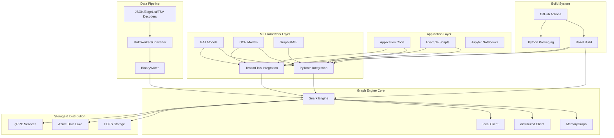

Sources: [requirements.txt:1-274](), [docs/BUILD:8-287](), [docs/graph_engine/custom_decoder.rst:1-151]()

## Core Components

### Graph Engine (Snark)

The Snark graph engine provides the foundational graph storage and processing capabilities. It supports both in-memory and distributed graph operations through multiple client interfaces.

**Graph Engine Component Architecture**

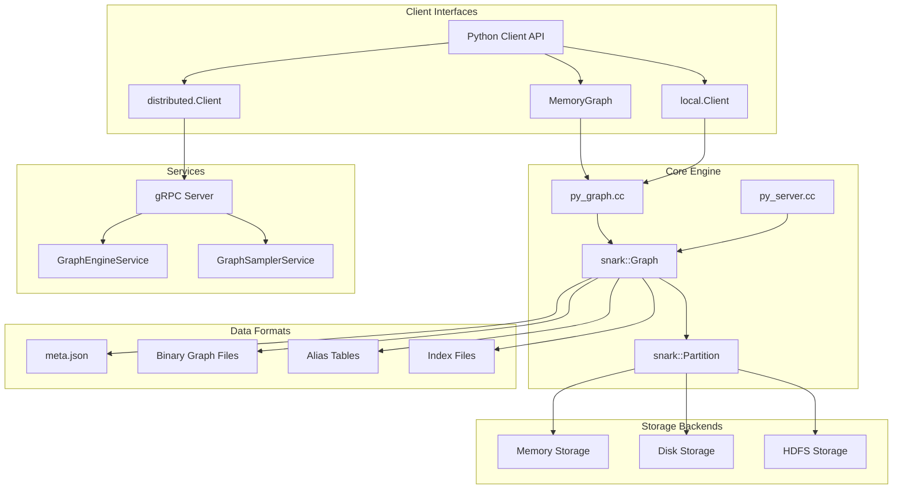

The engine supports multiple storage backends and provides both synchronous and asynchronous graph operations. Client applications interact with the graph through Python APIs that abstract the underlying C++ implementation.

Sources: [docs/BUILD:8-37](), [docs/graph_engine/custom_decoder.rst:135-151]()

### Data Processing Pipeline

The data conversion system transforms various input formats into the graph engine's optimized binary representation. This pipeline supports multiple input formats and provides extensible decoder interfaces.

**Data Conversion Flow**

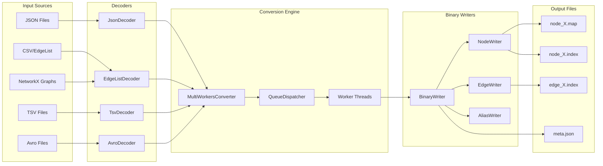

The pipeline supports custom decoders through the `Decoder` base class, allowing users to implement domain-specific data transformation logic while maintaining compatibility with the graph engine's storage format.

Sources: [docs/graph_engine/custom_decoder.rst:80-107](), [docs/BUILD:40-51]()

## Machine Learning Framework Integration

### PyTorch Integration

DeepGNN provides native PyTorch integration through specialized dataset classes, samplers, and model implementations. The integration supports distributed training scenarios and popular GNN architectures.

Key components include:
- `GraphSAGE` encoders and sampling utilities
- Custom PyTorch datasets for graph data
- Integration with PyTorch Geometric (`torch_geometric`)
- Ray-based distributed training support

### TensorFlow Integration

The TensorFlow integration offers similar capabilities with TensorFlow-specific implementations:
- Graph Attention Network (`GAT`) models
- Graph Convolutional Network (`GCN`) implementations  
- TensorFlow-compatible data loaders
- Ray distributed training integration

Sources: [requirements.txt:250-258](), [docs/BUILD:99-159](), [docs/BUILD:161-237](), [docs/tf/index.rst:1-11]()

## External System Integration

DeepGNN integrates with several external systems for data storage and distributed processing:

| System | Purpose | Configuration |
|--------|---------|---------------|
| Azure Data Lake | Cloud storage backend | Via `azure-datalake-store` package |
| HDFS | Distributed file storage | Native HDFS integration |
| Apache Spark | Data preprocessing | Through `pyspark` integration |
| Ray | Distributed training | For both PyTorch and TensorFlow |
| gRPC | Service communication | For distributed graph operations |

The framework automatically handles data partitioning and distribution across these systems, enabling scalable graph processing workflows.

Sources: [requirements.txt:20-35](), [requirements.txt:88-90](), [requirements.txt:185](), [requirements.txt:196]()

## Build and Deployment System

DeepGNN uses Bazel as its primary build system, providing reproducible builds across different platforms. The build configuration supports:

- Cross-platform C++ compilation with manylinux compatibility
- Python package generation and distribution
- Automated testing through GitHub Actions
- Documentation generation using Sphinx

The build system handles complex dependencies including C++ libraries, Python packages, and external frameworks, ensuring consistent deployment across development and production environments.

Sources: [docs/BUILD:1-287](), [docs/requirements.txt:1-31](), [.readthedocs.yaml:1-13]()

---

# Page: Graph Engine (Snark)

# Graph Engine (Snark)

<details>
<summary>Relevant source files</summary>

The following files were used as context for generating this wiki page:

- [src/cc/lib/graph/metadata.cc](src/cc/lib/graph/metadata.cc)
- [src/cc/lib/graph/metadata.h](src/cc/lib/graph/metadata.h)
- [src/cc/lib/graph/partition.cc](src/cc/lib/graph/partition.cc)
- [src/cc/lib/py_graph.h](src/cc/lib/py_graph.h)
- [src/python/deepgnn/graph_engine/snark/converter/writers.py](src/python/deepgnn/graph_engine/snark/converter/writers.py)
- [src/python/deepgnn/graph_engine/snark/distributed.py](src/python/deepgnn/graph_engine/snark/distributed.py)
- [src/python/deepgnn/graph_engine/snark/tests/e2e_test.py](src/python/deepgnn/graph_engine/snark/tests/e2e_test.py)
- [src/python/deepgnn/graph_engine/snark/tests/sparse_features_test.py](src/python/deepgnn/graph_engine/snark/tests/sparse_features_test.py)

</details>


The Graph Engine, internally known as Snark, is the core distributed graph storage and query engine for DeepGNN. It provides efficient storage, retrieval, and sampling operations for large-scale graphs across multiple partitions and servers. Snark handles both static and temporal graphs, supporting node and edge features, weighted sampling, and distributed operations through a client-server architecture.

For information about data processing and conversion pipelines that feed into Snark, see [Data Conversion Pipeline](#3.2). For ML framework integration that uses Snark, see [Machine Learning Integration](#4).

## Architecture Overview

Snark employs a multi-layered architecture with Python client interfaces, C++ backend processing, and flexible storage options. The system supports both local in-memory graphs and distributed multi-server deployments.

### Core System Architecture

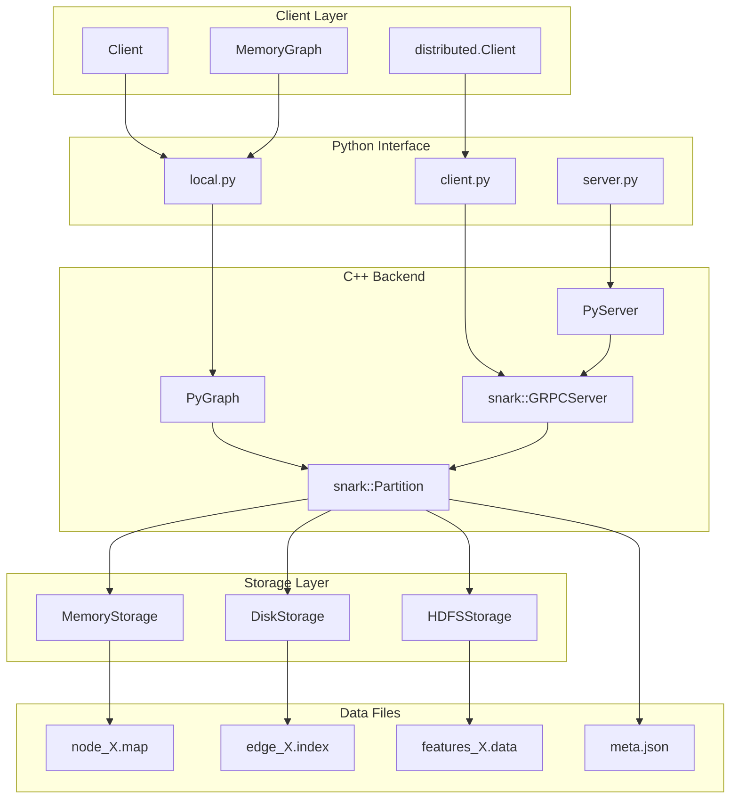

**Sources:** [src/python/deepgnn/graph_engine/snark/distributed.py:18-42](), [src/cc/lib/py_graph.h:30-44](), [src/cc/lib/graph/partition.cc:138-150]()

## Client APIs

Snark provides two primary client interfaces: local clients for single-machine deployments and distributed clients for multi-server setups.

### Local vs Distributed Clients

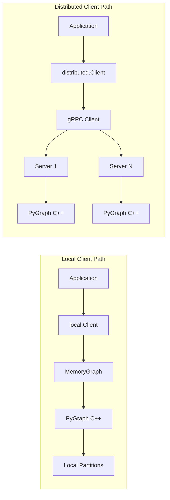

**Sources:** [src/python/deepgnn/graph_engine/snark/distributed.py:18-56](), [src/python/deepgnn/graph_engine/snark/tests/e2e_test.py:164-167]()

### Client Interface Operations

The client APIs support comprehensive graph operations including:

| Operation Category | Methods | Description |
|---|---|---|
| Node Operations | `node_features()`, `node_types()`, `node_string_features()` | Retrieve node attributes and features |
| Edge Operations | `edge_features()`, `neighbors()`, `neighbor_count()` | Access edge data and connectivity |
| Sampling | `NodeSampler`, `EdgeSampler` | Weighted and uniform sampling |
| Graph Queries | `get_node_type_count()`, `get_edge_type_count()` | Graph statistics |

**Sources:** [src/python/deepgnn/graph_engine/snark/tests/e2e_test.py:168-176](), [src/cc/lib/py_graph.h:96-125]()

## Server Components

The distributed server architecture enables horizontal scaling across multiple machines while maintaining data locality and efficient query processing.

### Server Initialization and Configuration

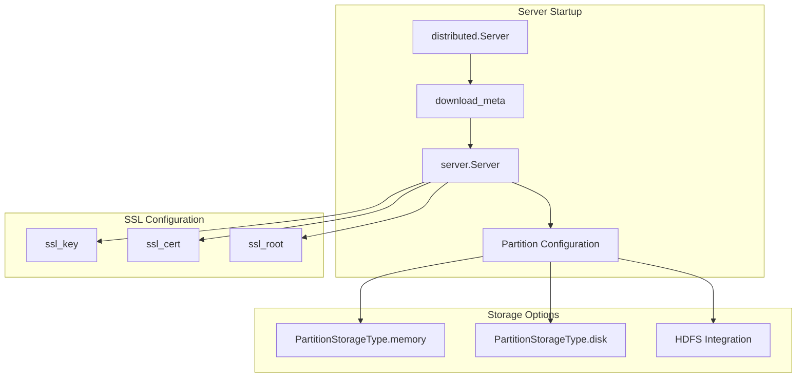

**Sources:** [src/python/deepgnn/graph_engine/snark/distributed.py:62-111](), [src/cc/lib/py_graph.h:84-89]()

## Data Storage and Partitioning

Snark uses a sophisticated partitioning scheme to distribute graph data across multiple storage backends while maintaining query efficiency.

### Partition Structure

The `snark::Partition` class manages individual graph partitions with the following key components:

- **Node Storage**: Node mappings, types, and feature indices
- **Edge Storage**: Edge indices, neighbor relationships, and timestamps
- **Feature Storage**: Dense and sparse feature data
- **Metadata**: Partition-specific statistics and configuration

**Sources:** [src/cc/lib/graph/partition.cc:138-201]()

### Storage Type Hierarchy

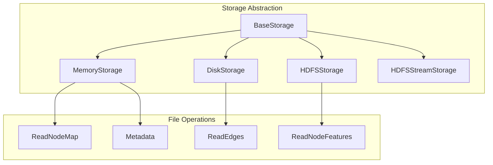

**Sources:** [src/cc/lib/graph/partition.cc:152-201](), [src/cc/lib/graph/partition.cc:396-455]()

### Binary File Format

Snark stores graph data in an optimized binary format with separate files for different data types:

| File Type | Purpose | Format |
|---|---|---|
| `node_X.map` | Node ID to internal ID mapping | `[node_id: 8b, internal_id: 8b, type: 4b]` |
| `edge_X.index` | Edge connectivity data | `[dst: 8b, feature_offset: 8b, type: 4b, weight: 4b]` |
| `neighbors_X.index` | Neighbor list indices | `[offset: 8b]` |
| `node_features_X.data` | Node feature storage | Variable length binary data |
| `meta.json` | Graph metadata | JSON metadata |

**Sources:** [src/cc/lib/graph/partition.cc:269-337](), [src/python/deepgnn/graph_engine/snark/converter/writers.py:214-221]()

## Metadata Management

The metadata system provides essential graph statistics and configuration information required for distributed operations.

### Metadata Structure

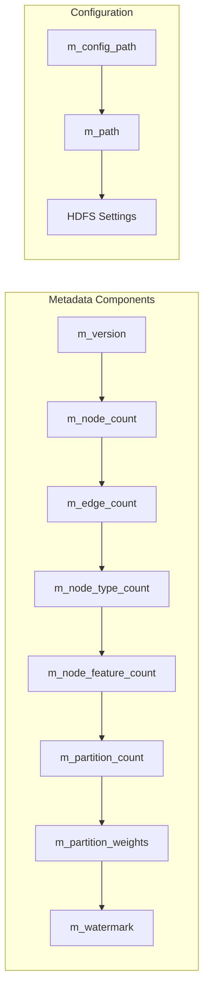

**Sources:** [src/cc/lib/graph/metadata.h:18-44](), [src/cc/lib/graph/metadata.cc:19-111]()

## Data Conversion Pipeline

The conversion pipeline transforms raw graph data into Snark's optimized binary format through a multi-stage process.

### Binary Writer Architecture

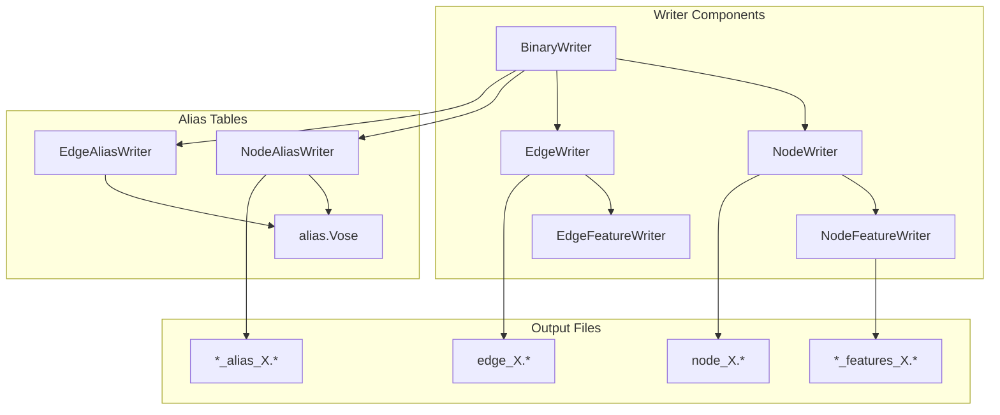

**Sources:** [src/python/deepgnn/graph_engine/snark/converter/writers.py:19-172](), [src/python/deepgnn/graph_engine/snark/converter/writers.py:487-576]()

## Key Operations and Interfaces

### C++ Interface Layer

The C interface in `py_graph.h` defines the core operations available to Python clients:

| Function Category | Key Functions | Purpose |
|---|---|---|
| Graph Creation | `CreateLocalGraph`, `CreateRemoteClient` | Initialize graph instances |
| Server Management | `StartServer`, `ResetServer` | Manage distributed servers |
| Node Operations | `GetNodeType`, `GetNodeFeature`, `GetNodeSparseFeature` | Node data access |
| Edge Operations | `GetEdgeFeature`, `GetNeighbors`, `NeighborCount` | Edge data access |
| Sampling | `CreateWeightedNodeSampler`, `SampleNodes`, `SampleEdges` | Random sampling |

**Sources:** [src/cc/lib/py_graph.h:80-183]()

### Feature Handling

Snark supports multiple feature types including dense arrays, sparse features, and string features with temporal versioning:

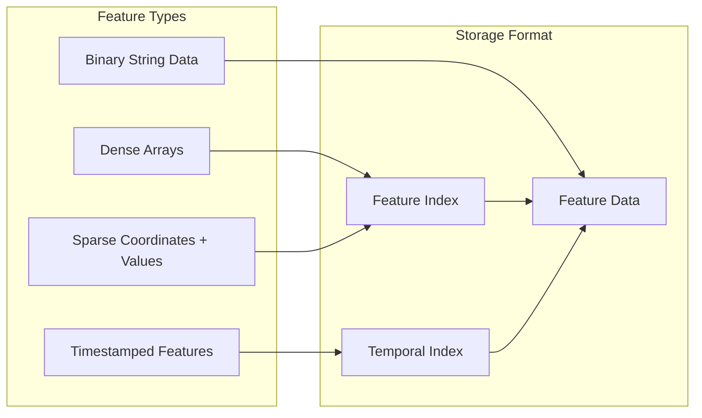

**Sources:** [src/cc/lib/graph/partition.cc:33-71](), [src/python/deepgnn/graph_engine/snark/converter/writers.py:680-736](), [src/python/deepgnn/graph_engine/snark/tests/sparse_features_test.py:24-53]()

---

# Page: Client APIs

# Client APIs

<details>
<summary>Relevant source files</summary>

The following files were used as context for generating this wiki page:

- [src/cc/lib/py_graph.cc](src/cc/lib/py_graph.cc)
- [src/cc/lib/version-script.darwin.lds](src/cc/lib/version-script.darwin.lds)
- [src/cc/lib/version-script.linux.lds](src/cc/lib/version-script.linux.lds)
- [src/python/deepgnn/graph_engine/snark/client.py](src/python/deepgnn/graph_engine/snark/client.py)
- [src/python/deepgnn/graph_engine/snark/local.py](src/python/deepgnn/graph_engine/snark/local.py)

</details>


## Purpose and Scope

This document covers the Python client interfaces for interacting with the DeepGNN graph engine (Snark). The client APIs provide the primary mechanism for loading graph data, querying graph structure, retrieving features, and performing sampling operations for machine learning workflows.

For information about server setup and distributed deployment, see [Server Components](#2.2). For distributed operations across multiple servers, see [Distributed Operations](#2.3).

## Client Architecture Overview

The client API consists of two main layers: a low-level `MemoryGraph` class that directly interfaces with the C++ backend, and a higher-level `Client` wrapper that provides convenient abstractions for common operations.

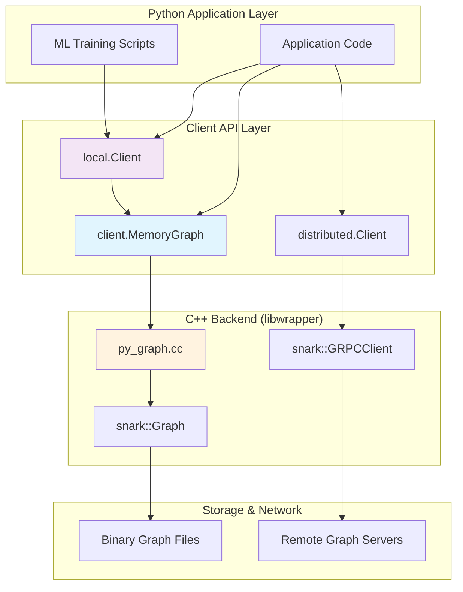

**Sources:** [src/python/deepgnn/graph_engine/snark/client.py:1-42](), [src/python/deepgnn/graph_engine/snark/local.py:1-25](), [src/cc/lib/py_graph.cc:64-71]()

## MemoryGraph - Core Local Client

The `MemoryGraph` class provides direct access to graph data loaded into memory or streamed from storage. It serves as the foundation for all local graph operations.

### Initialization and Storage Options

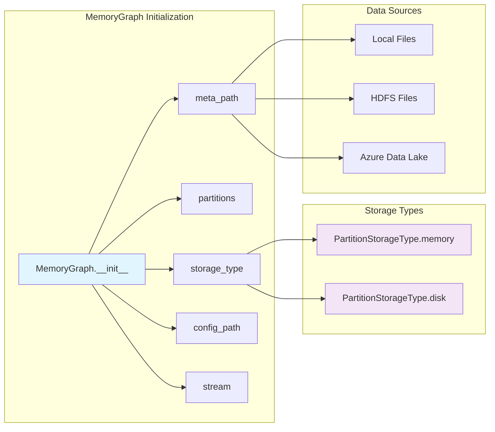

**Sources:** [src/python/deepgnn/graph_engine/snark/client.py:203-288](), [src/python/deepgnn/graph_engine/snark/client.py:99-104]()

### Feature Retrieval Operations

The `MemoryGraph` class supports multiple types of feature retrieval for both nodes and edges:

| Feature Type | Node Method | Edge Method | Data Format |
|--------------|-------------|-------------|-------------|
| Dense | `node_features()` | `edge_features()` | Fixed-size arrays |
| Sparse | `node_sparse_features()` | `edge_sparse_features()` | COO format indices + values |
| String | `node_string_features()` | `edge_string_features()` | Variable-length byte arrays |

**Sources:** [src/python/deepgnn/graph_engine/snark/client.py:540-584](), [src/python/deepgnn/graph_engine/snark/client.py:675-730](), [src/python/deepgnn/graph_engine/snark/client.py:586-629]()

### Neighbor Sampling Strategies

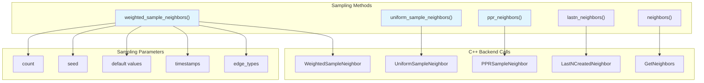

**Sources:** [src/python/deepgnn/graph_engine/snark/client.py:947-1025](), [src/python/deepgnn/graph_engine/snark/client.py:1027-1098](), [src/cc/lib/py_graph.cc:730-778](), [src/cc/lib/py_graph.cc:780-830]()

## Local Client Wrapper

The `local.Client` class provides a convenient high-level interface that wraps `MemoryGraph` and includes additional functionality for node/edge sampling and strategy-based neighbor sampling.

### Client Initialization Flow

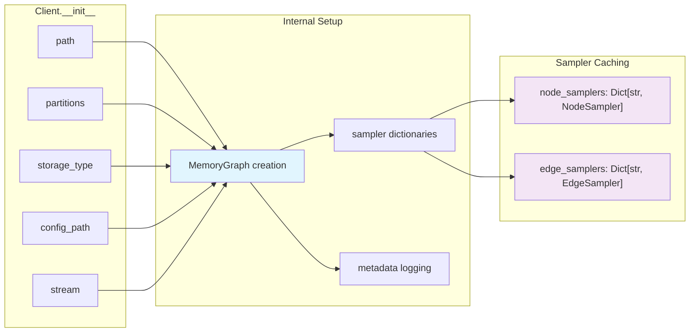

**Sources:** [src/python/deepgnn/graph_engine/snark/local.py:24-54](), [src/python/deepgnn/graph_engine/snark/local.py:49-50]()

### Sampling Strategy Mapping

The `local.Client` maps high-level sampling strategies to implementation-specific methods:

| Strategy | Implementation | Method Called |
|----------|----------------|---------------|
| `SamplingStrategy.Weighted` | "weighted" | `weighted_sample_neighbors()` |
| `SamplingStrategy.Random` | "uniform" | `uniform_sample_neighbors()` |
| `SamplingStrategy.RandomWithoutReplacement` | "withoutreplacement" | `uniform_sample_neighbors(without_replacement=True)` |
| `SamplingStrategy.PPRGo` | "ppr-go" | `ppr_neighbors()` |
| `SamplingStrategy.LastN` | "lastn" | `lastn_neighbors()` |

**Sources:** [src/python/deepgnn/graph_engine/snark/local.py:14-21](), [src/python/deepgnn/graph_engine/snark/local.py:116-188]()

## Core Client Operations

### Node and Edge Sampling

The client APIs support sampling of nodes and edges from the graph using various strategies:

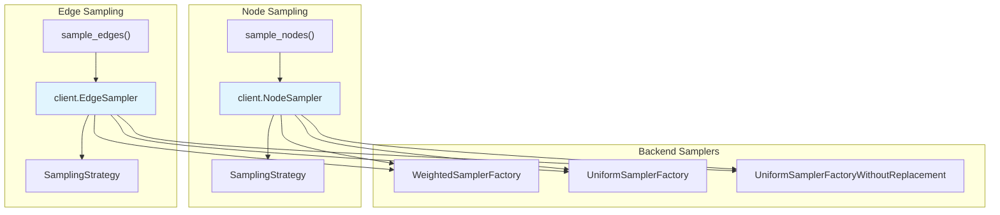

**Sources:** [src/python/deepgnn/graph_engine/snark/local.py:62-96](), [src/cc/lib/py_graph.cc:251-265]()

### Graph Traversal Operations

#### Random Walk Implementation

The client supports biased random walks following the node2vec algorithm:

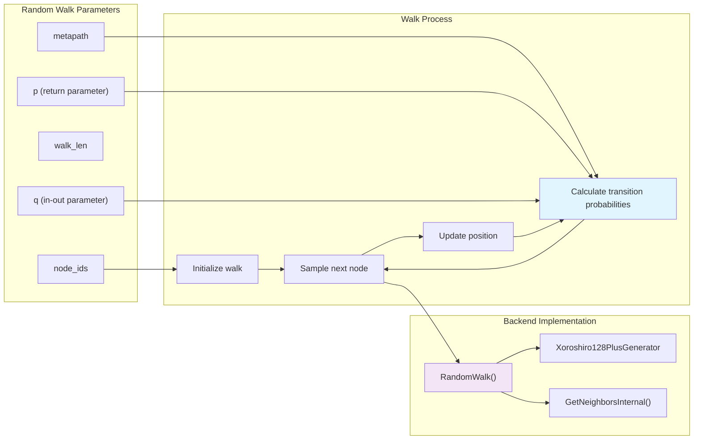

**Sources:** [src/python/deepgnn/graph_engine/snark/local.py:210-239](), [src/cc/lib/py_graph.cc:882-1022]()

### Feature Access Patterns

The client APIs provide comprehensive feature access with temporal support:

| Operation | Temporal Support | Return Format | Example Use Case |
|-----------|------------------|---------------|------------------|
| `node_features()` | ✓ (timestamps) | Dense arrays | Node embeddings |
| `edge_features()` | ✓ (timestamps) | Dense arrays | Edge weights |
| `node_sparse_features()` | ✓ (timestamps) | COO indices + values | Bag-of-words features |
| `neighbors()` | ✓ (timestamps) | Node IDs + metadata | Full neighborhood |
| `neighbor_count()` | ✓ (timestamps) | Counts | Degree information |

**Sources:** [src/python/deepgnn/graph_engine/snark/local.py:190-299](), [src/python/deepgnn/graph_engine/snark/client.py:844-883]()

## Error Handling and Retry Logic

The client implementation includes robust error handling for distributed scenarios:

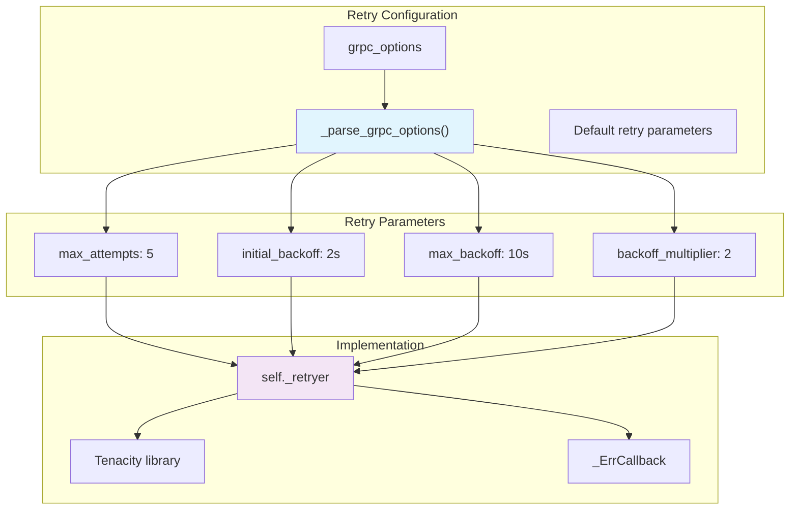

**Sources:** [src/python/deepgnn/graph_engine/snark/client.py:44-82](), [src/python/deepgnn/graph_engine/snark/client.py:88-97](), [src/python/deepgnn/graph_engine/snark/client.py:290]()

---

# Page: Server Components

# Server Components

<details>
<summary>Relevant source files</summary>

The following files were used as context for generating this wiki page:

- [src/cc/lib/py_server.cc](src/cc/lib/py_server.cc)
- [src/cc/tests/graph_test.cc](src/cc/tests/graph_test.cc)
- [src/python/deepgnn/graph_engine/snark/server.py](src/python/deepgnn/graph_engine/snark/server.py)
- [src/python/deepgnn/graph_engine/snark/tests/hdfs_test.py](src/python/deepgnn/graph_engine/snark/tests/hdfs_test.py)

</details>


This document covers the server-side components of the Graph Engine (Snark), including server setup, configuration options, storage backends, and service implementations. For information about client interfaces that connect to these servers, see [Client APIs](#2.1). For details about multi-server distributed deployments, see [Distributed Operations](#2.3).

## Architecture Overview

The DeepGNN graph engine server provides gRPC-based services for graph operations, supporting various storage backends and deployment configurations.

### Server Component Architecture

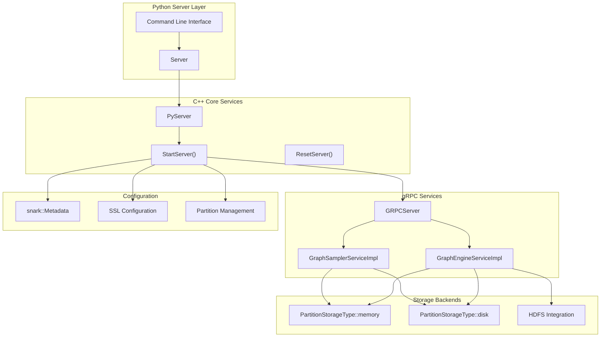

Sources: [src/python/deepgnn/graph_engine/snark/server.py:39-167](), [src/cc/lib/py_server.cc:32-54]()

## Main Server Class

The `Server` class in `server.py` serves as the primary interface for creating and managing graph engine servers.

### Server Initialization

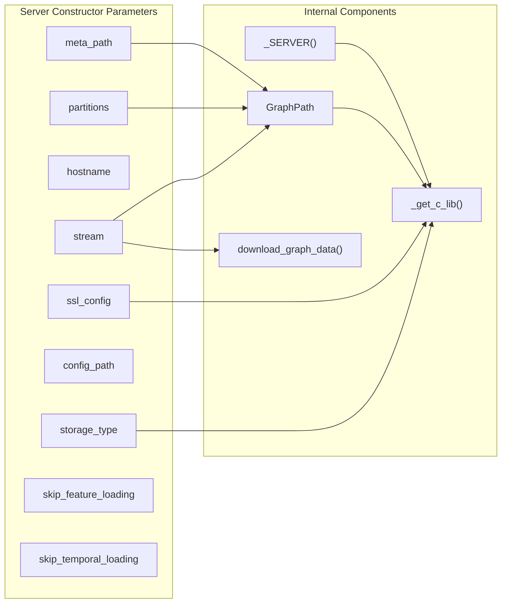

| Parameter | Type | Description |
|-----------|------|-------------|
| `meta_path` | `str` | Location of meta.json file with global graph information |
| `partitions` | `Sequence[Union[int, Tuple[str, int]]]` | Partition IDs or (path, ID) tuples to load |
| `hostname` | `str` | Address to use for serving (e.g., "0.0.0.0:9999") |
| `ssl_config` | `Dict[str, str]` | SSL configuration with keys: ssl_key, ssl_cert, ssl_root |
| `storage_type` | `PartitionStorageType` | Memory or disk storage (default: memory) |
| `config_path` | `str` | Path to configuration files for HDFS access |
| `stream` | `bool` | Stream data directly vs. download first (default: False) |
| `skip_feature_loading` | `bool` | Skip loading node/edge features (default: False) |
| `skip_temporal_loading` | `bool` | Skip loading temporal watermarks (default: False) |

Sources: [src/python/deepgnn/graph_engine/snark/server.py:42-70]()

### Server Lifecycle Methods

The server provides methods for managing its lifecycle:

- **`reset()`**: Stops the server and cleans up resources
- **C++ Integration**: Uses ctypes to interface with the underlying C++ server implementation

Sources: [src/python/deepgnn/graph_engine/snark/server.py:159-165]()

## Storage Configuration

### Storage Types

The server supports different storage backends through the `PartitionStorageType` enumeration:

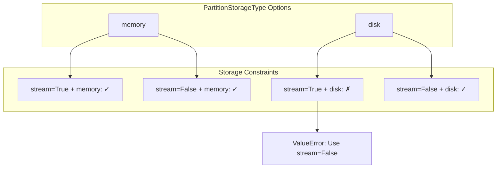

**Storage Type Validation**: The server enforces that `stream=True` cannot be used with `storage_type=disk`, raising a `ValueError` with the message "Use stream=False to download files first and use them from disk."

Sources: [src/python/deepgnn/graph_engine/snark/server.py:71-74]()

### HDFS and Remote Storage

The server supports various remote storage protocols:

| Protocol | Example Path | Configuration Required |
|----------|--------------|------------------------|
| HDFS | `hdfs://namenode:port/path` | Hadoop configuration files |
| Azure Data Lake | `adl://account.azuredatalakestore.net/path` | ADL configuration |
| Local Files | `file:///absolute/path` | Hadoop classpath setup |

**HDFS Integration**: When remote paths are detected, the server calls `_set_hadoop_classpath(config_path)` to configure the Hadoop environment.

Sources: [src/python/deepgnn/graph_engine/snark/server.py:91-96](), [src/python/deepgnn/graph_engine/snark/tests/hdfs_test.py:25-51]()

## C++ Service Implementation

### Core Server Functions

The C++ backend provides two primary functions for server management:

```mermaid
graph LR
    subgraph "Python Interface"
        ServerPy["Server.__init__()"]
        ResetPy["Server.reset()"]
    end
    
    subgraph "C++ Functions"
        StartServer["StartServer()"]
        ResetServer["ResetServer()"]
    end
    
    subgraph "Internal Services"
        GraphEngineServiceImpl["GraphEngineServiceImpl"]
        GraphSamplerServiceImpl["GraphSamplerServiceImpl"]
        GRPCServer["GRPCServer"]
    end
    
    ServerPy --> StartServer
    ResetPy --> ResetServer
    
    StartServer --> GraphEngineServiceImpl
    StartServer --> GraphSamplerServiceImpl
    StartServer --> GRPCServer
```

**StartServer Function**: Creates and initializes the server with the following signature:
```cpp
int32_t StartServer(PyServer *graph, const char *meta_location, size_t count, 
                   uint32_t *partition_indices, const char **partition_locations, 
                   const char *host_name, const char *ssl_key, const char *ssl_cert, 
                   const char *ssl_root, const PyPartitionStorageType storage_type_, 
                   const char *config_path, bool skip_feature_loading, 
                   bool skip_temporal_loading)
```

Sources: [src/cc/lib/py_server.cc:32-54]()

### Service Architecture

The C++ implementation creates two main gRPC services:

1. **GraphEngineServiceImpl**: Handles core graph operations (node/edge queries, features)
2. **GraphSamplerServiceImpl**: Provides graph sampling functionality

Both services are wrapped in a `GRPCServer` instance that manages the gRPC lifecycle.

Sources: [src/cc/lib/py_server.cc:46-52]()

## Command Line Interface

The server can be run as a standalone application using the built-in command line interface:

### Basic Usage

```bash
python -m deepgnn.graph_engine.snark.server \
    --port 9999 \
    --data_dir /path/to/graph/data \
    --partitions 0,1,2
```

### Command Line Arguments

| Argument | Type | Description |
|----------|------|-------------|
| `--port` | `str` | Server listening port (required) |
| `--data_dir` | `str` | Graph data directory (required) |
| `--partitions` | `List[int]` | Partition IDs to load |
| `--server_group` | `List[int]` | [server_index, total_servers, total_partitions] |
| `--storage_type` | `PartitionStorageType` | Storage backend (default: memory) |
| `--config_path` | `str` | Configuration directory for HDFS |
| `--stream` | `bool` | Stream remote data directly |
| `--skip_feature_loading` | `bool` | Skip feature loading |
| `--skip_temporal_loading` | `bool` | Skip temporal data loading |

### Server Group Configuration

For distributed deployments, use `--server_group` instead of `--partitions`:

```bash
# Server 0 in a 3-server setup with 9 total partitions
python -m deepgnn.graph_engine.snark.server \
    --port 9999 \
    --data_dir /path/to/data \
    --server_group 0,3,9
```

This automatically assigns partitions `[0, 3, 6]` to server 0.

Sources: [src/python/deepgnn/graph_engine/snark/server.py:175-268]()

## SSL Configuration

### SSL Setup

The server supports encrypted gRPC connections through SSL configuration:

```python
ssl_config = {
    "ssl_key": "/path/to/private.key",
    "ssl_cert": "/path/to/certificate.crt", 
    "ssl_root": "/path/to/ca.crt"
}

server = Server(
    meta_path="hdfs://namenode/graph/meta.json",
    partitions=[0, 1],
    hostname="0.0.0.0:9999",
    ssl_config=ssl_config
)
```

**SSL File Requirements**:
- `ssl_key`: Private key file for the server
- `ssl_cert`: Server certificate file
- `ssl_root`: Certificate authority root certificate

The SSL configuration is passed directly to the underlying gRPC server implementation.

Sources: [src/python/deepgnn/graph_engine/snark/server.py:135-141](), [src/cc/lib/py_server.cc:34-35]()

## Feature and Temporal Loading Control

### Loading Options

The server provides fine-grained control over data loading:

```mermaid
graph TB
    subgraph "Loading Control"
        SkipFeatures["skip_feature_loading=True"]
        SkipTemporal["skip_temporal_loading=True"]
        LoadAll["Default: Load Everything"]
    end
    
    subgraph "Data Components"
        NodeFeatures["Node Features"]
        EdgeFeatures["Edge Features"]
        TemporalData["Temporal Watermarks"]
        GraphStructure["Graph Structure"]
    end
    
    SkipFeatures -.-> NodeFeatures
    SkipFeatures -.-> EdgeFeatures
    SkipTemporal -.-> TemporalData
    LoadAll --> NodeFeatures
    LoadAll --> EdgeFeatures
    LoadAll --> TemporalData
    
    LoadAll --> GraphStructure
    SkipFeatures --> GraphStructure
    SkipTemporal --> GraphStructure
```

**Performance Optimization**: Skipping feature or temporal loading can significantly reduce server startup time and memory usage when these features are not needed.

Sources: [src/python/deepgnn/graph_engine/snark/server.py:68-69](), [src/python/deepgnn/graph_engine/snark/tests/hdfs_test.py:115-118]()

---

# Page: Distributed Operations

# Distributed Operations

<details>
<summary>Relevant source files</summary>

The following files were used as context for generating this wiki page:

- [src/cc/lib/distributed/client.cc](src/cc/lib/distributed/client.cc)
- [src/cc/lib/graph/merger.h](src/cc/lib/graph/merger.h)
- [src/cc/lib/graph/reservoir.cc](src/cc/lib/graph/reservoir.cc)
- [src/cc/lib/graph/reservoir.h](src/cc/lib/graph/reservoir.h)
- [src/cc/tests/distributed_test.cc](src/cc/tests/distributed_test.cc)
- [src/cc/tests/temporal_test.cc](src/cc/tests/temporal_test.cc)

</details>


This document covers the distributed graph operations system in DeepGNN's Snark graph engine, including client-server communication, multi-partition data retrieval, and distributed sampling algorithms. The distributed operations enable graph neural network workloads to scale across multiple servers by partitioning graph data and coordinating operations through gRPC services.

For information about setting up graph engine servers, see [Server Components](#2.2). For details about client APIs for local graph access, see [Client APIs](#2.1).

## System Overview

The distributed operations system enables graph queries and sampling across multiple server partitions through a coordinated client-server architecture. The system uses gRPC for communication and implements sophisticated response merging to provide a unified view of partitioned graph data.

### Distributed Architecture

```mermaid
graph TB
    subgraph "Client Layer"
        APP["Application"]
        GRPC_CLIENT["GRPCClient"]
        CQ["Completion Queues"]
        THREADS["Reply Threads"]
    end
    
    subgraph "Server Cluster"
        subgraph "Server 1"
            GES1["GraphEngineServiceImpl"]
            GSS1["GraphSamplerServiceImpl"]
            PART1["Partition 0"]
        end
        
        subgraph "Server 2"
            GES2["GraphEngineServiceImpl"] 
            GSS2["GraphSamplerServiceImpl"]
            PART2["Partition 1"]
        end
        
        subgraph "Server N"
            GESN["GraphEngineServiceImpl"]
            GSSN["GraphSamplerServiceImpl"]
            PARTN["Partition N"]
        end
    end
    
    subgraph "Response Processing"
        MERGER["Response Merger"]
        RESERVOIR["Reservoir Sampling"]
        SPARSE_IDX["SparseFeatureIndex"]
    end
    
    APP --> GRPC_CLIENT
    GRPC_CLIENT --> CQ
    CQ --> THREADS
    
    GRPC_CLIENT --> GES1
    GRPC_CLIENT --> GES2
    GRPC_CLIENT --> GESN
    
    GRPC_CLIENT --> GSS1
    GRPC_CLIENT --> GSS2
    GRPC_CLIENT --> GSSN
    
    GES1 --> PART1
    GES2 --> PART2
    GESN --> PARTN
    
    THREADS --> MERGER
    MERGER --> RESERVOIR
    MERGER --> SPARSE_IDX
```

Sources: [src/cc/lib/distributed/client.cc:164-186](), [src/cc/tests/distributed_test.cc:92-96]()

## Core Components

### GRPCClient

The `GRPCClient` class serves as the primary interface for distributed graph operations, managing connections to multiple server partitions and coordinating asynchronous requests.

```mermaid
graph TB
    subgraph "GRPCClient Components"
        STUBS["engine_stubs, sampler_stubs"]
        CQS["m_completion_queue[]"]
        THREADS["m_reply_threads[]"]
        LOGGER["m_logger"]
    end
    
    subgraph "Key Methods"
        GET_NODE_FEAT["GetNodeFeature()"]
        GET_SPARSE["GetNodeSparseFeature()"]
        GET_STRING["GetNodeStringFeature()"]
        SAMPLE_NB["WeightedSampleNeighbor()"]
        UNIFORM_SAMPLE["UniformSampleNeighbor()"]
        NEIGHBOR_COUNT["NeighborCount()"]
    end
    
    subgraph "Async Processing"
        ASYNC_CALL["AsyncClientCall"]
        CALLBACK["callback function"]
        PROMISE["std::promise<void>"]
        FUTURE["std::future<void>"]
    end
    
    STUBS --> GET_NODE_FEAT
    STUBS --> GET_SPARSE
    STUBS --> GET_STRING
    STUBS --> SAMPLE_NB
    STUBS --> UNIFORM_SAMPLE
    STUBS --> NEIGHBOR_COUNT
    
    GET_NODE_FEAT --> ASYNC_CALL
    GET_SPARSE --> ASYNC_CALL
    SAMPLE_NB --> ASYNC_CALL
    
    ASYNC_CALL --> CALLBACK
    CALLBACK --> PROMISE
    PROMISE --> FUTURE
    
    CQS --> THREADS
    THREADS --> ASYNC_CALL
```

Sources: [src/cc/lib/distributed/client.cc:164-186](), [src/cc/lib/distributed/client.cc:188-230]()

### Asynchronous Operation Framework

The distributed system uses an asynchronous callback model with completion queues to handle concurrent requests to multiple servers efficiently.

| Component | Purpose | Key Fields |
|-----------|---------|------------|
| `AsyncClientCall` | Request context | `ClientContext`, `Status`, `callback`, `promise` |
| Completion Queue | Async event handling | Per-thread queues for load balancing |
| Reply Threads | Response processing | Configurable thread pool |

Sources: [src/cc/lib/distributed/client.cc:34-47](), [src/cc/lib/distributed/client.cc:182-185]()

## Feature Retrieval Operations

### Node Feature Retrieval

Node feature retrieval distributes requests across servers and merges responses based on timestamps to provide the most recent feature values.

```mermaid
graph LR
    subgraph "Request Processing"
        REQ["NodeFeaturesRequest"]
        STUBS["Engine Stubs"]
        ASYNC["Async Calls"]
    end
    
    subgraph "Response Handling"
        REPLIES["NodeFeaturesReply[]"]
        RESP_IDX["response_index"]
        MERGER["Response Merger"]
    end
    
    subgraph "Output Generation"
        OUTPUT["Feature Output"]
        BACKFILL["Zero Backfill"]
    end
    
    REQ --> STUBS
    STUBS --> ASYNC
    ASYNC --> REPLIES
    REPLIES --> RESP_IDX
    RESP_IDX --> MERGER
    MERGER --> OUTPUT
    MERGER --> BACKFILL
```

The system maintains a response index that tracks the latest timestamp for each node-feature combination across all servers:

```cpp
// Response index structure: (shard_index, node_index, timestamp)
std::vector<std::tuple<int32_t, int32_t, snark::Timestamp>> response_index
```

Sources: [src/cc/lib/distributed/client.cc:284-388](), [src/cc/tests/distributed_test.cc:76-104]()

### Sparse Feature Handling

Sparse features use a specialized index structure to efficiently merge variable-length feature data from multiple partitions.

```mermaid
graph TB
    subgraph "SparseFeatureIndex Structure"
        SHARD["shard: int"]
        IDX_OFF["index_offset: int"]
        IDX_CNT["index_count: int"] 
        VAL_OFF["value_offset: int"]
        VAL_CNT["value_count: int"]
        TS["timestamp: Timestamp"]
    end
    
    subgraph "Processing Pipeline"
        UPDATE["UpdateSparseFeatureIndex()"]
        EXTRACT["ExtractFeatures()"]
        MERGE["Response Merge"]
    end
    
    SHARD --> UPDATE
    IDX_OFF --> UPDATE
    IDX_CNT --> UPDATE
    VAL_OFF --> UPDATE
    VAL_CNT --> UPDATE
    TS --> UPDATE
    
    UPDATE --> EXTRACT
    EXTRACT --> MERGE
```

Sources: [src/cc/lib/graph/merger.h:19-29](), [src/cc/lib/graph/merger.h:78-133](), [src/cc/lib/distributed/client.cc:469-486]()

## Distributed Sampling Operations

### Weighted Neighbor Sampling

Weighted neighbor sampling distributes sampling requests across partitions and uses reservoir sampling to merge results while maintaining proper probability distributions.

```mermaid
graph TB
    subgraph "Sampling Request"
        INPUT_NODES["Input Nodes"]
        EDGE_TYPES["Edge Types"]  
        SAMPLE_COUNT["Sample Count"]
        SEED["Random Seed"]
    end
    
    subgraph "Per-Server Processing"
        SERVER_SAMPLE["Server Sampling"]
        SHARD_WEIGHTS["Shard Weights"]
        RESERVOIR_MERGE["Reservoir Merge"]
    end
    
    subgraph "Response Merging"
        WEIGHT_MERGE["MergeWeightedSampledNeighbors()"]
        OVERWRITE_RATE["Overwrite Rate Calculation"]
        FINAL_OUTPUT["Final Sample Output"]
    end
    
    INPUT_NODES --> SERVER_SAMPLE
    EDGE_TYPES --> SERVER_SAMPLE
    SAMPLE_COUNT --> SERVER_SAMPLE
    SEED --> SERVER_SAMPLE
    
    SERVER_SAMPLE --> SHARD_WEIGHTS
    SHARD_WEIGHTS --> RESERVOIR_MERGE
    RESERVOIR_MERGE --> WEIGHT_MERGE
    WEIGHT_MERGE --> OVERWRITE_RATE
    OVERWRITE_RATE --> FINAL_OUTPUT
```

The merging process uses probabilistic replacement based on shard weights:

```cpp
float overwrite_rate = *curr_reply_shard_weight / *curr_shard_weight;
```

Sources: [src/cc/lib/distributed/client.cc:720-781](), [src/cc/lib/graph/merger.h:249-360]()

### Uniform Sampling

Uniform sampling provides unbiased neighbor selection across partitions using reservoir sampling algorithms.

| Sampling Mode | Algorithm | Replacement Policy |
|---------------|-----------|-------------------|
| Without Replacement | `AlgorithmL` | Optimal reservoir sampling |
| With Replacement | `WithReplacement` | Bernoulli trials |
| Merge Operations | `WithoutReplacementMerge` | Weighted merging |

Sources: [src/cc/lib/graph/reservoir.h:17-41](), [src/cc/lib/graph/reservoir.cc:13-55]()

## Response Merging and Aggregation

### Multi-Server Response Coordination

The system uses atomic counters and synchronized callbacks to coordinate responses from multiple servers before processing results.

```mermaid
graph LR
    subgraph "Response Coordination"
        ATOMIC_CTR["atomic<size_t> responses_left"]
        CALLBACK_SYNC["Synchronized Callback"]
        LAST_RESP["Last Response Processing"]
    end
    
    subgraph "Merge Operations"
        NEIGHBOR_MERGE["Neighbor List Merge"]
        FEATURE_MERGE["Feature Value Merge"]
        COUNT_AGG["Count Aggregation"]
    end
    
    ATOMIC_CTR --> CALLBACK_SYNC
    CALLBACK_SYNC --> LAST_RESP
    LAST_RESP --> NEIGHBOR_MERGE
    LAST_RESP --> FEATURE_MERGE
    LAST_RESP --> COUNT_AGG
```

Sources: [src/cc/lib/distributed/client.cc:552-589](), [src/cc/lib/distributed/client.cc:648-705]()

### Temporal Consistency

The distributed system maintains temporal consistency by selecting the most recent values across partitions based on timestamps.

```mermaid
graph TB
    subgraph "Timestamp Comparison"
        SERVER_A["Server A: ts=100"]
        SERVER_B["Server B: ts=150"] 
        SERVER_C["Server C: ts=75"]
    end
    
    subgraph "Selection Logic"
        COMPARE["Timestamp Compare"]
        SELECT["Select Latest"]
        UPDATE_INDEX["Update Response Index"]
    end
    
    SERVER_A --> COMPARE
    SERVER_B --> COMPARE
    SERVER_C --> COMPARE
    COMPARE --> SELECT
    SELECT --> UPDATE_INDEX
    
    style SERVER_B fill:#e1f5fe
```

Sources: [src/cc/lib/distributed/client.cc:336-342](), [src/cc/tests/temporal_test.cc:37-204]()

## Error Handling and Resilience

The distributed operations system implements comprehensive error handling for network failures, partial responses, and missing data scenarios.

### Missing Data Handling

| Scenario | Strategy | Default Value |
|----------|----------|---------------|
| Missing Node Features | Zero backfill | `0` bytes |
| Missing Neighbors | Default values | Configurable defaults |
| Empty Server Responses | Skip processing | Continue aggregation |
| Dimension Mismatches | Fatal error | Validation failure |

### Partial Response Processing

The system gracefully handles scenarios where some servers return empty responses or fail to respond, continuing with available data.

Sources: [src/cc/lib/distributed/client.cc:212-229](), [src/cc/lib/graph/merger.h:99-107](), [src/cc/tests/distributed_test.cc:354-391]()

---

# Page: Datasets and Data Processing

# Datasets and Data Processing

<details>
<summary>Relevant source files</summary>

The following files were used as context for generating this wiki page:

- [CHANGELOG.md](CHANGELOG.md)
- [src/python/deepgnn/graph_engine/data/BUILD](src/python/deepgnn/graph_engine/data/BUILD)
- [src/python/deepgnn/graph_engine/data/citeseer.py](src/python/deepgnn/graph_engine/data/citeseer.py)
- [src/python/deepgnn/graph_engine/data/citeseer.zip](src/python/deepgnn/graph_engine/data/citeseer.zip)
- [src/python/deepgnn/graph_engine/data/cora.py](src/python/deepgnn/graph_engine/data/cora.py)
- [src/python/deepgnn/graph_engine/data/data_util.py](src/python/deepgnn/graph_engine/data/data_util.py)
- [src/python/deepgnn/graph_engine/data/test_graph_dataset.py](src/python/deepgnn/graph_engine/data/test_graph_dataset.py)

</details>


This document covers the dataset management and data processing capabilities within DeepGNN. It explains the built-in graph datasets, the data conversion pipeline for custom datasets, and how raw graph data is transformed into the binary format used by the Snark graph engine.

For information about the core graph engine that consumes these processed datasets, see [Graph Engine (Snark)](#2). For machine learning framework integration with datasets, see [Machine Learning Integration](#4).

## Overview

DeepGNN provides a comprehensive data processing system that handles both built-in benchmark datasets and custom graph data conversion. The system transforms various input formats into an optimized binary representation suitable for distributed graph operations.

```mermaid
graph TB
    subgraph "Built-in Datasets"
        CORA["CoraFull"]
        CITESEER["CiteseerFull"] 
        PPI["PPI"]
        REDDIT["Reddit"]
        CITATION["CitationGraph"]
    end
    
    subgraph "Custom Data Sources"
        JSON["JSON Files"]
        CSV["CSV/EdgeList"]
        TSV["TSV Files"]
        NETWORKX["NetworkX Graphs"]
    end
    
    subgraph "Data Processing Pipeline"
        DECODERS["Decoders"]
        MWC["MultiWorkersConverter"]
        BW["BinaryWriter"]
    end
    
    subgraph "Output Format"
        META["meta.json"]
        BINARY["Binary Graph Files"]
        NODES["Node Files"]
        EDGES["Edge Files"]
    end
    
    subgraph "Graph Engine Integration"
        CLIENT["Graph Client"]
        MEMORY["MemoryGraph"]
        DIST["Distributed Graph"]
    end
    
    CORA --> CLIENT
    CITESEER --> CLIENT
    PPI --> CLIENT
    REDDIT --> CLIENT
    CITATION --> CLIENT
    
    JSON --> DECODERS
    CSV --> DECODERS
    TSV --> DECODERS
    NETWORKX --> DECODERS
    
    DECODERS --> MWC
    MWC --> BW
    BW --> META
    BW --> BINARY
    BW --> NODES
    BW --> EDGES
    
    META --> CLIENT
    BINARY --> CLIENT
    NODES --> MEMORY
    EDGES --> MEMORY
    
    CLIENT --> DIST
    MEMORY --> DIST
```

Sources: [src/python/deepgnn/graph_engine/data/data_util.py:83-215](), [src/python/deepgnn/graph_engine/data/BUILD:7-24]()

## Dataset Architecture

The dataset system is built around a common `Dataset` base class that provides standardized interfaces for graph data access and preprocessing.

```mermaid
graph TB
    subgraph "Base Classes"
        CLIENT["snark.local.Client"]
        DATASET["data_util.Dataset"]
    end
    
    subgraph "Dataset Implementations"
        CORA_FULL["cora.CoraFull"]
        CITESEER_FULL["citeseer.CiteseerFull"]
        PPI_IMPL["ppi.PPI"]
        CITATION_IMPL["citation.CitationGraph"]
        REDDIT_IMPL["reddit.Reddit"]
    end
    
    subgraph "Core Methods"
        LOAD_RAW["_load_raw_graph()"]
        BUILD_IMPL["_build_graph_impl()"]
        WRITE_EDGE_LIST["_write_edge_list_graph()"]
        LOG_STATS["_log_graph_statistic()"]
    end
    
    subgraph "Conversion Pipeline"
        EDGE_LIST_DECODER["EdgeListDecoder"]
        MULTI_WORKERS["MultiWorkersConverter"]
        BINARY_OUTPUT["Binary Files"]
    end
    
    CLIENT --> DATASET
    DATASET --> CORA_FULL
    DATASET --> CITESEER_FULL
    DATASET --> PPI_IMPL
    DATASET --> CITATION_IMPL
    DATASET --> REDDIT_IMPL
    
    DATASET --> LOAD_RAW
    DATASET --> BUILD_IMPL
    DATASET --> WRITE_EDGE_LIST
    DATASET --> LOG_STATS
    
    BUILD_IMPL --> EDGE_LIST_DECODER
    EDGE_LIST_DECODER --> MULTI_WORKERS
    MULTI_WORKERS --> BINARY_OUTPUT
```

Sources: [src/python/deepgnn/graph_engine/data/data_util.py:83-112](), [src/python/deepgnn/graph_engine/data/cora.py:13-54](), [src/python/deepgnn/graph_engine/data/citeseer.py:13-51]()

## Built-in Datasets

### Academic Citation Networks

DeepGNN includes several well-known academic citation datasets commonly used for graph neural network research.

| Dataset | Nodes | Edges | Classes | Features | Description |
|---------|-------|-------|---------|----------|-------------|
| `CoraFull` | 2,708 | 10,556 | 7 | 1,433 | Citation network with papers classified by research area |
| `CiteseerFull` | 3,312 | 9,228 | 6 | 3,703 | Computer science papers with citation relationships |

#### Cora Dataset

The `CoraFull` class provides access to the complete Cora citation network:

```python
# Basic usage
g = CoraFull()

# Custom configuration
g = CoraFull(
    output_dir="/path/to/data",
    train_node_ratio=0.8,
    random_selection=True,
    num_partitions=4
)
```

**Key Features:**
- Node features: Binary word vectors indicating paper content
- Labels: Research area classification (7 categories)
- Edges: Citation relationships between papers
- Configurable train/test splits

Sources: [src/python/deepgnn/graph_engine/data/cora.py:13-54](), [src/python/deepgnn/graph_engine/data/test_graph_dataset.py:96-112]()

#### Citeseer Dataset

The `CiteseerFull` class implements the Citeseer citation network:

```python
g = CiteseerFull(
    output_dir="/custom/path",
    train_node_ratio=0.7,
    random_selection=False
)
```

**Characteristics:**
- Focus: Computer science publications
- Features: Bag-of-words representations
- Higher dimensional features than Cora (3,703 vs 1,433)

Sources: [src/python/deepgnn/graph_engine/data/citeseer.py:13-51](), [src/python/deepgnn/graph_engine/data/test_graph_dataset.py:114-129]()

### Protein-Protein Interaction Dataset

The `PPI` dataset represents biological protein interaction networks:

```python
g = PPI()
```

**Statistics:**
- Training nodes: 44,906
- Validation nodes: 6,514  
- Test nodes: 5,524
- Features: 50-dimensional
- Classes: 121 (multi-label classification)
- Edges: 1,246,382 (training), 365,966 (validation)

Sources: [src/python/deepgnn/graph_engine/data/test_graph_dataset.py:175-206]()

### Legacy Datasets

#### MOOC Dataset (Deprecated)
The MOOC temporal dataset has been removed as indicated in the changelog. It previously provided user-course interaction data for temporal graph analysis.

Sources: [CHANGELOG.md:9](), [src/python/deepgnn/graph_engine/data/test_graph_dataset.py:208-229]()

## Data Conversion Pipeline

The conversion pipeline transforms raw graph data into DeepGNN's optimized binary format through a multi-stage process.

```mermaid
graph LR
    subgraph "Input Formats"
        JSON_INPUT["JSON Files"]
        EDGE_LIST_INPUT["EdgeList/CSV"]
        TSV_INPUT["TSV Files"]
    end
    
    subgraph "Decoder Layer"
        JSON_DECODER["JsonDecoder"]
        EDGE_DECODER["EdgeListDecoder"] 
        TSV_DECODER["TsvDecoder"]
    end
    
    subgraph "Conversion Engine"
        QUEUE_DISPATCH["QueueDispatcher"]
        WORKER_THREADS["Worker Threads"]
        CONVERTER["MultiWorkersConverter"]
    end
    
    subgraph "Binary Writers"
        NODE_WRITER["NodeWriter"]
        EDGE_WRITER["EdgeWriter"]
        ALIAS_WRITER["AliasWriter"]
        BINARY_WRITER["BinaryWriter"]
    end
    
    subgraph "Output Files"
        NODE_MAP["node_X.map"]
        NODE_INDEX["node_X.index"]
        EDGE_INDEX["edge_X.index"]
        META_JSON["meta.json"]
    end
    
    JSON_INPUT --> JSON_DECODER
    EDGE_LIST_INPUT --> EDGE_DECODER
    TSV_INPUT --> TSV_DECODER
    
    JSON_DECODER --> CONVERTER
    EDGE_DECODER --> CONVERTER
    TSV_DECODER --> CONVERTER
    
    CONVERTER --> QUEUE_DISPATCH
    QUEUE_DISPATCH --> WORKER_THREADS
    WORKER_THREADS --> BINARY_WRITER
    
    BINARY_WRITER --> NODE_WRITER
    BINARY_WRITER --> EDGE_WRITER
    BINARY_WRITER --> ALIAS_WRITER
    
    NODE_WRITER --> NODE_MAP
    NODE_WRITER --> NODE_INDEX
    EDGE_WRITER --> EDGE_INDEX
    BINARY_WRITER --> META_JSON
```

Sources: [src/python/deepgnn/graph_engine/data/data_util.py:143-156]()

### Conversion Process

The `Dataset._build_graph_impl()` method orchestrates the conversion:

1. **Raw Data Loading**: Extract from zip archives or download from URLs
2. **Edge List Generation**: Convert to intermediate edge list format using `get_edge_list_node()`
3. **Binary Conversion**: Use `MultiWorkersConverter` with `EdgeListDecoder`
4. **Output Generation**: Create node/edge files and metadata

Key conversion steps:
```python
# Convert graph: edge_list -> Binary
convert.MultiWorkersConverter(
    graph_path=graph_file,
    partition_count=self._num_partitions,
    output_dir=output_dir,
    decoder=decoders.EdgeListDecoder(),
).convert()
```

Sources: [src/python/deepgnn/graph_engine/data/data_util.py:149-155]()

### EdgeList Format

The intermediate EdgeList format uses a structured text representation:

```
# Node format: node_id,-1,node_type,weight,feature_type,feature_count,features...,label_type,label_count,labels...
# Edge format: src_id,edge_type,dst_id,weight

1,-1,0,1.0,float32,1433,0.1,0.2,...,float32,1,3
1,0,5,1.0
1,0,15,1.0
```

The `get_edge_list_node()` function generates this format:

Sources: [src/python/deepgnn/graph_engine/data/data_util.py:30-53]()

## File Formats and Storage

### Binary Graph Format

The conversion pipeline produces several binary file types optimized for efficient graph operations:

| File Type | Purpose | Example |
|-----------|---------|---------|
| `node_X.map` | Node ID mappings | Original ID → Internal ID |
| `node_X.index` | Node data indices | Offset pointers for features |
| `edge_X.index` | Edge data indices | Neighbor list pointers |
| `neighbors_X.index` | Neighbor indices | Adjacency list storage |
| `meta.json` | Graph metadata | Statistics and configuration |

### Metadata Structure

The `meta.json` file contains essential graph statistics and configuration:

```json
{
  "node_count": 2708,
  "edge_count": 10556,
  "node_type_num": 2,
  "edge_type_num": 2,
  "feature_count": 1,
  "watermark": 0
}
```

### Train/Test Split Files

Datasets generate auxiliary files for machine learning workflows:
- `train.nodes`: Training node IDs (one per line)
- `test.nodes`: Test node IDs (one per line)

Sources: [src/python/deepgnn/graph_engine/data/data_util.py:156-161]()

## Integration with Graph Engine

Datasets seamlessly integrate with the Snark graph engine through the `Client` interface:

```mermaid
graph TB
    subgraph "Dataset Layer"
        DATASET_CLASS["Dataset Classes"]
        BINARY_FILES["Binary Graph Files"]
        META_DATA["Metadata Files"]
    end
    
    subgraph "Graph Engine Interface"
        LOCAL_CLIENT["snark.local.Client"]
        MEMORY_GRAPH["MemoryGraph"]
        GRAPH_PARTITION["Graph Partitions"]
    end
    
    subgraph "Graph Operations"
        SAMPLE_NODES["sample_nodes()"]
        NODE_FEATURES["node_features()"]
        SAMPLE_NEIGHBORS["sample_neighbors()"]
        EDGE_FEATURES["edge_features()"]
    end
    
    DATASET_CLASS --> BINARY_FILES
    BINARY_FILES --> LOCAL_CLIENT
    META_DATA --> LOCAL_CLIENT
    LOCAL_CLIENT --> MEMORY_GRAPH
    MEMORY_GRAPH --> GRAPH_PARTITION
    
    GRAPH_PARTITION --> SAMPLE_NODES
    GRAPH_PARTITION --> NODE_FEATURES
    GRAPH_PARTITION --> SAMPLE_NEIGHBORS
    GRAPH_PARTITION --> EDGE_FEATURES
```

### Client Initialization

The `Dataset` base class inherits from `Client` and automatically initializes the graph engine:

```python
super().__init__(self.output_dir, partitions=[0])
```

This provides immediate access to graph operations:
- Node sampling with different strategies
- Feature extraction for nodes and edges  
- Neighbor sampling for GNN training
- Graph statistics and metadata access

Sources: [src/python/deepgnn/graph_engine/data/data_util.py:111](), [src/python/deepgnn/graph_engine/data/test_graph_dataset.py:18-32]()

### Usage in Machine Learning

Datasets integrate directly with training workflows:

```python
# Initialize dataset
g = CoraFull(train_node_ratio=0.8)

# Sample training nodes
train_nodes = g.sample_nodes(
    batch_size=64, 
    node_types=0, 
    strategy=SamplingStrategy.Random
)

# Get node features
features = g.node_features(
    train_nodes, 
    np.array([[0, g.FEATURE_DIM]], dtype=np.int32), 
    np.float32
)
```

Sources: [src/python/deepgnn/graph_engine/data/test_graph_dataset.py:47-51]()

---

# Page: Built-in Datasets

# Built-in Datasets

<details>
<summary>Relevant source files</summary>

The following files were used as context for generating this wiki page:

- [src/python/deepgnn/graph_engine/data/citation.py](src/python/deepgnn/graph_engine/data/citation.py)
- [src/python/deepgnn/graph_engine/data/ppi.py](src/python/deepgnn/graph_engine/data/ppi.py)
- [src/python/deepgnn/graph_engine/data/reddit.py](src/python/deepgnn/graph_engine/data/reddit.py)
- [src/python/deepgnn/tf/common/args.py](src/python/deepgnn/tf/common/args.py)
- [src/python/deepgnn/tf/common/unittest/testserver.py](src/python/deepgnn/tf/common/unittest/testserver.py)

</details>


This document covers the built-in graph datasets provided by DeepGNN, including citation networks (Cora, Citeseer), protein interaction networks (PPI), and social networks (Reddit). These datasets are pre-implemented with automatic download, preprocessing, and conversion to the graph engine's binary format.

For information about converting custom datasets, see [Data Conversion Pipeline](#3.2). For legacy dataset components, see [Legacy and Deprecated Components](#3.3).

## Dataset Overview

DeepGNN provides four main built-in datasets that are commonly used for graph neural network research. All datasets inherit from the graph engine's `Client` class and provide standardized interfaces for data access.

### Dataset Class Hierarchy

```mermaid
graph TB
    Client["Client (snark.local)"]
    CitationGraph["CitationGraph"]
    PPI["PPI"]
    Reddit["Reddit"]
    Cora["Cora"]
    Citeseer["Citeseer"]
    
    Client --> CitationGraph
    Client --> PPI
    CitationGraph --> Cora
    CitationGraph --> Citeseer
    PPI --> Reddit
```

Sources: [src/python/deepgnn/graph_engine/data/citation.py:183-207](), [src/python/deepgnn/graph_engine/data/ppi.py:21-55](), [src/python/deepgnn/graph_engine/data/reddit.py:24-70]()

### Dataset Statistics Summary

| Dataset | Nodes | Edges | Classes | Feature Dim | Split Type |
|---------|-------|-------|---------|-------------|------------|
| Cora | 2,708 | 10,556 | 7 | 1,433 | Node Classification |
| Citeseer | 3,312 | 9,228 | 6 | 3,703 | Node Classification |
| PPI | 56,944 | 1,637,432 | 121 | 50 | Multi-label Node Classification |
| Reddit | 232,965 | ~11.5M* | 50 | 300 | Node Classification |

*Reddit edges are downsampled by default (10% of ~115M total edges)

Sources: [src/python/deepgnn/graph_engine/data/citation.py:192-199](), [src/python/deepgnn/graph_engine/data/ppi.py:32-38](), [src/python/deepgnn/graph_engine/data/reddit.py:35-41]()

## Citation Networks

The citation network datasets include Cora and Citeseer, which are academic paper citation graphs commonly used for node classification tasks.

### CitationGraph Base Class

The `CitationGraph` class provides the foundation for both Cora and Citeseer datasets:

```mermaid
graph LR
    subgraph "CitationGraph Processing Pipeline"
        download["download_gcn_data()"]
        load["load_data()"]
        preprocess["preprocess_features()"]
        convert["MultiWorkersConverter"]
    end
    
    subgraph "Data Flow"
        zip_files["Dataset ZIP files"]
        raw_data["Raw pickle files"]
        processed["Processed features"]
        binary["Binary graph format"]
    end
    
    zip_files --> download
    download --> raw_data
    raw_data --> load
    load --> processed
    processed --> preprocess
    preprocess --> convert
    convert --> binary
```

Sources: [src/python/deepgnn/graph_engine/data/citation.py:141-154](), [src/python/deepgnn/graph_engine/data/citation.py:36-128](), [src/python/deepgnn/graph_engine/data/citation.py:131-138]()

### Cora Dataset

The `Cora` class implements the Cora citation network:

```python
# Usage example
from deepgnn.graph_engine.data.citation import Cora

# Initialize with default temp directory
cora = Cora()

# Initialize with custom output directory and random split
cora = Cora(output_dir="/path/to/data", split="random")
```

**Key characteristics:**
- **Nodes:** 2,708 academic papers
- **Edges:** 10,556 citation links  
- **Classes:** 7 research areas
- **Features:** 1,433-dimensional bag-of-words vectors
- **Splits:** Public (140 train, 500 val, 1000 test) or random (20 per class)

Sources: [src/python/deepgnn/graph_engine/data/citation.py:330-353](), [src/python/deepgnn/graph_engine/data/citation.py:192-195]()

### Citeseer Dataset

The `Citeseer` class implements the Citeseer citation network:

```python
# Usage example
from deepgnn.graph_engine.data.citation import Citeseer

citeseer = Citeseer(output_dir="/path/to/data", split="public")
```

**Key characteristics:**
- **Nodes:** 3,312 academic papers
- **Edges:** 9,228 citation links
- **Classes:** 6 research areas  
- **Features:** 3,703-dimensional bag-of-words vectors
- **Special handling:** Isolated nodes are handled with zero-vectors

Sources: [src/python/deepgnn/graph_engine/data/citation.py:356-379](), [src/python/deepgnn/graph_engine/data/citation.py:85-94]()

### Citation Data Processing

Citation datasets use a specialized processing pipeline:

```mermaid
graph TB
    subgraph "Input Files"
        x["ind.dataset.x (train features)"]
        y["ind.dataset.y (train labels)"]
        tx["ind.dataset.tx (test features)"]
        ty["ind.dataset.ty (test labels)"]
        allx["ind.dataset.allx (all features)"]
        ally["ind.dataset.ally (all labels)"]
        graph["ind.dataset.graph (adjacency)"]
        test_idx["ind.dataset.test.index"]
    end
    
    subgraph "Processing Steps"
        parse["parse_index_file()"]
        stack["sp.vstack() features"]
        adj_matrix["nx.adjacency_matrix()"]
        masks["sample_mask() creation"]
        normalize["preprocess_features()"]
    end
    
    subgraph "Output"
        features["Normalized features"]
        adjacency["Adjacency matrix"]
        train_mask["Train/val/test masks"]
        labels["One-hot labels"]
    end
    
    test_idx --> parse
    x --> stack
    tx --> stack
    allx --> stack
    stack --> normalize
    normalize --> features
    
    graph --> adj_matrix
    adj_matrix --> adjacency
    
    y --> masks
    ally --> masks
    ty --> masks
    masks --> train_mask
    masks --> labels
```

Sources: [src/python/deepgnn/graph_engine/data/citation.py:21-26](), [src/python/deepgnn/graph_engine/data/citation.py:70-128](), [src/python/deepgnn/graph_engine/data/citation.py:29-33]()

## PPI Dataset

The Protein-Protein Interactions (PPI) dataset is a multi-label node classification benchmark from Stanford SNAP.

### PPI Implementation

```python
# Usage example
from deepgnn.graph_engine.data.ppi import PPI

# Single partition
ppi = PPI(output_dir="/path/to/data")

# Multiple partitions for distributed processing
ppi = PPI(output_dir="/path/to/data", num_partitions=4)
```

**Key characteristics:**
- **Nodes:** 56,944 proteins
- **Edges:** 1,637,432 interactions
- **Labels:** 121 gene ontology terms (multi-label)
- **Features:** 50-dimensional positional gene sets
- **Splits:** Pre-defined train (44,906), val (6,514), test (5,524)

Sources: [src/python/deepgnn/graph_engine/data/ppi.py:21-55](), [src/python/deepgnn/graph_engine/data/ppi.py:32-38]()

### PPI Data Processing Pipeline

```mermaid
graph TB
    subgraph "Download & Extract"
        url["https://snap.stanford.edu/graphsage/ppi.zip"]
        download["download_file()"]
        extract["zipfile.ZipFile.extractall()"]
    end
    
    subgraph "Raw Data Files"
        id_map["ppi-id_map.json"]
        graph_json["ppi-G.json"]
        class_map["ppi-class_map.json"]
        feats["ppi-feats.npy"]
    end
    
    subgraph "Processing"
        load_graph["_load_raw_graph()"]
        scaler["StandardScaler()"]
        edge_list["_to_edge_list_node()"]
        converter["MultiWorkersConverter"]
    end
    
    subgraph "Output"
        binary_graph["Binary graph files"]
        node_files["train.nodes, val.nodes, test.nodes"]
    end
    
    url --> download
    download --> extract
    extract --> id_map
    extract --> graph_json
    extract --> class_map
    extract --> feats
    
    id_map --> load_graph
    graph_json --> load_graph
    class_map --> load_graph
    feats --> scaler
    scaler --> load_graph
    
    load_graph --> edge_list
    edge_list --> converter
    converter --> binary_graph
    converter --> node_files
```

Sources: [src/python/deepgnn/graph_engine/data/ppi.py:114-156](), [src/python/deepgnn/graph_engine/data/ppi.py:61-112](), [src/python/deepgnn/graph_engine/data/ppi.py:173-188]()

### PPI Feature Normalization

PPI applies StandardScaler normalization fitted only on training data:

```mermaid
graph LR
    subgraph "Feature Processing"
        raw_feats["Raw features (56944 x 50)"]
        train_feats["Training features"]
        scaler["StandardScaler.fit()"]
        normalized["Normalized features"]
    end
    
    raw_feats --> train_feats
    train_feats --> scaler
    scaler --> normalized
    raw_feats --> normalized
```

Sources: [src/python/deepgnn/graph_engine/data/ppi.py:105-110]()

## Reddit Dataset

The Reddit dataset represents subreddit-to-subreddit interactions and inherits from the `PPI` class with specialized processing.

### Reddit Implementation

```python
# Usage example  
from deepgnn.graph_engine.data.reddit import Reddit

# Default configuration with edge downsampling
reddit = Reddit(
    output_dir="/path/to/data",
    edge_downsample_pct=0.1,  # Use 10% of edges
    num_partitions=2,
    seed=42
)
```

**Key characteristics:**
- **Nodes:** 232,965 Reddit posts
- **Edges:** ~11.5M interactions (downsampled from ~115M)
- **Classes:** 50 subreddit communities  
- **Features:** 300-dimensional GloVe word vectors
- **Edge downsampling:** Configurable to manage large graph size

Sources: [src/python/deepgnn/graph_engine/data/reddit.py:24-70](), [src/python/deepgnn/graph_engine/data/reddit.py:35-41]()

### Reddit Edge Downsampling

Reddit implements edge downsampling to handle the large graph size:

```mermaid
graph LR
    subgraph "Edge Sampling Process"
        full_edges["~115M total edges"]
        uniform["np.random.uniform()"]
        mask["edge_downsample_mask"]
        sampled["~11.5M sampled edges"]
    end
    
    subgraph "Configuration"
        pct["edge_downsample_pct=0.1"]
        seed["np.random.seed()"]
    end
    
    seed --> uniform
    pct --> uniform
    full_edges --> uniform
    uniform --> mask
    mask --> sampled
```

Sources: [src/python/deepgnn/graph_engine/data/reddit.py:96-102]()

### Reddit Label Processing

Reddit converts class labels to one-hot vectors:

```python
# One-hot conversion from reddit.py
def _onehot(value, size):
    output = [0] * size
    output[value] = 1
    return output

# Applied to class map
class_map = {id_map[k]: _onehot(v, 50) for k, v in class_map.items()}
```

Sources: [src/python/deepgnn/graph_engine/data/reddit.py:17-21](), [src/python/deepgnn/graph_engine/data/reddit.py:117]()

## Common Dataset Interface

All built-in datasets inherit from `Client` and provide consistent interfaces:

### Initialization Parameters

| Parameter | Citation | PPI | Reddit | Description |
|-----------|----------|-----|--------|-------------|
| `output_dir` | ✓ | ✓ | ✓ | Custom data directory |
| `split` | ✓ | - | - | Train/val/test split method |
| `num_partitions` | - | ✓ | ✓ | Graph partitioning count |
| `edge_downsample_pct` | - | - | ✓ | Edge sampling percentage |
| `seed` | - | - | ✓ | Random seed for reproducibility |

### Common Methods

All datasets inherit these methods from `Client`:
- `node_features()` - Retrieve node feature vectors
- `node_neighbors()` - Get neighbor sampling 
- `edge_features()` - Access edge attributes
- `data_dir()` - Get dataset storage location

Sources: [src/python/deepgnn/graph_engine/data/citation.py:207](), [src/python/deepgnn/graph_engine/data/ppi.py:55](), [src/python/deepgnn/graph_engine/data/reddit.py:68-70]()

### Node Type Encoding

Built-in datasets use consistent node type encoding:

| Node Type | ID | Usage |
|-----------|----|----- |
| train | 0 | Training nodes |
| val/validation | 1 | Validation nodes |
| test | 2 | Test nodes |
| other | 3 | Unlabeled nodes (Citation only) |

Sources: [src/python/deepgnn/graph_engine/data/citation.py:298](), [src/python/deepgnn/graph_engine/data/ppi.py:69](), [src/python/deepgnn/graph_engine/data/reddit.py:80]()

---

# Page: Data Conversion Pipeline

# Data Conversion Pipeline

<details>
<summary>Relevant source files</summary>

The following files were used as context for generating this wiki page:

- [docs/advanced/sql_shard.rst](docs/advanced/sql_shard.rst)
- [docs/graph_engine/data_spec.rst](docs/graph_engine/data_spec.rst)
- [docs/graph_engine/spark_converter.rst](docs/graph_engine/spark_converter.rst)
- [src/cc/lib/benchmark/grpc_benchmark.cc](src/cc/lib/benchmark/grpc_benchmark.cc)
- [src/cc/lib/benchmark/neighbor_sampler_benchmark.cc](src/cc/lib/benchmark/neighbor_sampler_benchmark.cc)
- [src/cc/lib/distributed/service.proto](src/cc/lib/distributed/service.proto)
- [src/cc/tests/mocks.cc](src/cc/tests/mocks.cc)
- [src/python/deepgnn/graph_engine/snark/convert.py](src/python/deepgnn/graph_engine/snark/convert.py)
- [src/python/deepgnn/graph_engine/snark/decoders.py](src/python/deepgnn/graph_engine/snark/decoders.py)
- [src/python/deepgnn/graph_engine/snark/tests/convert_test.py](src/python/deepgnn/graph_engine/snark/tests/convert_test.py)

</details>


The data conversion pipeline transforms raw graph data from various human-readable formats into the optimized binary format used by the DeepGNN graph engine. This system supports multiple input formats and provides both single-machine and distributed conversion capabilities.

For information about the binary format specifications and working with converted graphs, see [Graph Engine (Snark)](#2). For details about available pre-converted datasets, see [Built-in Datasets](#3.1).

## Overview

The conversion pipeline follows a multi-stage process that decodes input data, partitions it across workers, and writes optimized binary files along with metadata for efficient graph operations.

```mermaid
graph LR
    subgraph "Input Stage"
        JSON["JSON Files"]
        CSV["EdgeList Files"] 
        TSV["TSV Files"]
    end
    
    subgraph "Decoding Stage"
        JsonDecoder["JsonDecoder"]
        EdgeListDecoder["EdgeListDecoder"]
        TsvDecoder["TsvDecoder"]
    end
    
    subgraph "Conversion Stage"
        MultiWorkersConverter["MultiWorkersConverter"]
        PipeDispatcher["PipeDispatcher"]
        QueueDispatcher["QueueDispatcher"]
    end
    
    subgraph "Writing Stage"
        BinaryWriter["BinaryWriter"]
        NodeWriter["NodeWriter"]
        EdgeWriter["EdgeWriter"]
        AliasWriter["AliasWriter"]
    end
    
    subgraph "Output Stage"
        NodeFiles["node_*.map<br/>node_*.index<br/>node_features_*.data"]
        EdgeFiles["edge_*.index<br/>edge_features_*.data<br/>neighbors_*.index"]
        MetaFiles["meta.json<br/>alias tables"]
    end
    
    JSON --> JsonDecoder
    CSV --> EdgeListDecoder
    TSV --> TsvDecoder
    
    JsonDecoder --> MultiWorkersConverter
    EdgeListDecoder --> MultiWorkersConverter
    TsvDecoder --> MultiWorkersConverter
    
    MultiWorkersConverter --> PipeDispatcher
    MultiWorkersConverter --> QueueDispatcher
    
    PipeDispatcher --> BinaryWriter
    QueueDispatcher --> BinaryWriter
    
    BinaryWriter --> NodeWriter
    BinaryWriter --> EdgeWriter
    BinaryWriter --> AliasWriter
    
    NodeWriter --> NodeFiles
    EdgeWriter --> EdgeFiles
    AliasWriter --> MetaFiles
```

Sources: [src/python/deepgnn/graph_engine/snark/convert.py:1-272](), [src/python/deepgnn/graph_engine/snark/decoders.py:1-551]()

## Input Data Formats and Decoders

The pipeline supports three primary input formats, each handled by a specialized decoder class that implements the `Decoder` interface.

### Decoder Architecture

```mermaid
graph TB
    subgraph "Decoder Interface"
        Decoder["Decoder<br/>(Abstract Base)"]
        DecodeMethod["decode(line: str)<br/>→ Iterator[Tuple]"]
    end
    
    subgraph "Concrete Decoders"
        JsonDecoder["JsonDecoder"]
        EdgeListDecoder["EdgeListDecoder"] 
        TsvDecoder["TsvDecoder"]
    end
    
    subgraph "Parser Methods"
        JsonParser["json.loads()"]
        CsvParser["line.split(delimiter)"]
        TsvParser["csv.reader()"]
    end
    
    subgraph "Feature Processing"
        DenseFeatures["Dense Features<br/>np.array()"]
        SparseFeatures["Sparse Features<br/>(coordinates, values)"]
        BinaryFeatures["Binary Features<br/>string data"]
    end
    
    Decoder --> JsonDecoder
    Decoder --> EdgeListDecoder
    Decoder --> TsvDecoder
    
    JsonDecoder --> JsonParser
    EdgeListDecoder --> CsvParser
    TsvDecoder --> TsvParser
    
    JsonParser --> DenseFeatures
    CsvParser --> DenseFeatures
    TsvParser --> DenseFeatures
    
    JsonParser --> SparseFeatures
    CsvParser --> SparseFeatures
    
    JsonParser --> BinaryFeatures
    CsvParser --> BinaryFeatures
    TsvParser --> BinaryFeatures
```

Sources: [src/python/deepgnn/graph_engine/snark/decoders.py:13-46](), [src/python/deepgnn/graph_engine/snark/decoders.py:299-438]()

### Format Support Matrix

| Format | Decoder Class | Heterogeneous Graphs | Sparse Features | Temporal Features |
|--------|---------------|---------------------|-----------------|-------------------|
| JSON | `JsonDecoder` | ✓ | ✓ | ✓ |
| EdgeList | `EdgeListDecoder` | ✓ | ✓ | ✓ |
| TSV | `TsvDecoder` | ✗ | ✗ | ✗ |

### JsonDecoder

The `JsonDecoder` handles JSON-formatted input where each line represents a complete node with its features and outgoing edges. It processes both dense and sparse features and supports temporal feature vectors.

Key capabilities:
- Feature type mapping via `convert_map` dictionary [src/python/deepgnn/graph_engine/snark/decoders.py:17-31]()
- Sparse feature coordinate handling [src/python/deepgnn/graph_engine/snark/decoders.py:374-383]()
- Temporal feature serialization [src/python/deepgnn/graph_engine/snark/decoders.py:331-354]()

### EdgeListDecoder 

The `EdgeListDecoder` processes CSV-like formats with flexible schema definitions. It supports default values for common attributes and configurable delimiters.

Key features:
- Configurable default values for node/edge types and weights [src/python/deepgnn/graph_engine/snark/decoders.py:138-154]()
- Sparse feature parsing with coordinate dimensions [src/python/deepgnn/graph_engine/snark/decoders.py:199-210]()
- Binary feature escape sequence handling [src/python/deepgnn/graph_engine/snark/decoders.py:213-226]()

### TsvDecoder

The `TsvDecoder` handles tab-separated values optimized for homogeneous graphs with simpler feature representations.

Sources: [src/python/deepgnn/graph_engine/snark/decoders.py:440-551](), [docs/graph_engine/data_spec.rst:15-25]()

## Conversion Process

The conversion process is orchestrated by the `MultiWorkersConverter` class, which coordinates data reading, processing, and writing across multiple workers and partitions.

### MultiWorkersConverter Architecture

```mermaid
graph TB
    subgraph "MultiWorkersConverter"
        Constructor["__init__()<br/>Configure workers,<br/>partitions, decoders"]
        ConvertMethod["convert()<br/>Main processing loop"]
        FileIterator["TextFileIterator<br/>Read input data"]
    end
    
    subgraph "Dispatching Layer"
        PipeDispatcher["PipeDispatcher<br/>(Multi-threaded)"]
        QueueDispatcher["QueueDispatcher<br/>(Custom partitioning)"]
        DispatcherInterface["dispatch(line)<br/>join()"]
    end
    
    subgraph "Writing Layer"
        BinaryWriter["BinaryWriter<br/>Per-partition writer"]
        NodeWriter["Write nodes"]
        EdgeWriter["Write edges"] 
        FeatureWriter["Write features"]
        AliasWriter["Write alias tables"]
    end
    
    subgraph "Output Coordination"
        MetadataGen["Metadata generation"]
        PartitionMerge["Partition metadata merge"]
    end
    
    Constructor --> ConvertMethod
    ConvertMethod --> FileIterator
    FileIterator --> PipeDispatcher
    FileIterator --> QueueDispatcher
    
    PipeDispatcher --> DispatcherInterface
    QueueDispatcher --> DispatcherInterface
    
    DispatcherInterface --> BinaryWriter
    BinaryWriter --> NodeWriter
    BinaryWriter --> EdgeWriter
    BinaryWriter --> FeatureWriter
    BinaryWriter --> AliasWriter
    
    NodeWriter --> MetadataGen
    EdgeWriter --> MetadataGen
    FeatureWriter --> MetadataGen
    AliasWriter --> PartitionMerge
```

Sources: [src/python/deepgnn/graph_engine/snark/convert.py:23-111](), [src/python/deepgnn/graph_engine/snark/convert.py:112-163]()

### Key Parameters

The `MultiWorkersConverter` constructor accepts several important configuration parameters:

- `partition_count`: Number of graph partitions to create
- `worker_count`: Number of parallel conversion workers  
- `thread_count`: Threads per worker for processing
- `decoder`: Decoder instance for input format
- `dispatcher`: Optional custom dispatcher for partitioning logic
- `debug`: Disables multiprocessing for error debugging

Sources: [src/python/deepgnn/graph_engine/snark/convert.py:26-67]()

### Dispatcher System

The dispatcher system determines how graph data is distributed across partitions. Two main implementations are provided:

#### PipeDispatcher
- Uses multiprocessing for parallel conversion
- Automatically partitions data across workers
- Optimized for throughput on large datasets

#### QueueDispatcher  
- Allows custom partitioning functions
- Single-threaded processing with custom logic
- Used for specific partitioning requirements

Sources: [src/python/deepgnn/graph_engine/snark/dispatcher.py](), [src/python/deepgnn/graph_engine/snark/convert.py:94-110]()

## Output Binary Format

The conversion process generates a structured set of binary files and metadata that enable efficient graph operations.

### Output File Structure

```mermaid
graph TB
    subgraph "Node Files (per partition)"
        NodeMap["node_X_Y.map<br/>Node ID → Internal ID<br/>mapping"]
        NodeIndex["node_X_Y.index<br/>Node position indices"]
        NodeFeatureData["node_features_X_Y.data<br/>Binary feature data"]
        NodeFeatureIndex["node_features_X_Y.index<br/>Feature data offsets"]
        NodeAlias["node_X_Y.alias<br/>Node sampling tables"]
    end
    
    subgraph "Edge Files (per partition)"
        EdgeIndex["edge_X_Y.index<br/>Edge structure data"]
        NeighborIndex["neighbors_X_Y.index<br/>Neighbor list offsets"]
        EdgeFeatureData["edge_features_X_Y.data<br/>Binary edge features"]
        EdgeFeatureIndex["edge_features_X_Y.index<br/>Edge feature offsets"]
        EdgeAlias["edge_X_Y.alias<br/>Edge sampling tables"]
    end
    
    subgraph "Global Metadata"
        MetaJson["meta.json<br/>Graph statistics<br/>& partition info"]
    end
    
    NodeMap --> NodeIndex
    NodeIndex --> NodeFeatureIndex
    NodeFeatureIndex --> NodeFeatureData
    
    EdgeIndex --> NeighborIndex
    NeighborIndex --> EdgeFeatureIndex
    EdgeFeatureIndex --> EdgeFeatureData
    
    NodeAlias --> MetaJson
    EdgeAlias --> MetaJson
```

Sources: [src/python/deepgnn/graph_engine/snark/tests/convert_test.py:134-206](), [src/python/deepgnn/graph_engine/snark/tests/convert_test.py:344-365]()

### Binary File Formats

#### Node Map Files (`node_X_Y.map`)
Contains mappings from original node IDs to internal partition indices. Each entry is 20 bytes:
- 8 bytes: Original node ID
- 8 bytes: Internal partition index  
- 4 bytes: Node type

#### Feature Data Files (`*_features_X_Y.data`)
Stores packed binary feature vectors in various formats:
- Dense features: Consecutive arrays of typed data
- Sparse features: Coordinate arrays followed by value arrays
- Binary features: Length-prefixed string data

#### Index Files (`*.index`)
Provide byte offsets into corresponding data files for random access:
- Node indices: Offsets into node feature data
- Edge indices: Neighbor list boundaries
- Feature indices: Individual feature vector boundaries

Sources: [src/python/deepgnn/graph_engine/snark/tests/convert_test.py:173-186](), [src/python/deepgnn/graph_engine/snark/tests/convert_test.py:218-231]()

### Metadata Format (`meta.json`)

The metadata file contains global graph statistics and partition information required for graph engine initialization:

```json
{
  "binary_data_version": "v2",
  "node_count": 1000000,
  "edge_count": 5000000, 
  "node_type_count": 3,
  "edge_type_count": 2,
  "node_feature_count": 5,
  "edge_feature_count": 3,
  "partitions": {
    "0": {
      "node_weight": [333333, 333333, 333334],
      "edge_weight": [2500000, 2500000]
    }
  },
  "node_count_per_type": [333333, 333333, 333334],
  "edge_count_per_type": [2500000, 2500000],
  "watermark": -1
}
```

Sources: [src/python/deepgnn/graph_engine/snark/convert.py:166-196](), [src/python/deepgnn/graph_engine/snark/meta.py]()

## Distributed Conversion

For large-scale graphs, the conversion pipeline supports distributed processing using Apache Spark or multiple converter instances.

### Spark-based Conversion

The distributed conversion approach uses Spark to parallelize conversion across a cluster:

```mermaid
graph TB
    subgraph "Spark Driver"
        InputRDD["Input RDD<br/>(Graph data lines)"]
        Repartition["repartition(N)<br/>Distribute across workers"]
        MetaMerger["MetaMerger<br/>Combine partition metadata"]
    end
    
    subgraph "Spark Executors"
        SparkTask1["SparkTask<br/>(Partition 0)"]
        SparkTask2["SparkTask<br/>(Partition 1)"]
        SparkTaskN["SparkTask<br/>(Partition N)"]
    end
    
    subgraph "Per-Executor Processing"
        JsonDecoder["JsonDecoder<br/>Parse input lines"]
        BinaryWriter["BinaryWriter<br/>Generate binary files"]
        PartitionMeta["PartitionMeta<br/>Track statistics"]
    end
    
    subgraph "Output Storage"
        BinaryFiles["Binary graph files<br/>(per partition)"]
        MetaFiles["Individual meta_X.json<br/>files"]
        GlobalMeta["Merged meta.json"]
    end
    
    InputRDD --> Repartition
    Repartition --> SparkTask1
    Repartition --> SparkTask2  
    Repartition --> SparkTaskN
    
    SparkTask1 --> JsonDecoder
    SparkTask2 --> JsonDecoder
    SparkTaskN --> JsonDecoder
    
    JsonDecoder --> BinaryWriter
    JsonDecoder --> PartitionMeta
    
    BinaryWriter --> BinaryFiles
    PartitionMeta --> MetaFiles
    
    MetaFiles --> MetaMerger
    MetaMerger --> GlobalMeta
```

Sources: [docs/graph_engine/spark_converter.rst:111-145]()

### Multi-Worker Conversion

For single-machine distributed conversion, multiple `MultiWorkersConverter` instances can process different portions of the data:

```python
# Worker 0: processes partitions 0-1
converter_0 = MultiWorkersConverter(
    graph_path=input_file,
    partition_count=4,
    worker_index=0, 
    worker_count=2,
    output_dir=output_dir
)

# Worker 1: processes partitions 2-3  
converter_1 = MultiWorkersConverter(
    graph_path=input_file,
    partition_count=4,
    worker_index=1,
    worker_count=2, 
    output_dir=output_dir
)
```

This approach automatically divides partitions across workers and generates separate metadata files that must be merged using the `meta_merger` utility.

Sources: [src/python/deepgnn/graph_engine/snark/convert.py:86-93](), [docs/graph_engine/spark_converter.rst:139-145]()

---

# Page: Legacy and Deprecated Components

# Legacy and Deprecated Components

<details>
<summary>Relevant source files</summary>

The following files were used as context for generating this wiki page:

- [src/python/deepgnn/graph_engine/data/mooc.py](src/python/deepgnn/graph_engine/data/mooc.py)
- [src/python/deepgnn/pytorch/encoding/test_feature_encoder.py](src/python/deepgnn/pytorch/encoding/test_feature_encoder.py)
- [src/python/deepgnn/pytorch/encoding/twinbert/test_encoder.py](src/python/deepgnn/pytorch/encoding/twinbert/test_encoder.py)
- [src/python/deepgnn/pytorch/encoding/twinbert/test_tokenization.py](src/python/deepgnn/pytorch/encoding/twinbert/test_tokenization.py)

</details>


This document covers deprecated and legacy components within the DeepGNN framework that are no longer actively maintained or supported. These components remain in the codebase for historical reference but should not be used in new projects.

For information about currently supported datasets, see [Built-in Datasets](#3.1). For active data processing capabilities, see [Data Conversion Pipeline](#3.2).

## Overview

The DeepGNN repository contains several deprecated components that were part of earlier versions of the framework:

- **MOOC Dataset**: A temporal graph dataset loader that is out of support
- **TwinBERT Text Encoding**: BERT-based text feature encoders for graph nodes

These components may have compatibility issues with current DeepGNN versions and should be replaced with supported alternatives.

## MOOC Temporal Dataset

The `MOOC` class provides access to a temporal student interaction network from Stanford SNAP, but is explicitly marked as out of support.

### Dataset Characteristics

| Property | Value |
|----------|-------|
| Nodes | 7,144 |
| Edges | 41,179 |
| Classes | 2 |
| Edge Feature Dimensions | 4 |
| Type | Temporal bipartite graph |

### Implementation Details

The `MOOC` class inherits from `Client` and implements temporal edge features through complex serialization:

```mermaid
graph TB
    subgraph "MOOC Dataset (Deprecated)"
        MOOC_CLASS["MOOC(Client)"]
        EDGE_ITER["_edge_iterator()"]
        SERIAL_FEAT["_serialize_temporal_features()"]
        BUILD_GRAPH["_build_graph()"]
        BUILD_META["_build_meta()"]
        
        MOOC_CLASS --> EDGE_ITER
        MOOC_CLASS --> SERIAL_FEAT
        MOOC_CLASS --> BUILD_GRAPH
        MOOC_CLASS --> BUILD_META
    end
    
    subgraph "External Data"
        SNAP_URL["https://snap.stanford.edu/data/act-mooc.tar.gz"]
        CSV_FILE["mooc.csv"]
    end
    
    subgraph "Output Files"
        BIN_WRITER["BinaryWriter"]
        META_JSON["meta.json"]
    end
    
    SNAP_URL --> BUILD_GRAPH
    CSV_FILE --> EDGE_ITER
    BUILD_GRAPH --> BIN_WRITER
    BUILD_META --> META_JSON
    
    EDGE_ITER --> SERIAL_FEAT
```

The dataset implements temporal features where multiple feature updates for the same edge are aggregated into the first occurrence, while subsequent edge instances contain empty features [src/python/deepgnn/graph_engine/data/mooc.py:123-171]().

### Deprecation Status

The MOOC dataset is explicitly marked as "OUT OF SUPPORT" with the comment that "Dataset loading needs to be modified for deepgnn loading" [src/python/deepgnn/graph_engine/data/mooc.py:24]().

**Sources:** [src/python/deepgnn/graph_engine/data/mooc.py:1-226]()

## TwinBERT Text Encoding Components

The TwinBERT system provided BERT-based text feature encoding for graph nodes but has been deprecated across all test suites.

### Component Architecture

```mermaid
graph TB
    subgraph "TwinBERT System (Deprecated)"
        subgraph "Core Encoders"
            TWIN_BERT["TwinBERTEncoder"]
            FEAT_ENC["TwinBERTFeatureEncoder"]
        end
        
        subgraph "Tokenizers"
            TRI_TOK["TriLetterTokenizer"]
            STD_TOK["StdBertTokenizer"]
        end
        
        subgraph "Input Processing"
            TRILETTER["TRILETTER mode"]
            WORDPIECE["WORDPIECE mode"]
        end
        
        subgraph "Configuration"
            CONFIG_TRI["twinbert_triletter.json"]
            CONFIG_WP["twinbert_wordpiece.json"]
            VOCAB_TSV["uncased_eng_vocab.tsv"]
            L3G_TXT["l3g.txt"]
        end
    end
    
    FEAT_ENC --> TWIN_BERT
    TRI_TOK --> TWIN_BERT
    STD_TOK --> TWIN_BERT
    
    TRILETTER --> TRI_TOK
    WORDPIECE --> STD_TOK
    
    CONFIG_TRI --> TRILETTER
    CONFIG_WP --> WORDPIECE
    VOCAB_TSV --> STD_TOK
    L3G_TXT --> TRI_TOK
```

### Feature Processing Pipeline

The TwinBERT system supported two tokenization approaches:

1. **TriLetter Tokenization**: Character-level tri-gram tokenization for subword representation
2. **WordPiece Tokenization**: Standard BERT wordpiece tokenization

The system processed string features through the following pipeline:

| Step | TriLetter Mode | WordPiece Mode |
|------|----------------|----------------|
| Input | Raw text strings | Raw text strings |
| Tokenization | 3-character sequences | WordPiece tokens |
| Sequence Length | 15 tokens (3×5) | 3 tokens |
| Output | Dense embeddings | Dense embeddings |

### Deprecation Markers

All TwinBERT test cases are marked with `@pytest.mark.skip(reason="Deprecated")`:

- Feature encoder tests [src/python/deepgnn/pytorch/encoding/test_feature_encoder.py:211]()
- Tokenization tests [src/python/deepgnn/pytorch/encoding/twinbert/test_tokenization.py:27]()
- Core encoder tests [src/python/deepgnn/pytorch/encoding/twinbert/test_encoder.py:156]()

**Sources:** [src/python/deepgnn/pytorch/encoding/test_feature_encoder.py:1-261](), [src/python/deepgnn/pytorch/encoding/twinbert/test_tokenization.py:1-49](), [src/python/deepgnn/pytorch/encoding/twinbert/test_encoder.py:1-176]()

## Migration Recommendations

### MOOC Dataset Alternatives

For temporal graph analysis, consider:
- Converting MOOC data using the current [Data Conversion Pipeline](#3.2)
- Using supported temporal datasets from [Built-in Datasets](#3.1)
- Implementing custom temporal features using the current graph engine APIs

### TwinBERT Replacement

For text feature encoding in graphs:
- Use standard PyTorch text encoders with the [PyTorch Integration](#4.1)
- Implement custom BERT encoders using HuggingFace transformers
- Leverage the current feature encoding APIs in the graph engine

## Legacy Component Context

```mermaid
graph TB
    subgraph "Current DeepGNN Architecture"
        subgraph "Supported Components"
            CURRENT_DATASETS["Cora, Citeseer, PPI, Reddit"]
            PYTORCH_INT["PyTorch Integration"]
            CONV_PIPELINE["Data Conversion Pipeline"]
        end
        
        subgraph "Deprecated Components"
            MOOC_DEP["MOOC Dataset"]
            TWINBERT_DEP["TwinBERT System"]
        end
        
        subgraph "Core Framework"
            GRAPH_ENGINE["Graph Engine (Snark)"]
            CLIENT_API["Client APIs"]
        end
    end
    
    CURRENT_DATASETS --> GRAPH_ENGINE
    PYTORCH_INT --> GRAPH_ENGINE
    CONV_PIPELINE --> GRAPH_ENGINE
    
    MOOC_DEP -.-> GRAPH_ENGINE
    TWINBERT_DEP -.-> PYTORCH_INT
    
    GRAPH_ENGINE --> CLIENT_API
    
    style MOOC_DEP stroke-dasharray: 5 5
    style TWINBERT_DEP stroke-dasharray: 5 5
```

These deprecated components represent earlier approaches to specific use cases that have been superseded by more flexible and maintainable solutions in the current DeepGNN architecture.

**Sources:** [src/python/deepgnn/graph_engine/data/mooc.py:1-226](), [src/python/deepgnn/pytorch/encoding/test_feature_encoder.py:1-261](), [src/python/deepgnn/pytorch/encoding/twinbert/test_tokenization.py:1-49](), [src/python/deepgnn/pytorch/encoding/twinbert/test_encoder.py:1-176]()

---

# Page: Machine Learning Integration

# Machine Learning Integration

<details>
<summary>Relevant source files</summary>

The following files were used as context for generating this wiki page:

- [docs/tf/ray_usage.rst](docs/tf/ray_usage.rst)
- [docs/torch/node_class.rst](docs/torch/node_class.rst)
- [examples/pytorch/gat.py](examples/pytorch/gat.py)
- [examples/pytorch/pyg_interface.py](examples/pytorch/pyg_interface.py)
- [examples/tensorflow/gat/test_gat.py](examples/tensorflow/gat/test_gat.py)
- [examples/tensorflow/gcn/test_gcn.py](examples/tensorflow/gcn/test_gcn.py)

</details>


This document covers DeepGNN's integration with machine learning frameworks for training Graph Neural Networks (GNNs). It explains the interfaces, components, and patterns used to connect the graph engine with PyTorch and TensorFlow for model training and inference.

For information about the underlying graph engine components, see [Graph Engine (Snark)](#2). For details about data processing and dataset management, see [Datasets and Data Processing](#3).

## Overview

DeepGNN provides integrated support for both PyTorch and TensorFlow frameworks, enabling users to train various GNN architectures on large-scale graphs. The integration follows a modular design where the graph engine handles data storage and sampling while ML frameworks handle model definition and training.

### Architecture Components

The ML integration consists of several key components that bridge the graph engine with ML frameworks:

```mermaid
graph TB
    subgraph "ML Framework Layer"
        TORCH["PyTorch Models"]
        TF["TensorFlow Models"]
        PYG["PyTorch Geometric"]
        RAY["Ray Distributed Training"]
    end
    
    subgraph "DeepGNN ML Interface"
        QUERY["Query Functions"]
        DATASET["Custom Datasets"]
        SAMPLER["Samplers"]
        FSTORE["FeatureStore"]
        GSTORE["GraphStore"]
    end
    
    subgraph "Graph Engine Integration"
        GRAPH_OPS["graph_ops.sub_graph"]
        GE_SAMPLER["GENodeSampler"]
        CLIENT["Graph Clients"]
        MEMORY_GRAPH["MemoryGraph"]
    end
    
    subgraph "Model Architectures"
        GAT["Graph Attention Networks"]
        GCN["Graph Convolutional Networks"]
        SAGE["GraphSAGE"]
    end
    
    TORCH --> QUERY
    TF --> QUERY
    PYG --> FSTORE
    PYG --> GSTORE
    
    QUERY --> GRAPH_OPS
    DATASET --> GE_SAMPLER
    SAMPLER --> CLIENT
    FSTORE --> MEMORY_GRAPH
    GSTORE --> MEMORY_GRAPH
    
    GAT --> TORCH
    GAT --> TF
    GCN --> TF
    SAGE --> TORCH
    
    RAY --> TORCH
    RAY --> TF
```

**Sources:** [examples/pytorch/gat.py:1-241](), [docs/tf/ray_usage.rst:1-261](), [examples/pytorch/pyg_interface.py:1-191]()

## Core Integration Patterns

### Query-Based Data Sampling

Both PyTorch and TensorFlow integrations use query functions to fetch graph contexts for training. These queries use `graph_ops.sub_graph` to sample neighborhoods and extract features:

| Component | Purpose | Key Methods |
|-----------|---------|-------------|
| `GATDataset` | PyTorch iterable dataset | `query()`, `__iter__()` |
| `GATQuery` | TensorFlow query interface | `query_training()` |
| `graph_ops.sub_graph` | Core sampling function | Neighbor sampling, subgraph extraction |

The query pattern enables parallel data loading while the model trains, improving overall performance.

**Sources:** [examples/pytorch/gat.py:80-103](), [docs/tf/ray_usage.rst:59-97](), [docs/torch/node_class.rst:57-77]()

### Feature and Graph Store Interfaces

For PyTorch Geometric integration, DeepGNN implements standard interfaces:

```mermaid
graph LR
    subgraph "PyTorch Geometric Interfaces"
        FSTORE_INT["FeatureStore Interface"]
        GSTORE_INT["GraphStore Interface"]
    end
    
    subgraph "DeepGNN Implementations"
        DEEPGNN_FSTORE["DeepGNNFeatureStore"]
        DEEPGNN_GSTORE["DeepGNNGraphStore"]
    end
    
    subgraph "Graph Engine Backend"
        GE["Graph Engine"]
        NODE_FEATURES["node_features()"]
        NEIGHBORS["neighbors()"]
    end
    
    FSTORE_INT --> DEEPGNN_FSTORE
    GSTORE_INT --> DEEPGNN_GSTORE
    
    DEEPGNN_FSTORE --> NODE_FEATURES
    DEEPGNN_GSTORE --> NEIGHBORS
    
    NODE_FEATURES --> GE
    NEIGHBORS --> GE
```

**Sources:** [examples/pytorch/pyg_interface.py:18-89]()

## Model Architecture Support

### Supported GNN Models

DeepGNN provides examples and utilities for several popular GNN architectures:

| Model | Framework | Implementation | Key Features |
|-------|-----------|----------------|--------------|
| GAT | PyTorch | `torch_geometric.nn.GATConv` | Multi-head attention, dropout |
| GAT | TensorFlow | `deepgnn.tf.nn.gat_conv.GATConv` | Custom attention mechanism |
| GCN | TensorFlow | Custom implementation | Graph convolution layers |
| GraphSAGE | PyTorch | `torch_geometric.nn.GraphSAGE` | Sampling and aggregation |

### Model Training Workflow

The typical training workflow follows this pattern:

```mermaid
flowchart TD
    START["Initialize Graph Engine"] --> DATASET["Create Dataset/Query"]
    DATASET --> MODEL["Define Model Architecture"]
    MODEL --> LOADER["Setup Data Loader"]
    LOADER --> TRAIN["Training Loop"]
    TRAIN --> EVAL["Evaluation"]
    EVAL --> SAVE["Save Model"]
    
    subgraph "Training Loop Details"
        BATCH["Fetch Batch"] --> FORWARD["Forward Pass"]
        FORWARD --> LOSS["Calculate Loss"]
        LOSS --> BACKWARD["Backward Pass"]
        BACKWARD --> UPDATE["Update Parameters"]
        UPDATE --> BATCH
    end
    
    TRAIN --> BATCH
```

**Sources:** [examples/pytorch/gat.py:194-207](), [docs/tf/ray_usage.rst:238-240]()

## Distributed Training Integration

### Ray Framework Support

DeepGNN integrates with Ray for distributed training across both frameworks:

```mermaid
graph TB
    subgraph "Ray Training Infrastructure"
        RAY_TORCH["TorchTrainer"]
        RAY_TF["TensorflowTrainer"]
        SCALING["ScalingConfig"]
        RUN_CONFIG["RunConfig"]
    end
    
    subgraph "DeepGNN Components"
        TRAIN_FUNC["_train_func()"]
        GET_GRAPH["get_graph()"]
        DIST_CLIENT["DistributedClient"]
        SERVER["Server"]
    end
    
    subgraph "Model Training"
        MODEL_TRAIN["Model Training"]
        DATA_PARALLEL["Data Parallel"]
        GRADIENT_SYNC["Gradient Synchronization"]
    end
    
    RAY_TORCH --> TRAIN_FUNC
    RAY_TF --> TRAIN_FUNC
    SCALING --> RAY_TORCH
    SCALING --> RAY_TF
    
    TRAIN_FUNC --> GET_GRAPH
    GET_GRAPH --> DIST_CLIENT
    DIST_CLIENT --> SERVER
    
    TRAIN_FUNC --> MODEL_TRAIN
    MODEL_TRAIN --> DATA_PARALLEL
    DATA_PARALLEL --> GRADIENT_SYNC
```

**Sources:** [examples/pytorch/gat.py:158-241](), [docs/tf/ray_usage.rst:245-258]()

### Configuration Parameters

Key configuration parameters for distributed training:

| Parameter | Purpose | Example Values |
|-----------|---------|----------------|
| `num_workers` | Number of training workers | 1, 2, 4 |
| `batch_size` | Training batch size | 140, 2708 |
| `learning_rate` | Optimizer learning rate | 0.005, 0.01 |
| `num_epochs` | Training epochs | 120, 200, 300 |

**Sources:** [examples/pytorch/gat.py:236-237](), [docs/tf/ray_usage.rst:248-256]()

## Framework-Specific Integration Details

For detailed information about PyTorch-specific integration patterns, components, and examples, see [PyTorch Integration](#4.1).

For comprehensive TensorFlow integration documentation including GAT and GCN implementations with Ray distributed training, see [TensorFlow Integration](#4.2).

**Sources:** [examples/pytorch/gat.py:1-241](), [examples/tensorflow/gat/test_gat.py:1-133](), [examples/tensorflow/gcn/test_gcn.py:1-135](), [docs/tf/ray_usage.rst:1-261](), [docs/torch/node_class.rst:1-218](), [examples/pytorch/pyg_interface.py:1-191]()

---

# Page: PyTorch Integration

# PyTorch Integration

<details>
<summary>Relevant source files</summary>

The following files were used as context for generating this wiki page:

- [docs/tf/ray_usage.rst](docs/tf/ray_usage.rst)
- [docs/torch/node_class.rst](docs/torch/node_class.rst)
- [examples/pytorch/gat.py](examples/pytorch/gat.py)
- [examples/pytorch/pyg_interface.py](examples/pytorch/pyg_interface.py)
- [examples/tensorflow/gat/test_gat.py](examples/tensorflow/gat/test_gat.py)
- [examples/tensorflow/gcn/test_gcn.py](examples/tensorflow/gcn/test_gcn.py)
- [examples/tensorflow/sage/sage.py](examples/tensorflow/sage/sage.py)
- [src/python/deepgnn/graph_engine/graph_ops.py](src/python/deepgnn/graph_engine/graph_ops.py)
- [src/python/deepgnn/graph_engine/multihop.py](src/python/deepgnn/graph_engine/multihop.py)
- [src/python/deepgnn/graph_engine/samplers.py](src/python/deepgnn/graph_engine/samplers.py)
- [src/python/deepgnn/pytorch/encoding/gnn_encoder_sage.py](src/python/deepgnn/pytorch/encoding/gnn_encoder_sage.py)
- [tools/manylinux/install-gcc11.sh](tools/manylinux/install-gcc11.sh)

</details>


This document covers the PyTorch integration components within the DeepGNN framework, including model implementations, data loading pipelines, and distributed training capabilities. The PyTorch integration provides Graph Neural Network (GNN) model implementations like GAT and GraphSAGE, along with seamless integration with the graph engine for efficient sampling and feature extraction.

For TensorFlow integration details, see [TensorFlow Integration](#4.2). For core graph engine functionality, see [Graph Engine (Snark)](#2).

## Architecture Overview

The PyTorch integration in DeepGNN follows a modular architecture that connects the graph engine's sampling capabilities with PyTorch's neural network framework. The integration supports both custom model implementations and PyTorch Geometric compatibility.

```mermaid
graph TB
    subgraph "Application Layer"
        APP["Training Scripts"]
        EXAMPLES["Example Applications"]
        NOTEBOOKS["Jupyter Notebooks"]
    end
    
    subgraph "PyTorch Integration Layer"
        GAT_MODEL["GAT Model"]
        SAGE_ENC["SageEncoder"]
        PYG_INT["PyTorch Geometric Interface"]
        CUSTOM["Custom Models"]
    end
    
    subgraph "Data Pipeline"
        GAT_DATASET["GATDataset"]
        SAGE_SAMPLER["Graph Samplers"]
        PYG_STORES["FeatureStore/GraphStore"]
        QUERY_FUNCS["Query Functions"]
    end
    
    subgraph "Graph Engine Interface"
        GE_CLIENT["Graph Engine Client"]
        GRAPH_OPS["graph_ops"]
        MULTIHOP["multihop sampling"]
        SAMPLERS["Base Samplers"]
    end
    
    subgraph "Graph Engine Core"
        MEMORY_GRAPH["MemoryGraph"]
        DIST_CLIENT["Distributed Client"]
        GRAPH_SERVER["Graph Server"]
    end
    
    APP --> GAT_MODEL
    APP --> SAGE_ENC
    APP --> PYG_INT
    EXAMPLES --> GAT_MODEL
    
    GAT_MODEL --> GAT_DATASET
    SAGE_ENC --> SAGE_SAMPLER
    PYG_INT --> PYG_STORES
    
    GAT_DATASET --> QUERY_FUNCS
    SAGE_SAMPLER --> SAMPLERS
    PYG_STORES --> GE_CLIENT
    QUERY_FUNCS --> GRAPH_OPS
    
    GRAPH_OPS --> GE_CLIENT
    MULTIHOP --> GE_CLIENT
    SAMPLERS --> GE_CLIENT
    
    GE_CLIENT --> MEMORY_GRAPH
    GE_CLIENT --> DIST_CLIENT
    DIST_CLIENT --> GRAPH_SERVER
    
    style GAT_MODEL fill:#e1f5fe
    style SAGE_ENC fill:#e1f5fe
    style PYG_INT fill:#fff3e0
    style GE_CLIENT fill:#f3e5f5
```

**Sources:** [examples/pytorch/gat.py:1-241](), [examples/pytorch/pyg_interface.py:1-191](), [src/python/deepgnn/pytorch/encoding/gnn_encoder_sage.py:1-144](), [docs/torch/node_class.rst:1-218]()

## Core Components

### Model Implementations

The PyTorch integration provides several GNN model implementations that work seamlessly with the graph engine:

| Component | Purpose | Key Classes |
|-----------|---------|-------------|
| **GAT Model** | Graph Attention Network implementation | `GAT`, `GATDataset`, `GATQueryParameter` |
| **GraphSAGE Encoder** | GraphSAGE encoding with sampling | `SageEncoder` |
| **PyTorch Geometric** | Integration with PyG ecosystem | `DeepGNNFeatureStore`, `DeepGNNGraphStore` |
| **Base Components** | Common functionality | `BaseSampler`, `GENodeSampler` |

### Data Flow Pipeline

```mermaid
graph LR
    subgraph "Input Sources"
        NODES["Node IDs"]
        DATASETS["Built-in Datasets"]
        FILES["Custom Files"]
    end
    
    subgraph "Sampling Layer"
        GE_SAMPLER["GENodeSampler"]
        FILE_SAMPLER["FileNodeSampler"]
        QUERY_FUNC["Query Functions"]
    end
    
    subgraph "Graph Operations"
        SUB_GRAPH["sub_graph()"]
        NEIGHBORS["sample_neighbors()"]
        FEATURES["node_features()"]
    end
    
    subgraph "PyTorch Data"
        DATASET["IterableDataset"]
        DATALOADER["DataLoader"]
        TENSORS["PyTorch Tensors"]
    end
    
    subgraph "Model Training"
        FORWARD["Forward Pass"]
        LOSS["Loss Calculation"]
        OPTIMIZER["Optimization"]
    end
    
    NODES --> GE_SAMPLER
    DATASETS --> GE_SAMPLER
    FILES --> FILE_SAMPLER
    
    GE_SAMPLER --> QUERY_FUNC
    FILE_SAMPLER --> QUERY_FUNC
    
    QUERY_FUNC --> SUB_GRAPH
    QUERY_FUNC --> NEIGHBORS
    QUERY_FUNC --> FEATURES
    
    SUB_GRAPH --> DATASET
    NEIGHBORS --> DATASET
    FEATURES --> DATASET
    
    DATASET --> DATALOADER
    DATALOADER --> TENSORS
    
    TENSORS --> FORWARD
    FORWARD --> LOSS
    LOSS --> OPTIMIZER
    
    style QUERY_FUNC fill:#e1f5fe
    style SUB_GRAPH fill:#f3e5f5
    style DATASET fill:#fff3e0
```

**Sources:** [src/python/deepgnn/graph_engine/samplers.py:127-182](), [src/python/deepgnn/graph_engine/graph_ops.py:95-179](), [examples/pytorch/gat.py:43-104]()

## GAT Model Implementation

The Graph Attention Network (GAT) implementation demonstrates the integration pattern between PyTorch models and the graph engine.

### GAT Dataset and Query

The `GATDataset` class extends `torch.utils.data.IterableDataset` to provide seamless integration with PyTorch's data loading infrastructure:

```mermaid
graph TB
    subgraph "GATDataset Components"
        PARAM["GATQueryParameter"]
        INPUTS["Input Node IDs"]
        GRAPH["Graph Client"]
        QUERY_METHOD["query() method"]
    end
    
    subgraph "Query Pipeline"
        SUB_GRAPH_OP["graph_ops.sub_graph()"]
        NODE_FEATURES["graph.node_features()"]
        EDGE_SAMPLING["Edge Sampling"]
        MASK_CREATION["Input Mask Creation"]
    end
    
    subgraph "Output Tensors"
        NODES_OUT["nodes"]
        FEATURES_OUT["feat"]
        EDGES_OUT["edges"]
        MASK_OUT["input_mask"]
        LABELS_OUT["label"]
    end
    
    PARAM --> QUERY_METHOD
    INPUTS --> QUERY_METHOD
    GRAPH --> QUERY_METHOD
    
    QUERY_METHOD --> SUB_GRAPH_OP
    QUERY_METHOD --> NODE_FEATURES
    QUERY_METHOD --> EDGE_SAMPLING
    QUERY_METHOD --> MASK_CREATION
    
    SUB_GRAPH_OP --> NODES_OUT
    SUB_GRAPH_OP --> EDGES_OUT
    NODE_FEATURES --> FEATURES_OUT
    NODE_FEATURES --> LABELS_OUT
    MASK_CREATION --> MASK_OUT
    
    style QUERY_METHOD fill:#e1f5fe
    style SUB_GRAPH_OP fill:#f3e5f5
    style NODE_FEATURES fill:#fff3e0
```

**Sources:** [examples/pytorch/gat.py:43-104](), [docs/torch/node_class.rst:41-78](), [src/python/deepgnn/graph_engine/graph_ops.py:95-179]()

### GAT Model Architecture

The GAT model uses PyTorch Geometric's `GATConv` layers with the graph engine's data pipeline:

```mermaid
graph TB
    subgraph "Model Input"
        INPUT_TUPLE["(nodes, feat, edges, mask, label)"]
    end
    
    subgraph "GAT Layers"
        CONV1["GATConv Layer 1"]
        DROPOUT1["Dropout"]
        ELU["ELU Activation"]
        CONV2["GATConv Layer 2"]
        DROPOUT2["Dropout"]
    end
    
    subgraph "Output Processing"
        MASK_APPLY["Apply Input Mask"]
        LOSS_CALC["CrossEntropyLoss"]
        PRED_CALC["Prediction Calculation"]
    end
    
    INPUT_TUPLE --> CONV1
    CONV1 --> DROPOUT1
    DROPOUT1 --> ELU
    ELU --> CONV2
    CONV2 --> DROPOUT2
    DROPOUT2 --> MASK_APPLY
    MASK_APPLY --> LOSS_CALC
    MASK_APPLY --> PRED_CALC
    
    style CONV1 fill:#e1f5fe
    style CONV2 fill:#e1f5fe
    style LOSS_CALC fill:#f3e5f5
```

**Sources:** [examples/pytorch/gat.py:106-155](), [docs/torch/node_class.rst:84-139]()

## GraphSAGE Encoder

The `SageEncoder` provides a flexible GraphSAGE implementation with configurable aggregation strategies.

### SageEncoder Architecture

```mermaid
graph TB
    subgraph "SageEncoder Components"
        FEATURES_FUNC["features() callback"]
        QUERY_FUNC["query_func()"]
        AGGREGATOR["aggregator module"]
        WEIGHT["weight parameters"]
    end
    
    subgraph "Neighbor Sampling"
        SAMPLE_NEIGHBORS["sample_neighbors()"]
        UNIQUE_NODES["np.unique()"]
        FEATURE_FETCH["node_features()"]
    end
    
    subgraph "Forward Pass"
        NEIGHBOR_AGG["Neighbor Aggregation"]
        SELF_FEATURES["Self Features"]
        CONCATENATION["Feature Concatenation"]
        LINEAR_TRANSFORM["Linear Transformation"]
        ACTIVATION["Activation Function"]
    end
    
    QUERY_FUNC --> SAMPLE_NEIGHBORS
    SAMPLE_NEIGHBORS --> UNIQUE_NODES
    UNIQUE_NODES --> FEATURE_FETCH
    
    FEATURE_FETCH --> NEIGHBOR_AGG
    FEATURES_FUNC --> SELF_FEATURES
    AGGREGATOR --> NEIGHBOR_AGG
    
    NEIGHBOR_AGG --> CONCATENATION
    SELF_FEATURES --> CONCATENATION
    CONCATENATION --> LINEAR_TRANSFORM
    WEIGHT --> LINEAR_TRANSFORM
    LINEAR_TRANSFORM --> ACTIVATION
    
    style AGGREGATOR fill:#e1f5fe
    style CONCATENATION fill:#f3e5f5
    style LINEAR_TRANSFORM fill:#fff3e0
```

**Sources:** [src/python/deepgnn/pytorch/encoding/gnn_encoder_sage.py:14-144]()

## PyTorch Geometric Integration

The PyTorch Geometric integration provides compatibility with the PyG ecosystem through custom store implementations.

### Store Architecture

```mermaid
graph TB
    subgraph "PyTorch Geometric Interface"
        LINK_LOADER["LinkNeighborLoader"]
        FEATURE_STORE["DeepGNNFeatureStore"]
        GRAPH_STORE["DeepGNNGraphStore"]
    end
    
    subgraph "DeepGNNFeatureStore"
        GET_TENSOR["_get_tensor()"]
        TENSOR_ATTRS["get_all_tensor_attrs()"]
        NODE_FEATURES_CALL["ge.node_features()"]
    end
    
    subgraph "DeepGNNGraphStore"
        GET_EDGE_INDEX["_get_edge_index()"]
        EDGE_ATTRS["get_all_edge_attrs()"]
        NEIGHBORS_CALL["ge.neighbors()"]
    end
    
    subgraph "Graph Engine Backend"
        GRAPH_ENGINE["Graph Engine"]
        NODE_DATA["Node Features"]
        EDGE_DATA["Edge Connections"]
    end
    
    LINK_LOADER --> FEATURE_STORE
    LINK_LOADER --> GRAPH_STORE
    
    FEATURE_STORE --> GET_TENSOR
    FEATURE_STORE --> TENSOR_ATTRS
    GET_TENSOR --> NODE_FEATURES_CALL
    
    GRAPH_STORE --> GET_EDGE_INDEX
    GRAPH_STORE --> EDGE_ATTRS
    GET_EDGE_INDEX --> NEIGHBORS_CALL
    
    NODE_FEATURES_CALL --> GRAPH_ENGINE
    NEIGHBORS_CALL --> GRAPH_ENGINE
    GRAPH_ENGINE --> NODE_DATA
    GRAPH_ENGINE --> EDGE_DATA
    
    style FEATURE_STORE fill:#e1f5fe
    style GRAPH_STORE fill:#e1f5fe
    style GRAPH_ENGINE fill:#f3e5f5
```

**Sources:** [examples/pytorch/pyg_interface.py:18-88]()

## Distributed Training with Ray

The PyTorch integration supports distributed training using Ray for scalable GNN training across multiple workers.

### Ray Training Pipeline

```mermaid
graph TB
    subgraph "Ray Training Setup"
        RAY_INIT["ray.init()"]
        TORCH_TRAINER["TorchTrainer"]
        SCALING_CONFIG["ScalingConfig"]
    end
    
    subgraph "Training Function"
        TRAIN_FUNC["_train_func()"]
        MODEL_PREP["train.torch.prepare_model()"]
        DATA_PREP["train.torch.prepare_data_loader()"]
        REPRODUCIBILITY["train.torch.enable_reproducibility()"]
    end
    
    subgraph "Graph Client Management"
        GET_GRAPH_FUNC["get_graph() function"]
        DIST_CLIENT["DistributedClient"]
        GRAPH_SERVER["Graph Server"]
    end
    
    subgraph "Training Loop"
        FORWARD_PASS["Model Forward"]
        LOSS_CALC["Loss Calculation"]
        BACKWARD_PASS["Backward Pass"]
        SESSION_REPORT["session.report()"]
    end
    
    RAY_INIT --> TORCH_TRAINER
    SCALING_CONFIG --> TORCH_TRAINER
    TORCH_TRAINER --> TRAIN_FUNC
    
    TRAIN_FUNC --> MODEL_PREP
    TRAIN_FUNC --> DATA_PREP
    TRAIN_FUNC --> REPRODUCIBILITY
    TRAIN_FUNC --> GET_GRAPH_FUNC
    
    GET_GRAPH_FUNC --> DIST_CLIENT
    DIST_CLIENT --> GRAPH_SERVER
    
    DATA_PREP --> FORWARD_PASS
    FORWARD_PASS --> LOSS_CALC
    LOSS_CALC --> BACKWARD_PASS
    BACKWARD_PASS --> SESSION_REPORT
    
    style TORCH_TRAINER fill:#e1f5fe
    style DIST_CLIENT fill:#f3e5f5
    style SESSION_REPORT fill:#fff3e0
```

**Sources:** [examples/pytorch/gat.py:210-241]()

## Data Sampling and Loading

The PyTorch integration leverages the graph engine's sampling infrastructure for efficient data loading.

### Sampling Components

| Component | Purpose | Key Features |
|-----------|---------|--------------|
| `GENodeSampler` | Sample nodes from graph engine | Weighted/random sampling, distributed support |
| `GEEdgeSampler` | Sample edges from graph engine | Edge type filtering, batch processing |
| `FileNodeSampler` | Load nodes from files | File-based sampling for large datasets |
| `FileEdgeSampler` | Load edges from files | Custom edge formats, feature support |

### Query Function Pattern

Graph queries follow a consistent pattern for fetching training data:

```mermaid
graph LR
    subgraph "Query Input"
        INPUT_NODES["Input Node IDs"]
        EDGE_TYPES["Edge Types"]
        NUM_HOPS["Number of Hops"]
    end
    
    subgraph "Graph Operations"
        SUB_GRAPH["graph_ops.sub_graph()"]
        SAMPLE_NEIGHBORS["sample_neighbors()"]
        NODE_FEATURES["node_features()"]
    end
    
    subgraph "Data Processing"
        MASK_CREATION["Create Input Mask"]
        EDGE_TRANSPOSE["Transpose Edges"]
        TYPE_CONVERSION["Type Conversion"]
    end
    
    subgraph "Output Format"
        TUPLE_OUTPUT["(nodes, feat, edges, mask, label)"]
    end
    
    INPUT_NODES --> SUB_GRAPH
    EDGE_TYPES --> SUB_GRAPH
    NUM_HOPS --> SUB_GRAPH
    
    SUB_GRAPH --> SAMPLE_NEIGHBORS
    SUB_GRAPH --> NODE_FEATURES
    
    SAMPLE_NEIGHBORS --> MASK_CREATION
    NODE_FEATURES --> TYPE_CONVERSION
    SUB_GRAPH --> EDGE_TRANSPOSE
    
    MASK_CREATION --> TUPLE_OUTPUT
    TYPE_CONVERSION --> TUPLE_OUTPUT
    EDGE_TRANSPOSE --> TUPLE_OUTPUT
    
    style SUB_GRAPH fill:#e1f5fe
    style NODE_FEATURES fill:#f3e5f5
    style TUPLE_OUTPUT fill:#fff3e0
```

**Sources:** [examples/pytorch/gat.py:80-103](), [docs/torch/node_class.rst:57-77](), [src/python/deepgnn/graph_engine/graph_ops.py:95-179]()

## Usage Examples

### Basic GAT Training

The GAT training example demonstrates the complete integration workflow:

1. **Dataset Setup**: Load Cora dataset using built-in downloader
2. **Model Creation**: Initialize GAT model with attention parameters
3. **Data Loading**: Create `GATDataset` with graph client
4. **Training Loop**: Standard PyTorch training with graph-based batches

### PyTorch Geometric Integration

The PyG interface example shows how to use DeepGNN with existing PyTorch Geometric workflows:

1. **Store Implementation**: Custom `FeatureStore` and `GraphStore` implementations
2. **Loader Integration**: Use with `LinkNeighborLoader` for neighbor sampling
3. **Model Compatibility**: Works with standard PyG models like `GraphSAGE`

### Distributed Training

Ray-based distributed training enables scaling across multiple workers:

1. **Server Setup**: Initialize distributed graph server
2. **Client Creation**: Create graph clients for each worker
3. **Model Distribution**: Use Ray's `prepare_model()` for distribution
4. **Synchronized Training**: Coordinate training across workers

**Sources:** [examples/pytorch/gat.py:210-241](), [examples/pytorch/pyg_interface.py:134-191](), [docs/torch/node_class.rst:160-218]()

---

# Page: TensorFlow Integration

# TensorFlow Integration

<details>
<summary>Relevant source files</summary>

The following files were used as context for generating this wiki page:

- [.github/actions/lint/action.yml](.github/actions/lint/action.yml)
- [CONTRIBUTING.md](CONTRIBUTING.md)
- [docs/tf/ray_usage.rst](docs/tf/ray_usage.rst)
- [docs/torch/distrib.rst](docs/torch/distrib.rst)
- [docs/torch/node_class.rst](docs/torch/node_class.rst)
- [examples/pytorch/gat.py](examples/pytorch/gat.py)
- [examples/pytorch/pyg_interface.py](examples/pytorch/pyg_interface.py)
- [examples/tensorflow/gat/test_gat.py](examples/tensorflow/gat/test_gat.py)
- [examples/tensorflow/gcn/test_gcn.py](examples/tensorflow/gcn/test_gcn.py)
- [examples/tensorflow/requirements.txt](examples/tensorflow/requirements.txt)

</details>


This document covers the TensorFlow integration components in DeepGNN, including neural network layers, distributed training with Ray, dataset creation utilities, and example model implementations. The integration enables training Graph Neural Networks using TensorFlow with the DeepGNN graph engine as the data backend.

For PyTorch integration, see [PyTorch Integration](#4.1). For information about the underlying graph engine, see [Graph Engine (Snark)](#2).

## Core TensorFlow Components

The TensorFlow integration provides several key components that work together to enable graph neural network training:

```mermaid
graph TB
    subgraph "TensorFlow Integration Layer"
        TF_NN["deepgnn.tf.nn"]
        TF_DATASET["deepgnn.tf.common.dataset"]
        TF_METRICS["deepgnn.tf.nn.metrics"]
        TF_UTILS["deepgnn.tf.common.utils"]
    end
    
    subgraph "Neural Network Layers"
        GAT_CONV["GATConv"]
        GCN_LAYER["GCN Layers"]
    end
    
    subgraph "Dataset Integration"
        CREATE_TF_DATASET["create_tf_dataset"]
        GE_NODE_SAMPLER["GENodeSampler"]
        SAMPLING_STRATEGY["SamplingStrategy"]
    end
    
    subgraph "Distributed Training"
        RAY_TF_TRAINER["TensorflowTrainer"]
        RAY_SESSION["ray.air.session"]
        RAY_CONFIG["ScalingConfig"]
    end
    
    subgraph "Graph Engine Backend"
        GRAPH_CLIENT["Client"]
        GRAPH_OPS["graph_ops"]
        GRAPH_QUERY["Graph Query Functions"]
    end
    
    TF_NN --> GAT_CONV
    TF_NN --> GCN_LAYER
    TF_DATASET --> CREATE_TF_DATASET
    TF_DATASET --> GE_NODE_SAMPLER
    
    CREATE_TF_DATASET --> GRAPH_CLIENT
    RAY_TF_TRAINER --> CREATE_TF_DATASET
    RAY_TF_TRAINER --> RAY_SESSION
    
    GRAPH_QUERY --> GRAPH_OPS
    GRAPH_QUERY --> GRAPH_CLIENT
    
    GAT_CONV --> TF_METRICS
    GCN_LAYER --> TF_METRICS
```

**TensorFlow Neural Network Components**
Sources: [docs/tf/ray_usage.rst:31-32]()

The `deepgnn.tf.nn` module provides TensorFlow implementations of graph neural network layers:

- `GATConv`: Graph Attention Network convolution layer
- Custom metrics including `masked_accuracy` and `masked_softmax_cross_entropy`

## Model Architecture Pattern

TensorFlow models in DeepGNN follow a consistent architectural pattern that integrates with the graph engine:

```mermaid
graph TD
    subgraph "Model Definition"
        GAT_QUERY["GATQuery class"]
        GAT_MODEL["GAT tf.keras.Model"]
        QUERY_PARAM["GATQueryParameter"]
    end
    
    subgraph "Graph Operations"
        SUB_GRAPH["graph_ops.sub_graph"]
        NODE_FEATURES["graph.node_features"]
        GRAPH_CLIENT["Client/Graph"]
    end
    
    subgraph "TensorFlow Layers"
        INPUT_LAYER["GATConv input_layer"]
        OUTPUT_LAYER["GATConv out_layer"]
        SPARSE_TENSOR["tf.SparseTensor"]
    end
    
    subgraph "Training Loop"
        TF_DATASET["tf.data.Dataset"]
        TRAIN_STEP["train_step override"]
        GRADIENT_TAPE["tf.GradientTape"]
    end
    
    QUERY_PARAM --> GAT_QUERY
    GAT_QUERY --> SUB_GRAPH
    SUB_GRAPH --> NODE_FEATURES
    NODE_FEATURES --> GRAPH_CLIENT
    
    GAT_QUERY --> TF_DATASET
    TF_DATASET --> GAT_MODEL
    
    GAT_MODEL --> INPUT_LAYER
    INPUT_LAYER --> OUTPUT_LAYER
    OUTPUT_LAYER --> SPARSE_TENSOR
    
    GAT_MODEL --> TRAIN_STEP
    TRAIN_STEP --> GRADIENT_TAPE
```

**Model Implementation Details**
Sources: [docs/tf/ray_usage.rst:51-98](), [docs/tf/ray_usage.rst:102-187]()

Models implement a query function that:
1. Samples subgraphs using `graph_ops.sub_graph`
2. Extracts node features and labels using `graph.node_features`
3. Creates sparse adjacency tensors for TensorFlow processing
4. Returns structured data for model consumption

## Ray Distributed Training Integration

The TensorFlow integration includes built-in support for distributed training using Ray:

```mermaid
graph LR
    subgraph "Ray Training Setup"
        RAY_INIT["ray.init()"]
        TENSORFLOW_TRAINER["TensorflowTrainer"]
        SCALING_CONFIG["ScalingConfig"]
    end
    
    subgraph "Training Configuration"
        TRAIN_LOOP_CONFIG["train_loop_config"]
        DATA_DIR["data_dir"]
        BATCH_SIZE["batch_size"]
        N_EPOCHS["n_epochs"]
    end
    
    subgraph "Worker Function"
        TRAIN_FUNC["train_func"]
        BUILD_MODEL["build_model()"]
        CREATE_TF_DATASET["create_tf_dataset()"]
        MODEL_FIT["model.fit()"]
    end
    
    subgraph "Session Reporting"
        SESSION_REPORT["session.report()"]
        HISTORY["history.history"]
    end
    
    RAY_INIT --> TENSORFLOW_TRAINER
    TENSORFLOW_TRAINER --> SCALING_CONFIG
    TRAIN_LOOP_CONFIG --> TRAIN_FUNC
    
    TRAIN_FUNC --> BUILD_MODEL
    TRAIN_FUNC --> CREATE_TF_DATASET
    CREATE_TF_DATASET --> MODEL_FIT
    MODEL_FIT --> HISTORY
    HISTORY --> SESSION_REPORT
```

**Ray Training Implementation**
Sources: [docs/tf/ray_usage.rst:215-261]()

The Ray integration enables:
- Multi-worker distributed training using `TensorflowTrainer`
- Automatic data distribution with `create_tf_dataset`
- Progress reporting through `session.report`
- Configurable scaling with `ScalingConfig`

## Dataset Creation and Sampling

The TensorFlow integration provides utilities for creating TensorFlow datasets from graph data:

| Component | Purpose | Key Parameters |
|-----------|---------|----------------|
| `create_tf_dataset` | Creates `tf.data.Dataset` from graph | `sampler_class`, `query_fn`, `backend` |
| `GENodeSampler` | Samples nodes from graph engine | `node_types`, `strategy` |
| `SamplingStrategy` | Defines sampling behavior | `RandomWithoutReplacement`, etc. |

**Dataset Creation Pattern**
Sources: [docs/tf/ray_usage.rst:220-229]()

```python
tf_dataset, steps_per_epoch = create_tf_dataset(
    sampler_class=GENodeSampler,
    query_fn=query.query_training,
    backend=type("Backend", (object,), {"graph": Client(config["data_dir"], [0])})(),
    node_types=np.array([0], dtype=np.int32),
    batch_size=config["batch_size"],
    num_workers=2,
    worker_index=0,
    strategy=SamplingStrategy.RandomWithoutReplacement,
)
```

## Testing Infrastructure

The TensorFlow integration includes comprehensive testing infrastructure for both eager and graph execution modes:

```mermaid
graph TB
    subgraph "Test Framework"
        TEST_GAT["test_gat.py"]
        TEST_GCN["test_gcn.py"]
        TEST_HELPER["TestHelper"]
    end
    
    subgraph "Execution Modes"
        EAGER_MODE["Eager Execution"]
        GRAPH_MODE["Graph Execution"]
        TF1_TRAINER["TF1Trainer"]
        EAGER_TRAINER["EagerTrainer"]
    end
    
    subgraph "Test Commands"
        TRAIN_CMD["Training Command"]
        EVAL_CMD["Evaluation Command"]
        INF_CMD["Inference Command"]
    end
    
    subgraph "Metrics Validation"
        GET_ACCURACY["get_accuracy()"]
        EVENT_FILES["TensorBoard Events"]
        SUMMARY_VALUES["Summary Values"]
    end
    
    TEST_GAT --> EAGER_MODE
    TEST_GAT --> GRAPH_MODE
    TEST_GCN --> EAGER_MODE
    TEST_GCN --> GRAPH_MODE
    
    EAGER_MODE --> EAGER_TRAINER
    GRAPH_MODE --> TF1_TRAINER
    
    EAGER_TRAINER --> TRAIN_CMD
    TF1_TRAINER --> TRAIN_CMD
    TRAIN_CMD --> EVAL_CMD
    EVAL_CMD --> INF_CMD
    
    EVAL_CMD --> GET_ACCURACY
    GET_ACCURACY --> EVENT_FILES
    EVENT_FILES --> SUMMARY_VALUES
```

**Test Execution Modes**
Sources: [examples/tensorflow/gat/test_gat.py:107-125](), [examples/tensorflow/gcn/test_gcn.py:109-127]()

Tests validate both execution modes:
- **Graph Mode**: Traditional TensorFlow 1.x style execution
- **Eager Mode**: TensorFlow 2.x eager execution
- Accuracy thresholds ensure model quality (e.g., Cora GAT > 0.823 accuracy)

## Model Examples

### GAT (Graph Attention Network)

The GAT implementation demonstrates the complete TensorFlow integration:

**Key Components:**
- `GATConv` layers with attention mechanisms
- Masked loss computation for semi-supervised learning  
- Custom `train_step` override for specialized training logic
- Support for multiple attention heads and dropout

Sources: [docs/tf/ray_usage.rst:102-187]()

### GCN (Graph Convolutional Network)

The GCN example shows simpler convolution-based models:

**Key Features:**
- Standard graph convolution operations
- L2 regularization support
- Configurable hidden dimensions
- Both eager and graph execution support

Sources: [examples/tensorflow/gcn/test_gcn.py:109-118]()

## Configuration and Command Line Interface

Both GAT and GCN examples support comprehensive command-line configuration:

| Parameter | Purpose | Example Values |
|-----------|---------|----------------|
| `--mode` | Execution mode | `train`, `evaluate`, `inference` |
| `--eager` | Enable eager execution | Flag |
| `--backend` | Graph backend type | `snark` |
| `--batch_size` | Training batch size | `140`, `1000` |
| `--learning_rate` | Optimizer learning rate | `0.005`, `0.01` |
| `--epochs` | Training epochs | `200`, `300` |
| `--neighbor_edge_types` | Edge types for sampling | `0` |

Sources: [examples/tensorflow/gat/test_gat.py:54-62](), [examples/tensorflow/gcn/test_gcn.py:54-62]()

---

# Page: Development and Deployment

# Development and Deployment

<details>
<summary>Relevant source files</summary>

The following files were used as context for generating this wiki page:

- [.github/actions/lint/action.yml](.github/actions/lint/action.yml)
- [CONTRIBUTING.md](CONTRIBUTING.md)
- [docs/torch/distrib.rst](docs/torch/distrib.rst)
- [examples/tensorflow/requirements.txt](examples/tensorflow/requirements.txt)

</details>


This document provides comprehensive guidance for developers working on the DeepGNN codebase, covering the complete development lifecycle from environment setup to deployment. It includes build system configuration, testing infrastructure, continuous integration workflows, and package distribution processes.

For specific build system details, see [Build System](#5.1). For packaging and distribution specifics, see [Package Distribution](#5.2). For detailed testing procedures, see [Testing and CI/CD](#5.3).

## Development Environment Setup

### Prerequisites by Platform

DeepGNN supports development across Linux, macOS, and Windows platforms with specific toolchain requirements for each:

| Platform | Required Tools | Build Config |
|----------|---------------|--------------|
| Linux | Bazel 6.4.0, g++-12, clang-format | `--config=linux` |
| macOS | XCode CLI tools, Bazel (via Homebrew) | `--config=macos` |
| Windows | Golang, Bazelisk, MSVC compilers | `--config=windows` |

The build system requires Python 3 as the default interpreter and uses Bazel as the primary build tool across all platforms.

**Development Workflow Overview**
```mermaid
graph TB
    subgraph "Development Environment"
        DEV_SETUP["Environment Setup"]
        PREREQ["Prerequisites Installation"]
        CLONE["Repository Clone"]
    end
    
    subgraph "Code Development"
        EDIT["Code Editing"]
        LINT["Code Formatting"]
        BUILD["Bazel Build"]
        TEST["Local Testing"]
    end
    
    subgraph "Quality Assurance"
        PRECOMMIT["pre-commit Hooks"]
        MYPY["Type Checking"]
        CLANG["C++ Formatting"]
        PYTEST["Python Tests"]
    end
    
    subgraph "CI/CD Pipeline"
        GITHUB_CI["GitHub Actions"]
        BUILD_TEST["Build & Test"]
        PACKAGE["Package Creation"]
        DEPLOY["Deployment"]
    end
    
    DEV_SETUP --> PREREQ
    PREREQ --> CLONE
    CLONE --> EDIT
    EDIT --> LINT
    LINT --> BUILD
    BUILD --> TEST
    TEST --> PRECOMMIT
    PRECOMMIT --> MYPY
    PRECOMMIT --> CLANG
    PRECOMMIT --> PYTEST
    MYPY --> GITHUB_CI
    CLANG --> GITHUB_CI
    PYTEST --> GITHUB_CI
    GITHUB_CI --> BUILD_TEST
    BUILD_TEST --> PACKAGE
    PACKAGE --> DEPLOY
```

Sources: [CONTRIBUTING.md:14-41](), [.github/actions/lint/action.yml:1-29]()

### Code Quality Tools

The development environment integrates several code quality tools managed through `pre-commit`:

```mermaid
graph LR
    subgraph "Code Quality Pipeline"
        COMMIT["Git Commit"]
        PRECOMMIT["pre-commit"]
        CLANG_FMT["clang-format"]
        MYPY["mypy Type Checker"]
        LINTERS["Python Linters"]
    end
    
    subgraph "Dependencies"
        WHEEL["wheel"]
        NUMPY["numpy==1.22.4"]
        TORCH["torch==1.13.1"]
        TF["tensorflow==2.13.0"]
        RAY["ray==2.9.1"]
    end
    
    COMMIT --> PRECOMMIT
    PRECOMMIT --> CLANG_FMT
    PRECOMMIT --> MYPY
    PRECOMMIT --> LINTERS
    
    WHEEL --> PRECOMMIT
    NUMPY --> PRECOMMIT
    TORCH --> PRECOMMIT
    TF --> PRECOMMIT
    RAY --> PRECOMMIT
```

Sources: [CONTRIBUTING.md:84-91](), [.github/actions/lint/action.yml:15-28]()

## Build System Architecture

The build system centers around Bazel with platform-specific configurations and targets for both C++ and Python components:

**Build System Components**
```mermaid
graph TB
    subgraph "Build Targets"
        CPP_LIB["//src/cc/lib:*"]
        PYTHON_TESTS["//src/python/deepgnn/...:*"]
        EXAMPLES["//examples/..."]
        DOCS["//docs:*"]
    end
    
    subgraph "Build Configurations"
        OPT_BUILD["-c opt (Optimized)"]
        DBG_BUILD["-c dbg (Debug)"]
        PLATFORM_CFG["Platform Configs"]
    end
    
    subgraph "Platform Targets"
        LINUX_CFG["--config=linux"]
        MACOS_CFG["--config=macos"]  
        WIN_CFG["--config=windows"]
    end
    
    subgraph "Output Artifacts"
        CPP_LIBS["C++ Libraries"]
        PY_WHEELS["Python Wheels"]
        TEST_RESULTS["Test Results"]
    end
    
    CPP_LIB --> OPT_BUILD
    CPP_LIB --> DBG_BUILD
    PYTHON_TESTS --> OPT_BUILD
    EXAMPLES --> OPT_BUILD
    DOCS --> OPT_BUILD
    
    OPT_BUILD --> PLATFORM_CFG
    DBG_BUILD --> PLATFORM_CFG
    
    PLATFORM_CFG --> LINUX_CFG
    PLATFORM_CFG --> MACOS_CFG
    PLATFORM_CFG --> WIN_CFG
    
    LINUX_CFG --> CPP_LIBS
    MACOS_CFG --> CPP_LIBS
    WIN_CFG --> CPP_LIBS
    
    CPP_LIBS --> PY_WHEELS
    PYTHON_TESTS --> TEST_RESULTS
```

Key build commands include:
- Optimized build: `bazel build -c opt //src/cc/lib:* --config=linux`
- Debug build: `bazel build -c dbg //src/cc/lib:* --config=linux`
- Python package: `python setup.py deepgnn-ge bdist_wheel --plat-name manylinux1_x86_64`

Sources: [CONTRIBUTING.md:42-69]()

## Testing Infrastructure

### Test Execution Framework

The testing system operates through Bazel with multiple test categories and timeout configurations:

| Test Category | Command | Timeout | Output |
|---------------|---------|---------|--------|
| C++ Graph Engine | `bazel test //src/cc/tests:*` | 4 seconds | `--test_output=all` |
| Python DeepGNN | `bazel test //src/python/deepgnn/...:*` | 6000 seconds | `--test_output=all` |
| TensorFlow Examples | `bazel run //examples/tensorflow/sage:test_sage` | 6000 seconds | `--test_output=all` |
| PyTorch Examples | `bazel run //examples/pytorch:sage` | 6000 seconds | `--test_output=all` |
| Documentation | `bazel test //docs:*` | 6000 seconds | `--test_output=all` |

**Test Execution Pipeline**
```mermaid
graph LR
    subgraph "Test Categories"
        CPP_TESTS["C++ Tests"]
        PY_TESTS["Python Tests"]
        EXAMPLE_TESTS["Example Tests"]
        DOC_TESTS["Documentation Tests"]
    end
    
    subgraph "Test Execution"
        BAZEL_TEST["bazel test"]
        BAZEL_RUN["bazel run"]
        PYTEST_ARGS["--test_arg parameters"]
    end
    
    subgraph "Test Targets"
        CC_TESTS["//src/cc/tests:*"]
        DEEPGNN_TESTS["//src/python/deepgnn/...:*"]
        TF_SAGE["//examples/tensorflow/sage:test_sage"]
        PT_SAGE["//examples/pytorch:sage"]
        DOCS_TARGET["//docs:*"]
    end
    
    CPP_TESTS --> BAZEL_TEST
    PY_TESTS --> BAZEL_TEST
    EXAMPLE_TESTS --> BAZEL_RUN
    DOC_TESTS --> BAZEL_TEST
    
    BAZEL_TEST --> CC_TESTS
    BAZEL_TEST --> DEEPGNN_TESTS
    BAZEL_RUN --> TF_SAGE
    BAZEL_RUN --> PT_SAGE
    BAZEL_TEST --> DOCS_TARGET
    
    BAZEL_TEST --> PYTEST_ARGS
```

Individual test filtering is supported through pytest arguments: `--test_arg=-k --test_arg='test_sanity_neighbors_index'`

Sources: [CONTRIBUTING.md:94-118]()

## Continuous Integration Workflow

### GitHub Actions Pipeline

The CI/CD system uses GitHub Actions with automated linting, testing, and deployment:

**CI/CD Pipeline Architecture**
```mermaid
graph TB
    subgraph "Source Control"
        FORK["Forked Repository"]
        PR["Pull Request"]
        MAIN["Main Branch"]
    end
    
    subgraph "GitHub Actions"
        LINT_ACTION[".github/actions/lint"]
        CI_WORKFLOW["ci.yml Workflow"]
        BUILD_JOBS["Build Jobs"]
        TEST_JOBS["Test Jobs"]
    end
    
    subgraph "Quality Gates"
        CLANG_FORMAT["clang-format Check"]
        PRECOMMIT_CHECK["pre-commit Validation"]
        MYPY_CHECK["Type Checking"]
        TEST_SUITE["Test Suite Execution"]
    end
    
    subgraph "Deployment"
        PACKAGE_BUILD["Package Building"]
        WHEEL_CREATION["Wheel Creation"]
        ARTIFACT_UPLOAD["Artifact Upload"]
    end
    
    FORK --> PR
    PR --> CI_WORKFLOW
    CI_WORKFLOW --> LINT_ACTION
    LINT_ACTION --> BUILD_JOBS
    BUILD_JOBS --> TEST_JOBS
    
    LINT_ACTION --> CLANG_FORMAT
    LINT_ACTION --> PRECOMMIT_CHECK
    LINT_ACTION --> MYPY_CHECK
    
    TEST_JOBS --> TEST_SUITE
    TEST_SUITE --> PACKAGE_BUILD
    PACKAGE_BUILD --> WHEEL_CREATION
    WHEEL_CREATION --> ARTIFACT_UPLOAD
    
    ARTIFACT_UPLOAD --> MAIN
```

The lint action installs platform-specific dependencies and runs comprehensive code quality checks across all supported platforms.

Sources: [CONTRIBUTING.md:119-131](), [.github/actions/lint/action.yml:1-29]()

## Package Distribution

### Python Package Building

The package distribution system creates platform-specific wheels with manylinux compatibility:

Key distribution commands:
- Set build version: `export BUILD_VERSION=0.1.60`
- Create wheel: `python setup.py deepgnn-ge bdist_wheel --plat-name manylinux1_x86_64 clean --all`
- Install package: `python -m pip install --upgrade --force-reinstall dist/deepgnn_ge-$BUILD_VERSION-py3-none-manylinux1_x86_64.whl`

The packaging system integrates with the C++ library build process and creates distributable wheels for PyPI deployment.

Sources: [CONTRIBUTING.md:61-69]()

## Framework Dependencies

### Machine Learning Framework Integration

The development environment supports multiple ML framework versions with specific compatibility requirements:

| Framework | Version | Additional Components |
|-----------|---------|----------------------|
| PyTorch | 1.13.1 | PyTorch Geometric |
| TensorFlow | 2.13.0 | TensorFlow Addons 0.21.0 |
| Ray | 2.9.1 | Distributed Training |
| Horovod | 0.28.1 | TensorFlow Backend (Linux/macOS only) |

**Framework Dependency Graph**
```mermaid
graph TB
    subgraph "Core ML Frameworks"
        TORCH["torch==1.13.1"]
        TF["tensorflow==2.13.0"]
        RAY["ray==2.9.1"]
    end
    
    subgraph "Framework Extensions"
        TF_ADDONS["tensorflow-addons==0.21.0"]
        HOROVOD["horovod[tensorflow]==0.28.1"]
        PYG["PyTorch Geometric"]
    end
    
    subgraph "Platform Constraints"
        LINUX_ONLY["sys_platform != 'win32'"]
        WIN_COMPAT["Windows Compatible"]
    end
    
    subgraph "Development Tools"
        MYPY["mypy==0.971"]
        NUMPY["numpy==1.22.4"]
        PRECOMMIT["pre-commit==2.17.0"]
    end
    
    TF --> TF_ADDONS
    TF --> HOROVOD
    TORCH --> PYG
    RAY --> TORCH
    RAY --> TF
    
    HOROVOD --> LINUX_ONLY
    TF_ADDONS --> WIN_COMPAT
    
    TORCH --> NUMPY
    TF --> NUMPY
    MYPY --> NUMPY
```

Platform-specific dependency management ensures compatibility across Linux, macOS, and Windows development environments.

Sources: [examples/tensorflow/requirements.txt:1-6](), [.github/actions/lint/action.yml:15-22](), [docs/torch/distrib.rst:248-254]()

---

# Page: Build System

# Build System

<details>
<summary>Relevant source files</summary>

The following files were used as context for generating this wiki page:

- [WORKSPACE](WORKSPACE)
- [config/variables.bzl](config/variables.bzl)
- [src/cc/lib/BUILD](src/cc/lib/BUILD)

</details>


The DeepGNN build system is based on Bazel and manages compilation of C++ components, Python package integration, and cross-platform builds. This document covers the Bazel workspace configuration, C++ library compilation, platform-specific build settings, and dependency management. For information about Python package distribution, see [Package Distribution](#5.2). For testing infrastructure, see [Testing and CI/CD](#5.3).

## Bazel Workspace Configuration

The build system is configured through the main `WORKSPACE` file, which defines external dependencies and build rules. The workspace uses multiple rule sets for different components:

| Rule Set | Purpose | Key Dependencies |
|----------|---------|------------------|
| `rules_python` | Python integration and pip dependencies | PyTorch, TensorFlow, numpy |
| `rules_proto` | Protocol buffer compilation | gRPC services, graph serialization |
| `rules_foreign_cc` | External C++ libraries | OpenSSL, mimalloc |
| `rules_cc` | C++ compilation | Core graph engine, distributed services |

The workspace defines two main Python dependency sets through `pip_parse`:

```mermaid
graph TB
    WORKSPACE["WORKSPACE"]
    
    subgraph "Python Dependencies"
        PIP_DEPS["pip_deps"]
        DOC_DEPS["doc_deps"]
        REQ_TXT["requirements.txt"]
        DOC_REQ["docs/requirements.txt"]
    end
    
    subgraph "C++ Dependencies"
        GRPC["com_github_grpc_grpc"]
        PROTOBUF["com_google_protobuf"]
        GLOG["com_github_google_glog"]
        BOOST["com_github_nelhage_rules_boost"]
        ABSL["com_google_absl"]
    end
    
    subgraph "System Dependencies"
        OPENSSL["openssl"]
        MIMALLOC["mimalloc"]
        HADOOP["hadoop"]
        JVM["jvm"]
    end
    
    WORKSPACE --> PIP_DEPS
    WORKSPACE --> DOC_DEPS
    WORKSPACE --> GRPC
    WORKSPACE --> PROTOBUF
    WORKSPACE --> GLOG
    WORKSPACE --> BOOST
    WORKSPACE --> ABSL
    WORKSPACE --> OPENSSL
    WORKSPACE --> MIMALLOC
    WORKSPACE --> HADOOP
    WORKSPACE --> JVM
    
    PIP_DEPS --> REQ_TXT
    DOC_DEPS --> DOC_REQ
```

**Sources:** [WORKSPACE:31-40](), [WORKSPACE:42-50]()

## C++ Wrapper Library Build

The core C++ wrapper library is built as a shared library through the `wrapper` target in `src/cc/lib/BUILD`. This library provides the Python-C++ interface for the graph engine:

```mermaid
graph LR
    subgraph "Source Files"
        PY_GRAPH["py_graph.cc"]
        PY_GRAPH_H["py_graph.h"]
        PY_SERVER["py_server.cc"]
    end
    
    subgraph "Build Target"
        WRAPPER["cc_binary: wrapper"]
    end
    
    subgraph "Dependencies"
        GRPC_LIB["//src/cc/lib/distributed:grpc"]
        GRAPH_LIB["//src/cc/lib/graph"]
        GLOG_LIB["@com_github_google_glog//:glog"]
        ABSL_MAP["@com_google_absl//absl/container:flat_hash_map"]
        ABSL_SET["@com_google_absl//absl/container:flat_hash_set"]
        BOOST_RANDOM["@boost//:random"]
    end
    
    subgraph "Platform Specific"
        MIMALLOC_LIB["@mimalloc//:mimalloc (Linux only)"]
        VERSION_SCRIPT["version-script files"]
    end
    
    PY_GRAPH --> WRAPPER
    PY_GRAPH_H --> WRAPPER
    PY_SERVER --> WRAPPER
    
    WRAPPER --> GRPC_LIB
    WRAPPER --> GRAPH_LIB
    WRAPPER --> GLOG_LIB
    WRAPPER --> ABSL_MAP
    WRAPPER --> ABSL_SET
    WRAPPER --> BOOST_RANDOM
    WRAPPER --> MIMALLOC_LIB
    WRAPPER --> VERSION_SCRIPT
```

**Sources:** [src/cc/lib/BUILD:6-59]()

## Platform-Specific Build Configuration

The build system handles three platforms with different compilation and linking options defined in `config/variables.bzl`:

| Platform | C++ Standard | Key Flags | Special Features |
|----------|--------------|-----------|------------------|
| Linux | C++20 | `-fvisibility=hidden`, `-Werror` | mimalloc integration, version scripts |
| macOS | C++20 | `-fvisibility=hidden`, `-Wno-error=non-pod-varargs` | Exported symbols list |
| Windows | C++20 | `/W3`, `/guard:cf`, `/Qspectre` | Control Flow Guard, Spectre mitigation |

The platform-specific configurations are applied through Bazel's `select()` mechanism:

```mermaid
graph TB
    subgraph "Platform Detection"
        PLATFORMS["@platforms//os"]
        LINUX["linux"]
        MACOS["macos"]
        WINDOWS["windows"]
    end
    
    subgraph "Configuration Variables"
        CXX_OPTS["CXX_OPTS"]
        PLATFORM_DEFINES["PLATFORM_DEFINES"]
    end
    
    subgraph "Linux Config"
        LINUX_OPTS["-std=c++20, -Werror, -fvisibility=hidden"]
        LINUX_DEFINES["SNARK_PLATFORM_LINUX"]
        LINUX_DEPS["mimalloc, version-script.linux.lds"]
    end
    
    subgraph "macOS Config"
        MACOS_OPTS["-std=c++20, -Werror, -Wno-error=non-pod-varargs"]
        MACOS_DEPS["version-script.darwin.lds"]
    end
    
    subgraph "Windows Config"
        WINDOWS_OPTS["/std:c++20, /W3, /guard:cf, /Qspectre"]
        WINDOWS_DEFINES["SNARK_PLATFORM_WINDOWS"]
        WINDOWS_DEPS["/DEBUG, /guard:cf"]
    end
    
    PLATFORMS --> LINUX
    PLATFORMS --> MACOS
    PLATFORMS --> WINDOWS
    
    LINUX --> LINUX_OPTS
    LINUX --> LINUX_DEFINES
    LINUX --> LINUX_DEPS
    
    MACOS --> MACOS_OPTS
    MACOS --> MACOS_DEPS
    
    WINDOWS --> WINDOWS_OPTS
    WINDOWS --> WINDOWS_DEFINES
    WINDOWS --> WINDOWS_DEPS
    
    LINUX_OPTS --> CXX_OPTS
    MACOS_OPTS --> CXX_OPTS
    WINDOWS_OPTS --> CXX_OPTS
    
    LINUX_DEFINES --> PLATFORM_DEFINES
    WINDOWS_DEFINES --> PLATFORM_DEFINES
```

**Sources:** [config/variables.bzl:6-16](), [config/variables.bzl:18-22](), [src/cc/lib/BUILD:16-26](), [src/cc/lib/BUILD:30-58]()

## External Dependency Management

The build system manages numerous external dependencies through different mechanisms:

### C++ Dependencies
- **gRPC** (`com_github_grpc_grpc`): Distributed communication services
- **Protocol Buffers** (`com_google_protobuf`): Data serialization 
- **Google Test** (`googletest`): Unit testing framework
- **Abseil** (`com_google_absl`): Google's C++ library collection
- **Boost** (`com_github_nelhage_rules_boost`): C++ libraries for random number generation

### System Dependencies  
- **OpenSSL** (`openssl`): Cryptographic library with custom build configuration
- **mimalloc** (`mimalloc`): Microsoft's memory allocator (Linux only)
- **Hadoop** (`hadoop`): HDFS integration for distributed storage
- **JSON** (`json`): nlohmann/json library for JSON parsing

### Python Dependencies
- **PyTorch**: Deep learning framework with CPU-specific wheel sources
- **TensorFlow**: Alternative deep learning framework
- **Documentation**: Separate dependency set for documentation generation

```mermaid
graph TB
    subgraph "Dependency Sources"
        HTTP_ARCHIVE["http_archive"]
        GIT_REPOSITORY["git_repository"]
        PIP_PARSE["pip_parse"]
    end
    
    subgraph "C++ Libraries"
        GRPC_DEP["gRPC v1.51.1"]
        PROTOBUF_DEP["Protobuf v3.19.4"]
        GTEST_DEP["GoogleTest v1.11.0"]
        BOOST_DEP["Boost (custom rules)"]
        ABSL_DEP["Abseil 20220623.0"]
    end
    
    subgraph "System Libraries"
        OPENSSL_DEP["OpenSSL 3.3.0"]
        MIMALLOC_DEP["mimalloc v2.1.2"]
        HADOOP_DEP["Hadoop 3.3.6"]
        JSON_DEP["nlohmann/json v3.11.2"]
    end
    
    subgraph "Python Packages"
        PYTORCH_DEP["PyTorch (CPU wheels)"]
        MAIN_DEPS["requirements.txt"]
        DOC_DEPS_PKG["docs/requirements.txt"]
    end
    
    HTTP_ARCHIVE --> GRPC_DEP
    HTTP_ARCHIVE --> PROTOBUF_DEP
    HTTP_ARCHIVE --> BOOST_DEP
    HTTP_ARCHIVE --> ABSL_DEP
    HTTP_ARCHIVE --> OPENSSL_DEP
    HTTP_ARCHIVE --> MIMALLOC_DEP
    HTTP_ARCHIVE --> HADOOP_DEP
    HTTP_ARCHIVE --> JSON_DEP
    
    GIT_REPOSITORY --> GTEST_DEP
    
    PIP_PARSE --> PYTORCH_DEP
    PIP_PARSE --> MAIN_DEPS
    PIP_PARSE --> DOC_DEPS_PKG
```

**Sources:** [WORKSPACE:52-56](), [WORKSPACE:94-106](), [WORKSPACE:116-121](), [WORKSPACE:31-36](), [WORKSPACE:134-139](), [WORKSPACE:147-153]()

## Build Process and Outputs

The build process produces platform-specific shared libraries that serve as the interface between Python and C++ components:

| Platform | Output Format | Key Features |
|----------|---------------|--------------|
| Linux | `.so` (shared object) | Symbol visibility control, mimalloc integration |
| macOS | `.dylib` (dynamic library) | Exported symbols list, Darwin-specific linking |
| Windows | `.dll` (dynamic library) | Control Flow Guard, debug symbols |

The `wrapper` target uses `linkshared = True` and `linkstatic = True` to create a self-contained shared library that can be loaded by Python. Platform-specific version scripts control symbol visibility to ensure a clean API surface.

**Sources:** [src/cc/lib/BUILD:27-28](), [src/cc/lib/BUILD:16-26]()

---

# Page: Package Distribution

# Package Distribution

<details>
<summary>Relevant source files</summary>

The following files were used as context for generating this wiki page:

- [examples/pytorch/aml.py](examples/pytorch/aml.py)
- [src/python/setup.py](src/python/setup.py)

</details>


This document covers the Python package distribution system for DeepGNN, including the setuptools configuration, binary library packaging, and wheel creation process. It focuses on how the framework packages its Python components along with the compiled C++ graph engine libraries for distribution via PyPI or other package repositories.

For information about the build system that creates the binaries packaged here, see [Build System](#5.1). For testing and CI/CD processes that validate these packages, see [Testing and CI/CD](#5.3).

## Package Structure Overview

The DeepGNN distribution system creates Python wheels that combine pure Python code with compiled C++ libraries from the Snark graph engine. The primary package distributed is `deepgnn-ge` (graph engine), which contains both the Python API and the underlying native libraries.

```mermaid
graph TB
    subgraph "Package Components"
        subgraph "Python Modules"
            DEEPGNN["deepgnn"]
            GE["deepgnn.graph_engine"]
            GE_SUB["deepgnn.graph_engine.*"]
            MIGRATE["deepgnn.migrate"]
            MIGRATE_SUB["deepgnn.migrate.*"]
        end
        
        subgraph "Native Libraries"
            WIN_DLL["wrapper.dll (Windows)"]
            MAC_DYLIB["libwrapper.dylib (macOS)"]
            LINUX_SO["libwrapper.so (Linux)"]
        end
        
        subgraph "Package Data"
            MANIFEST["MANIFEST.in"]
            PKG_DATA["*.so, *.dll, *.dylib, *.zip"]
        end
    end
    
    subgraph "Build Inputs"
        BAZEL_OUT["../../bazel-bin/src/cc/lib/"]
        README["README.md"]
        VERSION["BUILD_VERSION env var"]
    end
    
    subgraph "Distribution Output"
        WHEEL["deepgnn-ge wheel"]
        PYPI["PyPI/Package Registry"]
    end
    
    BAZEL_OUT --> WIN_DLL
    BAZEL_OUT --> MAC_DYLIB
    BAZEL_OUT --> LINUX_SO
    
    WIN_DLL --> WHEEL
    MAC_DYLIB --> WHEEL
    LINUX_SO --> WHEEL
    
    DEEPGNN --> WHEEL
    GE --> WHEEL
    GE_SUB --> WHEEL
    MIGRATE --> WHEEL
    MIGRATE_SUB --> WHEEL
    
    MANIFEST --> PKG_DATA
    PKG_DATA --> WHEEL
    
    README --> WHEEL
    VERSION --> WHEEL
    
    WHEEL --> PYPI
```

**Sources:** [src/python/setup.py:54-104]()

## Setup Configuration

The main package distribution logic is implemented in the `graph_engine()` function within `setup.py`. This function handles platform-specific library packaging and creates the wheel configuration.

### Package Metadata

| Property | Value |
|----------|-------|
| Package Name | `deepgnn-ge` |
| Description | Graph engine - distributed graph engine to host graphs |
| License | MIT |
| Python Requirements | `>=3.7` |
| Supported Versions | 3.7, 3.8, 3.9, 3.10 |

```mermaid
graph LR
    subgraph "Setup Process Flow"
        START["graph_engine(version)"]
        DETECT["_shared_lib() - Platform Detection"]
        COPY["Copy Bazel Libraries"]
        MANIFEST["Generate MANIFEST.in"]
        SETUP["setuptools.setup()"]
        CLEANUP["Remove Temp Files"]
        END["Package Ready"]
    end
    
    START --> DETECT
    DETECT --> COPY
    COPY --> MANIFEST
    MANIFEST --> SETUP
    SETUP --> CLEANUP
    CLEANUP --> END
    
    subgraph "Platform Libraries"
        WINDOWS["wrapper.dll"]
        MACOS["libwrapper.dylib"] 
        LINUX["libwrapper.so"]
    end
    
    DETECT --> WINDOWS
    DETECT --> MACOS
    DETECT --> LINUX
```

**Sources:** [src/python/setup.py:21-44](), [src/python/setup.py:54-89]()

## Binary Library Integration

The packaging process integrates compiled C++ libraries from the Bazel build system into the Python package. The `_shared_lib()` function determines the appropriate library name based on the target platform.

### Platform-Specific Library Handling

The setup process copies the appropriate shared library from the Bazel build output directory to the package directory:

```mermaid
graph TB
    subgraph "Library Copying Process"
        BAZEL_BIN["../../bazel-bin/src/cc/lib/"]
        PLATFORM_CHECK["platform.system()"]
        
        subgraph "Platform Detection"
            WIN_CHECK["Windows → wrapper.dll"]
            MAC_CHECK["Darwin → libwrapper.dylib"]  
            LINUX_CHECK["Other → libwrapper.so"]
        end
        
        COPY_OP["shutil.copy()"]
        TARGET_DIR["deepgnn/graph_engine/snark/"]
        MANIFEST_GEN["MANIFEST.in Generation"]
        CLEANUP["File Cleanup"]
    end
    
    BAZEL_BIN --> PLATFORM_CHECK
    PLATFORM_CHECK --> WIN_CHECK
    PLATFORM_CHECK --> MAC_CHECK
    PLATFORM_CHECK --> LINUX_CHECK
    
    WIN_CHECK --> COPY_OP
    MAC_CHECK --> COPY_OP
    LINUX_CHECK --> COPY_OP
    
    COPY_OP --> TARGET_DIR
    TARGET_DIR --> MANIFEST_GEN
    MANIFEST_GEN --> CLEANUP
```

The process also handles Windows-specific permissions by setting write permissions on the DLL files before copying.

**Sources:** [src/python/setup.py:24-45](), [src/python/setup.py:106-112]()

## Dependencies and Requirements

The package declares several categories of dependencies for different functionality areas:

### Core Dependencies

| Package | Version Requirement | Purpose |
|---------|-------------------|---------|
| `numpy` | `>=1.17.0` | Numerical computing |
| `networkx` | `==2.5.1` | Graph data structures |
| `scipy` | `>=1.10.0` | Scientific computing |
| `scikit-learn` | (latest) | Machine learning utilities |

### Cloud and Storage Dependencies

| Package | Purpose |
|---------|---------|
| `azure-datalake-store` | Azure Data Lake integration |
| `fsspec` | Filesystem abstraction |
| `tenacity` | Retry mechanisms |

### Monitoring Dependencies

| Package | Purpose |
|---------|---------|
| `opencensus-ext-azure` | Azure monitoring integration |

**Sources:** [src/python/setup.py:73-82]()

## Package Data and Manifest

The packaging system uses a dynamically generated `MANIFEST.in` file to include binary libraries in the distribution. This manifest ensures that platform-specific shared libraries are properly included in the wheel.

```mermaid
graph LR
    subgraph "Package Data Flow"
        GEN_MANIFEST["Generate MANIFEST.in"]
        INCLUDE_PATTERN["include python/deepgnn/graph_engine/snark/*.{so,dll,dylib}"]
        PKG_DATA["package_data: *.so, *.dll, *.dylib, *.zip"]
        WHEEL_BUILD["Wheel Build Process"]
        CLEANUP_MANIFEST["Remove MANIFEST.in"]
    end
    
    GEN_MANIFEST --> INCLUDE_PATTERN
    INCLUDE_PATTERN --> PKG_DATA
    PKG_DATA --> WHEEL_BUILD
    WHEEL_BUILD --> CLEANUP_MANIFEST
```

The `package_data` specification in setuptools configuration ensures that all binary files are included in the final package distribution.

**Sources:** [src/python/setup.py:32-45](), [src/python/setup.py:72](), [src/python/setup.py:107]()

## Build Version Management

Package versioning is controlled through the `BUILD_VERSION` environment variable, which is typically set by CI/CD pipelines during automated builds.

```mermaid
graph TB
    subgraph "Version Management"
        CI_PIPELINE["CI/CD Pipeline"]
        ENV_VAR["BUILD_VERSION Environment Variable"]
        SETUP_CALL["graph_engine(build_version)"]
        PACKAGE_META["Package Metadata"]
    end
    
    CI_PIPELINE --> ENV_VAR
    ENV_VAR --> SETUP_CALL
    SETUP_CALL --> PACKAGE_META
```

**Sources:** [src/python/setup.py:116-118]()

## Module Discovery and Packaging

The setup configuration uses `setuptools.find_packages()` with specific include patterns to package only the relevant modules:

- `deepgnn` - Base package
- `deepgnn.graph_engine` - Graph engine components  
- `deepgnn.graph_engine.*` - All graph engine submodules
- `deepgnn.migrate` - Migration utilities
- `deepgnn.migrate.*` - All migration submodules

This selective packaging ensures that only the core graph engine functionality and related utilities are included in the `deepgnn-ge` distribution package.

**Sources:** [src/python/setup.py:63-71]()

---

# Page: Testing and CI/CD

# Testing and CI/CD

<details>
<summary>Relevant source files</summary>

The following files were used as context for generating this wiki page:

- [.github/actions/benchmarks/action.yml](.github/actions/benchmarks/action.yml)
- [.github/actions/buildcache/action.yml](.github/actions/buildcache/action.yml)
- [.github/actions/test/action.yml](.github/actions/test/action.yml)
- [.github/actions/wheel/action.yml](.github/actions/wheel/action.yml)
- [.github/workflows/benchmark.yml](.github/workflows/benchmark.yml)
- [.github/workflows/ci.yml](.github/workflows/ci.yml)
- [.github/workflows/lint.yml](.github/workflows/lint.yml)
- [.github/workflows/test.yml](.github/workflows/test.yml)
- [.github/workflows/wheel.yml](.github/workflows/wheel.yml)

</details>


This page documents the testing infrastructure and continuous integration/continuous deployment (CI/CD) pipelines for the DeepGNN repository. It covers the GitHub Actions workflows, testing strategies, build caching mechanisms, and deployment processes used to ensure code quality and reliable distribution.

For information about the build system itself, see [Build System](#5.1). For package distribution details, see [Package Distribution](#5.2). For detailed testing infrastructure components, see [Testing Infrastructure Details](#5.4).

## Overview

The DeepGNN repository uses GitHub Actions for CI/CD with a comprehensive testing strategy that includes:

- Multi-platform testing (Linux, Windows)
- Multi-version Python support (3.8, 3.9, 3.10)
- C++ and Python unit tests
- Integration tests with ML frameworks
- Performance benchmarking
- Automated wheel building and distribution
- Remote build caching for efficiency

## CI/CD Pipeline Architecture

```mermaid
graph TB
    subgraph "Triggers"
        PUSH["Push to main"]
        PR["Pull Request"]
        MANUAL["Manual Dispatch"]
    end
    
    subgraph "GitHub Actions Workflows"
        CI["ci.yml"]
        TEST["test.yml"]
        WHEEL["wheel.yml"]
        LINT["lint.yml"]
        BENCH["benchmark.yml"]
    end
    
    subgraph "Jobs in ci.yml"
        PRECOMMIT["pre-commit"]
        TESTS["tests"]
        BENCHMARKS["benchmarks"]
        WHEELCIJOB["wheel"]
    end
    
    subgraph "GitHub Actions"
        TESTACTION["test/action.yml"]
        WHEELACTION["wheel/action.yml"]
        BENCHACTION["benchmarks/action.yml"]
        CACHEACTION["buildcache/action.yml"]
        LINTACTION["lint/action.yml"]
    end
    
    subgraph "Testing Components"
        CPPTESTS["C++ Tests"]
        PYTESTS["Python Tests"]
        EXAMPLES["PyTorch Examples"]
        DOCS["Documentation Tests"]
        PERFBENCH["Performance Benchmarks"]
    end
    
    subgraph "Build Cache"
        CACHE["bazel-remote"]
        AZURE["Azure Blob Storage"]
    end
    
    PUSH --> CI
    PR --> CI
    MANUAL --> TEST
    MANUAL --> WHEEL
    MANUAL --> LINT
    MANUAL --> BENCH
    
    CI --> PRECOMMIT
    CI --> TESTS
    CI --> BENCHMARKS
    CI --> WHEELCIJOB
    
    PRECOMMIT --> LINTACTION
    TESTS --> TESTACTION
    BENCHMARKS --> BENCHACTION
    WHEELCIJOB --> WHEELACTION
    
    TESTACTION --> CPPTESTS
    TESTACTION --> PYTESTS
    TESTACTION --> EXAMPLES
    TESTACTION --> DOCS
    BENCHACTION --> PERFBENCH
    
    TESTACTION --> CACHEACTION
    WHEELACTION --> CACHEACTION
    BENCHACTION --> CACHEACTION
    
    CACHEACTION --> CACHE
    CACHE --> AZURE
```

Sources: [.github/workflows/ci.yml:1-86](), [.github/workflows/test.yml:1-26](), [.github/workflows/wheel.yml:1-36](), [.github/workflows/lint.yml:1-20](), [.github/workflows/benchmark.yml:1-17]()

## Main CI Workflow

The primary CI workflow is defined in `ci.yml` and runs on push to main, pull requests, and manual triggers. It consists of four sequential jobs:

### Job Matrix Strategy

| Job | Python Versions | Operating Systems |
|-----|-----------------|-------------------|
| pre-commit | 3.8, 3.9, 3.10 | ubuntu-22.04, windows-2019 |
| tests | 3.10 | ubuntu-22.04, windows-2019 |
| benchmarks | N/A | ubuntu-22.04 |
| wheel | 3.10 | ubuntu-22.04 |

### Job Dependencies

```mermaid
graph LR
    PRECOMMIT["pre-commit"] --> TESTS["tests"]
    TESTS --> BENCHMARKS["benchmarks"]
    TESTS --> WHEEL["wheel"]
```

Sources: [.github/workflows/ci.yml:14-86]()

## Testing Infrastructure

### Test Execution Action

The `test/action.yml` action orchestrates all testing activities:

```mermaid
graph TB
    subgraph "Platform Configuration"
        LINUX["Linux: BAZEL_CONFIG=linux"]
        WINDOWS["Windows: BAZEL_CONFIG=windows"]
        MACOS["macOS: BAZEL_CONFIG=macos"]
    end
    
    subgraph "Cache Setup"
        PINGCACHE["Ping cache server"]
        CHECKCACHE["Check cache status"]
        SETREMOTE["Set REMOTE_CACHE env"]
    end
    
    subgraph "Test Execution"
        CPPTESTS["//src/cc/tests:*"]
        PYTHONTESTS["//src/python/deepgnn/...:*"]
        EXAMPLES["PyTorch Examples"]
        DOCTESTS["//docs:*"]
    end
    
    subgraph "Build Tasks"
        DOCS["Documentation"]
        BENCHMARKS["Benchmark Binaries"]
    end
    
    LINUX --> CPPTESTS
    WINDOWS --> CPPTESTS
    MACOS --> CPPTESTS
    
    PINGCACHE --> CHECKCACHE
    CHECKCACHE --> SETREMOTE
    
    CPPTESTS --> PYTHONTESTS
    PYTHONTESTS --> EXAMPLES
    EXAMPLES --> DOCTESTS
    DOCTESTS --> DOCS
    DOCS --> BENCHMARKS
```

### Test Commands

| Test Type | Bazel Command | Timeout |
|-----------|---------------|---------|
| C++ Tests | `bazel test -c dbg //src/cc/tests:* --test_output=all --test_timeout 30` | 30s |
| Python Tests | `bazel test -c dbg //src/python/deepgnn/...:* --jobs 1 --test_output=all --test_timeout 600` | 600s |
| Documentation | `bazel test -c dbg //docs:* --test_output=all --jobs 1` | Default |

### PyTorch Examples Testing

The following PyTorch examples are executed as integration tests:

- `//examples/pytorch:aml`
- `//examples/pytorch:gcn`  
- `//examples/pytorch:gat`
- `//examples/pytorch:sage`
- `//examples/pytorch:pyg_interface`

Sources: [.github/actions/test/action.yml:27-51]()

## Build Caching System

### Cache Architecture

```mermaid
graph TB
    subgraph "Local Environment"
        BAZEL["Bazel Build"]
        PROXY["bazel-remote proxy"]
    end
    
    subgraph "Azure Infrastructure"
        STORAGE["Azure Blob Storage"]
        CONTAINER["bazelcache container"]
        AUTH["Shared Key Auth"]
    end
    
    subgraph "Cache Configuration"
        TENANT["tenant_id: bazelcache"]
        ACCOUNT["storage_account: bazelcache"]
        MAXSIZE["max_size: 2GB"]
        TMPDIR["local_dir: /tmp/bazelcache"]
    end
    
    BAZEL --> PROXY
    PROXY --> STORAGE
    STORAGE --> CONTAINER
    CONTAINER --> AUTH
    
    PROXY --> TENANT
    PROXY --> ACCOUNT
    PROXY --> MAXSIZE
    PROXY --> TMPDIR
```

The build cache uses `bazel-remote` v2.4.1 to proxy between local Bazel builds and Azure Blob Storage. Cache availability is checked before use:

```bash
if [ ping -c 1 localhost:8080 &> /dev/null ] && [ $(curl localhost:8080/status | python -c "import sys, json; print(json.load(sys.stdin)['NumFiles'])") -ne 0 ]
```

Sources: [.github/actions/buildcache/action.yml:14-22]()

## Wheel Building Pipeline

### Platform-Specific Configuration

| Platform | Bazel Config | Platform Name | Special Requirements |
|----------|-------------|---------------|---------------------|
| Linux | `manylinux` | `manylinux1_x86_64` | GCC 11 installation |
| Windows | `windows` | `win-amd64` | None |
| macOS | `macos` | `macosx-10.9-x86_64` | None |

### Linux Wheel Building Process

```mermaid
graph TB
    subgraph "Compiler Setup"
        CACHE["Check compiler cache"]
        INSTALL["install-gcc11.sh"]
        GCC11["GCC 11 in /dt11"]
    end
    
    subgraph "Library Building"
        WRAPPER["//src/cc/lib:wrapper"]
        LIBWRAPPER["libwrapper.so"]
        COPY["Copy to Python package"]
    end
    
    subgraph "Wheel Creation"
        SETUPPY["setup.py bdist_wheel"]
        AUDIT["auditwheel show"]
        UPLOAD["Upload artifact"]
    end
    
    CACHE --> INSTALL
    INSTALL --> GCC11
    GCC11 --> WRAPPER
    WRAPPER --> LIBWRAPPER
    LIBWRAPPER --> COPY
    COPY --> SETUPPY
    SETUPPY --> AUDIT
    AUDIT --> UPLOAD
```

The wheel building process includes:

1. Installing GCC 11 for manylinux compatibility
2. Building the C++ wrapper library: `bazel build -c opt //src/cc/lib:wrapper`
3. Copying `libwrapper.so` to the Python package directory
4. Creating wheels with platform-specific names
5. Auditing Linux wheels with `auditwheel`

Sources: [.github/actions/wheel/action.yml:18-81]()

## Performance Benchmarking

### Benchmark Execution

The benchmarking system runs three performance tests:

```mermaid
graph LR
    GRPC["grpc_benchmark"]
    SAMPLER["sampler_benchmark"] 
    NEIGHBOR["neighbor_sampler_benchmark"]
    
    GRPC --> RESULTS["Performance Results"]
    SAMPLER --> RESULTS
    NEIGHBOR --> RESULTS
```

Each benchmark is executed with:
- Configuration: `--config=linux`
- Build mode: `-c opt` (optimized)
- Remote cache: Connected to Azure Blob Storage

Benchmark commands:
- `bazel run -c opt src/cc/lib/benchmark:grpc_benchmark`
- `bazel run -c opt src/cc/lib/benchmark:sampler_benchmark`  
- `bazel run -c opt src/cc/lib/benchmark:neighbor_sampler_benchmark`

Sources: [.github/actions/benchmarks/action.yml:16-18]()

## Workflow Triggers and Dependencies

### Trigger Configuration

| Workflow | Triggers | Secrets Required |
|----------|----------|------------------|
| `ci.yml` | Push to main, PR, Manual | `BAZEL_REMOTE_AZBLOB_SHARED_KEY` |
| `test.yml` | Manual dispatch | `BAZEL_REMOTE_AZBLOB_SHARED_KEY` |
| `wheel.yml` | Manual dispatch | `BAZEL_REMOTE_AZBLOB_SHARED_KEY` |
| `lint.yml` | Manual dispatch | None |
| `benchmark.yml` | Manual dispatch | `BAZEL_REMOTE_AZBLOB_SHARED_KEY` |

### Artifact Management

The CI pipeline produces and manages several artifacts:

- **Examples**: Uploaded from `examples/*` directory
- **Wheels**: Platform-specific wheel files from `src/python/dist/*.whl`
- **Documentation**: Generated during test runs
- **Benchmark Results**: Performance metrics from C++ benchmarks

Sources: [.github/workflows/ci.yml:68-85](), [.github/workflows/wheel.yml:31-35]()

---

# Page: Testing Infrastructure Details

# Testing Infrastructure Details

<details>
<summary>Relevant source files</summary>

The following files were used as context for generating this wiki page:

- [src/python/deepgnn/graph_engine/snark/tests/requirements.txt](src/python/deepgnn/graph_engine/snark/tests/requirements.txt)

</details>


## Purpose and Scope

This document provides detailed documentation of the testing infrastructure components in DeepGNN, including test dependencies, specialized testing environments, and testing framework configurations. This covers the technical implementation details of how tests are organized, executed, and managed across the various subsystems.

For general information about testing and CI/CD workflows, see [Testing and CI/CD](#5.3). For build system configuration that supports testing, see [Build System](#5.1).

## Test Dependencies Overview

The DeepGNN testing infrastructure relies on a carefully curated set of dependencies to support testing across multiple domains including graph operations, distributed systems, machine learning, and data processing.

### Core Testing Dependencies

The primary test dependencies are defined for the Snark graph engine testing environment:

| Dependency | Version | Purpose |
|------------|---------|---------|
| `pytest` | 6.1.2 | Primary testing framework |
| `grpcio` | 1.53.2 | gRPC client/server testing |
| `grpcio-health-checking` | 1.35.0 | gRPC health check testing |
| `networkx` | 2.5.1 | Graph structure validation |
| `numpy` | 1.22.0 | Numerical computation testing |
| `scipy` | 1.10.0 | Scientific computing tests |
| `requests` | 2.32.4 | HTTP client testing |
| `aiohttp` | 3.10.11 | Async HTTP testing |

### Test Dependency Architecture

```mermaid
graph TB
    subgraph "Test Dependencies"
        PYTEST["pytest"]
        GRPC["grpcio"]
        GRPC_HEALTH["grpcio-health-checking"]
        NETWORKX["networkx"]
        NUMPY["numpy"]
        SCIPY["scipy"]
        REQUESTS["requests"]
        AIOHTTP["aiohttp"]
    end
    
    subgraph "Testing Domains"
        UNIT["Unit Tests"]
        INTEGRATION["Integration Tests"]
        GRPC_TESTS["gRPC Service Tests"]
        GRAPH_TESTS["Graph Operation Tests"]
        ML_TESTS["ML Framework Tests"]
        DIST_TESTS["Distributed System Tests"]
    end
    
    subgraph "DeepGNN Components"
        SNARK["Graph Engine (Snark)"]
        CLIENT["Client APIs"]
        SERVER["Server Components"]
        DATA_PROC["Data Processing"]
        ML_INT["ML Integration"]
    end
    
    PYTEST --> UNIT
    PYTEST --> INTEGRATION
    
    GRPC --> GRPC_TESTS
    GRPC_HEALTH --> GRPC_TESTS
    
    NETWORKX --> GRAPH_TESTS
    NUMPY --> GRAPH_TESTS
    SCIPY --> ML_TESTS
    
    REQUESTS --> GRPC_TESTS
    AIOHTTP --> GRPC_TESTS
    
    UNIT --> SNARK
    INTEGRATION --> CLIENT
    GRPC_TESTS --> SERVER
    GRAPH_TESTS --> DATA_PROC
    ML_TESTS --> ML_INT
    DIST_TESTS --> SERVER
```

Sources: [src/python/deepgnn/graph_engine/snark/tests/requirements.txt:1-19]()

## Test Environment Configuration

### Version Compatibility Requirements

The testing infrastructure maintains strict version compatibility requirements, particularly for components that interact with the C++ backend:

- **gRPC Version Alignment**: The `grpcio` version (1.53.2) is specifically chosen to match the C++ gRPC version defined in the WORKSPACE file, ensuring compatibility between Python and C++ gRPC implementations.
- **NumPy Compatibility**: NumPy 1.22.0 provides stable array operations while maintaining compatibility with the C++ tensor operations.
- **NetworkX Version**: NetworkX 2.5.1 is used for graph structure validation and comparison against DeepGNN's native graph representations.

### Test Environment Dependencies

```mermaid
graph LR
    subgraph "Environment Setup"
        REQ["requirements.txt"]
        WORKSPACE["WORKSPACE (Bazel)"]
        BUILD["BUILD files"]
    end
    
    subgraph "Python Test Environment"
        PYTEST_ENV["pytest environment"]
        VENV["Virtual environment"]
        DEPS["Test dependencies"]
    end
    
    subgraph "C++ Test Environment"
        CPP_GRPC["C++ gRPC"]
        CPP_TESTS["C++ unit tests"]
        BAZEL_TEST["Bazel test targets"]
    end
    
    subgraph "Integration Environment"
        GRPC_SERVER["gRPC test server"]
        TEST_DATA["Test datasets"]
        MOCK_SERVICES["Mock services"]
    end
    
    REQ --> PYTEST_ENV
    WORKSPACE --> CPP_GRPC
    BUILD --> BAZEL_TEST
    
    PYTEST_ENV --> VENV
    VENV --> DEPS
    
    DEPS --> GRPC_SERVER
    CPP_GRPC --> GRPC_SERVER
    
    GRPC_SERVER --> TEST_DATA
    GRPC_SERVER --> MOCK_SERVICES
```

Sources: [src/python/deepgnn/graph_engine/snark/tests/requirements.txt:4-6]()

## Testing Framework Components

### Core Testing Infrastructure

The testing infrastructure is built around several key components that support different aspects of the DeepGNN system:

#### Graph Engine Testing
- **MemoryGraph Testing**: Tests for in-memory graph operations and queries
- **Distributed Client Testing**: Tests for distributed graph client functionality  
- **gRPC Service Testing**: Tests for `GraphEngineService` and `GraphSamplerService`
- **Storage Backend Testing**: Tests for HDFS, disk, and memory storage implementations

#### Data Processing Testing
- **Decoder Testing**: Tests for `JsonDecoder`, `EdgeListDecoder`, and `TsvDecoder`
- **Converter Testing**: Tests for `MultiWorkersConverter` and binary conversion pipeline
- **Dataset Testing**: Tests for built-in datasets like Cora, Citeseer, PPI, and Reddit

#### ML Framework Testing
- **PyTorch Integration Testing**: Tests for GraphSAGE, GAT, and GCN implementations
- **TensorFlow Integration Testing**: Tests for TensorFlow model training and inference
- **Ray Distributed Testing**: Tests for distributed training scenarios

### Test Execution Flow

```mermaid
graph TB
    subgraph "Test Discovery"
        PYTEST_DISCOVER["pytest discovery"]
        TEST_FILES["*.py test files"]
        TEST_FUNCS["test_* functions"]
    end
    
    subgraph "Test Setup"
        FIXTURES["pytest fixtures"]
        TEST_DATA_SETUP["Test data setup"]
        MOCK_SETUP["Mock service setup"]
        GRPC_SETUP["gRPC server setup"]
    end
    
    subgraph "Test Categories"
        UNIT_EXEC["Unit test execution"]
        INTEGRATION_EXEC["Integration test execution"]
        E2E_EXEC["End-to-end test execution"]
    end
    
    subgraph "Test Validation"
        ASSERT["Assertion validation"]
        GRPC_HEALTH["gRPC health checks"]
        GRAPH_VALIDATION["Graph state validation"]
        ML_METRICS["ML metric validation"]
    end
    
    subgraph "Test Cleanup"
        TEARDOWN["Test teardown"]
        RESOURCE_CLEANUP["Resource cleanup"]
        SERVER_SHUTDOWN["Server shutdown"]
    end
    
    PYTEST_DISCOVER --> TEST_FILES
    TEST_FILES --> TEST_FUNCS
    TEST_FUNCS --> FIXTURES
    
    FIXTURES --> TEST_DATA_SETUP
    FIXTURES --> MOCK_SETUP
    FIXTURES --> GRPC_SETUP
    
    TEST_DATA_SETUP --> UNIT_EXEC
    MOCK_SETUP --> INTEGRATION_EXEC
    GRPC_SETUP --> E2E_EXEC
    
    UNIT_EXEC --> ASSERT
    INTEGRATION_EXEC --> GRPC_HEALTH
    E2E_EXEC --> GRAPH_VALIDATION
    E2E_EXEC --> ML_METRICS
    
    ASSERT --> TEARDOWN
    GRPC_HEALTH --> RESOURCE_CLEANUP
    GRAPH_VALIDATION --> SERVER_SHUTDOWN
```

Sources: [src/python/deepgnn/graph_engine/snark/tests/requirements.txt:15-16]()

## Specialized Testing Components

### Async Testing Infrastructure

The inclusion of `aiohttp` in the test dependencies indicates support for asynchronous testing scenarios, particularly important for:

- **Async gRPC Operations**: Testing asynchronous graph queries and operations
- **Concurrent Client Testing**: Testing multiple simultaneous client connections
- **Performance Testing**: Testing system behavior under concurrent load

### Graph-Specific Testing Tools

The testing infrastructure includes specialized components for graph-specific validation:

- **NetworkX Integration**: Using NetworkX 2.5.1 for reference graph implementations to validate DeepGNN graph operations
- **Graph Structure Validation**: Comparing graph topology, node features, and edge relationships
- **Sampling Validation**: Testing graph sampling algorithms against known reference implementations

### Numerical Testing Framework

Scientific computing dependencies support numerical testing requirements:

- **NumPy Arrays**: Testing tensor operations and feature matrix computations
- **SciPy Functions**: Testing advanced mathematical operations used in graph algorithms
- **Precision Testing**: Validating numerical precision and stability across different data types

### Testing Environment Isolation

```mermaid
graph TB
    subgraph "Test Isolation Layers"
        PROCESS["Process isolation"]
        VENV["Virtual environment"]
        TEMP_DATA["Temporary data"]
        MOCK_NET["Mock network"]
    end
    
    subgraph "Resource Management"
        PORT_ALLOC["Port allocation"]
        TEMP_FILES["Temporary files"]
        MEM_CLEANUP["Memory cleanup"]
        GRPC_CLEANUP["gRPC cleanup"]
    end
    
    subgraph "Test Data Management"
        FIXTURES_DATA["Test fixtures"]
        SAMPLE_GRAPHS["Sample graphs"]
        MOCK_DATASETS["Mock datasets"]
        REF_DATA["Reference data"]
    end
    
    subgraph "Service Mocking"
        MOCK_GRPC["Mock gRPC services"]
        MOCK_HDFS["Mock HDFS"]
        MOCK_AZURE["Mock Azure storage"]
        FAKE_SERVERS["Fake servers"]
    end
    
    PROCESS --> PORT_ALLOC
    VENV --> TEMP_FILES
    TEMP_DATA --> MEM_CLEANUP
    MOCK_NET --> GRPC_CLEANUP
    
    FIXTURES_DATA --> SAMPLE_GRAPHS
    SAMPLE_GRAPHS --> MOCK_DATASETS
    MOCK_DATASETS --> REF_DATA
    
    MOCK_GRPC --> FAKE_SERVERS
    MOCK_HDFS --> FAKE_SERVERS
    MOCK_AZURE --> FAKE_SERVERS
```

Sources: [src/python/deepgnn/graph_engine/snark/tests/requirements.txt:1-19]()