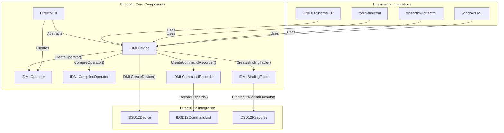
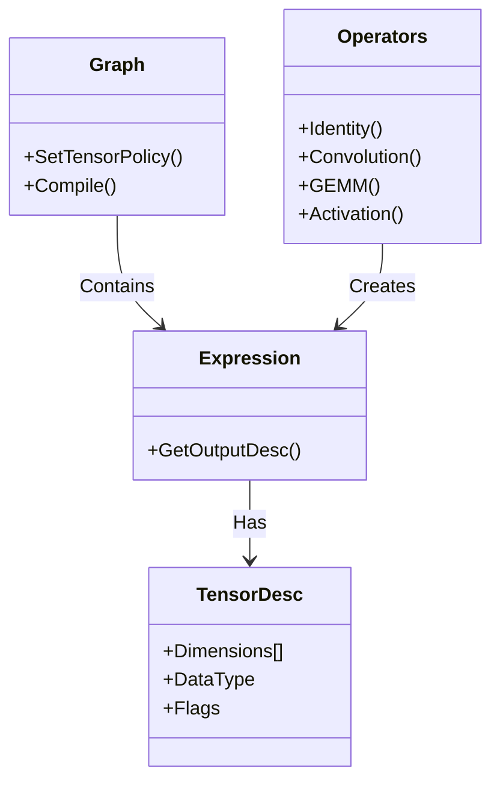
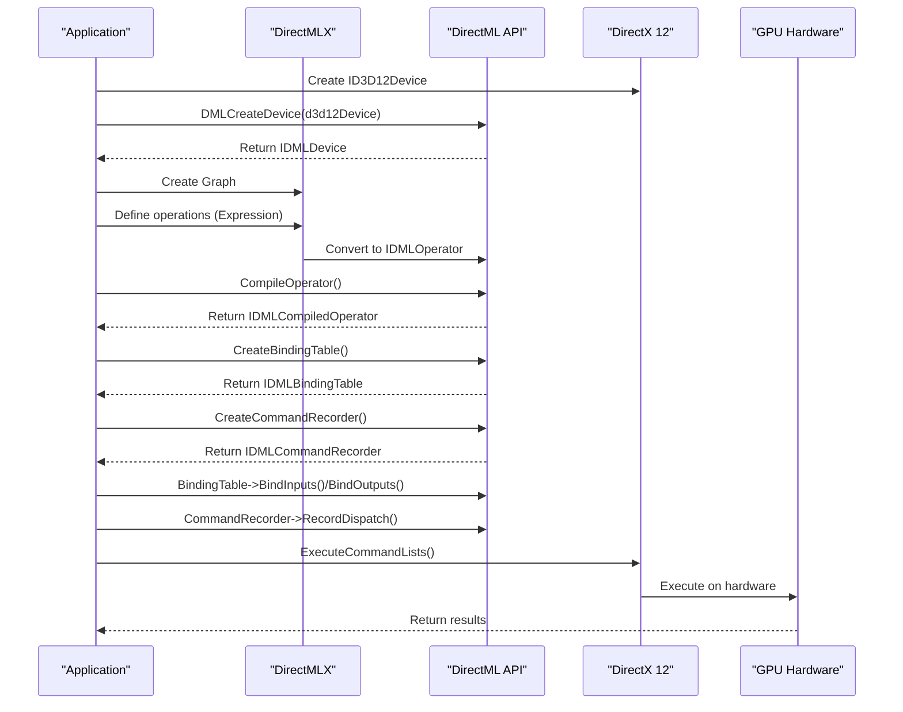

<!-- source: DeepWiki mcp.deepwiki.com · repo microsoft/DirectML · page 1 DirectML Overview · fetched 2026-10-26 -->

# DirectML Overview

Relevant source files

The following files were used as context for generating this wiki page:

- [DxDispatch/cmake/directml.cmake](DxDispatch/cmake/directml.cmake)
- [README.md](README.md)
- [Releases.md](Releases.md)
- [Samples/DirectMLSuperResolution/Readme.md](Samples/DirectMLSuperResolution/Readme.md)
- [Samples/DirectMLSuperResolution/packages.config](Samples/DirectMLSuperResolution/packages.config)
- [Samples/HelloDirectML/readme.md](Samples/HelloDirectML/readme.md)
- [Samples/yolov4/Readme.md](Samples/yolov4/Readme.md)
- [Samples/yolov4/packages.config](Samples/yolov4/packages.config)
- [TensorFlow/README.md](TensorFlow/README.md)

DirectML is a high-performance, hardware-accelerated DirectX 12 library for machine learning. It provides GPU acceleration for common machine learning tasks across a broad range of hardware and drivers, including DirectX 12-capable GPUs from vendors such as AMD, Intel, NVIDIA, and Qualcomm.

## Purpose and Scope

This document introduces the DirectML repository, explaining what it is, the problems it solves, and its key components. DirectML serves as both a standalone API for developers building machine learning capabilities into applications and as a backend acceleration layer for popular ML frameworks.

For detailed information about the system architecture, see [System Architecture](#1.1). For release history and versioning, see [Release History and Versioning](#1.2).

## What is DirectML?

DirectML is designed for high-performance, low-latency applications such as frameworks, games, and other real-time applications. Its seamless interoperability with Direct3D 12, low overhead, and consistent results across hardware make it ideal for accelerating machine learning when both performance and reliability are critical.

The DirectML API is a low-level DirectX 12 library that exposes hardware acceleration capabilities through a C++ API. It is distributed both as a system component in Windows 10 (version 1903 and newer) and as a redistributable NuGet package (`Microsoft.AI.DirectML`).

Sources: [README.md:1-7](), [README.md:27-32]()

## System Architecture Overview

The architecture of DirectML consists of several core components:

- **IDMLDevice**: The primary interface for creating operators and resources
- **IDMLOperator**: Represents a machine learning operator (like convolution, GEMM, etc.)
- **IDMLCompiledOperator**: A compiled version of an operator ready for execution
- **IDMLBindingTable**: Manages input/output resource bindings for operators
- **IDMLCommandRecorder**: Records DirectML operations into a D3D12 command list
- **DirectMLX**: A C++ abstraction layer providing high-level graph construction

These components interact with DirectX 12 through ID3D12Device for device creation, ID3D12CommandList for command recording, and ID3D12Resource for tensor storage.

Sources: [README.md:3-6]()

## Key Features

DirectML provides several key features that make it valuable for machine learning applications:

1. **Hardware Acceleration**: Utilizes GPU hardware for accelerated ML operations
2. **Cross-Vendor Support**: Works on GPUs from multiple vendors (AMD, Intel, NVIDIA, Qualcomm)
3. **DirectX 12 Interoperability**: Seamless integration with DirectX 12 graphics pipeline
4. **Low Overhead**: Designed for high-performance, low-latency applications
5. **Framework Integration**: Backend support for ONNX Runtime, PyTorch, TensorFlow, and Windows ML
6. **NPU Support**: Can utilize Neural Processing Units on supported hardware

Sources: [README.md:3-6](), [README.md:34-40]()

## DirectMLX Abstraction Layer

DirectMLX is a C++ abstraction layer over DirectML that simplifies the creation and execution of machine learning graphs. It provides:

- **Graph**: A high-level representation of a computational graph
- **Expression**: Represents operations or tensors in the graph
- **TensorDesc**: Defines the properties of tensors (dimensions, data type, etc.)
- **Operators**: Functions for creating common ML operations (Identity, Convolution, GEMM, etc.)

DirectMLX allows developers to define ML operations at a higher level of abstraction, making it easier to create complex computational graphs compared to using the raw DirectML API.

Sources: [DxDispatch/cmake/directml.cmake:218-226]()

## Typical Usage Flow

A typical workflow for using DirectML involves:

1. Creating a DirectX 12 device
2. Creating a DirectML device using `DMLCreateDevice()`
3. Defining operators (directly or through DirectMLX)
4. Compiling operators with `IDMLDevice::CompileOperator()`
5. Creating binding tables and command recorders
6. Binding inputs and outputs
7. Recording dispatch commands
8. Executing the commands on the GPU
9. Retrieving the results

Sources: [README.md:43-49](), [Samples/HelloDirectML/readme.md:12-16]()

## Framework Integrations

DirectML serves as a backend for several machine learning frameworks:

### ONNX Runtime

DirectML is available as an execution provider for ONNX Runtime, enabling hardware acceleration for ONNX models on Windows. It provides hardware acceleration when running on Windows 10.

### PyTorch with DirectML

PyTorch with DirectML enables training and inference of PyTorch models on DirectX 12-compatible hardware through the `torch-directml` plugin. It is supported on both Windows and Windows Subsystem for Linux.

### TensorFlow with DirectML

TensorFlow with DirectML accelerates TensorFlow models on DirectX 12-compatible hardware through the `tensorflow-directml` package. It supports both TensorFlow 1.15 (via a fork) and TensorFlow 2.9+ (via a plugin).

### Windows ML

Windows ML is a high-performance API for deploying ML inferences on Windows devices, using DirectML as its GPU backend.

Sources: [README.md:82-128](), [TensorFlow/README.md:1-26]()

## Sample Applications

DirectML includes several sample applications demonstrating its capabilities:

- **HelloDirectML**: A minimal "hello world" application executing a single DirectML operator
- **DirectMLSuperResolution**: Demonstrates using DirectML to upscale video from 540p to 1080p in real time
- **YOLOv4**: An object detection sample capable of recognizing 80 different classes of objects
- **DirectMLNpuInference**: Shows how to utilize NPU hardware with DirectML

These samples use the Microsoft.AI.DirectML NuGet package (version 1.15.2) and demonstrate different aspects of DirectML integration and usage.

Sources: [README.md:62-76](), [Samples/DirectMLSuperResolution/packages.config:1-5](), [Samples/yolov4/packages.config:1-5](), [Samples/HelloDirectML/readme.md:1-24]()

## Hardware and Platform Support

DirectML supports a wide range of hardware:

| Hardware Type | Supported Vendors/Models |
|---------------|--------------------------|
| **GPUs** | AMD: GCN 1st Gen (Radeon HD 7000 series) and above |
|         | Intel: Haswell (4th-gen core) HD Integrated Graphics and above |
|         | NVIDIA: Kepler (GTX 600 series) and above |
|         | Qualcomm: Adreno 600 and above |
| **NPUs** | Neural Processing Units on supported hardware |

**Platform Support**:
- Windows 10 version 1903 (build 10.0.18362) and above
- Windows Subsystem for Linux (WSL)

Sources: [README.md:34-40]()

## Getting Started

To get started with DirectML:

1. **Prerequisites**:
   - Windows 10 version 1903 or newer
   - DirectX 12 capable hardware
   - Visual Studio 2019 or newer (for development)

2. **Integrating DirectML**:
   - Add the Microsoft.AI.DirectML NuGet package to your project
   - Include DirectML.h and DirectMLX.h headers
   - Link against DirectML.lib
   - Follow the DirectML programming guide for implementation details

3. **Exploring Samples**:
   - Clone the DirectML repository
   - Build and run the provided samples
   - Use DxDispatch to experiment with operators

Sources: [README.md:27-60](), [DxDispatch/cmake/directml.cmake:44-52]()

## Conclusion

DirectML provides a high-performance, hardware-accelerated solution for machine learning tasks across a wide range of hardware. Its integration with DirectX 12 makes it particularly suitable for real-time applications and games. The availability of DirectMLX simplifies development, while integration with popular frameworks like ONNX Runtime, PyTorch, and TensorFlow makes it accessible to data scientists and researchers.

Whether you're developing a game with ML features, building a machine learning application that needs to run on various hardware, or looking for GPU acceleration for your ML models, DirectML provides the necessary tools and capabilities to achieve high-performance results.

Sources: [README.md:1-7](), [README.md:27-32]()

---

