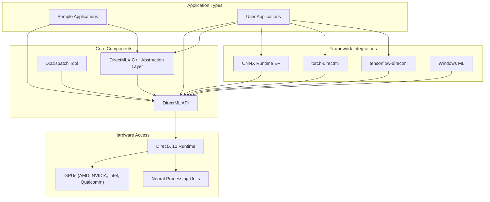
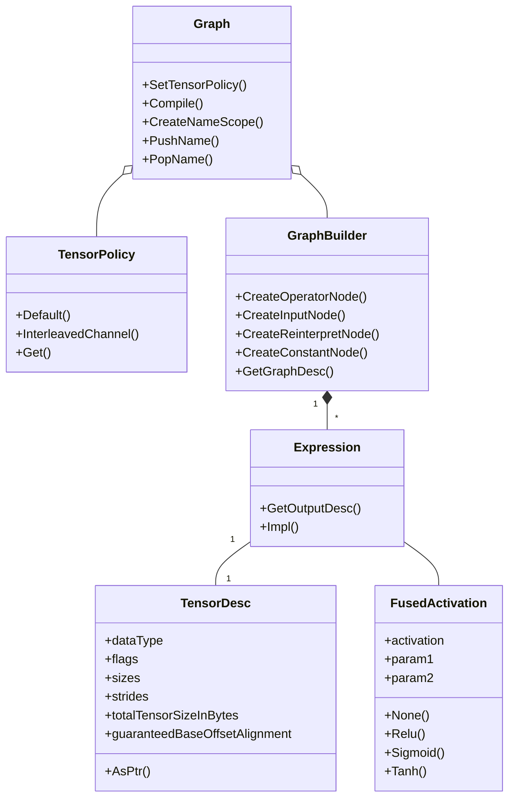
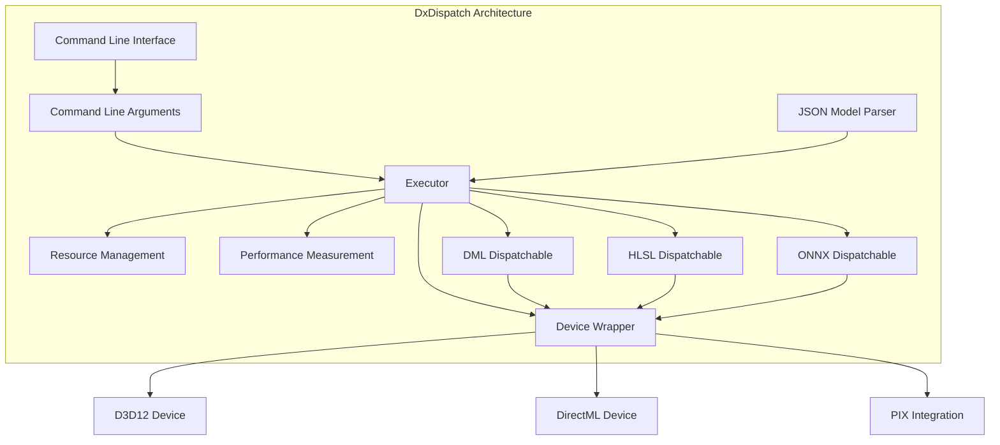
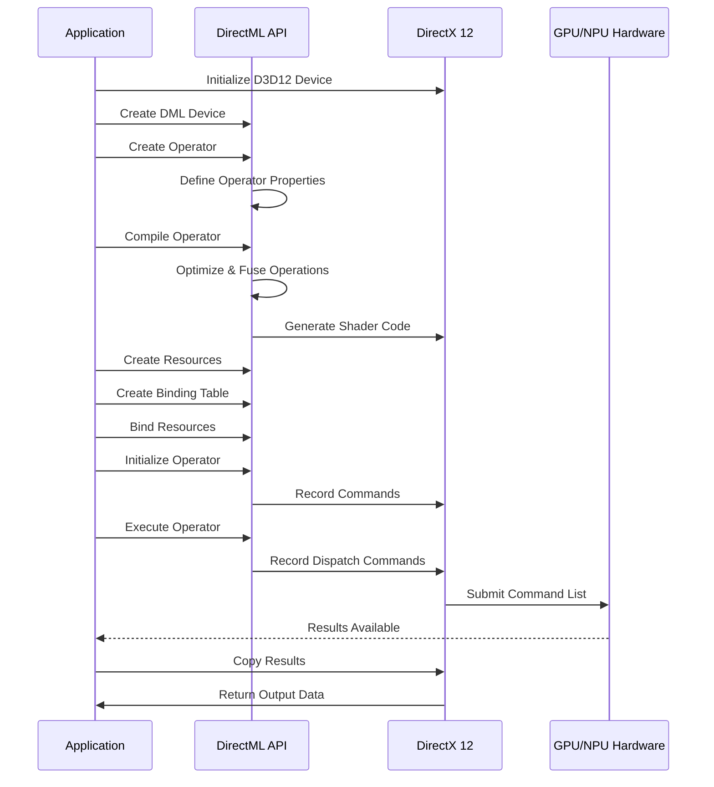
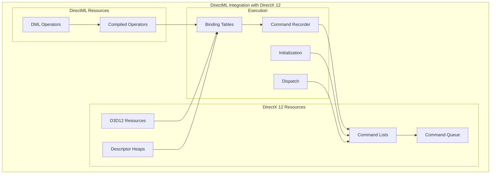
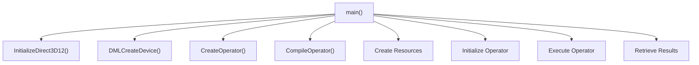
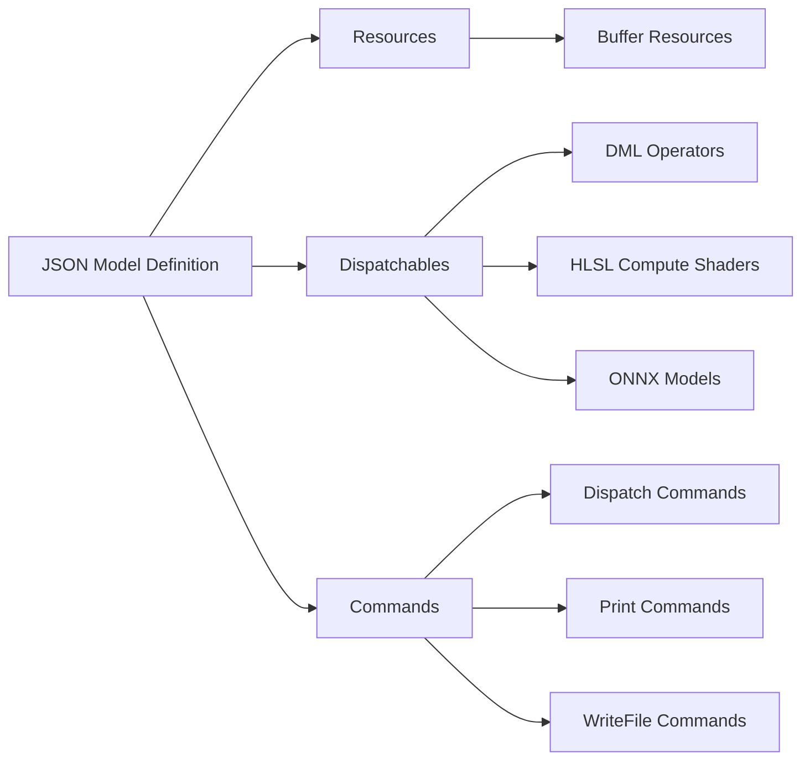

<!-- source: DeepWiki mcp.deepwiki.com · repo microsoft/DirectML · page 1.1 System Architecture · fetched 2026-10-26 -->

# System Architecture

<details>
<summary>Relevant source files</summary>

The following files were used as context for generating this wiki page:

- [DxDispatch/CMakeLists.txt](DxDispatch/CMakeLists.txt)
- [DxDispatch/cgmanifest.json](DxDispatch/cgmanifest.json)
- [DxDispatch/models/dml_convolution_2d.json](DxDispatch/models/dml_convolution_2d.json)
- [DxDispatch/models/dml_convolution_3d.json](DxDispatch/models/dml_convolution_3d.json)
- [DxDispatch/src/dxdispatch/Device.cpp](DxDispatch/src/dxdispatch/Device.cpp)
- [DxDispatch/src/dxdispatch/Executor.cpp](DxDispatch/src/dxdispatch/Executor.cpp)
- [Libraries/DirectMLX.h](Libraries/DirectMLX.h)
- [README.md](README.md)
- [Samples/DirectMLSuperResolution/Kits/DirectXTK12/DirectXTK_Desktop_2017_Win10.vcxproj](Samples/DirectMLSuperResolution/Kits/DirectXTK12/DirectXTK_Desktop_2017_Win10.vcxproj)
- [Samples/DirectMLSuperResolution/Readme.md](Samples/DirectMLSuperResolution/Readme.md)
- [Samples/HelloDirectML/main.cpp](Samples/HelloDirectML/main.cpp)
- [Samples/HelloDirectML/readme.md](Samples/HelloDirectML/readme.md)
- [Samples/yolov4/Kits/DirectXTK12/DirectXTK_Desktop_2017_Win10.vcxproj](Samples/yolov4/Kits/DirectXTK12/DirectXTK_Desktop_2017_Win10.vcxproj)
- [Samples/yolov4/Readme.md](Samples/yolov4/Readme.md)
- [TensorFlow/README.md](TensorFlow/README.md)

</details>


This document describes the high-level architecture of the DirectML project, explaining the core components, their relationships, and how they interact to provide hardware-accelerated machine learning capabilities. For specific framework integrations, see [Framework Integrations](#5).

## Overview

DirectML is a high-performance, hardware-accelerated DirectX 12 library for machine learning that provides GPU acceleration across a wide range of supported hardware. The system is designed with several layers of abstraction to balance performance with usability, allowing both direct low-level access and simplified high-level interfaces.



Sources:
- [README.md:3-19]()
- [DxDispatch/CMakeLists.txt:1-57]()

## Core Components

### DirectML API

The DirectML API provides the foundational layer for machine learning operations. It's a low-level, DirectX 12-based API that enables applications to perform hardware-accelerated ML operations.

Key interfaces include:
- `IDMLDevice` - Main entry point for creating operators
- `IDMLOperator` - Abstract representation of an ML operation
- `IDMLCompiledOperator` - Compiled GPU-ready operator
- `IDMLBindingTable` - Maps resources to operators
- `IDMLCommandRecorder` - Records commands into D3D12 command lists

The API is designed to integrate seamlessly with DirectX 12, allowing ML workloads to be efficiently interleaved with graphics and compute tasks.

Sources:
- [Samples/HelloDirectML/main.cpp:132-136]()
- [Samples/HelloDirectML/main.cpp:155-179]()
- [Samples/HelloDirectML/main.cpp:323-331]()

### DirectMLX Abstraction Layer

DirectMLX is a C++ abstraction layer over the core DirectML API that simplifies the creation and management of ML models. It provides a graph-based programming model that makes it easier to construct complex computational graphs.



Key components:
- `Graph` - Represents a computational graph
- `Expression` - Represents a node in the graph
- `TensorDesc` - Describes tensor properties such as dimensions and data type
- `TensorPolicy` - Controls tensor layout and memory arrangements

DirectMLX provides a more intuitive interface while maintaining the performance advantages of DirectML.

Sources:
- [Libraries/DirectMLX.h:286-855]()
- [Libraries/DirectMLX.h:412-472]()
- [Libraries/DirectMLX.h:757-770]()

### DxDispatch Tool

DxDispatch is a command-line tool that allows execution of DirectML, HLSL, and ONNX models without writing C++ code. It uses JSON-based model definitions to specify resources, operators, and execution commands.



Key components:
- `Model` - Represents JSON-defined resources, dispatchables, and commands
- `Executor` - Manages execution of commands on dispatchables
- `Device` - Wraps D3D12 and DirectML devices
- `Dispatchable` - Interface for executable entities (DML, HLSL, ONNX)

DxDispatch enables rapid prototyping and benchmarking of ML operations without the overhead of writing full C++ applications.

Sources:
- [DxDispatch/CMakeLists.txt:80-196]()
- [DxDispatch/src/dxdispatch/Executor.cpp:106-212]()
- [DxDispatch/src/dxdispatch/Executor.cpp:219-273]()
- [DxDispatch/src/dxdispatch/Device.cpp:47-307]()

## Execution Flow

The execution of machine learning operations in DirectML follows a specific flow pattern, whether using the native API, DirectMLX, or DxDispatch.



The execution flow can be summarized in these steps:

1. **Initialization**: Create D3D12 and DirectML devices
2. **Operator Creation**: Define ML operations
3. **Compilation**: Optimize operations for GPU execution
4. **Resource Setup**: Create and bind input/output resources
5. **Execution**: Dispatch operations and wait for completion
6. **Result Retrieval**: Copy results back to accessible memory

Sources:
- [Samples/HelloDirectML/main.cpp:113-633]()
- [DxDispatch/src/dxdispatch/Executor.cpp:275-446]()
- [DxDispatch/src/dxdispatch/Device.cpp:585-685]()

## Integration with DirectX 12

DirectML is built on top of DirectX 12, leveraging its efficient rendering and compute capabilities. This integration allows DirectML to benefit from the performance optimizations of DirectX 12 while providing specialized ML functionality.



Key aspects of integration:
- DirectML operators execute through DirectX 12 command lists
- Direct sharing of resources between graphics and ML workloads
- Unified memory management
- Synchronized execution with graphics pipelines

This tight integration allows applications to efficiently combine traditional rendering with ML operations in the same pipeline.

Sources:
- [Samples/HelloDirectML/main.cpp:20-82]()
- [Samples/HelloDirectML/main.cpp:323-331]()
- [DxDispatch/src/dxdispatch/Device.cpp:219-307]()

## Sample Applications

The DirectML repository includes several sample applications demonstrating different use cases and integration patterns:

1. **HelloDirectML**: A minimal sample showing the basic DirectML API usage
2. **DirectMLSuperResolution**: A sample that uses DirectML to upscale video from 540p to 1080p in real time
3. **YOLOv4**: An object detection model capable of recognizing up to 80 different classes of objects
4. **DirectMLNpuInference**: Demonstrates inference on Neural Processing Units (NPUs)

These samples provide practical examples of DirectML usage in various scenarios, from simple operator execution to complex ML models.

### HelloDirectML Structure



The HelloDirectML sample demonstrates the fundamental pattern for using DirectML, from initialization to execution and result retrieval.

Sources:
- [Samples/HelloDirectML/main.cpp:113-633]()
- [README.md:62-69]()
- [Samples/HelloDirectML/readme.md:12-23]()

## DxDispatch Model Format

DxDispatch uses a JSON-based format to define ML models, resources, and execution commands. This format enables users to quickly test and benchmark DirectML operations without writing C++ code.



A typical DxDispatch model includes:
- **Resources**: Input, output, and intermediate data buffers
- **Dispatchables**: ML operators, compute shaders, or ONNX models
- **Commands**: Instructions for execution and result handling

Example JSON structure for a convolution operation:

```
{
    "resources": {
        "input": { /* tensor definition */ },
        "filter": { /* tensor definition */ },
        "output": { /* tensor definition */ }
    },
    "dispatchables": {
        "conv2d": {
            "type": "DML_OPERATOR_CONVOLUTION",
            "desc": { /* operator parameters */ }
        }
    },
    "commands": [
        {
            "type": "dispatch",
            "dispatchable": "conv2d",
            "bindings": { /* resource bindings */ }
        },
        { "type": "print", "resource": "output" }
    ]
}
```

Sources:
- [DxDispatch/models/dml_convolution_2d.json:1-60]()
- [DxDispatch/models/dml_convolution_3d.json:1-60]()
- [DxDispatch/src/dxdispatch/Executor.cpp:497-563]()

## Summary

The DirectML architecture provides a flexible, high-performance system for executing machine learning workloads on DirectX 12-capable hardware. Its layered design offers options ranging from low-level control to higher-level abstractions, enabling a wide range of use cases from gaming to professional ML applications.

The system's core strengths include:
- Direct integration with DirectX 12 for optimal performance
- Support for diverse hardware from GPUs to specialized NPUs
- Multiple abstraction levels for different developer needs
- Extensible design supporting multiple ML frameworks
- Tools for rapid prototyping and benchmarking

This architecture allows DirectML to serve as a foundation for ML acceleration across Windows devices, powering applications from real-time graphics enhancement to complex neural networks.

Sources:
- [README.md:3-19]()
- [README.md:43-49]()
- [README.md:62-69]()

---

