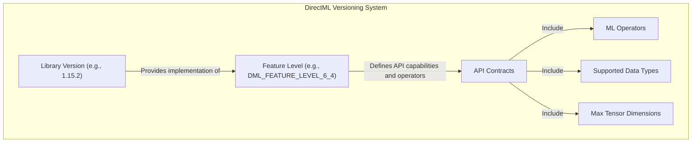
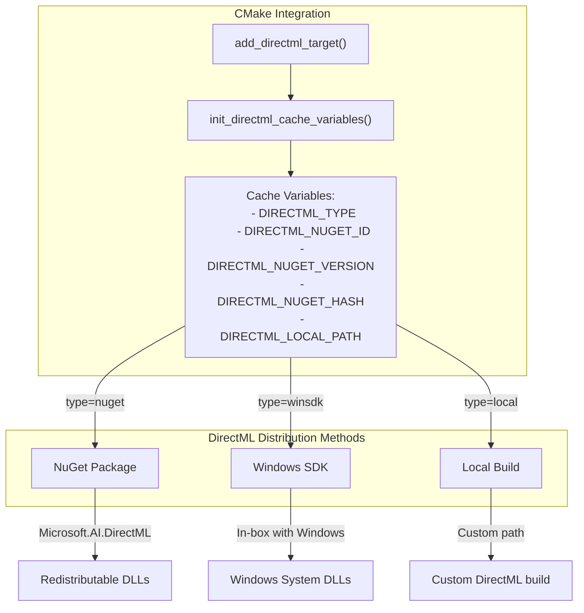

<!-- source: DeepWiki mcp.deepwiki.com · repo microsoft/DirectML · page 1.2 Release History and Versioning · fetched 2026-10-26 -->

# Release History and Versioning

<details>
<summary>Relevant source files</summary>

The following files were used as context for generating this wiki page:

- [DxDispatch/cmake/directml.cmake](DxDispatch/cmake/directml.cmake)
- [Releases.md](Releases.md)
- [Samples/DirectMLSuperResolution/packages.config](Samples/DirectMLSuperResolution/packages.config)
- [Samples/yolov4/packages.config](Samples/yolov4/packages.config)

</details>


This page documents the versioning system of DirectML, its release history, and how feature levels relate to version numbers. It provides guidance for selecting appropriate versions for compatibility with different platforms and integration methods. For information about the overall system architecture, see [System Architecture](#1.1).

## Versioning System Overview

DirectML employs a dual versioning approach:

1. **Library Version** (e.g., 1.15.2): Identifies the specific release of the DirectML library
2. **Feature Level** (e.g., DML_FEATURE_LEVEL_6_4): Represents the set of capabilities and operators available

This approach allows applications to target specific functionality while maintaining backward compatibility. When creating a DirectML device, applications can specify a minimum required feature level to ensure certain features are available.



Sources: [Releases.md:1-33]()

## Feature Level System

Feature levels in DirectML provide a way to categorize and version API capabilities. Each new feature level introduces additional operators, extends existing operators, or adds support for new data types. Feature levels are strictly hierarchical - higher levels include all functionality from lower levels.

```mermaid
graph TD
    subgraph "Feature Level Hierarchy"
        FL1.0["DML_FEATURE_LEVEL_1_0"]
        FL2.0["DML_FEATURE_LEVEL_2_0"]
        FL2.1["DML_FEATURE_LEVEL_2_1"]
        FL3.0["DML_FEATURE_LEVEL_3_0"]
        FL3.1["DML_FEATURE_LEVEL_3_1"]
        FL4.0["DML_FEATURE_LEVEL_4_0"]
        FL4.1["DML_FEATURE_LEVEL_4_1"]
        FL5.0["DML_FEATURE_LEVEL_5_0"]
        FL5.1["DML_FEATURE_LEVEL_5_1"]
        FL5.2["DML_FEATURE_LEVEL_5_2"]
        FL6.0["DML_FEATURE_LEVEL_6_0"]
        FL6.1["DML_FEATURE_LEVEL_6_1"]
        FL6.2["DML_FEATURE_LEVEL_6_2"]
        FL6.3["DML_FEATURE_LEVEL_6_3"]
        FL6.4["DML_FEATURE_LEVEL_6_4"]
        
        FL1.0 --> FL2.0
        FL2.0 --> FL2.1
        FL2.1 --> FL3.0
        FL3.0 --> FL3.1
        FL3.1 --> FL4.0
        FL4.0 --> FL4.1
        FL4.1 --> FL5.0
        FL5.0 --> FL5.1
        FL5.1 --> FL5.2
        FL5.2 --> FL6.0
        FL6.0 --> FL6.1
        FL6.1 --> FL6.2
        FL6.2 --> FL6.3
        FL6.3 --> FL6.4
    end
```



Sources: [Releases.md:1-33](), [Releases.md:38-67](), [Releases.md:77-96](), [Releases.md:104-107](), [Releases.md:110-120](), [Releases.md:128-137](), [Releases.md:149-160](), [Releases.md:172-179](), [Releases.md:183-190](), [Releases.md:194-202](), [Releases.md:209-220](), [Releases.md:238-244](), [Releases.md:248-254](), [Releases.md:258]()

## Release Timeline and OS Availability

DirectML versions are either included in Windows OS releases or available as redistributable packages. This table summarizes the release history:

| DirectML Version | Feature Level | First Available OS | Redistributable Package |
|------------------|---------------|-------------------|------------------------|
| 1.15.x (Current) | DML_FEATURE_LEVEL_6_4 | TBD | Microsoft.AI.DirectML.1.15.x |
| 1.13.x | DML_FEATURE_LEVEL_6_2 | TBD | Microsoft.AI.DirectML.1.13.x |
| 1.12.x | DML_FEATURE_LEVEL_6_1 | TBD | Microsoft.AI.DirectML.1.12.x |
| 1.11.0 | DML_FEATURE_LEVEL_6_0 | TBD | Microsoft.AI.DirectML.1.11.0 |
| 1.10.x | DML_FEATURE_LEVEL_5_2 | TBD | Microsoft.AI.DirectML.1.10.x |
| 1.9.x | DML_FEATURE_LEVEL_5_1 | TBD | Microsoft.AI.DirectML.1.9.x |
| 1.8.x | DML_FEATURE_LEVEL_5_0 | Windows 11 2022 Update (22H2) | Microsoft.AI.DirectML.1.8.x |
| 1.7.0 | DML_FEATURE_LEVEL_4_1 | Redistributable only | Microsoft.AI.DirectML.1.7.0 |
| 1.6.0 | DML_FEATURE_LEVEL_4_0 | Windows 11 (21H2) | Microsoft.AI.DirectML.1.6.0 |
| 1.5.x | DML_FEATURE_LEVEL_3_1 | Redistributable only | Microsoft.AI.DirectML.1.5.x |
| 1.4.x | DML_FEATURE_LEVEL_3_0 | Redistributable only | Microsoft.AI.DirectML.1.4.x |
| 1.1.0 | DML_FEATURE_LEVEL_2_0 | Windows 10 May 2020 Update (2004) | - |
| 1.0.0 | DML_FEATURE_LEVEL_1_0 | Windows 10 May 2019 Update (1903) | - |

Sources: [Releases.md:5-33]()

## Distribution Methods

DirectML can be integrated into applications through several methods:



Sources: [DxDispatch/cmake/directml.cmake:1-239]()

### NuGet Package

The NuGet package (`Microsoft.AI.DirectML`) is the recommended way to integrate DirectML into applications, providing:

- Access to the latest features without OS dependencies
- Availability for different platforms and architectures
- Consistent versioning across development environments

Sample applications in the DirectML repository use this approach:

Sources: [Samples/yolov4/packages.config:1-5](), [Samples/DirectMLSuperResolution/packages.config:1-5](), [DxDispatch/cmake/directml.cmake:67-106]()

### Windows SDK

For applications targeting specific Windows versions, DirectML can be used from the Windows SDK:

- No additional redistribution required
- Version tied to the OS version
- Limited to Windows platforms

Sources: [DxDispatch/cmake/directml.cmake:108-117]()

### Local Build

For development and testing, a local build of DirectML can be used:

- Useful for testing unreleased features
- Required for custom builds or modifications
- Not recommended for production releases

Sources: [DxDispatch/cmake/directml.cmake:119-156]()

## Key Feature Level Milestones

This section highlights significant additions in each feature level:

### DML_FEATURE_LEVEL_6_4 (DirectML 1.15.x)

- New operators: RESAMPLE3, FOLD, UNFOLD
- Updated operators with new capabilities
- LLM optimization: INT4 Dequantize + GEMM fusion, Multihead Attention fusion

### DML_FEATURE_LEVEL_6_3 (DirectML 1.15.x)

- New data types: UINT4, INT4
- New operators including MULTIHEAD_ATTENTION1 and QUANTIZE/DEQUANTIZE with INT4/UINT4 support

### DML_FEATURE_LEVEL_6_2 (DirectML 1.13.x)

- Intel Core Ultra NPU support
- New activation operators: SWISH, HARD_SWISH
- New graph node type: DML_GRAPH_NODE_TYPE_CONSTANT

### DML_FEATURE_LEVEL_6_1 (DirectML 1.12.x)

- Added MULTIHEAD_ATTENTION operator
- Support for fusing SOFTMAX activation with GEMM operations

### DML_FEATURE_LEVEL_6_0 (DirectML 1.11.0)

- Expanded 64-bit data type support across more operators
- FLOAT16 data type support for quantization operations
- Performance improvements for SOFTMAX activation and GEMM

### DML_FEATURE_LEVEL_5_0 to 5_2 (DirectML 1.8.x - 1.10.x)

- Expanded rank support across operators
- Added operators: CLIP1, CLIP_GRAD1, PADDING1, ELEMENT_WISE_NEGATE
- First version available in Windows 11 2022 Update

### DML_FEATURE_LEVEL_4_0 and 4_1 (DirectML 1.6.0 - 1.7.0)

- Support for 8D tensors in more operators
- Added operators for quantized operations and optimization
- First version available in Windows 11 (21H2)

### DML_FEATURE_LEVEL_3_0 and 3_1 (DirectML 1.4.x - 1.5.x)

- First release as a redistributable NuGet package
- 44 new operators added
- Increased tensor dimension support from 5D to 8D
- Initial support for ARM/ARM64 builds

### DML_FEATURE_LEVEL_2_0 (DirectML 1.1.0)

- Added 19 new operators
- Support for 8-bit integer tensors
- Available in Windows 10 May 2020 Update

### DML_FEATURE_LEVEL_1_0 (DirectML 1.0.0)

- Initial release of DirectML
- Available in Windows 10 May 2019 Update

Sources: [Releases.md:38-258]()

## Version Selection and Integration

When integrating DirectML, you must consider:

1. **Target Feature Level**: Select the minimum feature level your application requires
2. **Distribution Method**: Choose between NuGet, Windows SDK, or local build
3. **Platform Compatibility**: Ensure compatibility with your target platforms
4. **Fallback Strategy**: Implement fallback mechanisms for systems without your required feature level

### CMake Integration Example

```cmake
# Set DirectML version and distribution method
set(PREFIX_DIRECTML_TYPE "nuget" CACHE STRING "DirectML dependency type")
set(PREFIX_DIRECTML_NUGET_VERSION "1.15.2" CACHE STRING "Version of DirectML NuGet package")

# Add DirectML as a dependency
add_directml_target(directml CACHE_PREFIX PREFIX)

# Link your application with DirectML
target_link_libraries(your_app PRIVATE directml)
```

Sources: [DxDispatch/cmake/directml.cmake:1-239]()

### Runtime Feature Level Detection

Applications should check for feature level support at runtime:

```cpp
// Create a DirectML device with a minimum feature level
DML_CREATE_DEVICE_FLAGS flags = DML_CREATE_DEVICE_FLAG_NONE;
IDMLDevice* dmlDevice = nullptr;
HRESULT hr = DMLCreateDevice1(
    d3d12Device,                // ID3D12Device
    flags,                      // DML_CREATE_DEVICE_FLAGS 
    DML_FEATURE_LEVEL_6_2,      // Minimum required feature level
    IID_PPV_ARGS(&dmlDevice)    // Output DirectML device
);

if (FAILED(hr)) {
    // Feature level not supported - implement fallback or notify user
}
```

Sources: [Releases.md:1-33](), [DxDispatch/cmake/directml.cmake:1-239]()

## Sample Application Versions

The sample applications in the DirectML repository use the following version:

- YOLOv4 Sample: Microsoft.AI.DirectML 1.15.2
- DirectMLSuperResolution Sample: Microsoft.AI.DirectML 1.15.2

This indicates the current recommended version for new development.

Sources: [Samples/yolov4/packages.config:1-5](), [Samples/DirectMLSuperResolution/packages.config:1-5]()

## Conclusion

DirectML's versioning system with feature levels provides a flexible way to target specific capabilities while maintaining backward compatibility. By selecting the appropriate version and distribution method, developers can build ML-accelerated applications that work across a variety of Windows platforms and hardware.

For detailed feature level specifications, refer to the [DirectML version history on MSDN](https://docs.microsoft.com/windows/win32/direct3d12/dml-version-history) mentioned in the releases documentation.

Sources: [Releases.md:3]()

---

