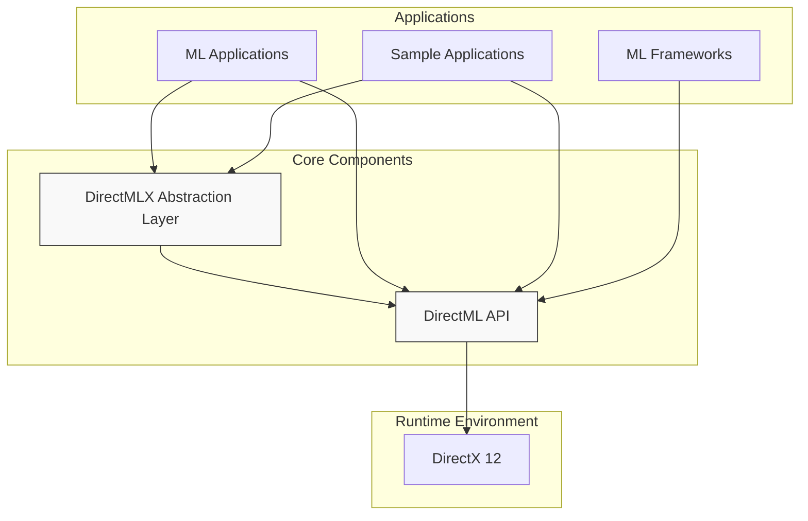
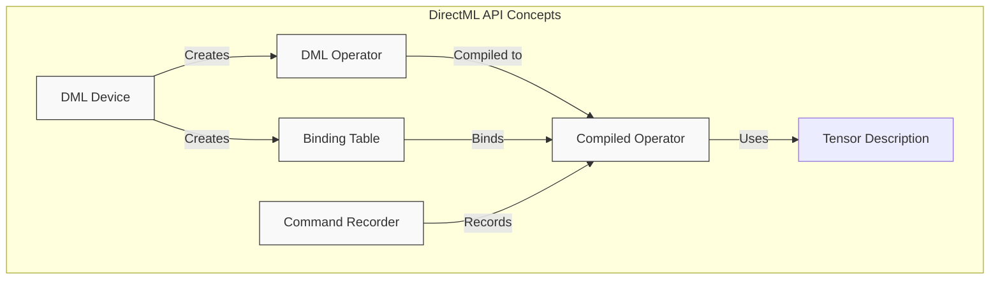
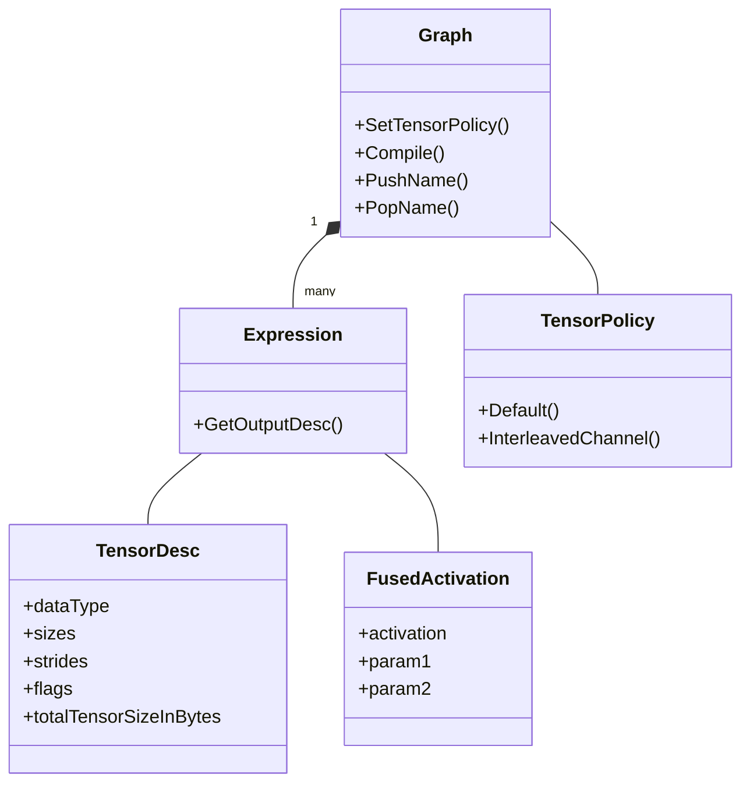
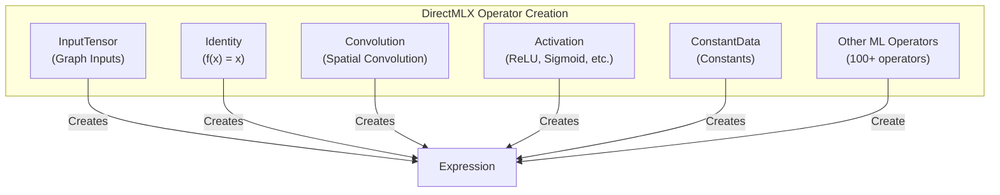
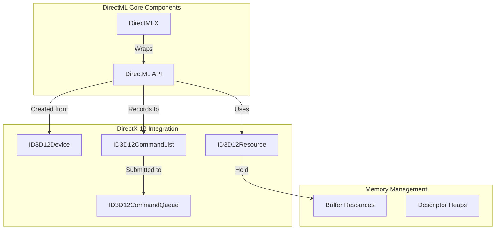
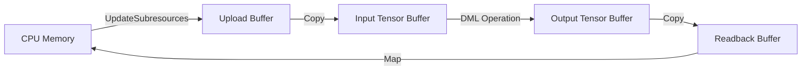

<!-- source: DeepWiki mcp.deepwiki.com · repo microsoft/DirectML · page 2 Core Components · fetched 2026-10-26 -->

# Core Components

<details>
<summary>Relevant source files</summary>

The following files were used as context for generating this wiki page:

- [DxDispatch/models/dml_convolution_2d.json](DxDispatch/models/dml_convolution_2d.json)
- [DxDispatch/models/dml_convolution_3d.json](DxDispatch/models/dml_convolution_3d.json)
- [Libraries/DirectMLX.h](Libraries/DirectMLX.h)
- [README.md](README.md)
- [Samples/DirectMLSuperResolution/Kits/DirectXTK12/DirectXTK_Desktop_2017_Win10.vcxproj](Samples/DirectMLSuperResolution/Kits/DirectXTK12/DirectXTK_Desktop_2017_Win10.vcxproj)
- [Samples/DirectMLSuperResolution/Readme.md](Samples/DirectMLSuperResolution/Readme.md)
- [Samples/HelloDirectML/main.cpp](Samples/HelloDirectML/main.cpp)
- [Samples/HelloDirectML/readme.md](Samples/HelloDirectML/readme.md)
- [Samples/yolov4/Kits/DirectXTK12/DirectXTK_Desktop_2017_Win10.vcxproj](Samples/yolov4/Kits/DirectXTK12/DirectXTK_Desktop_2017_Win10.vcxproj)
- [Samples/yolov4/Readme.md](Samples/yolov4/Readme.md)
- [TensorFlow/README.md](TensorFlow/README.md)

</details>


This page provides a detailed overview of the foundational libraries that comprise the DirectML system. These components form the backbone of DirectML's architecture, enabling hardware-accelerated machine learning operations across DirectX 12-compatible GPUs and NPUs.

For information about framework integrations like PyTorch and ONNX Runtime, see [Framework Integrations](#5). For details on the DxDispatch tool, see [DxDispatch Tool](#3).

## Overview of Core Components

DirectML consists of several key core components that work together to provide a complete hardware-accelerated machine learning solution:



Sources: [README.md:1-32](), [Libraries/DirectMLX.h:1-32]()

## DirectML API

The DirectML API is the foundation of the DirectML system. It provides a low-level, hardware-accelerated interface for executing machine learning operations on DirectX 12-capable GPUs from various vendors.

### Key Characteristics

- **DirectX 12 Integration**: Built on DirectX 12 for high-performance GPU computation
- **Hardware Agnostic**: Works across AMD, Intel, NVIDIA, and Qualcomm GPUs and NPUs
- **Low Overhead**: Designed for high-performance, low-latency applications
- **Operator-Based**: Provides atomic ML operations that can be combined to form complex networks

### Core Concepts



Sources: [Samples/HelloDirectML/main.cpp:132-183](), [README.md:28-45]()

### API Usage Flow

The typical usage flow of the DirectML API involves several key steps:

1. **Initialize DirectX 12**: Set up D3D12 device and command queue
2. **Create DirectML Device**: Initialize the DirectML device with the D3D12 device
3. **Create Operators**: Define the ML operations to perform
4. **Compile Operators**: Convert operators into optimized GPU code
5. **Resource Management**: Create and manage buffers for inputs and outputs
6. **Execute Operations**: Record and execute commands on the GPU
7. **Retrieve Results**: Copy results back from GPU to CPU when needed

Sources: [Samples/HelloDirectML/main.cpp:114-131](), [Samples/HelloDirectML/main.cpp:184-445]()

### Example Workflow

The following table outlines a simplified workflow using the DirectML API:

| Step | Description | API Functions |
|------|-------------|--------------|
| 1 | Initialize D3D12 | `D3D12CreateDevice`, `CreateCommandQueue` |
| 2 | Create DirectML device | `DMLCreateDevice` |
| 3 | Define tensor descriptions | `DML_BUFFER_TENSOR_DESC` |
| 4 | Create operators | `CreateOperator` |
| 5 | Compile operators | `CompileOperator` |
| 6 | Create binding tables | `CreateBindingTable` |
| 7 | Bind resources | `BindInputs`, `BindOutputs` |
| 8 | Record commands | `RecordDispatch` |
| 9 | Execute on GPU | `ExecuteCommandLists` |

Sources: [Samples/HelloDirectML/main.cpp:113-482]()

## DirectMLX Abstraction Layer

DirectMLX is a C++ abstraction layer built on top of the DirectML API that simplifies the process of constructing and executing machine learning graphs. It reduces boilerplate code and provides a more intuitive interface for working with DirectML.

### Architecture



Sources: [Libraries/DirectMLX.h:285-962]()

### Key Components

#### Graph

The `Graph` class is the central component of DirectMLX, representing a computational graph of operations:

- Creates and manages a collection of operations (expressions)
- Compiles the graph into a compiled operator for execution
- Manages tensor policies for controlling memory layout
- Provides naming scopes for debugging and visualization

```cpp
Graph graph(dmlDevice.Get());
dml::Expression output = dml::Identity(input);
dmlCompiledOperator = graph.Compile(executionFlags, { output });
```

Sources: [Libraries/DirectMLX.h:794-855](), [Samples/HelloDirectML/main.cpp:202-223]()

#### Expression

The `Expression` class represents a node in the computational graph:

- Represents operations or tensors in the graph
- Provides information about the operation's output tensor
- Can be combined to form complex computational graphs
- Implemented by `NodeOutput` internally

Sources: [Libraries/DirectMLX.h:756-793]()

#### TensorDesc

The `TensorDesc` class describes the properties of a tensor:

- Defines the data type, dimensions, and memory layout
- Calculates total memory requirements
- Configurable with custom strides for optimized memory access patterns
- Used to define inputs and outputs of operations

Sources: [Libraries/DirectMLX.h:411-527]()

#### TensorPolicy

The `TensorPolicy` class provides control over how tensors are laid out in memory:

- Can specify custom strides for different memory access patterns
- Includes built-in policies like `Default()` and `InterleavedChannel()`
- Allows optimization for specific hardware or operation patterns
- Applied via the `Graph` class

Sources: [Libraries/DirectMLX.h:302-409]()

### Operator Creation

DirectMLX simplifies operator creation through helper functions that create expressions:



Sources: [Libraries/DirectMLX.h:1025-1047](), [Samples/HelloDirectML/main.cpp:205-219]()

### Simplified Workflow

The DirectMLX abstraction layer significantly simplifies the DirectML workflow:

| Step | DirectML API | DirectMLX |
|------|--------------|-----------|
| 1 | Create tensor descriptions manually | Use `TensorDesc` constructor |
| 2 | Create operator descriptions manually | Use operator helper functions |
| 3 | Create and manage operators | Automatically managed by `Graph` |
| 4 | Compile operators | Call `Graph::Compile()` |
| 5 | Manage intermediate results | Automatically handled via expressions |

Sources: [Samples/HelloDirectML/main.cpp:141-179](), [Samples/HelloDirectML/main.cpp:196-223]()

## Component Integration

DirectML's core components are designed to integrate seamlessly with each other and with external systems:



Sources: [Samples/HelloDirectML/main.cpp:14-82](), [Samples/HelloDirectML/main.cpp:365-483]()

### Tensor Data Flow

Understanding how data flows through tensors is critical for effective use of DirectML:



Sources: [Samples/HelloDirectML/main.cpp:367-482]()

## Performance Considerations

When working with DirectML core components, consider these performance best practices:

1. **Resource Reuse**: Reuse resources, binding tables, and operators when possible
2. **Batch Processing**: Process multiple inputs in batches rather than individually
3. **Memory Layout**: Use appropriate tensor policies for optimized memory access patterns
4. **Fusion**: Fuse operations where possible using the `FusedActivation` feature
5. **Persistent Resources**: Properly manage persistent resources for compiled operators
6. **Descriptor Management**: Efficiently manage descriptor heaps for binding tables
7. **Command Recording**: Batch command recording to reduce overhead

Sources: [Libraries/DirectMLX.h:856-962](), [Samples/HelloDirectML/main.cpp:274-336]()

## Debugging and Validation

DirectML provides several debugging and validation features:

- **Debug Layer**: Enable with `DML_CREATE_DEVICE_FLAG_DEBUG` for validation
- **Error Messages**: Detailed error messages when operations fail
- **PIX Integration**: Compatible with PIX for Windows for GPU debugging
- **Naming**: Use `Graph::PushName()` in DirectMLX to name operations for debugging

Sources: [Samples/HelloDirectML/main.cpp:123-136](), [Libraries/DirectMLX.h:806-814]()

## Summary

The core components of DirectML provide a comprehensive foundation for machine learning on DirectX 12-capable hardware:

- **DirectML API**: Low-level, high-performance interface to ML operators
- **DirectMLX**: C++ abstraction layer for simplified graph construction
- **Integration**: Seamless integration with DirectX 12 and machine learning applications

These components work together to enable efficient, hardware-accelerated machine learning across a wide range of GPUs and NPUs. For more details on how to use DirectMLX, see [DirectMLX Abstraction Layer](#2.1). For build and integration information, see [Build and Integration](#2.2).

---

