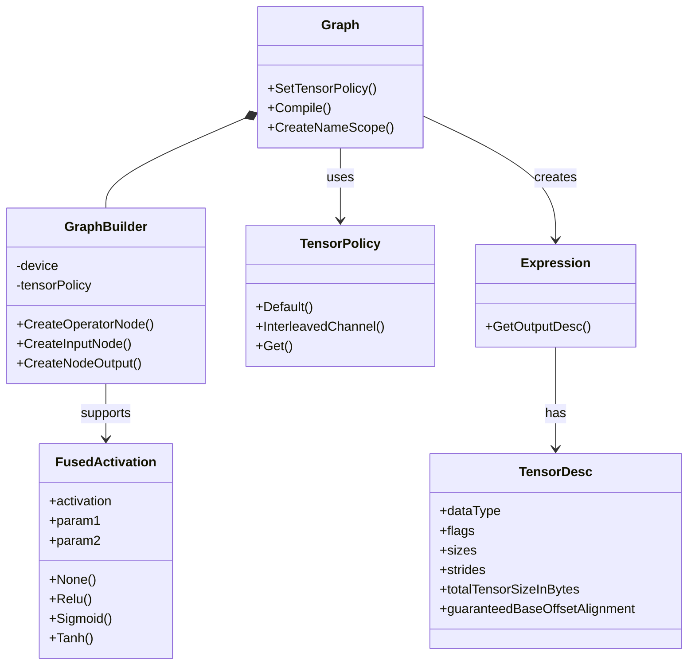
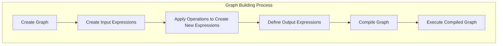
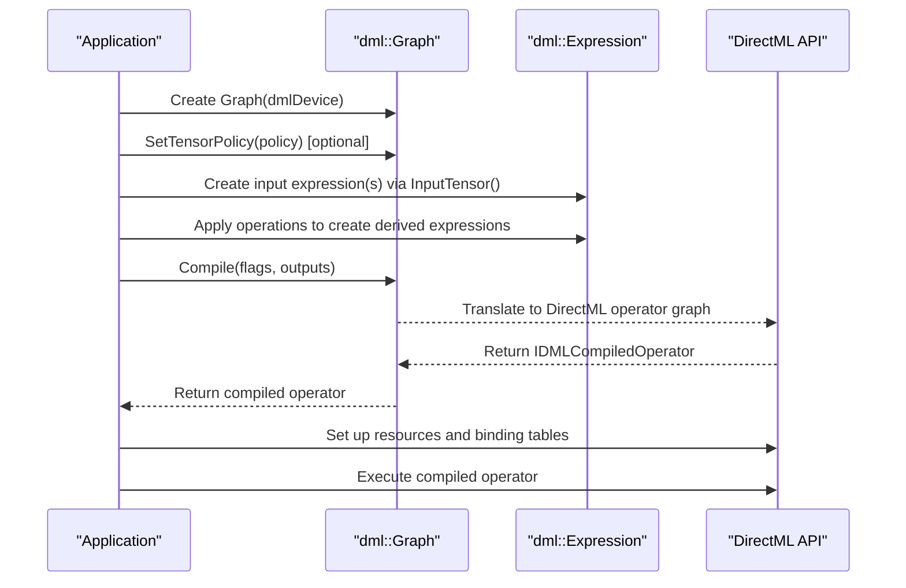
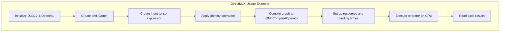

<!-- source: DeepWiki mcp.deepwiki.com · repo microsoft/DirectML · page 2.1 DirectMLX Abstraction Layer · fetched 2026-10-26 -->

# DirectMLX Abstraction Layer

<details>
<summary>Relevant source files</summary>

The following files were used as context for generating this wiki page:

- [DxDispatch/models/dml_convolution_2d.json](DxDispatch/models/dml_convolution_2d.json)
- [DxDispatch/models/dml_convolution_3d.json](DxDispatch/models/dml_convolution_3d.json)
- [Libraries/DirectMLX.h](Libraries/DirectMLX.h)
- [Samples/DirectMLSuperResolution/Kits/DirectXTK12/DirectXTK_Desktop_2017_Win10.vcxproj](Samples/DirectMLSuperResolution/Kits/DirectXTK12/DirectXTK_Desktop_2017_Win10.vcxproj)
- [Samples/HelloDirectML/HelloDirectML.vcxproj](Samples/HelloDirectML/HelloDirectML.vcxproj)
- [Samples/HelloDirectML/HelloDirectMLX.vcxproj](Samples/HelloDirectML/HelloDirectMLX.vcxproj)
- [Samples/HelloDirectML/main.cpp](Samples/HelloDirectML/main.cpp)
- [Samples/HelloDirectML/packages.config](Samples/HelloDirectML/packages.config)
- [Samples/yolov4/Kits/DirectXTK12/DirectXTK_Desktop_2017_Win10.vcxproj](Samples/yolov4/Kits/DirectXTK12/DirectXTK_Desktop_2017_Win10.vcxproj)

</details>


## Purpose and Scope

The DirectMLX Abstraction Layer is a C++ header-only API that simplifies working with DirectML by providing high-level abstractions for building, compiling, and executing machine learning computational graphs. It serves as a modern C++ wrapper around the lower-level DirectML C API, reducing boilerplate code and enabling more concise and readable implementation of machine learning operations on DirectX 12 compatible hardware.

This document covers the architecture, key classes, and usage patterns of the DirectMLX abstraction layer. For information about the core DirectML API, see [DirectML Overview](#1).

Sources: [Libraries/DirectMLX.h:133-133](), [Libraries/DirectMLX.h:285-855]()

## Architecture Overview

DirectMLX sits between application code and the DirectML API, providing C++ abstractions that make it easier to work with DirectML's concepts. It uses a declarative, expression-based approach to define computational graphs, which are then translated into DirectML operator graphs for execution.

### Key Components Diagram



Sources: [Libraries/DirectMLX.h:285-855](), [Libraries/DirectMLX.h:796-855](), [Libraries/DirectMLX.h:756-776](), [Libraries/DirectMLX.h:411-526](), [Libraries/DirectMLX.h:302-409](), [Libraries/DirectMLX.h:866-962]()

## Core Components

### Graph and Expression Classes

The central components of DirectMLX are the `Graph` and `Expression` classes:

- **Graph**: Represents a computational graph that can be compiled into a DirectML operator. It serves as the entry point for creating machine learning models.
  
- **Expression**: Represents a node in the computational graph, which could be an input tensor, a constant, or an operation to be performed.

Expressions are building blocks that can be composed to create complex computational pipelines. Each expression holds a reference to its output tensor description, allowing the system to track tensor shapes and types throughout the graph.



Sources: [Libraries/DirectMLX.h:756-855](), [Libraries/DirectMLX.h:285-295](), [Libraries/DirectMLX.h:816-851]()

### TensorDesc and Memory Management

`TensorDesc` defines the properties of a tensor, including:

- Data type (e.g., FLOAT32, FLOAT16, INT32)
- Dimensions
- Strides (optional)
- Total size in bytes
- Base offset alignment guarantees

DirectMLX handles tensor memory layout through the `TensorPolicy` class, which provides strategies for determining tensor properties like strides and size calculations:

| Policy Method | Description |
|---------------|-------------|
| `Default()` | Default tensor layout with no specific stride requirements |
| `InterleavedChannel()` | Creates tensors with channel-interleaved memory layout (e.g., NHWC instead of NCHW) |
| Custom | User-defined policies can be created by providing a custom function |

Sources: [Libraries/DirectMLX.h:411-526](), [Libraries/DirectMLX.h:302-409](), [Libraries/DirectMLX.h:59-131]()

### Under the Hood: GraphBuilder Implementation

While users primarily interact with the `Graph` and `Expression` classes, internally a `GraphBuilder` does the heavy lifting:

1. It maintains collections of nodes (inputs, operators, reinterprets, constants)
2. It creates `NodeOutput` objects that track tensor information
3. It translates the graph into DirectML operator descriptions when compilation is requested

The `GraphBuilder` creates several types of nodes:

- `InputNode`: Represents a graph input
- `OperatorNode`: Wraps a DirectML operator
- `ReinterpretNode`: Used for reshapes and type conversions
- `ConstantNode`: Represents constant data available at compile time

Sources: [Libraries/DirectMLX.h:529-739](), [Libraries/DirectMLX.h:611-739]()

## Graph Construction Flow

Building and executing a graph with DirectMLX follows this general pattern:



Sources: [Libraries/DirectMLX.h:816-851](), [Samples/HelloDirectML/main.cpp:194-227]()

## Operators and Activations

DirectMLX supports a wide range of operators through expression creation functions. These operators correspond to the underlying DirectML operators but with a simplified interface. Some common patterns include:

1. **Element-wise operators**: Add, subtract, multiply, divide
2. **Neural network layers**: Convolution, pooling, normalization
3. **Tensor manipulation**: Reshape, transpose, slice, concatenate

The `FusedActivation` class allows activation functions to be fused with operators, improving performance:

```
FusedActivation
├── None()
├── Identity()
├── Relu()
├── Sigmoid()
├── Tanh()
├── LeakyRelu(alpha)
├── ParametricSoftplus(alpha, beta)
├── Elu(alpha)
└── ... (other activations)
```

Sources: [Libraries/DirectMLX.h:866-962](), [Libraries/DirectMLX.h:1025-1047]()

## Usage Example Flow

The following diagram illustrates how the HelloDirectML sample uses DirectMLX to create and execute a simple identity operation:



In this example:
1. A `dml::Graph` is created from an `IDMLDevice`
2. An input tensor expression is created with a specific tensor description
3. The Identity operator is applied to create a new expression
4. The graph is compiled with the output expression
5. Resources are bound and the compiled operator is executed
6. Results are read back from the GPU

Sources: [Samples/HelloDirectML/main.cpp:194-227](), [Samples/HelloDirectML/main.cpp:227-477]()

## Integration with Applications

DirectMLX is designed to be used as a header-only library, making it easy to integrate with existing projects:

1. Include the `DirectMLX.h` header
2. Ensure DirectML is properly initialized with a D3D12 device
3. Build your computational graph using the DirectMLX abstractions
4. Compile and execute the graph

Projects can include DirectMLX by referencing the header file directly or by using the DirectML NuGet package, which includes the DirectMLX header.

The HelloDirectML sample project demonstrates both the raw DirectML API usage and the DirectMLX abstraction layer, controlled by the `USE_DMLX` preprocessor definition.

Sources: [Samples/HelloDirectML/HelloDirectMLX.vcxproj:231-233](), [Samples/HelloDirectML/main.cpp:194-227](), [Samples/HelloDirectML/packages.config:1-5]()

## Benefits and Tradeoffs

### Advantages of DirectMLX

1. **Reduced boilerplate**: Simplifies creation of DirectML operators
2. **Type safety**: Leverages C++ type system to prevent common errors
3. **Expression composition**: Makes building complex graphs more intuitive
4. **Memory management**: Handles resource lifetime through RAII principles

### Limitations

1. **Additional layer**: Introduces a thin abstraction layer that may not be desirable for all applications
2. **Learning curve**: Requires understanding both DirectML concepts and DirectMLX abstractions
3. **Header-only**: While convenient for integration, can increase compilation times

## Conclusion

The DirectMLX Abstraction Layer provides a modern C++ interface to DirectML, making it easier to build and execute machine learning graphs. Through its expression-based interface and sensible defaults, it reduces the amount of code required while maintaining the performance and flexibility of the underlying DirectML API.

Sources: [Libraries/DirectMLX.h:1-294](), [Libraries/DirectMLX.h:756-855]()

---

