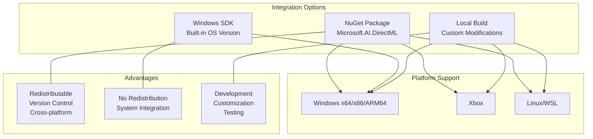
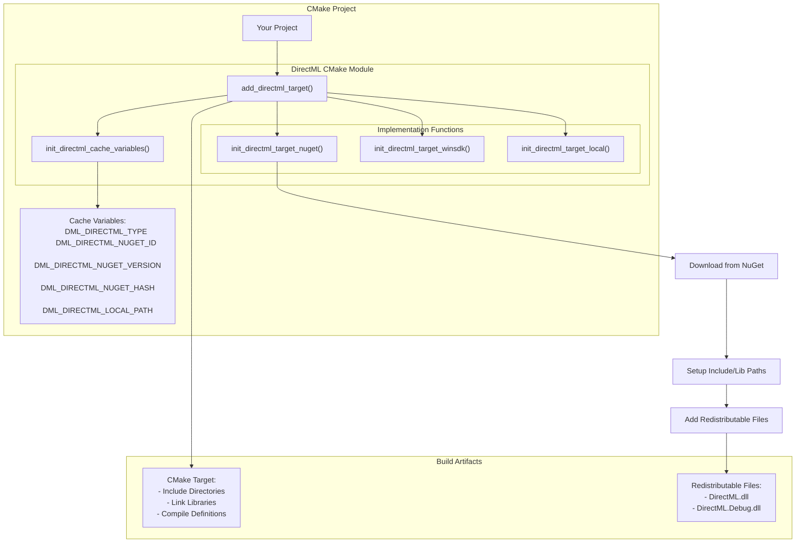
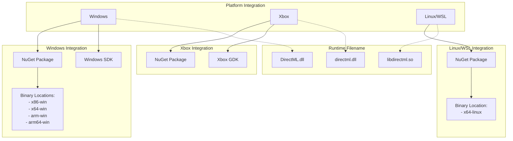
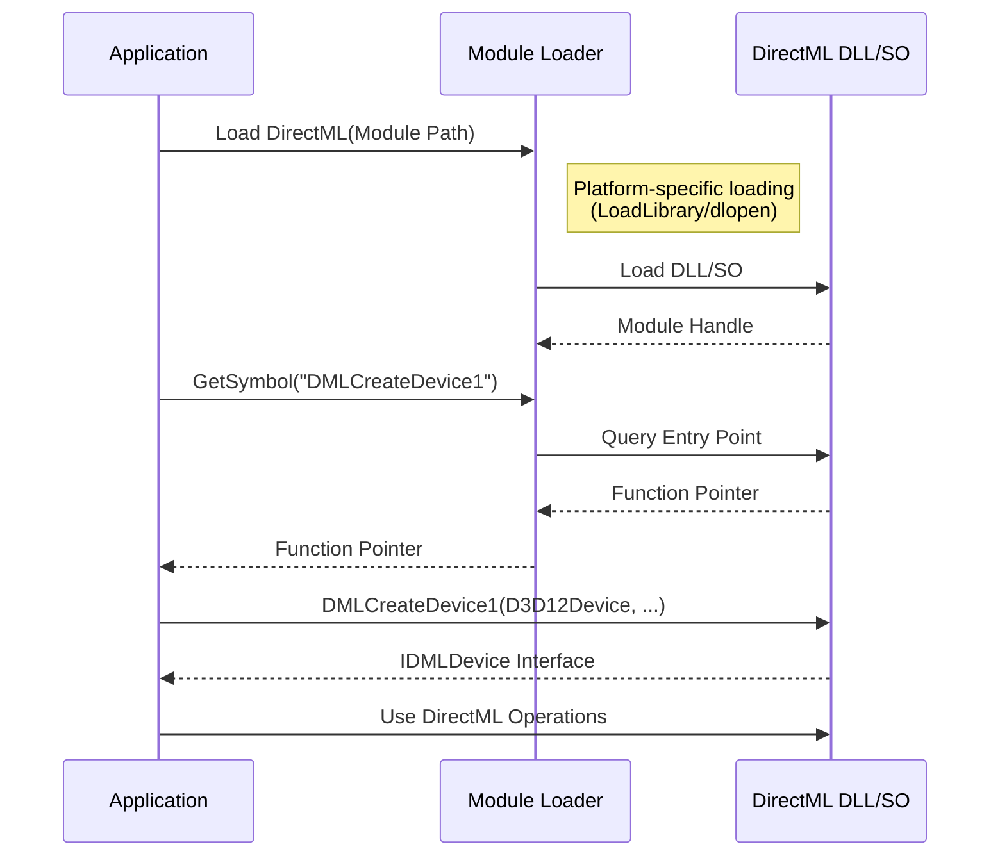
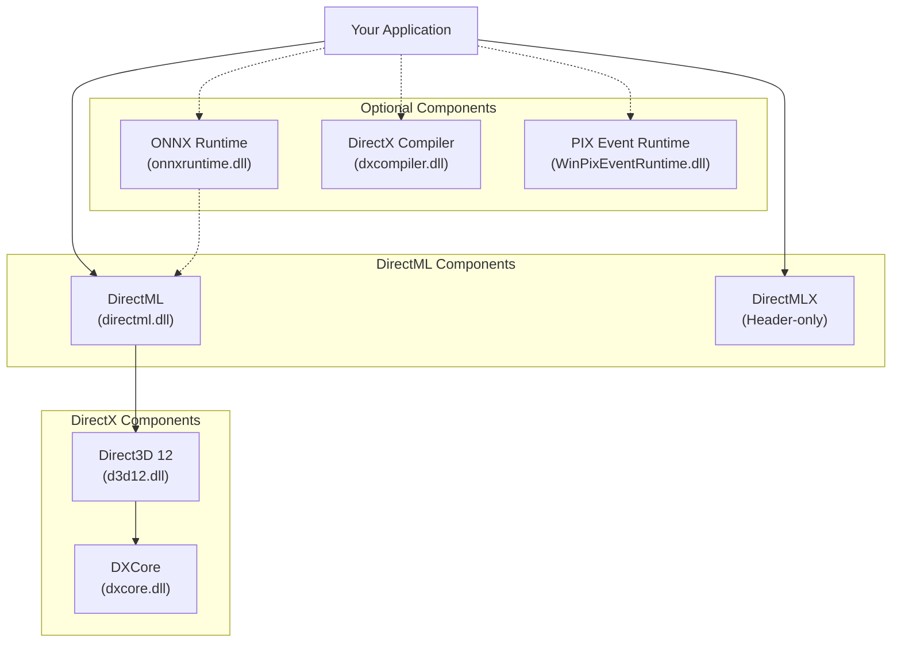

<!-- source: DeepWiki mcp.deepwiki.com · repo microsoft/DirectML · page 2.2 Build and Integration · fetched 2026-10-26 -->

# Build and Integration

<details>
<summary>Relevant source files</summary>

The following files were used as context for generating this wiki page:

- [DxDispatch/README.md](DxDispatch/README.md)
- [DxDispatch/cmake/d3d12.cmake](DxDispatch/cmake/d3d12.cmake)
- [DxDispatch/cmake/directml.cmake](DxDispatch/cmake/directml.cmake)
- [DxDispatch/cmake/dxcompiler.cmake](DxDispatch/cmake/dxcompiler.cmake)
- [DxDispatch/cmake/onnxruntime.cmake](DxDispatch/cmake/onnxruntime.cmake)
- [DxDispatch/models/dml_scalar_union_fp16.json](DxDispatch/models/dml_scalar_union_fp16.json)
- [DxDispatch/src/dxdispatch/DxModules.cpp](DxDispatch/src/dxdispatch/DxModules.cpp)
- [DxDispatch/src/dxdispatch/DxModules.h](DxDispatch/src/dxdispatch/DxModules.h)
- [DxDispatch/src/dxdispatch/ModuleInfo.cpp](DxDispatch/src/dxdispatch/ModuleInfo.cpp)
- [DxDispatch/src/dxdispatch/ModuleInfo.h](DxDispatch/src/dxdispatch/ModuleInfo.h)
- [DxDispatch/src/model/JsonParsersGenerated.cpp](DxDispatch/src/model/JsonParsersGenerated.cpp)
- [DxDispatch/tools/GenerateParsingHelpers.ps1](DxDispatch/tools/GenerateParsingHelpers.ps1)
- [Releases.md](Releases.md)
- [Samples/DirectMLSuperResolution/packages.config](Samples/DirectMLSuperResolution/packages.config)
- [Samples/yolov4/packages.config](Samples/yolov4/packages.config)

</details>


This page explains how to integrate DirectML into applications using various build systems. It covers the available distribution options, build system integrations, and platform-specific considerations. For information about DirectML API versions and feature levels, see [Release History and Versioning](#1.2).

## Distribution Options

DirectML can be integrated into your application in multiple ways. The best approach depends on your development environment, platform targets, and specific requirements.

### Distribution Options Diagram



Sources: [DxDispatch/cmake/directml.cmake:37-65](), [DxDispatch/README.md:77-130]()

### NuGet Package

The NuGet package is the most common and recommended way to integrate DirectML. It offers:

- Self-contained distribution without OS dependency
- Precise version control
- Support for Windows, Xbox, and Linux/WSL
- Easy integration with Visual Studio projects

The DirectML NuGet package is published as `Microsoft.AI.DirectML` and can be found at [nuget.org](https://www.nuget.org/packages/Microsoft.AI.DirectML/).

### Windows SDK

For applications targeting Windows only, you can use the DirectML version included in the Windows SDK. This approach:

- Avoids redistributing DirectML
- Uses the system-installed version
- May limit access to the latest features depending on OS version

### Local Build

For development and testing, you can build DirectML from source or use a custom build. This approach:

- Provides maximum flexibility
- Enables custom modifications
- Supports development workflows

## Integration with Build Systems

### NuGet Integration with Visual Studio

For Visual Studio projects, you can integrate DirectML using NuGet in several ways:

#### Using packages.config

Add a reference to the `Microsoft.AI.DirectML` package in your `packages.config` file:

```xml
<packages>
  <package id="Microsoft.AI.DirectML" version="1.15.2" targetFramework="native" />
</packages>
```

#### Using PackageReference (Modern .NET Projects)

For .NET SDK-style projects, add a `PackageReference` to your project file:

```xml
<ItemGroup>
  <PackageReference Include="Microsoft.AI.DirectML" Version="1.15.2" />
</ItemGroup>
```

Sources: [Samples/yolov4/packages.config:1-5](), [Samples/DirectMLSuperResolution/packages.config:1-5]()

### CMake Integration

DirectML provides CMake helper functions to simplify integration with CMake-based projects. The primary function is `add_directml_target` which creates a CMake target for DirectML.

#### DirectML CMake Integration Diagram



Sources: [DxDispatch/cmake/directml.cmake:27-239]()

#### Basic CMake Configuration

To use DirectML in a CMake project:

1. Include the DirectML CMake module
2. Call `add_directml_target` to create a DirectML target
3. Link your application against the DirectML target

```cmake
# Include the DirectML CMake module
include(cmake/directml.cmake)

# Create the DirectML target
add_directml_target(directml CACHE_PREFIX DML)

# Link your application
add_executable(your_app your_source_files.cpp)
target_link_libraries(your_app PRIVATE directml)
```

#### CMake Configuration Options

The following cache variables can be configured:

| Variable | Description | Default |
|----------|-------------|---------|
| `DML_DIRECTML_TYPE` | DirectML dependency type (`nuget`, `winsdk`, `local`) | `nuget` |
| `DML_DIRECTML_NUGET_ID` | ID of the DirectML NuGet package | `Microsoft.AI.DirectML` |
| `DML_DIRECTML_NUGET_VERSION` | Version of the DirectML NuGet package | `1.15.0` |
| `DML_DIRECTML_NUGET_HASH` | SHA256 hash of the NuGet package | (hash value) |
| `DML_DIRECTML_LOCAL_PATH` | Path to a local build of DirectML | "" |

These variables can be set using standard CMake methods:

```bash
cmake -DDML_DIRECTML_TYPE=winsdk ..
```

Sources: [DxDispatch/cmake/directml.cmake:30-66]()

### Manual Integration

For projects not using NuGet or CMake, you can manually integrate DirectML:

1. Download the DirectML binaries from NuGet or the GitHub repository
2. Add the appropriate include directories to your project
3. Link against DirectML.lib
4. Distribute DirectML.dll with your application

## Platform-Specific Considerations

### DirectML Platform Support Diagram



Sources: [DxDispatch/cmake/directml.cmake:85-99](), [DxDispatch/src/dxdispatch/ModuleInfo.h:2-30]()

### Windows

On Windows, DirectML is distributed as `DirectML.dll` and `DirectML.Debug.dll`. The NuGet package includes binaries for multiple architectures:

- x86-win
- x64-win
- arm-win
- arm64-win

### Xbox

On Xbox, DirectML is distributed as part of the Game Development Kit (GDK). The runtime module name is `directml.dll`.

### Linux/WSL

On Linux/WSL, DirectML is distributed as `libdirectml.so`. The NuGet package currently only includes binaries for x64-linux.

## Runtime Loading and Versioning

### Runtime Loading Diagram



Sources: [DxDispatch/src/dxdispatch/DxModules.cpp:14-117](), [DxDispatch/src/dxdispatch/DxModules.h:104-117]()

### DirectML API Version Selection

DirectML uses feature levels to represent API capabilities. When creating a DirectML device, you can specify the minimum required feature level:

```cpp
// Create with the latest available feature level
DMLCreateDevice1(
    d3d12Device,               // D3D12 device
    DML_CREATE_DEVICE_FLAG_NONE,
    DML_FEATURE_LEVEL_5_0,     // Minimum required feature level
    IID_PPV_ARGS(&dmlDevice)
);
```

Available feature levels are documented in the [Release History and Versioning](#1.2) page.

### Runtime Module Names

DirectML has different module names depending on the platform:

| Platform | Module Name |
|----------|-------------|
| Windows | `directml.dll` |
| Xbox | `directml.dll` |
| Linux/WSL | `libdirectml.so` |

Sources: [DxDispatch/src/dxdispatch/ModuleInfo.h:2-30]()

## Related Dependencies

### Component Relationship Diagram



Sources: [DxDispatch/README.md:77-130](), [DxDispatch/src/dxdispatch/ModuleInfo.cpp:102-109]()

### DirectX 12 Integration

DirectML requires DirectX 12, which can be integrated using similar methods:

- NuGet package (Microsoft.Direct3D.D3D12)
- Windows SDK
- Game Development Kit (for Xbox)

For CMake projects, the `add_d3d12_target` function works similarly to `add_directml_target`.

Sources: [DxDispatch/cmake/d3d12.cmake:1-210]()

### ONNX Runtime Integration

For machine learning workloads, you can integrate ONNX Runtime with DirectML as the execution provider:

- NuGet package (Microsoft.ML.OnnxRuntime.DirectML)
- Local build

For CMake projects, the `add_onnxruntime_target` function facilitates this integration.

Sources: [DxDispatch/cmake/onnxruntime.cmake:1-177]()

## Conclusion

This page covered the various ways to integrate DirectML into your applications. The recommended approach for most scenarios is to use the NuGet package, which provides the latest features and cross-platform support. For specialized cases, the Windows SDK or local build options provide additional flexibility.

For more details on using DirectML in your application, refer to the [DirectMLX Abstraction Layer](#2.1) page, which explains the C++ helper library that simplifies DirectML graph construction.

---

