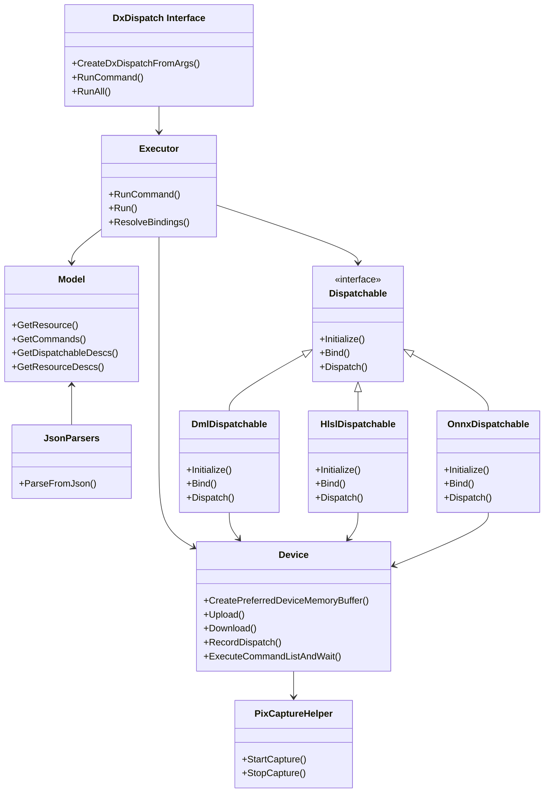
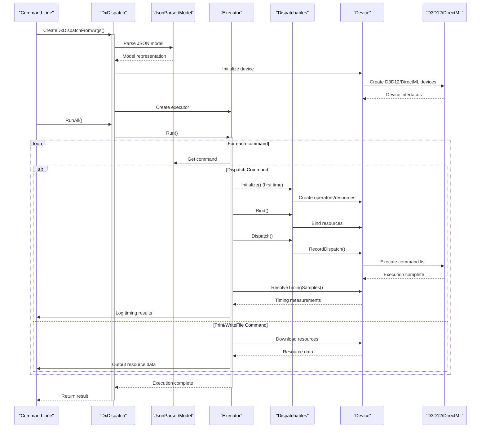
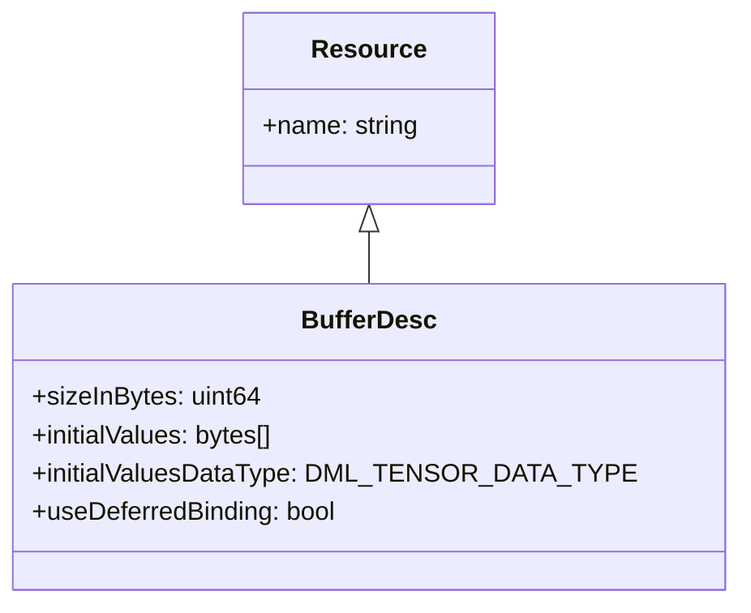
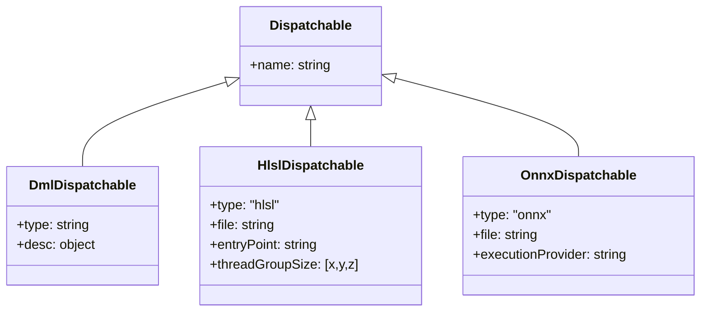
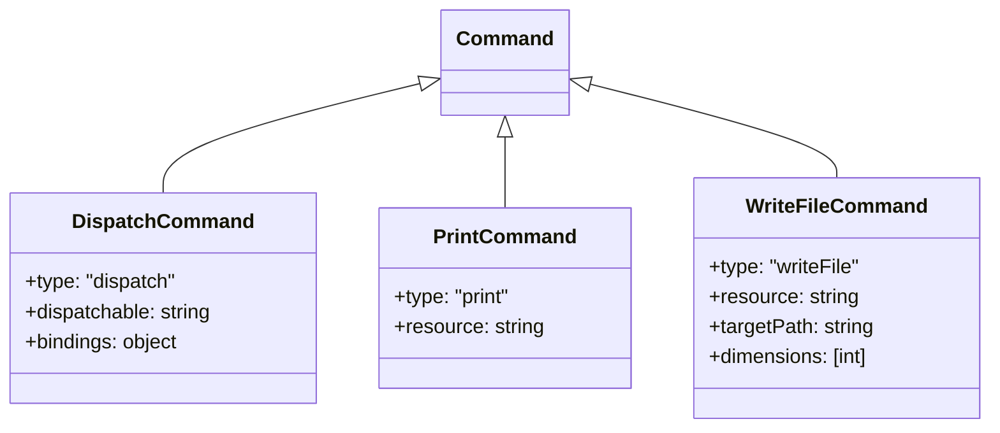
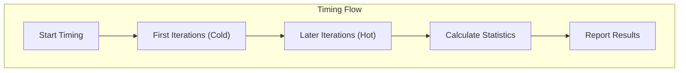
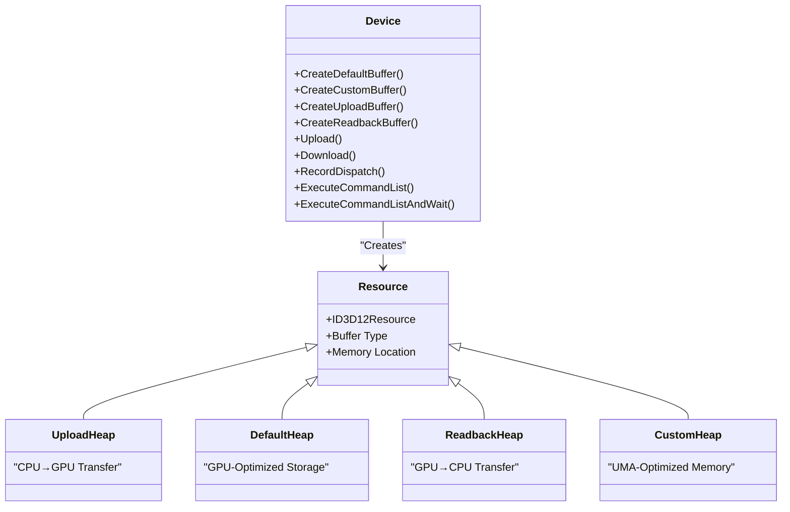
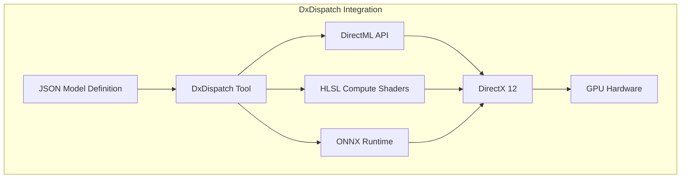

<!-- source: DeepWiki mcp.deepwiki.com · repo microsoft/DirectML · page 3 DxDispatch Tool · fetched 2026-10-26 -->

# DxDispatch Tool

<details>
<summary>Relevant source files</summary>

The following files were used as context for generating this wiki page:

- [DxDispatch/CMakeLists.txt](DxDispatch/CMakeLists.txt)
- [DxDispatch/cgmanifest.json](DxDispatch/cgmanifest.json)
- [DxDispatch/models/chihuahua.jpg](DxDispatch/models/chihuahua.jpg)
- [DxDispatch/models/image_io.json](DxDispatch/models/image_io.json)
- [DxDispatch/src/dxdispatch/Device.cpp](DxDispatch/src/dxdispatch/Device.cpp)
- [DxDispatch/src/dxdispatch/Executor.cpp](DxDispatch/src/dxdispatch/Executor.cpp)
- [DxDispatch/src/exe/main.cpp](DxDispatch/src/exe/main.cpp)
- [DxDispatch/src/model/ImageReaderWriter.cpp](DxDispatch/src/model/ImageReaderWriter.cpp)
- [DxDispatch/src/model/ImageReaderWriter.h](DxDispatch/src/model/ImageReaderWriter.h)

</details>


The DxDispatch Tool is a command-line utility for executing machine learning workloads on DirectX 12 hardware. It serves as a flexible testbed and diagnostic tool for DirectML operations, HLSL compute shaders, and ONNX models, allowing developers to define, execute, and analyze ML operations through a JSON-based model definition format.

For information about DirectML itself, see [DirectML Overview](#1).

## 1. Architecture Overview

DxDispatch consists of several key components that work together to provide a versatile execution environment for machine learning operations on DirectX 12 hardware.



Sources: [DxDispatch/CMakeLists.txt:127-150](), [DxDispatch/src/dxdispatch/Executor.cpp:106-212]()

The core architecture shows how the system processes model definitions, creates appropriate dispatchable objects, and executes them on DirectX 12 hardware:

1. **DxDispatch Interface**: The public-facing API that initializes the tool and executes models
2. **Executor**: Orchestrates the execution of commands defined in the model
3. **Device**: Abstracts DirectX 12/DirectML device management and command submission
4. **Model**: Represents the structure of a machine learning model with resources and operations
5. **JsonParsers**: Parses the JSON model format into internal representations
6. **Dispatchable Types**: Different backends for execution (DML, HLSL, ONNX)
7. **PixCaptureHelper**: Facilitates performance analysis with the PIX tool

## 2. Execution Flow

The following diagram shows the typical execution flow when running a model through DxDispatch:



Sources: [DxDispatch/src/dxdispatch/Executor.cpp:214-273](), [DxDispatch/src/exe/main.cpp:14-45]()

The sequence above illustrates how DxDispatch processes models from JSON definitions to GPU execution:

1. The command line creates a DxDispatch instance with configuration from arguments
2. DxDispatch parses the JSON model and initializes the device
3. When executing commands, the Executor manages different command types
4. Dispatch commands are executed on the GPU with timing measurements
5. Print/WriteFile commands retrieve and display/write resource data

## 3. JSON Model Format

DxDispatch uses a JSON-based model definition format to specify resources, dispatchable operations, and execution commands. This format allows for concise and declarative definitions of machine learning workloads.

### 3.1 Model Structure

A DxDispatch model consists of three main sections:

```
{
    "resources": { ... },      // Define tensor buffers and their initial values
    "dispatchables": { ... },  // Define operations (DML/HLSL/ONNX)
    "commands": [ ... ]        // Define execution sequence
}
```

### 3.2 Resources

Resources represent tensor buffers that can be bound to dispatchable operations. They can be initialized with values directly in the JSON, loaded from files, or created empty.



Sources: [DxDispatch/src/dxdispatch/Executor.cpp:109-127](), [DxDispatch/models/image_io.json:4-22]()

### 3.3 Dispatchables

Dispatchables define operations that can be executed on the GPU. DxDispatch supports three types of dispatchables:



Sources: [DxDispatch/src/dxdispatch/Executor.cpp:130-211](), [DxDispatch/models/image_io.json:24-45]()

### 3.4 Commands

Commands define the execution sequence for the model. Three main command types are supported:

1. **dispatch**: Execute a dispatchable operation with specified bindings
2. **print**: Display resource data in the console
3. **writeFile**: Write resource data to a file (supports NPY and image formats)



Sources: [DxDispatch/src/dxdispatch/Executor.cpp:275-688](), [DxDispatch/models/image_io.json:47-65]()

## 4. Command Line Interface

DxDispatch provides a command-line interface with various options for controlling execution, device selection, and performance analysis.

### 4.1 Basic Usage

```
dxdispatch model.json [options]
```

### 4.2 Key Options

| Category | Option | Description |
|----------|--------|-------------|
| Device Selection | `--adapter` | Specify GPU adapter index or name |
| | `--feature-level` | Specify D3D feature level |
| | `--dml-feature-level` | Specify DirectML feature level |
| Execution | `--dispatch-iterations` | Number of times to execute each dispatch command |
| | `--dispatch-repeat` | Number of times to repeat each dispatch within a single iteration |
| Timing | `--timing` | Control timing verbosity (basic, extended, all) |
| | `--min-dispatch-interval` | Minimum time between dispatches (ms) |
| | `--time-to-run` | Total time to run (ms) |
| Debugging | `--debug` | Enable debug layers |
| | `--pix-capture` | Capture PIX trace |
| Resource | `--custom-heap` | Use custom heaps for UMA systems |
| | `--clear-shader-cache` | Clear shader caches before execution |

Sources: [DxDispatch/src/exe/main.cpp:14-45]()

## 5. Performance Analysis

DxDispatch includes built-in performance measurement capabilities and can integrate with the PIX graphics debugging tool for in-depth analysis.

### 5.1 Timing Measurements

The tool takes both CPU and GPU timing measurements for each dispatched operation:

- CPU timing measures the time taken to submit the dispatch
- GPU timing uses D3D12 timestamp queries to measure actual GPU execution time
- Multiple iterations allow for warm-up and hot samples analysis
- Statistics include average, median, min, and max timings



Sources: [DxDispatch/src/dxdispatch/Executor.cpp:276-446](), [DxDispatch/src/dxdispatch/Device.cpp:620-685]()

### 5.2 PIX Integration

DxDispatch can generate PIX captures for detailed GPU performance analysis:

- Marks dispatch regions for easy identification
- Supports BeginCapture/EndCapture for targeted analysis
- Records GPU command timing information
- Includes a PowerShell script for analyzing captures

Sources: [DxDispatch/src/dxdispatch/Device.cpp:146-291](), [DxDispatch/CMakeLists.txt:231-233]()

## 6. Resource Management

The Device component in DxDispatch handles resource creation, data transfer, and execution on the GPU.



Sources: [DxDispatch/src/dxdispatch/Device.cpp:341-597]()

### 6.1 Memory Types

DxDispatch supports different memory types to optimize for different hardware configurations:

- **Default Heap**: GPU-optimized memory (discrete GPU)
- **Custom Heap**: UMA-optimized memory (integrated GPU)
- **Upload Heap**: For transferring data from CPU to GPU
- **Readback Heap**: For transferring data from GPU to CPU

### 6.2 Resource I/O

The tool supports various input/output formats for tensor data:

- Raw binary data
- NPY (NumPy) file format
- Image files (JPG, PNG) with automatic format conversion
- Console output for inspection

Sources: [DxDispatch/src/model/ImageReaderWriter.cpp:76-275](), [DxDispatch/src/dxdispatch/Executor.cpp:565-688]()

## 7. Integration with DirectML

DxDispatch is built on top of DirectML and provides a flexible way to exercise DirectML functionality. It can be used to:

- Test DirectML operators and execution
- Benchmark performance of ML operations
- Validate model correctness
- Compare different execution approaches (DirectML vs. HLSL vs. ONNX)



Sources: [DxDispatch/CMakeLists.txt:52-59](), [DxDispatch/cgmanifest.json:22-30]()

## 8. Example Use Cases

DxDispatch can be used for various tasks, including:

1. **Testing DirectML operators**: Define and run individual DirectML operations
2. **ML model execution**: Run ONNX models through DirectML
3. **Image processing**: Apply ML operations to images (as shown in the image_io.json example)
4. **Performance benchmarking**: Measure and compare performance of different operations
5. **Debugging**: Analyze execution with PIX for performance optimization

Sources: [DxDispatch/models/image_io.json:1-66]()

## Summary

The DxDispatch Tool provides a flexible way to define, execute, and analyze DirectML operations and ML models on DirectX 12 hardware. Its JSON-based model format allows for easy definition of resources and operations, while its command-line interface offers extensive control over execution and analysis. The tool serves as both a testbed for DirectML functionality and a benchmarking utility for ML operations on GPUs.

---

