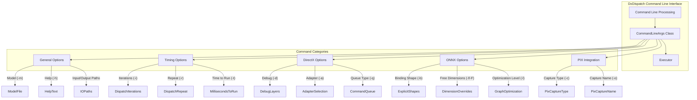
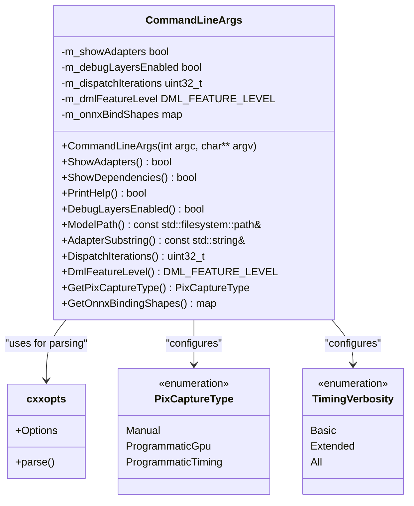
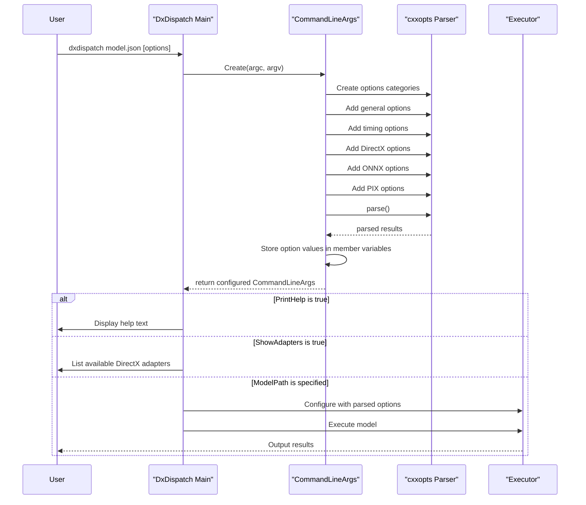

<!-- source: DeepWiki mcp.deepwiki.com · repo microsoft/DirectML · page 3.1 Command Line Interface · fetched 2026-10-26 -->

# Command Line Interface

<details>
<summary>Relevant source files</summary>

The following files were used as context for generating this wiki page:

- [DxDispatch/src/dxdispatch/CommandLineArgs.cpp](DxDispatch/src/dxdispatch/CommandLineArgs.cpp)
- [DxDispatch/src/dxdispatch/CommandLineArgs.h](DxDispatch/src/dxdispatch/CommandLineArgs.h)

</details>


This document provides a comprehensive reference for the command line interface (CLI) of the DxDispatch tool, which enables users to execute and benchmark DirectML, HLSL, and ONNX models through a unified command-line interface. For information about the DxDispatch tool's architecture and general capabilities, see [DxDispatch Tool](#3).

## Overview

The DxDispatch CLI processes command-line arguments to configure how models are loaded, executed, and benchmarked. It provides fine-grained control over DirectX device creation, execution parameters, performance measurement, and debugging capabilities.



Sources: [DxDispatch/src/dxdispatch/CommandLineArgs.h:12-133](), [DxDispatch/src/dxdispatch/CommandLineArgs.cpp:10-555]()

## Basic Usage

The DxDispatch tool is invoked with a model file and optional parameters to control execution:

```
dxdispatch -m model.json [options]
```

Or using the positional parameter:

```
dxdispatch model.json [options]
```

The command line interface supports multiple categories of options that control various aspects of model execution.

Sources: [DxDispatch/src/dxdispatch/CommandLineArgs.cpp:252-254]()

## Command Line Options

The options are organized into the following categories:

### General Options

| Option | Short | Description |
|--------|-------|-------------|
| `--model` | `-m` | Path to JSON/ONNX model file |
| `--help` | `-h` | Print command-line usage help |
| `--show_dependencies` | `-S` | Show version info for dependencies including DirectX components |
| `--input_path` | | Base path for reading input files |
| `--output_path` | | Base path for writing output files |
| `--print_commands` | | Prints detail message before and after each command |

Sources: [DxDispatch/src/dxdispatch/CommandLineArgs.cpp:30-61]()

### Timing Options

These options control how the model is executed for performance evaluation:

| Option | Short | Description | Default |
|--------|-------|-------------|---------|
| `--dispatch_iterations` | `-i` | Number of iterations in bind/dispatch/wait loop | 1 |
| `--dispatch_repeat` | `-r` | Number of times dispatch is invoked within each loop iteration | 1 |
| `--milliseconds_to_run` | `-t` | Total time to run the test for (overrides iterations) | - |
| `--dispatch_interval` | `-I` | Minimum time in milliseconds between dispatches | 0 |
| `--warmup_samples` | `-w` | Max number of warmup samples to discard from timing statistics | - |
| `--timing_verbosity` | `-v` | Timing verbosity level (0-2) | 0 |
| `--max_gpu_time_measurements` | | Size of GPU timestamp buffer (0 disables GPU timing) | 8192 |

Sources: [DxDispatch/src/dxdispatch/CommandLineArgs.cpp:64-100](), [DxDispatch/src/dxdispatch/CommandLineArgs.h:80-104]()

### DirectX Options

These options control the DirectX device, adapter selection, and debug settings:

| Option | Short | Description |
|--------|-------|-------------|
| `--debug` | `-d` | Enable D3D and DML debug layers |
| `--adapter` | `-a` | Substring to match a desired DirectX adapter |
| `--show_adapters` | `-s` | Show all available DirectX adapters |
| `--queue_type` | `-q` | Type of command queue/list to use ('compute' or 'direct') |
| `--disable_custom_heaps` | | Always use default heaps for resources |
| `--clear_shader_caches` | | Clears D3D shader caches before running commands |
| `--disable_gpu_timeout` | | Sets D3D12_COMMAND_QUEUE_FLAG_DISABLE_GPU_TIMEOUT on the command queue |
| `--enable_dred` | | Enables SetAutoBreadcrumbsEnablement and SetPageFaultEnablement |
| `--disable_background_processing` | | Disallows UMD from performing PGO in background threads |
| `--set_stable_power_state` | | Sets a device clock rate that may be lower but more stable |
| `--disable_agility_sdk` | | Force use of the system version of D3D12Core.dll |
| `--print_hlsl_disassembly` | | Prints disassembled shader bytecode (HLSL dispatchables only) |
| `--post_dispatch_barriers` | | Barrier types after dispatch: 'none', 'uav', or 'uav+aliasing' |
| `--dml_feature_level` | | DirectML feature level (e.g., 5.0, 6.2) |
| `--xbox_allow_precompile` | | Disables automatically defining __XBOX_DISABLE_PRECOMPILE |
| `--present_separator` | | Injects present after each inference pass for debugging |

Sources: [DxDispatch/src/dxdispatch/CommandLineArgs.cpp:103-200](), [DxDispatch/src/dxdispatch/CommandLineArgs.h:77-92]()

### PIX Integration Options

Options for controlling PIX capture integration:

| Option | Short | Description | Default |
|--------|-------|-------------|---------|
| `--pix_capture_type` | `-c` | Type of PIX captures: 'gpu', 'timing', or 'manual' | 'manual' |
| `--pix_capture_name` | `-o` | Name used for PIX capture files | 'dxdispatch' |

Sources: [DxDispatch/src/dxdispatch/CommandLineArgs.cpp:186-194](), [DxDispatch/src/dxdispatch/CommandLineArgs.h:98-108]()

### ONNX Runtime Options

These options control ONNX model execution:

| Option | Short | Description |
|--------|-------|-------------|
| `--onnx_free_dim_name_override` | `-f` | Free dimension overrides by name (e.g., `-f foo:3`) |
| `--onnx_free_dim_denotation_override` | `-F` | Free dimension overrides by denotation (e.g., `-F DATA_BATCH:3`) |
| `--onnx_session_config_entry` | `-e` | SessionOption config keys and values (e.g., `-e foo:0`) |
| `--binding_shape` | `-b` | Explicit shapes for ONNX model tensors (e.g., `-b input1:2,2`) |
| `--onnx_graph_optimization_level` | `-l` | ONNX Runtime graph optimization level (0-99) |
| `--onnx_logging_level` | `-L` | ONNX Runtime logging level (0-4) |
| `--print_onnx_bindings` | `-p` | Prints verbose ONNX model binding information |
| `--enable_ort_extensions` | `-x` | Enable use of custom operators in ortextensions.dll |
| `--enable_onnx_profiling` | | Captures a JSON file of CPU and GPU execution |

Sources: [DxDispatch/src/dxdispatch/CommandLineArgs.cpp:203-252](), [DxDispatch/src/dxdispatch/CommandLineArgs.h:110-131]()

## CommandLineArgs Processing Architecture

The `CommandLineArgs` class parses and stores all command line options, making them available to other components in the DxDispatch tool.



Sources: [DxDispatch/src/dxdispatch/CommandLineArgs.h:12-133](), [DxDispatch/src/dxdispatch/CommandLineArgs.cpp:10-555]()

## Command Line Processing Flow

The following diagram illustrates how command line arguments are processed in DxDispatch:



Sources: [DxDispatch/src/dxdispatch/CommandLineArgs.cpp:10-555]()

## Examples

### Basic Model Execution

Run a model with default settings:

```
dxdispatch model.json
```

### Benchmarking

Run a model for 100 iterations with timing information:

```
dxdispatch model.json -i 100 -v 1
```

### Selecting a Specific GPU

Run on a specific GPU (e.g., NVIDIA):

```
dxdispatch model.json -a NVIDIA
```

### Using PIX for Performance Analysis

Capture GPU timing information using PIX:

```
dxdispatch model.json -c gpu -o my_capture
```

### ONNX Model with Custom Dimensions

Run an ONNX model with specific input dimensions:

```
dxdispatch model.onnx -b input:1,3,224,224
```

Sources: [DxDispatch/src/dxdispatch/CommandLineArgs.cpp:30-252]()

## Implementation Details

The command line interface is implemented using the `cxxopts` library for parsing command line arguments. The `CommandLineArgs` class contains methods to access the parsed arguments and make them available to other components in the DxDispatch tool.

Key implementation details:

1. Command line options are organized into categories in the `CommandLineArgs` constructor
2. The `cxxopts` library parses the arguments into the appropriate types
3. The `CommandLineArgs` class provides getter methods for all options
4. Complex options like shape strings and key-value pairs are parsed and stored in appropriate data structures

Sources: [DxDispatch/src/dxdispatch/CommandLineArgs.cpp:6-7](), [DxDispatch/src/dxdispatch/CommandLineArgs.cpp:457-498]()

---

