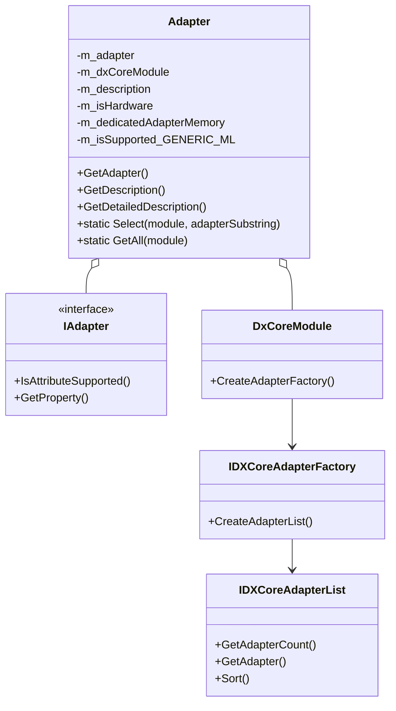
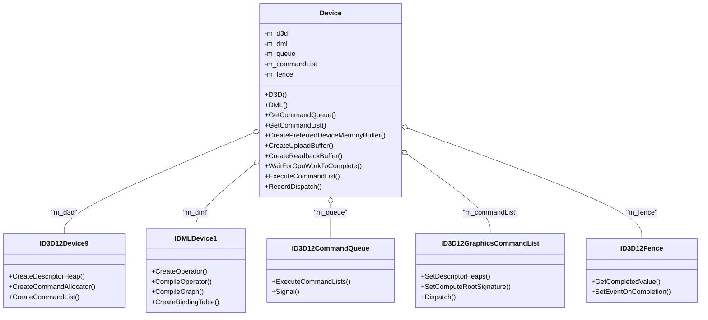
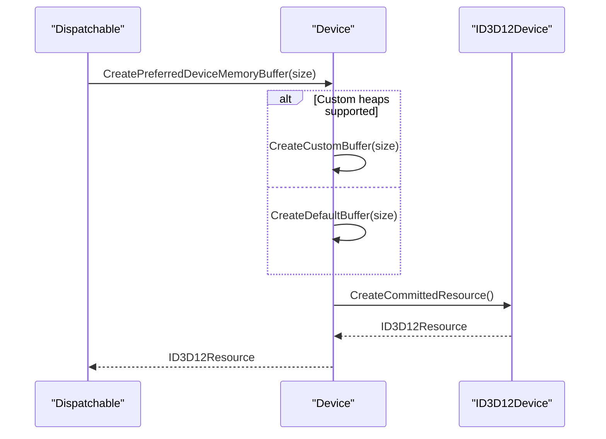
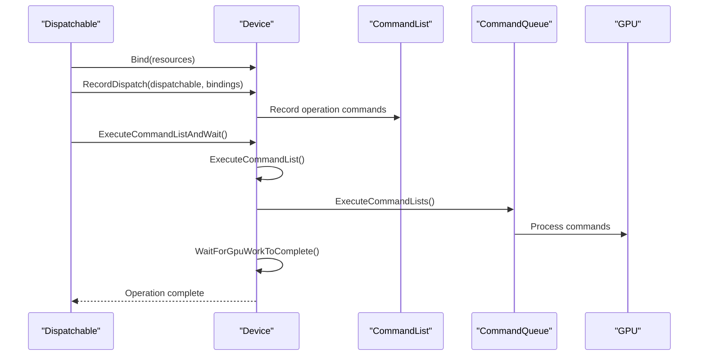
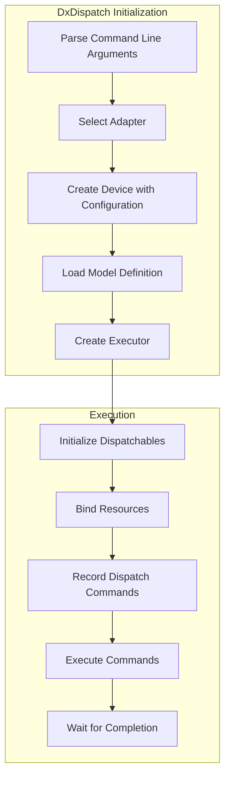

<!-- source: DeepWiki mcp.deepwiki.com · repo microsoft/DirectML · page 3.2 Device and Adapter Management · fetched 2026-10-26 -->

# Device and Adapter Management

<details>
<summary>Relevant source files</summary>

The following files were used as context for generating this wiki page:

- [DxDispatch/src/dxdispatch/Adapter.cpp](DxDispatch/src/dxdispatch/Adapter.cpp)
- [DxDispatch/src/dxdispatch/Adapter.h](DxDispatch/src/dxdispatch/Adapter.h)
- [DxDispatch/src/dxdispatch/Device.h](DxDispatch/src/dxdispatch/Device.h)
- [DxDispatch/src/dxdispatch/DmlDispatchable.cpp](DxDispatch/src/dxdispatch/DmlDispatchable.cpp)
- [DxDispatch/src/dxdispatch/HlslDispatchable.cpp](DxDispatch/src/dxdispatch/HlslDispatchable.cpp)
- [DxDispatch/src/dxdispatch/dxDispatchWrapper.cpp](DxDispatch/src/dxdispatch/dxDispatchWrapper.cpp)

</details>


This document explains how DxDispatch manages DirectX devices and adapters, including selection, creation, configuration, and command submission. It covers the architecture and interactions between the `Adapter` and `Device` classes that form the foundation for executing DirectML, HLSL, and ONNX workloads.

## Adapter Management

The `Adapter` class provides an abstraction over the DirectX Core (DXCore) functionality for enumerating, querying, and selecting hardware adapters (GPUs). It simplifies the process of finding the appropriate hardware for DirectML computation.



**Adapter Selection and Enumeration Process**

1. DxDispatch provides two main methods for adapter selection:
   - `Adapter::GetAll()`: Returns all available adapters that support ML or compute workloads
   - `Adapter::Select()`: Finds a specific adapter by matching a substring in its description

2. The system prioritizes adapters with hardware acceleration and high performance when multiple options are available.

3. For each adapter, the system queries various properties including:
   - Hardware/software implementation type
   - Memory configuration (dedicated and shared)
   - Driver version
   - Support for various DirectX capabilities (graphics, compute, ML)

Sources: [DxDispatch/src/dxdispatch/Adapter.h:5-94](), [DxDispatch/src/dxdispatch/Adapter.cpp:6-129]()

## Device Creation and Configuration

The `Device` class creates a simplified abstraction around DirectX 12 and DirectML devices, providing an interface for submitting work to the GPU. It encapsulates a D3D12 device, command queue, command list, and DirectML device.



**Device Creation Process**

When DxDispatch initializes a device, it performs the following steps:

1. Takes a selected adapter and creates a D3D12 device with appropriate feature levels
2. Creates a DirectML device from the D3D12 device
3. Initializes command structures (queue, allocator, list)
4. Sets up performance measurement infrastructure
5. Configures additional device settings like debug layers, timeouts, and power states

The device constructor allows extensive configuration through parameters:

```
Device(
    IAdapter* adapter, 
    D3D_FEATURE_LEVEL featureLevel,
    DML_FEATURE_LEVEL dmlFeatureLevel,
    bool debugLayersEnabled, 
    D3D12_COMMAND_LIST_TYPE commandListType, 
    uint32_t dispatchRepeat,
    bool uavBarrierAfterDispatch,
    bool aliasingBarrierAfterDispatch,
    ...
)
```

Sources: [DxDispatch/src/dxdispatch/Device.h:8-168](), [DxDispatch/src/dxdispatch/dxDispatchWrapper.cpp:158-189]()

## Device Memory Management

The `Device` class provides several methods for creating and managing GPU-accessible memory resources.

| Buffer Type | Description | Usage |
|-------------|-------------|-------|
| Default Buffer | GPU-accessible memory for general use | Primary storage for tensors and intermediate results |
| Upload Buffer | CPU-writable, GPU-readable | Used to transfer data from CPU to GPU |
| Readback Buffer | GPU-writable, CPU-readable | Used to retrieve results from GPU |
| Custom Buffer | Device memory with specific properties | Optimized for certain hardware when supported |
| Preferred Buffer | Creates either default or custom buffer | Automatically uses the best option for the current hardware |

**Memory Resource Creation**

The Device class provides buffer creation methods that handle the complexity of allocating properly aligned GPU memory with appropriate flags:



Sources: [DxDispatch/src/dxdispatch/Device.h:50-80]()

## Command Execution Flow

The `Device` class provides a simplified model for command recording and execution. It maintains a single command list that is always open for recording and provides methods to execute the recorded commands.



**Key Command Execution Methods**

- `ExecuteCommandList()`: Submits the recorded commands to the GPU but doesn't wait for completion
- `ExecuteCommandListAndWait()`: Submits commands and blocks until they complete
- `WaitForGpuWorkToComplete()`: Blocks until all previously submitted work completes
- `RecordDispatch()`: Records dispatch commands for DirectML operators or HLSL compute shaders

The command execution flow is designed to be simple for common use cases while still allowing for performance optimization when needed.

Sources: [DxDispatch/src/dxdispatch/Device.h:82-100](), [DxDispatch/src/dxdispatch/DmlDispatchable.cpp:632-637](), [DxDispatch/src/dxdispatch/HlslDispatchable.cpp:479-483]()

## Integration with DxDispatch System

DxDispatch integrates the adapter and device management into its overall workflow, handling the lifecycle of these components.



**Key Integration Points**

1. **Adapter Selection**: DxDispatch selects a GPU adapter based on command line arguments or uses a provided adapter.

2. **Device Creation**: A Device is created with the selected adapter and configured based on options.

3. **Dispatchable Initialization**: Each dispatchable (DML, HLSL, ONNX) is initialized with the shared Device.

4. **Command Recording**: Operations are recorded into the device's command list.

5. **Execution**: The device executes the commands and manages synchronization.

This design allows DxDispatch to support multiple types of compute workloads (DirectML operators, HLSL shaders, ONNX models) through a unified execution mechanism.

Sources: [DxDispatch/src/dxdispatch/dxDispatchWrapper.cpp:138-182](), [DxDispatch/src/dxdispatch/dxDispatchWrapper.cpp:271-294]()

## Performance Measurement and Debugging

The Device class includes built-in support for performance measurement through GPU timestamps and integration with PIX for Windows.

**GPU Timing**

- `RecordTimestamp()`: Inserts a timestamp into the command stream
- `ResolveTimestamps()`: Retrieves timestamp values from the GPU
- `ResolveTimingSamples()`: Converts timestamp pairs into timing measurements in milliseconds

**PIX Integration**

The Device class works with the `PixCaptureHelper` to enable GPU workload capture for detailed performance analysis.

**Debug Support**

The Device can be configured with various debugging options:
- DirectX 12 debug layers
- GPU timeout disabling
- Device Removed Extended Data (DRED)

Sources: [DxDispatch/src/dxdispatch/Device.h:98-107](), [DxDispatch/src/dxdispatch/dxDispatchWrapper.cpp:282-285]()

## Summary

The Device and Adapter Management system in DxDispatch provides a robust foundation for DirectML workloads by:

1. Simplifying GPU selection with hardware capability awareness
2. Abstracting DirectX 12 and DirectML device creation and management
3. Providing a streamlined interface for command recording and execution
4. Supporting efficient resource management for ML workloads
5. Enabling performance measurement and debugging

This system allows DxDispatch to focus on the higher-level concerns of model execution while handling the complexity of GPU interaction.

---

