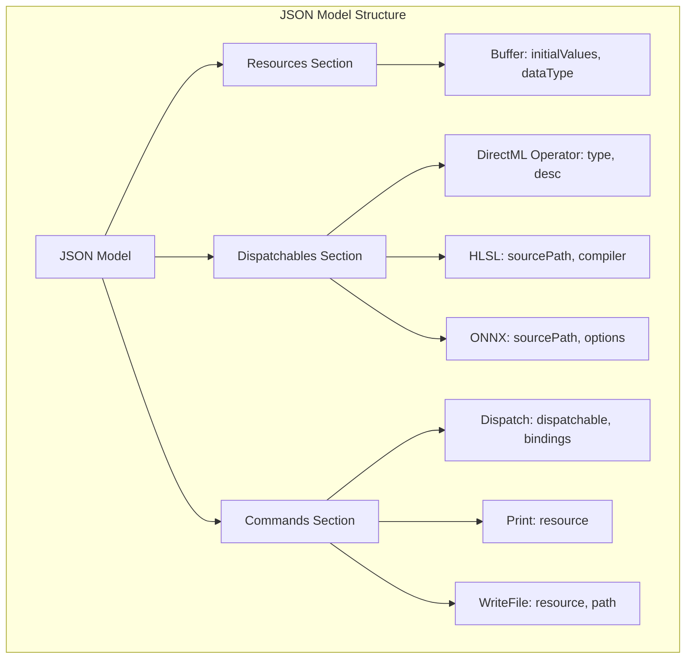
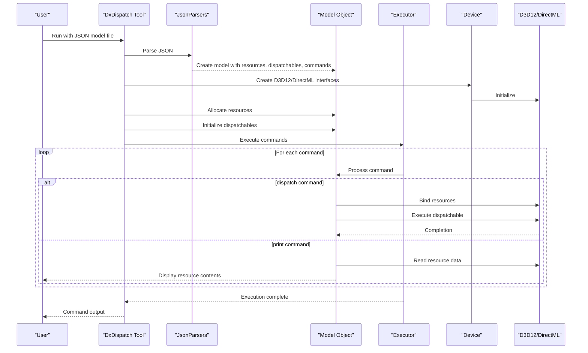
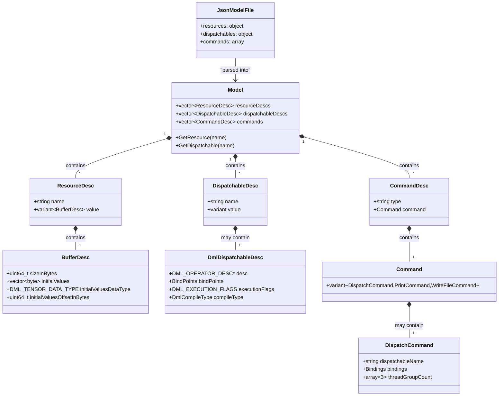
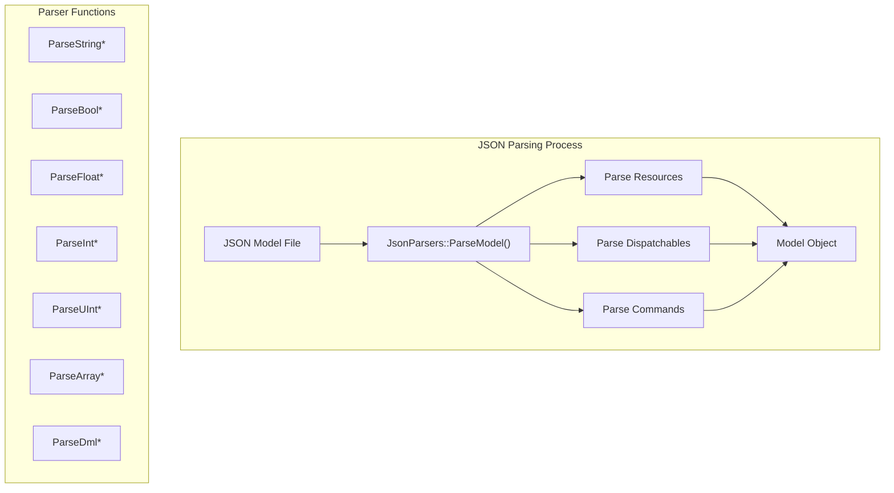

<!-- source: DeepWiki mcp.deepwiki.com · repo microsoft/DirectML · page 3.3 JSON Model Format · fetched 2026-10-26 -->

# JSON Model Format

<details>
<summary>Relevant source files</summary>

The following files were used as context for generating this wiki page:

- [DxDispatch/cmake/fmt.cmake](DxDispatch/cmake/fmt.cmake)
- [DxDispatch/doc/Guide.md](DxDispatch/doc/Guide.md)
- [DxDispatch/models/_schema.json](DxDispatch/models/_schema.json)
- [DxDispatch/models/dml_gemm_graph.json](DxDispatch/models/dml_gemm_graph.json)
- [DxDispatch/src/dxdispatch/DmlDispatchable.h](DxDispatch/src/dxdispatch/DmlDispatchable.h)
- [DxDispatch/src/dxdispatch/Executor.h](DxDispatch/src/dxdispatch/Executor.h)
- [DxDispatch/src/dxdispatch/pch.h](DxDispatch/src/dxdispatch/pch.h)
- [DxDispatch/src/model/JsonParsers.cpp](DxDispatch/src/model/JsonParsers.cpp)
- [DxDispatch/src/model/Model.h](DxDispatch/src/model/Model.h)
- [DxDispatch/src/test/JsonParserTests.cpp](DxDispatch/src/test/JsonParserTests.cpp)

</details>


This document details the JSON Model Format used by the DxDispatch tool in the DirectML repository. The JSON Model Format provides a declarative way to define machine learning workloads without writing C++ boilerplate code. It specifies resources (GPU buffers), dispatchable objects (computation kernels), and commands to execute. For information about the DxDispatch tool itself, see [DxDispatch Tool](#3).

## Overview and Structure

The JSON Model Format allows users to define complete machine learning workloads by specifying three main components:

1. **Resources**: GPU memory buffers initialized with specified values
2. **Dispatchables**: Computational objects (DirectML operators, HLSL compute shaders, ONNX models)
3. **Commands**: Instructions for execution (dispatch, print, write file)



Sources: [DxDispatch/doc/Guide.md:54-226](), [DxDispatch/models/_schema.json:1-30]()

## Basic Example

Here's a simple example of a complete JSON model that adds two buffers using a DirectML operator:

```json
{
    "resources": {
        "A": { "initialValuesDataType": "FLOAT32", "initialValues": [1,2,3] },
        "B": { "initialValuesDataType": "FLOAT32", "initialValues": [5,8,-5] },
        "Out": { "initialValuesDataType": "FLOAT32", "initialValues": { "valueCount": 3, "value": 0 } }
    },
    "dispatchables": {
        "simple_add": {
            "type": "DML_OPERATOR_ELEMENT_WISE_ADD",
            "desc": {
                "ATensor": { "DataType": "FLOAT32", "Sizes": [3] },
                "BTensor": { "DataType": "FLOAT32", "Sizes": [3] },
                "OutputTensor": { "DataType": "FLOAT32", "Sizes": [3] }
            }
        }
    },
    "commands": [
        {
            "type": "dispatch",
            "dispatchable": "simple_add",
            "bindings": { "ATensor": "A", "BTensor": "B", "OutputTensor": "Out" }
        },
        { "type": "print", "resource": "Out" }
    ]
}
```

Sources: [DxDispatch/doc/Guide.md:234-266]()

## Model Parsing and Execution Flow

When the DxDispatch tool processes a JSON model file, it follows this sequence:



Sources: [DxDispatch/doc/Guide.md:210-221](), [DxDispatch/src/dxdispatch/Executor.h:1-29]()

## JSON to Code Mapping

The DxDispatch tool parses the JSON model into C++ objects that represent the model components:



Sources: [DxDispatch/src/model/Model.h:1-186](), [DxDispatch/src/model/JsonParsers.cpp:1-50]()

## Resources Section

The resources section defines all GPU-accessible resources used in the model. Currently, only buffer resources are supported. Each resource declaration includes an initializer that sets the initial contents of the resource.

### Common Buffer Properties

| Property | Type | Required | Description |
|----------|------|----------|-------------|
| `initialValues` | Object or array | Yes | Determines initial contents of the buffer |
| `initialValuesDataType` | String | Yes | Data type associated with the buffer's initial values (e.g., "FLOAT32") |
| `sizeInBytes` | Number | No | Explicit buffer size (calculated if omitted) |
| `initialValuesOffsetInBytes` | Number | No | Offset to start writing initial values (default: 0) |

Sources: [DxDispatch/doc/Guide.md:276-292]()

### Buffer Initialization Methods

The JSON Model Format supports several methods to initialize buffer resources:

#### 1. Constant Initializer

Fills a buffer with a repeated single value:

```json
{
    "initialValuesDataType": "FLOAT32",
    "initialValues": { "valueCount": 4, "value": 0 }
}
```

#### 2. Array Initializer

Initializes a buffer with an array of values:

```json
{
    "initialValuesDataType": "FLOAT16",
    "initialValues": [ 65504, -65504, 4, 3, -4, -6, "nan", "inf", "-inf" ]
}
```

#### 3. Sequence Initializer

Initializes a buffer with a sequence of values:

```json
{
    "initialValuesDataType": "FLOAT32",
    "initialValues": { "valueCount": 4, "valueStart": 1, "valueDelta": 2.5 }
}
```

#### 4. File Data Initializer

Initializes a buffer from external files (.dat, .bin, .npy, image files):

```json
{
    "initialValuesDataType": "FLOAT32",
    "initialValues": { "sourcePath": "inputFile.dat" }
}
```

#### 5. List Initializer

Initializes a buffer with elements of different types (useful for constant buffers):

```json
{
    "initialValuesDataType": "UNKNOWN",
    "initialValues": [
        { "name": "elementCount", "type": "UINT32", "value": 6 },
        { "name": "alpha", "type": "FLOAT32", "value": 6 },
        { "name": "beta", "type": "FLOAT32", "value": 2.3 }
    ],
    "sizeInBytes": 256
}
```

Sources: [DxDispatch/doc/Guide.md:292-389](), [DxDispatch/models/_schema.json:88-175]()

## Dispatchables Section

The dispatchables section defines computational objects that can be executed on a D3D12 command queue. The model supports four types of dispatchables.

### 1. DirectML Operator Dispatchable

DirectML operators define machine learning computations using the DirectML API. The JSON format closely mirrors the DirectML C++ API:

```json
{
    "type": "DML_OPERATOR_CONVOLUTION",
    "desc": {
        "InputTensor": { "DataType": "FLOAT32", "Sizes": [1,1,3,3] },
        "FilterTensor": { "DataType": "FLOAT32", "Sizes": [1,1,2,2] },
        "OutputTensor": { "DataType": "FLOAT32", "Sizes": [1,1,2,2] },
        "Mode": "DML_CONVOLUTION_MODE_CROSS_CORRELATION",
        "Direction": "DML_CONVOLUTION_DIRECTION_FORWARD",
        "DimensionCount": 2,
        "Strides": [1,1],
        "Dilations": [1,1],
        "StartPadding": [0,0],
        "EndPadding": [0,0],
        "OutputPadding": [0,0],
        "GroupCount": 1
    },
    "executionFlags": ["DML_EXECUTION_FLAG_ALLOW_HALF_PRECISION_COMPUTATION"]
}
```

#### Special DML Tensor Description Rules

For DML_TENSOR_DESC structures, many fields have default values:

| Field | Required | Default |
|-------|----------|---------|
| `Type` | No | DML_TENSOR_TYPE_BUFFER |
| `DataType` | Yes | - |
| `Flags` | No | DML_TENSOR_FLAG_NONE |
| `DimensionCount` | No | Inferred from Sizes |
| `Sizes` | Yes | - |
| `Strides` | No | null |
| `TotalTensorSizeInBytes` | No | Calculated from other fields |
| `GuaranteedBaseOffsetAlignment` | No | 0 |

This allows for a simplified tensor description:

```json
{
    "DataType": "FLOAT32",
    "Sizes": [1,1,2,3]
}
```

#### DirectML Compile Type

Users can specify whether a DirectML operator should use the standard compilation path or a graph compilation path:

```json
{
    "type": "DML_OPERATOR_GEMM",
    "dmlCompileType": "DmlCompileGraph",
    "desc": { /* ... */ }
}
```

Sources: [DxDispatch/doc/Guide.md:390-556](), [DxDispatch/models/dml_gemm_graph.json:1-57]()

### 2. HLSL Compute Shader Dispatchable

Allows execution of custom compute shaders using HLSL:

```json
{
    "type": "hlsl",
    "sourcePath": "models/shader.hlsl",
    "compiler": "dxc",
    "compilerArgs": [
        "-T", "cs_6_2",
        "-E", "CSMain",
        "-D", "NUM_THREADS=6",
        "-enable-16bit-types"
    ]
}
```

Sources: [DxDispatch/doc/Guide.md:558-600]()

### 3. ONNX Model Dispatchable

Enables execution of machine learning models in ONNX format:

```json
{
    "type": "onnx",
    "sourcePath": "models/model.onnx",
    "freeDimensionNameOverrides": {
        "batch_size": 1,
        "height": 224
    },
    "graphOptimizationLevel": 99,
    "loggingLevel": 2
}
```

Sources: [DxDispatch/doc/Guide.md:22-26](), [DxDispatch/models/_schema.json:241-280]()

### 4. DirectML Serialized Graph Dispatchable

Allows execution of pre-compiled DirectML graph models:

```json
{
    "type": "dml_serialized_graph",
    "sourcePath": "models/graph.fb",
    "executionFlags": ["DML_EXECUTION_FLAG_ALLOW_HALF_PRECISION_COMPUTATION"]
}
```

Sources: [DxDispatch/src/dxdispatch/DmlDispatchable.h:1-44]()

## Commands Section

The commands section defines the sequence of operations to execute when running the model.

### Dispatch Command

Executes a dispatchable with specific resource bindings:

```json
{
    "type": "dispatch",
    "dispatchable": "simple_add",
    "bindings": { 
        "ATensor": "A", 
        "BTensor": "B", 
        "OutputTensor": "Out" 
    },
    "threadGroupCount": [1, 1, 1]
}
```

#### Resource Binding Specification

The bindings map specifies how to connect resources to the dispatchable. There are several ways to specify bindings:

1. Simple name reference:
```json
"ATensor": "A"
```

2. Detailed binding with options:
```json
"ATensor": {
    "name": "A",
    "elementCount": 10,
    "elementSizeInBytes": 4,
    "elementOffset": 0,
    "format": "R32_FLOAT"
}
```

3. Array of bindings:
```json
"Inputs": ["A", "B", "C"]
```

Sources: [DxDispatch/doc/Guide.md:257-263](), [DxDispatch/models/_schema.json:349-394]()

### Print Command

Displays the contents of a resource:

```json
{
    "type": "print",
    "resource": "Out"
}
```

Sources: [DxDispatch/doc/Guide.md:264-265](), [DxDispatch/models/_schema.json:396-408]()

### Write File Command

Writes the contents of a resource to a file:

```json
{
    "type": "write_file",
    "resource": "Out",
    "targetPath": "output.npy",
    "dimensions": [1, 3, 224, 224]
}
```

Sources: [DxDispatch/src/model/Model.h:143-148]()

## JSON Parsing Implementation

The DxDispatch tool uses RapidJSON to parse the JSON model files. The `JsonParsers` namespace provides specialized parsers for each data type and structure:



The parsing system includes specialized functions for different data types (FLOAT16, FLOAT32, INT32, etc.) and structures (arrays, tensor descriptions, operator descriptions).

Sources: [DxDispatch/src/model/JsonParsers.cpp:1-840]()

## Best Practices

1. **Resource Naming**: Use descriptive names for resources that reflect their purpose (e.g., "input", "weights", "output").

2. **Buffer Sizing**: Set explicit `sizeInBytes` when you need alignment requirements (e.g., 256-byte alignment for constant buffers).

3. **Tensor Descriptions**: Use simplified tensor descriptions when possible, letting the system infer default values.

4. **Bindings**: Use simple string references for bindings when no special options are needed. Use detailed binding objects only when necessary.

5. **Error Handling**: The JSON parser provides detailed error messages. When troubleshooting, check for required fields and proper data types.

Sources: [DxDispatch/doc/Guide.md:54-65]()

## Schema Definition

The DxDispatch tool includes a formal JSON schema definition in `_schema.json` that defines the structure and validation rules for model files. You can reference this schema in your models for editor validation support:

```json
{
    "$schema": "./_schema.json",
    "resources": { /* ... */ },
    "dispatchables": { /* ... */ },
    "commands": [ /* ... */ ]
}
```

Sources: [DxDispatch/models/_schema.json:1-436]()

---

