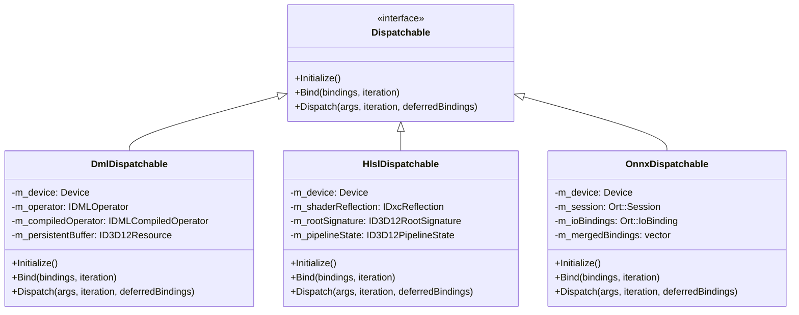
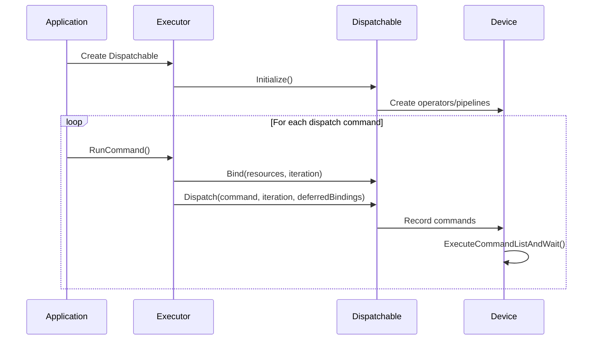
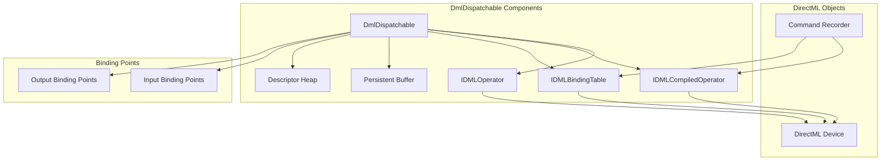
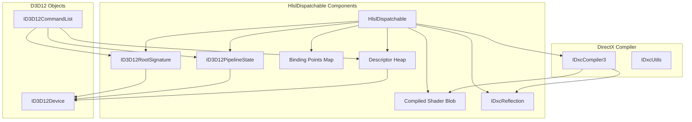
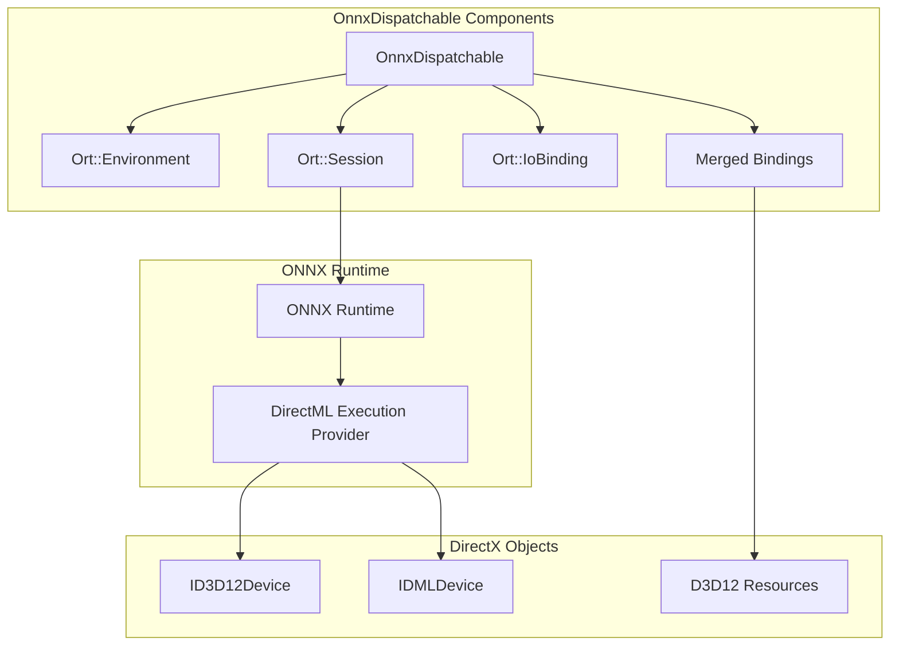
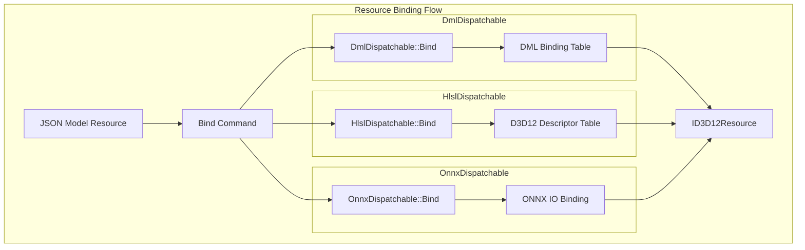

<!-- source: DeepWiki mcp.deepwiki.com · repo microsoft/DirectML · page 3.4 Dispatchable Types · fetched 2026-10-26 -->

# Dispatchable Types

Relevant source files

The following files were used as context for generating this wiki page:

- [DxDispatch/cmake/pix.cmake](DxDispatch/cmake/pix.cmake)
- [DxDispatch/src/dxdispatch/Device.h](DxDispatch/src/dxdispatch/Device.h)
- [DxDispatch/src/dxdispatch/Dispatchable.h](DxDispatch/src/dxdispatch/Dispatchable.h)
- [DxDispatch/src/dxdispatch/DmlDispatchable.cpp](DxDispatch/src/dxdispatch/DmlDispatchable.cpp)
- [DxDispatch/src/dxdispatch/HlslDispatchable.cpp](DxDispatch/src/dxdispatch/HlslDispatchable.cpp)
- [DxDispatch/src/dxdispatch/OnnxDispatchable.cpp](DxDispatch/src/dxdispatch/OnnxDispatchable.cpp)
- [DxDispatch/src/dxdispatch/OnnxDispatchable.h](DxDispatch/src/dxdispatch/OnnxDispatchable.h)
- [DxDispatch/src/dxdispatch/dxDispatchWrapper.cpp](DxDispatch/src/dxdispatch/dxDispatchWrapper.cpp)

## Purpose and Scope

This document describes the different types of dispatchables supported by the DxDispatch tool in DirectML. Dispatchables are executable compute workloads that can be bound to resources and dispatched for execution on the GPU. The DxDispatch tool supports three types of dispatchables: DirectML operators (DmlDispatchable), HLSL compute shaders (HlslDispatchable), and ONNX models (OnnxDispatchable).

For information about the DxDispatch tool in general, see [DxDispatch Tool](#3) and for information about the JSON model format used to define dispatchables, see [JSON Model Format](#3.3).

## Common Dispatchable Interface

All dispatchable types in DxDispatch implement a common interface defined in the `Dispatchable` abstract class.

Sources: [DxDispatch/src/dxdispatch/Dispatchable.h:1-39]()

The Dispatchable interface defines three key methods:

1. `Initialize()`: Sets up the dispatchable's resources and prepares it for execution
2. `Bind(bindings, iteration)`: Binds input and output resources to the dispatchable
3. `Dispatch(args, iteration, deferredBindings)`: Executes the dispatchable with the bound resources

The binding mechanism uses the following key structures:

| Structure | Purpose |
|-----------|---------|
| `BindingSource` | Represents a resource to be bound, containing the resource pointer, size information, and format details |
| `Bindings` | Maps bind point names to their corresponding binding sources |
| `DeferredBinding` | Used for output resources that may be generated during execution |

Sources: [DxDispatch/src/dxdispatch/Dispatchable.h:4-38]()

## Dispatchable Lifecycle

Sources: [DxDispatch/src/dxdispatch/dxDispatchWrapper.cpp:271-335]()

## DmlDispatchable

The DmlDispatchable wraps DirectML operators to execute them on the GPU. It supports both individual DirectML operators and serialized DirectML computation graphs.

### DmlDispatchable Structure

Sources: [DxDispatch/src/dxdispatch/DmlDispatchable.cpp:12-638]()

The DmlDispatchable supports two models:

1. **Regular DmlDispatchable**: Uses a single DirectML operator
   - Creates and compiles a single DirectML operator
   - Sets up binding tables for input and output resources

2. **Serialized Graph DmlDispatchable**: Uses a serialized DirectML computation graph
   - Loads a serialized graph from a file
   - Deserializes the graph structure
   - Loads constant nodes from external files
   - Compiles the entire graph as a single unit

### DmlDispatchable Initialization

During initialization, the DmlDispatchable either:
- Compiles the operator (DmlCompileOp mode)
- Creates and compiles a graph containing the operator (DmlCompileGraph mode)
- Loads and compiles a serialized graph (for serialized graph dispatchables)

After compilation, an operator initializer is created to allocate any persistent resources needed by the compiled operator.

Sources: [DxDispatch/src/dxdispatch/DmlDispatchable.cpp:193-560]()

### DmlDispatchable Binding and Dispatch

When binding resources, the DmlDispatchable:
1. Creates a binding table for the compiled operator
2. Fills descriptor tables with input and output bindings
3. Binds temporary and persistent resources

During dispatch, it simply records the dispatch command and executes the command list.

Sources: [DxDispatch/src/dxdispatch/DmlDispatchable.cpp:562-637]()

## HlslDispatchable

The HlslDispatchable executes HLSL compute shaders. It handles shader compilation, resource binding, and dispatch on the GPU.

### HlslDispatchable Structure

Sources: [DxDispatch/src/dxdispatch/HlslDispatchable.cpp:11-483]()

### HlslDispatchable Initialization

During initialization, the HlslDispatchable:
1. Compiles the HLSL shader source using the DirectX Compiler (DXC)
2. Performs shader reflection to identify resource bindings
3. Creates a root signature based on the shader's resource requirements
4. Creates a pipeline state object for the compiled shader

The shader reflection identifies binding points for different resource types:
- Shader Resource Views (SRVs) for read-only resources
- Unordered Access Views (UAVs) for read-write resources
- Constant Buffer Views (CBVs) for constant data

Sources: [DxDispatch/src/dxdispatch/HlslDispatchable.cpp:183-334]()

### HlslDispatchable Resource Binding Types

HlslDispatchable supports three buffer view types:

| Buffer View Type | Description | HLSL Examples |
|------------------|-------------|--------------|
| Typed | Buffer with specific data type format | Buffer<float4>, RWBuffer<uint> |
| Structured | Buffer containing structures of fixed size | StructuredBuffer<T>, RWStructuredBuffer<T> |
| Raw | Byte-addressable buffer | ByteAddressBuffer, RWByteAddressBuffer |

Sources: [DxDispatch/src/dxdispatch/HlslDispatchable.cpp:16-44]()

### HlslDispatchable Binding and Dispatch

When binding resources, the HlslDispatchable:
1. Creates appropriate view descriptors (SRV, UAV, CBV) for each bound resource
2. Updates the descriptor heap with these descriptors
3. Sets the root signature, pipeline state, and descriptor heaps

During dispatch, it records thread group counts and executes the compute shader.

Sources: [DxDispatch/src/dxdispatch/HlslDispatchable.cpp:336-483]()

## OnnxDispatchable

The OnnxDispatchable executes ONNX models using the ONNX Runtime with DirectML as the execution provider.

### OnnxDispatchable Structure

Sources: [DxDispatch/src/dxdispatch/OnnxDispatchable.cpp:1-619](), [DxDispatch/src/dxdispatch/OnnxDispatchable.h:1-46]()

### OnnxDispatchable Initialization

During initialization, the OnnxDispatchable:
1. Sets up the ONNX Runtime environment
2. Configures session options (optimization level, free dimension overrides)
3. Registers the DirectML execution provider
4. Creates an ONNX Runtime session from the model file

The OnnxDispatchable supports various configuration options:
- Logging level
- Graph optimization level
- Free dimension name and denotation overrides
- Session option configuration entries

Sources: [DxDispatch/src/dxdispatch/OnnxDispatchable.cpp:199-269]()

### OnnxDispatchable Tensor Binding

The OnnxDispatchable has a complex binding mechanism that:
1. Identifies input and output tensors from the ONNX model
2. Determines tensor shapes (static or dynamic)
3. Handles explicit bindings from JSON or command line
4. Creates implicit bindings for tensors without explicit bindings

For each tensor, it determines:
- Whether to use GPU (DirectX) or CPU memory
- How to handle dynamic shapes
- How to convert between DirectX resources and ONNX tensors

Sources: [DxDispatch/src/dxdispatch/OnnxDispatchable.cpp:272-517]()

### OnnxDispatchable Dispatch

During dispatch, the OnnxDispatchable:
1. Records PIX events for timing if enabled
2. Runs the ONNX model with the bound inputs
3. Synchronizes outputs after execution
4. Resolves any deferred bindings for the outputs

Sources: [DxDispatch/src/dxdispatch/OnnxDispatchable.cpp:519-619]()

## Comparison of Dispatchable Types

The following table compares the key characteristics of the three dispatchable types:

| Feature | DmlDispatchable | HlslDispatchable | OnnxDispatchable |
|---------|----------------|------------------|------------------|
| **Workload Type** | DirectML operators or graphs | HLSL compute shaders | ONNX ML models |
| **Programming Model** | ML operators (convolution, GEMM, etc.) | General compute programming | ML model graphs |
| **Binding Model** | DML binding tables | D3D12 descriptor tables | ONNX tensor bindings |
| **Resource Types** | Buffers | Typed/structured/raw buffers | Tensor resources |
| **Dynamic Shapes** | Limited support | Not supported | Fully supported |
| **Compilation** | Operator or graph compilation | HLSL to DXIL compilation | Model graph optimization |
| **Use Cases** | Individual ML operations | Custom compute algorithms | Complete ML models |

## Resource Binding Flow

Sources: [DxDispatch/src/dxdispatch/DmlDispatchable.cpp:562-628](), [DxDispatch/src/dxdispatch/HlslDispatchable.cpp:336-477](), [DxDispatch/src/dxdispatch/OnnxDispatchable.cpp:272-517]()

## Choosing the Right Dispatchable Type

- **DmlDispatchable**: Use when you need to execute specific DirectML operators or pre-compiled DirectML graphs. Best for ML workloads that can be expressed as DirectML operators.

- **HlslDispatchable**: Use when you need custom compute algorithms expressed in HLSL. Provides the most flexibility for general-purpose GPU computation.

- **OnnxDispatchable**: Use when you have complete ML models in the ONNX format. Best for running inference on pre-trained models.

All dispatchable types share a common execution model in DxDispatch, allowing them to be used interchangeably in workflows that involve multiple computation steps.

---

