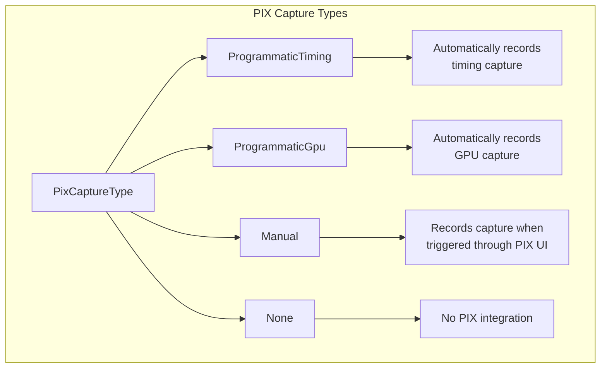
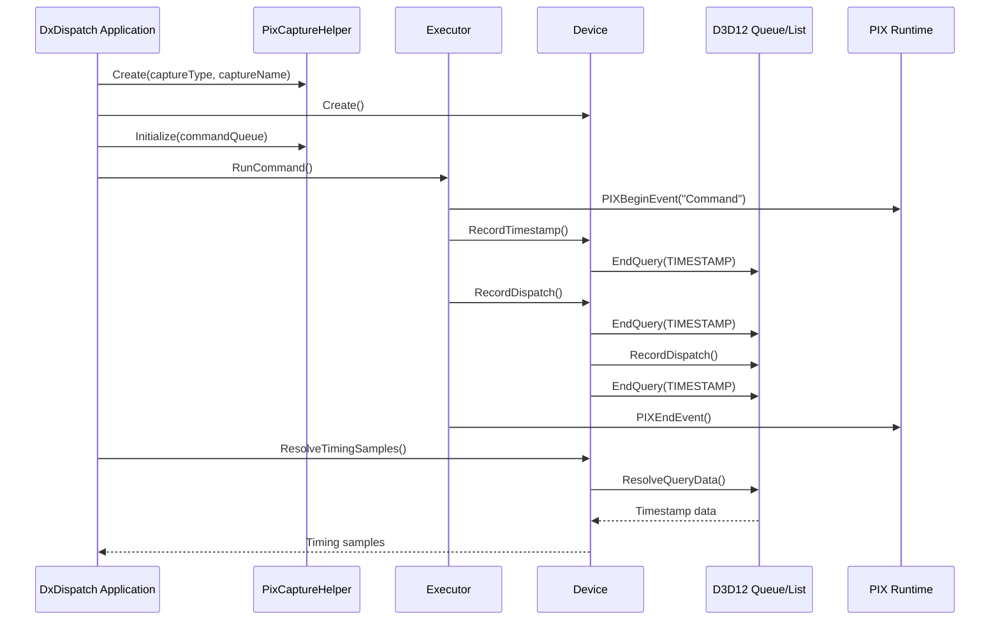
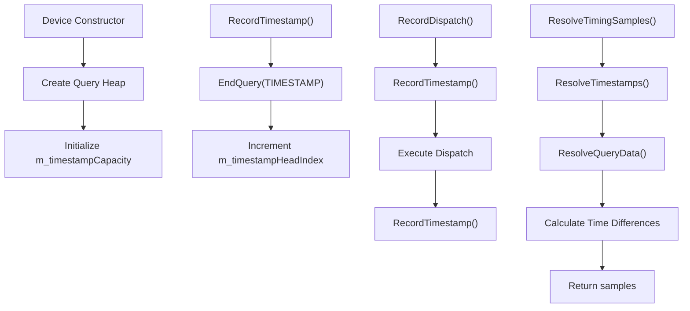
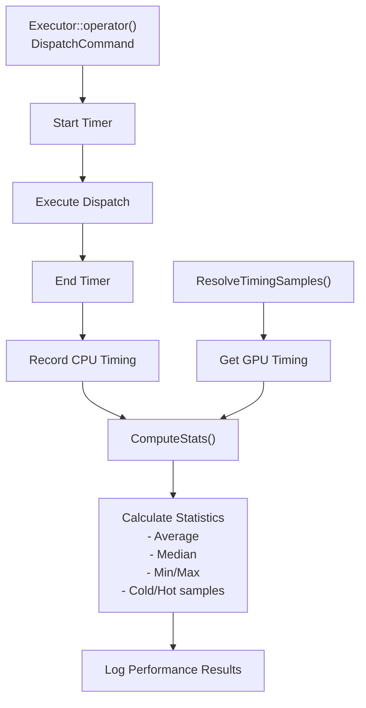
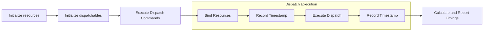
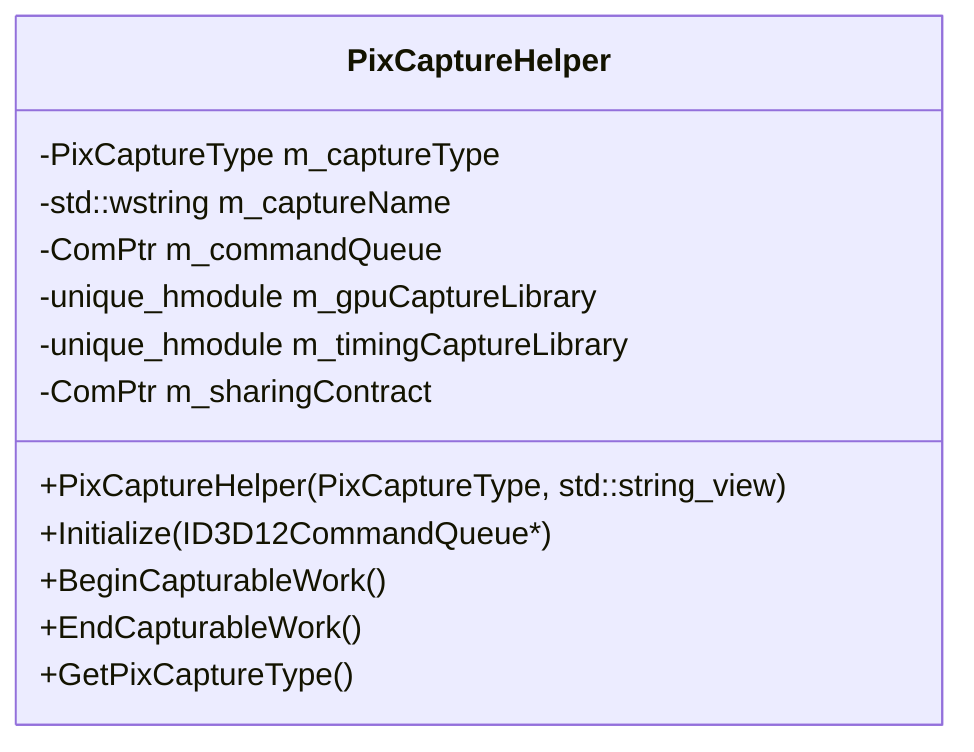
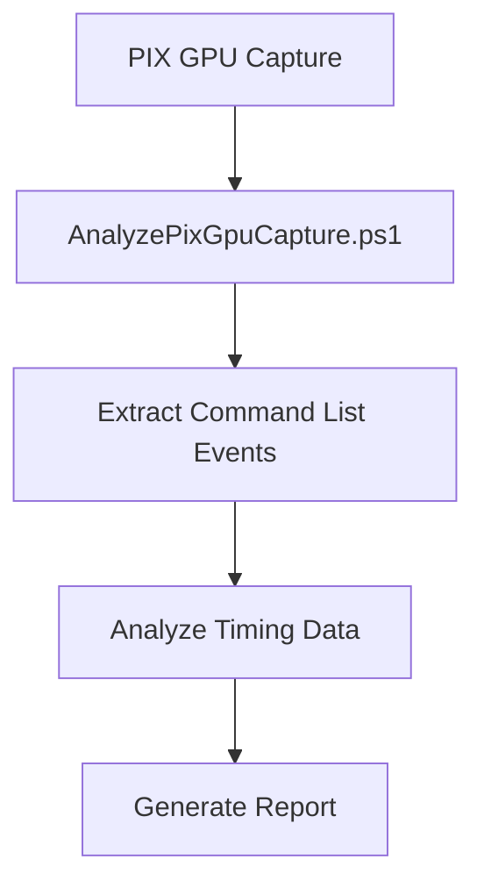

<!-- source: DeepWiki mcp.deepwiki.com · repo microsoft/DirectML · page 3.5 Performance Analysis with PIX · fetched 2026-10-26 -->

# Performance Analysis with PIX

Relevant source files

The following files were used as context for generating this wiki page:

- [DxDispatch/CMakeLists.txt](DxDispatch/CMakeLists.txt)
- [DxDispatch/cgmanifest.json](DxDispatch/cgmanifest.json)
- [DxDispatch/src/dxdispatch/Device.cpp](DxDispatch/src/dxdispatch/Device.cpp)
- [DxDispatch/src/dxdispatch/Executor.cpp](DxDispatch/src/dxdispatch/Executor.cpp)
- [DxDispatch/src/dxdispatch/PixCaptureHelper.cpp](DxDispatch/src/dxdispatch/PixCaptureHelper.cpp)
- [DxDispatch/src/dxdispatch/PixCaptureHelper.h](DxDispatch/src/dxdispatch/PixCaptureHelper.h)

## Introduction

This document describes how DxDispatch integrates with PIX (Performance Inspector for DirectX) to enable detailed performance analysis of DirectML operations. PIX is a debugging and performance tuning tool provided by Microsoft that allows developers to capture and analyze GPU workloads. The DxDispatch tool provides built-in support for PIX captures, GPU/CPU timing measurements, and performance statistics reporting.

Sources: [DxDispatch/src/dxdispatch/PixCaptureHelper.h:1-41](), [DxDispatch/cgmanifest.json:87-95]()

## PIX Capture Types

DxDispatch supports several methods for capturing performance data with PIX:

- **ProgrammaticTiming**: Automatically records timing data when `BeginCapturableWork` and `EndCapturableWork` are called, including CPU and GPU timing information.
- **ProgrammaticGpu**: Automatically records a full GPU capture between `BeginCapturableWork` and `EndCapturableWork`.
- **Manual**: Supports interactive captures triggered from the PIX UI. DxDispatch marks capturable regions that PIX can record when requested.
- **None**: Disables PIX integration entirely.

Sources: [DxDispatch/src/dxdispatch/PixCaptureHelper.h:3-17](), [DxDispatch/src/dxdispatch/PixCaptureHelper.cpp:29-47]()

## PIX Integration Architecture

DxDispatch uses PIX in several key places:
1. **Initialization**: The `PixCaptureHelper` is created before device initialization to ensure proper PIX integration.
2. **Command Execution**: PIX events mark the beginning and end of command execution.
3. **Dispatch Operations**: GPU timestamps are recorded before and after dispatches to measure execution time.
4. **Performance Reporting**: Timing data is analyzed and reported after execution.

Sources: [DxDispatch/src/dxdispatch/Device.cpp:291-291](), [DxDispatch/src/dxdispatch/Executor.cpp:111-111](), [DxDispatch/src/dxdispatch/Executor.cpp:189-211]()

## Command Line PIX Integration

DxDispatch supports PIX capture control via command line arguments:

| Argument | Description |
|----------|-------------|
| `--pix-capture-type` | Sets the PIX capture type (`timing`, `gpu`, `manual`, or `none`) |
| `--pix-capture-name` | Specifies the filename for PIX captures |

These settings determine how DxDispatch interacts with PIX during execution.

## GPU Timing Mechanism

DxDispatch implements GPU timing using D3D12 timestamp queries:

1. **Initialization**: A timestamp query heap is created during device initialization.
2. **Timestamp Recording**: `RecordTimestamp()` is called before and after each dispatch operation.
3. **Resolution**: After execution, `ResolveTimingSamples()` calculates the time differences between timestamp pairs.
4. **Conversion**: Timestamps are converted to milliseconds using the GPU's timestamp frequency.

The number of timestamp pairs that can be captured is controlled by the `maxGpuTimeMeasurements` parameter.

Sources: [DxDispatch/src/dxdispatch/Device.cpp:278-289](), [DxDispatch/src/dxdispatch/Device.cpp:622-635](), [DxDispatch/src/dxdispatch/Device.cpp:664-685]()

## CPU Timing and Performance Statistics

In addition to GPU timing, DxDispatch measures CPU execution time and calculates comprehensive performance statistics:

DxDispatch collects and analyzes the following performance metrics:

1. **CPU Execution Time**: Measures the time spent in the dispatch operation on the CPU.
2. **GPU Execution Time**: Measures the time spent executing the operation on the GPU.
3. **Cold/Hot Samples**: Differentiates between initial "cold" executions (which may be slower due to caches) and subsequent "hot" executions.
4. **Statistical Analysis**: Calculates average, median, minimum, and maximum execution times.

The `Timings` class provides methods to compute these statistics from the raw timing samples.

Sources: [DxDispatch/src/dxdispatch/Executor.cpp:23-104](), [DxDispatch/src/dxdispatch/Executor.cpp:279-445]()

## PIX Event Markup

DxDispatch uses PIX events to mark important operations in the command stream:

PIX events are used to mark:
1. **Resource Initialization**: Marked with `PIXScopedEvent` to track initialization time.
2. **Dispatchable Initialization**: Marked with `PIXBeginEvent` and `PIXEndEvent` pairs.
3. **Dispatch Operations**: Each dispatch is surrounded by timestamp queries for precise timing.
4. **Resource Operations**: Operations like printing or writing resources are marked.

These events create a hierarchical view of the execution in PIX, making it easier to identify performance bottlenecks.

Sources: [DxDispatch/src/dxdispatch/Executor.cpp:111-111](), [DxDispatch/src/dxdispatch/Executor.cpp:189-211](), [DxDispatch/src/dxdispatch/Executor.cpp:297-350](), [DxDispatch/src/dxdispatch/Device.cpp:469-486]()

## PIX Capture Helper Implementation

The `PixCaptureHelper` class manages the PIX capture lifecycle:

This helper handles platform-specific differences in PIX integration:
1. **Windows Desktop**: Loads the appropriate PIX libraries and uses the PIX API or sharing contract.
2. **Xbox**: Uses Xbox-specific PIX APIs for capturing.
3. **Cross-Platform**: Provides a consistent interface for both platforms.

The `BeginCapturableWork` and `EndCapturableWork` methods control when captures start and stop.

Sources: [DxDispatch/src/dxdispatch/PixCaptureHelper.h:19-41](), [DxDispatch/src/dxdispatch/PixCaptureHelper.cpp:62-199]()

## Using PIXAnalyzeGpuCapture.ps1

DxDispatch includes a PowerShell script (`AnalyzePixGpuCapture.ps1`) for post-processing PIX GPU captures:

This script can be used to:
1. Extract detailed timing information from PIX GPU captures
2. Analyze performance patterns across multiple dispatch operations
3. Generate reports highlighting potential optimization opportunities

The script is installed alongside DxDispatch and can be found in the `bin/tools` directory.

Sources: [DxDispatch/CMakeLists.txt:232-232]()

## Enabling PIX in Your Project

To enable PIX integration in your DirectML application:

1. **Include the PIX SDK**: Add the WinPixEventRuntime NuGet package to your project.
2. **Create a PixCaptureHelper**: Initialize with the desired capture type.
3. **Instrument with PIX Events**: Use PIX events to mark regions of interest.
4. **Measure Performance**: Implement timestamp queries for precise timing.
5. **Analyze Results**: Use PIX to visualize and analyze the performance data.

The DxDispatch tool demonstrates these patterns and can serve as a reference implementation.

Sources: [DxDispatch/CMakeLists.txt:44-46](), [DxDispatch/cgmanifest.json:87-95]()

## Troubleshooting PIX Integration

Common issues when using PIX with DxDispatch:

| Issue | Solution |
|-------|----------|
| PIX captures fail | Ensure PIX is installed and up-to-date (version 2303.02 or later) |
| Timing captures fail with access denied | Run the application with elevated privileges |
| Cannot find PIX libraries | Verify WinPixEventRuntime is properly installed |
| Missing GPU timing data | Ensure the GPU supports timestamp queries |
| Inconsistent timing results | Use more iterations and examine hot samples for stable measurements |

Sources: [DxDispatch/src/dxdispatch/PixCaptureHelper.cpp:84-101](), [DxDispatch/src/dxdispatch/Device.cpp:352-358]()

---

