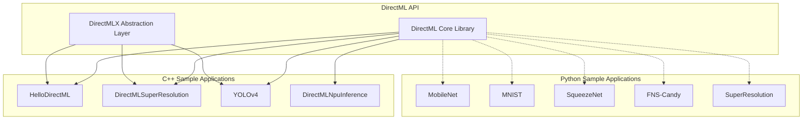
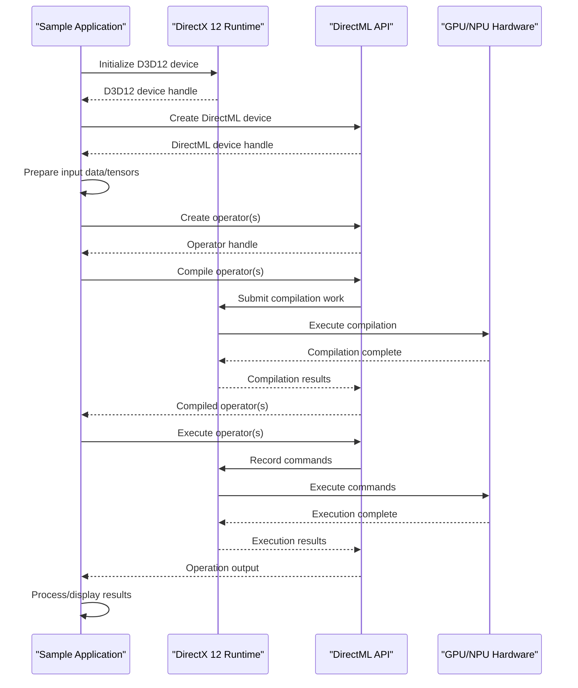
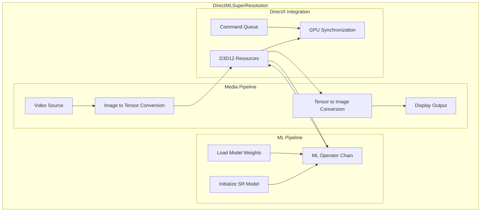
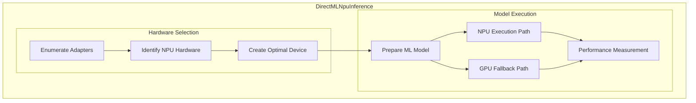
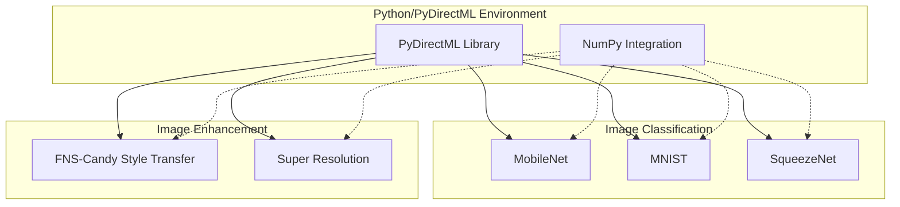

<!-- source: DeepWiki mcp.deepwiki.com · repo microsoft/DirectML · page 4 Sample Applications · fetched 2026-10-26 -->

# Sample Applications

Relevant source files

The following files were used as context for generating this wiki page:

- [README.md](README.md)
- [Samples/DirectMLSuperResolution/DirectMLSuperResolution.vcxproj](Samples/DirectMLSuperResolution/DirectMLSuperResolution.vcxproj)
- [Samples/DirectMLSuperResolution/DirectMLXSuperResolution.vcxproj](Samples/DirectMLSuperResolution/DirectMLXSuperResolution.vcxproj)
- [Samples/DirectMLSuperResolution/Readme.md](Samples/DirectMLSuperResolution/Readme.md)
- [Samples/HelloDirectML/HelloDirectML.vcxproj](Samples/HelloDirectML/HelloDirectML.vcxproj)
- [Samples/HelloDirectML/HelloDirectMLX.vcxproj](Samples/HelloDirectML/HelloDirectMLX.vcxproj)
- [Samples/HelloDirectML/packages.config](Samples/HelloDirectML/packages.config)
- [Samples/HelloDirectML/readme.md](Samples/HelloDirectML/readme.md)
- [Samples/yolov4/Readme.md](Samples/yolov4/Readme.md)
- [Samples/yolov4/yolov4.vcxproj](Samples/yolov4/yolov4.vcxproj)
- [TensorFlow/README.md](TensorFlow/README.md)

## Purpose and Scope

This page provides an overview of the sample applications included in the DirectML repository. These samples demonstrate practical implementations of DirectML for various machine learning tasks, illustrating how to use the DirectML API to leverage GPU acceleration in real-world scenarios. For information about the core DirectML libraries and their APIs, see [Core Components](#2).

## Sample Applications Overview

The DirectML repository includes several sample applications that demonstrate different aspects of using DirectML for hardware-accelerated machine learning. These samples range from minimal "hello world" examples to complex real-time object detection implementations.

*DirectML Sample Applications Ecosystem*

Sources: [README.md:62-77]()

### C++ Samples

The repository includes the following C++ sample applications:

| Sample | Description | Key Features |
|--------|-------------|--------------|
| HelloDirectML | A minimal "hello world" application | Single operator execution, basic DirectML initialization |
| DirectMLSuperResolution | Real-time video upscaling from 540p to 1080p | Media integration, tensor conversion, ML model implementation |
| YOLOv4 | Real-time object detection | Complex ML model, real-time processing, video stream analysis |
| DirectMLNpuInference | Neural Processing Unit (NPU) acceleration | Hardware-specific optimizations, NPU utilization |

Sources: [README.md:62-70](), [Samples/HelloDirectML/readme.md](), [Samples/DirectMLSuperResolution/Readme.md](), [Samples/yolov4/Readme.md]()

### Python Samples

Python samples utilize PyDirectML, an open-source Python projection library for DirectML:

| Sample | Description | Model Type |
|--------|-------------|------------|
| MobileNet | Image classification into 1000 classes | Efficient mobile-oriented CNN |
| MNIST | Handwritten digit recognition | Basic CNN classifier |
| SqueezeNet | ImageNet-trained image classification | Efficient CNN architecture |
| FNS-Candy | Artistic style transfer | Neural style transfer |
| SuperResolution | Image upscaling and enhancement | Super-resolution CNN |

Sources: [README.md:70-77]()

## Sample Architecture and Flow

Each sample follows a similar pattern in terms of initialization and execution flow, with variations based on their specific requirements.

*Typical Sample Application Execution Flow*

Sources: [Samples/HelloDirectML/readme.md](), [README.md:3-7]()

## HelloDirectML Sample

HelloDirectML is a minimal but complete sample that demonstrates the basics of initializing DirectML and executing a simple operator.

### Purpose and Functionality

This sample executes the DirectML "identity" operator (`f(x) = x`) on a 1x2x3x4 tensor, which effectively copies the tensor contents. It demonstrates the fundamental steps required to use DirectML, including:

1. Initializing DirectX 12 and DirectML
2. Creating and compiling an operator
3. Executing the operator on the GPU
4. Retrieving and verifying the results

The sample is provided in two variants:
- Using the low-level DirectML API directly
- Using the DirectMLX C++ abstraction layer

```mermaid
graph TD
    subgraph "HelloDirectML"
        subgraph "Initialization"
            InitD3D["Initialize D3D12"]
            InitDML["Initialize DirectML"]
        end
        
        subgraph "Operator Setup"
            CreateOp["Create Identity Operator"]
            CompileOp["Compile Operator"]
        end
        
        subgraph "Execution"
            PrepareResources["Prepare Resources"]
            RecordCommands["Record Commands"]
            ExecuteCommands["Execute Commands"]
            ReadResults["Read Results"]
        end
    end
    
    InitD3D --> InitDML
    InitDML --> CreateOp
    CreateOp --> CompileOp
    CompileOp --> PrepareResources
    PrepareResources --> RecordCommands
    RecordCommands --> ExecuteCommands
    ExecuteCommands --> ReadResults
```

*HelloDirectML Sample Structure*

Sources: [Samples/HelloDirectML/readme.md](), [Samples/HelloDirectML/HelloDirectML.vcxproj](), [Samples/HelloDirectML/HelloDirectMLX.vcxproj]()

### Key Implementation Details

The sample showcases:
- DirectML initialization with the D3D12 debug layer (in Debug builds)
- Creation of tensor descriptors
- Resource binding
- Command list execution
- GPU-CPU synchronization

When using the DirectMLX abstraction layer, the code is more concise as it handles much of the low-level details.

Sources: [Samples/HelloDirectML/readme.md](), [Samples/HelloDirectML/packages.config]()

## DirectMLSuperResolution Sample

DirectMLSuperResolution demonstrates a practical application of DirectML by implementing a real-time super-resolution model.

### Purpose and Functionality

This sample shows how to upscale video from 540p to 1080p in real time using a machine learning model. Key aspects include:

1. Converting between image and tensor formats
2. Initializing and executing ML operators
3. Interleaving graphics and ML work
4. Real-time processing of media content

*DirectMLSuperResolution Architecture*

Sources: [Samples/DirectMLSuperResolution/Readme.md](), [Samples/DirectMLSuperResolution/DirectMLSuperResolution.vcxproj](), [Samples/DirectMLSuperResolution/DirectMLXSuperResolution.vcxproj]()

### Implementation Details

The sample includes:
- Media playback integration using Media Foundation
- HLSL shaders for texture-tensor conversion
- A neural network model with convolutional layers
- DirectX integration for rendering and display
- Performance optimizations for real-time processing

Like HelloDirectML, DirectMLSuperResolution is available in two variants: one using the DirectML API directly and another using the DirectMLX abstraction layer.

Sources: [Samples/DirectMLSuperResolution/Readme.md](), [Samples/DirectMLSuperResolution/DirectMLSuperResolution.vcxproj]()

## YOLOv4 Sample

The YOLOv4 sample demonstrates a complex, production-quality implementation of a state-of-the-art object detection model using DirectML.

### Purpose and Functionality

YOLOv4 (You Only Look Once, version 4) is an object detection model capable of recognizing up to 80 different classes of objects in images or video streams. The sample features:

1. A complete end-to-end implementation using DirectML
2. Real-time processing of video streams
3. A complex neural network architecture
4. Pre-trained model weights integration

```mermaid
graph TD
    subgraph "YOLOv4 Sample"
        subgraph "Input Processing"
            VideoInput["Video Input"]
            Preprocessing["Image Preprocessing"]
        end
        
        subgraph "Model Architecture"
            Backbone["CSPDarknet53 Backbone"]
            Neck["SPP + PAN Neck"]
            Head["YOLOv4 Detection Head"]
        end
        
        subgraph "Post-processing"
            BoxGeneration["Bounding Box Generation"]
            NMS["Non-Maximum Suppression"]
            Visualization["Result Visualization"]
        end
    end
    
    VideoInput --> Preprocessing
    Preprocessing --> Backbone
    Backbone --> Neck
    Neck --> Head
    Head --> BoxGeneration
    BoxGeneration --> NMS
    NMS --> Visualization
```

*YOLOv4 Model Architecture and Processing Flow*

Sources: [Samples/yolov4/Readme.md](), [Samples/yolov4/yolov4.vcxproj]()

### Implementation Details

Key aspects of the implementation include:
- Model weights downloaded from the official YOLOv4 repository (245MB)
- DirectMLX used for GPU-accelerated inference
- Integration with DirectX for efficient GPU resource management
- Real-time rendering of detection results
- Support for various video sources

The sample demonstrates how DirectML can be used to implement complex deep learning models with high performance on DirectX-capable GPUs.

Sources: [Samples/yolov4/Readme.md](), [Samples/yolov4/yolov4.vcxproj]()

## DirectMLNpuInference Sample

The DirectMLNpuInference sample showcases the ability of DirectML to utilize specialized Neural Processing Unit (NPU) hardware for ML inference.

### Purpose and Functionality

This sample demonstrates:
1. How to detect and utilize NPU hardware with DirectML
2. Hardware-specific optimizations for ML inference
3. Performance comparison between NPU and GPU execution

*DirectMLNpuInference Sample Structure*

Sources: [README.md:66-67]()

### Key Aspects

The sample illustrates:
- How to query device capabilities to identify NPU hardware
- DirectML's hardware abstraction that enables consistent APIs across different hardware
- Optimal resource layout for NPU execution
- Performance considerations when targeting NPU hardware

This sample is particularly relevant for Windows devices with dedicated neural processing hardware, such as laptops with Intel Iris Xe MAX graphics or Qualcomm Snapdragon processors.

Sources: [README.md:33-40](), [README.md:66-67]()

## Python Samples

The DirectML repository also includes Python samples that demonstrate how to use DirectML through PyDirectML, a Python projection library.

### Sample Overview

The Python samples cover various ML models:

*Python Sample Applications Structure*

Sources: [README.md:70-77]()

### Using PyDirectML

The Python samples require building and installing PyDirectML from the `Python/src` directory. Key features of the Python samples include:

1. Integration with NumPy for data handling
2. Adaptation of ONNX models to use DirectML
3. Implementation of various model architectures
4. Performance-optimized tensor operations

These samples serve as a reference for data scientists and researchers who want to use DirectML acceleration within Python-based workflows.

Sources: [README.md:70-77]()

## Related Framework Integration

Beyond the standalone samples, DirectML also integrates with popular ML frameworks. For more information about these integrations, see:

- [ONNX Runtime Integration](#5.2) for details on using DirectML as an execution provider for ONNX models
- [PyTorch Integration](#5.1) for information about using DirectML acceleration with PyTorch
- [Framework Integrations](#5) for an overview of all supported ML frameworks

Sources: [README.md:95-127]()

---

