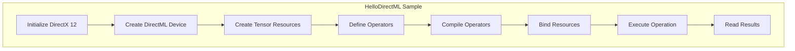
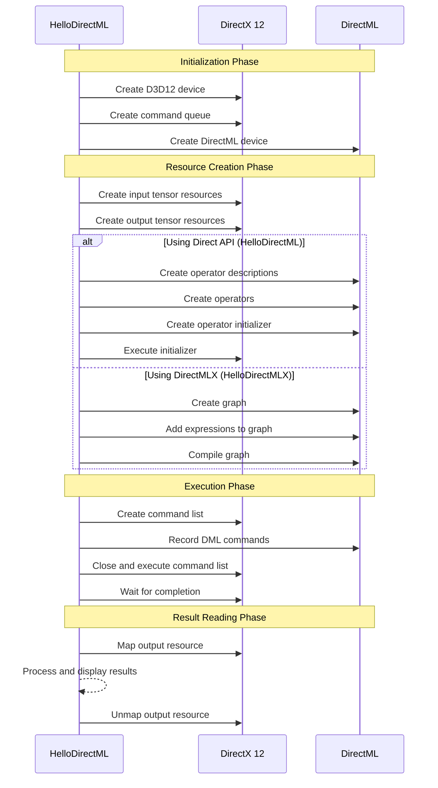

<!-- source: DeepWiki mcp.deepwiki.com · repo microsoft/DirectML · page 4.1 HelloDirectML · fetched 2026-10-26 -->

# HelloDirectML

<details>
<summary>Relevant source files</summary>

The following files were used as context for generating this wiki page:

- [Samples/HelloDirectML/HelloDirectML.vcxproj](Samples/HelloDirectML/HelloDirectML.vcxproj)
- [Samples/HelloDirectML/HelloDirectMLX.vcxproj](Samples/HelloDirectML/HelloDirectMLX.vcxproj)
- [Samples/HelloDirectML/packages.config](Samples/HelloDirectML/packages.config)

</details>


## Purpose and Introduction

HelloDirectML is an introductory sample application that demonstrates the basic functionality of DirectML. It serves as an entry point for developers looking to understand how to integrate and use DirectML in their applications. This sample shows the fundamental steps required to set up a DirectML environment, create tensors, define and execute basic machine learning operations.

The sample is provided in two variants:
1. **HelloDirectML** - Uses the DirectML API directly
2. **HelloDirectMLX** - Uses the DirectMLX abstraction layer for simplified graph construction

For more advanced DirectML usage examples, see [DirectMLSuperResolution](#4.2) or [DirectML_ESRGAN](#4.4).

## Overview

HelloDirectML demonstrates the following core concepts:

- Initializing DirectX 12 and DirectML devices
- Creating and managing tensor resources
- Defining and executing simple ML operations
- Reading results back from GPU 
- Comparing the basic and abstraction layer approaches

The sample performs a simple addition operation of two tensors and prints the results, providing a clear demonstration of the end-to-end workflow required to execute machine learning operations using DirectML.



Sources: [Samples/HelloDirectML/HelloDirectML.vcxproj](), [Samples/HelloDirectML/HelloDirectMLX.vcxproj]()

## Sample Variants and Structure

HelloDirectML provides two approaches to utilizing DirectML, each with its own project file:

### Direct DirectML API Approach (HelloDirectML)

The HelloDirectML variant demonstrates direct usage of the DirectML API, requiring more boilerplate code but showing the complete low-level workflow:

```mermaid
classDiagram
    class "main.cpp" {
        +InitializeDirectX12()
        +CreateDirectMLDevice()
        +CreateTensorResources()
        +CreateDirectMLOperator()
        +ExecuteOperator()
        +ReadBackResults()
    }
    
    class "ID3D12Device" {
        +CreateCommandQueue()
        +CreateCommittedResource()
    }
    
    class "IDMLDevice" {
        +CreateOperator()
        +CreateOperatorInitializer()
        +CreateBindingTable()
    }
    
    class "IDMLOperator" {
        +GetBindingProperties()
    }
    
    class "ID3D12Resource" {
        +Map()
        +Unmap()
    }
    
    "main.cpp" --> "ID3D12Device" : uses
    "main.cpp" --> "IDMLDevice" : uses
    "main.cpp" --> "IDMLOperator" : uses
    "main.cpp" --> "ID3D12Resource" : uses
```

Sources: [Samples/HelloDirectML/HelloDirectML.vcxproj]()

### DirectMLX Abstraction Approach (HelloDirectMLX)

The HelloDirectMLX variant demonstrates the use of the DirectMLX abstraction layer, which simplifies tensor and operator management:

```mermaid
classDiagram
    class "main.cpp" {
        +InitializeDirectX12()
        +CreateDirectMLDevice()
        +BuildComputationalGraph()
        +ExecuteGraph()
        +ReadBackResults()
    }
    
    class "ID3D12Device" {
        +CreateCommandQueue()
        +CreateCommittedResource()
    }
    
    class "IDMLDevice" {
        +Compile()
        +CreateBindingTable()
    }
    
    class "dml::Graph" {
        +SetTensorPolicy()
        +Compile()
    }
    
    class "dml::Expression" {
        +GetOutputDesc()
    }
    
    class "dml::Operator" {
        <<interface>>
    }
    
    "main.cpp" --> "ID3D12Device" : uses
    "main.cpp" --> "IDMLDevice" : uses
    "main.cpp" --> "dml::Graph" : uses
    "dml::Graph" --> "dml::Expression" : contains
    "dml::Expression" --|> "dml::Operator" : implements
```

Sources: [Samples/HelloDirectML/HelloDirectMLX.vcxproj]()

## Project Configuration and Dependencies

Both sample variants use the same set of dependencies but with different configuration:

| Dependency | Version | Purpose |
|------------|---------|---------|
| Microsoft.AI.DirectML | 1.15.2 | Core DirectML runtime |
| Microsoft.Windows.ImplementationLibrary | 1.0.220914.1 | Helper utilities for Windows apps |
| DirectX 12 | - | Low-level graphics API |

The key difference in configuration is the `USE_DMLX` preprocessor definition:

* **HelloDirectML**: Defines `USE_DMLX=0` to use the DirectML API directly
* **HelloDirectMLX**: Defines `USE_DMLX` to use the DirectMLX abstraction layer

Sources: [Samples/HelloDirectML/HelloDirectML.vcxproj:232-232](), [Samples/HelloDirectML/HelloDirectMLX.vcxproj:232-232](), [Samples/HelloDirectML/packages.config]()

## Execution Flow

The execution flow for both variants follows a similar pattern, with slight differences based on the API approach:



Sources: [Samples/HelloDirectML/HelloDirectML.vcxproj](), [Samples/HelloDirectML/HelloDirectMLX.vcxproj]()

## Platform Support

The sample is designed to run on a variety of platforms, with build configurations for:

- x64 (Windows desktop)
- x86 (Windows desktop)
- ARM and ARM64 (Windows on ARM)
- Xbox Scarlett

This demonstrates DirectML's cross-platform capabilities and its support for different hardware types, including GPUs and potentially NPUs where available.

Sources: [Samples/HelloDirectML/HelloDirectML.vcxproj:5-44](), [Samples/HelloDirectML/HelloDirectMLX.vcxproj:5-44]()

## Building and Running the Samples

Both samples are Visual Studio projects that can be built using Visual Studio 2022 or later. They require:

1. Windows 10 or later with the Windows SDK (10.0)
2. Visual Studio 2022 or later with C++ development tools 
3. A DirectX 12 compatible GPU

To build and run:

1. Open the solution file in Visual Studio
2. Restore NuGet packages to download the DirectML runtime
3. Select the desired platform (e.g., x64)
4. Build and run the sample

The samples will:
1. Initialize the DirectML environment
2. Create input tensors with sample data
3. Define and execute an addition operation
4. Print the results to the console

Sources: [Samples/HelloDirectML/HelloDirectML.vcxproj:436-448](), [Samples/HelloDirectML/HelloDirectMLX.vcxproj:436-448](), [Samples/HelloDirectML/packages.config]()

## Key Differences Between DirectML and DirectMLX Approaches

The most significant difference between the two samples is in the complexity of creating and managing operators:

| Aspect | HelloDirectML (Direct API) | HelloDirectMLX (Abstraction Layer) |
|--------|----------------------------|-----------------------------------|
| Tensor Management | Manual creation of tensor descriptors | Simplified tensor creation functions |
| Operator Definition | Explicit creation of operator descriptions and operators | Higher-level expressions and graphs |
| Binding | Manual binding of resources to operators | Automated by the abstraction layer |
| Code Complexity | More verbose, shows all steps | More concise, hides some complexity |
| Control | Fine-grained control over all aspects | Less control but easier development |

The DirectMLX approach is generally recommended for most applications as it reduces boilerplate code while maintaining the performance benefits of DirectML.

Sources: [Samples/HelloDirectML/HelloDirectML.vcxproj:232-232](), [Samples/HelloDirectML/HelloDirectMLX.vcxproj:232-232]()

## Summary

The HelloDirectML sample provides a foundational understanding of how to use DirectML for machine learning applications. Through its two variants, it demonstrates both the direct API approach and the higher-level abstraction provided by DirectMLX. This sample serves as a starting point for developers interested in leveraging GPU acceleration for machine learning workloads through DirectML.

For more advanced examples building on these concepts, see the [DirectMLSuperResolution](#4.2) sample which applies these techniques to image processing.

---

