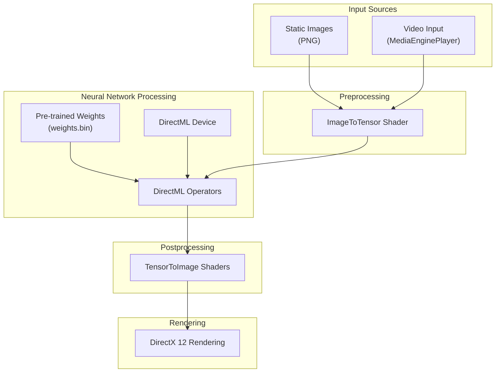
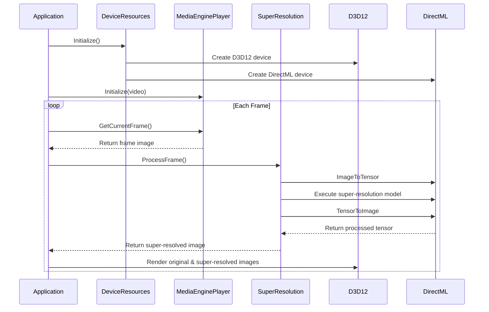
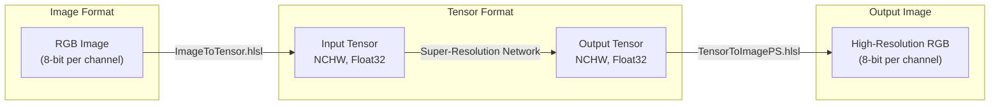
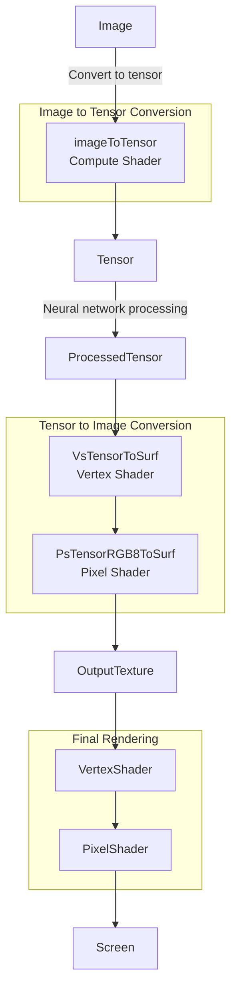
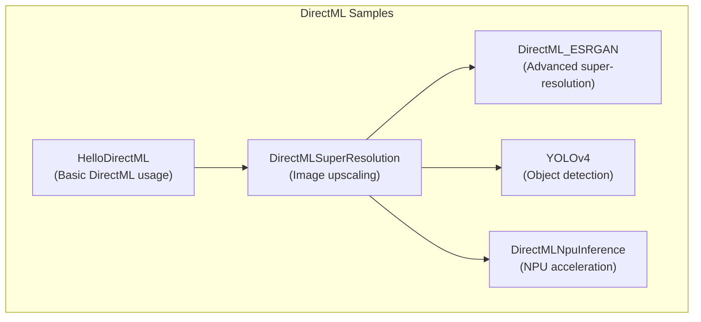

<!-- source: DeepWiki mcp.deepwiki.com · repo microsoft/DirectML · page 4.2 DirectMLSuperResolution · fetched 2026-10-26 -->

# DirectMLSuperResolution

Relevant source files

The following files were used as context for generating this wiki page:

- [Samples/DirectMLSuperResolution/DirectMLSuperResolution.vcxproj](Samples/DirectMLSuperResolution/DirectMLSuperResolution.vcxproj)
- [Samples/DirectMLSuperResolution/DirectMLXSuperResolution.vcxproj](Samples/DirectMLSuperResolution/DirectMLXSuperResolution.vcxproj)
- [Samples/yolov4/yolov4.vcxproj](Samples/yolov4/yolov4.vcxproj)

## Purpose and Scope

This document describes the DirectMLSuperResolution sample application, which demonstrates how to implement image super-resolution using DirectML. The sample shows how to upscale low-resolution images or video to higher resolutions using a neural network model. This documentation covers the application architecture, implementation details, and key components used to achieve hardware-accelerated super-resolution.

For information about other sample applications in the DirectML repository, see [Sample Applications](#4).

Sources: [Samples/DirectMLSuperResolution/DirectMLXSuperResolution.vcxproj](), [Samples/DirectMLSuperResolution/DirectMLSuperResolution.vcxproj]()

## Overview

DirectMLSuperResolution is a Windows desktop application that showcases real-time machine learning-based image upscaling. The sample demonstrates:

1. Converting images and video frames to ML tensor format
2. Processing these tensors through a convolutional neural network using DirectML
3. Converting the resulting high-resolution tensor back to a displayable image
4. Rendering the result to the screen with side-by-side comparison

The sample comes in two variants:
- **DirectMLSuperResolution** - Uses the DirectML API directly
- **DirectMLXSuperResolution** - Uses the DirectMLX abstraction layer to simplify neural network construction

Sources: [Samples/DirectMLSuperResolution/DirectMLSuperResolution.h](), [Samples/DirectMLSuperResolution/DirectMLSuperResolution.cpp]()

## Architecture

### System Components

The application follows a standard ML-based image processing pipeline, with DirectML providing hardware acceleration for the neural network operations.

Sources: [Samples/DirectMLSuperResolution/DirectMLSuperResolution.cpp](), [Samples/DirectMLSuperResolution/Main.cpp]()

### Application Flow

The sample manages the complete pipeline, from frame acquisition through tensor processing to final rendering.

Sources: [Samples/DirectMLSuperResolution/DeviceResources.cpp](), [Samples/DirectMLSuperResolution/MediaEnginePlayer.cpp]()

## Implementation Details

### Data Format Conversions

The sample performs several data format conversions to interface between standard image formats and ML tensor formats:

1. **Image to Tensor** - Converts RGB images to NCHW tensor format using a compute shader
2. **Tensor Processing** - Applies the super-resolution model to the tensor data
3. **Tensor to Image** - Converts the output tensor back to RGB format for display

Sources: [Samples/DirectMLSuperResolution/Assets/ImageToTensor.hlsl](), [Samples/DirectMLSuperResolution/Assets/TensorToImagePS.hlsl]()

### Super-Resolution Model

The application uses a convolutional neural network for super-resolution with the following characteristics:

1. Accepts 3-channel (RGB) input tensor
2. Processes through multiple convolutional layers with activation functions
3. Produces an upscaled output tensor (typically 2x resolution in each dimension)

The DirectML resource builder constructs the neural network graph using either:

1. **DirectML API directly** - Manually creating operators, binding resources, and executing commands
2. **DirectMLX layer** - Using the higher-level C++ abstraction to simplify graph construction

Sources: [Samples/DirectMLSuperResolution/DirectMLResourceBuilder.cpp](), [Samples/DirectMLSuperResolution/DirectMLXResourceBuilder.cpp]()

## Resource Management

### DirectML Resources

Key resources managed by the application:

| Resource Type | Purpose | Creation |
|---------------|---------|----------|
| DirectML Device | Provides DirectML functionality | Created from D3D12 device |
| DirectML Operator | Implements neural network layers | Created using descriptor objects |
| Operator Descriptors | Defines parameters for operators | Created during model initialization |
| Input/Output Tensors | Holds the data for processing | GPU resources bound to operators |
| Weights/Biases | Neural network parameters | Loaded from weights.bin file |

Sources: [Samples/DirectMLSuperResolution/LoadWeights.cpp](), [Samples/DirectMLSuperResolution/LoadWeights.h]()

### DirectX 12 Resources

The application manages these DirectX 12 resources:

| Resource Type | Purpose |
|---------------|---------|
| Command Queue | Submits workload to GPU |
| Command List | Records rendering/computation commands |
| Descriptor Heaps | Manage resource views |
| Buffers | Store tensor data |
| Textures | Store images for rendering |
| Pipeline State | Define shader stages for rendering |

Sources: [Samples/DirectMLSuperResolution/DeviceResources.cpp](), [Samples/DirectMLSuperResolution/DeviceResources.h]()

## Shader Pipeline

The sample uses several shaders to manage the conversion between image and tensor formats:

Sources: [Samples/DirectMLSuperResolution/Assets/ImageToTensor.hlsl](), [Samples/DirectMLSuperResolution/Assets/TensorToImageVS.hlsl](), [Samples/DirectMLSuperResolution/Assets/TensorToImagePS.hlsl]()

## Feature Highlights

### Media Support

The sample demonstrates super-resolution with both static images and video:

1. **Static Image Processing**: Loads PNG images and applies super-resolution
2. **Video Processing**: Uses MediaEnginePlayer to play MP4 videos and process each frame in real-time

The application allows toggling between original and super-resolved views for visual comparison.

Sources: [Samples/DirectMLSuperResolution/MediaEnginePlayer.cpp](), [Samples/DirectMLSuperResolution/MediaEnginePlayer.h]()

### Float16 Support

For better performance, the sample includes an option to use half-precision (FP16) computation:

1. **Float16Compressor**: Utility for converting between FP32 and FP16 formats
2. **DirectML Support**: Leverages DirectML's native FP16 capabilities where hardware supports it

Sources: [Samples/DirectMLSuperResolution/Float16Compressor.h]()

## Relationship with Other Samples

DirectMLSuperResolution demonstrates core concepts used in other samples:

The DirectMLSuperResolution sample shares common patterns with other samples but focuses specifically on image super-resolution as its primary use case.

Sources: [Samples/DirectMLSuperResolution/DirectMLSuperResolution.vcxproj](), [Samples/yolov4/yolov4.vcxproj]()

## Summary

DirectMLSuperResolution demonstrates how to integrate DirectML into a Windows application to perform hardware-accelerated machine learning inference for image super-resolution. It showcases the complete pipeline from data preparation through model execution to result visualization, illustrating both direct DirectML API usage and the higher-level DirectMLX abstraction layer.

---

