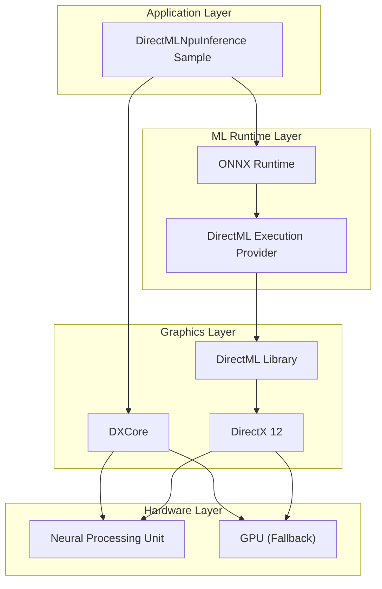
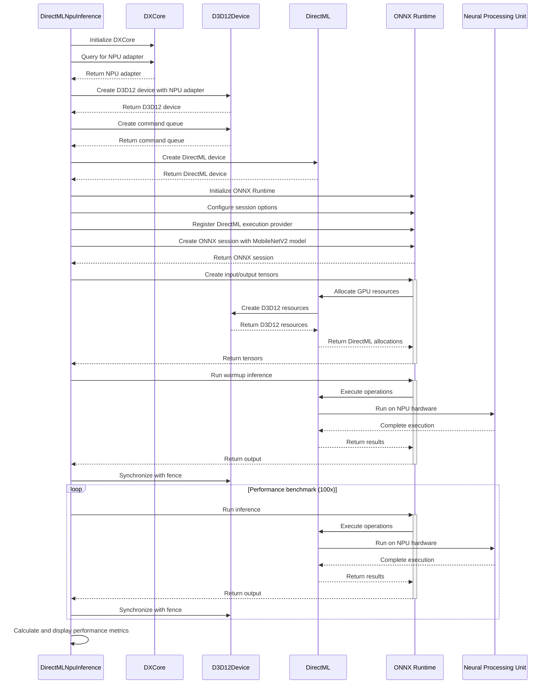
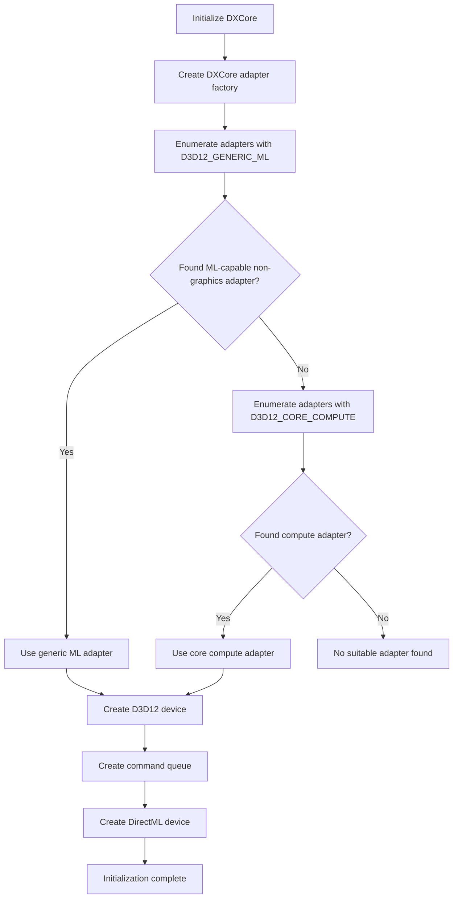
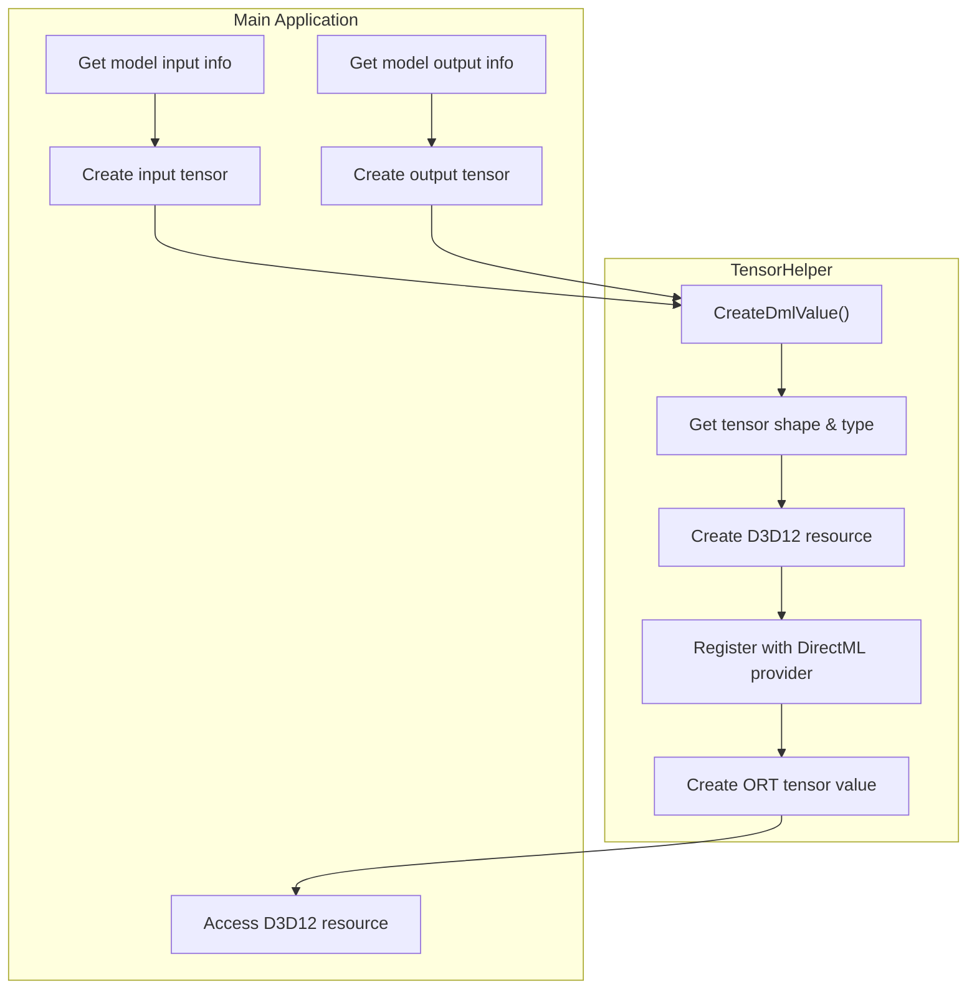

<!-- source: DeepWiki mcp.deepwiki.com · repo microsoft/DirectML · page 4.3 DirectMLNpuInference · fetched 2026-10-26 -->

# DirectMLNpuInference

Relevant source files

The following files were used as context for generating this wiki page:

- [Samples/DirectMLNpuInference/DirectMLNpuInference.sln](Samples/DirectMLNpuInference/DirectMLNpuInference.sln)
- [Samples/DirectMLNpuInference/DirectMLNpuInference.vcxproj](Samples/DirectMLNpuInference/DirectMLNpuInference.vcxproj)
- [Samples/DirectMLNpuInference/TensorHelper.cpp](Samples/DirectMLNpuInference/TensorHelper.cpp)
- [Samples/DirectMLNpuInference/TensorHelper.h](Samples/DirectMLNpuInference/TensorHelper.h)
- [Samples/DirectMLNpuInference/d3dx12.h](Samples/DirectMLNpuInference/d3dx12.h)
- [Samples/DirectMLNpuInference/main.cpp](Samples/DirectMLNpuInference/main.cpp)
- [Samples/DirectMLNpuInference/mobilenetv2-7-fp16.onnx](Samples/DirectMLNpuInference/mobilenetv2-7-fp16.onnx)
- [Samples/DirectMLNpuInference/packages.config](Samples/DirectMLNpuInference/packages.config)
- [Samples/DirectMLNpuInference/pch.cpp](Samples/DirectMLNpuInference/pch.cpp)
- [Samples/DirectMLNpuInference/pch.h](Samples/DirectMLNpuInference/pch.h)
- [Samples/DirectMLNpuInference/readme.md](Samples/DirectMLNpuInference/readme.md)

## Overview

The DirectMLNpuInference sample demonstrates how to run machine learning inference on Neural Processing Units (NPUs) using DirectML and ONNX Runtime. This sample provides a practical example of discovering NPU hardware, initializing DirectML, loading ONNX models, and executing them efficiently on dedicated ML acceleration hardware. The sample showcases the MobileNetV2 image classification model running on NPU hardware via the DirectML execution provider for ONNX Runtime.

For information about other DirectML samples, see [Sample Applications](#4).

Sources: [Samples/DirectMLNpuInference/readme.md:12-18]()

## System Architecture

The DirectMLNpuInference sample integrates several key components to enable ML inference on NPU hardware:

The architecture consists of several layers:

1. **Application Layer**: The DirectMLNpuInference sample application
2. **ML Runtime Layer**: ONNX Runtime with the DirectML execution provider
3. **Graphics Layer**: DirectML running on DirectX 12, with DXCore for device enumeration
4. **Hardware Layer**: The NPU or GPU hardware that executes the ML operations

This layered approach allows the application to leverage hardware acceleration for ML workloads through standard APIs, abstracting the complexity of directly programming the NPU hardware.

Sources: [Samples/DirectMLNpuInference/main.cpp:54-155](), [Samples/DirectMLNpuInference/main.cpp:157-247]()

## Execution Flow

The following diagram illustrates the sequence of steps performed by the sample:

This sequence diagram shows how the application initializes the necessary components and executes inference on the NPU, highlighting the interaction between the different layers of the system.

Sources: [Samples/DirectMLNpuInference/main.cpp:157-242]()

## Key Components

### NPU Detection and Initialization

The sample uses DXCore to enumerate available hardware adapters and find a suitable NPU device. It specifically looks for adapters that:
1. Support DirectX 12
2. Have the `DXCORE_ADAPTER_ATTRIBUTE_D3D12_GENERIC_ML` attribute (indicating ML capabilities)
3. Are not graphics adapters (focusing on dedicated NPUs)

If no adapter with Generic ML capability is found, it falls back to looking for Core Compute adapters.

The function `InitializeDirectML` in `main.cpp` handles this process, creating the DirectX 12 device and command queue that will be used for DirectML operations.

Sources: [Samples/DirectMLNpuInference/main.cpp:54-155]()

### DirectML and ONNX Runtime Integration

The sample integrates DirectML with ONNX Runtime through the DirectML execution provider. This allows ONNX models to run on NPU hardware with minimal code changes.

Key integration points:

1. **DirectML Device Creation**: Uses `DMLCreateDevice1` to create a DirectML device from the D3D12 device
2. **ONNX Runtime Configuration**: Sets up the ONNX Runtime environment with appropriate options
3. **Execution Provider Registration**: Registers the DirectML execution provider with ONNX Runtime
4. **Tensor Management**: Uses DirectML-specific APIs to create and manage GPU memory for tensors

The sample loads a pre-trained MobileNetV2 model (`mobilenetv2-7-fp16.onnx`) in FP16 precision format, which is well-suited for NPU execution.

Sources: [Samples/DirectMLNpuInference/main.cpp:171-185](), [Samples/DirectMLNpuInference/main.cpp:189-206]()

### Tensor Creation and Management

The DirectMLNpuInference sample uses a helper utility (`TensorHelper`) to create DirectML-compatible tensors for input and output. This involves:

1. Creating D3D12 resources on the GPU
2. Registering these resources with the DirectML provider
3. Creating ONNX Runtime tensors that reference these GPU resources

The `TensorHelper.cpp` implementation handles the complexity of creating GPU resources with the correct size and properties for DirectML execution.

Sources: [Samples/DirectMLNpuInference/TensorHelper.cpp:50-140](), [Samples/DirectMLNpuInference/main.cpp:190-206]()

### Inference Execution and Synchronization

The sample executes inference and properly synchronizes between CPU and GPU using the following pattern:

1. **Warmup Run**: Performs an initial inference to ensure everything is loaded and compiled
2. **GPU Synchronization**: Uses D3D12 fences to ensure GPU work is complete
3. **Benchmark Loop**: Runs multiple inferences to measure average performance
4. **Performance Timing**: Records CPU timing for the overall execution

The sample ensures proper synchronization between CPU and GPU operations using D3D12 fences, which is critical for accurate performance measurement and preventing race conditions.

Sources: [Samples/DirectMLNpuInference/main.cpp:208-242]()

## Dependencies and Requirements

The DirectMLNpuInference sample has the following key dependencies:

| Dependency | Version | Purpose |
|------------|---------|---------|
| DirectML | 1.15.2 | Machine learning acceleration |
| Windows Machine Learning | 1.19.2 | ONNX Runtime integration |
| Windows Implementation Library | 1.0.220914.1 | Helper utilities |
| ONNX Runtime | - | ONNX model execution |
| DirectX 12 | - | Graphics API for DirectML |

The sample requires:
1. A system with NPU hardware or DirectML-compatible GPU
2. Windows 10 or later with DirectX 12 support
3. Visual Studio 2022 or later for building

Sources: [Samples/DirectMLNpuInference/packages.config:1-6]()

## Performance Considerations

The sample demonstrates several performance optimization techniques for NPU inference:

1. **FP16 Precision**: Uses a model with FP16 precision which is optimal for many NPUs
2. **Warmup Execution**: Performs an initial inference to allow JIT compilation and caching
3. **Synchronization**: Proper synchronization between CPU and GPU work
4. **Performance Measurement**: Times multiple consecutive inferences to get accurate metrics

When running the sample, the output displays the average inference time per execution, which can be used to compare performance across different hardware configurations.

Sources: [Samples/DirectMLNpuInference/main.cpp:220-242]()

## Conclusions

The DirectMLNpuInference sample provides a straightforward example of how to:

1. Detect and initialize NPU hardware
2. Configure DirectML and ONNX Runtime for NPU execution
3. Load and run an ONNX model on the NPU
4. Measure inference performance

This sample serves as a starting point for developers looking to leverage NPU hardware for accelerating machine learning workloads in their applications.

Sources: [Samples/DirectMLNpuInference/readme.md:12-18](), [Samples/DirectMLNpuInference/main.cpp:1-247]()

---

