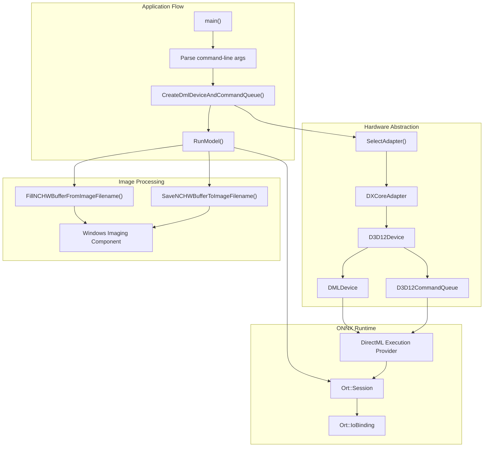
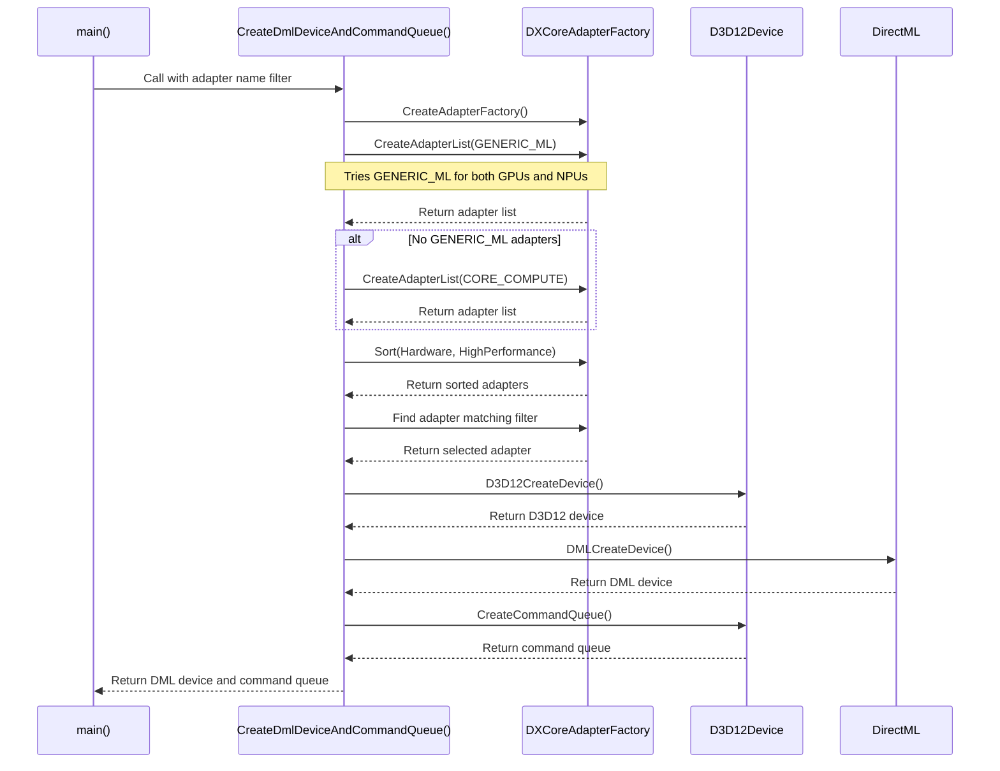
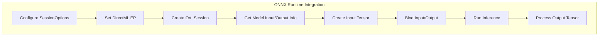
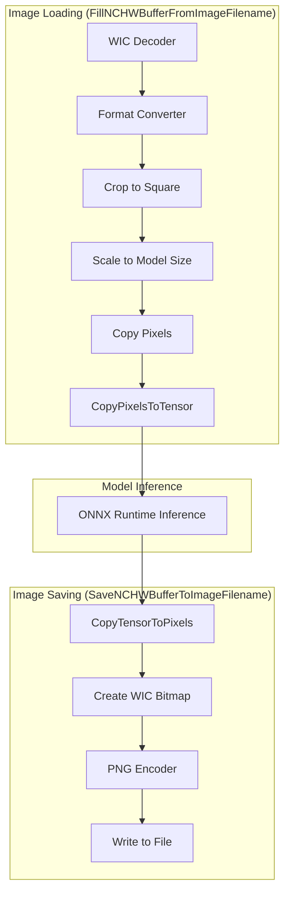
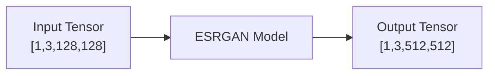
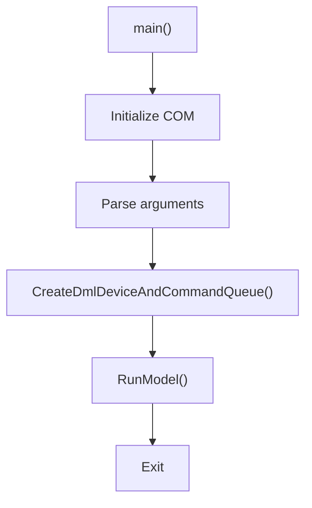

<!-- source: DeepWiki mcp.deepwiki.com · repo microsoft/DirectML · page 4.4 DirectML_ESRGAN · fetched 2026-10-26 -->

# DirectML_ESRGAN

<details>
<summary>Relevant source files</summary>

The following files were used as context for generating this wiki page:

- [Samples/DirectML_ESRGAN/.gitignore](Samples/DirectML_ESRGAN/.gitignore)
- [Samples/DirectML_ESRGAN/.readme/input.png](Samples/DirectML_ESRGAN/.readme/input.png)
- [Samples/DirectML_ESRGAN/.readme/output.png](Samples/DirectML_ESRGAN/.readme/output.png)
- [Samples/DirectML_ESRGAN/CMakePresets.json](Samples/DirectML_ESRGAN/CMakePresets.json)
- [Samples/DirectML_ESRGAN/README.md](Samples/DirectML_ESRGAN/README.md)
- [Samples/DirectML_ESRGAN/ThirdPartyNotices.txt](Samples/DirectML_ESRGAN/ThirdPartyNotices.txt)
- [Samples/DirectML_ESRGAN/half.hpp](Samples/DirectML_ESRGAN/half.hpp)
- [Samples/DirectML_ESRGAN/helpers.cpp](Samples/DirectML_ESRGAN/helpers.cpp)
- [Samples/DirectML_ESRGAN/helpers.h](Samples/DirectML_ESRGAN/helpers.h)
- [Samples/DirectML_ESRGAN/main.cpp](Samples/DirectML_ESRGAN/main.cpp)

</details>


This document covers the DirectML_ESRGAN sample application, which demonstrates how to use DirectML and ONNX Runtime to run the ESRGAN (Enhanced Super-Resolution Generative Adversarial Network) model for image upscaling. The sample illustrates how to leverage DirectML hardware acceleration across GPUs and NPUs through the ONNX Runtime DirectML execution provider. For information about other sample applications, see [Sample Applications](#4).

## Overview

The DirectML_ESRGAN sample demonstrates how to:

1. Build a C++ application using ONNX Runtime with the DirectML execution provider
2. Enumerate and select specific DirectX adapters (GPU or NPU)
3. Load and convert images to NCHW tensors using Windows Imaging Component (WIC)
4. Run inference of an ONNX model that upscales a 128x128 input image to 512x512



Sources:
- [Samples/DirectML_ESRGAN/main.cpp]()
- [Samples/DirectML_ESRGAN/helpers.cpp]()
- [Samples/DirectML_ESRGAN/README.md]()

## Hardware Selection

The sample demonstrates how to enumerate and select hardware adapters that support DirectML operations, including both GPUs and NPUs. The selection process prioritizes hardware and high-performance adapters, with support for filtering by adapter name.



Sources:
- [Samples/DirectML_ESRGAN/helpers.cpp:7-156]()
- [Samples/DirectML_ESRGAN/main.cpp:140-141]()

## ESRGAN Model Execution

The sample uses the ONNX Runtime API to load and execute an ESRGAN model with the DirectML execution provider for hardware acceleration.



Key components of the model execution include:

1. **Session Configuration**: Sets up ONNX Runtime options optimized for the DirectML execution provider
2. **DirectML EP Setup**: Initializes the DirectML execution provider with the previously created DirectML device and command queue
3. **Model Loading**: Loads the ESRGAN ONNX model file
4. **Input/Output Processing**: Handles tensor creation and binding
5. **Inference**: Executes the model and retrieves results

Sources:
- [Samples/DirectML_ESRGAN/main.cpp:7-119]()
- [Samples/DirectML_ESRGAN/README.md:3-9]()

## Image Processing Pipeline

The sample includes a comprehensive image processing pipeline to convert between standard image formats and ML tensor formats. The pipeline implements:



Key transformations implemented in the pipeline:

1. **Format Conversion**: Converts between different pixel formats
2. **Layout Transformation**: Converts from interleaved (HWC) to planar (NCHW) tensor format and back
3. **Data Type Handling**: Supports both float32 and float16 tensor data types
4. **Aspect Ratio Management**: Crops images to square for ML model input
5. **Resolution Scaling**: Scales images to the required dimensions

Sources:
- [Samples/DirectML_ESRGAN/helpers.cpp:158-460]()
- [Samples/DirectML_ESRGAN/helpers.h:6-56]()
- [Samples/DirectML_ESRGAN/main.cpp:78-118]()

## NPU Support

The sample demonstrates cross-hardware compatibility by supporting both GPUs and Neural Processing Units (NPUs). Specifically, it's designed to work with:

- Traditional GPUs (NVIDIA, AMD, Intel)
- Qualcomm Hexagon NPUs found in Snapdragon X Series processors (Copilot+ PCs)

NPU support is implemented through the adapter selection mechanism, which:

1. First tries to find adapters with the `DXCORE_ADAPTER_ATTRIBUTE_D3D12_GENERIC_ML` attribute (supported by NPUs)
2. Falls back to `DXCORE_ADAPTER_ATTRIBUTE_D3D12_CORE_COMPUTE` for compatibility with older drivers
3. Allows filtering by name with the `-a NPU` command-line option to specifically select NPU hardware

This unified approach allows the same code to run efficiently on different hardware types, demonstrating DirectML's hardware abstraction capabilities.

Sources:
- [Samples/DirectML_ESRGAN/helpers.cpp:7-41]()
- [Samples/DirectML_ESRGAN/README.md:54-69]()
- [Samples/DirectML_ESRGAN/main.cpp:135]()

## Command Line Interface

The application provides a command-line interface with the following options:

| Option | Description | Default |
|--------|-------------|---------|
| `-m, --model` | Path to ONNX model file | `esrgan.onnx` |
| `-i, --image` | Path to input image file | `zebra.jpg` |
| `-a, --adapter` | Adapter name substring filter | `""` (first available) |

Example usage:
```
directml_esrgan.exe -a NPU -m custom_model.onnx -i input.jpg
```

Sources:
- [Samples/DirectML_ESRGAN/main.cpp:130-137]()
- [Samples/DirectML_ESRGAN/README.md:39-65]()

## Model Architecture and Behavior

The ESRGAN model used in this sample:

1. Accepts a 128×128 RGB image as input (NCHW format tensor)
2. Produces a 512×512 RGB image as output (4× upscaling)
3. Was converted from PyTorch to ONNX format by Qualcomm AI Hub

The key differentiation from simple scaling methods is that ESRGAN uses neural networks to reconstruct higher-resolution details rather than just interpolating, resulting in sharper and more detailed images compared to traditional scaling methods.



Sources:
- [Samples/DirectML_ESRGAN/README.md:10-22]()
- [Samples/DirectML_ESRGAN/main.cpp:44-77]()

## Building the Sample

The sample uses CMake for building and includes presets for x64 and ARM64 architectures:

```
cmake --preset win-<arch>
cmake --build --preset win-<arch>-<config>
```

Where:
- `<arch>` must be one of: `x64`, `arm64`
- `<config>` must be one of: `release`, `debug`

The CMake configuration automatically downloads dependencies including ONNX Runtime.

Sources:
- [Samples/DirectML_ESRGAN/README.md:24-37]()
- [Samples/DirectML_ESRGAN/CMakePresets.json]()

## Implementation Details

### Main Function

The main application entry point:
1. Initializes COM for WIC image APIs
2. Parses command-line arguments
3. Creates a DirectML device and command queue
4. Calls `RunModel` to execute the ESRGAN model



Sources:
- [Samples/DirectML_ESRGAN/main.cpp:121-157]()

### RunModel Function

The `RunModel` function orchestrates model execution:
1. Configures ONNX Runtime session options for optimal DirectML performance
2. Attaches the DirectML execution provider with the provided device and queue
3. Loads the ONNX model and retrieves input/output information
4. Creates input tensor from the loaded image
5. Binds input and output tensors
6. Executes the model
7. Saves the input and output images

Sources:
- [Samples/DirectML_ESRGAN/main.cpp:7-119]()

### Image Processing Functions

Key image processing functions include:

1. **FillNCHWBufferFromImageFilename**: Loads an image and transforms it into an NCHW tensor:
   - Opens an image file using WIC
   - Converts pixel format to RGB
   - Crops to square if needed
   - Scales to input dimensions
   - Converts from interleaved pixels to planar NCHW format
   - Normalizes pixel values from [0-255] to [0-1] range

2. **SaveNCHWBufferToImageFilename**: Converts an NCHW tensor back to an image:
   - Converts from planar NCHW format to interleaved pixels
   - Denormalizes values from [0-1] to [0-255] range
   - Creates a WIC bitmap from memory
   - Encodes as PNG and saves to disk

3. **CopyPixelsToTensor/CopyTensorToPixels**: Template functions that handle the actual data conversion between formats with support for both float32 and float16 data types.

Sources:
- [Samples/DirectML_ESRGAN/helpers.cpp:161-460]()
- [Samples/DirectML_ESRGAN/helpers.h:6-56]()

## Summary

The DirectML_ESRGAN sample demonstrates:

1. How to use ONNX Runtime with the DirectML execution provider to accelerate ML inference
2. Cross-hardware compatibility between GPUs and NPUs through DirectML's abstraction
3. Image processing techniques to prepare data for ML models
4. Building high-performance applications that can leverage specialized ML hardware

The sample serves as a reference implementation for applications that need to use pre-trained ONNX models with hardware acceleration via DirectML.

Sources:
- [Samples/DirectML_ESRGAN/README.md]()
- [Samples/DirectML_ESRGAN/main.cpp]()
- [Samples/DirectML_ESRGAN/helpers.cpp]()

---

