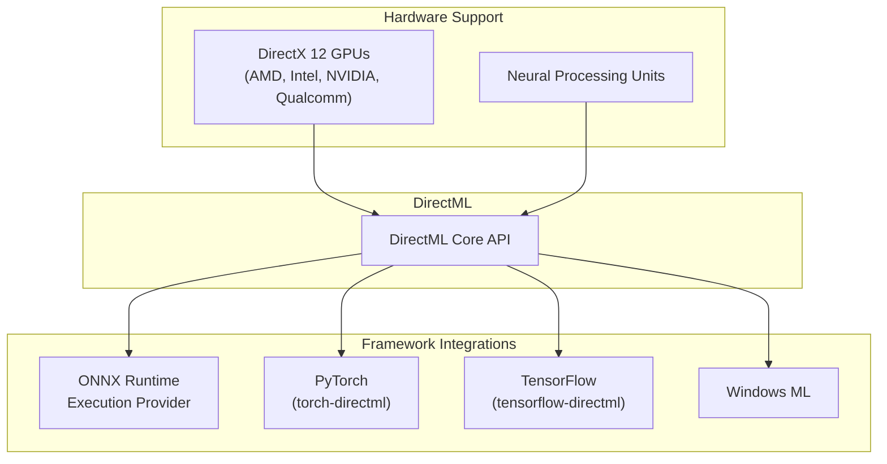
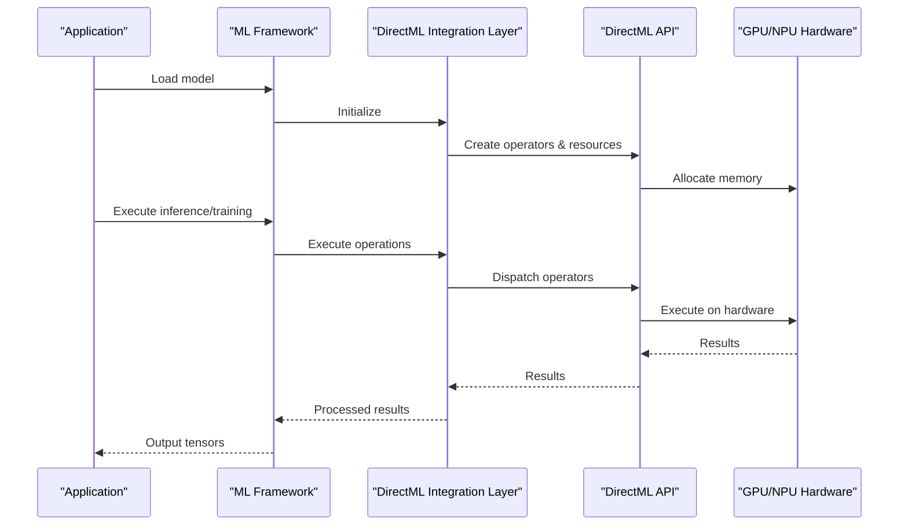
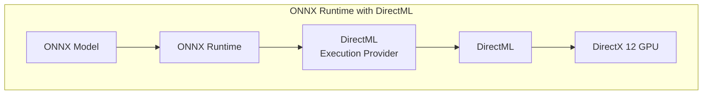
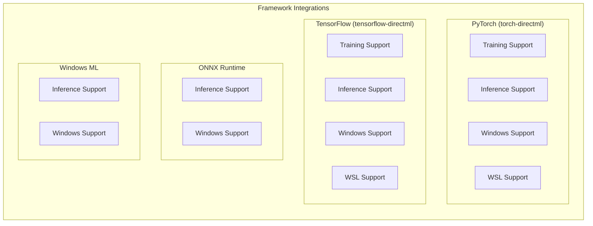

<!-- source: DeepWiki mcp.deepwiki.com · repo microsoft/DirectML · page 5 Framework Integrations · fetched 2026-10-26 -->

# Framework Integrations

<details>
<summary>Relevant source files</summary>

The following files were used as context for generating this wiki page:

- [PyTorch/README.md](PyTorch/README.md)
- [README.md](README.md)
- [Samples/DirectMLSuperResolution/Readme.md](Samples/DirectMLSuperResolution/Readme.md)
- [Samples/HelloDirectML/readme.md](Samples/HelloDirectML/readme.md)
- [Samples/yolov4/Readme.md](Samples/yolov4/Readme.md)
- [TensorFlow/README.md](TensorFlow/README.md)

</details>


This page documents how DirectML integrates with popular machine learning frameworks, enabling hardware acceleration for ML workloads across a broad range of DirectX 12-compatible hardware. DirectML provides a consistent, high-performance backend for various ML frameworks, allowing developers and users to leverage GPU acceleration without modifying their existing models or workflows.

## Overview of Framework Integrations

DirectML integrates with several major machine learning frameworks, providing GPU acceleration through either built-in components or plugin mechanisms. These integrations enable users to leverage DirectML's hardware acceleration capabilities while working within their preferred ML framework.



Sources: [README.md:82-128]()

## Integration Architecture

The framework integrations follow a common architectural pattern. Each integration layer maps framework-specific operations to DirectML operators, provides memory management between the framework and DirectML, and handles the execution of operations on the GPU through DirectML.



Sources: [README.md:30-50]()

## Windows ML Integration

Windows ML (WinML) is a high-performance API for deploying hardware-accelerated ML inferences on Windows devices. DirectML provides the GPU backend for Windows ML, enabling acceleration on a wide range of DirectX 12-compatible hardware.

### Configuration and Usage

DirectML acceleration can be enabled in Windows ML applications using the `LearningModelDevice` with any of the DirectX `DeviceKinds`. This allows applications to leverage DirectML's hardware acceleration capabilities through the Windows ML API.

| Feature | Details |
|---------|---------|
| Supported OS | Windows 10 version 1903 and newer |
| API Access | Windows.AI.MachineLearning namespace |
| Model Format | ONNX |
| Tools | WinMLRunner for model validation |

Sources: [README.md:82-93]()

## ONNX Runtime Integration

ONNX Runtime is a cross-platform inferencing and training accelerator compatible with many popular ML frameworks. DirectML is available as an execution provider for ONNX Runtime, providing hardware acceleration on Windows 10 devices.

### Configuration and Usage

To use DirectML with ONNX Runtime, developers need to configure the DirectML execution provider when initializing ONNX Runtime. This can be done through both C++ and Python APIs.



Sources: [README.md:94-104]()

## PyTorch Integration

PyTorch integration with DirectML is provided through the `torch-directml` plugin, which enables training and inference of complex machine learning models on DirectX 12-compatible hardware.

### Configuration and Usage

PyTorch with DirectML is supported on both Windows and Windows Subsystem for Linux (WSL). The integration is available as a PyPI package that can be easily installed with pip.

```
pip install torch-directml
```

After installation, DirectML can be selected as the device backend using the PyTorch device API:

```python
import torch
import torch_directml
dml = torch_directml.device()
tensor = torch.tensor([1, 2, 3], device=dml)
```

### Available Samples

The DirectML repository includes multiple PyTorch samples showcasing the integration:

| Category | Sample | Description |
|----------|--------|-------------|
| Computer Vision | YOLOv3 | Real-time object detection |
| Computer Vision | SqueezeNet | Small image classification model |
| Computer Vision | ResNet50 | Image classification model |
| Computer Vision | MaskRCNN | Object detection model |
| Transformers | Transformer | Original "Attention is All You Need" implementation |
| LLM | LLM | Text generation and chatbot application |
| Audio | Whisper | Speech recognition model |
| Diffusion | Stable Diffusion | Text-to-image generation model |

Sources: [README.md:106-115](), [PyTorch/README.md:1-27]()

## TensorFlow Integration

TensorFlow integration with DirectML is provided through the `tensorflow-directml` plugin, allowing execution of TensorFlow models on DirectX 12-compatible hardware.

### Configuration and Usage

TensorFlow with DirectML is supported on both Windows and Windows Subsystem for Linux (WSL). The integration is available as a PyPI package:

```
pip install tensorflow-directml
```

After installation, DirectML is automatically registered as an available device in TensorFlow, and can be selected using the standard TensorFlow device placement mechanisms.

### Available Samples

The DirectML repository includes TensorFlow samples in both TF1 and TF2 versions:

| TensorFlow Version | Available Samples |
|--------------------|-------------------|
| TensorFlow 1.15 | SqueezeNet, VisionTransformer, YOLOv3 |
| TensorFlow 2.9+ | SqueezeNet, VisionTransformer, YOLOv3 |

Sources: [README.md:116-128](), [TensorFlow/README.md:1-26]()

## Integration Comparison

Below is a comparison of the different framework integrations available with DirectML:



| Framework | Training Support | Inference Support | Windows Support | WSL Support |
|-----------|------------------|-------------------|-----------------|-------------|
| PyTorch | ✓ | ✓ | ✓ | ✓ |
| TensorFlow | ✓ | ✓ | ✓ | ✓ |
| ONNX Runtime | - | ✓ | ✓ | - |
| Windows ML | - | ✓ | ✓ | - |

Sources: [README.md:82-128](), [PyTorch/README.md:9-10](), [TensorFlow/README.md:3]()

## Common Use Cases

Each framework integration enables different use cases for DirectML:

1. **Windows ML**: Ideal for Windows application developers who want to integrate ML inference capabilities into their apps with minimal code.

2. **ONNX Runtime**: Best for cross-platform application developers who need to deploy models trained in various frameworks with consistent inference performance.

3. **PyTorch with DirectML**: Suitable for researchers and developers who need both training and inference capabilities and prefer the PyTorch ecosystem.

4. **TensorFlow with DirectML**: Appropriate for TensorFlow users who want to accelerate their existing TensorFlow models on DirectX 12 hardware.

Sources: [README.md:9-23](), [README.md:82-128]()

---

