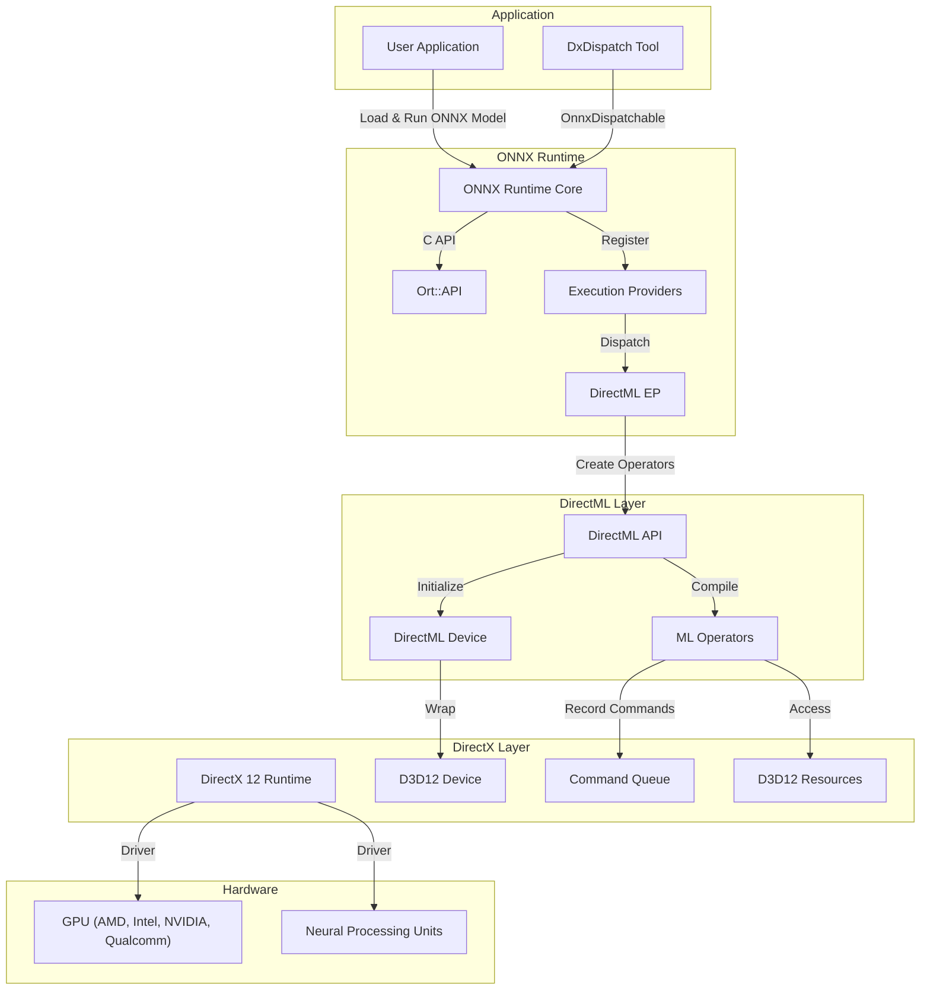
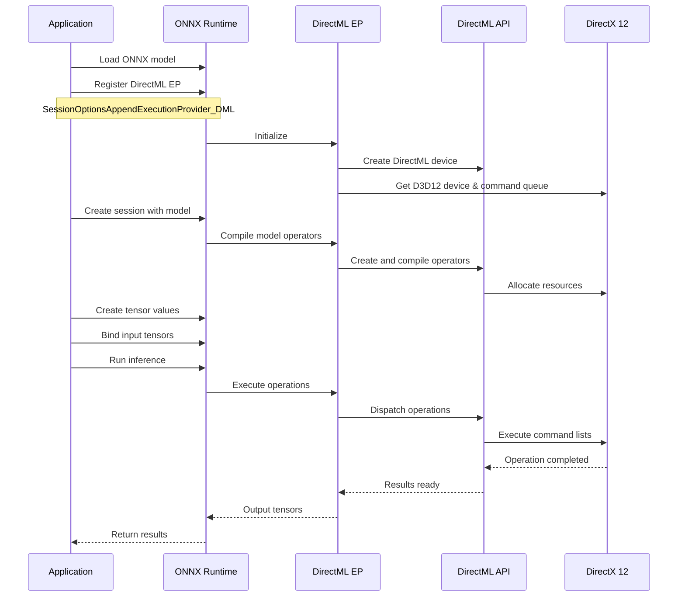
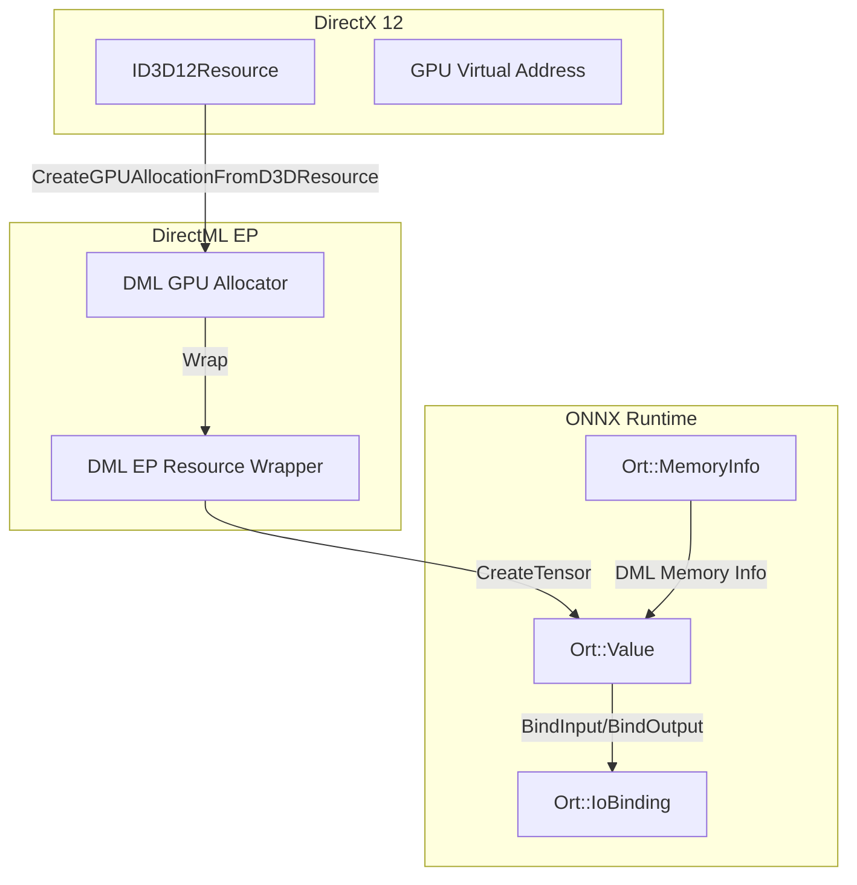
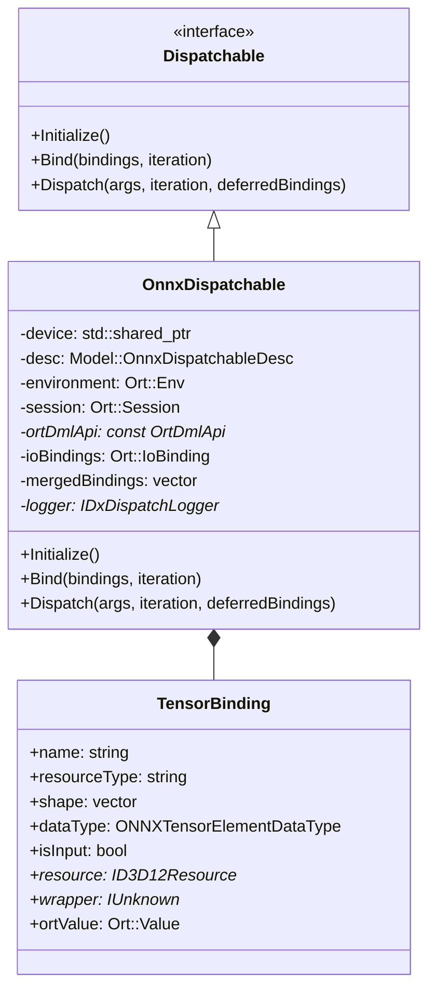

<!-- source: DeepWiki mcp.deepwiki.com · repo microsoft/DirectML · page 5.2 ONNX Runtime Integration · fetched 2026-10-26 -->

# ONNX Runtime Integration

<details>
<summary>Relevant source files</summary>

The following files were used as context for generating this wiki page:

- [DxDispatch/cmake/dxcompiler.cmake](DxDispatch/cmake/dxcompiler.cmake)
- [DxDispatch/cmake/onnxruntime.cmake](DxDispatch/cmake/onnxruntime.cmake)
- [DxDispatch/cmake/pix.cmake](DxDispatch/cmake/pix.cmake)
- [DxDispatch/models/dml_scalar_union_fp16.json](DxDispatch/models/dml_scalar_union_fp16.json)
- [DxDispatch/src/dxdispatch/Dispatchable.h](DxDispatch/src/dxdispatch/Dispatchable.h)
- [DxDispatch/src/dxdispatch/OnnxDispatchable.cpp](DxDispatch/src/dxdispatch/OnnxDispatchable.cpp)
- [DxDispatch/src/dxdispatch/OnnxDispatchable.h](DxDispatch/src/dxdispatch/OnnxDispatchable.h)
- [DxDispatch/src/model/JsonParsersGenerated.cpp](DxDispatch/src/model/JsonParsersGenerated.cpp)
- [DxDispatch/tools/GenerateParsingHelpers.ps1](DxDispatch/tools/GenerateParsingHelpers.ps1)
- [README.md](README.md)
- [Samples/DirectMLSuperResolution/Readme.md](Samples/DirectMLSuperResolution/Readme.md)
- [Samples/HelloDirectML/readme.md](Samples/HelloDirectML/readme.md)
- [Samples/yolov4/Readme.md](Samples/yolov4/Readme.md)
- [TensorFlow/README.md](TensorFlow/README.md)

</details>


This page documents the integration between DirectML and ONNX Runtime, explaining how DirectML provides hardware acceleration for ONNX models. For information about other framework integrations such as PyTorch with DirectML, see [PyTorch Integration](#5.1).

## 1. Overview

ONNX Runtime is a cross-platform inference and training accelerator compatible with many ML/DNN frameworks. DirectML integrates with ONNX Runtime as an execution provider (EP), enabling hardware acceleration of ONNX models on DirectX 12-compatible GPUs.

This integration allows developers to:

- Execute ONNX models with hardware acceleration across a wide range of GPUs
- Maintain compatibility with standard ONNX model formats
- Achieve high-performance inference on Windows platforms
- Seamlessly integrate ML capabilities into DirectX 12 applications

Sources: [README.md:95-105](), [DxDispatch/cmake/onnxruntime.cmake:1-19]()

## 2. Architecture

### System Architecture



The DirectML Execution Provider for ONNX Runtime serves as a bridge between the ONNX Runtime API and DirectML, enabling ONNX models to be executed on DirectX 12-capable GPUs and NPUs.

Sources: [README.md:95-105](), [DxDispatch/src/dxdispatch/OnnxDispatchable.cpp:1-48](), [DxDispatch/src/dxdispatch/OnnxDispatchable.h:1-15]()

### Execution Flow



This diagram illustrates the flow of execution when running an ONNX model with the DirectML execution provider, showing the interactions between the application, ONNX Runtime, DirectML EP, DirectML API, and DirectX 12.

Sources: [DxDispatch/src/dxdispatch/OnnxDispatchable.cpp:191-268](), [DxDispatch/src/dxdispatch/OnnxDispatchable.cpp:519-546]()

## 3. Integration Methods

DirectML offers several ways to integrate ONNX Runtime into applications. The primary integration methods include using NuGet packages or local builds.

### 3.1 NuGet Package Integration

The simplest way to integrate ONNX Runtime with DirectML is through the official NuGet package:

```
Microsoft.ML.OnnxRuntime.DirectML
```

The CMake configuration automatically handles this integration for Windows platforms (X64, ARM64):

| Configuration Option | Description | Default Value |
|----------------------|-------------|---------------|
| ONNXRUNTIME_TYPE | Integration method (nuget, local, none) | nuget (for Windows) |
| ONNXRUNTIME_NUGET_ID | NuGet package identifier | Microsoft.ML.OnnxRuntime.DirectML |
| ONNXRUNTIME_NUGET_VERSION | Package version | 1.18.0 |

Sources: [DxDispatch/cmake/onnxruntime.cmake:41-63](), [DxDispatch/cmake/onnxruntime.cmake:75-95]()

### 3.2 Local Build Integration

For scenarios requiring customization or for Xbox development, a local build option is available:

```cmake
set(DXD_ONNXRUNTIME_TYPE "local")
set(DXD_ONNXRUNTIME_LOCAL_PATH "path/to/local/onnxruntime")
```

The local path must contain:
- `bin/onnxruntime.dll`
- `bin/onnxruntime_providers_shared.dll`
- `lib/onnxruntime.lib`
- `include/onnxruntime/core/providers/dml/dml_provider_factory.h`

Sources: [DxDispatch/cmake/onnxruntime.cmake:99-139]()

## 4. Using the ONNX Runtime with DirectML

### 4.1 Initializing the DirectML Execution Provider

To use DirectML with ONNX Runtime, you need to register the DirectML execution provider with the ONNX Runtime session:

```cpp
// Create environment
Ort::Env env(ORT_LOGGING_LEVEL_WARNING, "OnnxRuntimeDirectML");

// Configure session options
Ort::SessionOptions sessionOptions;
sessionOptions.SetExecutionMode(ExecutionMode::ORT_SEQUENTIAL);
sessionOptions.DisableMemPattern();

// Get DirectML EP API
const OrtDmlApi* ortDmlApi;
Ort::ThrowOnError(
    Ort::GetApi().GetExecutionProviderApi(
        "DML", 
        ORT_API_VERSION, 
        reinterpret_cast<const void**>(&ortDmlApi)
    )
);

// Register DirectML EP with D3D12 device and command queue
Ort::ThrowOnError(
    ortDmlApi->SessionOptionsAppendExecutionProvider_DML1(
        sessionOptions, 
        dmlDevice, 
        commandQueue
    )
);

// Create session with model
Ort::Session session(env, modelPath.c_str(), sessionOptions);
```

Sources: [DxDispatch/src/dxdispatch/OnnxDispatchable.cpp:199-269]()

### 4.2 Binding DirectX Resources to ONNX Tensors

A key capability of the DirectML EP is binding D3D12 resources directly to ONNX tensors, avoiding CPU-GPU data transfers:



The `CreateTensorFromResource` function demonstrates how to create an ONNX tensor from a DirectX 12 resource:

```cpp
// Create ONNX tensor from D3D12 resource
Ort::Value tensor = CreateTensorFromResource(
    ortDmlApi,               // DirectML EP API
    dmlMemoryInformation,    // Memory info (OrtDeviceAllocator)
    d3dResource,             // D3D12 resource containing tensor data
    tensorDimensions,        // Shape of tensor
    elementDataType,         // Data type (FLOAT32, FLOAT16, etc.)
    &dmlEpResourceWrapper    // Output wrapper (for resource lifetime)
);

// Bind tensor to session
ioBindings.BindInput(tensorName, tensor);
// or
ioBindings.BindOutput(tensorName, tensor);
```

Sources: [DxDispatch/src/dxdispatch/OnnxDispatchable.cpp:13-43](), [DxDispatch/src/dxdispatch/OnnxDispatchable.cpp:376-394]()

### 4.3 Data Type Mapping

DirectML and ONNX Runtime use different enumeration types for tensor data types. The system provides mapping between these types:

| ONNX Data Type | DirectML Data Type | Size (bytes) |
|----------------|-------------------|--------------|
| FLOAT | DML_TENSOR_DATA_TYPE_FLOAT32 | 4 |
| FLOAT16 | DML_TENSOR_DATA_TYPE_FLOAT16 | 2 |
| INT32 | DML_TENSOR_DATA_TYPE_INT32 | 4 |
| INT64 | DML_TENSOR_DATA_TYPE_INT64 | 8 |
| UINT8 | DML_TENSOR_DATA_TYPE_UINT8 | 1 |
| INT8 | DML_TENSOR_DATA_TYPE_INT8 | 1 |
| UINT16 | DML_TENSOR_DATA_TYPE_UINT16 | 2 |
| INT16 | DML_TENSOR_DATA_TYPE_INT16 | 2 |
| BOOL | DML_TENSOR_DATA_TYPE_UINT8 | 1 |
| DOUBLE | DML_TENSOR_DATA_TYPE_FLOAT64 | 8 |

Sources: [DxDispatch/src/dxdispatch/OnnxDispatchable.cpp:85-164]()

## 5. DxDispatch ONNX Integration

DxDispatch is a DirectML tool that enables execution of ML models defined in JSON format, including ONNX models.

### 5.1 OnnxDispatchable Implementation

The `OnnxDispatchable` class implements the `Dispatchable` interface for ONNX models:



Sources: [DxDispatch/src/dxdispatch/OnnxDispatchable.h:1-46](), [DxDispatch/src/dxdispatch/Dispatchable.h:1-39]()

### 5.2 ONNX Model Lifecycle

The lifecycle of an ONNX model in DxDispatch follows these steps:

1. **Initialization** (`Initialize`):
   - Create ONNX environment with appropriate logging level
   - Configure session options (optimization level, execution mode)
   - Apply dimension overrides and configuration entries
   - Register the DirectML execution provider
   - Create the ONNX session with the model file
   - Initialize I/O bindings

2. **Binding** (`Bind`):
   - Clear previous bindings
   - For each input and output tensor:
     - Get tensor information (name, shape, data type)
     - Apply shape overrides if specified
     - Create or wrap D3D12 resources for tensors
     - Create ONNX tensor values from resources
     - Bind tensors to inputs/outputs

3. **Execution** (`Dispatch`):
   - Record PIX events for performance analysis (if enabled)
   - Run the ONNX model using the session
   - Synchronize outputs to ensure completion
   - Process any deferred bindings (late-bound outputs)
   - Extract results from output tensors

Sources: [DxDispatch/src/dxdispatch/OnnxDispatchable.cpp:199-268](), [DxDispatch/src/dxdispatch/OnnxDispatchable.cpp:272-517](), [DxDispatch/src/dxdispatch/OnnxDispatchable.cpp:519-618]()

### 5.3 Resource Binding Strategy

The OnnxDispatchable implementation employs a flexible binding strategy:

1. **Explicit Bindings**: Resources explicitly bound in JSON model
   - Strict validation of resource compatibility with tensor
   - Fails if binding doesn't make sense for execution

2. **Implicit Bindings**: Automatically created resources for tensors without explicit bindings
   - For tensors with static shapes that can be preallocated
   - Creates DirectX resources for DML-supported types
   - Creates CPU resources for types not supported by DML

3. **Deferred Bindings**: Lazily allocated resources for output tensors with dynamic shapes
   - Shape determined at runtime after execution
   - Handles tensors with free dimensions that can't be preallocated

Sources: [DxDispatch/src/dxdispatch/OnnxDispatchable.cpp:283-389](), [DxDispatch/src/dxdispatch/OnnxDispatchable.cpp:547-618]()

## 6. Performance Considerations

### 6.1 Profiling Support

The ONNX Runtime integration with DirectML includes profiling capabilities:

```cpp
// Enable ONNX Runtime profiling
sessionOptions.EnableProfiling(L"ProfilePath");

// Enable PIX event capture
PIXBeginEvent(commandList, PIX_COLOR(255, 255, 0), "ONNX: '%s'", modelName);
device->RecordTimestamp();
// Run inference
device->RecordTimestamp();
PIXEndEvent(commandList);
```

Sources: [DxDispatch/src/dxdispatch/OnnxDispatchable.cpp:214-217](), [DxDispatch/src/dxdispatch/OnnxDispatchable.cpp:521-544](), [DxDispatch/cmake/pix.cmake:1-150]()

### 6.2 Optimization Options

ONNX Runtime with DirectML offers several optimization options:

| Optimization | Description |
|--------------|-------------|
| Graph Optimization Level | Controls the level of graph optimizations applied (None, Basic, Extended, All) |
| ExecutionMode | ORT_SEQUENTIAL for predictable, sequential execution |
| DisableMemPattern | Helps reduce memory fragmentation and improve performance |
| Free Dimension Overrides | Allows specifying sizes for dynamic "free" dimensions |
| Session Configuration | Advanced configuration options for fine-tuning |

Sources: [DxDispatch/src/dxdispatch/OnnxDispatchable.cpp:226-262]()

### 6.3 Resource Usage Optimization

For optimal performance with DirectML EP:

1. **Reuse D3D12 Resources**: Bind the same D3D12 resources across multiple inference runs
2. **Match Tensor Formats**: Ensure tensor data types and layouts are compatible with DirectML
3. **Batch Processing**: Process multiple inputs in a single inference run when possible
4. **Command Queue Synchronization**: Properly synchronize command queue execution
5. **Resource Transitions**: Handle D3D12 resource state transitions correctly

Sources: [DxDispatch/src/dxdispatch/OnnxDispatchable.cpp:272-279](), [DxDispatch/src/dxdispatch/OnnxDispatchable.cpp:519-546]()

## 7. Troubleshooting

### 7.1 Common Issues

1. **Tensor Shape Mismatch**
   - Ensure input tensor shapes match model expectations
   - Check for free dimensions that need explicit size specification

2. **Resource Binding Errors**
   - Verify D3D12 resources are compatible with tensor requirements
   - Check buffer sizes match the required tensor sizes

3. **Data Type Compatibility**
   - Ensure tensor data types are supported by DirectML
   - Verify correct mapping between ONNX and DirectML data types

4. **Memory Access Violations**
   - Ensure proper resource lifetime management
   - Verify resource wrappers are kept alive during execution

5. **Performance Issues**
   - Enable profiling to identify bottlenecks
   - Check for unnecessary CPU-GPU synchronization

Sources: [DxDispatch/src/dxdispatch/OnnxDispatchable.cpp:368-402](), [DxDispatch/src/dxdispatch/OnnxDispatchable.cpp:409-459]()

### 7.2 Logging and Diagnostics

The ONNX Runtime integration includes several diagnostic tools:

1. **ONNX Runtime Logging**
   - Configure logging level (WARNING, INFO, VERBOSE, etc.)
   - Set custom logging callbacks for integration with application logging

2. **Verbose Binding Information**
   - Enable detailed tensor binding information
   - Shows resource types, data types, and tensor shapes

3. **PIX Integration**
   - Capture DirectX workloads with PIX
   - View timeline of GPU operations

Sources: [DxDispatch/src/dxdispatch/OnnxDispatchable.cpp:496-516](), [DxDispatch/cmake/pix.cmake:1-150]()