# Page: DirectML Overview

# DirectML Overview

<details>
<summary>Relevant source files</summary>

The following files were used as context for generating this wiki page:

- [DxDispatch/cmake/directml.cmake](DxDispatch/cmake/directml.cmake)
- [README.md](README.md)
- [Releases.md](Releases.md)
- [Samples/DirectMLSuperResolution/Readme.md](Samples/DirectMLSuperResolution/Readme.md)
- [Samples/DirectMLSuperResolution/packages.config](Samples/DirectMLSuperResolution/packages.config)
- [Samples/HelloDirectML/readme.md](Samples/HelloDirectML/readme.md)
- [Samples/yolov4/Readme.md](Samples/yolov4/Readme.md)
- [Samples/yolov4/packages.config](Samples/yolov4/packages.config)
- [TensorFlow/README.md](TensorFlow/README.md)

</details>


DirectML is a high-performance, hardware-accelerated DirectX 12 library for machine learning. It provides GPU acceleration for common machine learning tasks across a broad range of hardware and drivers, including DirectX 12-capable GPUs from vendors such as AMD, Intel, NVIDIA, and Qualcomm.

## Purpose and Scope

This document introduces the DirectML repository, explaining what it is, the problems it solves, and its key components. DirectML serves as both a standalone API for developers building machine learning capabilities into applications and as a backend acceleration layer for popular ML frameworks.

For detailed information about the system architecture, see [System Architecture](#1.1). For release history and versioning, see [Release History and Versioning](#1.2).

## What is DirectML?

DirectML is designed for high-performance, low-latency applications such as frameworks, games, and other real-time applications. Its seamless interoperability with Direct3D 12, low overhead, and consistent results across hardware make it ideal for accelerating machine learning when both performance and reliability are critical.

The DirectML API is a low-level DirectX 12 library that exposes hardware acceleration capabilities through a C++ API. It is distributed both as a system component in Windows 10 (version 1903 and newer) and as a redistributable NuGet package (`Microsoft.AI.DirectML`).

Sources: [README.md:1-7](), [README.md:27-32]()

## System Architecture Overview

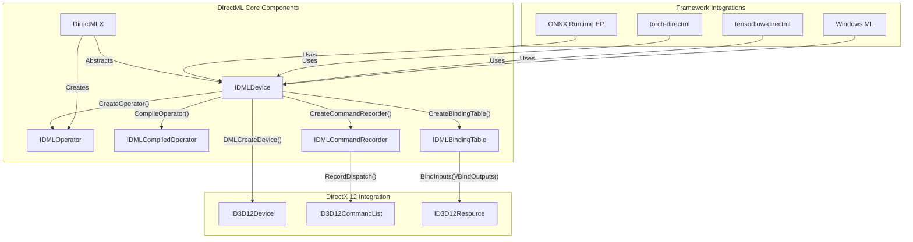

The architecture of DirectML consists of several core components:

- **IDMLDevice**: The primary interface for creating operators and resources
- **IDMLOperator**: Represents a machine learning operator (like convolution, GEMM, etc.)
- **IDMLCompiledOperator**: A compiled version of an operator ready for execution
- **IDMLBindingTable**: Manages input/output resource bindings for operators
- **IDMLCommandRecorder**: Records DirectML operations into a D3D12 command list
- **DirectMLX**: A C++ abstraction layer providing high-level graph construction

These components interact with DirectX 12 through ID3D12Device for device creation, ID3D12CommandList for command recording, and ID3D12Resource for tensor storage.

Sources: [README.md:3-6]()

## Key Features

DirectML provides several key features that make it valuable for machine learning applications:

1. **Hardware Acceleration**: Utilizes GPU hardware for accelerated ML operations
2. **Cross-Vendor Support**: Works on GPUs from multiple vendors (AMD, Intel, NVIDIA, Qualcomm)
3. **DirectX 12 Interoperability**: Seamless integration with DirectX 12 graphics pipeline
4. **Low Overhead**: Designed for high-performance, low-latency applications
5. **Framework Integration**: Backend support for ONNX Runtime, PyTorch, TensorFlow, and Windows ML
6. **NPU Support**: Can utilize Neural Processing Units on supported hardware

Sources: [README.md:3-6](), [README.md:34-40]()

## DirectMLX Abstraction Layer

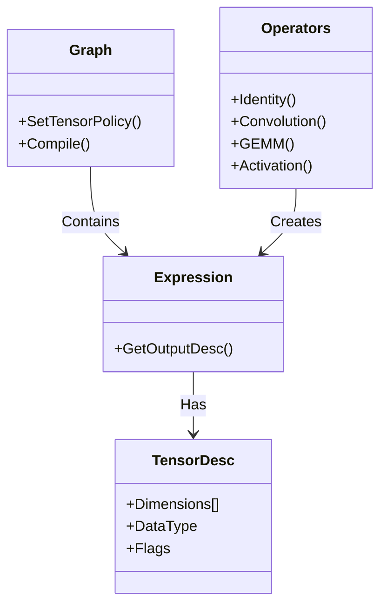

DirectMLX is a C++ abstraction layer over DirectML that simplifies the creation and execution of machine learning graphs. It provides:

- **Graph**: A high-level representation of a computational graph
- **Expression**: Represents operations or tensors in the graph
- **TensorDesc**: Defines the properties of tensors (dimensions, data type, etc.)
- **Operators**: Functions for creating common ML operations (Identity, Convolution, GEMM, etc.)

DirectMLX allows developers to define ML operations at a higher level of abstraction, making it easier to create complex computational graphs compared to using the raw DirectML API.

Sources: [DxDispatch/cmake/directml.cmake:218-226]()

## Typical Usage Flow

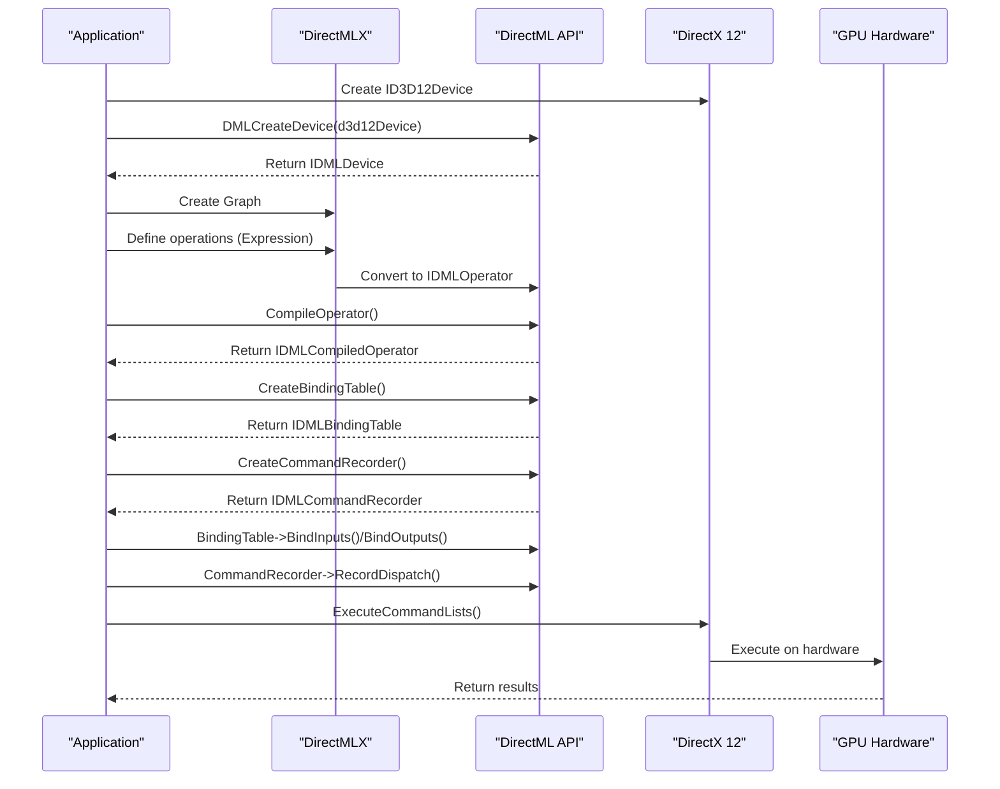

A typical workflow for using DirectML involves:

1. Creating a DirectX 12 device
2. Creating a DirectML device using `DMLCreateDevice()`
3. Defining operators (directly or through DirectMLX)
4. Compiling operators with `IDMLDevice::CompileOperator()`
5. Creating binding tables and command recorders
6. Binding inputs and outputs
7. Recording dispatch commands
8. Executing the commands on the GPU
9. Retrieving the results

Sources: [README.md:43-49](), [Samples/HelloDirectML/readme.md:12-16]()

## Framework Integrations

DirectML serves as a backend for several machine learning frameworks:

### ONNX Runtime

DirectML is available as an execution provider for ONNX Runtime, enabling hardware acceleration for ONNX models on Windows. It provides hardware acceleration when running on Windows 10.

### PyTorch with DirectML

PyTorch with DirectML enables training and inference of PyTorch models on DirectX 12-compatible hardware through the `torch-directml` plugin. It is supported on both Windows and Windows Subsystem for Linux.

### TensorFlow with DirectML

TensorFlow with DirectML accelerates TensorFlow models on DirectX 12-compatible hardware through the `tensorflow-directml` package. It supports both TensorFlow 1.15 (via a fork) and TensorFlow 2.9+ (via a plugin).

### Windows ML

Windows ML is a high-performance API for deploying ML inferences on Windows devices, using DirectML as its GPU backend.

Sources: [README.md:82-128](), [TensorFlow/README.md:1-26]()

## Sample Applications

DirectML includes several sample applications demonstrating its capabilities:

- **HelloDirectML**: A minimal "hello world" application executing a single DirectML operator
- **DirectMLSuperResolution**: Demonstrates using DirectML to upscale video from 540p to 1080p in real time
- **YOLOv4**: An object detection sample capable of recognizing 80 different classes of objects
- **DirectMLNpuInference**: Shows how to utilize NPU hardware with DirectML

These samples use the Microsoft.AI.DirectML NuGet package (version 1.15.2) and demonstrate different aspects of DirectML integration and usage.

Sources: [README.md:62-76](), [Samples/DirectMLSuperResolution/packages.config:1-5](), [Samples/yolov4/packages.config:1-5](), [Samples/HelloDirectML/readme.md:1-24]()

## Hardware and Platform Support

DirectML supports a wide range of hardware:

| Hardware Type | Supported Vendors/Models |
|---------------|--------------------------|
| **GPUs** | AMD: GCN 1st Gen (Radeon HD 7000 series) and above |
|         | Intel: Haswell (4th-gen core) HD Integrated Graphics and above |
|         | NVIDIA: Kepler (GTX 600 series) and above |
|         | Qualcomm: Adreno 600 and above |
| **NPUs** | Neural Processing Units on supported hardware |

**Platform Support**:
- Windows 10 version 1903 (build 10.0.18362) and above
- Windows Subsystem for Linux (WSL)

Sources: [README.md:34-40]()

## Getting Started

To get started with DirectML:

1. **Prerequisites**:
   - Windows 10 version 1903 or newer
   - DirectX 12 capable hardware
   - Visual Studio 2019 or newer (for development)

2. **Integrating DirectML**:
   - Add the Microsoft.AI.DirectML NuGet package to your project
   - Include DirectML.h and DirectMLX.h headers
   - Link against DirectML.lib
   - Follow the DirectML programming guide for implementation details

3. **Exploring Samples**:
   - Clone the DirectML repository
   - Build and run the provided samples
   - Use DxDispatch to experiment with operators

Sources: [README.md:27-60](), [DxDispatch/cmake/directml.cmake:44-52]()

## Conclusion

DirectML provides a high-performance, hardware-accelerated solution for machine learning tasks across a wide range of hardware. Its integration with DirectX 12 makes it particularly suitable for real-time applications and games. The availability of DirectMLX simplifies development, while integration with popular frameworks like ONNX Runtime, PyTorch, and TensorFlow makes it accessible to data scientists and researchers.

Whether you're developing a game with ML features, building a machine learning application that needs to run on various hardware, or looking for GPU acceleration for your ML models, DirectML provides the necessary tools and capabilities to achieve high-performance results.

Sources: [README.md:1-7](), [README.md:27-32]()

---

# Page: System Architecture

# System Architecture

<details>
<summary>Relevant source files</summary>

The following files were used as context for generating this wiki page:

- [DxDispatch/CMakeLists.txt](DxDispatch/CMakeLists.txt)
- [DxDispatch/cgmanifest.json](DxDispatch/cgmanifest.json)
- [DxDispatch/models/dml_convolution_2d.json](DxDispatch/models/dml_convolution_2d.json)
- [DxDispatch/models/dml_convolution_3d.json](DxDispatch/models/dml_convolution_3d.json)
- [DxDispatch/src/dxdispatch/Device.cpp](DxDispatch/src/dxdispatch/Device.cpp)
- [DxDispatch/src/dxdispatch/Executor.cpp](DxDispatch/src/dxdispatch/Executor.cpp)
- [Libraries/DirectMLX.h](Libraries/DirectMLX.h)
- [README.md](README.md)
- [Samples/DirectMLSuperResolution/Kits/DirectXTK12/DirectXTK_Desktop_2017_Win10.vcxproj](Samples/DirectMLSuperResolution/Kits/DirectXTK12/DirectXTK_Desktop_2017_Win10.vcxproj)
- [Samples/DirectMLSuperResolution/Readme.md](Samples/DirectMLSuperResolution/Readme.md)
- [Samples/HelloDirectML/main.cpp](Samples/HelloDirectML/main.cpp)
- [Samples/HelloDirectML/readme.md](Samples/HelloDirectML/readme.md)
- [Samples/yolov4/Kits/DirectXTK12/DirectXTK_Desktop_2017_Win10.vcxproj](Samples/yolov4/Kits/DirectXTK12/DirectXTK_Desktop_2017_Win10.vcxproj)
- [Samples/yolov4/Readme.md](Samples/yolov4/Readme.md)
- [TensorFlow/README.md](TensorFlow/README.md)

</details>


This document describes the high-level architecture of the DirectML project, explaining the core components, their relationships, and how they interact to provide hardware-accelerated machine learning capabilities. For specific framework integrations, see [Framework Integrations](#5).

## Overview

DirectML is a high-performance, hardware-accelerated DirectX 12 library for machine learning that provides GPU acceleration across a wide range of supported hardware. The system is designed with several layers of abstraction to balance performance with usability, allowing both direct low-level access and simplified high-level interfaces.

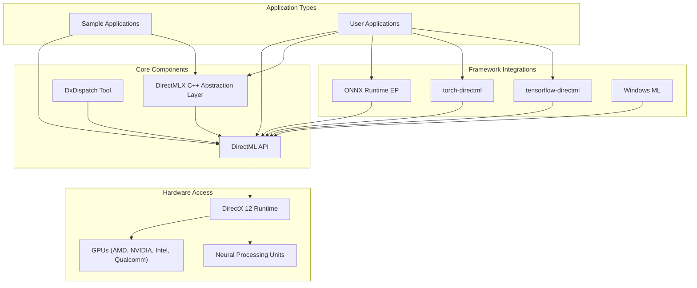

Sources:
- [README.md:3-19]()
- [DxDispatch/CMakeLists.txt:1-57]()

## Core Components

### DirectML API

The DirectML API provides the foundational layer for machine learning operations. It's a low-level, DirectX 12-based API that enables applications to perform hardware-accelerated ML operations.

Key interfaces include:
- `IDMLDevice` - Main entry point for creating operators
- `IDMLOperator` - Abstract representation of an ML operation
- `IDMLCompiledOperator` - Compiled GPU-ready operator
- `IDMLBindingTable` - Maps resources to operators
- `IDMLCommandRecorder` - Records commands into D3D12 command lists

The API is designed to integrate seamlessly with DirectX 12, allowing ML workloads to be efficiently interleaved with graphics and compute tasks.

Sources:
- [Samples/HelloDirectML/main.cpp:132-136]()
- [Samples/HelloDirectML/main.cpp:155-179]()
- [Samples/HelloDirectML/main.cpp:323-331]()

### DirectMLX Abstraction Layer

DirectMLX is a C++ abstraction layer over the core DirectML API that simplifies the creation and management of ML models. It provides a graph-based programming model that makes it easier to construct complex computational graphs.

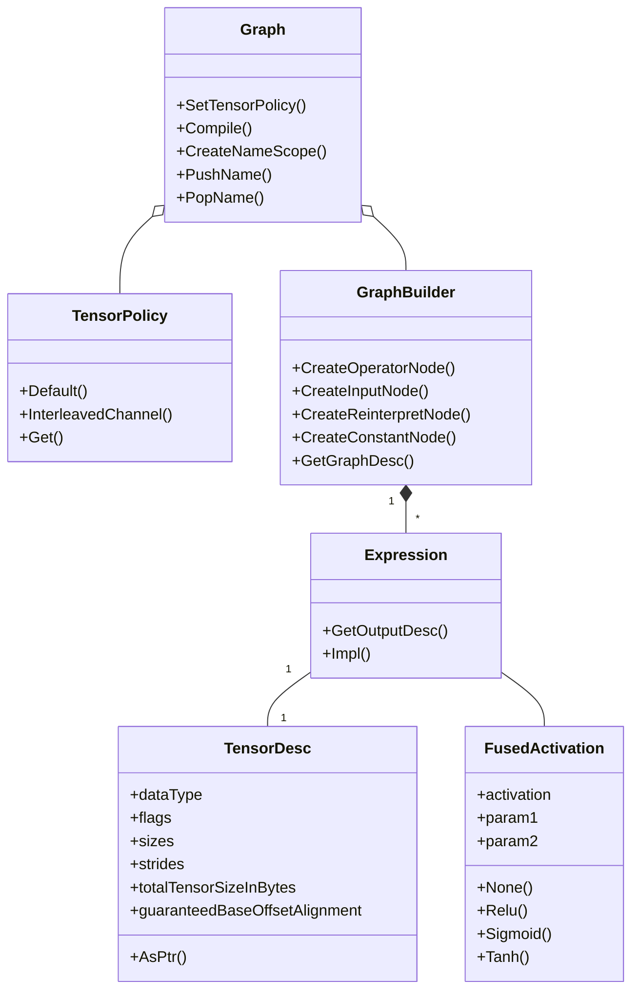

Key components:
- `Graph` - Represents a computational graph
- `Expression` - Represents a node in the graph
- `TensorDesc` - Describes tensor properties such as dimensions and data type
- `TensorPolicy` - Controls tensor layout and memory arrangements

DirectMLX provides a more intuitive interface while maintaining the performance advantages of DirectML.

Sources:
- [Libraries/DirectMLX.h:286-855]()
- [Libraries/DirectMLX.h:412-472]()
- [Libraries/DirectMLX.h:757-770]()

### DxDispatch Tool

DxDispatch is a command-line tool that allows execution of DirectML, HLSL, and ONNX models without writing C++ code. It uses JSON-based model definitions to specify resources, operators, and execution commands.

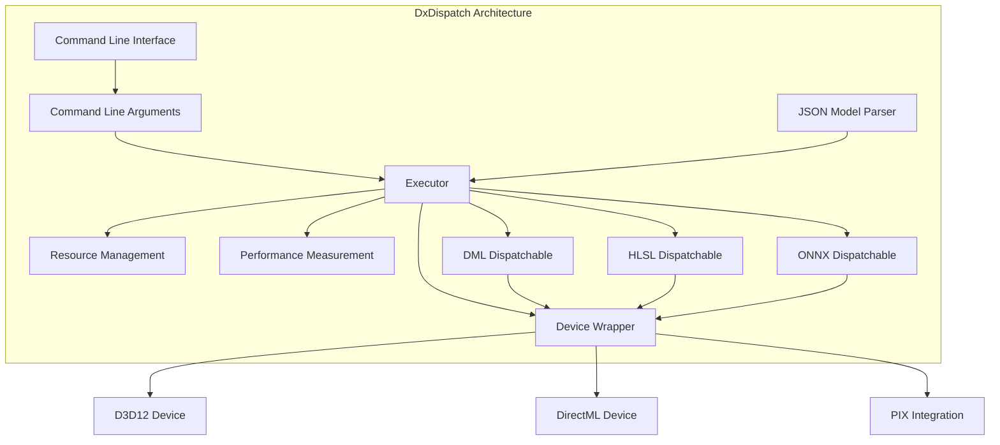

Key components:
- `Model` - Represents JSON-defined resources, dispatchables, and commands
- `Executor` - Manages execution of commands on dispatchables
- `Device` - Wraps D3D12 and DirectML devices
- `Dispatchable` - Interface for executable entities (DML, HLSL, ONNX)

DxDispatch enables rapid prototyping and benchmarking of ML operations without the overhead of writing full C++ applications.

Sources:
- [DxDispatch/CMakeLists.txt:80-196]()
- [DxDispatch/src/dxdispatch/Executor.cpp:106-212]()
- [DxDispatch/src/dxdispatch/Executor.cpp:219-273]()
- [DxDispatch/src/dxdispatch/Device.cpp:47-307]()

## Execution Flow

The execution of machine learning operations in DirectML follows a specific flow pattern, whether using the native API, DirectMLX, or DxDispatch.

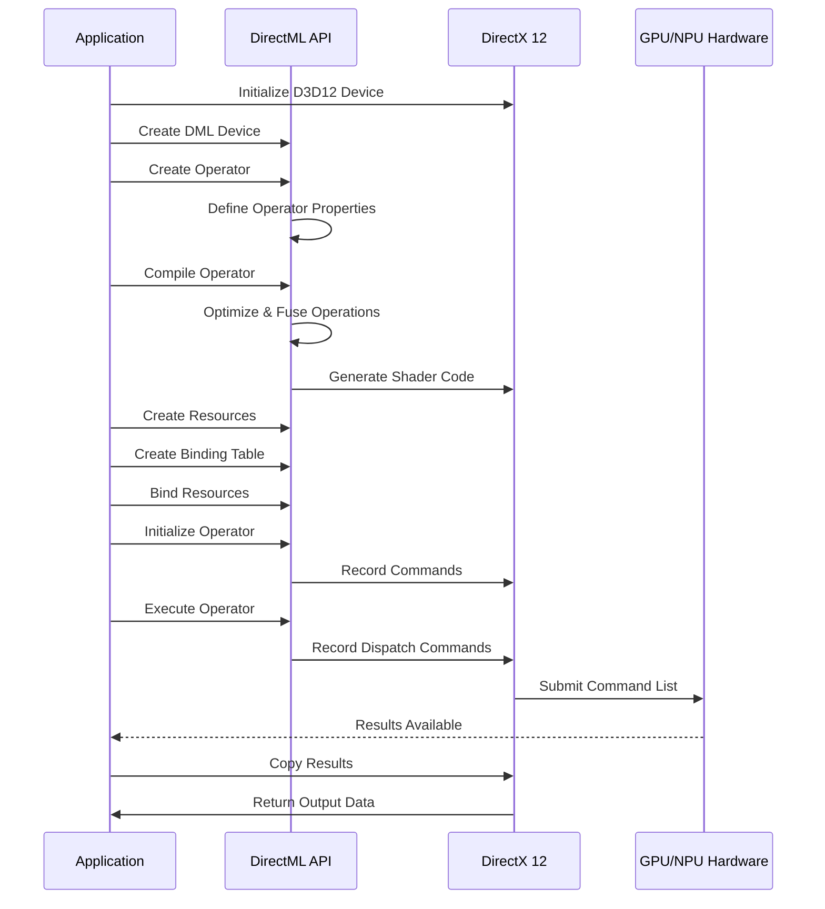

The execution flow can be summarized in these steps:

1. **Initialization**: Create D3D12 and DirectML devices
2. **Operator Creation**: Define ML operations
3. **Compilation**: Optimize operations for GPU execution
4. **Resource Setup**: Create and bind input/output resources
5. **Execution**: Dispatch operations and wait for completion
6. **Result Retrieval**: Copy results back to accessible memory

Sources:
- [Samples/HelloDirectML/main.cpp:113-633]()
- [DxDispatch/src/dxdispatch/Executor.cpp:275-446]()
- [DxDispatch/src/dxdispatch/Device.cpp:585-685]()

## Integration with DirectX 12

DirectML is built on top of DirectX 12, leveraging its efficient rendering and compute capabilities. This integration allows DirectML to benefit from the performance optimizations of DirectX 12 while providing specialized ML functionality.

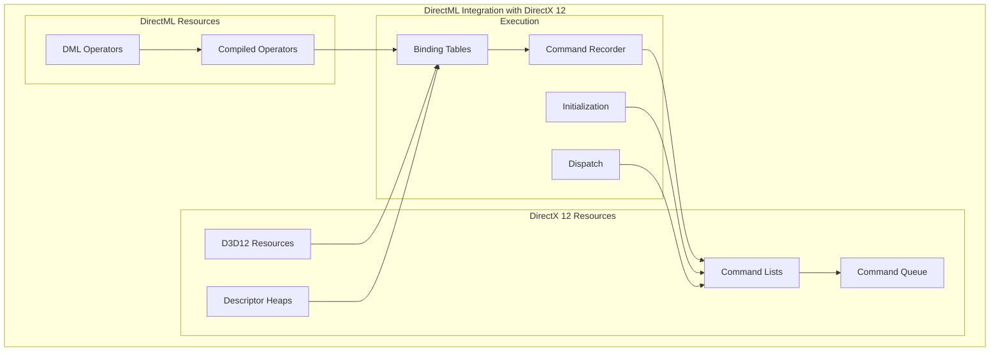

Key aspects of integration:
- DirectML operators execute through DirectX 12 command lists
- Direct sharing of resources between graphics and ML workloads
- Unified memory management
- Synchronized execution with graphics pipelines

This tight integration allows applications to efficiently combine traditional rendering with ML operations in the same pipeline.

Sources:
- [Samples/HelloDirectML/main.cpp:20-82]()
- [Samples/HelloDirectML/main.cpp:323-331]()
- [DxDispatch/src/dxdispatch/Device.cpp:219-307]()

## Sample Applications

The DirectML repository includes several sample applications demonstrating different use cases and integration patterns:

1. **HelloDirectML**: A minimal sample showing the basic DirectML API usage
2. **DirectMLSuperResolution**: A sample that uses DirectML to upscale video from 540p to 1080p in real time
3. **YOLOv4**: An object detection model capable of recognizing up to 80 different classes of objects
4. **DirectMLNpuInference**: Demonstrates inference on Neural Processing Units (NPUs)

These samples provide practical examples of DirectML usage in various scenarios, from simple operator execution to complex ML models.

### HelloDirectML Structure

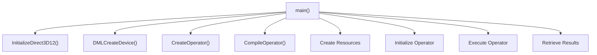

The HelloDirectML sample demonstrates the fundamental pattern for using DirectML, from initialization to execution and result retrieval.

Sources:
- [Samples/HelloDirectML/main.cpp:113-633]()
- [README.md:62-69]()
- [Samples/HelloDirectML/readme.md:12-23]()

## DxDispatch Model Format

DxDispatch uses a JSON-based format to define ML models, resources, and execution commands. This format enables users to quickly test and benchmark DirectML operations without writing C++ code.

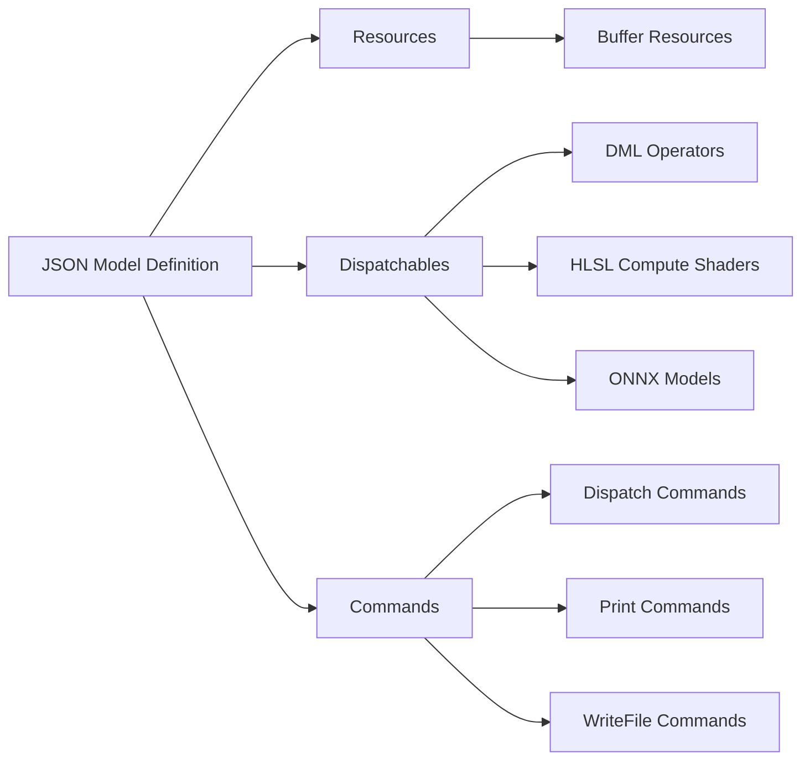

A typical DxDispatch model includes:
- **Resources**: Input, output, and intermediate data buffers
- **Dispatchables**: ML operators, compute shaders, or ONNX models
- **Commands**: Instructions for execution and result handling

Example JSON structure for a convolution operation:

```
{
    "resources": {
        "input": { /* tensor definition */ },
        "filter": { /* tensor definition */ },
        "output": { /* tensor definition */ }
    },
    "dispatchables": {
        "conv2d": {
            "type": "DML_OPERATOR_CONVOLUTION",
            "desc": { /* operator parameters */ }
        }
    },
    "commands": [
        {
            "type": "dispatch",
            "dispatchable": "conv2d",
            "bindings": { /* resource bindings */ }
        },
        { "type": "print", "resource": "output" }
    ]
}
```

Sources:
- [DxDispatch/models/dml_convolution_2d.json:1-60]()
- [DxDispatch/models/dml_convolution_3d.json:1-60]()
- [DxDispatch/src/dxdispatch/Executor.cpp:497-563]()

## Summary

The DirectML architecture provides a flexible, high-performance system for executing machine learning workloads on DirectX 12-capable hardware. Its layered design offers options ranging from low-level control to higher-level abstractions, enabling a wide range of use cases from gaming to professional ML applications.

The system's core strengths include:
- Direct integration with DirectX 12 for optimal performance
- Support for diverse hardware from GPUs to specialized NPUs
- Multiple abstraction levels for different developer needs
- Extensible design supporting multiple ML frameworks
- Tools for rapid prototyping and benchmarking

This architecture allows DirectML to serve as a foundation for ML acceleration across Windows devices, powering applications from real-time graphics enhancement to complex neural networks.

Sources:
- [README.md:3-19]()
- [README.md:43-49]()
- [README.md:62-69]()

---

# Page: Release History and Versioning

# Release History and Versioning

<details>
<summary>Relevant source files</summary>

The following files were used as context for generating this wiki page:

- [DxDispatch/cmake/directml.cmake](DxDispatch/cmake/directml.cmake)
- [Releases.md](Releases.md)
- [Samples/DirectMLSuperResolution/packages.config](Samples/DirectMLSuperResolution/packages.config)
- [Samples/yolov4/packages.config](Samples/yolov4/packages.config)

</details>


This page documents the versioning system of DirectML, its release history, and how feature levels relate to version numbers. It provides guidance for selecting appropriate versions for compatibility with different platforms and integration methods. For information about the overall system architecture, see [System Architecture](#1.1).

## Versioning System Overview

DirectML employs a dual versioning approach:

1. **Library Version** (e.g., 1.15.2): Identifies the specific release of the DirectML library
2. **Feature Level** (e.g., DML_FEATURE_LEVEL_6_4): Represents the set of capabilities and operators available

This approach allows applications to target specific functionality while maintaining backward compatibility. When creating a DirectML device, applications can specify a minimum required feature level to ensure certain features are available.

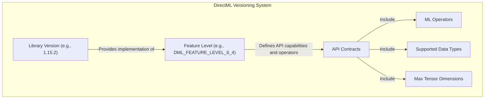

Sources: [Releases.md:1-33]()

## Feature Level System

Feature levels in DirectML provide a way to categorize and version API capabilities. Each new feature level introduces additional operators, extends existing operators, or adds support for new data types. Feature levels are strictly hierarchical - higher levels include all functionality from lower levels.

```mermaid
graph TD
    subgraph "Feature Level Hierarchy"
        FL1.0["DML_FEATURE_LEVEL_1_0"]
        FL2.0["DML_FEATURE_LEVEL_2_0"]
        FL2.1["DML_FEATURE_LEVEL_2_1"]
        FL3.0["DML_FEATURE_LEVEL_3_0"]
        FL3.1["DML_FEATURE_LEVEL_3_1"]
        FL4.0["DML_FEATURE_LEVEL_4_0"]
        FL4.1["DML_FEATURE_LEVEL_4_1"]
        FL5.0["DML_FEATURE_LEVEL_5_0"]
        FL5.1["DML_FEATURE_LEVEL_5_1"]
        FL5.2["DML_FEATURE_LEVEL_5_2"]
        FL6.0["DML_FEATURE_LEVEL_6_0"]
        FL6.1["DML_FEATURE_LEVEL_6_1"]
        FL6.2["DML_FEATURE_LEVEL_6_2"]
        FL6.3["DML_FEATURE_LEVEL_6_3"]
        FL6.4["DML_FEATURE_LEVEL_6_4"]
        
        FL1.0 --> FL2.0
        FL2.0 --> FL2.1
        FL2.1 --> FL3.0
        FL3.0 --> FL3.1
        FL3.1 --> FL4.0
        FL4.0 --> FL4.1
        FL4.1 --> FL5.0
        FL5.0 --> FL5.1
        FL5.1 --> FL5.2
        FL5.2 --> FL6.0
        FL6.0 --> FL6.1
        FL6.1 --> FL6.2
        FL6.2 --> FL6.3
        FL6.3 --> FL6.4
    end
```

Sources: [Releases.md:1-33](), [Releases.md:38-67](), [Releases.md:77-96](), [Releases.md:104-107](), [Releases.md:110-120](), [Releases.md:128-137](), [Releases.md:149-160](), [Releases.md:172-179](), [Releases.md:183-190](), [Releases.md:194-202](), [Releases.md:209-220](), [Releases.md:238-244](), [Releases.md:248-254](), [Releases.md:258]()

## Release Timeline and OS Availability

DirectML versions are either included in Windows OS releases or available as redistributable packages. This table summarizes the release history:

| DirectML Version | Feature Level | First Available OS | Redistributable Package |
|------------------|---------------|-------------------|------------------------|
| 1.15.x (Current) | DML_FEATURE_LEVEL_6_4 | TBD | Microsoft.AI.DirectML.1.15.x |
| 1.13.x | DML_FEATURE_LEVEL_6_2 | TBD | Microsoft.AI.DirectML.1.13.x |
| 1.12.x | DML_FEATURE_LEVEL_6_1 | TBD | Microsoft.AI.DirectML.1.12.x |
| 1.11.0 | DML_FEATURE_LEVEL_6_0 | TBD | Microsoft.AI.DirectML.1.11.0 |
| 1.10.x | DML_FEATURE_LEVEL_5_2 | TBD | Microsoft.AI.DirectML.1.10.x |
| 1.9.x | DML_FEATURE_LEVEL_5_1 | TBD | Microsoft.AI.DirectML.1.9.x |
| 1.8.x | DML_FEATURE_LEVEL_5_0 | Windows 11 2022 Update (22H2) | Microsoft.AI.DirectML.1.8.x |
| 1.7.0 | DML_FEATURE_LEVEL_4_1 | Redistributable only | Microsoft.AI.DirectML.1.7.0 |
| 1.6.0 | DML_FEATURE_LEVEL_4_0 | Windows 11 (21H2) | Microsoft.AI.DirectML.1.6.0 |
| 1.5.x | DML_FEATURE_LEVEL_3_1 | Redistributable only | Microsoft.AI.DirectML.1.5.x |
| 1.4.x | DML_FEATURE_LEVEL_3_0 | Redistributable only | Microsoft.AI.DirectML.1.4.x |
| 1.1.0 | DML_FEATURE_LEVEL_2_0 | Windows 10 May 2020 Update (2004) | - |
| 1.0.0 | DML_FEATURE_LEVEL_1_0 | Windows 10 May 2019 Update (1903) | - |

Sources: [Releases.md:5-33]()

## Distribution Methods

DirectML can be integrated into applications through several methods:

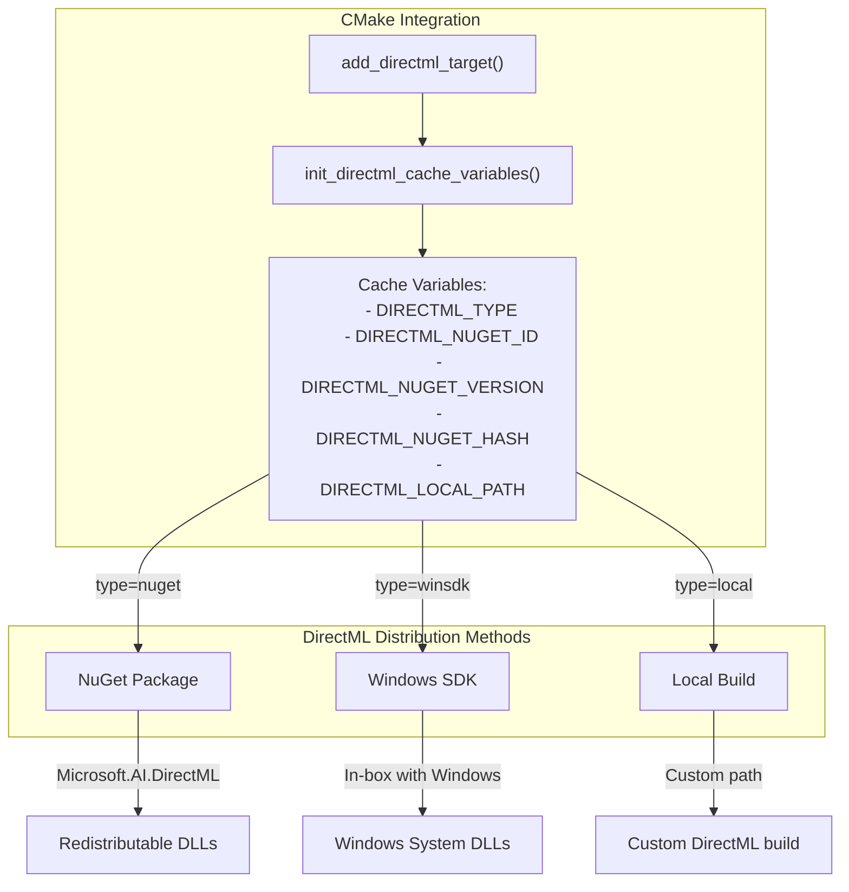

Sources: [DxDispatch/cmake/directml.cmake:1-239]()

### NuGet Package

The NuGet package (`Microsoft.AI.DirectML`) is the recommended way to integrate DirectML into applications, providing:

- Access to the latest features without OS dependencies
- Availability for different platforms and architectures
- Consistent versioning across development environments

Sample applications in the DirectML repository use this approach:

Sources: [Samples/yolov4/packages.config:1-5](), [Samples/DirectMLSuperResolution/packages.config:1-5](), [DxDispatch/cmake/directml.cmake:67-106]()

### Windows SDK

For applications targeting specific Windows versions, DirectML can be used from the Windows SDK:

- No additional redistribution required
- Version tied to the OS version
- Limited to Windows platforms

Sources: [DxDispatch/cmake/directml.cmake:108-117]()

### Local Build

For development and testing, a local build of DirectML can be used:

- Useful for testing unreleased features
- Required for custom builds or modifications
- Not recommended for production releases

Sources: [DxDispatch/cmake/directml.cmake:119-156]()

## Key Feature Level Milestones

This section highlights significant additions in each feature level:

### DML_FEATURE_LEVEL_6_4 (DirectML 1.15.x)

- New operators: RESAMPLE3, FOLD, UNFOLD
- Updated operators with new capabilities
- LLM optimization: INT4 Dequantize + GEMM fusion, Multihead Attention fusion

### DML_FEATURE_LEVEL_6_3 (DirectML 1.15.x)

- New data types: UINT4, INT4
- New operators including MULTIHEAD_ATTENTION1 and QUANTIZE/DEQUANTIZE with INT4/UINT4 support

### DML_FEATURE_LEVEL_6_2 (DirectML 1.13.x)

- Intel Core Ultra NPU support
- New activation operators: SWISH, HARD_SWISH
- New graph node type: DML_GRAPH_NODE_TYPE_CONSTANT

### DML_FEATURE_LEVEL_6_1 (DirectML 1.12.x)

- Added MULTIHEAD_ATTENTION operator
- Support for fusing SOFTMAX activation with GEMM operations

### DML_FEATURE_LEVEL_6_0 (DirectML 1.11.0)

- Expanded 64-bit data type support across more operators
- FLOAT16 data type support for quantization operations
- Performance improvements for SOFTMAX activation and GEMM

### DML_FEATURE_LEVEL_5_0 to 5_2 (DirectML 1.8.x - 1.10.x)

- Expanded rank support across operators
- Added operators: CLIP1, CLIP_GRAD1, PADDING1, ELEMENT_WISE_NEGATE
- First version available in Windows 11 2022 Update

### DML_FEATURE_LEVEL_4_0 and 4_1 (DirectML 1.6.0 - 1.7.0)

- Support for 8D tensors in more operators
- Added operators for quantized operations and optimization
- First version available in Windows 11 (21H2)

### DML_FEATURE_LEVEL_3_0 and 3_1 (DirectML 1.4.x - 1.5.x)

- First release as a redistributable NuGet package
- 44 new operators added
- Increased tensor dimension support from 5D to 8D
- Initial support for ARM/ARM64 builds

### DML_FEATURE_LEVEL_2_0 (DirectML 1.1.0)

- Added 19 new operators
- Support for 8-bit integer tensors
- Available in Windows 10 May 2020 Update

### DML_FEATURE_LEVEL_1_0 (DirectML 1.0.0)

- Initial release of DirectML
- Available in Windows 10 May 2019 Update

Sources: [Releases.md:38-258]()

## Version Selection and Integration

When integrating DirectML, you must consider:

1. **Target Feature Level**: Select the minimum feature level your application requires
2. **Distribution Method**: Choose between NuGet, Windows SDK, or local build
3. **Platform Compatibility**: Ensure compatibility with your target platforms
4. **Fallback Strategy**: Implement fallback mechanisms for systems without your required feature level

### CMake Integration Example

```cmake
# Set DirectML version and distribution method
set(PREFIX_DIRECTML_TYPE "nuget" CACHE STRING "DirectML dependency type")
set(PREFIX_DIRECTML_NUGET_VERSION "1.15.2" CACHE STRING "Version of DirectML NuGet package")

# Add DirectML as a dependency
add_directml_target(directml CACHE_PREFIX PREFIX)

# Link your application with DirectML
target_link_libraries(your_app PRIVATE directml)
```

Sources: [DxDispatch/cmake/directml.cmake:1-239]()

### Runtime Feature Level Detection

Applications should check for feature level support at runtime:

```cpp
// Create a DirectML device with a minimum feature level
DML_CREATE_DEVICE_FLAGS flags = DML_CREATE_DEVICE_FLAG_NONE;
IDMLDevice* dmlDevice = nullptr;
HRESULT hr = DMLCreateDevice1(
    d3d12Device,                // ID3D12Device
    flags,                      // DML_CREATE_DEVICE_FLAGS 
    DML_FEATURE_LEVEL_6_2,      // Minimum required feature level
    IID_PPV_ARGS(&dmlDevice)    // Output DirectML device
);

if (FAILED(hr)) {
    // Feature level not supported - implement fallback or notify user
}
```

Sources: [Releases.md:1-33](), [DxDispatch/cmake/directml.cmake:1-239]()

## Sample Application Versions

The sample applications in the DirectML repository use the following version:

- YOLOv4 Sample: Microsoft.AI.DirectML 1.15.2
- DirectMLSuperResolution Sample: Microsoft.AI.DirectML 1.15.2

This indicates the current recommended version for new development.

Sources: [Samples/yolov4/packages.config:1-5](), [Samples/DirectMLSuperResolution/packages.config:1-5]()

## Conclusion

DirectML's versioning system with feature levels provides a flexible way to target specific capabilities while maintaining backward compatibility. By selecting the appropriate version and distribution method, developers can build ML-accelerated applications that work across a variety of Windows platforms and hardware.

For detailed feature level specifications, refer to the [DirectML version history on MSDN](https://docs.microsoft.com/windows/win32/direct3d12/dml-version-history) mentioned in the releases documentation.

Sources: [Releases.md:3]()

---

# Page: Core Components

# Core Components

<details>
<summary>Relevant source files</summary>

The following files were used as context for generating this wiki page:

- [DxDispatch/models/dml_convolution_2d.json](DxDispatch/models/dml_convolution_2d.json)
- [DxDispatch/models/dml_convolution_3d.json](DxDispatch/models/dml_convolution_3d.json)
- [Libraries/DirectMLX.h](Libraries/DirectMLX.h)
- [README.md](README.md)
- [Samples/DirectMLSuperResolution/Kits/DirectXTK12/DirectXTK_Desktop_2017_Win10.vcxproj](Samples/DirectMLSuperResolution/Kits/DirectXTK12/DirectXTK_Desktop_2017_Win10.vcxproj)
- [Samples/DirectMLSuperResolution/Readme.md](Samples/DirectMLSuperResolution/Readme.md)
- [Samples/HelloDirectML/main.cpp](Samples/HelloDirectML/main.cpp)
- [Samples/HelloDirectML/readme.md](Samples/HelloDirectML/readme.md)
- [Samples/yolov4/Kits/DirectXTK12/DirectXTK_Desktop_2017_Win10.vcxproj](Samples/yolov4/Kits/DirectXTK12/DirectXTK_Desktop_2017_Win10.vcxproj)
- [Samples/yolov4/Readme.md](Samples/yolov4/Readme.md)
- [TensorFlow/README.md](TensorFlow/README.md)

</details>


This page provides a detailed overview of the foundational libraries that comprise the DirectML system. These components form the backbone of DirectML's architecture, enabling hardware-accelerated machine learning operations across DirectX 12-compatible GPUs and NPUs.

For information about framework integrations like PyTorch and ONNX Runtime, see [Framework Integrations](#5). For details on the DxDispatch tool, see [DxDispatch Tool](#3).

## Overview of Core Components

DirectML consists of several key core components that work together to provide a complete hardware-accelerated machine learning solution:

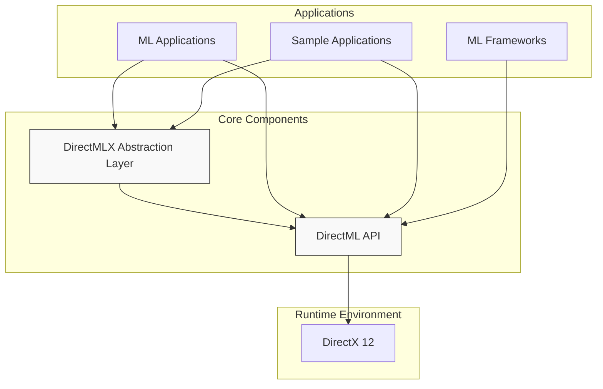

Sources: [README.md:1-32](), [Libraries/DirectMLX.h:1-32]()

## DirectML API

The DirectML API is the foundation of the DirectML system. It provides a low-level, hardware-accelerated interface for executing machine learning operations on DirectX 12-capable GPUs from various vendors.

### Key Characteristics

- **DirectX 12 Integration**: Built on DirectX 12 for high-performance GPU computation
- **Hardware Agnostic**: Works across AMD, Intel, NVIDIA, and Qualcomm GPUs and NPUs
- **Low Overhead**: Designed for high-performance, low-latency applications
- **Operator-Based**: Provides atomic ML operations that can be combined to form complex networks

### Core Concepts

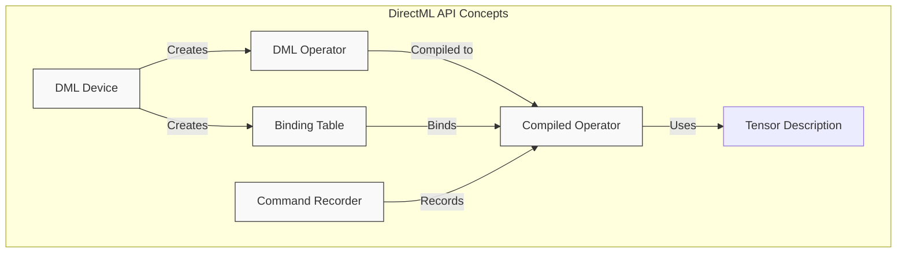

Sources: [Samples/HelloDirectML/main.cpp:132-183](), [README.md:28-45]()

### API Usage Flow

The typical usage flow of the DirectML API involves several key steps:

1. **Initialize DirectX 12**: Set up D3D12 device and command queue
2. **Create DirectML Device**: Initialize the DirectML device with the D3D12 device
3. **Create Operators**: Define the ML operations to perform
4. **Compile Operators**: Convert operators into optimized GPU code
5. **Resource Management**: Create and manage buffers for inputs and outputs
6. **Execute Operations**: Record and execute commands on the GPU
7. **Retrieve Results**: Copy results back from GPU to CPU when needed

Sources: [Samples/HelloDirectML/main.cpp:114-131](), [Samples/HelloDirectML/main.cpp:184-445]()

### Example Workflow

The following table outlines a simplified workflow using the DirectML API:

| Step | Description | API Functions |
|------|-------------|--------------|
| 1 | Initialize D3D12 | `D3D12CreateDevice`, `CreateCommandQueue` |
| 2 | Create DirectML device | `DMLCreateDevice` |
| 3 | Define tensor descriptions | `DML_BUFFER_TENSOR_DESC` |
| 4 | Create operators | `CreateOperator` |
| 5 | Compile operators | `CompileOperator` |
| 6 | Create binding tables | `CreateBindingTable` |
| 7 | Bind resources | `BindInputs`, `BindOutputs` |
| 8 | Record commands | `RecordDispatch` |
| 9 | Execute on GPU | `ExecuteCommandLists` |

Sources: [Samples/HelloDirectML/main.cpp:113-482]()

## DirectMLX Abstraction Layer

DirectMLX is a C++ abstraction layer built on top of the DirectML API that simplifies the process of constructing and executing machine learning graphs. It reduces boilerplate code and provides a more intuitive interface for working with DirectML.

### Architecture

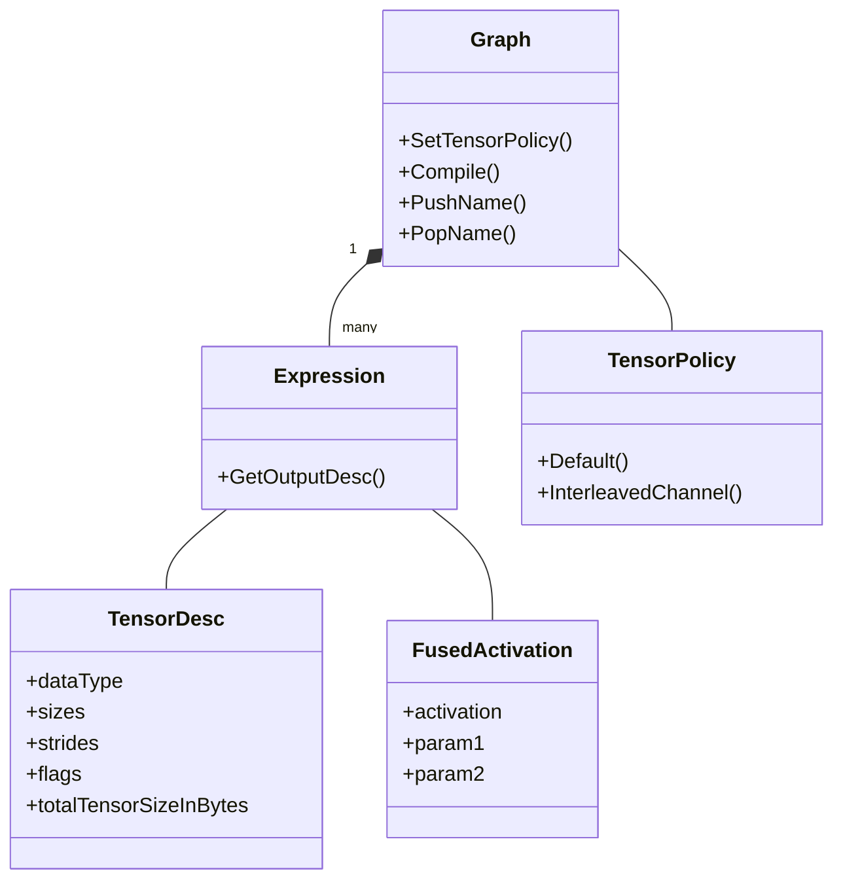

Sources: [Libraries/DirectMLX.h:285-962]()

### Key Components

#### Graph

The `Graph` class is the central component of DirectMLX, representing a computational graph of operations:

- Creates and manages a collection of operations (expressions)
- Compiles the graph into a compiled operator for execution
- Manages tensor policies for controlling memory layout
- Provides naming scopes for debugging and visualization

```cpp
Graph graph(dmlDevice.Get());
dml::Expression output = dml::Identity(input);
dmlCompiledOperator = graph.Compile(executionFlags, { output });
```

Sources: [Libraries/DirectMLX.h:794-855](), [Samples/HelloDirectML/main.cpp:202-223]()

#### Expression

The `Expression` class represents a node in the computational graph:

- Represents operations or tensors in the graph
- Provides information about the operation's output tensor
- Can be combined to form complex computational graphs
- Implemented by `NodeOutput` internally

Sources: [Libraries/DirectMLX.h:756-793]()

#### TensorDesc

The `TensorDesc` class describes the properties of a tensor:

- Defines the data type, dimensions, and memory layout
- Calculates total memory requirements
- Configurable with custom strides for optimized memory access patterns
- Used to define inputs and outputs of operations

Sources: [Libraries/DirectMLX.h:411-527]()

#### TensorPolicy

The `TensorPolicy` class provides control over how tensors are laid out in memory:

- Can specify custom strides for different memory access patterns
- Includes built-in policies like `Default()` and `InterleavedChannel()`
- Allows optimization for specific hardware or operation patterns
- Applied via the `Graph` class

Sources: [Libraries/DirectMLX.h:302-409]()

### Operator Creation

DirectMLX simplifies operator creation through helper functions that create expressions:

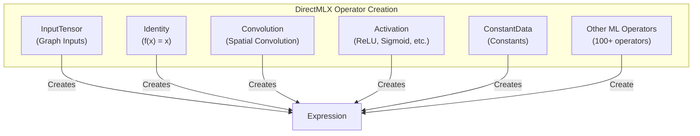

Sources: [Libraries/DirectMLX.h:1025-1047](), [Samples/HelloDirectML/main.cpp:205-219]()

### Simplified Workflow

The DirectMLX abstraction layer significantly simplifies the DirectML workflow:

| Step | DirectML API | DirectMLX |
|------|--------------|-----------|
| 1 | Create tensor descriptions manually | Use `TensorDesc` constructor |
| 2 | Create operator descriptions manually | Use operator helper functions |
| 3 | Create and manage operators | Automatically managed by `Graph` |
| 4 | Compile operators | Call `Graph::Compile()` |
| 5 | Manage intermediate results | Automatically handled via expressions |

Sources: [Samples/HelloDirectML/main.cpp:141-179](), [Samples/HelloDirectML/main.cpp:196-223]()

## Component Integration

DirectML's core components are designed to integrate seamlessly with each other and with external systems:

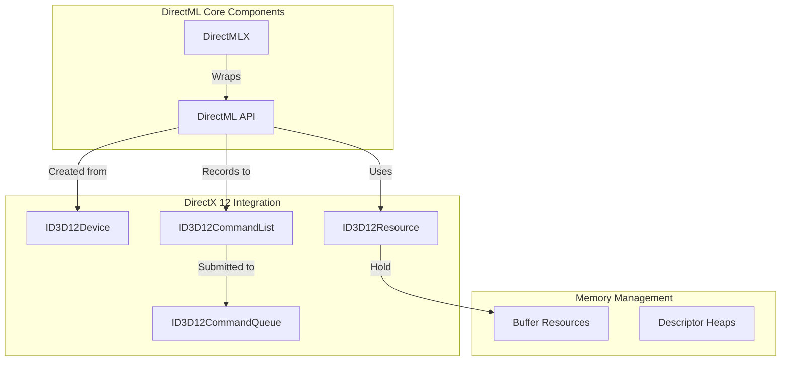

Sources: [Samples/HelloDirectML/main.cpp:14-82](), [Samples/HelloDirectML/main.cpp:365-483]()

### Tensor Data Flow

Understanding how data flows through tensors is critical for effective use of DirectML:

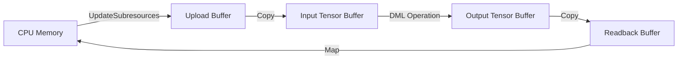

Sources: [Samples/HelloDirectML/main.cpp:367-482]()

## Performance Considerations

When working with DirectML core components, consider these performance best practices:

1. **Resource Reuse**: Reuse resources, binding tables, and operators when possible
2. **Batch Processing**: Process multiple inputs in batches rather than individually
3. **Memory Layout**: Use appropriate tensor policies for optimized memory access patterns
4. **Fusion**: Fuse operations where possible using the `FusedActivation` feature
5. **Persistent Resources**: Properly manage persistent resources for compiled operators
6. **Descriptor Management**: Efficiently manage descriptor heaps for binding tables
7. **Command Recording**: Batch command recording to reduce overhead

Sources: [Libraries/DirectMLX.h:856-962](), [Samples/HelloDirectML/main.cpp:274-336]()

## Debugging and Validation

DirectML provides several debugging and validation features:

- **Debug Layer**: Enable with `DML_CREATE_DEVICE_FLAG_DEBUG` for validation
- **Error Messages**: Detailed error messages when operations fail
- **PIX Integration**: Compatible with PIX for Windows for GPU debugging
- **Naming**: Use `Graph::PushName()` in DirectMLX to name operations for debugging

Sources: [Samples/HelloDirectML/main.cpp:123-136](), [Libraries/DirectMLX.h:806-814]()

## Summary

The core components of DirectML provide a comprehensive foundation for machine learning on DirectX 12-capable hardware:

- **DirectML API**: Low-level, high-performance interface to ML operators
- **DirectMLX**: C++ abstraction layer for simplified graph construction
- **Integration**: Seamless integration with DirectX 12 and machine learning applications

These components work together to enable efficient, hardware-accelerated machine learning across a wide range of GPUs and NPUs. For more details on how to use DirectMLX, see [DirectMLX Abstraction Layer](#2.1). For build and integration information, see [Build and Integration](#2.2).

---

# Page: DirectMLX Abstraction Layer

# DirectMLX Abstraction Layer

<details>
<summary>Relevant source files</summary>

The following files were used as context for generating this wiki page:

- [DxDispatch/models/dml_convolution_2d.json](DxDispatch/models/dml_convolution_2d.json)
- [DxDispatch/models/dml_convolution_3d.json](DxDispatch/models/dml_convolution_3d.json)
- [Libraries/DirectMLX.h](Libraries/DirectMLX.h)
- [Samples/DirectMLSuperResolution/Kits/DirectXTK12/DirectXTK_Desktop_2017_Win10.vcxproj](Samples/DirectMLSuperResolution/Kits/DirectXTK12/DirectXTK_Desktop_2017_Win10.vcxproj)
- [Samples/HelloDirectML/HelloDirectML.vcxproj](Samples/HelloDirectML/HelloDirectML.vcxproj)
- [Samples/HelloDirectML/HelloDirectMLX.vcxproj](Samples/HelloDirectML/HelloDirectMLX.vcxproj)
- [Samples/HelloDirectML/main.cpp](Samples/HelloDirectML/main.cpp)
- [Samples/HelloDirectML/packages.config](Samples/HelloDirectML/packages.config)
- [Samples/yolov4/Kits/DirectXTK12/DirectXTK_Desktop_2017_Win10.vcxproj](Samples/yolov4/Kits/DirectXTK12/DirectXTK_Desktop_2017_Win10.vcxproj)

</details>


## Purpose and Scope

The DirectMLX Abstraction Layer is a C++ header-only API that simplifies working with DirectML by providing high-level abstractions for building, compiling, and executing machine learning computational graphs. It serves as a modern C++ wrapper around the lower-level DirectML C API, reducing boilerplate code and enabling more concise and readable implementation of machine learning operations on DirectX 12 compatible hardware.

This document covers the architecture, key classes, and usage patterns of the DirectMLX abstraction layer. For information about the core DirectML API, see [DirectML Overview](#1).

Sources: [Libraries/DirectMLX.h:133-133](), [Libraries/DirectMLX.h:285-855]()

## Architecture Overview

DirectMLX sits between application code and the DirectML API, providing C++ abstractions that make it easier to work with DirectML's concepts. It uses a declarative, expression-based approach to define computational graphs, which are then translated into DirectML operator graphs for execution.

### Key Components Diagram

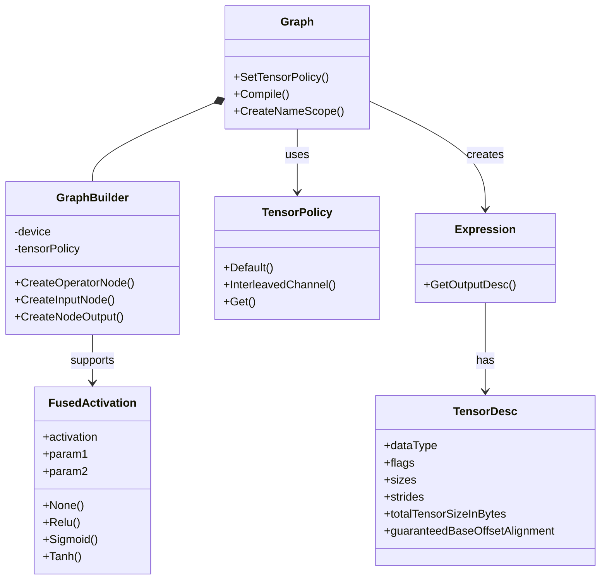

Sources: [Libraries/DirectMLX.h:285-855](), [Libraries/DirectMLX.h:796-855](), [Libraries/DirectMLX.h:756-776](), [Libraries/DirectMLX.h:411-526](), [Libraries/DirectMLX.h:302-409](), [Libraries/DirectMLX.h:866-962]()

## Core Components

### Graph and Expression Classes

The central components of DirectMLX are the `Graph` and `Expression` classes:

- **Graph**: Represents a computational graph that can be compiled into a DirectML operator. It serves as the entry point for creating machine learning models.
  
- **Expression**: Represents a node in the computational graph, which could be an input tensor, a constant, or an operation to be performed.

Expressions are building blocks that can be composed to create complex computational pipelines. Each expression holds a reference to its output tensor description, allowing the system to track tensor shapes and types throughout the graph.

```mermaid
graph TD
    subgraph "Graph Building Process"
        A["Create Graph"] --> B["Create Input Expressions"]
        B --> C["Apply Operations to Create New Expressions"]
        C --> D["Define Output Expressions"]
        D --> E["Compile Graph"]
        E --> F["Execute Compiled Graph"]
    end
```

Sources: [Libraries/DirectMLX.h:756-855](), [Libraries/DirectMLX.h:285-295](), [Libraries/DirectMLX.h:816-851]()

### TensorDesc and Memory Management

`TensorDesc` defines the properties of a tensor, including:

- Data type (e.g., FLOAT32, FLOAT16, INT32)
- Dimensions
- Strides (optional)
- Total size in bytes
- Base offset alignment guarantees

DirectMLX handles tensor memory layout through the `TensorPolicy` class, which provides strategies for determining tensor properties like strides and size calculations:

| Policy Method | Description |
|---------------|-------------|
| `Default()` | Default tensor layout with no specific stride requirements |
| `InterleavedChannel()` | Creates tensors with channel-interleaved memory layout (e.g., NHWC instead of NCHW) |
| Custom | User-defined policies can be created by providing a custom function |

Sources: [Libraries/DirectMLX.h:411-526](), [Libraries/DirectMLX.h:302-409](), [Libraries/DirectMLX.h:59-131]()

### Under the Hood: GraphBuilder Implementation

While users primarily interact with the `Graph` and `Expression` classes, internally a `GraphBuilder` does the heavy lifting:

1. It maintains collections of nodes (inputs, operators, reinterprets, constants)
2. It creates `NodeOutput` objects that track tensor information
3. It translates the graph into DirectML operator descriptions when compilation is requested

The `GraphBuilder` creates several types of nodes:

- `InputNode`: Represents a graph input
- `OperatorNode`: Wraps a DirectML operator
- `ReinterpretNode`: Used for reshapes and type conversions
- `ConstantNode`: Represents constant data available at compile time

Sources: [Libraries/DirectMLX.h:529-739](), [Libraries/DirectMLX.h:611-739]()

## Graph Construction Flow

Building and executing a graph with DirectMLX follows this general pattern:

```mermaid
sequenceDiagram
    participant App as "Application"
    participant Graph as "dml::Graph"
    participant Expr as "dml::Expression"
    participant DML as "DirectML API"
    
    App->>Graph: Create Graph(dmlDevice)
    App->>Graph: SetTensorPolicy(policy) [optional]
    
    App->>Expr: Create input expression(s) via InputTensor()
    App->>Expr: Apply operations to create derived expressions
    
    App->>Graph: Compile(flags, outputs)
    Graph-->>DML: Translate to DirectML operator graph
    DML-->>Graph: Return IDMLCompiledOperator
    Graph-->>App: Return compiled operator
    
    App->>DML: Set up resources and binding tables
    App->>DML: Execute compiled operator
```

Sources: [Libraries/DirectMLX.h:816-851](), [Samples/HelloDirectML/main.cpp:194-227]()

## Operators and Activations

DirectMLX supports a wide range of operators through expression creation functions. These operators correspond to the underlying DirectML operators but with a simplified interface. Some common patterns include:

1. **Element-wise operators**: Add, subtract, multiply, divide
2. **Neural network layers**: Convolution, pooling, normalization
3. **Tensor manipulation**: Reshape, transpose, slice, concatenate

The `FusedActivation` class allows activation functions to be fused with operators, improving performance:

```
FusedActivation
├── None()
├── Identity()
├── Relu()
├── Sigmoid()
├── Tanh()
├── LeakyRelu(alpha)
├── ParametricSoftplus(alpha, beta)
├── Elu(alpha)
└── ... (other activations)
```

Sources: [Libraries/DirectMLX.h:866-962](), [Libraries/DirectMLX.h:1025-1047]()

## Usage Example Flow

The following diagram illustrates how the HelloDirectML sample uses DirectMLX to create and execute a simple identity operation:

```mermaid
graph TD
    subgraph "DirectMLX Usage Example"
        Init["Initialize D3D12 & DirectML"] --> CreateGraph["Create dml::Graph"]
        CreateGraph --> InputTensor["Create input tensor expression"]
        InputTensor --> IdentityOp["Apply Identity operation"]
        IdentityOp --> Compile["Compile graph to IDMLCompiledOperator"]
        Compile --> Setup["Set up resources and binding tables"]
        Setup --> Execute["Execute operator on GPU"]
        Execute --> ReadBack["Read back results"]
    end
```

In this example:
1. A `dml::Graph` is created from an `IDMLDevice`
2. An input tensor expression is created with a specific tensor description
3. The Identity operator is applied to create a new expression
4. The graph is compiled with the output expression
5. Resources are bound and the compiled operator is executed
6. Results are read back from the GPU

Sources: [Samples/HelloDirectML/main.cpp:194-227](), [Samples/HelloDirectML/main.cpp:227-477]()

## Integration with Applications

DirectMLX is designed to be used as a header-only library, making it easy to integrate with existing projects:

1. Include the `DirectMLX.h` header
2. Ensure DirectML is properly initialized with a D3D12 device
3. Build your computational graph using the DirectMLX abstractions
4. Compile and execute the graph

Projects can include DirectMLX by referencing the header file directly or by using the DirectML NuGet package, which includes the DirectMLX header.

The HelloDirectML sample project demonstrates both the raw DirectML API usage and the DirectMLX abstraction layer, controlled by the `USE_DMLX` preprocessor definition.

Sources: [Samples/HelloDirectML/HelloDirectMLX.vcxproj:231-233](), [Samples/HelloDirectML/main.cpp:194-227](), [Samples/HelloDirectML/packages.config:1-5]()

## Benefits and Tradeoffs

### Advantages of DirectMLX

1. **Reduced boilerplate**: Simplifies creation of DirectML operators
2. **Type safety**: Leverages C++ type system to prevent common errors
3. **Expression composition**: Makes building complex graphs more intuitive
4. **Memory management**: Handles resource lifetime through RAII principles

### Limitations

1. **Additional layer**: Introduces a thin abstraction layer that may not be desirable for all applications
2. **Learning curve**: Requires understanding both DirectML concepts and DirectMLX abstractions
3. **Header-only**: While convenient for integration, can increase compilation times

## Conclusion

The DirectMLX Abstraction Layer provides a modern C++ interface to DirectML, making it easier to build and execute machine learning graphs. Through its expression-based interface and sensible defaults, it reduces the amount of code required while maintaining the performance and flexibility of the underlying DirectML API.

Sources: [Libraries/DirectMLX.h:1-294](), [Libraries/DirectMLX.h:756-855]()

---

# Page: Build and Integration

# Build and Integration

<details>
<summary>Relevant source files</summary>

The following files were used as context for generating this wiki page:

- [DxDispatch/README.md](DxDispatch/README.md)
- [DxDispatch/cmake/d3d12.cmake](DxDispatch/cmake/d3d12.cmake)
- [DxDispatch/cmake/directml.cmake](DxDispatch/cmake/directml.cmake)
- [DxDispatch/cmake/dxcompiler.cmake](DxDispatch/cmake/dxcompiler.cmake)
- [DxDispatch/cmake/onnxruntime.cmake](DxDispatch/cmake/onnxruntime.cmake)
- [DxDispatch/models/dml_scalar_union_fp16.json](DxDispatch/models/dml_scalar_union_fp16.json)
- [DxDispatch/src/dxdispatch/DxModules.cpp](DxDispatch/src/dxdispatch/DxModules.cpp)
- [DxDispatch/src/dxdispatch/DxModules.h](DxDispatch/src/dxdispatch/DxModules.h)
- [DxDispatch/src/dxdispatch/ModuleInfo.cpp](DxDispatch/src/dxdispatch/ModuleInfo.cpp)
- [DxDispatch/src/dxdispatch/ModuleInfo.h](DxDispatch/src/dxdispatch/ModuleInfo.h)
- [DxDispatch/src/model/JsonParsersGenerated.cpp](DxDispatch/src/model/JsonParsersGenerated.cpp)
- [DxDispatch/tools/GenerateParsingHelpers.ps1](DxDispatch/tools/GenerateParsingHelpers.ps1)
- [Releases.md](Releases.md)
- [Samples/DirectMLSuperResolution/packages.config](Samples/DirectMLSuperResolution/packages.config)
- [Samples/yolov4/packages.config](Samples/yolov4/packages.config)

</details>


This page explains how to integrate DirectML into applications using various build systems. It covers the available distribution options, build system integrations, and platform-specific considerations. For information about DirectML API versions and feature levels, see [Release History and Versioning](#1.2).

## Distribution Options

DirectML can be integrated into your application in multiple ways. The best approach depends on your development environment, platform targets, and specific requirements.

### Distribution Options Diagram

```mermaid
flowchart TD
    subgraph "Integration Options"
        direction LR
        
        nuget["NuGet Package
        Microsoft.AI.DirectML"]
        
        winsdk["Windows SDK
        Built-in OS Version"]
        
        local["Local Build
        Custom Modifications"]
    end
    
    subgraph "Platform Support"
        win["Windows x64/x86/ARM64"]
        xbox["Xbox"]
        wsl["Linux/WSL"]
    end
    
    nuget --> win
    nuget --> xbox
    nuget --> wsl
    winsdk --> win
    local --> win
    local --> xbox
    local --> wsl
    
    subgraph "Advantages"
        direction TB
        nuget_adv["Redistributable
        Version Control
        Cross-platform"]
        
        winsdk_adv["No Redistribution
        System Integration"]
        
        local_adv["Development
        Customization
        Testing"]
    end
    
    nuget --- nuget_adv
    winsdk --- winsdk_adv
    local --- local_adv
```

Sources: [DxDispatch/cmake/directml.cmake:37-65](), [DxDispatch/README.md:77-130]()

### NuGet Package

The NuGet package is the most common and recommended way to integrate DirectML. It offers:

- Self-contained distribution without OS dependency
- Precise version control
- Support for Windows, Xbox, and Linux/WSL
- Easy integration with Visual Studio projects

The DirectML NuGet package is published as `Microsoft.AI.DirectML` and can be found at [nuget.org](https://www.nuget.org/packages/Microsoft.AI.DirectML/).

### Windows SDK

For applications targeting Windows only, you can use the DirectML version included in the Windows SDK. This approach:

- Avoids redistributing DirectML
- Uses the system-installed version
- May limit access to the latest features depending on OS version

### Local Build

For development and testing, you can build DirectML from source or use a custom build. This approach:

- Provides maximum flexibility
- Enables custom modifications
- Supports development workflows

## Integration with Build Systems

### NuGet Integration with Visual Studio

For Visual Studio projects, you can integrate DirectML using NuGet in several ways:

#### Using packages.config

Add a reference to the `Microsoft.AI.DirectML` package in your `packages.config` file:

```xml
<packages>
  <package id="Microsoft.AI.DirectML" version="1.15.2" targetFramework="native" />
</packages>
```

#### Using PackageReference (Modern .NET Projects)

For .NET SDK-style projects, add a `PackageReference` to your project file:

```xml
<ItemGroup>
  <PackageReference Include="Microsoft.AI.DirectML" Version="1.15.2" />
</ItemGroup>
```

Sources: [Samples/yolov4/packages.config:1-5](), [Samples/DirectMLSuperResolution/packages.config:1-5]()

### CMake Integration

DirectML provides CMake helper functions to simplify integration with CMake-based projects. The primary function is `add_directml_target` which creates a CMake target for DirectML.

#### DirectML CMake Integration Diagram

```mermaid
flowchart TD
    subgraph "CMake Project"
        project["Your Project"]
        
        subgraph "DirectML CMake Module"
            add_directml_target["add_directml_target()"]
            init_cache["init_directml_cache_variables()"]
            
            subgraph "Implementation Functions"
                nuget_impl["init_directml_target_nuget()"]
                winsdk_impl["init_directml_target_winsdk()"]
                local_impl["init_directml_target_local()"]
            end
        end
        
        config["Cache Variables:
        DML_DIRECTML_TYPE
        DML_DIRECTML_NUGET_ID
        DML_DIRECTML_NUGET_VERSION
        DML_DIRECTML_NUGET_HASH
        DML_DIRECTML_LOCAL_PATH"]
    end
    
    project --> add_directml_target
    add_directml_target --> init_cache
    init_cache --> config
    
    add_directml_target --> nuget_impl
    add_directml_target --> winsdk_impl
    add_directml_target --> local_impl
    
    nuget_impl --> nuget_download["Download from NuGet"]
    nuget_download --> setup_paths["Setup Include/Lib Paths"]
    setup_paths --> add_redist["Add Redistributable Files"]
    
    subgraph "Build Artifacts"
        dml_target["CMake Target:
        - Include Directories
        - Link Libraries
        - Compile Definitions"]
        
        redist["Redistributable Files:
        - DirectML.dll
        - DirectML.Debug.dll"]
    end
    
    add_directml_target --> dml_target
    add_redist --> redist
```

Sources: [DxDispatch/cmake/directml.cmake:27-239]()

#### Basic CMake Configuration

To use DirectML in a CMake project:

1. Include the DirectML CMake module
2. Call `add_directml_target` to create a DirectML target
3. Link your application against the DirectML target

```cmake
# Include the DirectML CMake module
include(cmake/directml.cmake)

# Create the DirectML target
add_directml_target(directml CACHE_PREFIX DML)

# Link your application
add_executable(your_app your_source_files.cpp)
target_link_libraries(your_app PRIVATE directml)
```

#### CMake Configuration Options

The following cache variables can be configured:

| Variable | Description | Default |
|----------|-------------|---------|
| `DML_DIRECTML_TYPE` | DirectML dependency type (`nuget`, `winsdk`, `local`) | `nuget` |
| `DML_DIRECTML_NUGET_ID` | ID of the DirectML NuGet package | `Microsoft.AI.DirectML` |
| `DML_DIRECTML_NUGET_VERSION` | Version of the DirectML NuGet package | `1.15.0` |
| `DML_DIRECTML_NUGET_HASH` | SHA256 hash of the NuGet package | (hash value) |
| `DML_DIRECTML_LOCAL_PATH` | Path to a local build of DirectML | "" |

These variables can be set using standard CMake methods:

```bash
cmake -DDML_DIRECTML_TYPE=winsdk ..
```

Sources: [DxDispatch/cmake/directml.cmake:30-66]()

### Manual Integration

For projects not using NuGet or CMake, you can manually integrate DirectML:

1. Download the DirectML binaries from NuGet or the GitHub repository
2. Add the appropriate include directories to your project
3. Link against DirectML.lib
4. Distribute DirectML.dll with your application

## Platform-Specific Considerations

### DirectML Platform Support Diagram

```mermaid
flowchart TD
    subgraph "Platform Integration"
        windows["Windows"]
        xbox["Xbox"]
        wsl["Linux/WSL"]
    end
    
    subgraph "Windows Integration"
        win_nuget["NuGet Package"]
        win_sdk["Windows SDK"]
        win_dir["Binary Locations:
        - x86-win
        - x64-win
        - arm-win
        - arm64-win"]
    end
    
    subgraph "Xbox Integration"
        xbox_nuget["NuGet Package"]
        xbox_gdk["Xbox GDK"]
    end
    
    subgraph "Linux/WSL Integration"
        wsl_nuget["NuGet Package"]
        wsl_bin["Binary Location:
        - x64-linux"]
    end
    
    windows --> win_nuget
    windows --> win_sdk
    win_nuget --> win_dir
    
    xbox --> xbox_nuget
    xbox --> xbox_gdk
    
    wsl --> wsl_nuget
    wsl_nuget --> wsl_bin
    
    subgraph "Runtime Filename"
        windows_name["DirectML.dll"]
        xbox_name["directml.dll"]
        wsl_name["libdirectml.so"]
    end
    
    windows -.-> windows_name
    xbox -.-> xbox_name
    wsl -.-> wsl_name
```

Sources: [DxDispatch/cmake/directml.cmake:85-99](), [DxDispatch/src/dxdispatch/ModuleInfo.h:2-30]()

### Windows

On Windows, DirectML is distributed as `DirectML.dll` and `DirectML.Debug.dll`. The NuGet package includes binaries for multiple architectures:

- x86-win
- x64-win
- arm-win
- arm64-win

### Xbox

On Xbox, DirectML is distributed as part of the Game Development Kit (GDK). The runtime module name is `directml.dll`.

### Linux/WSL

On Linux/WSL, DirectML is distributed as `libdirectml.so`. The NuGet package currently only includes binaries for x64-linux.

## Runtime Loading and Versioning

### Runtime Loading Diagram

```mermaid
sequenceDiagram
    participant App as Application
    participant Loader as Module Loader
    participant DML as DirectML DLL/SO

    App->>Loader: Load DirectML(Module Path)
    Note right of Loader: Platform-specific loading<br/>(LoadLibrary/dlopen)
    Loader->>DML: Load DLL/SO
    DML-->>Loader: Module Handle
    
    App->>Loader: GetSymbol("DMLCreateDevice1")
    Loader->>DML: Query Entry Point
    DML-->>Loader: Function Pointer
    Loader-->>App: Function Pointer
    
    App->>DML: DMLCreateDevice1(D3D12Device, ...)
    DML-->>App: IDMLDevice Interface
    
    App->>DML: Use DirectML Operations
```

Sources: [DxDispatch/src/dxdispatch/DxModules.cpp:14-117](), [DxDispatch/src/dxdispatch/DxModules.h:104-117]()

### DirectML API Version Selection

DirectML uses feature levels to represent API capabilities. When creating a DirectML device, you can specify the minimum required feature level:

```cpp
// Create with the latest available feature level
DMLCreateDevice1(
    d3d12Device,               // D3D12 device
    DML_CREATE_DEVICE_FLAG_NONE,
    DML_FEATURE_LEVEL_5_0,     // Minimum required feature level
    IID_PPV_ARGS(&dmlDevice)
);
```

Available feature levels are documented in the [Release History and Versioning](#1.2) page.

### Runtime Module Names

DirectML has different module names depending on the platform:

| Platform | Module Name |
|----------|-------------|
| Windows | `directml.dll` |
| Xbox | `directml.dll` |
| Linux/WSL | `libdirectml.so` |

Sources: [DxDispatch/src/dxdispatch/ModuleInfo.h:2-30]()

## Related Dependencies

### Component Relationship Diagram

```mermaid
flowchart TD
    app["Your Application"]
    
    subgraph "DirectML Components"
        dml["DirectML
        (directml.dll)"]
        
        dmlx["DirectMLX
        (Header-only)"]
    end
    
    subgraph "DirectX Components"
        d3d12["Direct3D 12
        (d3d12.dll)"]
        
        dxcore["DXCore
        (dxcore.dll)"]
    end
    
    subgraph "Optional Components"
        onnx["ONNX Runtime
        (onnxruntime.dll)"]
        
        dxc["DirectX Compiler
        (dxcompiler.dll)"]
        
        pix["PIX Event Runtime
        (WinPixEventRuntime.dll)"]
    end
    
    app --> dml
    app --> dmlx
    dml --> d3d12
    d3d12 --> dxcore
    
    app -.-> onnx
    app -.-> dxc
    app -.-> pix
    
    onnx -.-> dml
```

Sources: [DxDispatch/README.md:77-130](), [DxDispatch/src/dxdispatch/ModuleInfo.cpp:102-109]()

### DirectX 12 Integration

DirectML requires DirectX 12, which can be integrated using similar methods:

- NuGet package (Microsoft.Direct3D.D3D12)
- Windows SDK
- Game Development Kit (for Xbox)

For CMake projects, the `add_d3d12_target` function works similarly to `add_directml_target`.

Sources: [DxDispatch/cmake/d3d12.cmake:1-210]()

### ONNX Runtime Integration

For machine learning workloads, you can integrate ONNX Runtime with DirectML as the execution provider:

- NuGet package (Microsoft.ML.OnnxRuntime.DirectML)
- Local build

For CMake projects, the `add_onnxruntime_target` function facilitates this integration.

Sources: [DxDispatch/cmake/onnxruntime.cmake:1-177]()

## Conclusion

This page covered the various ways to integrate DirectML into your applications. The recommended approach for most scenarios is to use the NuGet package, which provides the latest features and cross-platform support. For specialized cases, the Windows SDK or local build options provide additional flexibility.

For more details on using DirectML in your application, refer to the [DirectMLX Abstraction Layer](#2.1) page, which explains the C++ helper library that simplifies DirectML graph construction.

---

# Page: DxDispatch Tool

# DxDispatch Tool

<details>
<summary>Relevant source files</summary>

The following files were used as context for generating this wiki page:

- [DxDispatch/CMakeLists.txt](DxDispatch/CMakeLists.txt)
- [DxDispatch/cgmanifest.json](DxDispatch/cgmanifest.json)
- [DxDispatch/models/chihuahua.jpg](DxDispatch/models/chihuahua.jpg)
- [DxDispatch/models/image_io.json](DxDispatch/models/image_io.json)
- [DxDispatch/src/dxdispatch/Device.cpp](DxDispatch/src/dxdispatch/Device.cpp)
- [DxDispatch/src/dxdispatch/Executor.cpp](DxDispatch/src/dxdispatch/Executor.cpp)
- [DxDispatch/src/exe/main.cpp](DxDispatch/src/exe/main.cpp)
- [DxDispatch/src/model/ImageReaderWriter.cpp](DxDispatch/src/model/ImageReaderWriter.cpp)
- [DxDispatch/src/model/ImageReaderWriter.h](DxDispatch/src/model/ImageReaderWriter.h)

</details>


The DxDispatch Tool is a command-line utility for executing machine learning workloads on DirectX 12 hardware. It serves as a flexible testbed and diagnostic tool for DirectML operations, HLSL compute shaders, and ONNX models, allowing developers to define, execute, and analyze ML operations through a JSON-based model definition format.

For information about DirectML itself, see [DirectML Overview](#1).

## 1. Architecture Overview

DxDispatch consists of several key components that work together to provide a versatile execution environment for machine learning operations on DirectX 12 hardware.

```mermaid
classDiagram
    class DxDispatch["DxDispatch Interface"] {
        +CreateDxDispatchFromArgs()
        +RunCommand()
        +RunAll()
    }
    
    class Executor {
        +RunCommand()
        +Run()
        +ResolveBindings()
    }
    
    class Device {
        +CreatePreferredDeviceMemoryBuffer()
        +Upload()
        +Download()
        +RecordDispatch()
        +ExecuteCommandListAndWait()
    }
    
    class Model {
        +GetResource()
        +GetCommands()
        +GetDispatchableDescs()
        +GetResourceDescs()
    }
    
    class JsonParsers {
        +ParseFromJson()
    }
    
    class PixCaptureHelper {
        +StartCapture()
        +StopCapture()
    }
    
    class Dispatchable {
        <<interface>>
        +Initialize()
        +Bind()
        +Dispatch()
    }
    
    class DmlDispatchable {
        +Initialize()
        +Bind()
        +Dispatch()
    }
    
    class HlslDispatchable {
        +Initialize()
        +Bind()
        +Dispatch()
    }
    
    class OnnxDispatchable {
        +Initialize()
        +Bind()
        +Dispatch()
    }
    
    DxDispatch --> Executor
    Executor --> Model
    Executor --> Device
    Model <-- JsonParsers
    Device --> PixCaptureHelper
    Executor --> Dispatchable
    
    Dispatchable <|-- DmlDispatchable
    Dispatchable <|-- HlslDispatchable
    Dispatchable <|-- OnnxDispatchable
    
    DmlDispatchable --> Device
    HlslDispatchable --> Device
    OnnxDispatchable --> Device
```

Sources: [DxDispatch/CMakeLists.txt:127-150](), [DxDispatch/src/dxdispatch/Executor.cpp:106-212]()

The core architecture shows how the system processes model definitions, creates appropriate dispatchable objects, and executes them on DirectX 12 hardware:

1. **DxDispatch Interface**: The public-facing API that initializes the tool and executes models
2. **Executor**: Orchestrates the execution of commands defined in the model
3. **Device**: Abstracts DirectX 12/DirectML device management and command submission
4. **Model**: Represents the structure of a machine learning model with resources and operations
5. **JsonParsers**: Parses the JSON model format into internal representations
6. **Dispatchable Types**: Different backends for execution (DML, HLSL, ONNX)
7. **PixCaptureHelper**: Facilitates performance analysis with the PIX tool

## 2. Execution Flow

The following diagram shows the typical execution flow when running a model through DxDispatch:

```mermaid
sequenceDiagram
    participant CLI as "Command Line"
    participant DxD as "DxDispatch"
    participant Model as "JsonParser/Model"
    participant Exec as "Executor"
    participant Disp as "Dispatchables"
    participant Dev as "Device"
    participant D3D as "D3D12/DirectML"
    
    CLI->>+DxD: CreateDxDispatchFromArgs()
    DxD->>Model: Parse JSON model
    Model-->>DxD: Model representation
    
    DxD->>Dev: Initialize device
    Dev->>D3D: Create D3D12/DirectML devices
    D3D-->>Dev: Device interfaces
    
    DxD->>Exec: Create executor
    
    CLI->>DxD: RunAll()
    DxD->>+Exec: Run()
    
    loop For each command
        Exec->>Model: Get command
        
        alt Dispatch Command
            Exec->>Disp: Initialize() (first time)
            Disp->>Dev: Create operators/resources
            
            Exec->>Disp: Bind()
            Disp->>Dev: Bind resources
            
            Exec->>Disp: Dispatch()
            Disp->>Dev: RecordDispatch()
            Dev->>D3D: Execute command list
            D3D-->>Dev: Execution complete
            
            Exec->>Dev: ResolveTimingSamples()
            Dev-->>Exec: Timing measurements
            
            Exec->>CLI: Log timing results
        else Print/WriteFile Command
            Exec->>Dev: Download resources
            Dev-->>Exec: Resource data
            Exec->>CLI: Output resource data
        end
    end
    
    Exec-->>-DxD: Execution complete
    DxD-->>-CLI: Return result
```

Sources: [DxDispatch/src/dxdispatch/Executor.cpp:214-273](), [DxDispatch/src/exe/main.cpp:14-45]()

The sequence above illustrates how DxDispatch processes models from JSON definitions to GPU execution:

1. The command line creates a DxDispatch instance with configuration from arguments
2. DxDispatch parses the JSON model and initializes the device
3. When executing commands, the Executor manages different command types
4. Dispatch commands are executed on the GPU with timing measurements
5. Print/WriteFile commands retrieve and display/write resource data

## 3. JSON Model Format

DxDispatch uses a JSON-based model definition format to specify resources, dispatchable operations, and execution commands. This format allows for concise and declarative definitions of machine learning workloads.

### 3.1 Model Structure

A DxDispatch model consists of three main sections:

```
{
    "resources": { ... },      // Define tensor buffers and their initial values
    "dispatchables": { ... },  // Define operations (DML/HLSL/ONNX)
    "commands": [ ... ]        // Define execution sequence
}
```

### 3.2 Resources

Resources represent tensor buffers that can be bound to dispatchable operations. They can be initialized with values directly in the JSON, loaded from files, or created empty.

```mermaid
classDiagram
    class Resource {
        +name: string
    }
    
    class BufferDesc {
        +sizeInBytes: uint64
        +initialValues: bytes[]
        +initialValuesDataType: DML_TENSOR_DATA_TYPE
        +useDeferredBinding: bool
    }
    
    Resource <|-- BufferDesc
```

Sources: [DxDispatch/src/dxdispatch/Executor.cpp:109-127](), [DxDispatch/models/image_io.json:4-22]()

### 3.3 Dispatchables

Dispatchables define operations that can be executed on the GPU. DxDispatch supports three types of dispatchables:

```mermaid
classDiagram
    class Dispatchable {
        +name: string
    }
    
    class DmlDispatchable {
        +type: string
        +desc: object
    }
    
    class HlslDispatchable {
        +type: "hlsl"
        +file: string
        +entryPoint: string
        +threadGroupSize: [x,y,z]
    }
    
    class OnnxDispatchable {
        +type: "onnx"
        +file: string
        +executionProvider: string
    }
    
    Dispatchable <|-- DmlDispatchable
    Dispatchable <|-- HlslDispatchable
    Dispatchable <|-- OnnxDispatchable
```

Sources: [DxDispatch/src/dxdispatch/Executor.cpp:130-211](), [DxDispatch/models/image_io.json:24-45]()

### 3.4 Commands

Commands define the execution sequence for the model. Three main command types are supported:

1. **dispatch**: Execute a dispatchable operation with specified bindings
2. **print**: Display resource data in the console
3. **writeFile**: Write resource data to a file (supports NPY and image formats)

```mermaid
classDiagram
    class Command
    
    class DispatchCommand {
        +type: "dispatch"
        +dispatchable: string
        +bindings: object
    }
    
    class PrintCommand {
        +type: "print"
        +resource: string
    }
    
    class WriteFileCommand {
        +type: "writeFile"
        +resource: string
        +targetPath: string
        +dimensions: [int]
    }
    
    Command <|-- DispatchCommand
    Command <|-- PrintCommand
    Command <|-- WriteFileCommand
```

Sources: [DxDispatch/src/dxdispatch/Executor.cpp:275-688](), [DxDispatch/models/image_io.json:47-65]()

## 4. Command Line Interface

DxDispatch provides a command-line interface with various options for controlling execution, device selection, and performance analysis.

### 4.1 Basic Usage

```
dxdispatch model.json [options]
```

### 4.2 Key Options

| Category | Option | Description |
|----------|--------|-------------|
| Device Selection | `--adapter` | Specify GPU adapter index or name |
| | `--feature-level` | Specify D3D feature level |
| | `--dml-feature-level` | Specify DirectML feature level |
| Execution | `--dispatch-iterations` | Number of times to execute each dispatch command |
| | `--dispatch-repeat` | Number of times to repeat each dispatch within a single iteration |
| Timing | `--timing` | Control timing verbosity (basic, extended, all) |
| | `--min-dispatch-interval` | Minimum time between dispatches (ms) |
| | `--time-to-run` | Total time to run (ms) |
| Debugging | `--debug` | Enable debug layers |
| | `--pix-capture` | Capture PIX trace |
| Resource | `--custom-heap` | Use custom heaps for UMA systems |
| | `--clear-shader-cache` | Clear shader caches before execution |

Sources: [DxDispatch/src/exe/main.cpp:14-45]()

## 5. Performance Analysis

DxDispatch includes built-in performance measurement capabilities and can integrate with the PIX graphics debugging tool for in-depth analysis.

### 5.1 Timing Measurements

The tool takes both CPU and GPU timing measurements for each dispatched operation:

- CPU timing measures the time taken to submit the dispatch
- GPU timing uses D3D12 timestamp queries to measure actual GPU execution time
- Multiple iterations allow for warm-up and hot samples analysis
- Statistics include average, median, min, and max timings

```mermaid
flowchart TB
    subgraph "Timing Flow"
        A["Start Timing"] --> B["First Iterations (Cold)"]
        B --> C["Later Iterations (Hot)"]
        C --> D["Calculate Statistics"]
        D --> E["Report Results"]
    end
```

Sources: [DxDispatch/src/dxdispatch/Executor.cpp:276-446](), [DxDispatch/src/dxdispatch/Device.cpp:620-685]()

### 5.2 PIX Integration

DxDispatch can generate PIX captures for detailed GPU performance analysis:

- Marks dispatch regions for easy identification
- Supports BeginCapture/EndCapture for targeted analysis
- Records GPU command timing information
- Includes a PowerShell script for analyzing captures

Sources: [DxDispatch/src/dxdispatch/Device.cpp:146-291](), [DxDispatch/CMakeLists.txt:231-233]()

## 6. Resource Management

The Device component in DxDispatch handles resource creation, data transfer, and execution on the GPU.

```mermaid
classDiagram
    class Device {
        +CreateDefaultBuffer()
        +CreateCustomBuffer()
        +CreateUploadBuffer()
        +CreateReadbackBuffer()
        +Upload()
        +Download()
        +RecordDispatch()
        +ExecuteCommandList()
        +ExecuteCommandListAndWait()
    }
    
    class Resource {
        +ID3D12Resource
        +Buffer Type
        +Memory Location
    }
    
    class UploadHeap {
        "CPU→GPU Transfer"
    }
    
    class DefaultHeap {
        "GPU-Optimized Storage"
    }
    
    class ReadbackHeap {
        "GPU→CPU Transfer"
    }
    
    class CustomHeap {
        "UMA-Optimized Memory"
    }
    
    Device --> Resource : "Creates"
    Resource <|-- UploadHeap
    Resource <|-- DefaultHeap
    Resource <|-- ReadbackHeap
    Resource <|-- CustomHeap
```

Sources: [DxDispatch/src/dxdispatch/Device.cpp:341-597]()

### 6.1 Memory Types

DxDispatch supports different memory types to optimize for different hardware configurations:

- **Default Heap**: GPU-optimized memory (discrete GPU)
- **Custom Heap**: UMA-optimized memory (integrated GPU)
- **Upload Heap**: For transferring data from CPU to GPU
- **Readback Heap**: For transferring data from GPU to CPU

### 6.2 Resource I/O

The tool supports various input/output formats for tensor data:

- Raw binary data
- NPY (NumPy) file format
- Image files (JPG, PNG) with automatic format conversion
- Console output for inspection

Sources: [DxDispatch/src/model/ImageReaderWriter.cpp:76-275](), [DxDispatch/src/dxdispatch/Executor.cpp:565-688]()

## 7. Integration with DirectML

DxDispatch is built on top of DirectML and provides a flexible way to exercise DirectML functionality. It can be used to:

- Test DirectML operators and execution
- Benchmark performance of ML operations
- Validate model correctness
- Compare different execution approaches (DirectML vs. HLSL vs. ONNX)

```mermaid
flowchart TD
    subgraph "DxDispatch Integration"
        A["JSON Model Definition"] --> B["DxDispatch Tool"]
        B --> C["DirectML API"]
        B --> D["HLSL Compute Shaders"]
        B --> E["ONNX Runtime"]
        C --> F["DirectX 12"]
        D --> F
        E --> F
        F --> G["GPU Hardware"]
    end
```

Sources: [DxDispatch/CMakeLists.txt:52-59](), [DxDispatch/cgmanifest.json:22-30]()

## 8. Example Use Cases

DxDispatch can be used for various tasks, including:

1. **Testing DirectML operators**: Define and run individual DirectML operations
2. **ML model execution**: Run ONNX models through DirectML
3. **Image processing**: Apply ML operations to images (as shown in the image_io.json example)
4. **Performance benchmarking**: Measure and compare performance of different operations
5. **Debugging**: Analyze execution with PIX for performance optimization

Sources: [DxDispatch/models/image_io.json:1-66]()

## Summary

The DxDispatch Tool provides a flexible way to define, execute, and analyze DirectML operations and ML models on DirectX 12 hardware. Its JSON-based model format allows for easy definition of resources and operations, while its command-line interface offers extensive control over execution and analysis. The tool serves as both a testbed for DirectML functionality and a benchmarking utility for ML operations on GPUs.

---

# Page: Command Line Interface

# Command Line Interface

<details>
<summary>Relevant source files</summary>

The following files were used as context for generating this wiki page:

- [DxDispatch/src/dxdispatch/CommandLineArgs.cpp](DxDispatch/src/dxdispatch/CommandLineArgs.cpp)
- [DxDispatch/src/dxdispatch/CommandLineArgs.h](DxDispatch/src/dxdispatch/CommandLineArgs.h)

</details>


This document provides a comprehensive reference for the command line interface (CLI) of the DxDispatch tool, which enables users to execute and benchmark DirectML, HLSL, and ONNX models through a unified command-line interface. For information about the DxDispatch tool's architecture and general capabilities, see [DxDispatch Tool](#3).

## Overview

The DxDispatch CLI processes command-line arguments to configure how models are loaded, executed, and benchmarked. It provides fine-grained control over DirectX device creation, execution parameters, performance measurement, and debugging capabilities.

```mermaid
flowchart TD
    subgraph "DxDispatch Command Line Interface"
        CLI["Command Line Processing"]
        Args["CommandLineArgs Class"]
        Exec["Executor"]
    end
    
    subgraph "Command Categories"
        General["General Options"]
        Timing["Timing Options"]
        DirectX["DirectX Options"]
        ONNX["ONNX Options"]
        PIX["PIX Integration"]
    end
    
    CLI --> Args
    Args --> Exec
    
    Args --> General
    Args --> Timing
    Args --> DirectX
    Args --> ONNX
    Args --> PIX
    
    General --> |"Model (-m)"| ModelFile
    General --> |"Help (-h)"| HelpText
    General --> |"Input/Output Paths"| IOPaths
    
    Timing --> |"Iterations (-i)"| DispatchIterations
    Timing --> |"Repeat (-r)"| DispatchRepeat
    Timing --> |"Time to Run (-t)"| MillisecondsToRun
    
    DirectX --> |"Debug (-d)"| DebugLayers
    DirectX --> |"Adapter (-a)"| AdapterSelection
    DirectX --> |"Queue Type (-q)"| CommandQueue
    
    ONNX --> |"Binding Shape (-b)"| ExplicitShapes
    ONNX --> |"Free Dimensions (-f/-F)"| DimensionOverrides
    ONNX --> |"Optimization Level (-l)"| GraphOptimization
    
    PIX --> |"Capture Type (-c)"| PixCaptureType
    PIX --> |"Capture Name (-o)"| PixCaptureName
```

Sources: [DxDispatch/src/dxdispatch/CommandLineArgs.h:12-133](), [DxDispatch/src/dxdispatch/CommandLineArgs.cpp:10-555]()

## Basic Usage

The DxDispatch tool is invoked with a model file and optional parameters to control execution:

```
dxdispatch -m model.json [options]
```

Or using the positional parameter:

```
dxdispatch model.json [options]
```

The command line interface supports multiple categories of options that control various aspects of model execution.

Sources: [DxDispatch/src/dxdispatch/CommandLineArgs.cpp:252-254]()

## Command Line Options

The options are organized into the following categories:

### General Options

| Option | Short | Description |
|--------|-------|-------------|
| `--model` | `-m` | Path to JSON/ONNX model file |
| `--help` | `-h` | Print command-line usage help |
| `--show_dependencies` | `-S` | Show version info for dependencies including DirectX components |
| `--input_path` | | Base path for reading input files |
| `--output_path` | | Base path for writing output files |
| `--print_commands` | | Prints detail message before and after each command |

Sources: [DxDispatch/src/dxdispatch/CommandLineArgs.cpp:30-61]()

### Timing Options

These options control how the model is executed for performance evaluation:

| Option | Short | Description | Default |
|--------|-------|-------------|---------|
| `--dispatch_iterations` | `-i` | Number of iterations in bind/dispatch/wait loop | 1 |
| `--dispatch_repeat` | `-r` | Number of times dispatch is invoked within each loop iteration | 1 |
| `--milliseconds_to_run` | `-t` | Total time to run the test for (overrides iterations) | - |
| `--dispatch_interval` | `-I` | Minimum time in milliseconds between dispatches | 0 |
| `--warmup_samples` | `-w` | Max number of warmup samples to discard from timing statistics | - |
| `--timing_verbosity` | `-v` | Timing verbosity level (0-2) | 0 |
| `--max_gpu_time_measurements` | | Size of GPU timestamp buffer (0 disables GPU timing) | 8192 |

Sources: [DxDispatch/src/dxdispatch/CommandLineArgs.cpp:64-100](), [DxDispatch/src/dxdispatch/CommandLineArgs.h:80-104]()

### DirectX Options

These options control the DirectX device, adapter selection, and debug settings:

| Option | Short | Description |
|--------|-------|-------------|
| `--debug` | `-d` | Enable D3D and DML debug layers |
| `--adapter` | `-a` | Substring to match a desired DirectX adapter |
| `--show_adapters` | `-s` | Show all available DirectX adapters |
| `--queue_type` | `-q` | Type of command queue/list to use ('compute' or 'direct') |
| `--disable_custom_heaps` | | Always use default heaps for resources |
| `--clear_shader_caches` | | Clears D3D shader caches before running commands |
| `--disable_gpu_timeout` | | Sets D3D12_COMMAND_QUEUE_FLAG_DISABLE_GPU_TIMEOUT on the command queue |
| `--enable_dred` | | Enables SetAutoBreadcrumbsEnablement and SetPageFaultEnablement |
| `--disable_background_processing` | | Disallows UMD from performing PGO in background threads |
| `--set_stable_power_state` | | Sets a device clock rate that may be lower but more stable |
| `--disable_agility_sdk` | | Force use of the system version of D3D12Core.dll |
| `--print_hlsl_disassembly` | | Prints disassembled shader bytecode (HLSL dispatchables only) |
| `--post_dispatch_barriers` | | Barrier types after dispatch: 'none', 'uav', or 'uav+aliasing' |
| `--dml_feature_level` | | DirectML feature level (e.g., 5.0, 6.2) |
| `--xbox_allow_precompile` | | Disables automatically defining __XBOX_DISABLE_PRECOMPILE |
| `--present_separator` | | Injects present after each inference pass for debugging |

Sources: [DxDispatch/src/dxdispatch/CommandLineArgs.cpp:103-200](), [DxDispatch/src/dxdispatch/CommandLineArgs.h:77-92]()

### PIX Integration Options

Options for controlling PIX capture integration:

| Option | Short | Description | Default |
|--------|-------|-------------|---------|
| `--pix_capture_type` | `-c` | Type of PIX captures: 'gpu', 'timing', or 'manual' | 'manual' |
| `--pix_capture_name` | `-o` | Name used for PIX capture files | 'dxdispatch' |

Sources: [DxDispatch/src/dxdispatch/CommandLineArgs.cpp:186-194](), [DxDispatch/src/dxdispatch/CommandLineArgs.h:98-108]()

### ONNX Runtime Options

These options control ONNX model execution:

| Option | Short | Description |
|--------|-------|-------------|
| `--onnx_free_dim_name_override` | `-f` | Free dimension overrides by name (e.g., `-f foo:3`) |
| `--onnx_free_dim_denotation_override` | `-F` | Free dimension overrides by denotation (e.g., `-F DATA_BATCH:3`) |
| `--onnx_session_config_entry` | `-e` | SessionOption config keys and values (e.g., `-e foo:0`) |
| `--binding_shape` | `-b` | Explicit shapes for ONNX model tensors (e.g., `-b input1:2,2`) |
| `--onnx_graph_optimization_level` | `-l` | ONNX Runtime graph optimization level (0-99) |
| `--onnx_logging_level` | `-L` | ONNX Runtime logging level (0-4) |
| `--print_onnx_bindings` | `-p` | Prints verbose ONNX model binding information |
| `--enable_ort_extensions` | `-x` | Enable use of custom operators in ortextensions.dll |
| `--enable_onnx_profiling` | | Captures a JSON file of CPU and GPU execution |

Sources: [DxDispatch/src/dxdispatch/CommandLineArgs.cpp:203-252](), [DxDispatch/src/dxdispatch/CommandLineArgs.h:110-131]()

## CommandLineArgs Processing Architecture

The `CommandLineArgs` class parses and stores all command line options, making them available to other components in the DxDispatch tool.

```mermaid
classDiagram
    class CommandLineArgs {
        +CommandLineArgs(int argc, char** argv)
        +ShowAdapters() bool
        +ShowDependencies() bool
        +PrintHelp() bool
        +DebugLayersEnabled() bool
        +ModelPath() const std::filesystem::path&
        +AdapterSubstring() const std::string&
        +DispatchIterations() uint32_t
        +DmlFeatureLevel() DML_FEATURE_LEVEL
        +GetPixCaptureType() PixCaptureType
        +GetOnnxBindingShapes() map
        -m_showAdapters bool
        -m_debugLayersEnabled bool
        -m_dispatchIterations uint32_t
        -m_dmlFeatureLevel DML_FEATURE_LEVEL
        -m_onnxBindShapes map
    }
    
    class cxxopts {
        +Options
        +parse()
    }
    
    class PixCaptureType {
        <<enumeration>>
        Manual
        ProgrammaticGpu
        ProgrammaticTiming
    }
    
    class TimingVerbosity {
        <<enumeration>>
        Basic
        Extended
        All
    }
    
    CommandLineArgs --> cxxopts : "uses for parsing"
    CommandLineArgs --> PixCaptureType : "configures"
    CommandLineArgs --> TimingVerbosity : "configures"
```

Sources: [DxDispatch/src/dxdispatch/CommandLineArgs.h:12-133](), [DxDispatch/src/dxdispatch/CommandLineArgs.cpp:10-555]()

## Command Line Processing Flow

The following diagram illustrates how command line arguments are processed in DxDispatch:

```mermaid
sequenceDiagram
    participant User
    participant DxDispatch as "DxDispatch Main"
    participant CommandLineArgs as "CommandLineArgs"
    participant Parser as "cxxopts Parser"
    participant Executor as "Executor"
    
    User->>DxDispatch: dxdispatch model.json [options]
    DxDispatch->>CommandLineArgs: Create(argc, argv)
    CommandLineArgs->>Parser: Create options categories
    
    CommandLineArgs->>Parser: Add general options
    CommandLineArgs->>Parser: Add timing options
    CommandLineArgs->>Parser: Add DirectX options
    CommandLineArgs->>Parser: Add ONNX options
    CommandLineArgs->>Parser: Add PIX options
    
    CommandLineArgs->>Parser: parse()
    Parser-->>CommandLineArgs: parsed results
    
    CommandLineArgs->>CommandLineArgs: Store option values in member variables
    CommandLineArgs-->>DxDispatch: return configured CommandLineArgs
    
    alt PrintHelp is true
        DxDispatch->>User: Display help text
    else ShowAdapters is true
        DxDispatch->>User: List available DirectX adapters
    else ModelPath is specified
        DxDispatch->>Executor: Configure with parsed options
        DxDispatch->>Executor: Execute model
        Executor-->>User: Output results
    end
```

Sources: [DxDispatch/src/dxdispatch/CommandLineArgs.cpp:10-555]()

## Examples

### Basic Model Execution

Run a model with default settings:

```
dxdispatch model.json
```

### Benchmarking

Run a model for 100 iterations with timing information:

```
dxdispatch model.json -i 100 -v 1
```

### Selecting a Specific GPU

Run on a specific GPU (e.g., NVIDIA):

```
dxdispatch model.json -a NVIDIA
```

### Using PIX for Performance Analysis

Capture GPU timing information using PIX:

```
dxdispatch model.json -c gpu -o my_capture
```

### ONNX Model with Custom Dimensions

Run an ONNX model with specific input dimensions:

```
dxdispatch model.onnx -b input:1,3,224,224
```

Sources: [DxDispatch/src/dxdispatch/CommandLineArgs.cpp:30-252]()

## Implementation Details

The command line interface is implemented using the `cxxopts` library for parsing command line arguments. The `CommandLineArgs` class contains methods to access the parsed arguments and make them available to other components in the DxDispatch tool.

Key implementation details:

1. Command line options are organized into categories in the `CommandLineArgs` constructor
2. The `cxxopts` library parses the arguments into the appropriate types
3. The `CommandLineArgs` class provides getter methods for all options
4. Complex options like shape strings and key-value pairs are parsed and stored in appropriate data structures

Sources: [DxDispatch/src/dxdispatch/CommandLineArgs.cpp:6-7](), [DxDispatch/src/dxdispatch/CommandLineArgs.cpp:457-498]()

---

# Page: Device and Adapter Management

# Device and Adapter Management

<details>
<summary>Relevant source files</summary>

The following files were used as context for generating this wiki page:

- [DxDispatch/src/dxdispatch/Adapter.cpp](DxDispatch/src/dxdispatch/Adapter.cpp)
- [DxDispatch/src/dxdispatch/Adapter.h](DxDispatch/src/dxdispatch/Adapter.h)
- [DxDispatch/src/dxdispatch/Device.h](DxDispatch/src/dxdispatch/Device.h)
- [DxDispatch/src/dxdispatch/DmlDispatchable.cpp](DxDispatch/src/dxdispatch/DmlDispatchable.cpp)
- [DxDispatch/src/dxdispatch/HlslDispatchable.cpp](DxDispatch/src/dxdispatch/HlslDispatchable.cpp)
- [DxDispatch/src/dxdispatch/dxDispatchWrapper.cpp](DxDispatch/src/dxdispatch/dxDispatchWrapper.cpp)

</details>


This document explains how DxDispatch manages DirectX devices and adapters, including selection, creation, configuration, and command submission. It covers the architecture and interactions between the `Adapter` and `Device` classes that form the foundation for executing DirectML, HLSL, and ONNX workloads.

## Adapter Management

The `Adapter` class provides an abstraction over the DirectX Core (DXCore) functionality for enumerating, querying, and selecting hardware adapters (GPUs). It simplifies the process of finding the appropriate hardware for DirectML computation.

```mermaid
classDiagram
    class Adapter {
        +GetAdapter()
        +GetDescription()
        +GetDetailedDescription()
        +static Select(module, adapterSubstring)
        +static GetAll(module)
        -m_adapter
        -m_dxCoreModule
        -m_description
        -m_isHardware
        -m_dedicatedAdapterMemory
        -m_isSupported_GENERIC_ML
    }
    
    class IAdapter {
        <<interface>>
        +IsAttributeSupported()
        +GetProperty()
    }
    
    class DxCoreModule {
        +CreateAdapterFactory()
    }
    
    class IDXCoreAdapterFactory {
        +CreateAdapterList()
    }
    
    class IDXCoreAdapterList {
        +GetAdapterCount()
        +GetAdapter()
        +Sort()
    }
    
    Adapter o-- IAdapter
    Adapter o-- DxCoreModule
    DxCoreModule --> IDXCoreAdapterFactory
    IDXCoreAdapterFactory --> IDXCoreAdapterList
```

**Adapter Selection and Enumeration Process**

1. DxDispatch provides two main methods for adapter selection:
   - `Adapter::GetAll()`: Returns all available adapters that support ML or compute workloads
   - `Adapter::Select()`: Finds a specific adapter by matching a substring in its description

2. The system prioritizes adapters with hardware acceleration and high performance when multiple options are available.

3. For each adapter, the system queries various properties including:
   - Hardware/software implementation type
   - Memory configuration (dedicated and shared)
   - Driver version
   - Support for various DirectX capabilities (graphics, compute, ML)

Sources: [DxDispatch/src/dxdispatch/Adapter.h:5-94](), [DxDispatch/src/dxdispatch/Adapter.cpp:6-129]()

## Device Creation and Configuration

The `Device` class creates a simplified abstraction around DirectX 12 and DirectML devices, providing an interface for submitting work to the GPU. It encapsulates a D3D12 device, command queue, command list, and DirectML device.

```mermaid
classDiagram
    class Device {
        +D3D()
        +DML()
        +GetCommandQueue()
        +GetCommandList()
        +CreatePreferredDeviceMemoryBuffer()
        +CreateUploadBuffer()
        +CreateReadbackBuffer()
        +WaitForGpuWorkToComplete()
        +ExecuteCommandList()
        +RecordDispatch()
        -m_d3d
        -m_dml
        -m_queue
        -m_commandList
        -m_fence
    }

    class ID3D12Device9 {
        +CreateDescriptorHeap()
        +CreateCommandAllocator()
        +CreateCommandList()
    }

    class IDMLDevice1 {
        +CreateOperator()
        +CompileOperator()
        +CompileGraph()
        +CreateBindingTable()
    }

    class ID3D12CommandQueue {
        +ExecuteCommandLists()
        +Signal()
    }

    class ID3D12GraphicsCommandList {
        +SetDescriptorHeaps()
        +SetComputeRootSignature()
        +Dispatch()
    }

    class ID3D12Fence {
        +GetCompletedValue()
        +SetEventOnCompletion()
    }

    Device o-- ID3D12Device9 : "m_d3d"
    Device o-- IDMLDevice1 : "m_dml" 
    Device o-- ID3D12CommandQueue : "m_queue"
    Device o-- ID3D12GraphicsCommandList : "m_commandList"
    Device o-- ID3D12Fence : "m_fence"
```

**Device Creation Process**

When DxDispatch initializes a device, it performs the following steps:

1. Takes a selected adapter and creates a D3D12 device with appropriate feature levels
2. Creates a DirectML device from the D3D12 device
3. Initializes command structures (queue, allocator, list)
4. Sets up performance measurement infrastructure
5. Configures additional device settings like debug layers, timeouts, and power states

The device constructor allows extensive configuration through parameters:

```
Device(
    IAdapter* adapter, 
    D3D_FEATURE_LEVEL featureLevel,
    DML_FEATURE_LEVEL dmlFeatureLevel,
    bool debugLayersEnabled, 
    D3D12_COMMAND_LIST_TYPE commandListType, 
    uint32_t dispatchRepeat,
    bool uavBarrierAfterDispatch,
    bool aliasingBarrierAfterDispatch,
    ...
)
```

Sources: [DxDispatch/src/dxdispatch/Device.h:8-168](), [DxDispatch/src/dxdispatch/dxDispatchWrapper.cpp:158-189]()

## Device Memory Management

The `Device` class provides several methods for creating and managing GPU-accessible memory resources.

| Buffer Type | Description | Usage |
|-------------|-------------|-------|
| Default Buffer | GPU-accessible memory for general use | Primary storage for tensors and intermediate results |
| Upload Buffer | CPU-writable, GPU-readable | Used to transfer data from CPU to GPU |
| Readback Buffer | GPU-writable, CPU-readable | Used to retrieve results from GPU |
| Custom Buffer | Device memory with specific properties | Optimized for certain hardware when supported |
| Preferred Buffer | Creates either default or custom buffer | Automatically uses the best option for the current hardware |

**Memory Resource Creation**

The Device class provides buffer creation methods that handle the complexity of allocating properly aligned GPU memory with appropriate flags:

```mermaid
sequenceDiagram
    participant App as "Dispatchable"
    participant Device as "Device"
    participant D3D as "ID3D12Device"
    
    App->>Device: CreatePreferredDeviceMemoryBuffer(size)
    alt Custom heaps supported
        Device->>Device: CreateCustomBuffer(size)
    else
        Device->>Device: CreateDefaultBuffer(size)
    end
    
    Device->>D3D: CreateCommittedResource()
    D3D-->>Device: ID3D12Resource
    Device-->>App: ID3D12Resource
```

Sources: [DxDispatch/src/dxdispatch/Device.h:50-80]()

## Command Execution Flow

The `Device` class provides a simplified model for command recording and execution. It maintains a single command list that is always open for recording and provides methods to execute the recorded commands.

```mermaid
sequenceDiagram
    participant Disp as "Dispatchable"
    participant Dev as "Device"
    participant CmdList as "CommandList"
    participant Queue as "CommandQueue"
    participant GPU as "GPU"
    
    Disp->>Dev: Bind(resources)
    Disp->>Dev: RecordDispatch(dispatchable, bindings)
    Dev->>CmdList: Record operation commands
    
    Disp->>Dev: ExecuteCommandListAndWait()
    Dev->>Dev: ExecuteCommandList()
    Dev->>Queue: ExecuteCommandLists()
    Queue->>GPU: Process commands
    Dev->>Dev: WaitForGpuWorkToComplete()
    Dev-->>Disp: Operation complete
```

**Key Command Execution Methods**

- `ExecuteCommandList()`: Submits the recorded commands to the GPU but doesn't wait for completion
- `ExecuteCommandListAndWait()`: Submits commands and blocks until they complete
- `WaitForGpuWorkToComplete()`: Blocks until all previously submitted work completes
- `RecordDispatch()`: Records dispatch commands for DirectML operators or HLSL compute shaders

The command execution flow is designed to be simple for common use cases while still allowing for performance optimization when needed.

Sources: [DxDispatch/src/dxdispatch/Device.h:82-100](), [DxDispatch/src/dxdispatch/DmlDispatchable.cpp:632-637](), [DxDispatch/src/dxdispatch/HlslDispatchable.cpp:479-483]()

## Integration with DxDispatch System

DxDispatch integrates the adapter and device management into its overall workflow, handling the lifecycle of these components.

```mermaid
flowchart TD
    subgraph "DxDispatch Initialization"
        ParseArgs["Parse Command Line Arguments"]
        SelectAdapter["Select Adapter"]
        CreateDevice["Create Device with Configuration"]
        LoadModel["Load Model Definition"]
        CreateExecutor["Create Executor"]
    end
    
    subgraph "Execution"
        InitDisp["Initialize Dispatchables"]
        BindRes["Bind Resources"]
        RecordDisp["Record Dispatch Commands"]
        Execute["Execute Commands"]
        Wait["Wait for Completion"]
    end
    
    ParseArgs --> SelectAdapter
    SelectAdapter --> CreateDevice
    CreateDevice --> LoadModel
    LoadModel --> CreateExecutor
    CreateExecutor --> InitDisp
    InitDisp --> BindRes
    BindRes --> RecordDisp
    RecordDisp --> Execute
    Execute --> Wait
    
    class SelectAdapter,CreateDevice,RecordDisp,Execute highlight
```

**Key Integration Points**

1. **Adapter Selection**: DxDispatch selects a GPU adapter based on command line arguments or uses a provided adapter.

2. **Device Creation**: A Device is created with the selected adapter and configured based on options.

3. **Dispatchable Initialization**: Each dispatchable (DML, HLSL, ONNX) is initialized with the shared Device.

4. **Command Recording**: Operations are recorded into the device's command list.

5. **Execution**: The device executes the commands and manages synchronization.

This design allows DxDispatch to support multiple types of compute workloads (DirectML operators, HLSL shaders, ONNX models) through a unified execution mechanism.

Sources: [DxDispatch/src/dxdispatch/dxDispatchWrapper.cpp:138-182](), [DxDispatch/src/dxdispatch/dxDispatchWrapper.cpp:271-294]()

## Performance Measurement and Debugging

The Device class includes built-in support for performance measurement through GPU timestamps and integration with PIX for Windows.

**GPU Timing**

- `RecordTimestamp()`: Inserts a timestamp into the command stream
- `ResolveTimestamps()`: Retrieves timestamp values from the GPU
- `ResolveTimingSamples()`: Converts timestamp pairs into timing measurements in milliseconds

**PIX Integration**

The Device class works with the `PixCaptureHelper` to enable GPU workload capture for detailed performance analysis.

**Debug Support**

The Device can be configured with various debugging options:
- DirectX 12 debug layers
- GPU timeout disabling
- Device Removed Extended Data (DRED)

Sources: [DxDispatch/src/dxdispatch/Device.h:98-107](), [DxDispatch/src/dxdispatch/dxDispatchWrapper.cpp:282-285]()

## Summary

The Device and Adapter Management system in DxDispatch provides a robust foundation for DirectML workloads by:

1. Simplifying GPU selection with hardware capability awareness
2. Abstracting DirectX 12 and DirectML device creation and management
3. Providing a streamlined interface for command recording and execution
4. Supporting efficient resource management for ML workloads
5. Enabling performance measurement and debugging

This system allows DxDispatch to focus on the higher-level concerns of model execution while handling the complexity of GPU interaction.

---

# Page: JSON Model Format

# JSON Model Format

<details>
<summary>Relevant source files</summary>

The following files were used as context for generating this wiki page:

- [DxDispatch/cmake/fmt.cmake](DxDispatch/cmake/fmt.cmake)
- [DxDispatch/doc/Guide.md](DxDispatch/doc/Guide.md)
- [DxDispatch/models/_schema.json](DxDispatch/models/_schema.json)
- [DxDispatch/models/dml_gemm_graph.json](DxDispatch/models/dml_gemm_graph.json)
- [DxDispatch/src/dxdispatch/DmlDispatchable.h](DxDispatch/src/dxdispatch/DmlDispatchable.h)
- [DxDispatch/src/dxdispatch/Executor.h](DxDispatch/src/dxdispatch/Executor.h)
- [DxDispatch/src/dxdispatch/pch.h](DxDispatch/src/dxdispatch/pch.h)
- [DxDispatch/src/model/JsonParsers.cpp](DxDispatch/src/model/JsonParsers.cpp)
- [DxDispatch/src/model/Model.h](DxDispatch/src/model/Model.h)
- [DxDispatch/src/test/JsonParserTests.cpp](DxDispatch/src/test/JsonParserTests.cpp)

</details>


This document details the JSON Model Format used by the DxDispatch tool in the DirectML repository. The JSON Model Format provides a declarative way to define machine learning workloads without writing C++ boilerplate code. It specifies resources (GPU buffers), dispatchable objects (computation kernels), and commands to execute. For information about the DxDispatch tool itself, see [DxDispatch Tool](#3).

## Overview and Structure

The JSON Model Format allows users to define complete machine learning workloads by specifying three main components:

1. **Resources**: GPU memory buffers initialized with specified values
2. **Dispatchables**: Computational objects (DirectML operators, HLSL compute shaders, ONNX models)
3. **Commands**: Instructions for execution (dispatch, print, write file)

```mermaid
graph TD
    subgraph "JSON Model Structure"
        JSON["JSON Model"] --> Resources["Resources Section"]
        JSON --> Dispatchables["Dispatchables Section"]
        JSON --> Commands["Commands Section"]
        
        Resources --> Buffer1["Buffer: initialValues, dataType"]
        Dispatchables --> DML["DirectML Operator: type, desc"]
        Dispatchables --> HLSL["HLSL: sourcePath, compiler"]
        Dispatchables --> ONNX["ONNX: sourcePath, options"]
        Commands --> Dispatch["Dispatch: dispatchable, bindings"]
        Commands --> Print["Print: resource"]
        Commands --> Write["WriteFile: resource, path"]
    end
```

Sources: [DxDispatch/doc/Guide.md:54-226](), [DxDispatch/models/_schema.json:1-30]()

## Basic Example

Here's a simple example of a complete JSON model that adds two buffers using a DirectML operator:

```json
{
    "resources": {
        "A": { "initialValuesDataType": "FLOAT32", "initialValues": [1,2,3] },
        "B": { "initialValuesDataType": "FLOAT32", "initialValues": [5,8,-5] },
        "Out": { "initialValuesDataType": "FLOAT32", "initialValues": { "valueCount": 3, "value": 0 } }
    },
    "dispatchables": {
        "simple_add": {
            "type": "DML_OPERATOR_ELEMENT_WISE_ADD",
            "desc": {
                "ATensor": { "DataType": "FLOAT32", "Sizes": [3] },
                "BTensor": { "DataType": "FLOAT32", "Sizes": [3] },
                "OutputTensor": { "DataType": "FLOAT32", "Sizes": [3] }
            }
        }
    },
    "commands": [
        {
            "type": "dispatch",
            "dispatchable": "simple_add",
            "bindings": { "ATensor": "A", "BTensor": "B", "OutputTensor": "Out" }
        },
        { "type": "print", "resource": "Out" }
    ]
}
```

Sources: [DxDispatch/doc/Guide.md:234-266]()

## Model Parsing and Execution Flow

When the DxDispatch tool processes a JSON model file, it follows this sequence:

```mermaid
sequenceDiagram
    participant User as "User"
    participant DxDispatch as "DxDispatch Tool"
    participant JsonParsers as "JsonParsers"
    participant Model as "Model Object"
    participant Executor as "Executor"
    participant Device as "Device"
    participant D3D12 as "D3D12/DirectML"
    
    User->>DxDispatch: Run with JSON model file
    DxDispatch->>JsonParsers: Parse JSON
    JsonParsers-->>Model: Create model with resources, dispatchables, commands
    DxDispatch->>Device: Create D3D12/DirectML interfaces
    Device->>D3D12: Initialize
    DxDispatch->>Model: Allocate resources
    DxDispatch->>Model: Initialize dispatchables
    DxDispatch->>Executor: Execute commands
    
    loop For each command
        Executor->>Model: Process command
        alt dispatch command
            Model->>D3D12: Bind resources
            Model->>D3D12: Execute dispatchable
            D3D12-->>Model: Completion
        else print command
            Model->>D3D12: Read resource data
            Model-->>User: Display resource contents
        end
    end
    
    Executor-->>DxDispatch: Execution complete
    DxDispatch-->>User: Command output
```

Sources: [DxDispatch/doc/Guide.md:210-221](), [DxDispatch/src/dxdispatch/Executor.h:1-29]()

## JSON to Code Mapping

The DxDispatch tool parses the JSON model into C++ objects that represent the model components:

```mermaid
classDiagram
    class JsonModelFile {
        +resources: object
        +dispatchables: object
        +commands: array
    }
    
    class Model {
        +vector~ResourceDesc~ resourceDescs
        +vector~DispatchableDesc~ dispatchableDescs
        +vector~CommandDesc~ commands
        +GetResource(name)
        +GetDispatchable(name)
    }
    
    class ResourceDesc {
        +string name
        +variant~BufferDesc~ value
    }
    
    class BufferDesc {
        +uint64_t sizeInBytes
        +vector~byte~ initialValues
        +DML_TENSOR_DATA_TYPE initialValuesDataType
        +uint64_t initialValuesOffsetInBytes
    }
    
    class DispatchableDesc {
        +string name
        +variant value
    }
    
    class DmlDispatchableDesc {
        +DML_OPERATOR_DESC* desc
        +BindPoints bindPoints
        +DML_EXECUTION_FLAGS executionFlags
        +DmlCompileType compileType
    }
    
    class CommandDesc {
        +string type
        +Command command
    }
    
    class Command {
        +variant~DispatchCommand,PrintCommand,WriteFileCommand~
    }
    
    class DispatchCommand {
        +string dispatchableName
        +Bindings bindings
        +array~3~ threadGroupCount
    }
    
    JsonModelFile --> Model: "parsed into"
    Model "1" *-- "*" ResourceDesc: contains
    Model "1" *-- "*" DispatchableDesc: contains
    Model "1" *-- "*" CommandDesc: contains
    ResourceDesc *-- "1" BufferDesc: contains
    DispatchableDesc *-- "1" DmlDispatchableDesc: may contain
    CommandDesc *-- "1" Command: contains
    Command *-- "1" DispatchCommand: may contain
```

Sources: [DxDispatch/src/model/Model.h:1-186](), [DxDispatch/src/model/JsonParsers.cpp:1-50]()

## Resources Section

The resources section defines all GPU-accessible resources used in the model. Currently, only buffer resources are supported. Each resource declaration includes an initializer that sets the initial contents of the resource.

### Common Buffer Properties

| Property | Type | Required | Description |
|----------|------|----------|-------------|
| `initialValues` | Object or array | Yes | Determines initial contents of the buffer |
| `initialValuesDataType` | String | Yes | Data type associated with the buffer's initial values (e.g., "FLOAT32") |
| `sizeInBytes` | Number | No | Explicit buffer size (calculated if omitted) |
| `initialValuesOffsetInBytes` | Number | No | Offset to start writing initial values (default: 0) |

Sources: [DxDispatch/doc/Guide.md:276-292]()

### Buffer Initialization Methods

The JSON Model Format supports several methods to initialize buffer resources:

#### 1. Constant Initializer

Fills a buffer with a repeated single value:

```json
{
    "initialValuesDataType": "FLOAT32",
    "initialValues": { "valueCount": 4, "value": 0 }
}
```

#### 2. Array Initializer

Initializes a buffer with an array of values:

```json
{
    "initialValuesDataType": "FLOAT16",
    "initialValues": [ 65504, -65504, 4, 3, -4, -6, "nan", "inf", "-inf" ]
}
```

#### 3. Sequence Initializer

Initializes a buffer with a sequence of values:

```json
{
    "initialValuesDataType": "FLOAT32",
    "initialValues": { "valueCount": 4, "valueStart": 1, "valueDelta": 2.5 }
}
```

#### 4. File Data Initializer

Initializes a buffer from external files (.dat, .bin, .npy, image files):

```json
{
    "initialValuesDataType": "FLOAT32",
    "initialValues": { "sourcePath": "inputFile.dat" }
}
```

#### 5. List Initializer

Initializes a buffer with elements of different types (useful for constant buffers):

```json
{
    "initialValuesDataType": "UNKNOWN",
    "initialValues": [
        { "name": "elementCount", "type": "UINT32", "value": 6 },
        { "name": "alpha", "type": "FLOAT32", "value": 6 },
        { "name": "beta", "type": "FLOAT32", "value": 2.3 }
    ],
    "sizeInBytes": 256
}
```

Sources: [DxDispatch/doc/Guide.md:292-389](), [DxDispatch/models/_schema.json:88-175]()

## Dispatchables Section

The dispatchables section defines computational objects that can be executed on a D3D12 command queue. The model supports four types of dispatchables.

### 1. DirectML Operator Dispatchable

DirectML operators define machine learning computations using the DirectML API. The JSON format closely mirrors the DirectML C++ API:

```json
{
    "type": "DML_OPERATOR_CONVOLUTION",
    "desc": {
        "InputTensor": { "DataType": "FLOAT32", "Sizes": [1,1,3,3] },
        "FilterTensor": { "DataType": "FLOAT32", "Sizes": [1,1,2,2] },
        "OutputTensor": { "DataType": "FLOAT32", "Sizes": [1,1,2,2] },
        "Mode": "DML_CONVOLUTION_MODE_CROSS_CORRELATION",
        "Direction": "DML_CONVOLUTION_DIRECTION_FORWARD",
        "DimensionCount": 2,
        "Strides": [1,1],
        "Dilations": [1,1],
        "StartPadding": [0,0],
        "EndPadding": [0,0],
        "OutputPadding": [0,0],
        "GroupCount": 1
    },
    "executionFlags": ["DML_EXECUTION_FLAG_ALLOW_HALF_PRECISION_COMPUTATION"]
}
```

#### Special DML Tensor Description Rules

For DML_TENSOR_DESC structures, many fields have default values:

| Field | Required | Default |
|-------|----------|---------|
| `Type` | No | DML_TENSOR_TYPE_BUFFER |
| `DataType` | Yes | - |
| `Flags` | No | DML_TENSOR_FLAG_NONE |
| `DimensionCount` | No | Inferred from Sizes |
| `Sizes` | Yes | - |
| `Strides` | No | null |
| `TotalTensorSizeInBytes` | No | Calculated from other fields |
| `GuaranteedBaseOffsetAlignment` | No | 0 |

This allows for a simplified tensor description:

```json
{
    "DataType": "FLOAT32",
    "Sizes": [1,1,2,3]
}
```

#### DirectML Compile Type

Users can specify whether a DirectML operator should use the standard compilation path or a graph compilation path:

```json
{
    "type": "DML_OPERATOR_GEMM",
    "dmlCompileType": "DmlCompileGraph",
    "desc": { /* ... */ }
}
```

Sources: [DxDispatch/doc/Guide.md:390-556](), [DxDispatch/models/dml_gemm_graph.json:1-57]()

### 2. HLSL Compute Shader Dispatchable

Allows execution of custom compute shaders using HLSL:

```json
{
    "type": "hlsl",
    "sourcePath": "models/shader.hlsl",
    "compiler": "dxc",
    "compilerArgs": [
        "-T", "cs_6_2",
        "-E", "CSMain",
        "-D", "NUM_THREADS=6",
        "-enable-16bit-types"
    ]
}
```

Sources: [DxDispatch/doc/Guide.md:558-600]()

### 3. ONNX Model Dispatchable

Enables execution of machine learning models in ONNX format:

```json
{
    "type": "onnx",
    "sourcePath": "models/model.onnx",
    "freeDimensionNameOverrides": {
        "batch_size": 1,
        "height": 224
    },
    "graphOptimizationLevel": 99,
    "loggingLevel": 2
}
```

Sources: [DxDispatch/doc/Guide.md:22-26](), [DxDispatch/models/_schema.json:241-280]()

### 4. DirectML Serialized Graph Dispatchable

Allows execution of pre-compiled DirectML graph models:

```json
{
    "type": "dml_serialized_graph",
    "sourcePath": "models/graph.fb",
    "executionFlags": ["DML_EXECUTION_FLAG_ALLOW_HALF_PRECISION_COMPUTATION"]
}
```

Sources: [DxDispatch/src/dxdispatch/DmlDispatchable.h:1-44]()

## Commands Section

The commands section defines the sequence of operations to execute when running the model.

### Dispatch Command

Executes a dispatchable with specific resource bindings:

```json
{
    "type": "dispatch",
    "dispatchable": "simple_add",
    "bindings": { 
        "ATensor": "A", 
        "BTensor": "B", 
        "OutputTensor": "Out" 
    },
    "threadGroupCount": [1, 1, 1]
}
```

#### Resource Binding Specification

The bindings map specifies how to connect resources to the dispatchable. There are several ways to specify bindings:

1. Simple name reference:
```json
"ATensor": "A"
```

2. Detailed binding with options:
```json
"ATensor": {
    "name": "A",
    "elementCount": 10,
    "elementSizeInBytes": 4,
    "elementOffset": 0,
    "format": "R32_FLOAT"
}
```

3. Array of bindings:
```json
"Inputs": ["A", "B", "C"]
```

Sources: [DxDispatch/doc/Guide.md:257-263](), [DxDispatch/models/_schema.json:349-394]()

### Print Command

Displays the contents of a resource:

```json
{
    "type": "print",
    "resource": "Out"
}
```

Sources: [DxDispatch/doc/Guide.md:264-265](), [DxDispatch/models/_schema.json:396-408]()

### Write File Command

Writes the contents of a resource to a file:

```json
{
    "type": "write_file",
    "resource": "Out",
    "targetPath": "output.npy",
    "dimensions": [1, 3, 224, 224]
}
```

Sources: [DxDispatch/src/model/Model.h:143-148]()

## JSON Parsing Implementation

The DxDispatch tool uses RapidJSON to parse the JSON model files. The `JsonParsers` namespace provides specialized parsers for each data type and structure:

```mermaid
graph TD
    subgraph "JSON Parsing Process"
        JSON["JSON Model File"]
        Parse["JsonParsers::ParseModel()"]
        Resources["Parse Resources"]
        Dispatchables["Parse Dispatchables"]
        Commands["Parse Commands"]
        Model["Model Object"]
        
        JSON --> Parse
        Parse --> Resources
        Parse --> Dispatchables
        Parse --> Commands
        Resources --> Model
        Dispatchables --> Model
        Commands --> Model
    end
    
    subgraph "Parser Functions"
        String["ParseString*"]
        Bool["ParseBool*"]
        Float["ParseFloat*"]
        Int["ParseInt*"]
        UInt["ParseUInt*"]
        Array["ParseArray*"]
        DML["ParseDml*"]
    end
```

The parsing system includes specialized functions for different data types (FLOAT16, FLOAT32, INT32, etc.) and structures (arrays, tensor descriptions, operator descriptions).

Sources: [DxDispatch/src/model/JsonParsers.cpp:1-840]()

## Best Practices

1. **Resource Naming**: Use descriptive names for resources that reflect their purpose (e.g., "input", "weights", "output").

2. **Buffer Sizing**: Set explicit `sizeInBytes` when you need alignment requirements (e.g., 256-byte alignment for constant buffers).

3. **Tensor Descriptions**: Use simplified tensor descriptions when possible, letting the system infer default values.

4. **Bindings**: Use simple string references for bindings when no special options are needed. Use detailed binding objects only when necessary.

5. **Error Handling**: The JSON parser provides detailed error messages. When troubleshooting, check for required fields and proper data types.

Sources: [DxDispatch/doc/Guide.md:54-65]()

## Schema Definition

The DxDispatch tool includes a formal JSON schema definition in `_schema.json` that defines the structure and validation rules for model files. You can reference this schema in your models for editor validation support:

```json
{
    "$schema": "./_schema.json",
    "resources": { /* ... */ },
    "dispatchables": { /* ... */ },
    "commands": [ /* ... */ ]
}
```

Sources: [DxDispatch/models/_schema.json:1-436]()

---

# Page: Dispatchable Types

# Dispatchable Types

<details>
<summary>Relevant source files</summary>

The following files were used as context for generating this wiki page:

- [DxDispatch/cmake/pix.cmake](DxDispatch/cmake/pix.cmake)
- [DxDispatch/src/dxdispatch/Device.h](DxDispatch/src/dxdispatch/Device.h)
- [DxDispatch/src/dxdispatch/Dispatchable.h](DxDispatch/src/dxdispatch/Dispatchable.h)
- [DxDispatch/src/dxdispatch/DmlDispatchable.cpp](DxDispatch/src/dxdispatch/DmlDispatchable.cpp)
- [DxDispatch/src/dxdispatch/HlslDispatchable.cpp](DxDispatch/src/dxdispatch/HlslDispatchable.cpp)
- [DxDispatch/src/dxdispatch/OnnxDispatchable.cpp](DxDispatch/src/dxdispatch/OnnxDispatchable.cpp)
- [DxDispatch/src/dxdispatch/OnnxDispatchable.h](DxDispatch/src/dxdispatch/OnnxDispatchable.h)
- [DxDispatch/src/dxdispatch/dxDispatchWrapper.cpp](DxDispatch/src/dxdispatch/dxDispatchWrapper.cpp)

</details>


## Purpose and Scope

This document describes the different types of dispatchables supported by the DxDispatch tool in DirectML. Dispatchables are executable compute workloads that can be bound to resources and dispatched for execution on the GPU. The DxDispatch tool supports three types of dispatchables: DirectML operators (DmlDispatchable), HLSL compute shaders (HlslDispatchable), and ONNX models (OnnxDispatchable).

For information about the DxDispatch tool in general, see [DxDispatch Tool](#3) and for information about the JSON model format used to define dispatchables, see [JSON Model Format](#3.3).

## Common Dispatchable Interface

All dispatchable types in DxDispatch implement a common interface defined in the `Dispatchable` abstract class.

```mermaid
classDiagram
    class Dispatchable {
        <<interface>>
        +Initialize()
        +Bind(bindings, iteration)
        +Dispatch(args, iteration, deferredBindings)
    }
    
    class DmlDispatchable {
        -m_device: Device
        -m_operator: IDMLOperator
        -m_compiledOperator: IDMLCompiledOperator
        -m_persistentBuffer: ID3D12Resource
        +Initialize()
        +Bind(bindings, iteration)
        +Dispatch(args, iteration, deferredBindings)
    }
    
    class HlslDispatchable {
        -m_device: Device
        -m_shaderReflection: IDxcReflection
        -m_rootSignature: ID3D12RootSignature
        -m_pipelineState: ID3D12PipelineState
        +Initialize()
        +Bind(bindings, iteration)
        +Dispatch(args, iteration, deferredBindings)
    }
    
    class OnnxDispatchable {
        -m_device: Device
        -m_session: Ort::Session
        -m_ioBindings: Ort::IoBinding
        -m_mergedBindings: vector<TensorBinding>
        +Initialize()
        +Bind(bindings, iteration)
        +Dispatch(args, iteration, deferredBindings)
    }
    
    Dispatchable <|-- DmlDispatchable
    Dispatchable <|-- HlslDispatchable
    Dispatchable <|-- OnnxDispatchable
```

Sources: [DxDispatch/src/dxdispatch/Dispatchable.h:1-39]()

The Dispatchable interface defines three key methods:

1. `Initialize()`: Sets up the dispatchable's resources and prepares it for execution
2. `Bind(bindings, iteration)`: Binds input and output resources to the dispatchable
3. `Dispatch(args, iteration, deferredBindings)`: Executes the dispatchable with the bound resources

The binding mechanism uses the following key structures:

| Structure | Purpose |
|-----------|---------|
| `BindingSource` | Represents a resource to be bound, containing the resource pointer, size information, and format details |
| `Bindings` | Maps bind point names to their corresponding binding sources |
| `DeferredBinding` | Used for output resources that may be generated during execution |

Sources: [DxDispatch/src/dxdispatch/Dispatchable.h:4-38]()

## Dispatchable Lifecycle

```mermaid
sequenceDiagram
    participant App as Application
    participant Exec as Executor
    participant Disp as Dispatchable
    participant Dev as Device

    App->>Exec: Create Dispatchable
    Exec->>Disp: Initialize()
    Disp->>Dev: Create operators/pipelines
    
    loop For each dispatch command
        App->>Exec: RunCommand()
        Exec->>Disp: Bind(resources, iteration)
        Exec->>Disp: Dispatch(command, iteration, deferredBindings)
        Disp->>Dev: Record commands
        Dev->>Dev: ExecuteCommandListAndWait()
    end
```

Sources: [DxDispatch/src/dxdispatch/dxDispatchWrapper.cpp:271-335]()

## DmlDispatchable

The DmlDispatchable wraps DirectML operators to execute them on the GPU. It supports both individual DirectML operators and serialized DirectML computation graphs.

### DmlDispatchable Structure

```mermaid
graph TD
    subgraph "DmlDispatchable Components"
        DmlDisp["DmlDispatchable"]
        DmlOp["IDMLOperator"]
        CompiledOp["IDMLCompiledOperator"]
        BindTable["IDMLBindingTable"]
        PersistBuf["Persistent Buffer"]
        DescHeap["Descriptor Heap"]
    end

    subgraph "DirectML Objects"
        DML["DirectML Device"]
        CmdRec["Command Recorder"]
    end

    subgraph "Binding Points"
        Inputs["Input Binding Points"]
        Outputs["Output Binding Points"]
    end

    DmlDisp --> DmlOp
    DmlDisp --> CompiledOp
    DmlDisp --> BindTable
    DmlDisp --> PersistBuf
    DmlDisp --> DescHeap
    DmlDisp --> Inputs
    DmlDisp --> Outputs
    
    DmlOp --> DML
    CompiledOp --> DML
    BindTable --> DML
    
    CmdRec --> CompiledOp
    CmdRec --> BindTable
```

Sources: [DxDispatch/src/dxdispatch/DmlDispatchable.cpp:12-638]()

The DmlDispatchable supports two models:

1. **Regular DmlDispatchable**: Uses a single DirectML operator
   - Creates and compiles a single DirectML operator
   - Sets up binding tables for input and output resources

2. **Serialized Graph DmlDispatchable**: Uses a serialized DirectML computation graph
   - Loads a serialized graph from a file
   - Deserializes the graph structure
   - Loads constant nodes from external files
   - Compiles the entire graph as a single unit

### DmlDispatchable Initialization

During initialization, the DmlDispatchable either:
- Compiles the operator (DmlCompileOp mode)
- Creates and compiles a graph containing the operator (DmlCompileGraph mode)
- Loads and compiles a serialized graph (for serialized graph dispatchables)

After compilation, an operator initializer is created to allocate any persistent resources needed by the compiled operator.

Sources: [DxDispatch/src/dxdispatch/DmlDispatchable.cpp:193-560]()

### DmlDispatchable Binding and Dispatch

When binding resources, the DmlDispatchable:
1. Creates a binding table for the compiled operator
2. Fills descriptor tables with input and output bindings
3. Binds temporary and persistent resources

During dispatch, it simply records the dispatch command and executes the command list.

Sources: [DxDispatch/src/dxdispatch/DmlDispatchable.cpp:562-637]()

## HlslDispatchable

The HlslDispatchable executes HLSL compute shaders. It handles shader compilation, resource binding, and dispatch on the GPU.

### HlslDispatchable Structure

```mermaid
graph TD
    subgraph "HlslDispatchable Components"
        HlslDisp["HlslDispatchable"]
        ShaderBlob["Compiled Shader Blob"]
        ShaderRef["IDxcReflection"]
        RootSig["ID3D12RootSignature"]
        PSO["ID3D12PipelineState"]
        BindPoints["Binding Points Map"]
        DescHeap["Descriptor Heap"]
    end

    subgraph "DirectX Compiler"
        DXC["IDxcCompiler3"]
        DXCUtils["IDxcUtils"]
    end

    subgraph "D3D12 Objects"
        D3D["ID3D12Device"]
        CmdList["ID3D12CommandList"]
    end

    HlslDisp --> ShaderBlob
    HlslDisp --> ShaderRef
    HlslDisp --> RootSig
    HlslDisp --> PSO
    HlslDisp --> BindPoints
    HlslDisp --> DescHeap
    
    HlslDisp --> DXC
    DXC --> ShaderBlob
    DXC --> ShaderRef
    
    RootSig --> D3D
    PSO --> D3D
    DescHeap --> D3D
    
    CmdList --> PSO
    CmdList --> RootSig
    CmdList --> DescHeap
```

Sources: [DxDispatch/src/dxdispatch/HlslDispatchable.cpp:11-483]()

### HlslDispatchable Initialization

During initialization, the HlslDispatchable:
1. Compiles the HLSL shader source using the DirectX Compiler (DXC)
2. Performs shader reflection to identify resource bindings
3. Creates a root signature based on the shader's resource requirements
4. Creates a pipeline state object for the compiled shader

The shader reflection identifies binding points for different resource types:
- Shader Resource Views (SRVs) for read-only resources
- Unordered Access Views (UAVs) for read-write resources
- Constant Buffer Views (CBVs) for constant data

Sources: [DxDispatch/src/dxdispatch/HlslDispatchable.cpp:183-334]()

### HlslDispatchable Resource Binding Types

HlslDispatchable supports three buffer view types:

| Buffer View Type | Description | HLSL Examples |
|------------------|-------------|--------------|
| Typed | Buffer with specific data type format | Buffer<float4>, RWBuffer<uint> |
| Structured | Buffer containing structures of fixed size | StructuredBuffer<T>, RWStructuredBuffer<T> |
| Raw | Byte-addressable buffer | ByteAddressBuffer, RWByteAddressBuffer |

Sources: [DxDispatch/src/dxdispatch/HlslDispatchable.cpp:16-44]()

### HlslDispatchable Binding and Dispatch

When binding resources, the HlslDispatchable:
1. Creates appropriate view descriptors (SRV, UAV, CBV) for each bound resource
2. Updates the descriptor heap with these descriptors
3. Sets the root signature, pipeline state, and descriptor heaps

During dispatch, it records thread group counts and executes the compute shader.

Sources: [DxDispatch/src/dxdispatch/HlslDispatchable.cpp:336-483]()

## OnnxDispatchable

The OnnxDispatchable executes ONNX models using the ONNX Runtime with DirectML as the execution provider.

### OnnxDispatchable Structure

```mermaid
graph TD
    subgraph "OnnxDispatchable Components"
        OnnxDisp["OnnxDispatchable"]
        OrtEnv["Ort::Environment"]
        OrtSession["Ort::Session"]
        OrtBindings["Ort::IoBinding"]
        MergedBindings["Merged Bindings"]
    end

    subgraph "ONNX Runtime"
        OrtRT["ONNX Runtime"]
        DmlEP["DirectML Execution Provider"]
    end

    subgraph "DirectX Objects"
        D3D["ID3D12Device"]
        DML["IDMLDevice"]
        Resources["D3D12 Resources"]
    end

    OnnxDisp --> OrtEnv
    OnnxDisp --> OrtSession
    OnnxDisp --> OrtBindings
    OnnxDisp --> MergedBindings
    
    OrtSession --> OrtRT
    OrtRT --> DmlEP
    
    DmlEP --> DML
    DmlEP --> D3D
    
    MergedBindings --> Resources
```

Sources: [DxDispatch/src/dxdispatch/OnnxDispatchable.cpp:1-619](), [DxDispatch/src/dxdispatch/OnnxDispatchable.h:1-46]()

### OnnxDispatchable Initialization

During initialization, the OnnxDispatchable:
1. Sets up the ONNX Runtime environment
2. Configures session options (optimization level, free dimension overrides)
3. Registers the DirectML execution provider
4. Creates an ONNX Runtime session from the model file

The OnnxDispatchable supports various configuration options:
- Logging level
- Graph optimization level
- Free dimension name and denotation overrides
- Session option configuration entries

Sources: [DxDispatch/src/dxdispatch/OnnxDispatchable.cpp:199-269]()

### OnnxDispatchable Tensor Binding

The OnnxDispatchable has a complex binding mechanism that:
1. Identifies input and output tensors from the ONNX model
2. Determines tensor shapes (static or dynamic)
3. Handles explicit bindings from JSON or command line
4. Creates implicit bindings for tensors without explicit bindings

For each tensor, it determines:
- Whether to use GPU (DirectX) or CPU memory
- How to handle dynamic shapes
- How to convert between DirectX resources and ONNX tensors

Sources: [DxDispatch/src/dxdispatch/OnnxDispatchable.cpp:272-517]()

### OnnxDispatchable Dispatch

During dispatch, the OnnxDispatchable:
1. Records PIX events for timing if enabled
2. Runs the ONNX model with the bound inputs
3. Synchronizes outputs after execution
4. Resolves any deferred bindings for the outputs

Sources: [DxDispatch/src/dxdispatch/OnnxDispatchable.cpp:519-619]()

## Comparison of Dispatchable Types

The following table compares the key characteristics of the three dispatchable types:

| Feature | DmlDispatchable | HlslDispatchable | OnnxDispatchable |
|---------|----------------|------------------|------------------|
| **Workload Type** | DirectML operators or graphs | HLSL compute shaders | ONNX ML models |
| **Programming Model** | ML operators (convolution, GEMM, etc.) | General compute programming | ML model graphs |
| **Binding Model** | DML binding tables | D3D12 descriptor tables | ONNX tensor bindings |
| **Resource Types** | Buffers | Typed/structured/raw buffers | Tensor resources |
| **Dynamic Shapes** | Limited support | Not supported | Fully supported |
| **Compilation** | Operator or graph compilation | HLSL to DXIL compilation | Model graph optimization |
| **Use Cases** | Individual ML operations | Custom compute algorithms | Complete ML models |

## Resource Binding Flow

```mermaid
graph TD
    subgraph "Resource Binding Flow"
        JSON["JSON Model Resource"]
        BindCmd["Bind Command"]
        
        subgraph "DmlDispatchable"
            DmlBind["DmlDispatchable::Bind"]
            DmlBT["DML Binding Table"]
        end
        
        subgraph "HlslDispatchable"
            HlslBind["HlslDispatchable::Bind"]
            HlslDT["D3D12 Descriptor Table"]
        end
        
        subgraph "OnnxDispatchable"
            OnnxBind["OnnxDispatchable::Bind"]
            OnnxIO["ONNX IO Binding"]
        end
        
        D3DRes["ID3D12Resource"]
    end
    
    JSON --> BindCmd
    BindCmd --> DmlBind
    BindCmd --> HlslBind
    BindCmd --> OnnxBind
    
    DmlBind --> DmlBT
    HlslBind --> HlslDT
    OnnxBind --> OnnxIO
    
    DmlBT --> D3DRes
    HlslDT --> D3DRes
    OnnxIO --> D3DRes
```

Sources: [DxDispatch/src/dxdispatch/DmlDispatchable.cpp:562-628](), [DxDispatch/src/dxdispatch/HlslDispatchable.cpp:336-477](), [DxDispatch/src/dxdispatch/OnnxDispatchable.cpp:272-517]()

## Choosing the Right Dispatchable Type

- **DmlDispatchable**: Use when you need to execute specific DirectML operators or pre-compiled DirectML graphs. Best for ML workloads that can be expressed as DirectML operators.

- **HlslDispatchable**: Use when you need custom compute algorithms expressed in HLSL. Provides the most flexibility for general-purpose GPU computation.

- **OnnxDispatchable**: Use when you have complete ML models in the ONNX format. Best for running inference on pre-trained models.

All dispatchable types share a common execution model in DxDispatch, allowing them to be used interchangeably in workflows that involve multiple computation steps.

---

# Page: Performance Analysis with PIX

# Performance Analysis with PIX

<details>
<summary>Relevant source files</summary>

The following files were used as context for generating this wiki page:

- [DxDispatch/CMakeLists.txt](DxDispatch/CMakeLists.txt)
- [DxDispatch/cgmanifest.json](DxDispatch/cgmanifest.json)
- [DxDispatch/src/dxdispatch/Device.cpp](DxDispatch/src/dxdispatch/Device.cpp)
- [DxDispatch/src/dxdispatch/Executor.cpp](DxDispatch/src/dxdispatch/Executor.cpp)
- [DxDispatch/src/dxdispatch/PixCaptureHelper.cpp](DxDispatch/src/dxdispatch/PixCaptureHelper.cpp)
- [DxDispatch/src/dxdispatch/PixCaptureHelper.h](DxDispatch/src/dxdispatch/PixCaptureHelper.h)

</details>


## Introduction

This document describes how DxDispatch integrates with PIX (Performance Inspector for DirectX) to enable detailed performance analysis of DirectML operations. PIX is a debugging and performance tuning tool provided by Microsoft that allows developers to capture and analyze GPU workloads. The DxDispatch tool provides built-in support for PIX captures, GPU/CPU timing measurements, and performance statistics reporting.

Sources: [DxDispatch/src/dxdispatch/PixCaptureHelper.h:1-41](), [DxDispatch/cgmanifest.json:87-95]()

## PIX Capture Types

DxDispatch supports several methods for capturing performance data with PIX:

```mermaid
flowchart TD
    subgraph "PIX Capture Types"
        A["PixCaptureType"]
        A --> B["ProgrammaticTiming"]
        A --> C["ProgrammaticGpu"]
        A --> D["Manual"]
        A --> E["None"]

        B["ProgrammaticTiming"] --> F["Automatically records\ntiming capture"]
        C["ProgrammaticGpu"] --> G["Automatically records\nGPU capture"]
        D["Manual"] --> H["Records capture when\ntriggered through PIX UI"]
        E["None"] --> I["No PIX integration"]
    end
```

- **ProgrammaticTiming**: Automatically records timing data when `BeginCapturableWork` and `EndCapturableWork` are called, including CPU and GPU timing information.
- **ProgrammaticGpu**: Automatically records a full GPU capture between `BeginCapturableWork` and `EndCapturableWork`.
- **Manual**: Supports interactive captures triggered from the PIX UI. DxDispatch marks capturable regions that PIX can record when requested.
- **None**: Disables PIX integration entirely.

Sources: [DxDispatch/src/dxdispatch/PixCaptureHelper.h:3-17](), [DxDispatch/src/dxdispatch/PixCaptureHelper.cpp:29-47]()

## PIX Integration Architecture

```mermaid
sequenceDiagram
    participant App as DxDispatch Application
    participant PixHelper as PixCaptureHelper
    participant Executor as Executor
    participant Device as Device
    participant D3D as D3D12 Queue/List
    participant PIX as PIX Runtime

    App->>PixHelper: Create(captureType, captureName)
    App->>Device: Create()
    App->>PixHelper: Initialize(commandQueue)
    
    App->>Executor: RunCommand()
    Executor->>PIX: PIXBeginEvent("Command")
    
    Executor->>Device: RecordTimestamp()
    Device->>D3D: EndQuery(TIMESTAMP)
    
    Executor->>Device: RecordDispatch()
    Device->>D3D: EndQuery(TIMESTAMP)
    Device->>D3D: RecordDispatch()
    Device->>D3D: EndQuery(TIMESTAMP)
    
    Executor->>PIX: PIXEndEvent()
    
    App->>Device: ResolveTimingSamples()
    Device->>D3D: ResolveQueryData()
    D3D-->>Device: Timestamp data
    Device-->>App: Timing samples
```

DxDispatch uses PIX in several key places:
1. **Initialization**: The `PixCaptureHelper` is created before device initialization to ensure proper PIX integration.
2. **Command Execution**: PIX events mark the beginning and end of command execution.
3. **Dispatch Operations**: GPU timestamps are recorded before and after dispatches to measure execution time.
4. **Performance Reporting**: Timing data is analyzed and reported after execution.

Sources: [DxDispatch/src/dxdispatch/Device.cpp:291-291](), [DxDispatch/src/dxdispatch/Executor.cpp:111-111](), [DxDispatch/src/dxdispatch/Executor.cpp:189-211]()

## Command Line PIX Integration

DxDispatch supports PIX capture control via command line arguments:

| Argument | Description |
|----------|-------------|
| `--pix-capture-type` | Sets the PIX capture type (`timing`, `gpu`, `manual`, or `none`) |
| `--pix-capture-name` | Specifies the filename for PIX captures |

These settings determine how DxDispatch interacts with PIX during execution.

## GPU Timing Mechanism

```mermaid
flowchart TD
    A["Device Constructor"] --> B["Create Query Heap"]
    B --> C["Initialize m_timestampCapacity"]
    
    D["RecordTimestamp()"] --> E["EndQuery(TIMESTAMP)"]
    E --> F["Increment m_timestampHeadIndex"]
    
    G["RecordDispatch()"] --> H1["RecordTimestamp()"]
    H1 --> I["Execute Dispatch"]
    I --> H2["RecordTimestamp()"]
    
    J["ResolveTimingSamples()"] --> K["ResolveTimestamps()"]
    K --> L["ResolveQueryData()"]
    L --> M["Calculate Time Differences"]
    M --> N["Return samples"]
```

DxDispatch implements GPU timing using D3D12 timestamp queries:

1. **Initialization**: A timestamp query heap is created during device initialization.
2. **Timestamp Recording**: `RecordTimestamp()` is called before and after each dispatch operation.
3. **Resolution**: After execution, `ResolveTimingSamples()` calculates the time differences between timestamp pairs.
4. **Conversion**: Timestamps are converted to milliseconds using the GPU's timestamp frequency.

The number of timestamp pairs that can be captured is controlled by the `maxGpuTimeMeasurements` parameter.

Sources: [DxDispatch/src/dxdispatch/Device.cpp:278-289](), [DxDispatch/src/dxdispatch/Device.cpp:622-635](), [DxDispatch/src/dxdispatch/Device.cpp:664-685]()

## CPU Timing and Performance Statistics

In addition to GPU timing, DxDispatch measures CPU execution time and calculates comprehensive performance statistics:

```mermaid
flowchart TD
    A["Executor::operator()\nDispatchCommand"] --> B["Start Timer"]
    B --> C["Execute Dispatch"]
    C --> D["End Timer"]
    D --> E["Record CPU Timing"]
    
    F["ResolveTimingSamples()"] --> G["Get GPU Timing"]
    
    E --> H["ComputeStats()"]
    G --> H
    
    H --> I["Calculate Statistics\n- Average\n- Median\n- Min/Max\n- Cold/Hot samples"]
    
    I --> J["Log Performance Results"]
```

DxDispatch collects and analyzes the following performance metrics:

1. **CPU Execution Time**: Measures the time spent in the dispatch operation on the CPU.
2. **GPU Execution Time**: Measures the time spent executing the operation on the GPU.
3. **Cold/Hot Samples**: Differentiates between initial "cold" executions (which may be slower due to caches) and subsequent "hot" executions.
4. **Statistical Analysis**: Calculates average, median, minimum, and maximum execution times.

The `Timings` class provides methods to compute these statistics from the raw timing samples.

Sources: [DxDispatch/src/dxdispatch/Executor.cpp:23-104](), [DxDispatch/src/dxdispatch/Executor.cpp:279-445]()

## PIX Event Markup

DxDispatch uses PIX events to mark important operations in the command stream:

```mermaid
flowchart LR
    A["Initialize resources"] --> B["Initialize dispatchables"]
    B --> C["Execute Dispatch Commands"]
    
    subgraph "Dispatch Execution"
        D["Bind Resources"] --> E["Record Timestamp"]
        E --> F["Execute Dispatch"]
        F --> G["Record Timestamp"]
    end
    
    C --> D
    G --> H["Calculate and Report Timings"]
```

PIX events are used to mark:
1. **Resource Initialization**: Marked with `PIXScopedEvent` to track initialization time.
2. **Dispatchable Initialization**: Marked with `PIXBeginEvent` and `PIXEndEvent` pairs.
3. **Dispatch Operations**: Each dispatch is surrounded by timestamp queries for precise timing.
4. **Resource Operations**: Operations like printing or writing resources are marked.

These events create a hierarchical view of the execution in PIX, making it easier to identify performance bottlenecks.

Sources: [DxDispatch/src/dxdispatch/Executor.cpp:111-111](), [DxDispatch/src/dxdispatch/Executor.cpp:189-211](), [DxDispatch/src/dxdispatch/Executor.cpp:297-350](), [DxDispatch/src/dxdispatch/Device.cpp:469-486]()

## PIX Capture Helper Implementation

The `PixCaptureHelper` class manages the PIX capture lifecycle:

```mermaid
classDiagram
    class PixCaptureHelper {
        -PixCaptureType m_captureType
        -std::wstring m_captureName
        -ComPtr<ID3D12CommandQueue> m_commandQueue
        -unique_hmodule m_gpuCaptureLibrary
        -unique_hmodule m_timingCaptureLibrary
        -ComPtr<ID3D12SharingContract> m_sharingContract
        +PixCaptureHelper(PixCaptureType, std::string_view)
        +Initialize(ID3D12CommandQueue*)
        +BeginCapturableWork()
        +EndCapturableWork()
        +GetPixCaptureType()
    }
```

This helper handles platform-specific differences in PIX integration:
1. **Windows Desktop**: Loads the appropriate PIX libraries and uses the PIX API or sharing contract.
2. **Xbox**: Uses Xbox-specific PIX APIs for capturing.
3. **Cross-Platform**: Provides a consistent interface for both platforms.

The `BeginCapturableWork` and `EndCapturableWork` methods control when captures start and stop.

Sources: [DxDispatch/src/dxdispatch/PixCaptureHelper.h:19-41](), [DxDispatch/src/dxdispatch/PixCaptureHelper.cpp:62-199]()

## Using PIXAnalyzeGpuCapture.ps1

DxDispatch includes a PowerShell script (`AnalyzePixGpuCapture.ps1`) for post-processing PIX GPU captures:

```mermaid
flowchart TD
    A["PIX GPU Capture"] --> B["AnalyzePixGpuCapture.ps1"]
    B --> C["Extract Command List Events"]
    C --> D["Analyze Timing Data"]
    D --> E["Generate Report"]
```

This script can be used to:
1. Extract detailed timing information from PIX GPU captures
2. Analyze performance patterns across multiple dispatch operations
3. Generate reports highlighting potential optimization opportunities

The script is installed alongside DxDispatch and can be found in the `bin/tools` directory.

Sources: [DxDispatch/CMakeLists.txt:232-232]()

## Enabling PIX in Your Project

To enable PIX integration in your DirectML application:

1. **Include the PIX SDK**: Add the WinPixEventRuntime NuGet package to your project.
2. **Create a PixCaptureHelper**: Initialize with the desired capture type.
3. **Instrument with PIX Events**: Use PIX events to mark regions of interest.
4. **Measure Performance**: Implement timestamp queries for precise timing.
5. **Analyze Results**: Use PIX to visualize and analyze the performance data.

The DxDispatch tool demonstrates these patterns and can serve as a reference implementation.

Sources: [DxDispatch/CMakeLists.txt:44-46](), [DxDispatch/cgmanifest.json:87-95]()

## Troubleshooting PIX Integration

Common issues when using PIX with DxDispatch:

| Issue | Solution |
|-------|----------|
| PIX captures fail | Ensure PIX is installed and up-to-date (version 2303.02 or later) |
| Timing captures fail with access denied | Run the application with elevated privileges |
| Cannot find PIX libraries | Verify WinPixEventRuntime is properly installed |
| Missing GPU timing data | Ensure the GPU supports timestamp queries |
| Inconsistent timing results | Use more iterations and examine hot samples for stable measurements |

Sources: [DxDispatch/src/dxdispatch/PixCaptureHelper.cpp:84-101](), [DxDispatch/src/dxdispatch/Device.cpp:352-358]()

---

# Page: Sample Applications

# Sample Applications

<details>
<summary>Relevant source files</summary>

The following files were used as context for generating this wiki page:

- [README.md](README.md)
- [Samples/DirectMLSuperResolution/DirectMLSuperResolution.vcxproj](Samples/DirectMLSuperResolution/DirectMLSuperResolution.vcxproj)
- [Samples/DirectMLSuperResolution/DirectMLXSuperResolution.vcxproj](Samples/DirectMLSuperResolution/DirectMLXSuperResolution.vcxproj)
- [Samples/DirectMLSuperResolution/Readme.md](Samples/DirectMLSuperResolution/Readme.md)
- [Samples/HelloDirectML/HelloDirectML.vcxproj](Samples/HelloDirectML/HelloDirectML.vcxproj)
- [Samples/HelloDirectML/HelloDirectMLX.vcxproj](Samples/HelloDirectML/HelloDirectMLX.vcxproj)
- [Samples/HelloDirectML/packages.config](Samples/HelloDirectML/packages.config)
- [Samples/HelloDirectML/readme.md](Samples/HelloDirectML/readme.md)
- [Samples/yolov4/Readme.md](Samples/yolov4/Readme.md)
- [Samples/yolov4/yolov4.vcxproj](Samples/yolov4/yolov4.vcxproj)
- [TensorFlow/README.md](TensorFlow/README.md)

</details>


## Purpose and Scope

This page provides an overview of the sample applications included in the DirectML repository. These samples demonstrate practical implementations of DirectML for various machine learning tasks, illustrating how to use the DirectML API to leverage GPU acceleration in real-world scenarios. For information about the core DirectML libraries and their APIs, see [Core Components](#2).

## Sample Applications Overview

The DirectML repository includes several sample applications that demonstrate different aspects of using DirectML for hardware-accelerated machine learning. These samples range from minimal "hello world" examples to complex real-time object detection implementations.

```mermaid
graph TD
    subgraph "DirectML API"
        DML["DirectML Core Library"]
        DMLX["DirectMLX Abstraction Layer"]
    end
    
    subgraph "C++ Sample Applications"
        HelloDML["HelloDirectML"]
        SuperRes["DirectMLSuperResolution"]
        YOLOv4["YOLOv4"]
        NPUInference["DirectMLNpuInference"]
    end
    
    subgraph "Python Sample Applications"
        MobileNet["MobileNet"]
        MNIST["MNIST"]
        SqueezeNet["SqueezeNet"]
        FNSCandy["FNS-Candy"]
        PySuperRes["SuperResolution"]
    end
    
    DML --> HelloDML
    DML --> SuperRes
    DML --> YOLOv4
    DML --> NPUInference
    
    DMLX --> HelloDML
    DMLX --> SuperRes
    DMLX --> YOLOv4
    
    DML -.-> MobileNet
    DML -.-> MNIST
    DML -.-> SqueezeNet
    DML -.-> FNSCandy
    DML -.-> PySuperRes
```

*DirectML Sample Applications Ecosystem*

Sources: [README.md:62-77]()

### C++ Samples

The repository includes the following C++ sample applications:

| Sample | Description | Key Features |
|--------|-------------|--------------|
| HelloDirectML | A minimal "hello world" application | Single operator execution, basic DirectML initialization |
| DirectMLSuperResolution | Real-time video upscaling from 540p to 1080p | Media integration, tensor conversion, ML model implementation |
| YOLOv4 | Real-time object detection | Complex ML model, real-time processing, video stream analysis |
| DirectMLNpuInference | Neural Processing Unit (NPU) acceleration | Hardware-specific optimizations, NPU utilization |

Sources: [README.md:62-70](), [Samples/HelloDirectML/readme.md](), [Samples/DirectMLSuperResolution/Readme.md](), [Samples/yolov4/Readme.md]()

### Python Samples

Python samples utilize PyDirectML, an open-source Python projection library for DirectML:

| Sample | Description | Model Type |
|--------|-------------|------------|
| MobileNet | Image classification into 1000 classes | Efficient mobile-oriented CNN |
| MNIST | Handwritten digit recognition | Basic CNN classifier |
| SqueezeNet | ImageNet-trained image classification | Efficient CNN architecture |
| FNS-Candy | Artistic style transfer | Neural style transfer |
| SuperResolution | Image upscaling and enhancement | Super-resolution CNN |

Sources: [README.md:70-77]()

## Sample Architecture and Flow

Each sample follows a similar pattern in terms of initialization and execution flow, with variations based on their specific requirements.

```mermaid
sequenceDiagram
    participant App as "Sample Application"
    participant D3D as "DirectX 12 Runtime"
    participant DML as "DirectML API"
    participant GPU as "GPU/NPU Hardware"
    
    App->>D3D: Initialize D3D12 device
    D3D-->>App: D3D12 device handle
    App->>DML: Create DirectML device
    DML-->>App: DirectML device handle
    
    App->>App: Prepare input data/tensors
    App->>DML: Create operator(s)
    DML-->>App: Operator handle
    
    App->>DML: Compile operator(s)
    DML->>D3D: Submit compilation work
    D3D->>GPU: Execute compilation
    GPU-->>D3D: Compilation complete
    D3D-->>DML: Compilation results
    DML-->>App: Compiled operator(s)
    
    App->>DML: Execute operator(s)
    DML->>D3D: Record commands
    D3D->>GPU: Execute commands
    GPU-->>D3D: Execution complete
    D3D-->>DML: Execution results
    DML-->>App: Operation output
    
    App->>App: Process/display results
```

*Typical Sample Application Execution Flow*

Sources: [Samples/HelloDirectML/readme.md](), [README.md:3-7]()

## HelloDirectML Sample

HelloDirectML is a minimal but complete sample that demonstrates the basics of initializing DirectML and executing a simple operator.

### Purpose and Functionality

This sample executes the DirectML "identity" operator (`f(x) = x`) on a 1x2x3x4 tensor, which effectively copies the tensor contents. It demonstrates the fundamental steps required to use DirectML, including:

1. Initializing DirectX 12 and DirectML
2. Creating and compiling an operator
3. Executing the operator on the GPU
4. Retrieving and verifying the results

The sample is provided in two variants:
- Using the low-level DirectML API directly
- Using the DirectMLX C++ abstraction layer

```mermaid
graph TD
    subgraph "HelloDirectML"
        subgraph "Initialization"
            InitD3D["Initialize D3D12"]
            InitDML["Initialize DirectML"]
        end
        
        subgraph "Operator Setup"
            CreateOp["Create Identity Operator"]
            CompileOp["Compile Operator"]
        end
        
        subgraph "Execution"
            PrepareResources["Prepare Resources"]
            RecordCommands["Record Commands"]
            ExecuteCommands["Execute Commands"]
            ReadResults["Read Results"]
        end
    end
    
    InitD3D --> InitDML
    InitDML --> CreateOp
    CreateOp --> CompileOp
    CompileOp --> PrepareResources
    PrepareResources --> RecordCommands
    RecordCommands --> ExecuteCommands
    ExecuteCommands --> ReadResults
```

*HelloDirectML Sample Structure*

Sources: [Samples/HelloDirectML/readme.md](), [Samples/HelloDirectML/HelloDirectML.vcxproj](), [Samples/HelloDirectML/HelloDirectMLX.vcxproj]()

### Key Implementation Details

The sample showcases:
- DirectML initialization with the D3D12 debug layer (in Debug builds)
- Creation of tensor descriptors
- Resource binding
- Command list execution
- GPU-CPU synchronization

When using the DirectMLX abstraction layer, the code is more concise as it handles much of the low-level details.

Sources: [Samples/HelloDirectML/readme.md](), [Samples/HelloDirectML/packages.config]()

## DirectMLSuperResolution Sample

DirectMLSuperResolution demonstrates a practical application of DirectML by implementing a real-time super-resolution model.

### Purpose and Functionality

This sample shows how to upscale video from 540p to 1080p in real time using a machine learning model. Key aspects include:

1. Converting between image and tensor formats
2. Initializing and executing ML operators
3. Interleaving graphics and ML work
4. Real-time processing of media content

```mermaid
graph TD
    subgraph "DirectMLSuperResolution"
        subgraph "Media Pipeline"
            VideoSource["Video Source"]
            ImageToTensor["Image to Tensor Conversion"]
            TensorToImage["Tensor to Image Conversion"]
            DisplayOutput["Display Output"]
        end
        
        subgraph "ML Pipeline"
            ModelInit["Initialize SR Model"]
            WeightsLoading["Load Model Weights"]
            OperatorChain["ML Operator Chain"]
        end
        
        subgraph "DirectX Integration"
            D3D12Resources["D3D12 Resources"]
            CommandQueue["Command Queue"]
            Synchronization["GPU Synchronization"]
        end
    end
    
    VideoSource --> ImageToTensor
    ImageToTensor --> D3D12Resources
    D3D12Resources --> OperatorChain
    WeightsLoading --> OperatorChain
    OperatorChain --> D3D12Resources
    D3D12Resources --> TensorToImage
    TensorToImage --> DisplayOutput
    
    ModelInit --> OperatorChain
    CommandQueue --> Synchronization
    D3D12Resources --> Synchronization
```

*DirectMLSuperResolution Architecture*

Sources: [Samples/DirectMLSuperResolution/Readme.md](), [Samples/DirectMLSuperResolution/DirectMLSuperResolution.vcxproj](), [Samples/DirectMLSuperResolution/DirectMLXSuperResolution.vcxproj]()

### Implementation Details

The sample includes:
- Media playback integration using Media Foundation
- HLSL shaders for texture-tensor conversion
- A neural network model with convolutional layers
- DirectX integration for rendering and display
- Performance optimizations for real-time processing

Like HelloDirectML, DirectMLSuperResolution is available in two variants: one using the DirectML API directly and another using the DirectMLX abstraction layer.

Sources: [Samples/DirectMLSuperResolution/Readme.md](), [Samples/DirectMLSuperResolution/DirectMLSuperResolution.vcxproj]()

## YOLOv4 Sample

The YOLOv4 sample demonstrates a complex, production-quality implementation of a state-of-the-art object detection model using DirectML.

### Purpose and Functionality

YOLOv4 (You Only Look Once, version 4) is an object detection model capable of recognizing up to 80 different classes of objects in images or video streams. The sample features:

1. A complete end-to-end implementation using DirectML
2. Real-time processing of video streams
3. A complex neural network architecture
4. Pre-trained model weights integration

```mermaid
graph TD
    subgraph "YOLOv4 Sample"
        subgraph "Input Processing"
            VideoInput["Video Input"]
            Preprocessing["Image Preprocessing"]
        end
        
        subgraph "Model Architecture"
            Backbone["CSPDarknet53 Backbone"]
            Neck["SPP + PAN Neck"]
            Head["YOLOv4 Detection Head"]
        end
        
        subgraph "Post-processing"
            BoxGeneration["Bounding Box Generation"]
            NMS["Non-Maximum Suppression"]
            Visualization["Result Visualization"]
        end
    end
    
    VideoInput --> Preprocessing
    Preprocessing --> Backbone
    Backbone --> Neck
    Neck --> Head
    Head --> BoxGeneration
    BoxGeneration --> NMS
    NMS --> Visualization
```

*YOLOv4 Model Architecture and Processing Flow*

Sources: [Samples/yolov4/Readme.md](), [Samples/yolov4/yolov4.vcxproj]()

### Implementation Details

Key aspects of the implementation include:
- Model weights downloaded from the official YOLOv4 repository (245MB)
- DirectMLX used for GPU-accelerated inference
- Integration with DirectX for efficient GPU resource management
- Real-time rendering of detection results
- Support for various video sources

The sample demonstrates how DirectML can be used to implement complex deep learning models with high performance on DirectX-capable GPUs.

Sources: [Samples/yolov4/Readme.md](), [Samples/yolov4/yolov4.vcxproj]()

## DirectMLNpuInference Sample

The DirectMLNpuInference sample showcases the ability of DirectML to utilize specialized Neural Processing Unit (NPU) hardware for ML inference.

### Purpose and Functionality

This sample demonstrates:
1. How to detect and utilize NPU hardware with DirectML
2. Hardware-specific optimizations for ML inference
3. Performance comparison between NPU and GPU execution

```mermaid
graph TD
    subgraph "DirectMLNpuInference"
        subgraph "Hardware Selection"
            EnumAdapters["Enumerate Adapters"]
            CheckNPU["Identify NPU Hardware"]
            CreateDevice["Create Optimal Device"]
        end
        
        subgraph "Model Execution"
            PrepareModel["Prepare ML Model"]
            NPUExecution["NPU Execution Path"]
            GPUExecution["GPU Fallback Path"]
            Benchmark["Performance Measurement"]
        end
    end
    
    EnumAdapters --> CheckNPU
    CheckNPU --> CreateDevice
    CreateDevice --> PrepareModel
    PrepareModel --> NPUExecution
    PrepareModel --> GPUExecution
    NPUExecution --> Benchmark
    GPUExecution --> Benchmark
```

*DirectMLNpuInference Sample Structure*

Sources: [README.md:66-67]()

### Key Aspects

The sample illustrates:
- How to query device capabilities to identify NPU hardware
- DirectML's hardware abstraction that enables consistent APIs across different hardware
- Optimal resource layout for NPU execution
- Performance considerations when targeting NPU hardware

This sample is particularly relevant for Windows devices with dedicated neural processing hardware, such as laptops with Intel Iris Xe MAX graphics or Qualcomm Snapdragon processors.

Sources: [README.md:33-40](), [README.md:66-67]()

## Python Samples

The DirectML repository also includes Python samples that demonstrate how to use DirectML through PyDirectML, a Python projection library.

### Sample Overview

The Python samples cover various ML models:

```mermaid
graph TD
    subgraph "Python/PyDirectML Environment"
        PyDirectML["PyDirectML Library"]
        NumPy["NumPy Integration"]
    end
    
    subgraph "Image Classification"
        MobileNet["MobileNet"]
        MNIST["MNIST"]
        SqueezeNet["SqueezeNet"]
    end
    
    subgraph "Image Enhancement"
        FNSCandy["FNS-Candy Style Transfer"]
        SuperRes["Super Resolution"]
    end
    
    PyDirectML --> MobileNet
    PyDirectML --> MNIST
    PyDirectML --> SqueezeNet
    PyDirectML --> FNSCandy
    PyDirectML --> SuperRes
    
    NumPy -.-> MobileNet
    NumPy -.-> MNIST
    NumPy -.-> SqueezeNet
    NumPy -.-> FNSCandy
    NumPy -.-> SuperRes
```

*Python Sample Applications Structure*

Sources: [README.md:70-77]()

### Using PyDirectML

The Python samples require building and installing PyDirectML from the `Python/src` directory. Key features of the Python samples include:

1. Integration with NumPy for data handling
2. Adaptation of ONNX models to use DirectML
3. Implementation of various model architectures
4. Performance-optimized tensor operations

These samples serve as a reference for data scientists and researchers who want to use DirectML acceleration within Python-based workflows.

Sources: [README.md:70-77]()

## Related Framework Integration

Beyond the standalone samples, DirectML also integrates with popular ML frameworks. For more information about these integrations, see:

- [ONNX Runtime Integration](#5.2) for details on using DirectML as an execution provider for ONNX models
- [PyTorch Integration](#5.1) for information about using DirectML acceleration with PyTorch
- [Framework Integrations](#5) for an overview of all supported ML frameworks

Sources: [README.md:95-127]()

---

# Page: HelloDirectML

# HelloDirectML

<details>
<summary>Relevant source files</summary>

The following files were used as context for generating this wiki page:

- [Samples/HelloDirectML/HelloDirectML.vcxproj](Samples/HelloDirectML/HelloDirectML.vcxproj)
- [Samples/HelloDirectML/HelloDirectMLX.vcxproj](Samples/HelloDirectML/HelloDirectMLX.vcxproj)
- [Samples/HelloDirectML/packages.config](Samples/HelloDirectML/packages.config)

</details>


## Purpose and Introduction

HelloDirectML is an introductory sample application that demonstrates the basic functionality of DirectML. It serves as an entry point for developers looking to understand how to integrate and use DirectML in their applications. This sample shows the fundamental steps required to set up a DirectML environment, create tensors, define and execute basic machine learning operations.

The sample is provided in two variants:
1. **HelloDirectML** - Uses the DirectML API directly
2. **HelloDirectMLX** - Uses the DirectMLX abstraction layer for simplified graph construction

For more advanced DirectML usage examples, see [DirectMLSuperResolution](#4.2) or [DirectML_ESRGAN](#4.4).

## Overview

HelloDirectML demonstrates the following core concepts:

- Initializing DirectX 12 and DirectML devices
- Creating and managing tensor resources
- Defining and executing simple ML operations
- Reading results back from GPU 
- Comparing the basic and abstraction layer approaches

The sample performs a simple addition operation of two tensors and prints the results, providing a clear demonstration of the end-to-end workflow required to execute machine learning operations using DirectML.

```mermaid
graph TD
    subgraph "HelloDirectML Sample"
        Init["Initialize DirectX 12"]
        DMLDev["Create DirectML Device"]
        Resources["Create Tensor Resources"]
        Operators["Define Operators"]
        Compile["Compile Operators"]
        Bind["Bind Resources"]
        Execute["Execute Operation"]
        ReadBack["Read Results"]
    end

    Init --> DMLDev
    DMLDev --> Resources
    Resources --> Operators
    Operators --> Compile
    Compile --> Bind
    Bind --> Execute
    Execute --> ReadBack
```

Sources: [Samples/HelloDirectML/HelloDirectML.vcxproj](), [Samples/HelloDirectML/HelloDirectMLX.vcxproj]()

## Sample Variants and Structure

HelloDirectML provides two approaches to utilizing DirectML, each with its own project file:

### Direct DirectML API Approach (HelloDirectML)

The HelloDirectML variant demonstrates direct usage of the DirectML API, requiring more boilerplate code but showing the complete low-level workflow:

```mermaid
classDiagram
    class "main.cpp" {
        +InitializeDirectX12()
        +CreateDirectMLDevice()
        +CreateTensorResources()
        +CreateDirectMLOperator()
        +ExecuteOperator()
        +ReadBackResults()
    }
    
    class "ID3D12Device" {
        +CreateCommandQueue()
        +CreateCommittedResource()
    }
    
    class "IDMLDevice" {
        +CreateOperator()
        +CreateOperatorInitializer()
        +CreateBindingTable()
    }
    
    class "IDMLOperator" {
        +GetBindingProperties()
    }
    
    class "ID3D12Resource" {
        +Map()
        +Unmap()
    }
    
    "main.cpp" --> "ID3D12Device" : uses
    "main.cpp" --> "IDMLDevice" : uses
    "main.cpp" --> "IDMLOperator" : uses
    "main.cpp" --> "ID3D12Resource" : uses
```

Sources: [Samples/HelloDirectML/HelloDirectML.vcxproj]()

### DirectMLX Abstraction Approach (HelloDirectMLX)

The HelloDirectMLX variant demonstrates the use of the DirectMLX abstraction layer, which simplifies tensor and operator management:

```mermaid
classDiagram
    class "main.cpp" {
        +InitializeDirectX12()
        +CreateDirectMLDevice()
        +BuildComputationalGraph()
        +ExecuteGraph()
        +ReadBackResults()
    }
    
    class "ID3D12Device" {
        +CreateCommandQueue()
        +CreateCommittedResource()
    }
    
    class "IDMLDevice" {
        +Compile()
        +CreateBindingTable()
    }
    
    class "dml::Graph" {
        +SetTensorPolicy()
        +Compile()
    }
    
    class "dml::Expression" {
        +GetOutputDesc()
    }
    
    class "dml::Operator" {
        <<interface>>
    }
    
    "main.cpp" --> "ID3D12Device" : uses
    "main.cpp" --> "IDMLDevice" : uses
    "main.cpp" --> "dml::Graph" : uses
    "dml::Graph" --> "dml::Expression" : contains
    "dml::Expression" --|> "dml::Operator" : implements
```

Sources: [Samples/HelloDirectML/HelloDirectMLX.vcxproj]()

## Project Configuration and Dependencies

Both sample variants use the same set of dependencies but with different configuration:

| Dependency | Version | Purpose |
|------------|---------|---------|
| Microsoft.AI.DirectML | 1.15.2 | Core DirectML runtime |
| Microsoft.Windows.ImplementationLibrary | 1.0.220914.1 | Helper utilities for Windows apps |
| DirectX 12 | - | Low-level graphics API |

The key difference in configuration is the `USE_DMLX` preprocessor definition:

* **HelloDirectML**: Defines `USE_DMLX=0` to use the DirectML API directly
* **HelloDirectMLX**: Defines `USE_DMLX` to use the DirectMLX abstraction layer

Sources: [Samples/HelloDirectML/HelloDirectML.vcxproj:232-232](), [Samples/HelloDirectML/HelloDirectMLX.vcxproj:232-232](), [Samples/HelloDirectML/packages.config]()

## Execution Flow

The execution flow for both variants follows a similar pattern, with slight differences based on the API approach:

```mermaid
sequenceDiagram
    participant App as HelloDirectML
    participant DX12 as DirectX 12
    participant DML as DirectML
    
    Note over App,DML: Initialization Phase
    App->>DX12: Create D3D12 device
    App->>DX12: Create command queue
    App->>DML: Create DirectML device
    
    Note over App,DML: Resource Creation Phase
    App->>DX12: Create input tensor resources
    App->>DX12: Create output tensor resources
    
    alt Using Direct API (HelloDirectML)
        App->>DML: Create operator descriptions
        App->>DML: Create operators
        App->>DML: Create operator initializer
        App->>DX12: Execute initializer
    else Using DirectMLX (HelloDirectMLX)
        App->>DML: Create graph
        App->>DML: Add expressions to graph
        App->>DML: Compile graph
    end
    
    Note over App,DML: Execution Phase
    App->>DX12: Create command list
    App->>DML: Record DML commands
    App->>DX12: Close and execute command list
    App->>DX12: Wait for completion
    
    Note over App,DML: Result Reading Phase
    App->>DX12: Map output resource
    App-->>App: Process and display results
    App->>DX12: Unmap output resource
```

Sources: [Samples/HelloDirectML/HelloDirectML.vcxproj](), [Samples/HelloDirectML/HelloDirectMLX.vcxproj]()

## Platform Support

The sample is designed to run on a variety of platforms, with build configurations for:

- x64 (Windows desktop)
- x86 (Windows desktop)
- ARM and ARM64 (Windows on ARM)
- Xbox Scarlett

This demonstrates DirectML's cross-platform capabilities and its support for different hardware types, including GPUs and potentially NPUs where available.

Sources: [Samples/HelloDirectML/HelloDirectML.vcxproj:5-44](), [Samples/HelloDirectML/HelloDirectMLX.vcxproj:5-44]()

## Building and Running the Samples

Both samples are Visual Studio projects that can be built using Visual Studio 2022 or later. They require:

1. Windows 10 or later with the Windows SDK (10.0)
2. Visual Studio 2022 or later with C++ development tools 
3. A DirectX 12 compatible GPU

To build and run:

1. Open the solution file in Visual Studio
2. Restore NuGet packages to download the DirectML runtime
3. Select the desired platform (e.g., x64)
4. Build and run the sample

The samples will:
1. Initialize the DirectML environment
2. Create input tensors with sample data
3. Define and execute an addition operation
4. Print the results to the console

Sources: [Samples/HelloDirectML/HelloDirectML.vcxproj:436-448](), [Samples/HelloDirectML/HelloDirectMLX.vcxproj:436-448](), [Samples/HelloDirectML/packages.config]()

## Key Differences Between DirectML and DirectMLX Approaches

The most significant difference between the two samples is in the complexity of creating and managing operators:

| Aspect | HelloDirectML (Direct API) | HelloDirectMLX (Abstraction Layer) |
|--------|----------------------------|-----------------------------------|
| Tensor Management | Manual creation of tensor descriptors | Simplified tensor creation functions |
| Operator Definition | Explicit creation of operator descriptions and operators | Higher-level expressions and graphs |
| Binding | Manual binding of resources to operators | Automated by the abstraction layer |
| Code Complexity | More verbose, shows all steps | More concise, hides some complexity |
| Control | Fine-grained control over all aspects | Less control but easier development |

The DirectMLX approach is generally recommended for most applications as it reduces boilerplate code while maintaining the performance benefits of DirectML.

Sources: [Samples/HelloDirectML/HelloDirectML.vcxproj:232-232](), [Samples/HelloDirectML/HelloDirectMLX.vcxproj:232-232]()

## Summary

The HelloDirectML sample provides a foundational understanding of how to use DirectML for machine learning applications. Through its two variants, it demonstrates both the direct API approach and the higher-level abstraction provided by DirectMLX. This sample serves as a starting point for developers interested in leveraging GPU acceleration for machine learning workloads through DirectML.

For more advanced examples building on these concepts, see the [DirectMLSuperResolution](#4.2) sample which applies these techniques to image processing.

---

# Page: DirectMLSuperResolution

# DirectMLSuperResolution

<details>
<summary>Relevant source files</summary>

The following files were used as context for generating this wiki page:

- [Samples/DirectMLSuperResolution/DirectMLSuperResolution.vcxproj](Samples/DirectMLSuperResolution/DirectMLSuperResolution.vcxproj)
- [Samples/DirectMLSuperResolution/DirectMLXSuperResolution.vcxproj](Samples/DirectMLSuperResolution/DirectMLXSuperResolution.vcxproj)
- [Samples/yolov4/yolov4.vcxproj](Samples/yolov4/yolov4.vcxproj)

</details>


## Purpose and Scope

This document describes the DirectMLSuperResolution sample application, which demonstrates how to implement image super-resolution using DirectML. The sample shows how to upscale low-resolution images or video to higher resolutions using a neural network model. This documentation covers the application architecture, implementation details, and key components used to achieve hardware-accelerated super-resolution.

For information about other sample applications in the DirectML repository, see [Sample Applications](#4).

Sources: [Samples/DirectMLSuperResolution/DirectMLXSuperResolution.vcxproj](), [Samples/DirectMLSuperResolution/DirectMLSuperResolution.vcxproj]()

## Overview

DirectMLSuperResolution is a Windows desktop application that showcases real-time machine learning-based image upscaling. The sample demonstrates:

1. Converting images and video frames to ML tensor format
2. Processing these tensors through a convolutional neural network using DirectML
3. Converting the resulting high-resolution tensor back to a displayable image
4. Rendering the result to the screen with side-by-side comparison

The sample comes in two variants:
- **DirectMLSuperResolution** - Uses the DirectML API directly
- **DirectMLXSuperResolution** - Uses the DirectMLX abstraction layer to simplify neural network construction

Sources: [Samples/DirectMLSuperResolution/DirectMLSuperResolution.h](), [Samples/DirectMLSuperResolution/DirectMLSuperResolution.cpp]()

## Architecture

### System Components

```mermaid
graph TD
    subgraph "Input Sources"
        Image["Static Images\n(PNG)"]
        Video["Video Input\n(MediaEnginePlayer)"]
    end

    subgraph "Preprocessing"
        PreProc["ImageToTensor Shader"]
    end

    subgraph "Neural Network Processing"
        DML["DirectML Operators"]
        Weights["Pre-trained Weights\n(weights.bin)"]
        DMLDevice["DirectML Device"]
        Weights --> DML
    end

    subgraph "Postprocessing" 
        PostProc["TensorToImage Shaders"]
    end

    subgraph "Rendering"
        D3D12["DirectX 12 Rendering"]
    end

    Image --> PreProc
    Video --> PreProc
    PreProc --> DML
    DML --> PostProc
    PostProc --> D3D12
    DMLDevice --> DML
```

The application follows a standard ML-based image processing pipeline, with DirectML providing hardware acceleration for the neural network operations.

Sources: [Samples/DirectMLSuperResolution/DirectMLSuperResolution.cpp](), [Samples/DirectMLSuperResolution/Main.cpp]()

### Application Flow

```mermaid
sequenceDiagram
    participant App as Application
    participant DR as DeviceResources
    participant MEP as MediaEnginePlayer
    participant SR as SuperResolution
    participant D3D as D3D12
    participant DML as DirectML

    App->>DR: Initialize()
    DR->>D3D: Create D3D12 device
    DR->>DML: Create DirectML device
    
    App->>MEP: Initialize(video)
    
    loop Each Frame
        App->>MEP: GetCurrentFrame()
        MEP-->>App: Return frame image
        App->>SR: ProcessFrame()
        SR->>DML: ImageToTensor
        SR->>DML: Execute super-resolution model
        SR->>DML: TensorToImage
        DML-->>SR: Return processed tensor
        SR-->>App: Return super-resolved image
        App->>D3D: Render original & super-resolved images
    end
```

The sample manages the complete pipeline, from frame acquisition through tensor processing to final rendering.

Sources: [Samples/DirectMLSuperResolution/DeviceResources.cpp](), [Samples/DirectMLSuperResolution/MediaEnginePlayer.cpp]()

## Implementation Details

### Data Format Conversions

The sample performs several data format conversions to interface between standard image formats and ML tensor formats:

1. **Image to Tensor** - Converts RGB images to NCHW tensor format using a compute shader
2. **Tensor Processing** - Applies the super-resolution model to the tensor data
3. **Tensor to Image** - Converts the output tensor back to RGB format for display

```mermaid
graph LR
    subgraph "Image Format"
        RGB["RGB Image\n(8-bit per channel)"]
    end
    
    subgraph "Tensor Format"
        InputTensor["Input Tensor\nNCHW, Float32"]
        OutputTensor["Output Tensor\nNCHW, Float32"]
    end
    
    subgraph "Output Image"
        HRGB["High-Resolution RGB\n(8-bit per channel)"]
    end
    
    RGB -->|"ImageToTensor.hlsl"| InputTensor
    InputTensor -->|"Super-Resolution Network"| OutputTensor
    OutputTensor -->|"TensorToImagePS.hlsl"| HRGB
```

Sources: [Samples/DirectMLSuperResolution/Assets/ImageToTensor.hlsl](), [Samples/DirectMLSuperResolution/Assets/TensorToImagePS.hlsl]()

### Super-Resolution Model

The application uses a convolutional neural network for super-resolution with the following characteristics:

1. Accepts 3-channel (RGB) input tensor
2. Processes through multiple convolutional layers with activation functions
3. Produces an upscaled output tensor (typically 2x resolution in each dimension)

The DirectML resource builder constructs the neural network graph using either:

1. **DirectML API directly** - Manually creating operators, binding resources, and executing commands
2. **DirectMLX layer** - Using the higher-level C++ abstraction to simplify graph construction

Sources: [Samples/DirectMLSuperResolution/DirectMLResourceBuilder.cpp](), [Samples/DirectMLSuperResolution/DirectMLXResourceBuilder.cpp]()

## Resource Management

### DirectML Resources

Key resources managed by the application:

| Resource Type | Purpose | Creation |
|---------------|---------|----------|
| DirectML Device | Provides DirectML functionality | Created from D3D12 device |
| DirectML Operator | Implements neural network layers | Created using descriptor objects |
| Operator Descriptors | Defines parameters for operators | Created during model initialization |
| Input/Output Tensors | Holds the data for processing | GPU resources bound to operators |
| Weights/Biases | Neural network parameters | Loaded from weights.bin file |

Sources: [Samples/DirectMLSuperResolution/LoadWeights.cpp](), [Samples/DirectMLSuperResolution/LoadWeights.h]()

### DirectX 12 Resources

The application manages these DirectX 12 resources:

| Resource Type | Purpose |
|---------------|---------|
| Command Queue | Submits workload to GPU |
| Command List | Records rendering/computation commands |
| Descriptor Heaps | Manage resource views |
| Buffers | Store tensor data |
| Textures | Store images for rendering |
| Pipeline State | Define shader stages for rendering |

Sources: [Samples/DirectMLSuperResolution/DeviceResources.cpp](), [Samples/DirectMLSuperResolution/DeviceResources.h]()

## Shader Pipeline

The sample uses several shaders to manage the conversion between image and tensor formats:

```mermaid
graph TD
    subgraph "Image to Tensor Conversion"
        ITC["imageToTensor\nCompute Shader"]
    end
    
    subgraph "Tensor to Image Conversion"
        VS["VsTensorToSurf\nVertex Shader"]
        PS["PsTensorRGB8ToSurf\nPixel Shader"]
    end
    
    subgraph "Final Rendering"
        VShader["VertexShader"]
        PShader["PixelShader"]
    end
    
    Image -->|"Convert to tensor"| ITC
    ITC --> Tensor
    Tensor -->|"Neural network processing"| ProcessedTensor
    ProcessedTensor --> VS
    VS --> PS
    PS --> OutputTexture
    OutputTexture --> VShader
    VShader --> PShader
    PShader --> Screen
```

Sources: [Samples/DirectMLSuperResolution/Assets/ImageToTensor.hlsl](), [Samples/DirectMLSuperResolution/Assets/TensorToImageVS.hlsl](), [Samples/DirectMLSuperResolution/Assets/TensorToImagePS.hlsl]()

## Feature Highlights

### Media Support

The sample demonstrates super-resolution with both static images and video:

1. **Static Image Processing**: Loads PNG images and applies super-resolution
2. **Video Processing**: Uses MediaEnginePlayer to play MP4 videos and process each frame in real-time

The application allows toggling between original and super-resolved views for visual comparison.

Sources: [Samples/DirectMLSuperResolution/MediaEnginePlayer.cpp](), [Samples/DirectMLSuperResolution/MediaEnginePlayer.h]()

### Float16 Support

For better performance, the sample includes an option to use half-precision (FP16) computation:

1. **Float16Compressor**: Utility for converting between FP32 and FP16 formats
2. **DirectML Support**: Leverages DirectML's native FP16 capabilities where hardware supports it

Sources: [Samples/DirectMLSuperResolution/Float16Compressor.h]()

## Relationship with Other Samples

DirectMLSuperResolution demonstrates core concepts used in other samples:

```mermaid
graph TD
    subgraph "DirectML Samples"
        Hello["HelloDirectML\n(Basic DirectML usage)"]
        SuperRes["DirectMLSuperResolution\n(Image upscaling)"]
        YOLO["YOLOv4\n(Object detection)"]
        ESRGAN["DirectML_ESRGAN\n(Advanced super-resolution)"]
        NPU["DirectMLNpuInference\n(NPU acceleration)"]
    end
    
    Hello --> SuperRes
    SuperRes --> ESRGAN
    SuperRes --> YOLO
    SuperRes --> NPU
```

The DirectMLSuperResolution sample shares common patterns with other samples but focuses specifically on image super-resolution as its primary use case.

Sources: [Samples/DirectMLSuperResolution/DirectMLSuperResolution.vcxproj](), [Samples/yolov4/yolov4.vcxproj]()

## Summary

DirectMLSuperResolution demonstrates how to integrate DirectML into a Windows application to perform hardware-accelerated machine learning inference for image super-resolution. It showcases the complete pipeline from data preparation through model execution to result visualization, illustrating both direct DirectML API usage and the higher-level DirectMLX abstraction layer.

---

# Page: DirectMLNpuInference

# DirectMLNpuInference

<details>
<summary>Relevant source files</summary>

The following files were used as context for generating this wiki page:

- [Samples/DirectMLNpuInference/DirectMLNpuInference.sln](Samples/DirectMLNpuInference/DirectMLNpuInference.sln)
- [Samples/DirectMLNpuInference/DirectMLNpuInference.vcxproj](Samples/DirectMLNpuInference/DirectMLNpuInference.vcxproj)
- [Samples/DirectMLNpuInference/TensorHelper.cpp](Samples/DirectMLNpuInference/TensorHelper.cpp)
- [Samples/DirectMLNpuInference/TensorHelper.h](Samples/DirectMLNpuInference/TensorHelper.h)
- [Samples/DirectMLNpuInference/d3dx12.h](Samples/DirectMLNpuInference/d3dx12.h)
- [Samples/DirectMLNpuInference/main.cpp](Samples/DirectMLNpuInference/main.cpp)
- [Samples/DirectMLNpuInference/mobilenetv2-7-fp16.onnx](Samples/DirectMLNpuInference/mobilenetv2-7-fp16.onnx)
- [Samples/DirectMLNpuInference/packages.config](Samples/DirectMLNpuInference/packages.config)
- [Samples/DirectMLNpuInference/pch.cpp](Samples/DirectMLNpuInference/pch.cpp)
- [Samples/DirectMLNpuInference/pch.h](Samples/DirectMLNpuInference/pch.h)
- [Samples/DirectMLNpuInference/readme.md](Samples/DirectMLNpuInference/readme.md)

</details>


## Overview

The DirectMLNpuInference sample demonstrates how to run machine learning inference on Neural Processing Units (NPUs) using DirectML and ONNX Runtime. This sample provides a practical example of discovering NPU hardware, initializing DirectML, loading ONNX models, and executing them efficiently on dedicated ML acceleration hardware. The sample showcases the MobileNetV2 image classification model running on NPU hardware via the DirectML execution provider for ONNX Runtime.

For information about other DirectML samples, see [Sample Applications](#4).

Sources: [Samples/DirectMLNpuInference/readme.md:12-18]()

## System Architecture

The DirectMLNpuInference sample integrates several key components to enable ML inference on NPU hardware:

```mermaid
graph TD
    subgraph "Application Layer"
        App["DirectMLNpuInference Sample"]
    end
    
    subgraph "ML Runtime Layer"
        ONNX["ONNX Runtime"]
        DMLEP["DirectML Execution Provider"]
    end
    
    subgraph "Graphics Layer"
        DML["DirectML Library"]
        D3D12["DirectX 12"]
        DXCore["DXCore"]
    end
    
    subgraph "Hardware Layer"
        NPU["Neural Processing Unit"]
        GPU["GPU (Fallback)"]
    end
    
    App --> ONNX
    ONNX --> DMLEP
    DMLEP --> DML
    DML --> D3D12
    App --> DXCore
    DXCore --> NPU
    DXCore --> GPU
    D3D12 --> NPU
    D3D12 --> GPU
```

The architecture consists of several layers:

1. **Application Layer**: The DirectMLNpuInference sample application
2. **ML Runtime Layer**: ONNX Runtime with the DirectML execution provider
3. **Graphics Layer**: DirectML running on DirectX 12, with DXCore for device enumeration
4. **Hardware Layer**: The NPU or GPU hardware that executes the ML operations

This layered approach allows the application to leverage hardware acceleration for ML workloads through standard APIs, abstracting the complexity of directly programming the NPU hardware.

Sources: [Samples/DirectMLNpuInference/main.cpp:54-155](), [Samples/DirectMLNpuInference/main.cpp:157-247]()

## Execution Flow

The following diagram illustrates the sequence of steps performed by the sample:

```mermaid
sequenceDiagram
    participant App as DirectMLNpuInference
    participant DXCore as DXCore
    participant D3D12 as D3D12Device
    participant DML as DirectML
    participant ONNX as ONNX Runtime
    participant NPU as Neural Processing Unit
    
    App->>DXCore: Initialize DXCore
    App->>DXCore: Query for NPU adapter
    DXCore-->>App: Return NPU adapter
    
    App->>D3D12: Create D3D12 device with NPU adapter
    D3D12-->>App: Return D3D12 device
    
    App->>D3D12: Create command queue
    D3D12-->>App: Return command queue
    
    App->>DML: Create DirectML device
    DML-->>App: Return DirectML device
    
    App->>ONNX: Initialize ONNX Runtime
    App->>ONNX: Configure session options
    App->>ONNX: Register DirectML execution provider
    
    App->>ONNX: Create ONNX session with MobileNetV2 model
    ONNX-->>App: Return ONNX session
    
    App->>+ONNX: Create input/output tensors
    ONNX->>DML: Allocate GPU resources
    DML->>D3D12: Create D3D12 resources
    D3D12-->>DML: Return D3D12 resources
    DML-->>ONNX: Return DirectML allocations
    ONNX-->>-App: Return tensors
    
    App->>+ONNX: Run warmup inference
    ONNX->>DML: Execute operations
    DML->>NPU: Run on NPU hardware
    NPU-->>DML: Complete execution
    DML-->>ONNX: Return results
    ONNX-->>-App: Return output
    
    App->>D3D12: Synchronize with fence
    
    loop Performance benchmark (100x)
        App->>+ONNX: Run inference
        ONNX->>DML: Execute operations
        DML->>NPU: Run on NPU hardware
        NPU-->>DML: Complete execution
        DML-->>ONNX: Return results
        ONNX-->>-App: Return output
        App->>D3D12: Synchronize with fence
    end
    
    App->>App: Calculate and display performance metrics
```

This sequence diagram shows how the application initializes the necessary components and executes inference on the NPU, highlighting the interaction between the different layers of the system.

Sources: [Samples/DirectMLNpuInference/main.cpp:157-242]()

## Key Components

### NPU Detection and Initialization

The sample uses DXCore to enumerate available hardware adapters and find a suitable NPU device. It specifically looks for adapters that:
1. Support DirectX 12
2. Have the `DXCORE_ADAPTER_ATTRIBUTE_D3D12_GENERIC_ML` attribute (indicating ML capabilities)
3. Are not graphics adapters (focusing on dedicated NPUs)

If no adapter with Generic ML capability is found, it falls back to looking for Core Compute adapters.

```mermaid
graph TD
    Start["Initialize DXCore"] --> CreateFactory["Create DXCore adapter factory"]
    CreateFactory --> EnumGenericML["Enumerate adapters with D3D12_GENERIC_ML"]
    EnumGenericML --> HasML{"Found ML-capable non-graphics adapter?"}
    
    HasML -- Yes --> UseMLAdapter["Use generic ML adapter"]
    HasML -- No --> EnumCompute["Enumerate adapters with D3D12_CORE_COMPUTE"]
    EnumCompute --> HasCompute{"Found compute adapter?"}
    
    HasCompute -- Yes --> UseComputeAdapter["Use core compute adapter"]
    HasCompute -- No --> NoAdapter["No suitable adapter found"]
    
    UseMLAdapter --> CreateDevice["Create D3D12 device"]
    UseComputeAdapter --> CreateDevice
    
    CreateDevice --> CreateQueue["Create command queue"]
    CreateQueue --> CreateDML["Create DirectML device"]
    CreateDML --> Complete["Initialization complete"]
```

The function `InitializeDirectML` in `main.cpp` handles this process, creating the DirectX 12 device and command queue that will be used for DirectML operations.

Sources: [Samples/DirectMLNpuInference/main.cpp:54-155]()

### DirectML and ONNX Runtime Integration

The sample integrates DirectML with ONNX Runtime through the DirectML execution provider. This allows ONNX models to run on NPU hardware with minimal code changes.

Key integration points:

1. **DirectML Device Creation**: Uses `DMLCreateDevice1` to create a DirectML device from the D3D12 device
2. **ONNX Runtime Configuration**: Sets up the ONNX Runtime environment with appropriate options
3. **Execution Provider Registration**: Registers the DirectML execution provider with ONNX Runtime
4. **Tensor Management**: Uses DirectML-specific APIs to create and manage GPU memory for tensors

The sample loads a pre-trained MobileNetV2 model (`mobilenetv2-7-fp16.onnx`) in FP16 precision format, which is well-suited for NPU execution.

Sources: [Samples/DirectMLNpuInference/main.cpp:171-185](), [Samples/DirectMLNpuInference/main.cpp:189-206]()

### Tensor Creation and Management

The DirectMLNpuInference sample uses a helper utility (`TensorHelper`) to create DirectML-compatible tensors for input and output. This involves:

1. Creating D3D12 resources on the GPU
2. Registering these resources with the DirectML provider
3. Creating ONNX Runtime tensors that reference these GPU resources

```mermaid
graph TD
    subgraph "TensorHelper"
        CreateDmlValue["CreateDmlValue()"] --> GetShapeInfo["Get tensor shape & type"]
        GetShapeInfo --> CreateD3D12Resource["Create D3D12 resource"]
        CreateD3D12Resource --> RegisterWithDML["Register with DirectML provider"]
        RegisterWithDML --> CreateOrtValue["Create ORT tensor value"]
    end
    
    subgraph "Main Application"
        GetInputInfo["Get model input info"]
        GetOutputInfo["Get model output info"]
        CreateInputTensor["Create input tensor"]
        CreateOutputTensor["Create output tensor"]
        GetD3D12Resource["Access D3D12 resource"]
    end
    
    GetInputInfo --> CreateInputTensor
    GetOutputInfo --> CreateOutputTensor
    CreateInputTensor --> CreateDmlValue
    CreateOutputTensor --> CreateDmlValue
    CreateOrtValue --> GetD3D12Resource
```

The `TensorHelper.cpp` implementation handles the complexity of creating GPU resources with the correct size and properties for DirectML execution.

Sources: [Samples/DirectMLNpuInference/TensorHelper.cpp:50-140](), [Samples/DirectMLNpuInference/main.cpp:190-206]()

### Inference Execution and Synchronization

The sample executes inference and properly synchronizes between CPU and GPU using the following pattern:

1. **Warmup Run**: Performs an initial inference to ensure everything is loaded and compiled
2. **GPU Synchronization**: Uses D3D12 fences to ensure GPU work is complete
3. **Benchmark Loop**: Runs multiple inferences to measure average performance
4. **Performance Timing**: Records CPU timing for the overall execution

The sample ensures proper synchronization between CPU and GPU operations using D3D12 fences, which is critical for accurate performance measurement and preventing race conditions.

Sources: [Samples/DirectMLNpuInference/main.cpp:208-242]()

## Dependencies and Requirements

The DirectMLNpuInference sample has the following key dependencies:

| Dependency | Version | Purpose |
|------------|---------|---------|
| DirectML | 1.15.2 | Machine learning acceleration |
| Windows Machine Learning | 1.19.2 | ONNX Runtime integration |
| Windows Implementation Library | 1.0.220914.1 | Helper utilities |
| ONNX Runtime | - | ONNX model execution |
| DirectX 12 | - | Graphics API for DirectML |

The sample requires:
1. A system with NPU hardware or DirectML-compatible GPU
2. Windows 10 or later with DirectX 12 support
3. Visual Studio 2022 or later for building

Sources: [Samples/DirectMLNpuInference/packages.config:1-6]()

## Performance Considerations

The sample demonstrates several performance optimization techniques for NPU inference:

1. **FP16 Precision**: Uses a model with FP16 precision which is optimal for many NPUs
2. **Warmup Execution**: Performs an initial inference to allow JIT compilation and caching
3. **Synchronization**: Proper synchronization between CPU and GPU work
4. **Performance Measurement**: Times multiple consecutive inferences to get accurate metrics

When running the sample, the output displays the average inference time per execution, which can be used to compare performance across different hardware configurations.

Sources: [Samples/DirectMLNpuInference/main.cpp:220-242]()

## Conclusions

The DirectMLNpuInference sample provides a straightforward example of how to:

1. Detect and initialize NPU hardware
2. Configure DirectML and ONNX Runtime for NPU execution
3. Load and run an ONNX model on the NPU
4. Measure inference performance

This sample serves as a starting point for developers looking to leverage NPU hardware for accelerating machine learning workloads in their applications.

Sources: [Samples/DirectMLNpuInference/readme.md:12-18](), [Samples/DirectMLNpuInference/main.cpp:1-247]()

---

# Page: DirectML_ESRGAN

# DirectML_ESRGAN

<details>
<summary>Relevant source files</summary>

The following files were used as context for generating this wiki page:

- [Samples/DirectML_ESRGAN/.gitignore](Samples/DirectML_ESRGAN/.gitignore)
- [Samples/DirectML_ESRGAN/.readme/input.png](Samples/DirectML_ESRGAN/.readme/input.png)
- [Samples/DirectML_ESRGAN/.readme/output.png](Samples/DirectML_ESRGAN/.readme/output.png)
- [Samples/DirectML_ESRGAN/CMakePresets.json](Samples/DirectML_ESRGAN/CMakePresets.json)
- [Samples/DirectML_ESRGAN/README.md](Samples/DirectML_ESRGAN/README.md)
- [Samples/DirectML_ESRGAN/ThirdPartyNotices.txt](Samples/DirectML_ESRGAN/ThirdPartyNotices.txt)
- [Samples/DirectML_ESRGAN/half.hpp](Samples/DirectML_ESRGAN/half.hpp)
- [Samples/DirectML_ESRGAN/helpers.cpp](Samples/DirectML_ESRGAN/helpers.cpp)
- [Samples/DirectML_ESRGAN/helpers.h](Samples/DirectML_ESRGAN/helpers.h)
- [Samples/DirectML_ESRGAN/main.cpp](Samples/DirectML_ESRGAN/main.cpp)

</details>


This document covers the DirectML_ESRGAN sample application, which demonstrates how to use DirectML and ONNX Runtime to run the ESRGAN (Enhanced Super-Resolution Generative Adversarial Network) model for image upscaling. The sample illustrates how to leverage DirectML hardware acceleration across GPUs and NPUs through the ONNX Runtime DirectML execution provider. For information about other sample applications, see [Sample Applications](#4).

## Overview

The DirectML_ESRGAN sample demonstrates how to:

1. Build a C++ application using ONNX Runtime with the DirectML execution provider
2. Enumerate and select specific DirectX adapters (GPU or NPU)
3. Load and convert images to NCHW tensors using Windows Imaging Component (WIC)
4. Run inference of an ONNX model that upscales a 128x128 input image to 512x512

```mermaid
graph TD
    subgraph "Application Flow"
        Main["main()"]
        ParseArgs["Parse command-line args"]
        CreateDevices["CreateDmlDeviceAndCommandQueue()"]
        RunModelFn["RunModel()"]
    end
    
    subgraph "Hardware Abstraction"
        SelectAdapterFn["SelectAdapter()"]
        DXCoreAdapter["DXCoreAdapter"]
        D3D12Device["D3D12Device"]
        DMLDevice["DMLDevice"]
        CmdQueue["D3D12CommandQueue"]
    end
    
    subgraph "ONNX Runtime"
        OrtSession["Ort::Session"]
        DirectMLEP["DirectML Execution Provider"]
        IoBinding["Ort::IoBinding"]
    end
    
    subgraph "Image Processing"
        LoadImage["FillNCHWBufferFromImageFilename()"]
        SaveImage["SaveNCHWBufferToImageFilename()"]
        WIC["Windows Imaging Component"]
    end
    
    Main --> ParseArgs
    ParseArgs --> CreateDevices
    CreateDevices --> SelectAdapterFn
    SelectAdapterFn --> DXCoreAdapter
    DXCoreAdapter --> D3D12Device
    D3D12Device --> DMLDevice
    D3D12Device --> CmdQueue
    CreateDevices --> RunModelFn
    
    RunModelFn --> OrtSession
    DMLDevice --> DirectMLEP
    CmdQueue --> DirectMLEP
    DirectMLEP --> OrtSession
    OrtSession --> IoBinding
    
    RunModelFn --> LoadImage
    RunModelFn --> SaveImage
    LoadImage --> WIC
    SaveImage --> WIC
```

Sources:
- [Samples/DirectML_ESRGAN/main.cpp]()
- [Samples/DirectML_ESRGAN/helpers.cpp]()
- [Samples/DirectML_ESRGAN/README.md]()

## Hardware Selection

The sample demonstrates how to enumerate and select hardware adapters that support DirectML operations, including both GPUs and NPUs. The selection process prioritizes hardware and high-performance adapters, with support for filtering by adapter name.

```mermaid
sequenceDiagram
    participant Main as main()
    participant AdapterFn as CreateDmlDeviceAndCommandQueue()
    participant DXCore as DXCoreAdapterFactory
    participant D3D12 as D3D12Device
    participant DML as DirectML
    
    Main->>AdapterFn: Call with adapter name filter
    AdapterFn->>DXCore: CreateAdapterFactory()
    AdapterFn->>DXCore: CreateAdapterList(GENERIC_ML)
    Note over AdapterFn,DXCore: Tries GENERIC_ML for both GPUs and NPUs
    DXCore-->>AdapterFn: Return adapter list
    
    alt No GENERIC_ML adapters
        AdapterFn->>DXCore: CreateAdapterList(CORE_COMPUTE)
        DXCore-->>AdapterFn: Return adapter list
    end
    
    AdapterFn->>DXCore: Sort(Hardware, HighPerformance)
    DXCore-->>AdapterFn: Return sorted adapters
    
    AdapterFn->>DXCore: Find adapter matching filter
    DXCore-->>AdapterFn: Return selected adapter
    
    AdapterFn->>D3D12: D3D12CreateDevice()
    D3D12-->>AdapterFn: Return D3D12 device
    
    AdapterFn->>DML: DMLCreateDevice()
    DML-->>AdapterFn: Return DML device
    
    AdapterFn->>D3D12: CreateCommandQueue()
    D3D12-->>AdapterFn: Return command queue
    
    AdapterFn-->>Main: Return DML device and command queue
```

Sources:
- [Samples/DirectML_ESRGAN/helpers.cpp:7-156]()
- [Samples/DirectML_ESRGAN/main.cpp:140-141]()

## ESRGAN Model Execution

The sample uses the ONNX Runtime API to load and execute an ESRGAN model with the DirectML execution provider for hardware acceleration.

```mermaid
graph TD
    subgraph "ONNX Runtime Integration"
        Config["Configure SessionOptions"]
        SetDMLEP["Set DirectML EP"]
        CreateSession["Create Ort::Session"]
        GetInfo["Get Model Input/Output Info"]
        PrepareInput["Create Input Tensor"]
        BindIO["Bind Input/Output"]
        RunInference["Run Inference"]
        GetOutput["Process Output Tensor"]
    end
    
    Config --> SetDMLEP
    SetDMLEP --> CreateSession
    CreateSession --> GetInfo
    GetInfo --> PrepareInput
    PrepareInput --> BindIO
    BindIO --> RunInference
    RunInference --> GetOutput
```

Key components of the model execution include:

1. **Session Configuration**: Sets up ONNX Runtime options optimized for the DirectML execution provider
2. **DirectML EP Setup**: Initializes the DirectML execution provider with the previously created DirectML device and command queue
3. **Model Loading**: Loads the ESRGAN ONNX model file
4. **Input/Output Processing**: Handles tensor creation and binding
5. **Inference**: Executes the model and retrieves results

Sources:
- [Samples/DirectML_ESRGAN/main.cpp:7-119]()
- [Samples/DirectML_ESRGAN/README.md:3-9]()

## Image Processing Pipeline

The sample includes a comprehensive image processing pipeline to convert between standard image formats and ML tensor formats. The pipeline implements:

```mermaid
graph TD
    subgraph "Image Loading (FillNCHWBufferFromImageFilename)"
        LoadWIC["WIC Decoder"]
        Format["Format Converter"]
        Crop["Crop to Square"]
        Scale["Scale to Model Size"]
        CopyPixels["Copy Pixels"]
        ConvertToNCHW["CopyPixelsToTensor"]
    end
    
    subgraph "Model Inference"
        RunModel["ONNX Runtime Inference"]
    end
    
    subgraph "Image Saving (SaveNCHWBufferToImageFilename)"
        ConvertFromNCHW["CopyTensorToPixels"]
        CreateBitmap["Create WIC Bitmap"]
        EncodeImage["PNG Encoder"]
        WriteFile["Write to File"]
    end
    
    LoadWIC --> Format
    Format --> Crop
    Crop --> Scale
    Scale --> CopyPixels
    CopyPixels --> ConvertToNCHW
    
    ConvertToNCHW --> RunModel
    
    RunModel --> ConvertFromNCHW
    ConvertFromNCHW --> CreateBitmap
    CreateBitmap --> EncodeImage
    EncodeImage --> WriteFile
```

Key transformations implemented in the pipeline:

1. **Format Conversion**: Converts between different pixel formats
2. **Layout Transformation**: Converts from interleaved (HWC) to planar (NCHW) tensor format and back
3. **Data Type Handling**: Supports both float32 and float16 tensor data types
4. **Aspect Ratio Management**: Crops images to square for ML model input
5. **Resolution Scaling**: Scales images to the required dimensions

Sources:
- [Samples/DirectML_ESRGAN/helpers.cpp:158-460]()
- [Samples/DirectML_ESRGAN/helpers.h:6-56]()
- [Samples/DirectML_ESRGAN/main.cpp:78-118]()

## NPU Support

The sample demonstrates cross-hardware compatibility by supporting both GPUs and Neural Processing Units (NPUs). Specifically, it's designed to work with:

- Traditional GPUs (NVIDIA, AMD, Intel)
- Qualcomm Hexagon NPUs found in Snapdragon X Series processors (Copilot+ PCs)

NPU support is implemented through the adapter selection mechanism, which:

1. First tries to find adapters with the `DXCORE_ADAPTER_ATTRIBUTE_D3D12_GENERIC_ML` attribute (supported by NPUs)
2. Falls back to `DXCORE_ADAPTER_ATTRIBUTE_D3D12_CORE_COMPUTE` for compatibility with older drivers
3. Allows filtering by name with the `-a NPU` command-line option to specifically select NPU hardware

This unified approach allows the same code to run efficiently on different hardware types, demonstrating DirectML's hardware abstraction capabilities.

Sources:
- [Samples/DirectML_ESRGAN/helpers.cpp:7-41]()
- [Samples/DirectML_ESRGAN/README.md:54-69]()
- [Samples/DirectML_ESRGAN/main.cpp:135]()

## Command Line Interface

The application provides a command-line interface with the following options:

| Option | Description | Default |
|--------|-------------|---------|
| `-m, --model` | Path to ONNX model file | `esrgan.onnx` |
| `-i, --image` | Path to input image file | `zebra.jpg` |
| `-a, --adapter` | Adapter name substring filter | `""` (first available) |

Example usage:
```
directml_esrgan.exe -a NPU -m custom_model.onnx -i input.jpg
```

Sources:
- [Samples/DirectML_ESRGAN/main.cpp:130-137]()
- [Samples/DirectML_ESRGAN/README.md:39-65]()

## Model Architecture and Behavior

The ESRGAN model used in this sample:

1. Accepts a 128×128 RGB image as input (NCHW format tensor)
2. Produces a 512×512 RGB image as output (4× upscaling)
3. Was converted from PyTorch to ONNX format by Qualcomm AI Hub

The key differentiation from simple scaling methods is that ESRGAN uses neural networks to reconstruct higher-resolution details rather than just interpolating, resulting in sharper and more detailed images compared to traditional scaling methods.

```mermaid
graph LR
    Input["Input Tensor
    [1,3,128,128]"] --> ESRGAN["ESRGAN Model"]
    ESRGAN --> Output["Output Tensor
    [1,3,512,512]"]
```

Sources:
- [Samples/DirectML_ESRGAN/README.md:10-22]()
- [Samples/DirectML_ESRGAN/main.cpp:44-77]()

## Building the Sample

The sample uses CMake for building and includes presets for x64 and ARM64 architectures:

```
cmake --preset win-<arch>
cmake --build --preset win-<arch>-<config>
```

Where:
- `<arch>` must be one of: `x64`, `arm64`
- `<config>` must be one of: `release`, `debug`

The CMake configuration automatically downloads dependencies including ONNX Runtime.

Sources:
- [Samples/DirectML_ESRGAN/README.md:24-37]()
- [Samples/DirectML_ESRGAN/CMakePresets.json]()

## Implementation Details

### Main Function

The main application entry point:
1. Initializes COM for WIC image APIs
2. Parses command-line arguments
3. Creates a DirectML device and command queue
4. Calls `RunModel` to execute the ESRGAN model

```mermaid
graph TD
    Start["main()"] --> InitCOM["Initialize COM"]
    InitCOM --> ParseArgs["Parse arguments"]
    ParseArgs --> CreateDevices["CreateDmlDeviceAndCommandQueue()"]
    CreateDevices --> RunModel["RunModel()"]
    RunModel --> End["Exit"]
```

Sources:
- [Samples/DirectML_ESRGAN/main.cpp:121-157]()

### RunModel Function

The `RunModel` function orchestrates model execution:
1. Configures ONNX Runtime session options for optimal DirectML performance
2. Attaches the DirectML execution provider with the provided device and queue
3. Loads the ONNX model and retrieves input/output information
4. Creates input tensor from the loaded image
5. Binds input and output tensors
6. Executes the model
7. Saves the input and output images

Sources:
- [Samples/DirectML_ESRGAN/main.cpp:7-119]()

### Image Processing Functions

Key image processing functions include:

1. **FillNCHWBufferFromImageFilename**: Loads an image and transforms it into an NCHW tensor:
   - Opens an image file using WIC
   - Converts pixel format to RGB
   - Crops to square if needed
   - Scales to input dimensions
   - Converts from interleaved pixels to planar NCHW format
   - Normalizes pixel values from [0-255] to [0-1] range

2. **SaveNCHWBufferToImageFilename**: Converts an NCHW tensor back to an image:
   - Converts from planar NCHW format to interleaved pixels
   - Denormalizes values from [0-1] to [0-255] range
   - Creates a WIC bitmap from memory
   - Encodes as PNG and saves to disk

3. **CopyPixelsToTensor/CopyTensorToPixels**: Template functions that handle the actual data conversion between formats with support for both float32 and float16 data types.

Sources:
- [Samples/DirectML_ESRGAN/helpers.cpp:161-460]()
- [Samples/DirectML_ESRGAN/helpers.h:6-56]()

## Summary

The DirectML_ESRGAN sample demonstrates:

1. How to use ONNX Runtime with the DirectML execution provider to accelerate ML inference
2. Cross-hardware compatibility between GPUs and NPUs through DirectML's abstraction
3. Image processing techniques to prepare data for ML models
4. Building high-performance applications that can leverage specialized ML hardware

The sample serves as a reference implementation for applications that need to use pre-trained ONNX models with hardware acceleration via DirectML.

Sources:
- [Samples/DirectML_ESRGAN/README.md]()
- [Samples/DirectML_ESRGAN/main.cpp]()
- [Samples/DirectML_ESRGAN/helpers.cpp]()

---

# Page: Framework Integrations

# Framework Integrations

<details>
<summary>Relevant source files</summary>

The following files were used as context for generating this wiki page:

- [PyTorch/README.md](PyTorch/README.md)
- [README.md](README.md)
- [Samples/DirectMLSuperResolution/Readme.md](Samples/DirectMLSuperResolution/Readme.md)
- [Samples/HelloDirectML/readme.md](Samples/HelloDirectML/readme.md)
- [Samples/yolov4/Readme.md](Samples/yolov4/Readme.md)
- [TensorFlow/README.md](TensorFlow/README.md)

</details>


This page documents how DirectML integrates with popular machine learning frameworks, enabling hardware acceleration for ML workloads across a broad range of DirectX 12-compatible hardware. DirectML provides a consistent, high-performance backend for various ML frameworks, allowing developers and users to leverage GPU acceleration without modifying their existing models or workflows.

## Overview of Framework Integrations

DirectML integrates with several major machine learning frameworks, providing GPU acceleration through either built-in components or plugin mechanisms. These integrations enable users to leverage DirectML's hardware acceleration capabilities while working within their preferred ML framework.

```mermaid
graph TD
    subgraph "DirectML"
        DML["DirectML Core API"]
    end

    subgraph "Framework Integrations"
        ONNX["ONNX Runtime<br>Execution Provider"]
        PyTorch["PyTorch<br>(torch-directml)"]
        TF["TensorFlow<br>(tensorflow-directml)"]
        WinML["Windows ML"]
    end

    subgraph "Hardware Support"
        GPUs["DirectX 12 GPUs<br>(AMD, Intel, NVIDIA, Qualcomm)"]
        NPUs["Neural Processing Units"]
    end

    DML --> ONNX
    DML --> PyTorch
    DML --> TF
    DML --> WinML
    GPUs --> DML
    NPUs --> DML
```

Sources: [README.md:82-128]()

## Integration Architecture

The framework integrations follow a common architectural pattern. Each integration layer maps framework-specific operations to DirectML operators, provides memory management between the framework and DirectML, and handles the execution of operations on the GPU through DirectML.

```mermaid
sequenceDiagram
    participant App as "Application"
    participant Framework as "ML Framework"
    participant Integration as "DirectML Integration Layer"
    participant DML as "DirectML API"
    participant GPU as "GPU/NPU Hardware"

    App->>Framework: Load model
    Framework->>Integration: Initialize
    Integration->>DML: Create operators & resources
    DML->>GPU: Allocate memory

    App->>Framework: Execute inference/training
    Framework->>Integration: Execute operations
    Integration->>DML: Dispatch operators
    DML->>GPU: Execute on hardware
    GPU-->>DML: Results
    DML-->>Integration: Results
    Integration-->>Framework: Processed results
    Framework-->>App: Output tensors
```

Sources: [README.md:30-50]()

## Windows ML Integration

Windows ML (WinML) is a high-performance API for deploying hardware-accelerated ML inferences on Windows devices. DirectML provides the GPU backend for Windows ML, enabling acceleration on a wide range of DirectX 12-compatible hardware.

### Configuration and Usage

DirectML acceleration can be enabled in Windows ML applications using the `LearningModelDevice` with any of the DirectX `DeviceKinds`. This allows applications to leverage DirectML's hardware acceleration capabilities through the Windows ML API.

| Feature | Details |
|---------|---------|
| Supported OS | Windows 10 version 1903 and newer |
| API Access | Windows.AI.MachineLearning namespace |
| Model Format | ONNX |
| Tools | WinMLRunner for model validation |

Sources: [README.md:82-93]()

## ONNX Runtime Integration

ONNX Runtime is a cross-platform inferencing and training accelerator compatible with many popular ML frameworks. DirectML is available as an execution provider for ONNX Runtime, providing hardware acceleration on Windows 10 devices.

### Configuration and Usage

To use DirectML with ONNX Runtime, developers need to configure the DirectML execution provider when initializing ONNX Runtime. This can be done through both C++ and Python APIs.

```mermaid
graph TD
    subgraph "ONNX Runtime with DirectML"
        ONNX_Model["ONNX Model"]
        ONNX_Runtime["ONNX Runtime"]
        DML_EP["DirectML<br>Execution Provider"]
        DirectML["DirectML"]
        GPU["DirectX 12 GPU"]
    end

    ONNX_Model --> ONNX_Runtime
    ONNX_Runtime --> DML_EP
    DML_EP --> DirectML
    DirectML --> GPU
```

Sources: [README.md:94-104]()

## PyTorch Integration

PyTorch integration with DirectML is provided through the `torch-directml` plugin, which enables training and inference of complex machine learning models on DirectX 12-compatible hardware.

### Configuration and Usage

PyTorch with DirectML is supported on both Windows and Windows Subsystem for Linux (WSL). The integration is available as a PyPI package that can be easily installed with pip.

```
pip install torch-directml
```

After installation, DirectML can be selected as the device backend using the PyTorch device API:

```python
import torch
import torch_directml
dml = torch_directml.device()
tensor = torch.tensor([1, 2, 3], device=dml)
```

### Available Samples

The DirectML repository includes multiple PyTorch samples showcasing the integration:

| Category | Sample | Description |
|----------|--------|-------------|
| Computer Vision | YOLOv3 | Real-time object detection |
| Computer Vision | SqueezeNet | Small image classification model |
| Computer Vision | ResNet50 | Image classification model |
| Computer Vision | MaskRCNN | Object detection model |
| Transformers | Transformer | Original "Attention is All You Need" implementation |
| LLM | LLM | Text generation and chatbot application |
| Audio | Whisper | Speech recognition model |
| Diffusion | Stable Diffusion | Text-to-image generation model |

Sources: [README.md:106-115](), [PyTorch/README.md:1-27]()

## TensorFlow Integration

TensorFlow integration with DirectML is provided through the `tensorflow-directml` plugin, allowing execution of TensorFlow models on DirectX 12-compatible hardware.

### Configuration and Usage

TensorFlow with DirectML is supported on both Windows and Windows Subsystem for Linux (WSL). The integration is available as a PyPI package:

```
pip install tensorflow-directml
```

After installation, DirectML is automatically registered as an available device in TensorFlow, and can be selected using the standard TensorFlow device placement mechanisms.

### Available Samples

The DirectML repository includes TensorFlow samples in both TF1 and TF2 versions:

| TensorFlow Version | Available Samples |
|--------------------|-------------------|
| TensorFlow 1.15 | SqueezeNet, VisionTransformer, YOLOv3 |
| TensorFlow 2.9+ | SqueezeNet, VisionTransformer, YOLOv3 |

Sources: [README.md:116-128](), [TensorFlow/README.md:1-26]()

## Integration Comparison

Below is a comparison of the different framework integrations available with DirectML:

```mermaid
graph LR
    subgraph "Framework Integrations"
        subgraph "PyTorch (torch-directml)"
            PT_Train["Training Support"]
            PT_Infer["Inference Support"]
            PT_Win["Windows Support"]
            PT_WSL["WSL Support"]
        end

        subgraph "TensorFlow (tensorflow-directml)"
            TF_Train["Training Support"]
            TF_Infer["Inference Support"]
            TF_Win["Windows Support"]
            TF_WSL["WSL Support"]
        end

        subgraph "ONNX Runtime"
            ONNX_Infer["Inference Support"]
            ONNX_Win["Windows Support"]
        end

        subgraph "Windows ML"
            WML_Infer["Inference Support"]
            WML_Win["Windows Support"]
        end
    end
```

| Framework | Training Support | Inference Support | Windows Support | WSL Support |
|-----------|------------------|-------------------|-----------------|-------------|
| PyTorch | ✓ | ✓ | ✓ | ✓ |
| TensorFlow | ✓ | ✓ | ✓ | ✓ |
| ONNX Runtime | - | ✓ | ✓ | - |
| Windows ML | - | ✓ | ✓ | - |

Sources: [README.md:82-128](), [PyTorch/README.md:9-10](), [TensorFlow/README.md:3]()

## Common Use Cases

Each framework integration enables different use cases for DirectML:

1. **Windows ML**: Ideal for Windows application developers who want to integrate ML inference capabilities into their apps with minimal code.

2. **ONNX Runtime**: Best for cross-platform application developers who need to deploy models trained in various frameworks with consistent inference performance.

3. **PyTorch with DirectML**: Suitable for researchers and developers who need both training and inference capabilities and prefer the PyTorch ecosystem.

4. **TensorFlow with DirectML**: Appropriate for TensorFlow users who want to accelerate their existing TensorFlow models on DirectX 12 hardware.

Sources: [README.md:9-23](), [README.md:82-128]()

---

# Page: PyTorch Integration

# PyTorch Integration

<details>
<summary>Relevant source files</summary>

The following files were used as context for generating this wiki page:

- [PyTorch/README.md](PyTorch/README.md)

</details>


## Purpose and Scope

This document provides an overview of the PyTorch integration with DirectML through the `torch-directml` plugin. It covers functionality, installation, supported platforms, and available sample applications that demonstrate how to use PyTorch with DirectML. For information about ONNX Runtime integration with DirectML, see [ONNX Runtime Integration](#5.2).

## Introduction to torch-directml

PyTorch with DirectML enables training and inference of complex machine learning models on DirectX 12-compatible hardware. This integration is implemented through `torch-directml`, a plugin for PyTorch that connects PyTorch's frontend with DirectML's hardware acceleration capabilities.

DirectML is a high-performance, hardware-accelerated DirectX 12 library for machine learning that provides GPU acceleration for common machine learning tasks across a broad range of hardware and drivers, including DirectX 12-capable GPUs from vendors such as AMD, Intel, NVIDIA, and Qualcomm.

Sources: [PyTorch/README.md:1-7]()

## System Architecture

The following diagram illustrates how `torch-directml` integrates with both PyTorch and DirectML:

```mermaid
graph TD
    subgraph "Application Layer"
        PyApp["PyTorch Application"]
        PySamples["Sample Applications"]
    end
    
    subgraph "Integration Layer"
        TorchDML["torch-directml Plugin"]
    end
    
    subgraph "Framework Layer"
        PyTorch["PyTorch Framework"]
    end
    
    subgraph "Acceleration Layer"
        DML["DirectML API"]
    end
    
    subgraph "Hardware Layer"
        DX12["DirectX 12 Runtime"]
        GPUs["DirectX 12-capable GPUs"]
    end
    
    PyApp --> PyTorch
    PySamples --> PyTorch
    PyTorch --> TorchDML
    TorchDML --> DML
    DML --> DX12
    DX12 --> GPUs
```

The `torch-directml` plugin serves as an integration layer between PyTorch and DirectML, allowing PyTorch models to execute on DirectX 12-compatible GPUs from various hardware vendors.

Sources: [PyTorch/README.md:3-7]()

## Installation and Setup

PyTorch with DirectML is available as a PyPI package and can be installed using pip:

```
pip install torch-directml
```

The package supports Python versions 3.8 to 3.12 and is compatible with both Windows and Windows Subsystem for Linux (WSL).

For detailed setup instructions, Microsoft Learn provides comprehensive guides for:
- [Windows setup](https://learn.microsoft.com/windows/ai/directml/pytorch-windows)
- [WSL 2 setup](https://learn.microsoft.com/windows/ai/directml/pytorch-wsl)

Sources: [PyTorch/README.md:9-15]()

## Supported Platforms and Hardware

`torch-directml` supports the following platforms:

| Platform | Support |
|----------|---------|
| Windows | ✓ |
| Windows Subsystem for Linux (WSL 2) | ✓ |

The integration works with all DirectX 12-capable GPUs from the following vendors:
- AMD
- Intel
- NVIDIA
- Qualcomm

This cross-vendor support enables developers to run their PyTorch models on a wide range of hardware devices.

Sources: [PyTorch/README.md:5, 10]()

## Sample Applications

### Sample Structure and Organization

The DirectML repository contains a variety of sample applications demonstrating the use of PyTorch with DirectML across different machine learning domains:

```mermaid
graph TD
    subgraph "torch-directml Sample Structure"
        PyTorch["PyTorch/"]
        CV["cv/"]
        Trans["transformer/"]
        LLM["llm/"]
        Audio["audio/"]
        Diff["diffusion/"]
    end
    
    PyTorch --> CV
    PyTorch --> Trans
    PyTorch --> LLM
    PyTorch --> Audio
    PyTorch --> Diff
    
    CV --> YOLOv3["yolov3/"]
    CV --> SqueezeNet["squeezenet/"]
    CV --> ResNet["resnet50/"]
    CV --> ObjDet["objectDetection/maskrcnn/"]
    
    Trans --> AIAYN["attention_is_all_you_need/"]
    
    LLM --> TextGen["Various LLM implementations"]
    
    Audio --> Whisper["whisper/"]
    
    Diff --> SD["sd/"]
```

These samples cover a diverse range of machine learning applications across multiple domains:

| Domain | Sample | Description | Location |
|--------|--------|-------------|----------|
| Transformer | Attention is All You Need | The original transformer model | `transformer/attention_is_all_you_need/` |
| Computer Vision | YOLOv3 | Real-time object detection | `cv/yolov3/` |
| Computer Vision | SqueezeNet | Small image classification model | `cv/squeezenet/` |
| Computer Vision | ResNet50 | Image classification model | `cv/resnet50/` |
| Computer Vision | MaskRCNN | Object detection model | `cv/objectDetection/maskrcnn/` |
| Language Models | Various LLMs | Text generation and chatbot applications | `llm/` |
| Audio | Whisper | General-purpose speech recognition | `audio/whisper/` |
| Diffusion | Stable Diffusion Turbo & XL Turbo | Text-to-image generation | `diffusion/sd/` |

These samples serve as practical examples for developers looking to leverage PyTorch with DirectML for their own machine learning projects.

Sources: [PyTorch/README.md:17-27]()

### Sample Applications Workflow

The following diagram illustrates the general workflow for PyTorch samples using DirectML:

```mermaid
sequenceDiagram
    participant User as User
    participant Sample as PyTorch Sample
    participant TorchDML as torch-directml
    participant DML as DirectML
    participant GPU as GPU Hardware
    
    User->>Sample: Run sample script
    Sample->>TorchDML: Import torch_directml
    Sample->>TorchDML: Select DML device
    TorchDML->>DML: Initialize DirectML backend
    Sample->>Sample: Create/load model
    Sample->>TorchDML: Move model to DML device
    Sample->>Sample: Prepare input data
    Sample->>TorchDML: Move input data to DML device
    Sample->>Sample: Model inference/training
    TorchDML->>DML: Execute operations
    DML->>GPU: Hardware acceleration
    GPU->>DML: Computation results
    DML->>TorchDML: Operation results
    TorchDML->>Sample: PyTorch tensors
    Sample->>User: Output results
```

This workflow represents the typical pattern used in the sample applications, with `torch-directml` acting as the intermediary between PyTorch models and the DirectML hardware acceleration.

Sources: [PyTorch/README.md:17-27]()

## External Resources

For more information about PyTorch with DirectML, refer to these resources:

- [torch-directml PyPI project](https://pypi.org/project/torch-directml/)
- [PyTorch homepage](https://pytorch.org/)
- [DirectML Overview on Microsoft Learn](https://learn.microsoft.com/windows/ai/directml/dml)

Sources: [PyTorch/README.md:28-30]()

---

# Page: ONNX Runtime Integration

# ONNX Runtime Integration

<details>
<summary>Relevant source files</summary>

The following files were used as context for generating this wiki page:

- [DxDispatch/cmake/dxcompiler.cmake](DxDispatch/cmake/dxcompiler.cmake)
- [DxDispatch/cmake/onnxruntime.cmake](DxDispatch/cmake/onnxruntime.cmake)
- [DxDispatch/cmake/pix.cmake](DxDispatch/cmake/pix.cmake)
- [DxDispatch/models/dml_scalar_union_fp16.json](DxDispatch/models/dml_scalar_union_fp16.json)
- [DxDispatch/src/dxdispatch/Dispatchable.h](DxDispatch/src/dxdispatch/Dispatchable.h)
- [DxDispatch/src/dxdispatch/OnnxDispatchable.cpp](DxDispatch/src/dxdispatch/OnnxDispatchable.cpp)
- [DxDispatch/src/dxdispatch/OnnxDispatchable.h](DxDispatch/src/dxdispatch/OnnxDispatchable.h)
- [DxDispatch/src/model/JsonParsersGenerated.cpp](DxDispatch/src/model/JsonParsersGenerated.cpp)
- [DxDispatch/tools/GenerateParsingHelpers.ps1](DxDispatch/tools/GenerateParsingHelpers.ps1)
- [README.md](README.md)
- [Samples/DirectMLSuperResolution/Readme.md](Samples/DirectMLSuperResolution/Readme.md)
- [Samples/HelloDirectML/readme.md](Samples/HelloDirectML/readme.md)
- [Samples/yolov4/Readme.md](Samples/yolov4/Readme.md)
- [TensorFlow/README.md](TensorFlow/README.md)

</details>


This page documents the integration between DirectML and ONNX Runtime, explaining how DirectML provides hardware acceleration for ONNX models. For information about other framework integrations such as PyTorch with DirectML, see [PyTorch Integration](#5.1).

## 1. Overview

ONNX Runtime is a cross-platform inference and training accelerator compatible with many ML/DNN frameworks. DirectML integrates with ONNX Runtime as an execution provider (EP), enabling hardware acceleration of ONNX models on DirectX 12-compatible GPUs.

This integration allows developers to:

- Execute ONNX models with hardware acceleration across a wide range of GPUs
- Maintain compatibility with standard ONNX model formats
- Achieve high-performance inference on Windows platforms
- Seamlessly integrate ML capabilities into DirectX 12 applications

Sources: [README.md:95-105](), [DxDispatch/cmake/onnxruntime.cmake:1-19]()

## 2. Architecture

### System Architecture

```mermaid
graph TD
    subgraph "Application"
        App["User Application"]
        DxDispatch["DxDispatch Tool"]
    end
    
    subgraph "ONNX Runtime"
        ONNXRT["ONNX Runtime Core"]
        OrtAPI["Ort::API"]
        EPs["Execution Providers"]
        DmlEP["DirectML EP"]
    end
    
    subgraph "DirectML Layer"
        DML["DirectML API"]
        DMLDevice["DirectML Device"]
        DMLOps["ML Operators"]
    end
    
    subgraph "DirectX Layer"
        DX12["DirectX 12 Runtime"]
        D3D12Dev["D3D12 Device"]
        CmdQueue["Command Queue"]
        Resources["D3D12 Resources"]
    end
    
    subgraph "Hardware"
        GPU["GPU (AMD, Intel, NVIDIA, Qualcomm)"]
        NPU["Neural Processing Units"]
    end
    
    App -->|"Load & Run ONNX Model"| ONNXRT
    DxDispatch -->|"OnnxDispatchable"| ONNXRT
    
    ONNXRT -->|"C API"| OrtAPI
    ONNXRT -->|"Register"| EPs
    EPs -->|"Dispatch"| DmlEP
    
    DmlEP -->|"Create Operators"| DML
    DML -->|"Initialize"| DMLDevice
    DML -->|"Compile"| DMLOps
    
    DMLDevice -->|"Wrap"| D3D12Dev
    DMLOps -->|"Record Commands"| CmdQueue
    DMLOps -->|"Access"| Resources
    
    DX12 -->|"Driver"| GPU
    DX12 -->|"Driver"| NPU
```

The DirectML Execution Provider for ONNX Runtime serves as a bridge between the ONNX Runtime API and DirectML, enabling ONNX models to be executed on DirectX 12-capable GPUs and NPUs.

Sources: [README.md:95-105](), [DxDispatch/src/dxdispatch/OnnxDispatchable.cpp:1-48](), [DxDispatch/src/dxdispatch/OnnxDispatchable.h:1-15]()

### Execution Flow

```mermaid
sequenceDiagram
    participant App as Application
    participant ORT as ONNX Runtime
    participant DMLEP as DirectML EP
    participant DML as DirectML API
    participant D3D12 as DirectX 12
    
    App->>ORT: Load ONNX model
    App->>ORT: Register DirectML EP
    Note over App,ORT: SessionOptionsAppendExecutionProvider_DML
    
    ORT->>DMLEP: Initialize
    DMLEP->>DML: Create DirectML device
    DMLEP->>D3D12: Get D3D12 device & command queue
    
    App->>ORT: Create session with model
    ORT->>DMLEP: Compile model operators
    DMLEP->>DML: Create and compile operators
    DML->>D3D12: Allocate resources
    
    App->>ORT: Create tensor values
    App->>ORT: Bind input tensors
    App->>ORT: Run inference
    ORT->>DMLEP: Execute operations
    DMLEP->>DML: Dispatch operations
    DML->>D3D12: Execute command lists
    
    D3D12-->>DML: Operation completed
    DML-->>DMLEP: Results ready
    DMLEP-->>ORT: Output tensors
    ORT-->>App: Return results
```

This diagram illustrates the flow of execution when running an ONNX model with the DirectML execution provider, showing the interactions between the application, ONNX Runtime, DirectML EP, DirectML API, and DirectX 12.

Sources: [DxDispatch/src/dxdispatch/OnnxDispatchable.cpp:191-268](), [DxDispatch/src/dxdispatch/OnnxDispatchable.cpp:519-546]()

## 3. Integration Methods

DirectML offers several ways to integrate ONNX Runtime into applications. The primary integration methods include using NuGet packages or local builds.

### 3.1 NuGet Package Integration

The simplest way to integrate ONNX Runtime with DirectML is through the official NuGet package:

```
Microsoft.ML.OnnxRuntime.DirectML
```

The CMake configuration automatically handles this integration for Windows platforms (X64, ARM64):

| Configuration Option | Description | Default Value |
|----------------------|-------------|---------------|
| ONNXRUNTIME_TYPE | Integration method (nuget, local, none) | nuget (for Windows) |
| ONNXRUNTIME_NUGET_ID | NuGet package identifier | Microsoft.ML.OnnxRuntime.DirectML |
| ONNXRUNTIME_NUGET_VERSION | Package version | 1.18.0 |

Sources: [DxDispatch/cmake/onnxruntime.cmake:41-63](), [DxDispatch/cmake/onnxruntime.cmake:75-95]()

### 3.2 Local Build Integration

For scenarios requiring customization or for Xbox development, a local build option is available:

```cmake
set(DXD_ONNXRUNTIME_TYPE "local")
set(DXD_ONNXRUNTIME_LOCAL_PATH "path/to/local/onnxruntime")
```

The local path must contain:
- `bin/onnxruntime.dll`
- `bin/onnxruntime_providers_shared.dll`
- `lib/onnxruntime.lib`
- `include/onnxruntime/core/providers/dml/dml_provider_factory.h`

Sources: [DxDispatch/cmake/onnxruntime.cmake:99-139]()

## 4. Using the ONNX Runtime with DirectML

### 4.1 Initializing the DirectML Execution Provider

To use DirectML with ONNX Runtime, you need to register the DirectML execution provider with the ONNX Runtime session:

```cpp
// Create environment
Ort::Env env(ORT_LOGGING_LEVEL_WARNING, "OnnxRuntimeDirectML");

// Configure session options
Ort::SessionOptions sessionOptions;
sessionOptions.SetExecutionMode(ExecutionMode::ORT_SEQUENTIAL);
sessionOptions.DisableMemPattern();

// Get DirectML EP API
const OrtDmlApi* ortDmlApi;
Ort::ThrowOnError(
    Ort::GetApi().GetExecutionProviderApi(
        "DML", 
        ORT_API_VERSION, 
        reinterpret_cast<const void**>(&ortDmlApi)
    )
);

// Register DirectML EP with D3D12 device and command queue
Ort::ThrowOnError(
    ortDmlApi->SessionOptionsAppendExecutionProvider_DML1(
        sessionOptions, 
        dmlDevice, 
        commandQueue
    )
);

// Create session with model
Ort::Session session(env, modelPath.c_str(), sessionOptions);
```

Sources: [DxDispatch/src/dxdispatch/OnnxDispatchable.cpp:199-269]()

### 4.2 Binding DirectX Resources to ONNX Tensors

A key capability of the DirectML EP is binding D3D12 resources directly to ONNX tensors, avoiding CPU-GPU data transfers:

```mermaid
graph TD
    subgraph "ONNX Runtime"
        OrtValue["Ort::Value"]
        OrtMem["Ort::MemoryInfo"]
        IOBinding["Ort::IoBinding"]
    end
    
    subgraph "DirectML EP"
        DmlAlloc["DML GPU Allocator"]
        DmlResource["DML EP Resource Wrapper"]
    end
    
    subgraph "DirectX 12"
        D3D12Res["ID3D12Resource"]
        GpuVA["GPU Virtual Address"]
    end
    
    D3D12Res -->|"CreateGPUAllocationFromD3DResource"| DmlAlloc
    DmlAlloc -->|"Wrap"| DmlResource
    DmlResource -->|"CreateTensor"| OrtValue
    OrtMem -->|"DML Memory Info"| OrtValue
    OrtValue -->|"BindInput/BindOutput"| IOBinding
```

The `CreateTensorFromResource` function demonstrates how to create an ONNX tensor from a DirectX 12 resource:

```cpp
// Create ONNX tensor from D3D12 resource
Ort::Value tensor = CreateTensorFromResource(
    ortDmlApi,               // DirectML EP API
    dmlMemoryInformation,    // Memory info (OrtDeviceAllocator)
    d3dResource,             // D3D12 resource containing tensor data
    tensorDimensions,        // Shape of tensor
    elementDataType,         // Data type (FLOAT32, FLOAT16, etc.)
    &dmlEpResourceWrapper    // Output wrapper (for resource lifetime)
);

// Bind tensor to session
ioBindings.BindInput(tensorName, tensor);
// or
ioBindings.BindOutput(tensorName, tensor);
```

Sources: [DxDispatch/src/dxdispatch/OnnxDispatchable.cpp:13-43](), [DxDispatch/src/dxdispatch/OnnxDispatchable.cpp:376-394]()

### 4.3 Data Type Mapping

DirectML and ONNX Runtime use different enumeration types for tensor data types. The system provides mapping between these types:

| ONNX Data Type | DirectML Data Type | Size (bytes) |
|----------------|-------------------|--------------|
| FLOAT | DML_TENSOR_DATA_TYPE_FLOAT32 | 4 |
| FLOAT16 | DML_TENSOR_DATA_TYPE_FLOAT16 | 2 |
| INT32 | DML_TENSOR_DATA_TYPE_INT32 | 4 |
| INT64 | DML_TENSOR_DATA_TYPE_INT64 | 8 |
| UINT8 | DML_TENSOR_DATA_TYPE_UINT8 | 1 |
| INT8 | DML_TENSOR_DATA_TYPE_INT8 | 1 |
| UINT16 | DML_TENSOR_DATA_TYPE_UINT16 | 2 |
| INT16 | DML_TENSOR_DATA_TYPE_INT16 | 2 |
| BOOL | DML_TENSOR_DATA_TYPE_UINT8 | 1 |
| DOUBLE | DML_TENSOR_DATA_TYPE_FLOAT64 | 8 |

Sources: [DxDispatch/src/dxdispatch/OnnxDispatchable.cpp:85-164]()

## 5. DxDispatch ONNX Integration

DxDispatch is a DirectML tool that enables execution of ML models defined in JSON format, including ONNX models.

### 5.1 OnnxDispatchable Implementation

The `OnnxDispatchable` class implements the `Dispatchable` interface for ONNX models:

```mermaid
classDiagram
    class Dispatchable {
        <<interface>>
        +Initialize()
        +Bind(bindings, iteration)
        +Dispatch(args, iteration, deferredBindings)
    }
    
    class OnnxDispatchable {
        -device: std::shared_ptr<Device>
        -desc: Model::OnnxDispatchableDesc
        -environment: Ort::Env
        -session: Ort::Session
        -ortDmlApi: const OrtDmlApi*
        -ioBindings: Ort::IoBinding
        -mergedBindings: vector<TensorBinding>
        -logger: IDxDispatchLogger*
        +Initialize()
        +Bind(bindings, iteration)
        +Dispatch(args, iteration, deferredBindings)
    }
    
    class TensorBinding {
        +name: string
        +resourceType: string
        +shape: vector<int64_t>
        +dataType: ONNXTensorElementDataType
        +isInput: bool
        +resource: ID3D12Resource*
        +wrapper: IUnknown*
        +ortValue: Ort::Value
    }
    
    Dispatchable <|-- OnnxDispatchable
    OnnxDispatchable *-- TensorBinding
```

Sources: [DxDispatch/src/dxdispatch/OnnxDispatchable.h:1-46](), [DxDispatch/src/dxdispatch/Dispatchable.h:1-39]()

### 5.2 ONNX Model Lifecycle

The lifecycle of an ONNX model in DxDispatch follows these steps:

1. **Initialization** (`Initialize`):
   - Create ONNX environment with appropriate logging level
   - Configure session options (optimization level, execution mode)
   - Apply dimension overrides and configuration entries
   - Register the DirectML execution provider
   - Create the ONNX session with the model file
   - Initialize I/O bindings

2. **Binding** (`Bind`):
   - Clear previous bindings
   - For each input and output tensor:
     - Get tensor information (name, shape, data type)
     - Apply shape overrides if specified
     - Create or wrap D3D12 resources for tensors
     - Create ONNX tensor values from resources
     - Bind tensors to inputs/outputs

3. **Execution** (`Dispatch`):
   - Record PIX events for performance analysis (if enabled)
   - Run the ONNX model using the session
   - Synchronize outputs to ensure completion
   - Process any deferred bindings (late-bound outputs)
   - Extract results from output tensors

Sources: [DxDispatch/src/dxdispatch/OnnxDispatchable.cpp:199-268](), [DxDispatch/src/dxdispatch/OnnxDispatchable.cpp:272-517](), [DxDispatch/src/dxdispatch/OnnxDispatchable.cpp:519-618]()

### 5.3 Resource Binding Strategy

The OnnxDispatchable implementation employs a flexible binding strategy:

1. **Explicit Bindings**: Resources explicitly bound in JSON model
   - Strict validation of resource compatibility with tensor
   - Fails if binding doesn't make sense for execution

2. **Implicit Bindings**: Automatically created resources for tensors without explicit bindings
   - For tensors with static shapes that can be preallocated
   - Creates DirectX resources for DML-supported types
   - Creates CPU resources for types not supported by DML

3. **Deferred Bindings**: Lazily allocated resources for output tensors with dynamic shapes
   - Shape determined at runtime after execution
   - Handles tensors with free dimensions that can't be preallocated

Sources: [DxDispatch/src/dxdispatch/OnnxDispatchable.cpp:283-389](), [DxDispatch/src/dxdispatch/OnnxDispatchable.cpp:547-618]()

## 6. Performance Considerations

### 6.1 Profiling Support

The ONNX Runtime integration with DirectML includes profiling capabilities:

```cpp
// Enable ONNX Runtime profiling
sessionOptions.EnableProfiling(L"ProfilePath");

// Enable PIX event capture
PIXBeginEvent(commandList, PIX_COLOR(255, 255, 0), "ONNX: '%s'", modelName);
device->RecordTimestamp();
// Run inference
device->RecordTimestamp();
PIXEndEvent(commandList);
```

Sources: [DxDispatch/src/dxdispatch/OnnxDispatchable.cpp:214-217](), [DxDispatch/src/dxdispatch/OnnxDispatchable.cpp:521-544](), [DxDispatch/cmake/pix.cmake:1-150]()

### 6.2 Optimization Options

ONNX Runtime with DirectML offers several optimization options:

| Optimization | Description |
|--------------|-------------|
| Graph Optimization Level | Controls the level of graph optimizations applied (None, Basic, Extended, All) |
| ExecutionMode | ORT_SEQUENTIAL for predictable, sequential execution |
| DisableMemPattern | Helps reduce memory fragmentation and improve performance |
| Free Dimension Overrides | Allows specifying sizes for dynamic "free" dimensions |
| Session Configuration | Advanced configuration options for fine-tuning |

Sources: [DxDispatch/src/dxdispatch/OnnxDispatchable.cpp:226-262]()

### 6.3 Resource Usage Optimization

For optimal performance with DirectML EP:

1. **Reuse D3D12 Resources**: Bind the same D3D12 resources across multiple inference runs
2. **Match Tensor Formats**: Ensure tensor data types and layouts are compatible with DirectML
3. **Batch Processing**: Process multiple inputs in a single inference run when possible
4. **Command Queue Synchronization**: Properly synchronize command queue execution
5. **Resource Transitions**: Handle D3D12 resource state transitions correctly

Sources: [DxDispatch/src/dxdispatch/OnnxDispatchable.cpp:272-279](), [DxDispatch/src/dxdispatch/OnnxDispatchable.cpp:519-546]()

## 7. Troubleshooting

### 7.1 Common Issues

1. **Tensor Shape Mismatch**
   - Ensure input tensor shapes match model expectations
   - Check for free dimensions that need explicit size specification

2. **Resource Binding Errors**
   - Verify D3D12 resources are compatible with tensor requirements
   - Check buffer sizes match the required tensor sizes

3. **Data Type Compatibility**
   - Ensure tensor data types are supported by DirectML
   - Verify correct mapping between ONNX and DirectML data types

4. **Memory Access Violations**
   - Ensure proper resource lifetime management
   - Verify resource wrappers are kept alive during execution

5. **Performance Issues**
   - Enable profiling to identify bottlenecks
   - Check for unnecessary CPU-GPU synchronization

Sources: [DxDispatch/src/dxdispatch/OnnxDispatchable.cpp:368-402](), [DxDispatch/src/dxdispatch/OnnxDispatchable.cpp:409-459]()

### 7.2 Logging and Diagnostics

The ONNX Runtime integration includes several diagnostic tools:

1. **ONNX Runtime Logging**
   - Configure logging level (WARNING, INFO, VERBOSE, etc.)
   - Set custom logging callbacks for integration with application logging

2. **Verbose Binding Information**
   - Enable detailed tensor binding information
   - Shows resource types, data types, and tensor shapes

3. **PIX Integration**
   - Capture DirectX workloads with PIX
   - View timeline of GPU operations

Sources: [DxDispatch/src/dxdispatch/OnnxDispatchable.cpp:496-516](), [DxDispatch/cmake/pix.cmake:1-150]()