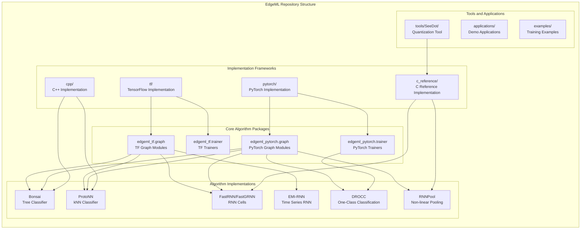
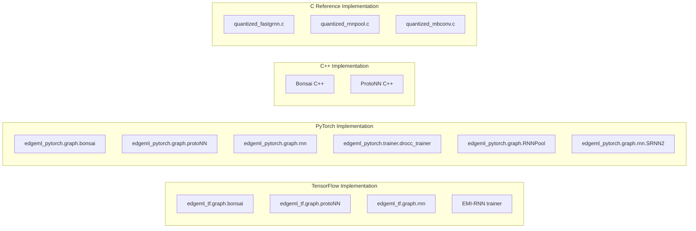
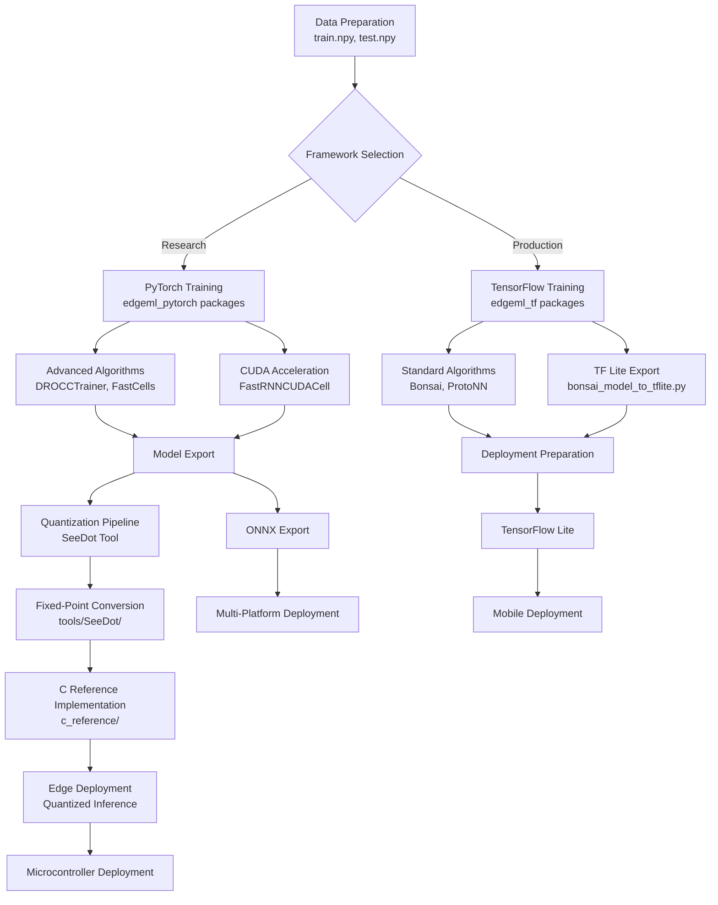
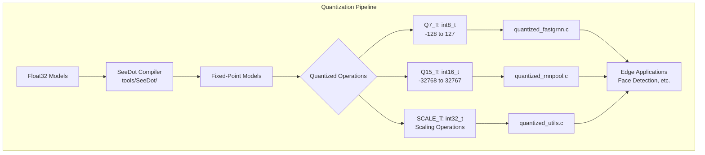

<!-- source: DeepWiki mcp.deepwiki.com · repo microsoft/EdgeML · page 1 Overview · fetched 2026-10-26 -->

# Overview

Relevant source files

The following files were used as context for generating this wiki page:

- [README.md](README.md)
- [examples/pytorch/DROCC/README.md](examples/pytorch/DROCC/README.md)
- [examples/pytorch/DROCC/data_process_scripts/process_cifar.py](examples/pytorch/DROCC/data_process_scripts/process_cifar.py)
- [examples/pytorch/DROCC/data_process_scripts/process_mnist.py](examples/pytorch/DROCC/data_process_scripts/process_mnist.py)
- [examples/pytorch/DROCC/main_cifar.py](examples/pytorch/DROCC/main_cifar.py)
- [examples/pytorch/DROCC/main_drocclf_mnist.py](examples/pytorch/DROCC/main_drocclf_mnist.py)
- [examples/pytorch/DROCC/main_tabular.py](examples/pytorch/DROCC/main_tabular.py)
- [examples/pytorch/DROCC/main_timeseries.py](examples/pytorch/DROCC/main_timeseries.py)
- [pytorch/README.md](pytorch/README.md)
- [pytorch/edgeml_pytorch/trainer/drocc_trainer.py](pytorch/edgeml_pytorch/trainer/drocc_trainer.py)
- [pytorch/edgeml_pytorch/trainer/drocclf_trainer.py](pytorch/edgeml_pytorch/trainer/drocclf_trainer.py)
- [tf/README.md](tf/README.md)

This document provides a comprehensive overview of the EdgeML repository, which contains machine learning algorithms optimized for resource-constrained edge devices. EdgeML was developed at Microsoft Research India to enable real-time predictions on IoT devices and edge computing platforms with minimal storage, computation, and energy requirements.

For specific training examples and usage instructions, see [Training and Examples](#4). For detailed algorithm implementations, see [Core Algorithms](#2). For deployment and quantization processes, see [Deployment and Optimization](#5).

## Purpose and Scope

EdgeML addresses the challenge of deploying machine learning models on devices with severe resource constraints. The repository provides algorithms that can train models requiring orders of magnitude less memory than conventional ML approaches while maintaining competitive accuracy. These models are designed to fit in kilobytes and run efficiently on microcontrollers, IoT sensors, and edge devices without cloud connectivity.

Sources: [README.md:1-27]()

## System Architecture

The EdgeML ecosystem consists of multiple implementation frameworks, core algorithms, and deployment tools that work together to provide a complete pipeline from training to edge deployment.

### Overall Architecture

Sources: [README.md:36-45](), [tf/README.md:1-15](), [pytorch/README.md:1-40]()

## Core Algorithms

EdgeML provides several specialized algorithms designed for resource efficiency:

| Algorithm | Purpose | Key Features | Implementations |
|-----------|---------|--------------|-----------------|
| **Bonsai** | Tree-based classification | Shallow non-linear trees | `tf/`, `pytorch/`, `cpp/` |
| **ProtoNN** | Prototype-based kNN | Efficient nearest neighbor | `tf/`, `pytorch/`, `cpp/` |
| **FastRNN/FastGRNN** | Recurrent neural networks | Low-rank parameterization, CUDA acceleration | `tf/`, `pytorch/`, `c_reference/` |
| **DROCC** | One-class classification | Deep robust anomaly detection | `pytorch/` only |
| **EMI-RNN** | Time series analysis | Early prediction for RNNs | `tf/` |
| **RNNPool** | Non-linear pooling | RAM-constrained inference | `pytorch/`, `c_reference/` |

### Algorithm Availability Matrix

Sources: [tf/README.md:3-10](), [pytorch/README.md:8-39](), [README.md:14-21]()

## Implementation Frameworks

### Framework Capabilities

Each implementation framework serves different use cases:

- **TensorFlow** (`tf/`): Production deployment with TensorFlow Lite export support
- **PyTorch** (`pytorch/`): Research and development with the most complete algorithm coverage
- **C++** (`cpp/`): High-performance training and inference for Bonsai and ProtoNN
- **C Reference** (`c_reference/`): Quantized inference optimized for microcontrollers

### PyTorch Implementation Highlights

The PyTorch implementation provides the most comprehensive algorithm support, including:

- `FastRNNCUDACell` and `FastGRNNCUDACell` for GPU acceleration
- `DROCCTrainer` class for one-class classification training
- `SRNN2` meta-architecture for streaming data
- Full ONNX export compatibility

Sources: [pytorch/README.md:18-27](), [pytorch/edgeml_pytorch/trainer/drocc_trainer.py:10-35]()

## Training to Deployment Pipeline

The EdgeML system supports a complete pipeline from model training to edge deployment:

Sources: [README.md:29-30](), [README.md:36-45]()

## Quantization and Edge Optimization

EdgeML provides a sophisticated quantization pipeline through the SeeDot tool:

### Quantization Data Types

The C reference implementation provides highly optimized quantized operations for:
- `quantized_fastgrnn.c` - Quantized FastGRNN cells
- `quantized_rnnpool.c` - Quantized RNNPool operations  
- `quantized_mbconv.c` - Quantized MBConv blocks
- `quantized_utils.c` - Supporting quantized utilities

Sources: [README.md:29-30](), [README.md:44]()

## Getting Started

To begin using EdgeML:

1. **Choose Implementation Framework**: Select between TensorFlow (`tf/`) for production deployment or PyTorch (`pytorch/`) for research and development
2. **Install Dependencies**: Follow framework-specific installation instructions in respective README files
3. **Select Algorithm**: Choose from Bonsai, ProtoNN, FastCells, DROCC, or other algorithms based on your use case
4. **Train Model**: Use provided examples in `examples/tf/` or `examples/pytorch/`
5. **Deploy**: Export to TensorFlow Lite, ONNX, or use SeeDot quantization for edge deployment

For detailed installation instructions, see [Development Setup](#6). For algorithm-specific guidance, see [Core Algorithms](#2).

Sources: [tf/README.md:16-33](), [pytorch/README.md:44-74](), [README.md:46]()

---

