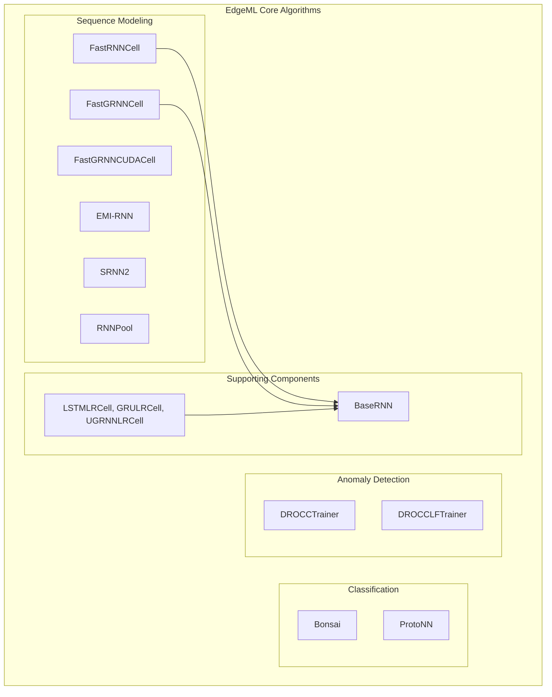
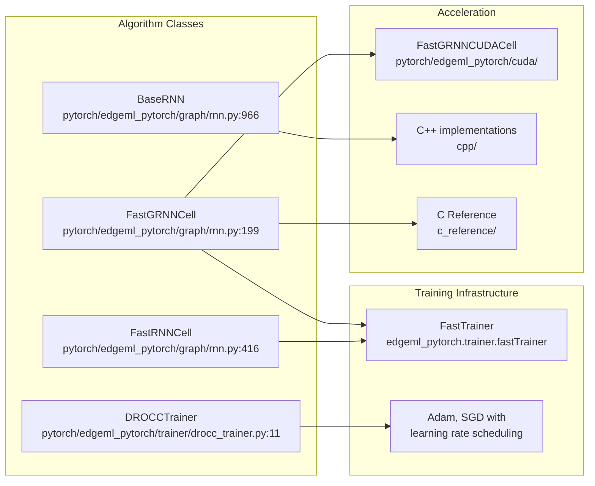
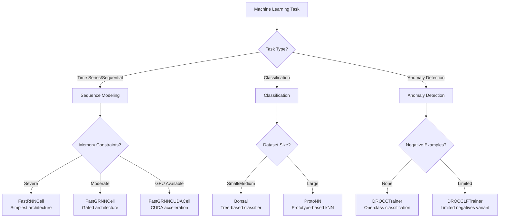
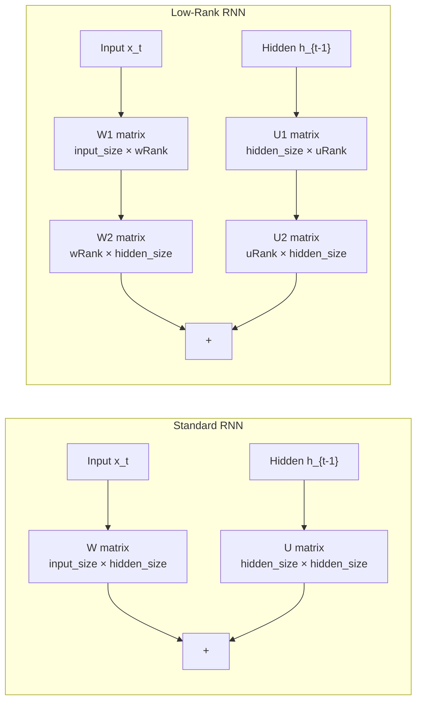

<!-- source: DeepWiki mcp.deepwiki.com · repo microsoft/EdgeML · page 2 Core Algorithms · fetched 2026-10-26 -->

# Core Algorithms

Relevant source files

The following files were used as context for generating this wiki page:

- [README.md](README.md)
- [examples/pytorch/DROCC/README.md](examples/pytorch/DROCC/README.md)
- [examples/pytorch/DROCC/data_process_scripts/process_cifar.py](examples/pytorch/DROCC/data_process_scripts/process_cifar.py)
- [examples/pytorch/DROCC/data_process_scripts/process_mnist.py](examples/pytorch/DROCC/data_process_scripts/process_mnist.py)
- [examples/pytorch/DROCC/main_cifar.py](examples/pytorch/DROCC/main_cifar.py)
- [examples/pytorch/DROCC/main_drocclf_mnist.py](examples/pytorch/DROCC/main_drocclf_mnist.py)
- [examples/pytorch/DROCC/main_tabular.py](examples/pytorch/DROCC/main_tabular.py)
- [examples/pytorch/DROCC/main_timeseries.py](examples/pytorch/DROCC/main_timeseries.py)
- [examples/pytorch/FastCells/fastcell_example.py](examples/pytorch/FastCells/fastcell_example.py)
- [examples/pytorch/FastCells/helpermethods.py](examples/pytorch/FastCells/helpermethods.py)
- [pytorch/README.md](pytorch/README.md)
- [pytorch/edgeml_pytorch/cuda/fastgrnn_cuda.cpp](pytorch/edgeml_pytorch/cuda/fastgrnn_cuda.cpp)
- [pytorch/edgeml_pytorch/cuda/fastgrnn_cuda_kernel.cu](pytorch/edgeml_pytorch/cuda/fastgrnn_cuda_kernel.cu)
- [pytorch/edgeml_pytorch/cuda/setup.py](pytorch/edgeml_pytorch/cuda/setup.py)
- [pytorch/edgeml_pytorch/graph/rnn.py](pytorch/edgeml_pytorch/graph/rnn.py)
- [pytorch/edgeml_pytorch/trainer/drocc_trainer.py](pytorch/edgeml_pytorch/trainer/drocc_trainer.py)
- [pytorch/edgeml_pytorch/trainer/drocclf_trainer.py](pytorch/edgeml_pytorch/trainer/drocclf_trainer.py)
- [pytorch/edgeml_pytorch/utils.py](pytorch/edgeml_pytorch/utils.py)
- [pytorch/setup.py](pytorch/setup.py)
- [tf/README.md](tf/README.md)

This document provides an overview of the machine learning algorithms implemented in EdgeML, their characteristics, and implementation architecture. These algorithms are specifically designed for resource-constrained edge devices with emphasis on model size, inference speed, and energy efficiency.

For detailed algorithm-specific documentation, see: [DROCC](#2.1), [FastCells](#2.2), [Bonsai and ProtoNN](#2.3), and [Other Algorithms](#2.4). For training examples and usage, see [Training and Examples](#4). For deployment considerations, see [Deployment and Optimization](#5).

## Algorithm Categories

EdgeML implements algorithms across three main categories, each targeting different machine learning paradigms while maintaining resource efficiency:

**Sources:** [README.md:14-21](), [pytorch/edgeml_pytorch/graph/rnn.py:966-1043]()

## Key Algorithm Characteristics

All EdgeML algorithms share common design principles optimized for edge deployment:

| Characteristic | Implementation | Benefit |
|---|---|---|
| **Low-Rank Parameterization** | `wRank`, `uRank` parameters in RNN cells | Reduces parameter count |
| **Sparsity Control** | `wSparsity`, `uSparsity` with `hardThreshold()` | Further compression |
| **Quantization Support** | Fixed-point arithmetic via SeeDot | Memory and compute efficiency |
| **Custom Non-linearities** | `quantTanh`, `quantSigm` in `gen_nonlinearity()` | Hardware-friendly activations |

**Sources:** [pytorch/edgeml_pytorch/graph/rnn.py:76-143](), [pytorch/edgeml_pytorch/utils.py:73-84]()

## Implementation Architecture

The EdgeML codebase implements algorithms across multiple frameworks with consistent interfaces:

**Sources:** [pytorch/edgeml_pytorch/graph/rnn.py:199-318](), [examples/pytorch/FastCells/fastcell_example.py:84-86](), [pytorch/edgeml_pytorch/cuda/setup.py:7-18]()

## Framework Support Matrix

Different algorithms have varying levels of support across EdgeML's implementation frameworks:

| Algorithm | PyTorch | TensorFlow | C++ | C Reference | CUDA |
|---|---|---|---|---|---|
| **FastGRNN** | ✓ `FastGRNNCell` | ✓ | ✗ | ✓ `quantized_fastgrnn.c` | ✓ `FastGRNNCUDACell` |
| **FastRNN** | ✓ `FastRNNCell` | ✓ | ✗ | ✗ | ✗ |
| **DROCC** | ✓ `DROCCTrainer` | ✗ | ✗ | ✗ | ✗ |
| **Bonsai** | ✓ | ✓ | ✓ | ✗ | ✗ |
| **ProtoNN** | ✓ | ✓ | ✓ | ✗ | ✗ |
| **RNNPool** | ✓ | ✗ | ✗ | ✓ `quantized_rnnpool.c` | ✗ |

**Sources:** [README.md:36-44](), [pytorch/README.md:18-39](), [tf/README.md:5-11]()

## Algorithm Selection Guide

Choose algorithms based on your specific use case and constraints:

**Sources:** [README.md:14-21](), [pytorch/edgeml_pytorch/trainer/drocc_trainer.py:11-34](), [pytorch/edgeml_pytorch/trainer/drocclf_trainer.py:185-210]()

## Low-Rank Parameterization

A key innovation across EdgeML algorithms is low-rank matrix decomposition to reduce model parameters:

**Sources:** [pytorch/edgeml_pytorch/graph/rnn.py:253-263](), [pytorch/edgeml_pytorch/graph/rnn.py:280-291]()

---

