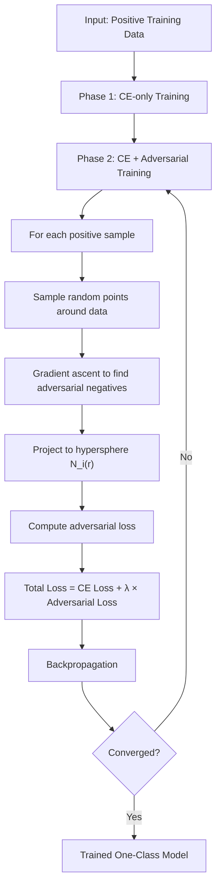
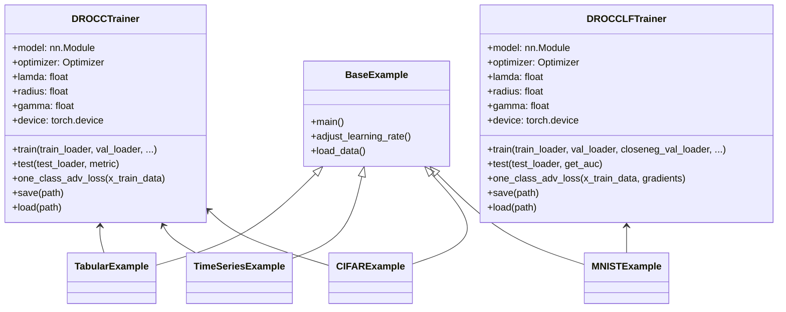
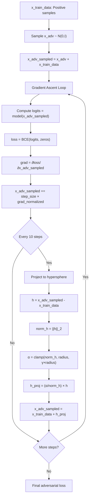
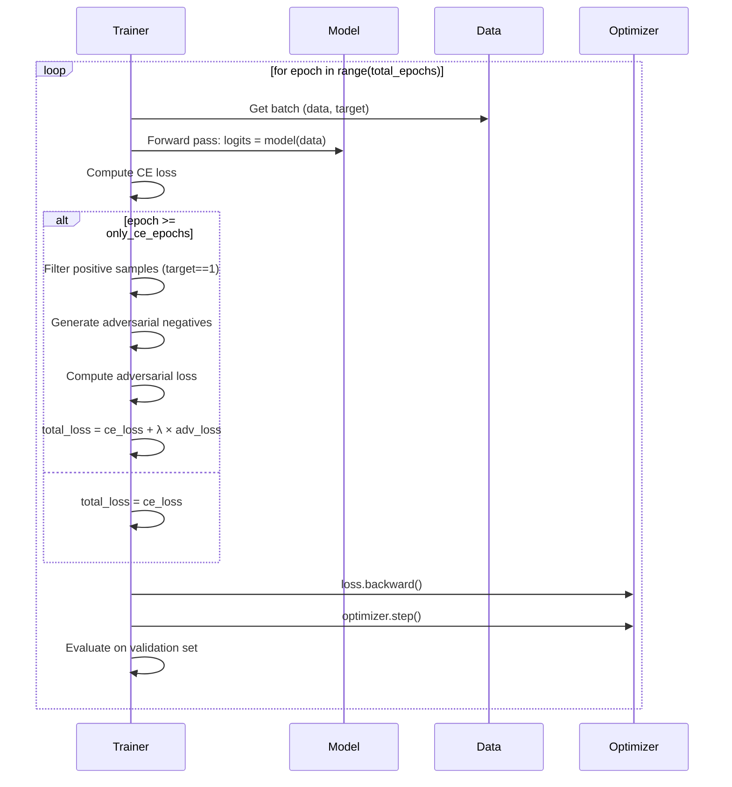
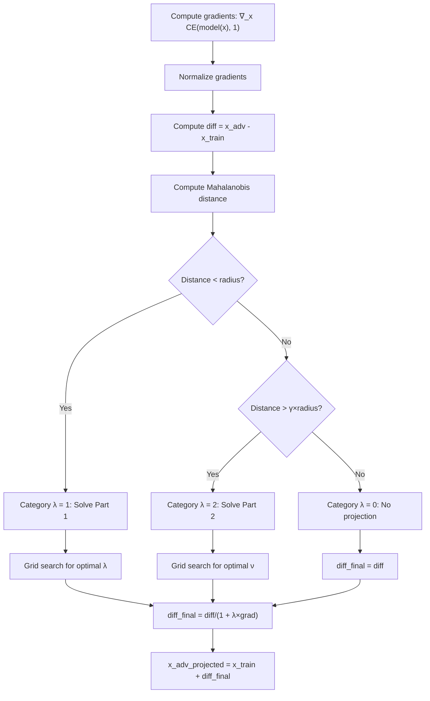
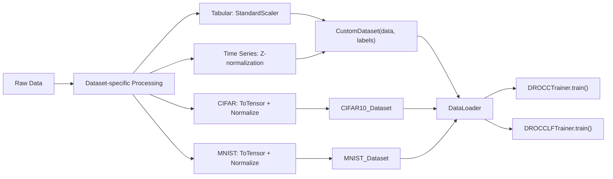

<!-- source: DeepWiki mcp.deepwiki.com · repo microsoft/EdgeML · page 2.1 DROCC - Deep Robust One-Class Classification · fetched 2026-10-26 -->

# DROCC - Deep Robust One-Class Classification

<details>
<summary>Relevant source files</summary>

The following files were used as context for generating this wiki page:

- [README.md](README.md)
- [examples/pytorch/DROCC/README.md](examples/pytorch/DROCC/README.md)
- [examples/pytorch/DROCC/data_process_scripts/process_cifar.py](examples/pytorch/DROCC/data_process_scripts/process_cifar.py)
- [examples/pytorch/DROCC/data_process_scripts/process_mnist.py](examples/pytorch/DROCC/data_process_scripts/process_mnist.py)
- [examples/pytorch/DROCC/main_cifar.py](examples/pytorch/DROCC/main_cifar.py)
- [examples/pytorch/DROCC/main_drocclf_mnist.py](examples/pytorch/DROCC/main_drocclf_mnist.py)
- [examples/pytorch/DROCC/main_tabular.py](examples/pytorch/DROCC/main_tabular.py)
- [examples/pytorch/DROCC/main_timeseries.py](examples/pytorch/DROCC/main_timeseries.py)
- [pytorch/README.md](pytorch/README.md)
- [pytorch/edgeml_pytorch/trainer/drocc_trainer.py](pytorch/edgeml_pytorch/trainer/drocc_trainer.py)
- [pytorch/edgeml_pytorch/trainer/drocclf_trainer.py](pytorch/edgeml_pytorch/trainer/drocclf_trainer.py)
- [tf/README.md](tf/README.md)

</details>


## Purpose and Scope

This document covers the DROCC (Deep Robust One-Class Classification) algorithm implementation in EdgeML. DROCC is designed for training robust anomaly detectors and one-class classifiers that can handle adversarial examples and provide better generalization. The implementation includes both the standard DROCC algorithm and the DROCC-LF (Limited Feedback) variant for scenarios with limited negative samples.

For information about other anomaly detection approaches, see other algorithms in [Core Algorithms](#2). For training examples and practical usage, see [PyTorch Training Examples](#4.1).

## Algorithm Overview

DROCC addresses the challenge of training robust one-class classifiers by incorporating adversarial training. The key innovation is generating adversarial negative samples around positive training data points and using them to improve model robustness.

### DROCC Training Pipeline



**Sources:** [pytorch/edgeml_pytorch/trainer/drocc_trainer.py:36-117](), [examples/pytorch/DROCC/README.md:1-93]()

### Core Components

The DROCC implementation consists of two main trainer classes and supporting utilities:



**Sources:** [pytorch/edgeml_pytorch/trainer/drocc_trainer.py:11-221](), [pytorch/edgeml_pytorch/trainer/drocclf_trainer.py:185-411]()

## DROCC Algorithm Implementation

### DROCCTrainer Class

The `DROCCTrainer` class implements the standard DROCC algorithm with the following key parameters:

| Parameter | Description | Typical Range |
|-----------|-------------|---------------|
| `lamda` | Weight for adversarial loss (μ in paper) | 0.5 - 2.0 |
| `radius` | Radius for hypersphere sampling | 2.5 - 16 |
| `gamma` | Projection parameter (radius multiplier) | 1.0 - 2.0 |
| `ascent_step_size` | Step size for gradient ascent | 0.001 - 0.1 |
| `ascent_num_steps` | Number of ascent steps | 50 - 100 |

**Sources:** [pytorch/edgeml_pytorch/trainer/drocc_trainer.py:17-34](), [examples/pytorch/DROCC/README.md:84-93]()

### Adversarial Loss Computation

The adversarial loss generation follows this process:



**Sources:** [pytorch/edgeml_pytorch/trainer/drocc_trainer.py:158-214]()

### Training Process

The training combines cross-entropy loss with adversarial loss:



**Sources:** [pytorch/edgeml_pytorch/trainer/drocc_trainer.py:59-117]()

## DROCC-LF Algorithm Implementation

### DROCCLFTrainer Class

The `DROCCLFTrainer` extends DROCC for scenarios with limited negative feedback. Key differences include:

- Uses Mahalanobis distance for projection instead of Euclidean distance
- Solves a non-convex optimization problem for projection
- Evaluates performance using precision/recall at fixed false positive rates

**Sources:** [pytorch/edgeml_pytorch/trainer/drocclf_trainer.py:185-210]()

### Mahalanobis Distance Projection



**Sources:** [pytorch/edgeml_pytorch/trainer/drocclf_trainer.py:112-161](), [pytorch/edgeml_pytorch/trainer/drocclf_trainer.py:40-97]()

## Usage Examples

### Model Architectures

Different example scripts demonstrate DROCC with various model architectures:

| Data Type | Model Class | Architecture | Example Script |
|-----------|-------------|--------------|----------------|
| Tabular | `MLP` | Single hidden layer + ReLU | `main_tabular.py` |
| Time Series | `LSTM_FC` | Single LSTM + FC layer | `main_timeseries.py` |
| Images (CIFAR) | `CIFAR10_LeNet` | 3 Conv + 3 FC layers | `main_cifar.py` |
| Images (MNIST) | `MNIST_LeNet` | 2 Conv + 2 FC layers | `main_drocclf_mnist.py` |

**Sources:** [examples/pytorch/DROCC/main_tabular.py:14-38](), [examples/pytorch/DROCC/main_timeseries.py:13-39](), [examples/pytorch/DROCC/main_cifar.py:14-43](), [examples/pytorch/DROCC/main_drocclf_mnist.py:14-37]()

### Data Processing Pipeline



**Sources:** [examples/pytorch/DROCC/main_tabular.py:81-99](), [examples/pytorch/DROCC/main_timeseries.py:78-98](), [examples/pytorch/DROCC/data_process_scripts/process_cifar.py:51-82](), [examples/pytorch/DROCC/data_process_scripts/process_mnist.py:51-77]()

### Learning Rate Scheduling

All examples implement custom learning rate scheduling functions:

```python
def adjust_learning_rate(epoch, total_epochs, only_ce_epochs, learning_rate, optimizer):
    # Adjust learning rate based on training phase
    epoch = epoch - only_ce_epochs
    drocc_epochs = total_epochs - only_ce_epochs
    
    # Different decay schedules for different datasets
    if epoch <= drocc_epochs:
        lr = learning_rate * decay_factor
    # Additional conditions based on epoch fractions
```

**Sources:** [examples/pytorch/DROCC/main_tabular.py:40-66](), [examples/pytorch/DROCC/main_timeseries.py:54-76](), [examples/pytorch/DROCC/main_cifar.py:45-69]()

## Evaluation Metrics

### Standard DROCC

The standard `DROCCTrainer` supports two evaluation metrics:

- **AUC**: Area Under the ROC Curve
- **F1**: F1-score using 20th percentile threshold

**Sources:** [pytorch/edgeml_pytorch/trainer/drocc_trainer.py:147-155]()

### DROCC-LF

The `DROCCLFTrainer` uses precision and recall at fixed false positive rates:

- **Precision @ FPR 3%**: Precision when false positive rate is 3%
- **Recall @ FPR 3%**: Recall when false positive rate is 3%
- **Precision @ FPR 5%**: Precision when false positive rate is 5%
- **Recall @ FPR 5%**: Recall when false positive rate is 5%

The `cal_precision_recall()` function computes these metrics by combining far negative and close negative scores to determine appropriate thresholds.

**Sources:** [pytorch/edgeml_pytorch/trainer/drocclf_trainer.py:10-25](), [examples/pytorch/DROCC/main_drocclf_mnist.py:144-149]()

## Integration with EdgeML

DROCC is implemented as part of the PyTorch implementation of EdgeML and follows the same patterns as other algorithms:

- Trainer classes are in `edgeml_pytorch.trainer` module
- Examples demonstrate usage with different data types
- Models can be saved/loaded using standard PyTorch state dictionaries
- Compatible with CUDA acceleration when available

The implementation supports the EdgeML philosophy of resource-efficient machine learning by providing configurable model architectures and training procedures suitable for edge deployment scenarios.

**Sources:** [pytorch/README.md:31-34](), [pytorch/edgeml_pytorch/trainer/drocc_trainer.py:216-221](), [examples/pytorch/DROCC/README.md:4-10]()

---

