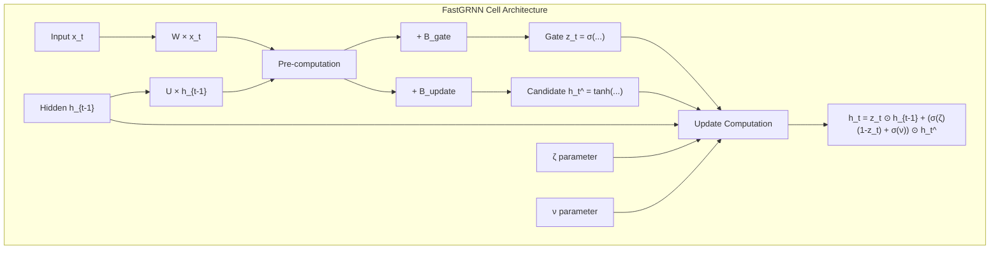
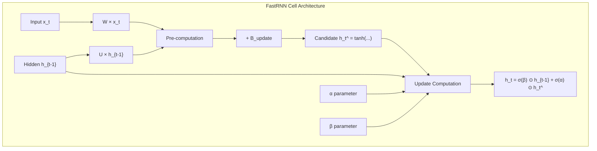
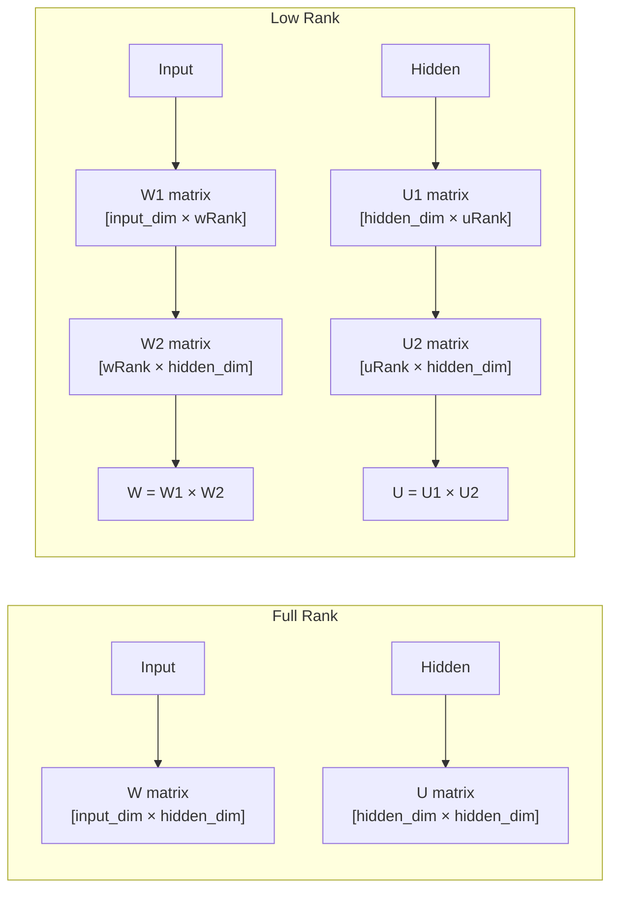
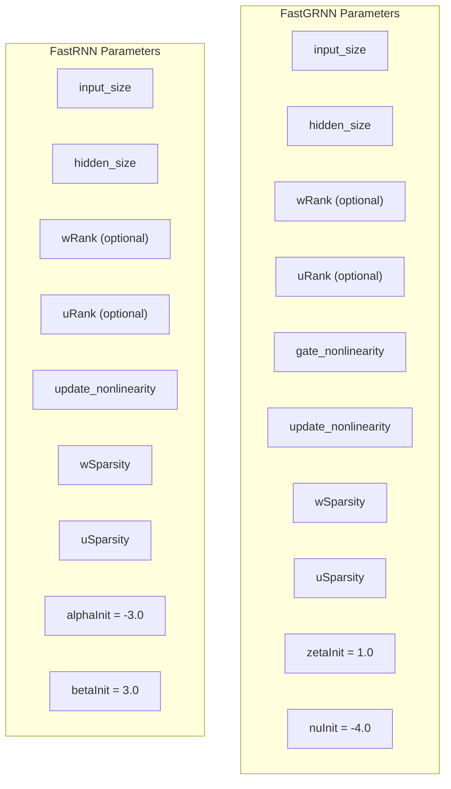
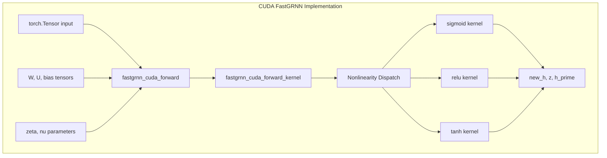
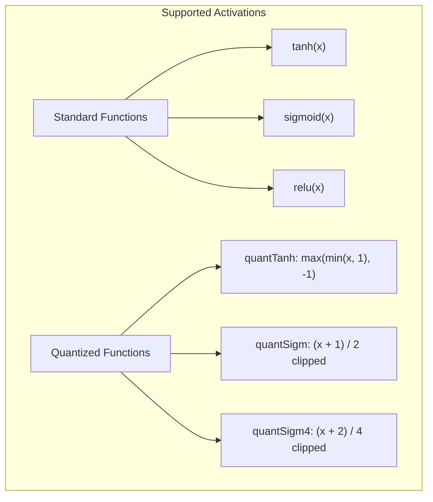

<!-- source: DeepWiki mcp.deepwiki.com · repo microsoft/EdgeML · page 2.2 FastCells - FastRNN and FastGRNN · fetched 2026-10-26 -->

# FastCells - FastRNN and FastGRNN

<details>
<summary>Relevant source files</summary>

The following files were used as context for generating this wiki page:

- [c_reference/Makefile](c_reference/Makefile)
- [c_reference/README.md](c_reference/README.md)
- [c_reference/config.mk](c_reference/config.mk)
- [c_reference/include/classifier.h](c_reference/include/classifier.h)
- [c_reference/include/fastgrnn.h](c_reference/include/fastgrnn.h)
- [c_reference/include/utils.h](c_reference/include/utils.h)
- [c_reference/src/classifier.c](c_reference/src/classifier.c)
- [c_reference/src/utils.c](c_reference/src/utils.c)
- [c_reference/tests/fastgrnn/test_fastgrnn_lr.c](c_reference/tests/fastgrnn/test_fastgrnn_lr.c)
- [c_reference/tests/rnnpool/test_rnnpool.c](c_reference/tests/rnnpool/test_rnnpool.c)
- [examples/pytorch/FastCells/fastcell_example.py](examples/pytorch/FastCells/fastcell_example.py)
- [examples/pytorch/FastCells/helpermethods.py](examples/pytorch/FastCells/helpermethods.py)
- [pytorch/edgeml_pytorch/cuda/fastgrnn_cuda.cpp](pytorch/edgeml_pytorch/cuda/fastgrnn_cuda.cpp)
- [pytorch/edgeml_pytorch/cuda/fastgrnn_cuda_kernel.cu](pytorch/edgeml_pytorch/cuda/fastgrnn_cuda_kernel.cu)
- [pytorch/edgeml_pytorch/cuda/setup.py](pytorch/edgeml_pytorch/cuda/setup.py)
- [pytorch/edgeml_pytorch/graph/rnn.py](pytorch/edgeml_pytorch/graph/rnn.py)
- [pytorch/edgeml_pytorch/utils.py](pytorch/edgeml_pytorch/utils.py)
- [pytorch/setup.py](pytorch/setup.py)

</details>


## Purpose and Scope

This document covers the FastCells family of algorithms in EdgeML, specifically FastRNN and FastGRNN (Fast Gated Recurrent Neural Network). These are resource-efficient RNN architectures designed for edge devices that achieve competitive accuracy while using significantly fewer parameters than standard RNNs through low-rank parameterization and sparsity techniques.

For information about other RNN architectures like EMI-RNN and SRNN, see [Other Algorithms](#2.4). For deployment and quantization of FastCells, see [Quantization Pipeline](#5.1).

## Architecture Overview

FastCells implement gated recurrent architectures with the following key innovations:

### FastGRNN Architecture

FastGRNN uses a simplified gating mechanism compared to standard GRU/LSTM:



**Sources:** [pytorch/edgeml_pytorch/graph/rnn.py:199-318](), [c_reference/include/fastgrnn.h:27-40]()

### FastRNN Architecture

FastRNN uses an even simpler update mechanism without explicit gating:



**Sources:** [pytorch/edgeml_pytorch/graph/rnn.py:416-531]()

## Low-Rank Parameterization

Both FastRNN and FastGRNN support low-rank matrix factorization to reduce parameters:



**Sources:** [pytorch/edgeml_pytorch/graph/rnn.py:245-263](), [c_reference/include/fastgrnn.h:14-26]()

## Implementation Variants

### PyTorch Implementation

| Class | Description | Key Features |
|-------|-------------|--------------|
| `FastGRNNCell` | Standard FastGRNN implementation | Full/low-rank, multiple activations, sparsity |
| `FastRNNCell` | Simplified FastRNN variant | No explicit gating, lighter computation |
| `FastGRNNCUDACell` | CUDA-accelerated FastGRNN | GPU optimization, forward/backward kernels |
| `BaseRNN` | RNN wrapper for sequence processing | Bidirectional support, batch handling |

### Parameter Configuration



**Sources:** [pytorch/edgeml_pytorch/graph/rnn.py:235-251](), [pytorch/edgeml_pytorch/graph/rnn.py:449-466]()

### CUDA Acceleration

The CUDA implementation provides significant speedup for GPU training:



**Sources:** [pytorch/edgeml_pytorch/cuda/fastgrnn_cuda_kernel.cu:42-60](), [pytorch/edgeml_pytorch/cuda/fastgrnn_cuda.cpp:72-106]()

### C Reference Implementation

The C implementation provides quantized inference for deployment:

| Structure | Purpose | Key Fields |
|-----------|---------|------------|
| `FastGRNN_Params` | Model parameters | `W`, `U`, `Bg`, `Bh`, `sigmoid_zeta`, `sigmoid_nu` |
| `FastGRNN_LR_Params` | Low-rank parameters | `W1`, `W2`, `U1`, `U2`, `wRank`, `uRank` |
| `FastGRNN_Buffers` | Computation buffers | `preComp`, `normFeatures` |
| `FastGRNN_LR_Buffers` | Low-rank buffers | `tempLRW`, `tempLRU` |

**Sources:** [c_reference/include/fastgrnn.h:88-107](), [c_reference/include/fastgrnn.h:27-54]()

## Activation Functions

FastCells support multiple activation functions optimized for quantization:



**Sources:** [pytorch/edgeml_pytorch/graph/rnn.py:46-74](), [c_reference/src/utils.c:16-37]()

## Training and Usage

### Basic Training Setup

```python
# Initialize FastGRNN cell
cell = FastGRNNCell(
    input_size=inputDims, 
    hidden_size=hiddenDims,
    gate_nonlinearity="sigmoid",
    update_nonlinearity="tanh",
    wRank=wRank,  # Optional low-rank
    uRank=uRank   # Optional low-rank
)

# Wrap in BaseRNN for sequence processing
rnn = BaseRNN(cell, batch_first=False)

# Training with FastTrainer
trainer = FastTrainer(cell, numClasses, 
                     sW=sparsity_W, sU=sparsity_U)
```

**Sources:** [examples/pytorch/FastCells/fastcell_example.py:55-86]()

### Sparsification Process

FastCells implement structured sparsification during training:


**Sources:** [pytorch/edgeml_pytorch/graph/rnn.py:172-198](), [pytorch/edgeml_pytorch/utils.py:73-101]()

## Model Export and Deployment

FastCells can be exported to multiple formats:

| Target | Method | Key Features |
|--------|--------|--------------|
| ONNX | `onnx_exportable_rnn()` | Cross-platform deployment |
| TensorFlow Lite | TF conversion | Mobile optimization |
| C Reference | Parameter export | Quantized inference |
| CUDA Inference | GPU deployment | Real-time processing |

**Sources:** [pytorch/edgeml_pytorch/graph/rnn.py:25-44]()

## Performance Characteristics

FastCells achieve efficiency through:

1. **Parameter Reduction**: Low-rank factorization reduces W and U matrices
2. **Sparsity**: Structured pruning removes unnecessary connections  
3. **Simplified Gates**: Fewer operations than LSTM/GRU
4. **Quantization Ready**: Support for fixed-point arithmetic
5. **Hardware Acceleration**: CUDA kernels for GPU deployment

The `get_model_size()` method estimates memory footprint based on non-zero parameters and sparsity patterns.

**Sources:** [pytorch/edgeml_pytorch/graph/rnn.py:149-170](), [pytorch/edgeml_pytorch/utils.py:104-134]()

---

